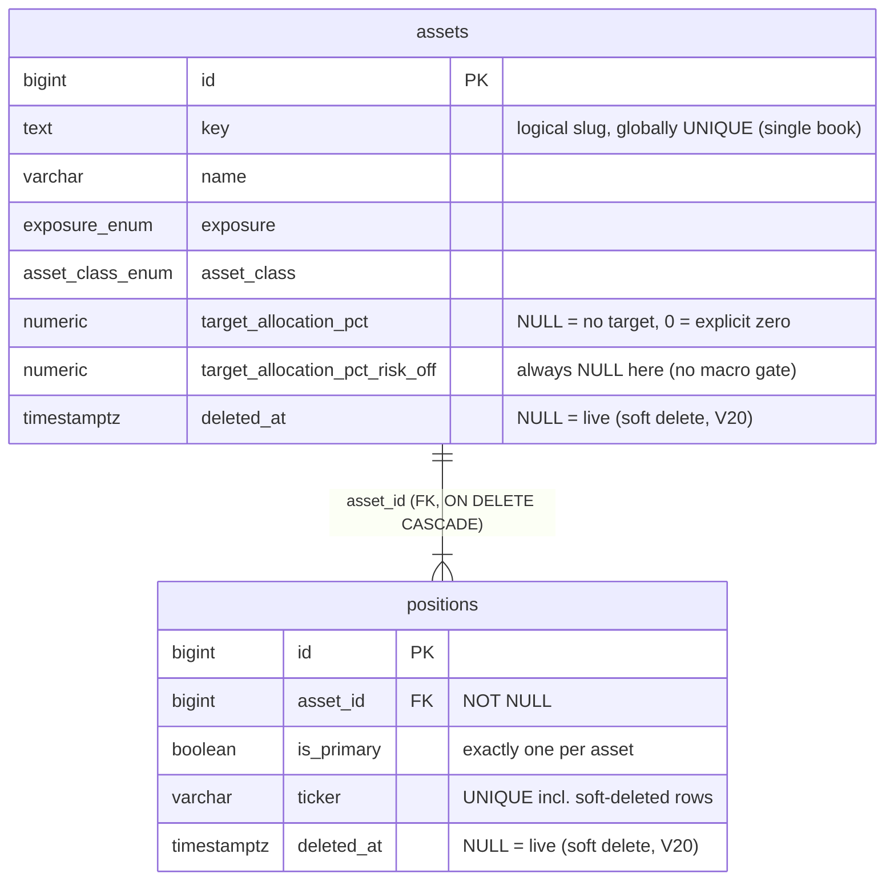

# Architecture — portfolio-b

## System topology

```
Browser → Nginx (/portfolio-b/) → React SPA (Vite, port 5173 in dev)
                           → /portfolio-b/api/ → backend-go-portfolio-b (Go, port 8092, internal only)
                                          → PostgreSQL (db-shared, database `portfolio-b`)
```

- Runs on Raspberry Pi alongside investing-app, behind same Nginx + Tailscale VPN
- Single user, no auth
- All in Docker Compose (`infra/compose.yml`)

## Tech stack

| Layer | Technology |
|---|---|
| Backend | Go 1.27 (chi, pgx v5, sqlc, oapi-codegen), Flyway CLI runner (one-shot compose service), common code in `packages/common/go/common-go` |
| Database | PostgreSQL 17 |
| Frontend | React 19, TypeScript 5, Vite 6, Tailwind v4, shadcn/ui, TanStack Query v5 |
| Common | `@common/*` packages (Axios singleton with per-app baseURL, auth, envelope, shadcn/ui) + per-app API clients/Zod schemas in `frontend-web/src/api/` (the old `@portfolio-b/shared` workspace was deleted by task 158) |

## Database schema

| Table | Purpose |
|---|---|
| `assets` | **Logical assets** (Bitcoin, Gold, Nasdaq 100, or a single fund) — the aggregate root that carries the target allocation, name, exposure and asset class (task 156, V18). See "Asset / Subasset model" below |
| `positions` | **Subassets**: one concrete holding (ticker) per row, each belonging to exactly one asset via `asset_id`; per-account unit columns (ike_tata, ike_mama, ikze_tata, ikze_mama, inne). No target column — targets live on `assets` |
| `deposits` | Capital deposits per account_type (IKE_TATA/IKE_MAMA/IKZE_TATA/IKZE_MAMA/INNE), all PLN |
| `historia` | Daily portfolio value snapshots used for XIRR chart |
| `price_cache` | Yahoo Finance + Binance price cache per ticker |
| `fx_rate_cache` | EUR/USD/GBP/CHF → PLN exchange rate cache |
| `settings` | Key/value config: `monthly_contribution_pln`, `ike_annual_limit_pln`, `ikze_annual_limit_pln` |
| `account_cash_snapshot` | **Single-row** (id=1) — free cash per account ready to invest. Fields: ike_tata, ike_mama, ikze_tata, ikze_mama, updated_at, update_reason ('MANUAL' \| 'POST_PURCHASE') |
| `purchase_lots` | Purchase history — one row per (confirm session, ticker). Written inside `confirm()`. Frozen cost basis (`cost_pln = units × price_pln`); current value computed live from `price_cache`, never stored. |
| `position_transfers` | Manual sell-assist ("1.5x trim") audit log — one row per leg (sold or bought) of a user-submitted sell+buy transaction. Written by `PositionTransferService.executeTransfer()`. Never read by target/deviation computation or the DCA calculator. |

### Asset / Subasset model (task 156, deployed 2026-09-24; Flyway V18 + V19)



The book is a list of **assets**; each asset groups one or more **subassets** (`positions` rows) and exactly one subasset is its **primary** — the default buy destination (partial `UNIQUE (asset_id) WHERE is_primary`). The **target allocation lives only on the asset**; a subasset has no target field. An asset's value is the sum of its subassets, and `currentPct`/`deviationPct` (including the ADR-053 zero-target sentinel) are computed on the asset. Live: 36 `positions` rows in 25 assets; e.g. **Nasdaq 100** (`key = nasdaq-100`, target 10.0) has primary `SXRV.DE` plus subassets `ETFBNDXPL` and `NQSE`; Bitcoin, Ethereum, Solana, XRP, Sui, Gold and Silver are likewise multi-subasset. Single-holding assets keep `key = ticker`; `assets.key` is an immutable label — never join on it, join on `asset_id`.

- **API.** `GET /positions` returns assets (subassets primary-first); `GET /positions/{id}` takes a **subasset** id and returns its parent asset. `POST /positions` creates a subasset under an existing asset (`assetId`) or a new one (`newAsset{…}` — its key is the subasset's ticker). `PUT /positions/{id}` edits subasset fields and may re-home a **non-primary** subasset via `assetId` (a primary answers `409 CONFLICT`). `DELETE /positions/{id}` (a soft delete since task 173): a primary with live siblings is `409`; the last live subasset soft-deletes its asset. `PUT /assets/{id}` is the only writer of targets (absent = unchanged, explicit `null` = clear, range 0..100, no Σ = 100 guard). `POST /assets/{id}/primary {subassetId}` is a pure relabel of two rows in one transaction (no units, cost or targets move) guarded by a Σ targets == 100 tripwire inside the transaction. Full contract: root `docs/architecture/03-api-contract.md` and this app's `docs/openapi.yaml`.
- **Soft delete (task 173, ADR-109; Flyway V20).** `assets.deleted_at` / `positions.deleted_at` (`TIMESTAMPTZ NULL`, `NULL` = live). `DELETE /assets/{id}` and `DELETE /positions/{id}` set it and never remove a row, so the history FKs from `purchase_lots` and `position_transfers` (`… REFERENCES positions(ticker)`) stay valid and never block a delete. Every current-holdings read (portfolio, Σ targets, calculator/confirm, transfer, XIRR, price refresh, today's historia snapshot) is live-only. History (purchase history, transfers, lots, historia backfill) still shows deleted assets. `POST /positions` with a deleted ticker restores the old row (same id, units, cost and history; only that subasset). Query-by-query list: root `docs/architecture/diagrams/173-asset-soft-delete.md` §5.2; schema rules: root `docs/architecture/04-db-schema.md` "Soft delete".
- **DCA calculator.** `POST /purchases/calculate` folds each asset's subasset values into one asset entry (`N_i`), so the proportional deficit is per asset; each buy item's `ticker` is the asset's primary and `availableTickers` lists all its subassets (primary first) for the UI's destination picker.
- **Profit.** An asset's `profitPct` is `Σvalue / Σcost − 1` (`positioncalc.GroupProfit`, corrected 2026-09-25): Σcost sums the recorded costs, Σvalue sums every priced subasset; a subasset without recorded cost (trades keep recorded cost current per the asset-level rule, but never invent one — an asset with no recorded cost stays untracked) adds its value but no cost, a costed-but-unpriced one contributes neither, and `profitPct` is `null` when no cost is recorded anywhere in the asset (the usual case here until the task 161 baselines exist).
- **History.** Migrated by a data-driven sweep (V18: every old main row → an asset + its primary; companions joined by exact parent-ticker equality; targets/class/exposure read from each group's live head; tripwires abort the deploy on any shape it cannot place) followed by V19, which drops `is_companion_row`, `companion_parent_ticker` and the positions target columns. Design and verification record: root `docs/architecture/diagrams/156-asset-subasset-model.md`.

### `purchase_lots` columns

| Column | Type | Notes |
|---|---|---|
| `id` | `BIGSERIAL` PK | |
| `session_id` | `UUID` NOT NULL | Groups all lots from one "Zatwierdź zakupy" click |
| `purchased_at` | `DATE` NOT NULL | `LocalDate.now()` at confirm |
| `ticker` | `VARCHAR(20)` NOT NULL | FK → `positions.ticker` |
| `units` | `NUMERIC(18,8)` NOT NULL | Total IKE/IKZE units bought across all accounts (INNE excluded), summed for this ticker in this session. `> 0` |
| `price_pln` | `NUMERIC(18,8)` NOT NULL | PLN price snapshot at confirm (same one `confirm()` uses for cash deduction). `> 0` |
| `cost_pln` | `NUMERIC(18,4)` NOT NULL | `units × price_pln`, scale 4 HALF_UP. `> 0` |
| `created_at` | `TIMESTAMPTZ` NOT NULL | `DEFAULT NOW()` |

Constraints: `UNIQUE (session_id, ticker)` (one aggregated lot per ticker per session); indexes on `session_id` and `purchased_at`. Account type is **not** stored — lots aggregate the per-account units of the same ticker in one confirm into a single row.

### `position_transfers` columns

| Column | Type | Notes |
|---|---|---|
| `id` | `BIGSERIAL` PK | |
| `transfer_id` | `UUID` NOT NULL | Groups all legs of one "Sprzedaj" submission |
| `ticker` | `VARCHAR(20)` NOT NULL | FK → `positions.ticker`; each leg names the position it moves units on |
| `account_type` | `account_type_enum` NOT NULL | `IKE_TATA` \| `IKE_MAMA` \| `IKZE_TATA` \| `IKZE_MAMA` \| `INNE` — unlike `purchase_lots`, account type **is** stored per leg (a sell and its buys can land in different accounts) |
| `units_delta` | `NUMERIC(18,8)` NOT NULL | Signed: negative for the sold leg, positive for each buy leg. `<> 0` |
| `price_pln` | `NUMERIC(18,8)` NOT NULL | PLN price snapshot at execution time, one per leg. `> 0` |
| `total_pln` | `NUMERIC(18,4)` NOT NULL | `units_delta × price_pln`, same sign as `units_delta` |
| `transferred_at` | `TIMESTAMPTZ` NOT NULL | When the transaction happened; `DEFAULT NOW()` |
| `created_at` | `TIMESTAMPTZ` NOT NULL | `DEFAULT NOW()` |

Constraints: `CHECK (units_delta <> 0)`, `CHECK (price_pln > 0)`; FK to `positions(ticker)`; indexes on `transfer_id` and `(ticker, transferred_at DESC)`. A transfer is exactly one sold leg (`units_delta < 0`) plus one-or-more buy legs (`units_delta > 0`) sharing a `transfer_id`; `PositionTransferService` validates that the sold leg has sufficient units and that the legs are cash-neutral before writing any rows — the table itself doesn't enforce cross-row invariants. This table is purely additive/audit and is never read by `PositionService`'s deviation computation or `RebalancingStrategy`'s DCA calculation. (The transfer that writes it does maintain `positions.total_spent_pln` through the asset-level cost rule — see "Manual sell-assist" step 4; `avg_buy_price` is never touched.)

## API controllers

| Controller | Path | Purpose |
|---|---|---|
| `PositionsController` | `/positions`, `/assets` | `GET /positions` lists **assets** (each with its `subassets[]`); `POST`/`PUT`/`DELETE /positions` create/edit/delete one subasset; `PUT`/`DELETE /assets/{id}` edit asset targets/name or delete an asset; `POST /assets/{id}/primary` changes the primary subasset |
| `DepositsController` | `/deposits` | CRUD for deposits + annual cap usage |
| `HistoriaController` | `/historia` | Portfolio history for charts |
| `MarketDataController` | `/market-data` | Price refresh from Yahoo/Binance |
| `SettingsController` | `/settings` | Key/value settings |
| `RebalancingController` | `/purchases` | DCA calc (`POST /purchases/calculate`), confirm (`POST /purchases/confirm`), **history (`GET /purchases/history`)** |
| `AccountCashController` | `/account-cash` | Cash snapshot: GET, PUT (manual), POST /deduct |
| `PositionTransferController` | `/position-transfers` | Manual sell-assist: `POST /position-transfers` executes a user-submitted sell+buy transaction |

## Purchase history (`GET /purchases/history`)

Returns purchase sessions newest-first, each with live-valued lots. Read-only; data is produced by `confirm()` (see below). Standard `{ data, meta }` envelope (`Meta.create()`).

**Response shape:**

```jsonc
{
  "data": {
    "sessions": [
      {
        "sessionId": "uuid",
        "purchasedAt": "2026-06-16",            // ISO date
        "totalCostPln": 4000.0000,              // Σ lot.costPln
        "totalCurrentValuePln": 4180.5000,      // Σ lot.currentValuePln (priced lots only)
        "totalGainPln": 180.5000,               // totalCurrentValuePln − totalCostPln
        "totalGainPct": 4.5125,                 // totalGainPln / totalCostPln × 100, null if totalCostPln = 0
        "lots": [
          {
            "ticker": "ETCGLDRMAU",
            "name": "iShares Physical Gold ETC",
            "units": 12.34000000,
            "pricePln": 250.12340000,           // snapshot at confirm
            "costPln": 3086.5228,               // units × pricePln (frozen)
            "currentPricePln": 261.00000000,    // live from price_cache; null if unavailable
            "currentValuePln": 3220.7400,       // units × currentPricePln; null if unavailable
            "gainPln": 134.2172,                // currentValuePln − costPln; null if unavailable
            "gainPct": 4.3486,                  // gainPln / costPln × 100; null if unavailable
            "priceAvailable": true
          }
        ]
      }
    ]
  },
  "meta": { "requestId": "uuid", "timestamp": "<instant>" }
}
```

**Valuation rules:**
- `currentPricePln` = live `PriceCache.getPricePln()` looked up via the lot's `positions.yahoo_ticker`. If the position has no `yahoo_ticker`, or no `price_cache` row, or `price_pln = 0` → `priceAvailable = false` and `currentPricePln`, `currentValuePln`, `gainPln`, `gainPct` are all `null`.
- Session totals (`totalCurrentValuePln`, `totalGainPln`, `totalGainPct`) sum **only priced lots** — unavailable lots contribute nothing to current value / gain (but their `costPln` still counts in `totalCostPln`). This intentionally understates gain rather than inventing a price.
- All math uses `BigDecimal`. Money scale 4 HALF_UP; percentages scale 4 HALF_UP. `gainPct` / `totalGainPct` are `null` when the denominator (`costPln` / `totalCostPln`) is 0.
- Ordering: sessions by `purchased_at DESC`, then `MIN(created_at) DESC` (newest confirm first); lots within a session by `ticker ASC`.

## `confirm()` writes purchase lots

`PurchaseConfirmService.confirm(ConfirmPurchasesRequest)` must, **in the same `@Transactional`**, persist purchase history alongside its existing work (unit updates, cash deduction, monthly deposit):

1. Generate **one** `session_id` (`UUID.randomUUID()`) per `confirm()` call. `purchasedAt = LocalDate.now()`.
2. For each request item (ticker): sum the units of its **IKE/IKZE allocations only** (`IKE_TATA`, `IKE_MAMA`, `IKZE_TATA`, `IKZE_MAMA`). **`INNE` allocations are excluded** (INNE is read-only, never tracked as a lot).
3. Reuse the **same `pricePln` snapshot** the method already computes for cash deduction.
4. **Skip the lot** (write nothing) if summed IKE/IKZE units `<= 0` **or** `pricePln <= 0`. The `CHECK (units > 0)` / `CHECK (price_pln > 0)` constraints enforce this. Rationale: a zero-price lot can't be valued and would corrupt totals.
5. Otherwise insert one `purchase_lots` row: `cost_pln = units × price_pln` (scale 4 HALF_UP).

A confirm with only INNE allocations, or only zero-priced tickers, produces **no** lots and therefore no session.

## Rebalancing flow

1. User transfers money to IKE/IKZE accounts on XTB
2. User opens **AccountCashCard** → enters available cash per account → "Zapisz" → `PUT /account-cash`
3. User clicks **Oblicz zakupy** → `POST /rebalancing/calculate` reads the snapshot, runs proportional DCA algorithm, returns buy list with per-account allocations
4. User executes purchases on XTB
5. User clicks **Wykonałem zakupy** → `POST /account-cash/deduct` subtracts the allocated amounts from the snapshot (floors at 0), sets update_reason='POST_PURCHASE'
6. User can manually correct the snapshot at any time (step 2)

## Rebalancing algorithm (proportional DCA)

```
deficit_i    = target_value_i - current_value_i
deposit_i    = IF(deficit_i > 0, total_deposit × deficit_i / sum_positive_deficits, 0)
units_to_buy = deposit_i / price_pln_i
```

`price_pln_i` is the **PLN-converted** price (`price_cache.price_pln`), never the quote-currency
price (`price_cache.price`). Everything is bought in PLN on XTB, so `deposit_i` is PLN and the
divisor must be too — most positions are quoted in USD or EUR, and dividing by the native price
inflates `units_to_buy` by the FX rate. `RebalancingStrategy` step 8 gets this via
`ValueComputationService.getNativePricePln()`, which also handles the `CHF` row (no yahoo ticker —
valued straight off the FX rate).

Account allocation: greedy priority fill IKE_TATA → IKE_MAMA → IKZE_TATA → IKZE_MAMA.

## Manual sell-assist (1.5x trim)

An asset whose `computed.deviationPct` (see `ComputedPositionFields`, already computed by `PositionService` for every asset — group-level: the asset's value is the sum of its subassets, no new computation) crosses a threshold is flagged in the portfolio table's "Rebalansowanie" column (a dot and a label):

| `deviationPct` | Status |
|---|---|
| `> 0.5` (asset ≥ 150% of its target allocation) | **SELL** |
| `> 0.05` | OVER |
| `< -0.05` | UNDER |
| otherwise | OK |

**Explicit zero target (ADR-053, ported here 2026-09-23):** an asset with `targetAllocationPct`
set to an explicit `0` (not `NULL`) that still holds nonzero value gets `deviationPct` forced to a
fixed sentinel, `1.0`, instead of staying `null` — this trips the same `> 0.5` SELL threshold
above. A `0` target is an unambiguous "sell whatever is left" signal, and without this, the
proportional `deviationPct` formula (division by target) is undefined at target `0` and the SELL
badge could never fire for a retired-but-still-held asset. Computed in the shared
`packages/common/go/common-go/positioncalc.ComputeFields` kernel this app's `PositionService`
calls into — see root `docs/architecture/05-rebalancing-algorithm.md` §7.6 for the full rationale
(originally designed for, and implemented in, the root investing-app; this app's copy was a
missed port, now closed as a bug-parity fix, not a new decision).

These thresholds are **display-only**: `deviationStatus()` in the common
`packages/common/ui/src/portfolio/model/rebalanceStatus.ts` evaluates them client-side, one copy for
all three apps since task 170. The status column never shows a percentage: SELL shows the PLN to
sell to get back to 1.0× the target (`computeTrimExcessPln`, the same amount the Sprzedaj dialog
pre-fills; root `docs/architecture/05-rebalancing-algorithm.md` §7.5), and the other statuses show
the deviation in percentage points. Nothing on the backend computes or stores a SELL flag, and `PositionService`, `RebalancingStrategy`, and the `/rebalancing/calculate` DCA endpoint have zero awareness of it — flagging is not a trigger, it's a hint for the human.

When the user clicks the row's **Sprzedaj** action, a dialog opens for **manually** recording what they actually sold on XTB and what they bought with the proceeds (potentially split across several tickers/accounts). Submitting calls `POST /position-transfers`, which:

1. Validates the sold leg's `units` doesn't exceed the subasset's holdings in the given `account_type` (each leg names a concrete subasset ticker — the sold leg may be any subasset of the asset, not only its primary).
2. Applies each leg's unit delta directly to `positions` (same per-account-type update the `confirm()` switch already does for purchases — extracted into a shared `PositionDeltaApplicator` so both paths use one code path).
3. Writes one `position_transfers` audit row per leg, all sharing a new `transfer_id`.
4. Updates `positions.total_spent_pln` in the same transaction with the **asset-level average-cost rule** (task 161a-3, design `docs/architecture/diagrams/161-asset-entry-price.md` §2, shared kernel `packages/common/go/common-go/costbasis`): a sale scales the recorded cost of the whole asset by the value share sold (also when the sold subasset itself carries no cost), a leg on the **same asset** carries that cost (a same-asset swap leaves the asset's cost unchanged), a leg on **another asset** is bought at market, a full sale leaves exactly 0, and an asset with **no recorded cost** stays untracked — no cost is invented for it (this app's live shape: every position is `NULL` until reviewed baselines exist, task 161a-4). Prices come from `price_cache` inside the transaction (no network call). The same rule runs in `confirm()` for buys (adds the PLN paid, only to an asset that already has recorded cost or holds no units). A manual `PUT /positions/{id}` units edit never changes cost — cost changes only through an explicit `totalSpentPln` edit. `avg_buy_price` is never written by a trade, and no target/deviation value is recomputed or persisted.

The suggested sell amount shown in the dialog (units that would bring the asset back down to exactly 1.0× its target allocation) is likewise a **UI-only** convenience number computed client-side from data the positions list already returns — the user can override it freely, and the backend never validates the sold amount against it. This mirrors the "manual-sell-only" rule already in force for the DCA calculator: the app never auto-suggests or auto-executes a sell, it only records what the user tells it happened.

Because the positions list backing this dialog is a polling query, all of the dialog's manual selections — sold account, sold units/price, and any buy legs already entered — must stay stable across background refetches while the dialog is open: a poll tick must never silently reset a field the user has already touched. Effects that prefill or default dialog state may depend only on stable local state (the selection of *what* to sell), never on data reference identity from the polling query, and any prefill effect must respect fields the user has already edited (e.g. via react-hook-form `dirtyFields`). `RebalancingTransferDialog.tsx` in the main app already upholds this; `PositionTransferDialog.tsx` here must too.

**Shared component (task 136, contract designed 2026-09-03).** This dialog's form lifecycle, the `dirtyFields`-guarded prefill effects described above, and the sell-candidate/buy-option/target-gap derivation now live once in `packages/common/ui/src/PositionTransferDialog.tsx`, not duplicated per app — see the investing-app root's `docs/architecture/diagrams/136-shared-transfer-dialog.md` for the full prop contract and diagrams, and `docs/architecture/05-rebalancing-algorithm.md` §7.9 for the extraction record. This app's own `frontend-web/src/components/PositionTransferDialog.tsx` is a thin wrapper: it adapts portfolio-b's `Asset` (task 156: primary subasset's ticker/price/units + the asset's group numbers, `subassets` as sell candidates) into the shared component's `TransferAssetLike` shape, supplies the 5-account option list above (`IKE_TATA`/`IKE_MAMA`/`IKZE_TATA`/`IKZE_MAMA`/`INNE`, unrestricted — no ADR-054-style wrapper lock, unlike root), and injects `executePositionTransfer` as `submitTransfer`. No `portfolio` field is passed (this app has no portfolio dimension), matching the request shape already described above.

## Market data sources

- **Yahoo Finance** (Go `common-go/priceprovider`) — ETFs, stocks, FX rates
- **Binance REST API** (no key) — BTC/ETH/SOL spot prices

## Package structure

Go module `portfolio-b/backend-go` (the former Java `pl.portfolio-b` tree was deleted in Phase 9, ADR-098):

```
apps/portfolio-b/
├── backend-go/
│   ├── cmd/server/        wiring, schedulers, graceful shutdown
│   ├── openapi/           generated ServerInterface + DTOs (from this app's docs/openapi.yaml)
│   ├── db/                sqlc queries (queries/), generated code (sqlcgen/), migration smoke test
│   └── internal/          one package per domain: accountcash, admin, authexchange, deposit, historia,
│                          inflation, marketdata, position, positiontransfer, rebalancing, settings
│                          (handler.go → service.go → sqlc Queries; common logic in packages/common/go/common-go)
└── db/migration/          Flyway DDL (V1–V6, V8–V17), applied by the one-shot `flyway-portfolio-b` compose service
```
