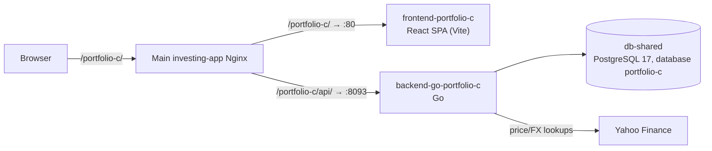
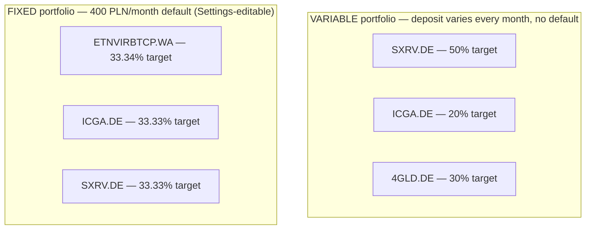
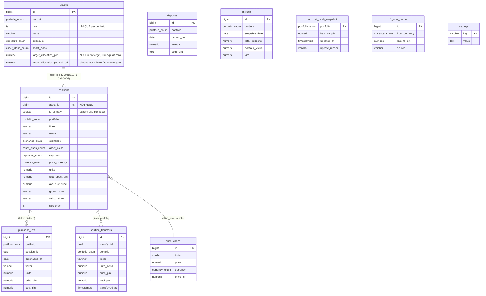
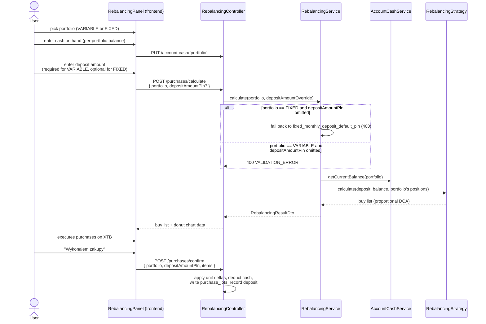

# Architecture — portfolio-c

## System topology



- Runs on the Raspberry Pi alongside `investing-app` and `portfolio-b`,
  behind the **same Nginx** — there is no standalone Nginx for this app. The main
  investing-app's Nginx owns the `/portfolio-c/` location block and proxies straight to
  `frontend-portfolio-c:80` (SPA) and `backend-go-portfolio-c:8093` (API), exactly mirroring
  the existing `/portfolio-b/` block.
- **Google OAuth + email allowlist** (`packages/common/go/common-go/auth` + `internal/authexchange`) — same pattern as the main app and as
  Portfolio B. Allowlist: `szczyrbus21@gmail.com`, `second-user@example.com`. No user tables —
  the allowlist is config (`ALLOWED_EMAIL_1`/`ALLOWED_EMAIL_2` env vars), not a
  DB-backed concept. See "Authentication" below.
- All in Docker Compose (`infra/compose.yml`): `flyway-portfolio-c` (one-shot migration runner), `backend-go-portfolio-c`
  (:8093, no published host port) and `frontend-portfolio-c` (no published host port) — reached only via the shared
  `investing-shared` Docker network. The database is `db-shared` (database `portfolio-c`) in the separate `shared-infra` stack (`infra/shared/`).

## Tech stack

| Layer | Technology |
|---|---|
| Backend | Go 1.27 (chi, pgx v5, sqlc, oapi-codegen), Flyway CLI runner (one-shot compose service), common code in `packages/common/go/common-go` |
| Database | PostgreSQL 17 |
| Frontend | React 19, TypeScript 5, Vite 6, Tailwind v4, shadcn/ui, TanStack Query v5 |
| Common | `@common/*` packages (Axios singleton with per-app baseURL, auth, envelope, shadcn/ui) + per-app API clients/Zod schemas in `frontend-web/src/api/` (the old `@portfolio-c/shared` workspace was deleted by task 158) |

## Domain: two portfolios, never mixed

Unlike Portfolio B's app (one retirement portfolio split into IKE/IKZE sub-accounts),
Portfolio C's app tracks **two completely independent portfolios**. Their positions,
deposits, cash, history, and settings never mix — there is no query, screen, or
computation that spans both. `portfolio_enum` (`VARIABLE`, `FIXED`) is the only
partition dimension in the schema; there is no IKE/IKZE concept anywhere.



Note ICGA.DE and SXRV.DE each appear in **both** portfolios, at different target
weights — this is why `positions` is unique on `(ticker, portfolio)`, not on
`ticker` alone.

**Seeded holdings** (`V2__seed_data.sql`): VARIABLE starts with real current
holdings (SXRV.DE 0.4914 units, ICGA.DE 69.7204 units, 4GLD.DE 2.9722 units); FIXED
starts empty (0 units in all three — no purchases yet). `avg_buy_price` /
`total_spent_pln` are seeded `NULL`, not zero — see "Cost basis" below.

**Ticker flag:** the FIXED portfolio's crypto position was specified as
"ETNVIRBTCP.PL"; Yahoo Finance's real GPW suffix is normally `.WA`, matching the
sibling VirETP notes already used elsewhere (`ETNVIRBTCP.WA` / `ETNVIRETH.WA` /
`ETNVIRSOL.WA` / `ETNVIRXRP.WA`). Seeded as `ETNVIRBTCP.WA` — Backend must verify
against a live Yahoo Finance lookup before the market-data integration ships and
correct it with a plain `UPDATE` if wrong (no migration needed, since Flyway
migrations are immutable once applied).

## Database schema



| Table | Purpose |
|---|---|
| `assets` | **Logical assets** for one portfolio — the aggregate root carrying the target allocation, name, exposure and asset class (task 156, V9). Unique on `(key, portfolio)`. See "Asset / Subasset model" below. |
| `positions` | **Subassets**: ETF/stock/metals holdings for one portfolio, each belonging to exactly one asset via `asset_id`; single `units` column (no sub-accounts). Unique on `(ticker, portfolio)` — the same ticker can be held by both books. No target column — targets live on `assets`. |
| `deposits` | Capital deposits, scoped by `portfolio`, all in PLN. |
| `historia` | Daily per-portfolio value snapshots for the XIRR chart. Unique on `(portfolio, snapshot_date)` — two rows per day, one per portfolio. |
| `price_cache` | Yahoo Finance price cache, keyed by `yahoo_ticker` — **shared across both portfolios** (a ticker held by both books, e.g. ICGA.DE, is priced once, not twice). |
| `fx_rate_cache` | EUR/USD/CHF/GBP → PLN exchange rate cache — shared, needed because the Xetra-listed tickers (SXRV.DE, ICGA.DE, 4GLD.DE) are EUR-denominated on the exchange even though the user's account and every displayed figure is PLN. |
| `settings` | Global key/value. Currently one key: `fixed_monthly_deposit_default_pln` (400). Deliberately **not** a generic `(key, portfolio)`-scoped table — only FIXED has a configurable default at all; see `docs/adr/001-portfolio-dimension.md`. |
| `account_cash_snapshot` | **One row per portfolio** (PK = `portfolio`) — replaces Portfolio B's single `id=1` row with four IKE/IKZE columns. Single `balance_pln` field per portfolio; `update_reason` (`MANUAL` \| `POST_PURCHASE`) unchanged from Portfolio B. |
| `purchase_lots` | Purchase history, one row per (confirm session, ticker), now scoped by `portfolio`. FK to `positions` is composite: `(ticker, portfolio)`. |
| `position_transfers` | Manual sell-assist ("1.5x trim") audit log, one row per leg, scoped by `portfolio`. The `account_type` column from Portfolio B is gone entirely — there are no sub-accounts to record. |

### Asset / Subasset model (task 156, deployed 2026-09-24; Flyway V9 + V10)

Each portfolio's book is a list of **assets**; every asset groups one or more **subassets** (`positions` rows) and exactly one subasset is its **primary** — the default buy destination (partial `UNIQUE (asset_id) WHERE is_primary`). The **target allocation lives only on the asset** (`assets.target_allocation_pct`); a subasset has no target field. An asset's value is the sum of its subassets, and `currentPct`/`deviationPct` (with the ADR-053 zero-target sentinel) are computed on the asset. `assets.key` is an immutable logical label (`UNIQUE (key, portfolio)`) — join on `asset_id`, never on `key`.

Live: all 8 rows (VARIABLE 4, FIXED 4) are single-subasset assets, each its own primary with `key = ticker`, Σ targets 100 per portfolio. The model is identical to the other two apps, so a second subasset (e.g. a wrapper ETF of an existing asset) can be attached later without a schema change; V9 deliberately RAISEs at deploy time if it finds a multi-subasset group with no naming map (none existed).

- **API.** `GET /positions?portfolio=…` returns assets (subassets primary-first); `GET /positions/{id}` takes a **subasset** id and returns its parent asset. `POST /positions` creates a subasset under an existing asset of the same portfolio (`assetId`) or a new one (`newAsset{…}`). `PUT /positions/{id}` edits subasset fields and may re-home a **non-primary** subasset via `assetId` (same portfolio only, `400` otherwise; a primary answers `409 CONFLICT`). `DELETE /positions/{id}` (a soft delete since task 173): a primary with live siblings is `409`; the last live subasset soft-deletes its asset. `PUT /assets/{id}` is the only writer of targets (absent = unchanged, explicit `null` = clear, range 0..100, no Σ = 100 guard). `POST /assets/{id}/primary {subassetId}` is a pure relabel of two rows in one transaction, guarded by a per-portfolio Σ targets == 100 tripwire inside the transaction. Full contract: root `docs/architecture/03-api-contract.md` and this app's `docs/openapi.yaml`.
- **Soft delete (task 173, ADR-109; Flyway V14).** `assets.deleted_at` / `positions.deleted_at` (`TIMESTAMPTZ NULL`, `NULL` = live). `DELETE /assets/{id}` and `DELETE /positions/{id}` set it and never remove a row, so the history FKs from `purchase_lots` and `position_transfers` (`… REFERENCES positions(ticker, portfolio)`) stay valid and never block a delete. Every current-holdings read (portfolio, Σ targets, calculator/confirm, transfer, XIRR, price refresh, today's historia snapshot) is live-only. History (purchase history, transfers, lots, historia backfill) still shows deleted assets. `POST /positions` with a deleted ticker restores the old row (same id, units, cost and history; only that subasset). Query-by-query list: root `docs/architecture/diagrams/173-asset-soft-delete.md` §5.3; schema rules: root `docs/architecture/04-db-schema.md` "Soft delete".
- **Rebalancing.** The proportional calculator folds each asset's subasset values into one asset entry per portfolio and buys the primary; it still runs independently per portfolio.
- **Profit.** `profitPct` is `Σvalue / Σcost − 1` (`positioncalc.GroupProfit`, corrected 2026-09-25): Σcost sums the recorded costs, Σvalue sums every priced subasset; a subasset without recorded cost adds its value but no cost, a costed-but-unpriced one contributes neither; `null` when no cost is recorded.
- **History.** V9 backfills one asset per existing row (targets moved verbatim, tripwires on orphans / primaries / Σ), V10 drops `is_companion_row`, `companion_parent_ticker` and the positions target column. Design and verification record: root `docs/architecture/diagrams/156-asset-subasset-model.md`.

### `purchase_lots` columns

| Column | Type | Notes |
|---|---|---|
| `id` | `BIGSERIAL` PK | |
| `portfolio` | `portfolio_enum` NOT NULL | Which book this session's purchases belong to |
| `session_id` | `UUID` NOT NULL | Groups all lots from one "Zatwierdź zakupy" click |
| `purchased_at` | `DATE` NOT NULL | `LocalDate.now()` at confirm |
| `ticker` | `VARCHAR(20)` NOT NULL | FK (with `portfolio`) → `positions.ticker` |
| `units` | `NUMERIC(18,8)` NOT NULL | Units bought for this ticker in this session. `> 0` |
| `price_pln` | `NUMERIC(18,8)` NOT NULL | PLN price snapshot at confirm (same one `confirm()` uses for cash deduction). `> 0` |
| `cost_pln` | `NUMERIC(18,4)` NOT NULL | `units × price_pln`, scale 4 HALF_UP. `> 0` |
| `created_at` | `TIMESTAMPTZ` NOT NULL | `DEFAULT NOW()` |

Constraints: `UNIQUE (session_id, ticker)` (one aggregated lot per ticker per
session); composite FK `(ticker, portfolio) REFERENCES positions (ticker,
portfolio)`; indexes on `session_id`, `purchased_at`, and `(portfolio,
purchased_at)`.

### `position_transfers` columns

| Column | Type | Notes |
|---|---|---|
| `id` | `BIGSERIAL` PK | |
| `transfer_id` | `UUID` NOT NULL | Groups all legs of one "Sprzedaj" submission |
| `portfolio` | `portfolio_enum` NOT NULL | The one portfolio this whole transfer happens inside |
| `ticker` | `VARCHAR(20)` NOT NULL | FK (with `portfolio`) → `positions.ticker`; each leg names the position it moves units on |
| `units_delta` | `NUMERIC(18,8)` NOT NULL | Signed: negative for the sold leg, positive for each buy leg. `<> 0` |
| `price_pln` | `NUMERIC(18,8)` NOT NULL | PLN price snapshot at execution time, one per leg. `> 0` |
| `total_pln` | `NUMERIC(18,4)` NOT NULL | `units_delta × price_pln`, same sign as `units_delta` |
| `transferred_at` | `TIMESTAMPTZ` NOT NULL | When the transaction happened; `DEFAULT NOW()` |
| `created_at` | `TIMESTAMPTZ` NOT NULL | `DEFAULT NOW()` |

Constraints: `CHECK (units_delta <> 0)`, `CHECK (price_pln > 0)`; composite FK
`(ticker, portfolio)`; indexes on `transfer_id` and `(portfolio, ticker,
transferred_at DESC)`. A transfer is exactly one sold leg (`units_delta < 0`) plus
one-or-more buy legs (`units_delta > 0`) sharing a `transfer_id`, all within the
same `portfolio` — `PositionTransferService` validates that the sold leg has
sufficient units and that the legs are cash-neutral before writing any rows; the
table itself doesn't enforce cross-row invariants. Purely additive/audit: it never
is never read by deviation computation or the DCA calculator. (The transfer that
writes it does maintain `positions.total_spent_pln` through the asset-level cost
rule — see "Cost basis" below; `avg_buy_price` is never touched.)

### Cost basis (avg_buy_price / total_spent_pln)

`V2__seed_data.sql` seeds both fields `NULL` for every position, deliberately — not
zero, and not a guessed price. The real go-live figures arrived as Flyway data
migrations: `V3` (VARIABLE, 2026-07-28 purchases) and `V5` (FIXED, first purchase
2026-07-29) set `total_spent_pln`/`avg_buy_price`. (An earlier design here proposed a
Backend *startup reconciliation* that would price NULL rows at the live price; it was
never built and `V3` superseded it.)

From task 161a-3 on, **trades keep `total_spent_pln` current** with the asset-level
average-cost rule (design `docs/architecture/diagrams/161-asset-entry-price.md` §2,
shared kernel `packages/common/go/common-go/costbasis`), inside the trade's own
transaction and with `price_cache` prices only (no network call):

- `confirm()` buy: adds the PLN paid to the bought subasset — only if its asset already
  has recorded cost or holds no units (an asset with units but no recorded cost stays
  untracked; no cost is invented).
- `POST /position-transfers`: the sale scales the whole sold asset's recorded cost by
  the value share sold (also when the sold subasset carries no cost); a buy leg on the
  **same asset** carries that cost (a same-asset swap leaves the asset's cost
  unchanged), a leg on another asset is bought at market; a full sale leaves exactly 0
  and a later rebuy starts fresh. Only the request's portfolio's rows take part —
  the same instrument held in the other portfolio is never touched.
- A manual `PUT /positions/{id}` units edit never changes cost; cost changes only
  through an explicit `totalSpentPln` edit.
- The stored go-live baselines are left as they are (only scaled/added to by trades);
  their owner-reviewed reconciliation is task 161a-4. `avg_buy_price` is never written
  by a trade.

Both fields stay `NULL`-safe everywhere downstream — `computeFields` (shared
`positioncalc.ComputeFields`) derives `profitPct = Σvalue / Σcost − 1` over the asset's
rows with a recorded cost and `avgBuyPricePln = pricePln / (1 + profitPct)` (the asset's
entry price, PLN per unit of the primary; it never reads `avg_buy_price`); when no cost is
recorded (Σcost ≤ 0) both are `null` rather than dividing by zero. The full definition —
including the native-currency line — is in the root `docs/architecture/02-domain-model.md`
§2.1 ("Asset-level cost, profit and entry price").

## API controllers

| Controller | Path | Purpose |
|---|---|---|
| `PositionsController` | `/positions`, `/assets` | `GET /positions` lists **assets** (each with `subassets[]`) and requires a `portfolio` query param — there is no cross-portfolio listing; `POST`/`PUT`/`DELETE /positions` create/edit/delete one subasset; `PUT`/`DELETE /assets/{id}` edit asset targets/name or delete an asset; `POST /assets/{id}/primary` changes the primary subasset. |
| `DepositsController` | `/deposits` | CRUD for deposits. `GET /deposits` requires a `portfolio` query param; `POST /deposits` body carries `portfolio`. |
| `HistoriaController` | `/history` | Portfolio history for charts. `GET /history` requires a `portfolio` query param. |
| `MarketDataController` | `/market-data` | Price refresh from Yahoo Finance (shared, not portfolio-scoped). |
| `SettingsController` | `/settings` | Key/value settings — unchanged path; only the key name changed (`fixed_monthly_deposit_default_pln`). |
| `RebalancingController` | `/purchases` | DCA calc (`POST /purchases/calculate`), confirm (`POST /purchases/confirm`), history (`GET /purchases/history`) — all portfolio-scoped, see "Rebalancing flow". |
| `AccountCashController` | `/account-cash/{portfolio}` | Cash balance for one portfolio: `GET`, `PUT` (manual), `POST /account-cash/{portfolio}/deduct`. Portfolio is a path variable — the resource is now one-per-portfolio, not a global singleton. |
| `PositionTransferController` | `/position-transfers` | Manual sell-assist: `POST /position-transfers` executes a user-submitted sell+buy transaction, body carries `portfolio` at the root. |

## Rebalancing flow



1. User picks which portfolio they're working on (VARIABLE or FIXED) — the rest of
   the flow operates only on that portfolio's own positions, cash, and history.
2. User opens the cash-balance UI → enters available cash → "Zapisz" →
   `PUT /account-cash/{portfolio}`.
3. User enters (or, for FIXED, optionally leaves blank to use the stored default)
   a deposit amount, then clicks **Oblicz zakupy** → `POST /purchases/calculate`
   with `{ portfolio, depositAmountPln? }`.
   - **FIXED**: `depositAmountPln` omitted → falls back to
     `fixed_monthly_deposit_default_pln` (400 by default, editable in Settings).
     Supplied → that value wins for this call only, the stored default is
     unchanged.
   - **VARIABLE**: `depositAmountPln` is **required**. Omitting it is a
     `VALIDATION_ERROR` — there is no fallback, because there is nothing sensible
     to fall back to.
   - `RebalancingStrategy` runs the proportional DCA algorithm against only that
     portfolio's positions and that portfolio's cash balance, returning a buy list
     with no per-account breakdown (there are no sub-accounts to break down).
4. User executes purchases on XTB.
5. User clicks **Wykonałem zakupy** → `POST /purchases/confirm` with
   `{ portfolio, depositAmountPln, items: [{ ticker, units }] }`. This:
   - Applies each item's unit delta directly to that ticker's `(ticker,
     portfolio)` position row.
   - Deducts the actual PLN spent from that portfolio's `account_cash_snapshot`
     balance (floors at 0), sets `update_reason = 'POST_PURCHASE'`.
   - Writes one `purchase_lots` row per ticker, scoped to `portfolio`.
   - Records a `deposits` row for `depositAmountPln` in that `portfolio` — this is
     the exact amount that was used for the preceding `calculate()` call, so the
     deposit ledger is correct for both the FIXED-with-a-default case and the
     VARIABLE-always-explicit case without `PurchaseConfirmService` re-deriving or
     re-guessing an amount.
6. User can manually correct the cash balance at any time (step 2).

## Rebalancing algorithm (proportional DCA, per portfolio)

```
deficit_i    = target_value_i - current_value_i
deposit_i    = IF(deficit_i > 0, total_deposit × deficit_i / sum_positive_deficits, 0)
units_to_buy = deposit_i / price_pln_i
```

No regression weights, no ISM PMI conditioning, no per-account priority fill — the
whole algorithm runs once per `calculate()` call against one portfolio's own
positions and one deposit amount. There is no allocation step "between accounts"
because a portfolio has exactly one cash balance.

## Manual sell-assist (1.5x trim)

An asset whose `computed.deviationPct` (see `ComputedPositionFields`, already
computed by `PositionService` for every asset — group-level, value = Σ subassets, no new
computation) crosses a threshold is flagged in the portfolio table's "Rebalansowanie" column
(a dot and a label):

| `deviationPct` | Status |
|---|---|
| `> 0.5` (asset ≥ 150% of its target allocation) | **SELL** |
| `> 0.05` | OVER |
| `< -0.05` | UNDER |
| otherwise | OK |

**Explicit zero target (ADR-053, ported here 2026-09-23):** an asset with `targetAllocationPct`
set to an explicit `0` (not `NULL`) that still holds nonzero value gets `deviationPct` forced to a
fixed sentinel, `1.0`, instead of staying `null` — this trips the same `> 0.5` SELL threshold
above. A `0` target is an unambiguous "sell whatever is left" signal, and without this, the
proportional `deviationPct` formula (division by target) is undefined at target `0` and the SELL
badge could never fire for a retired-but-still-held asset. Computed in the shared
`packages/common/go/common-go/positioncalc.ComputeFields` kernel this app's `PositionService`
calls into — see root `docs/architecture/05-rebalancing-algorithm.md` §7.6 for the full rationale
(originally designed for, and implemented in, the root investing-app; this app's copy was a
missed port, now closed as a bug-parity fix, not a new decision).

These thresholds are **display-only**: `deviationStatus()` in the common
`packages/common/ui/src/portfolio/model/rebalanceStatus.ts` evaluates them client-side, one copy for
all three apps since task 170. The status column never shows a percentage: SELL shows the PLN to
sell to get back to 1.0× the target (`computeTrimExcessPln`, the same amount the Sprzedaj dialog
pre-fills; root `docs/architecture/05-rebalancing-algorithm.md` §7.5), and the other statuses show
the deviation in percentage points. Nothing on the backend computes or stores a SELL flag, and
`PositionService`, `RebalancingStrategy`, and the `/purchases/calculate` DCA endpoint have zero
awareness of it — flagging is not a trigger, it's a hint for the human.

When the user clicks the row's **Sprzedaj** action, a dialog opens for **manually**
recording what they actually sold on XTB and what they bought with the proceeds
(potentially split across several tickers), all within the same portfolio as the
flagged position. Submitting calls `POST /position-transfers` with `{ portfolio,
sold: { ticker, units, pricePln }, buys: [{ ticker, units, pricePln }, ...] }`
(no `accountType` on any leg — that field existed only for Portfolio B's sub-accounts).

Each leg's `pricePln` on the wire is still a per-unit price, but the dialog does not
ask the user to type one directly: each leg (the sold leg and every buy leg) is
entered as a total PLN **amount** — how much was actually received for the sold leg,
or spent on each buy leg — and the per-unit price is derived as `amountPln / units`
and shown only as a non-editable hint, the same pattern `UnitPriceHint` implements in
`RebalancingTransferDialog.tsx` in the main app. `pricePln` is computed from that
amount immediately before the request payload is built; it is never a field the user
fills in themselves.

Submitting the request:

1. Validates the sold leg's `units` doesn't exceed the position's holdings for
   that `(ticker, portfolio)`.
2. Applies each leg's unit delta directly to `positions.units` (the same
   single-field update `confirm()` uses for purchases — both paths share
   `PositionDeltaApplicator`).
3. Writes one `position_transfers` audit row per leg, all sharing a new
   `transfer_id` and the request's `portfolio`.
4. Updates `positions.total_spent_pln` in the same transaction with the
   **asset-level average-cost rule** (task 161a-3; see "Cost basis" below) and does
   **not** touch `avg_buy_price` nor recompute or persist any target/deviation value.

The suggested sell amount shown in the dialog (units that would bring the position
back down to exactly 1.0× its target allocation) is likewise a **UI-only**
convenience number computed client-side from data the positions list already
returns — the user can override it freely, and the backend never validates the
sold amount against it. The app never auto-suggests or auto-executes a sell, it
only records what the user tells it happened.

Because the positions list backing this dialog is a polling query, all of the
dialog's manual selections — which ticker is being sold, the sold leg's units and
amount, and any buy legs already entered — must stay stable across background
refetches while the dialog is open: a poll tick must never silently reset a field
the user has already touched. Effects that prefill or default dialog state may
depend only on stable local state (the selection of *what* to sell), never on data
reference identity from the polling query (e.g. `totalValuePln` derived from the
live `allPositions` query), and any prefill effect must respect fields the user has
already edited (e.g. via react-hook-form `dirtyFields`). `RebalancingTransferDialog.tsx`
in the main app already upholds this; `PositionTransferDialog.tsx` here must too.

**Shared component (task 136, contract designed 2026-09-03).** This dialog's form lifecycle,
the `dirtyFields`-guarded prefill effects described above, and the sell-candidate/buy-option/
target-gap derivation now live once in `packages/common/ui/src/PositionTransferDialog.tsx`, not
duplicated per app — see the investing-app root's
`docs/architecture/diagrams/136-shared-transfer-dialog.md` for the full prop contract and
diagrams, and `docs/architecture/05-rebalancing-algorithm.md` §7.9 for the extraction record.
This app's own `frontend-web/src/components/PositionTransferDialog.tsx` is a thin wrapper: it
adapts portfolio-c's `Asset` (task 156: primary subasset's ticker/price/units + the asset's group
numbers, `subassets` as sell candidates) into the shared component's `TransferAssetLike`
shape, passes `accountDimension={undefined}` (this app has no account/sub-account concept at
all, so the shared component renders no "Konto" selector on either leg), supplies `portfolioId`
(`VARIABLE`/`FIXED`, included in the request body), and injects a `submitTransfer` closure that
narrows the shared request shape onto portfolio-c's own `PositionTransferRequest` (which requires
`portfolio` non-optionally) before calling `executePositionTransfer`.

## Authentication

Despite an earlier (stale) version of this document and of `CLAUDE.md` claiming
"single user, no auth," the actual copied backend code
(`SecurityConfig`, `GoogleJwtAuthenticationConverter`, `AuthController`,
`SecurityProperties` with `allowedEmails`/`googleClientId`/`jwtSecret`, and
`infra/compose.yml`'s `GOOGLE_CLIENT_ID`/`ALLOWED_EMAIL_1`/`ALLOWED_EMAIL_2`/
`JWT_SECRET` env vars) shows this app uses the same Google OAuth + email-allowlist
pattern as the main `investing-app` and as `portfolio-b`. This is kept
exactly as copied — no redesign needed here, just a documentation correction.

Allowlist for this app: `szczyrbus21@gmail.com` and `second-user@example.com` (Portfolio C's
own Google account). No user table exists or is needed — per the parent app's
ADR-004 pattern, the allowlist is config (env vars), not persisted state.

## Market data sources

- **Yahoo Finance** (Go `common-go/priceprovider`) — ETFs, metals ETC, FX rates. Shared
  across both portfolios (see `price_cache` / `fx_rate_cache` above) — a ticker
  held by both books is priced once.
- No Binance/crypto-exchange integration is needed for this app specifically (the
  one crypto-adjacent instrument, ETNVIRBTCP.WA, is itself a Yahoo-covered ETN, not
  a raw exchange spot price).

## Package structure

Go module `portfolio-c/backend-go` (the former Java `pl.portfolio-c` tree was deleted in Phase 9, ADR-098):

```
apps/portfolio-c/
├── backend-go/
│   ├── cmd/server/        wiring, schedulers, graceful shutdown
│   ├── openapi/           generated ServerInterface + DTOs (from this app's docs/openapi.yaml)
│   ├── db/                sqlc queries (queries/), generated code (sqlcgen/), migration smoke test
│   └── internal/          one package per domain: accountcash, admin, authexchange, deposit, historia,
│                          inflation, marketdata, position, positiontransfer, rebalancing, settings
│                          (portfolio-scoped: VARIABLE / FIXED; common logic in packages/common/go/common-go)
└── db/migration/          Flyway DDL (V1–V8), applied by the one-shot `flyway-portfolio-c` compose service
```

## Infra / deployment

- `flyway-portfolio-c`: one-shot `flyway/flyway:12.4.0` runner (`mem_limit: 384m`), mounts `db/migration/` read-only,
  runs `migrate` and exits; `backend-go-portfolio-c` starts only after it exits 0.
- `backend-go-portfolio-c`: container port `8093`, **no published host port** (internal only; `mem_limit: 64m`).
- `frontend-portfolio-c`: **no published host port** — reached only via the shared
  `investing-shared` external Docker network, exactly like
  `frontend-portfolio-b`/`backend-go-portfolio-b`.
- The database is not in this stack: `db-shared` (database `portfolio-c`, own role `portfolio_c_user`) lives in `infra/shared/compose.yml`.
- The main `investing-app`'s Nginx (not a Nginx belonging to this app) owns the
  `/portfolio-c/` location block: explicit per-endpoint Go locations plus a generic `/portfolio-c/api/` catch-all to
  `backend-go-portfolio-c:8093`, and `/portfolio-c/` → `http://frontend-portfolio-c:80/` — mirroring the `/portfolio-b/` block in
  `investing-app/infra/nginx/nginx.conf` (variable upstreams + Docker resolver, so a recreated container is
  re-resolved without restarting Nginx).
