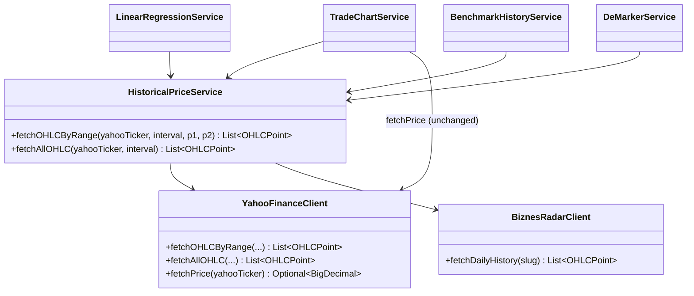
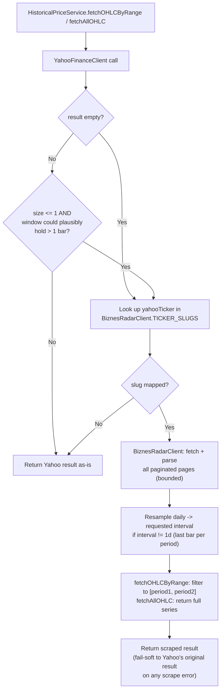

# ADR-078: BiznesRadar historical-OHLC fallback for the Yahoo `ETNVIR*` gap

**Date:** 2026-08-22
**Status:** BLOCKED (2026-09-02) — see §9. Design accepted in principle but does not ship as-is;
the §5 robots.txt prerequisite this ADR itself required was checked and failed.
**Extends:** ADR-057 (trade-history chart — the primary consumer that surfaced this gap)
**Related:** ADR-068 (China M2 scraped tip sources — the precedent this design deliberately follows)

## Context

Yahoo Finance's v8 chart API (`YahooFinanceClient.fetchOHLCByRange` / `fetchAllOHLC`) returns
**zero real historical bars** for the four Virtune crypto ETNs listed on GPW/Warsaw:
`PL.ETNVIRBTCP` / `PL.ETNVIRETH` / `PL.ETNVIRSOL` / `PL.ETNVIRXRP` (`yahoo_ticker`
`ETNVIRBTCP.WA` / `ETNVIRETH.WA` / `ETNVIRSOL.WA` / `ETNVIRXRP.WA`). Confirmed live against
Yahoo's own endpoint: `meta.validRanges` is `["1d","5d"]` only, and any wider request (`range=1y`,
explicit `period1`/`period2`) collapses to exactly **one** timestamp — today's latest quote —
regardless of the window asked for. The identical request shape against `AAPL` returns 139
weekly points fine, so this is a Yahoo-side data gap for this ticker family, not a request-format
bug. Yahoo's live quote (`regularMarketPrice`) works correctly for these tickers; only the
historical series is affected.

Five services call the two affected `YahooFinanceClient` OHLC methods:

| Service | Interval(s) requested |
|---|---|
| `TradeChartService` | dynamic (`"1" + interval`, chart-picker driven) — price series; also `"1d"` for the FX-conversion series |
| `LinearRegressionService` | dynamic (`"1" + interval`) |
| `BenchmarkHistoryService` | `"1wk"` |
| `DeMarkerService` | `"1d"`, fixed 35-day window |
| `FxRateCacheService` | **correction from the task brief**: this service itself only ever calls `YahooFinanceClient.fetchPrice` (the live-quote method). The historical FX series used by the trade-history chart's currency conversion is fetched by `TradeChartService`, via `FxRateCacheService.fxTickerFor(currency)` for the ticker string only. `FxRateCacheService` is therefore not a direct caller of the affected methods — noted here so the implementing backend agent doesn't go looking for a call site that doesn't exist. It's still true that none of these four tickers are FX pairs, so this gap doesn't practically affect FX series either way. |

`docs/adr/ADR-068-china-m2-scraped-tip-sources.md` already established this project's pattern for
"a free data source has a gap; a scraped public page fills it" — precedent search discipline
(exhaust real APIs first), fail-soft behavior, fixture-pinned parser tests, and an explicit ToS
disclaimer, not a claim of endorsement. This ADR follows that pattern rather than inventing a new
one, adapted for HTML-table scraping instead of single-value prose extraction.

### Candidate sources (research already done — not re-derived here)

- **Stooq — rejected.** Both `stooq.pl` and `stooq.com` are behind a Cloudflare-style JS bot-wall
  on every endpoint tried (CSV export and HTML pages alike). Not fetchable by a plain server-side
  HTTP client, and headless-browser workarounds are not viable on this Pi (Chromium hangs/is
  broken here — see project memory "Headless Chromium Broken On This Pi"). Do not revisit unless
  a genuinely different, unprotected Stooq endpoint surfaces.
- **BiznesRadar.pl — adopted.** `https://www.biznesradar.pl/notowania-historyczne/{TICKER}`
  (`,{page}` suffix for pagination, 50 rows/page, page 4+ empty for these tickers) returns plain
  server-rendered HTML — no JS wall, works with a bare `curl -A "Mozilla/5.0"` — containing a
  daily OHLCV table (`Data`/`Otwarcie`/`Max`/`Min`/`Zamknięcie`/`Wolumen`/`Obrót`). Confirmed to
  return `ETNVIRXRP`'s full trading history back to its actual GPW listing date (~2026-02-25).

## Decision

### 1. A single facade in front of `YahooFinanceClient`, not per-service branching

New `HistoricalPriceService` (`pl.investing.service`), the **only** new consumer-facing seam:

```java
List<OHLCPoint> fetchOHLCByRange(String yahooTicker, String interval,
                                  long period1EpochSecs, long period2EpochSecs);
List<OHLCPoint> fetchAllOHLC(String yahooTicker, String interval);
```

Identical signatures and identical return type (`YahooFinanceClient.OHLCPoint`) to the two
methods it replaces at call sites — swapping a service's injected `YahooFinanceClient` field for
`HistoricalPriceService` for these two calls is the entire migration; `YahooFinanceClient` itself
is unchanged internally and keeps serving `fetchPrice` (live quotes) directly to every caller,
including `FxRateCacheService`, as it does today.

`HistoricalPriceService` wraps two single-source clients:
- `YahooFinanceClient` (existing, untouched)
- `BiznesRadarClient` (new, `pl.investing.client`) — HTML scraper, Jsoup-based (see §6)



**Why a facade, not branching in each service, and why not folded into `YahooFinanceClient`
itself:** this project already has a one-client-per-source convention (`YahooFinanceClient`,
`BinanceClient`, `ChinaDataLiveClient`, `TradingEconomicsChinaM2Client`, `YChartsChinaM2Client` —
never one client with multi-source branching inside it), plus a precedent for a thin
orchestration point that decides backbone-vs-tip-source precedence
(`MacroDataService.extendChinaM2Tip`, ADR-068). Folding BiznesRadar-fallback logic into
`YahooFinanceClient` would blur its single responsibility (a Yahoo-only client suddenly knowing
about a Polish HTML table). Wiring the fallback into each of the four services independently
would mean four near-identical "if empty/thin, call BiznesRadar, else use Yahoo" branches, four
places to keep the trigger rule (§2) consistent, and four sets of tests mocking two clients
instead of one. `YahooFinanceClient` is the sole HTTP boundary for historical prices today —
extending that boundary with one new seam is the smaller, more consistent change.

### 2. Trigger condition — concrete, not vibes

`HistoricalPriceService` falls back to `BiznesRadarClient` when either:

1. Yahoo's result is **empty**, or
2. Yahoo's result is **suspiciously thin**: `points.size() <= 1` **and** the requested window
   could plausibly contain more than one bar at the requested granularity.

For `fetchOHLCByRange`, "could plausibly contain more than one bar" means
`period2EpochSecs - period1EpochSecs > intervalSeconds(interval)`, where `intervalSeconds` is a
fixed lookup: `1d → 86 400`, `1wk → 604 800`, `1mo → ~2 592 000` (30 days). For `fetchAllOHLC`
(`range=max`) there is no explicit window — "give me everything" always implies more than one bar
is plausible, so any result with `size() <= 1` is automatically suspicious.

This isn't a fuzzy heuristic: it's built directly from the confirmed failure signature — Yahoo
collapses to **exactly one point, always today's date, regardless of how wide the request is**.
A genuinely young-but-real ticker (e.g. a stock 3 trading days post-IPO) still returns more than
one daily bar for a multi-day request; only Yahoo's actual gap behavior produces exactly one. The
threshold is deliberately `<= 1`, not some larger number like `< 5` — there's no ticker in the
current ~30-position roster that would produce a false positive at that bar, and a looser
threshold would risk masking a real (if short) history with an unnecessary scrape.



On a scrape failure (network error, parse error, unmapped ticker), `HistoricalPriceService`
returns Yahoo's original result unchanged — never worse than pre-ADR-078 behavior, and never a
new exception type surfacing to the four calling services.

### 3. Ticker mapping — explicit static map, not a derived transform

`BiznesRadarClient` owns a small static map, the same shape as
`FxRateCacheService.YAHOO_FX_TICKERS`:

```java
private static final Map<String, String> TICKER_SLUGS = Map.of(
    "ETNVIRBTCP.WA", "ETNVIRBTCP",
    "ETNVIRETH.WA",  "ETNVIRETH",
    "ETNVIRSOL.WA",  "ETNVIRSOL",
    "ETNVIRXRP.WA",  "ETNVIRXRP"
);
```

Keyed on `yahoo_ticker` (what every calling service already has in hand) rather than
`positions.ticker`, since the facade never sees a `Position` row — only the ticker string each
service already passes to `YahooFinanceClient` today.

**Why an explicit map instead of a string-transform** (e.g. "strip the `.WA` suffix," which
happens to work for all four tickers here): an implicit convention is exactly the kind of thing
that breaks silently the day a fifth ticker doesn't follow the same shape — a different Warsaw
suffix, or a ticker whose BiznesRadar slug genuinely differs from its Yahoo ticker stripped of
exchange suffix. A tiny curated map is self-documenting, fails safe (an unmapped ticker never
gets a guessed URL fetched — see §4), and matches this codebase's existing precedent for small
structural mappings living as static in-code maps, not DB columns or generated transforms.

**No new column, no new table.** Four rows is not a lookup table's worth of data, and see §7 for
why no persistence is added at all here.

### 4. Scope: this ETN family only, by construction of the map

The map in §3 **is** the scope gate — there is no general "any ticker with thin Yahoo coverage
gets scraped" mechanism. An unmapped `yahooTicker` short-circuits to Yahoo's (possibly still
empty/thin) result, identical to today's behavior for every position other than these four.

**Recommendation: narrow scope, matching ADR-068's own precedent.** Reasons:
- BiznesRadar's coverage for tickers *other than* this Virtune-ETN family is explicitly
  unconfirmed by the research this ADR is built on — building general infrastructure on an
  unverified assumption is the wrong order of operations.
- A general slug-auto-derivation mechanism risks silently scraping the **wrong instrument** for
  some other ticker (a worse failure mode than today's known-empty Yahoo result, which at least
  fails loudly/visibly rather than plotting a plausible-looking but wrong price history).
- This portfolio has on the order of 30 positions total. Extending the map by one line (plus a
  manual sanity check that the new slug is correct) is the cheap, deliberate path the next time
  this gap is found elsewhere — cheaper than maintaining general-purpose scraping infrastructure
  against a site whose ToS hasn't even been checked yet (§5).
- The mechanism (facade + map) generalizes trivially if a broader need does show up later —
  narrow scope is a starting posture, not an architectural ceiling.

### 5. Scraping robustness and cost-free compliance

This is HTML scraping of an unofficial third-party site, not a documented API — accept the
following trade-offs explicitly, matching ADR-068's framing rather than pretending otherwise:

- **Fragile by nature.** A BiznesRadar markup/CSS-class change breaks the parser silently in
  production unless caught first. Mitigation: `BiznesRadarClient`'s parser is pinned by unit
  tests holding real HTML fragments captured from the live page (same discipline as
  `TradingEconomicsChinaM2Client`/`YChartsChinaM2Client`'s tests) — an upstream redesign then
  surfaces as a failing test, not a silently empty scrape in production.
- **Fail-soft, always.** Any network error, unexpected markup, or parse failure yields an empty
  list plus a `WARN` log naming the ticker/slug — never an exception. This exactly matches
  `YahooFinanceClient.fetchOHLCByRange`/`fetchAllOHLC`'s own existing `catch (Exception e) {
  log.warn(...); return List.of(); }` shape, so `HistoricalPriceService`'s fallback failing
  degrades to "use Yahoo's (already-known-thin) result," which is the pre-ADR-078 status quo —
  never a new failure mode for the four consuming services to handle.
- **Bounded pagination.** Fetch page 1, then page N+1 only while page N returned at least one
  data row, capped at a hard limit (e.g. 20 pages / ~1000 daily rows — roughly 4 years of daily
  history, far more than any of these four ETNs has traded) so a change in BiznesRadar's
  page-4-onward-empty behavior can't cause an unbounded fetch loop.
- **Request volume is trivial.** A handful of chart-view requests per day at most, for four
  tickers, from a single self-hosted personal instance — not remotely bot-like traffic. Same
  scale argument ADR-068 makes for its own scrapers (~7 requests/month there; this is a similar
  order of magnitude, likely lower).
- **Timeouts.** `BiznesRadarClient` uses the same short connect/read timeout discipline
  `YahooFinanceClient` already applies (5s connect / 10–20s read) so a slow or hanging BiznesRadar
  response can't stall a chart request indefinitely.
- **ToS / robots.txt — explicit prerequisite, not done here.** Per the task brief, this has not
  been checked and is **not** a trivial rubber-stamp to skip. Before shipping this, the
  implementing backend agent must fetch and read `https://www.biznesradar.pl/robots.txt` and skim
  for any visible terms-of-use page, specifically checking whether `/notowania-historyczne/` (or
  automated access generally) is disallowed. If it is, this ADR's design must not ship as-is —
  escalate back to this decision rather than shipping anyway on the theory that "it returned
  200." This is a real gate, not a formality, precisely because unlike ADR-068's two scrapers
  (checked at the time against their own ToS posture) this specific site's policy is an open
  question.
- **Rate-limiting behavior under repeated calls** is also unchecked — flagged as a secondary
  unknown for the backend agent to watch for once live (e.g. via response codes / a sudden empty
  run), not a blocker to note here since call volume is low regardless.

### 6. New dependency: Jsoup

**Confirmed as the parser.** `backend/pom.xml` has no HTML-parsing library today (checked — no
jsoup/htmlunit/selenium). Unlike ADR-068's two scrapers — which each extract a single value from
one prose sentence or JSON-LD blob via regex, with no DOM library needed — BiznesRadar returns a
genuine multi-row, 7-column DOM table across multiple paginated pages
(`<table class="qTableFull">`). Regex-scraping a real table reliably (row boundaries, column
order, pagination) is exactly the class of problem a DOM/CSS-selector parser solves and ad hoc
regex does not scale to cleanly. Jsoup (`org.jsoup:jsoup`, Apache License 2.0, free, actively
maintained) is the standard, lightweight choice for this in the Java ecosystem and satisfies the
project's cost-free-only constraint.

```xml
<dependency>
    <groupId>org.jsoup</groupId>
    <artifactId>jsoup</artifactId>
    <version>1.18.3</version>
</dependency>
```

The implementing backend agent should confirm the current stable 1.18.x patch version at
implementation time rather than treat the pin above as fixed.

### 7. No new DB table or migration

**Matches the existing pattern deliberately, not by default.** `LinearRegressionService`,
`TradeChartService`, `BenchmarkHistoryService`, and `DeMarkerService` all fetch live from Yahoo on
every request today with no caching table — `HistoricalPriceService` does the same for the merged
Yahoo/BiznesRadar result: no persistence, purely a request-scoped fetch-and-merge. There is no
concrete reason found during this design to diverge from that pattern (the request volume is low,
per §5, and correctness — not latency — is the concern this ADR addresses).

This is unrelated to, and does not change, `price_cache`/`fx_rate_cache` (`02-domain-model.md`
§2, Decision 3) — those are DB-backed caches for **live** quotes with a 15-minute TTL, a
completely different concern from this ADR's on-demand **historical** series fetch.

If BiznesRadar's uncached, full-history-every-request cost ever becomes a real latency problem
(repeated multi-page scrapes per chart load), the fix is a caching layer added later with its own
justification — not something to build speculatively now.

### 8. Interval handling — BiznesRadar is daily-only

BiznesRadar's page offers no weekly/monthly toggle in the confirmed research — every row is one
trading day. `BiznesRadarClient.fetchDailyHistory(slug)` therefore always returns daily bars,
sorted **ascending by date** (matching the ascending order `YahooFinanceClient.parseOHLC` already
produces, regardless of BiznesRadar's on-page row order) with `open`/`high`/`low`/`close` parsed
from the `Otwarcie`/`Max`/`Min`/`Zamknięcie` columns (Polish `dd.MM.yyyy` dates). `Wolumen`/`Obrót`
are not parsed — `OHLCPoint` has no volume field today (Yahoo's own OHLC parsing already drops
volume), so there is nothing downstream to carry it to.

When `HistoricalPriceService` falls back for a non-daily `interval` (`1wk`/`1mo`), it resamples
the scraped daily series client-side — taking the last trading day's bar within each ISO week or
calendar month — rather than asking BiznesRadar for a granularity it doesn't offer. This keeps
`HistoricalPriceService`'s output interval-faithful regardless of which source actually answered,
so none of the four calling services need to know or care which one did.

For `fetchOHLCByRange`, since BiznesRadar's page has no server-side date-range parameter, the
facade fetches the full paginated (bounded) history once and filters in-memory to
`[period1EpochSecs, period2EpochSecs]` after resampling. For `fetchAllOHLC`, the full
resampled series is returned unfiltered.

## Consequences

- **New class `HistoricalPriceService`** becomes the sole seam the four affected services
  (`TradeChartService`, `LinearRegressionService`, `BenchmarkHistoryService`, `DeMarkerService`)
  use for historical OHLC; each swaps its injected client for this facade for exactly the two
  methods in question. `YahooFinanceClient.fetchPrice` call sites (live quotes), including
  `FxRateCacheService`'s, are unaffected.
- **New class `BiznesRadarClient`**, Jsoup-based, scoped to the four-ticker map in §3. Unit tests
  must mock this the same way existing tests mock `YahooFinanceClient` (e.g. `TradeChartServiceIT`
  pattern) — never a live HTTP call to BiznesRadar from the test suite, matching the task brief's
  explicit requirement.
- **New dependency**: `org.jsoup:jsoup` in `backend/pom.xml` (§6).
- **No new Flyway migration, no new table** (§7) — a deliberate match to the existing
  fetch-live-every-request pattern for historical series, not an oversight.
- **Prerequisite before shipping, not optional**: the backend agent must check
  `https://www.biznesradar.pl/robots.txt` and any visible ToS for `/notowania-historyczne/`
  before this goes into production use (§5). If that check fails, this design does not ship as-is
  — come back to this decision.
- **Fragility is accepted, not hidden.** This will break silently if BiznesRadar's markup changes;
  fixture-pinned parser tests turn that into a loud test failure instead. When it does break, the
  system degrades to exactly today's pre-ADR-078 behavior for these four tickers (empty/thin
  Yahoo result, same as now) — never worse.
- **Scope is deliberately narrow** (§4): four tickers today, extended one map entry at a time if
  and when the same Yahoo gap is confirmed for another ticker — not a general "thin Yahoo data"
  auto-fallback.

## 9. Update (2026-09-02) — the §5 robots.txt prerequisite was checked, and it failed

Per §5's explicit, self-imposed gate ("must fetch and read
`https://www.biznesradar.pl/robots.txt`... If it is [disallowed], this ADR's design must not
ship as-is — escalate back to this decision"): checked directly (`curl -A "Mozilla/5.0"
https://www.biznesradar.pl/robots.txt`, raw response, not summarized):

```
User-agent: *
Allow: /
Disallow: /profile-transactions/*,*
Disallow: /profile-history/*,*
Disallow: /transakcje/*,*
Disallow: /notowania-historyczne/*,*
```

`/notowania-historyczne/*,*` — **exactly the path this entire design scrapes** — is disallowed
for all user-agents. This is not a rate-limit or bot-wall issue (§5 already treats those as
separate, secondary unknowns); it is the site operator's explicit stated policy on this specific
path, checked before any implementation exists, per the process this ADR itself mandated.

**Consequence, per §5's own gate: this design does not ship as-is.** `BiznesRadarClient` must
not scrape `/notowania-historyczne/` in production. This does not retroactively fabricate a
different source — no implementation exists (verified: no `BiznesRadarClient` or
`HistoricalPriceService` class in the codebase), so nothing needs to be reverted. It does mean:

- The underlying problem (§`Context` — Yahoo returns zero real history for the four `ETNVIR*`
  Virtune crypto ETNs) is **unresolved**, not fixed.
- Task 115 (`.claude/tasks/115-yahoo-historical-data-gap-fallback-source.task.md`) cannot proceed
  as scoped against this ADR's design.
- Stooq was already rejected in this same ADR (§`Candidate sources`, JS bot-wall). With BiznesRadar
  now also closed, both previously-identified free candidates are exhausted — a fresh source
  search (or a different mitigation: e.g. accepting the Yahoo gap and disclosing it in the UI
  rather than filling it) needs to go back through the Architect before any further backend work
  on this task, rather than defaulting to "scrape anyway, it's low volume" — that would be
  overriding this ADR's own explicit gate, not a call to make unilaterally.
