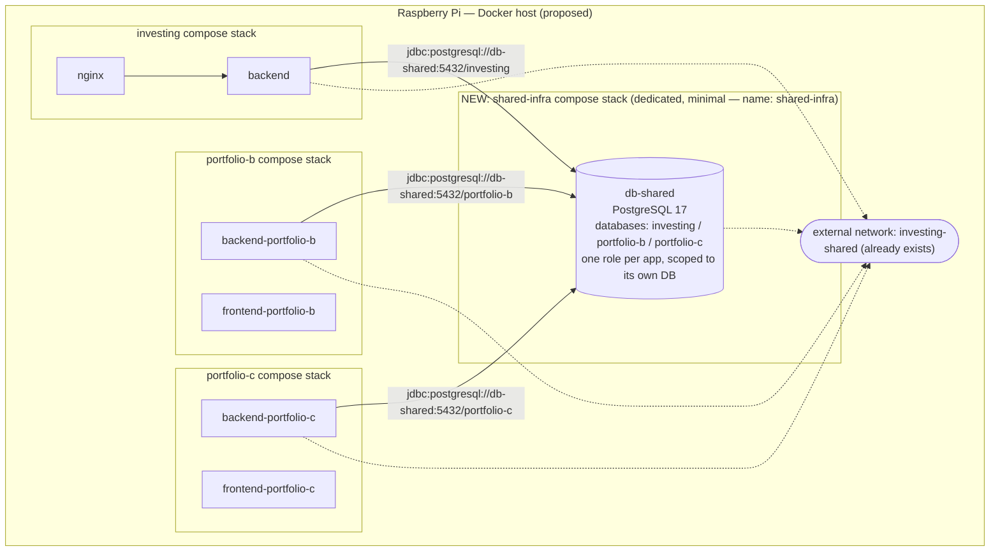

# ADR-083: Container RAM consolidation across the three sibling apps

**Date:** 2026-09-02
**Status:** Accepted (Postgres consolidation + memory-limit fix); Rejected for now (JVM merge, nginx merge); Already resolved (pgadmin)
**Update 2026-09-19:** implemented (tasks 131/132) and then overtaken by the Go rewrite (ADR-094, ADR-098): no Spring
Boot JVM runs any more, so this ADR's premise (JVM RAM pressure) no longer holds. Numbers re-measured — see
**"Outcome and re-measurement (2026-09-19)"** below; the "Measured baseline" table in Context is the
2026-09-02 starting point, kept for the before/after comparison.

---

## Context

investing-app, `apps/portfolio-b/`, and `apps/portfolio-c/` each deploy as a
fully independent Docker Compose stack on the same Raspberry Pi (7.9GiB total RAM, no swap
headroom to spare — see measurements below). Per `docs/architecture/12-portfolio-bpps-and-shared-packages.md`
§3, that independence was a deliberate prior decision (ADR-077): each app keeps its own Maven
build, its own Postgres instance, its own Spring Boot JVM, and its own compose stack, precisely
so that a redeploy of one app never touches the other two. The user has now asked, separately,
whether that independence is costing more RAM than it needs to — and explicitly told the
Architect to treat "independently-deployed sibling apps" as **not binding** for this evaluation.
A JVM-merge or DB-merge across apps is genuinely on the table here, contradicting §3's framing,
because the framing itself is what's being reconsidered.

**This ADR does not overturn ADR-077.** ADR-077 was about *repository* consolidation (one git
history) while keeping runtime independence; this ADR is a separate, later evaluation of
*runtime* consolidation (fewer processes) triggered by a real resource constraint ADR-077 never
had to weigh in. Where this ADR's recommendations touch runtime topology, they supersede the
"three Docker images, three Postgres databases, three `docker compose` stacks — no domain-model
merging, no change to runtime architecture" framing in doc 12 §3's opening paragraph; ADR-077's
actual subject (repo layout, `packages/shared/`) is untouched.

### Measured baseline (2026-09-02, live host, `docker top` / `ps` RSS — not `docker stats`, which
returns `0B/0B` for every container on this host; see the memory-limit finding below for why)

| Component | investing | portfolio-b | portfolio-c | **Total (3 apps)** |
|---|---|---|---|---|
| Spring Boot JVM (`java -jar app.jar`, no `-Xmx` set) | 507 MB | 407 MB | 385 MB | **1,299 MB** |
| PostgreSQL 17 (postmaster + ~10 bg workers each) | 108 MB | 103 MB | 85 MB | **296 MB** |
| nginx / static frontend | 16 MB | 15 MB | 15 MB | **46 MB** |
| pgAdmin | not running (`profiles: [dev]`, confirmed via live `docker ps` — zero pgAdmin containers currently up in any of the 3 stacks) | | | **0 MB** |
| **Stack total** | 631 MB | 525 MB | 485 MB | **~1,641 MB** |

Host: `free -h` shows **6.0GiB/7.9GiB used, swap 1.9GiB/2.0GiB used (95% full)**. The three
investing-suite stacks above account for only ~1.6GiB of that 6.0GiB — the rest is other
services on this shared home server (a `receipts-app` stack, `home-assistant`, `matter-server`,
`adguardhome`, `ticket-to-ride-app`, and a stray Eclipse JDT language-server process alone using
922MB RSS). **Consolidating the investing suite alone will not eliminate the host's memory
pressure** — that's an honest ceiling on what this ADR can promise. What it can do is stop the
investing suite from being an unbounded contributor to that pressure, which the next finding
shows it currently is.

### A critical finding: the existing `deploy.resources.limits` blocks are silently inert

Root's `infra/compose.yml` declares `deploy: resources: limits: memory: ...` for `db` (256m),
`backend` (512m), and `nginx` (64m). **These limits are not being enforced.** `deploy:` under
Compose is a Swarm-mode construct; a plain `docker compose up` (confirmed: this host runs
Compose v5.5.0 in standalone mode, not Swarm, no `--compatibility` flag in any documented
rebuild command) ignores it entirely. Verified directly: `docker inspect -f
'{{.HostConfig.Memory}}'` returns `0` (no limit) for every one of the 9 running containers
across all three stacks, including `investing-backend-1` despite its declared `512m` limit.
portfolio-b's and portfolio-c's compose files declare **no memory limits at all**, not even an inert one.

The consequence is concrete, not theoretical: each Spring Boot JVM has no `-Xmx` set, so its
ergonomic `MaxHeapSize` defaults to 25% of the **host's total physical RAM**, not of any
container ceiling — confirmed via `java -XX:+PrintFlagsFinal -version` inside
`investing-backend-1`: `MaxHeapSize = 2113929216` (≈2.01GiB), consistent with 25% of 7.9GiB.
**Three independent JVMs, each capable of ballooning toward ~2GiB uncapped, on a host whose swap
is already 95% full**, is a real bulkhead failure, not a hypothetical one — see Decision 2 below.

---

## Pattern & principle evaluation

This is a deployment-topology decision, not a code-level one — the relevant vocabulary is
architecture *styles* and the Bulkhead / Sidecar patterns, not GoF creational/structural/
behavioral patterns. Evaluated per the `software-design-excellence` skill:

| Candidate | Verdict | Why |
|---|---|---|
| Database-per-service (keep 3 Postgres processes) | rejected | Real duplicated fixed overhead (3× background-worker sets) for zero added isolation over the alternative below — Postgres already gives database-per-app catalog isolation *within one process* |
| Shared-database-instance, per-app **database** (not schema) | **adopted** | Preserves full catalog-level isolation (cannot cross-query without `dblink`/FDW) and keeps each app's Flyway `flyway_schema_history` fully independent — zero migration coupling — while eliminating 2 of 3 background-worker sets |
| Shared-database-instance, per-app **schema** within one database | rejected | Same RAM win as the database-level split, but weaker isolation (`search_path` bugs, accidental cross-schema `DROP`/`GRANT` are possible in a way cross-database access isn't) and adds Flyway `defaultSchema` configuration surface for no additional benefit — strictly worse than the database-level split for this use case |
| True multi-tenant single JVM (merge 3 Spring Boot processes) | rejected | Requires erasing already-deliberate per-app divergence (JWT issuer, exception→status mapping, security filter chains — see Decision 4) or building tenant-routing infrastructure that doesn't exist; see full reasoning below |
| Bulkhead (per-container memory ceilings, isolating one app's failure from the others) | **adopted** | Directly addresses the measured finding that ceilings are currently unenforced; this is the textbook use case for the pattern |
| AppCDS / Class Data Sharing (share JVM class metadata across processes without merging them) | **adopted as a follow-up to measure, not commit to** | Captures part of the JVM-consolidation RAM win without the process-merge blast radius; genuinely uncertain payoff until measured, so scoped as an experiment, not a decision |
| Sidecar (shared reverse-proxy fronting all 3 apps) | already in place, no change | investing-app's `nginx` already proxies `/portfolio-b/*` and `/portfolio-c/*` over the `investing-shared` network (doc 12 §1) — nothing to add here |
| Ambassador / dedicated shared-infra process for the merged Postgres | **adopted** | A 4th, minimal compose stack owning only `db-shared`, rather than folding it into any one app's existing stack — see Decision 1's "who owns it" discussion |

YAGNI/KISS is the tie-breaker throughout: the JVM merge is the pattern most likely to look
attractive on a RAM spreadsheet and worst in practice, precisely because it's the one that
requires inventing infrastructure (multi-tenancy) this codebase has never needed and has
already, on a prior audit, found real reasons not to share (doc 12 §2.2).

---

## Decision

### 1. Adopted — consolidate the 3 Postgres processes into 1 instance, 3 databases

One shared PostgreSQL 17 container, in a **new, dedicated 4th compose stack**
(`infra-shared/compose.yml`, project `name: shared-infra` — chosen deliberately to avoid
repeating the exact Compose project-name collision this monorepo already hit once and fixed,
per doc 12 §1's "Infra footgun — fixed" note), holding three logical databases: `investing`,
`portfolio-b`, `portfolio-c` — matching each app's existing `POSTGRES_DB` value exactly, so `CREATE
DATABASE` + per-app credential grants is the only migration step; no schema, table, or Flyway
history changes anywhere.

**Why a database per app, not a schema per app inside one shared database:** Postgres's
`flyway_schema_history` table lives per-database by default. Splitting by database means each
app's migration history stays exactly as independent as it is today — `V1`..`Vn` per app,
zero cross-app numbering coupling, zero Flyway config changes beyond the JDBC URL. Splitting by
schema instead would require `defaultSchema`/`schemas` config per app and `search_path`
discipline that buys nothing here (the RAM saving comes from sharing the *process*, not from
sharing the *database*). Each app keeps its own Postgres role, granted only against its own
database — physical co-location does not become credential co-location.

**Why a dedicated 4th stack rather than folding `db-shared` into one app's existing compose
file:** if `db-shared` were declared inside, say, root's `infra/compose.yml`, then root's own
routine `docker compose down` / `up --build` (documented in root `CLAUDE.md` as the normal
backend-rebuild flow) would tear down portfolio-b's and portfolio-c's database along with it — a footgun
strictly worse than anything ADR-077's independence was protecting against. A separate stack
that none of the three apps' own compose files ever `down`/`up` as a side effect avoids this.
All three apps' `backend*` services keep reaching it the same way `nginx` already reaches
`frontend-portfolio-b`/`backend-portfolio-b` today — over the existing external `investing-shared`
network — so no new network primitive is introduced, only a new member of an existing one.

*Legend:* only the database layer changes. Backend JVMs, nginx/frontend containers, and the
existing `investing-shared` network topology for HTTP traffic (§1 of doc 12) are untouched —
this diagram deliberately omits them where unchanged to keep the delta visible. `db-shared` is
reached exactly like `frontend-portfolio-b`/`backend-portfolio-b` are reached today: as another member of
`investing-shared`, not a new networking mechanism.

**Estimated RAM impact:** today's 3× Postgres background-worker sets (~296MB combined, ~100MB
each) collapse to 1 set (~100-120MB) — a **~180-200MB reduction**, plus removal of 2 of the 3
Postgres containers/images entirely. This is the more conservative of the two consolidation
options in absolute MB, but it is also the lower-risk one — see Consequences below for what it
costs.

### 2. Adopted — make the memory ceilings real

> **Done (task 131). Still in force:** every service in all four compose stacks now has a kernel-enforced `mem_limit:` (backend-go 64m, nginx/frontends 96m, `db-shared` 384m, Flyway runner 384m). The JVM `-Xmx`/`MaxRAMPercentage` half of this decision is **moot** — no steady-state JVM remains.

Replace the currently-inert `deploy.resources.limits` blocks (root) and the complete absence of
any limit (portfolio-b, portfolio-c) with Compose v2's actually-enforced top-level `mem_limit:` key (or
adopt `docker compose --compatibility` consistently in every documented rebuild command — a
policy choice for the DevOps follow-up to pick one, not both), sized with headroom above each
service's measured RSS:

| Service | Measured RSS today | Proposed `mem_limit` |
|---|---|---|
| `backend` (investing) | 507 MB | ~768 MB |
| `backend-portfolio-b` | 407 MB | ~640 MB |
| `backend-portfolio-c` | 385 MB | ~640 MB |
| `db-shared` (merged) | ~296 MB combined today | ~384 MB |
| `nginx` / `frontend-*` (×3) | 15-16 MB each | ~96 MB each |

Pair each backend's container ceiling with an explicit `-XX:MaxRAMPercentage` (e.g. `65-75`) or
`-Xmx` flag in that app's `infra*/backend/Dockerfile`/entrypoint, so JVM heap ergonomics respect
the *container* ceiling instead of the *host's* total RAM. This is the single highest-value,
lowest-risk change in this ADR: it does not reduce today's steady-state usage (today's actual
RSS is already well under any sane ceiling), but it closes the "no safety net" gap directly
responsible for the risk profile described in Context — a leak, a traffic spike, or a bad
release in any one of the three apps can no longer balloon toward ~2GiB unchecked and push an
already-95%-full swap into active thrashing for the whole host, including the unrelated services
sharing this Pi.

### 3. Adopted as a measurement follow-up, not a commitment — AppCDS

> **Moot (2026-09-19):** task 133 (AppCDS spike) is not needed — there is no always-on JVM left to share class metadata across.

Investigate Application Class Data Sharing (`-XX:ArchiveClassesAtExit=app.jsa` at build time,
`-XX:SharedArchiveFile=app.jsa` at runtime; built into the JDK since Java 12, free, no new
dependency) as a way to capture part of the JVM-consolidation RAM win — shared, read-only,
page-cache-backed class metadata across the 3 still-separate JVM processes — without merging
the processes. `shared-java`'s ~118 files (doc 12 §2.5) give the 3 backends genuine classfile
overlap for this to exploit; framework classes (Spring, Hibernate, Jackson, MapStruct-generated)
overlap further. This is flagged as something to *build a small prototype and measure*, not a
decision with a promised number — unlike the two adopted items above, this ADR does not have a
verified baseline for it.

### 4. Rejected (for the always-on production topology) — merge the 3 Spring Boot JVMs

> **Moot (2026-09-19):** the JVMs are gone; three independent Go binaries cost ~52 MiB combined, so the per-app divergence this section protected is kept for free.

A true single-process multi-tenant backend was evaluated and rejected. Reasons, in order of
weight:

1. **It contradicts already-verified, deliberate per-app divergence, not just duplication.**
   Doc 12 §2.2 already audited every Java file that looked like a sharing candidate and found
   several that carry *real* behavioral differences, not just naming: `SecurityConfig`'s
   backend-issued JWT `iss` claim is a hardcoded per-app string literal
   (`investing-app`/`portfolio-b`/`portfolio-c`); `GlobalExceptionHandler` maps the identical
   exception type to a *different* HTTP status per app
   (`RebalancingInvariantViolatedException` is `400` in investing-app, `500` in portfolio-b);
   investing-app alone carries a second `@Order(1)` security filter chain for the host-cron news
   job. A JVM merge would force resolving all of these into one shared runtime behavior — either
   erasing real per-app tenancy semantics silently, or building a full multi-tenant
   request-routing layer (per-request tenant resolution, per-tenant `DataSource` routing,
   per-tenant Flyway execution ordering, per-tenant JWT issuance) that does not exist anywhere in
   this codebase today and was never scoped as a requirement.
2. **Blast radius.** One JVM process for 3 apps means one OOM, one stop-the-world GC pause, one
   runaway thread pool, or one bad deploy takes all three users' apps down simultaneously, and a
   redeploy of any single app requires restarting all three — a zero-uptime coupling that does
   not exist in the current topology and that ADR-077 was explicit about preserving ("no change
   to runtime architecture").
3. **The RAM math doesn't clear the bar the risk sets.** Rough estimate: merging would eliminate
   roughly 2 of 3 sets of fixed JVM/Spring-context bootstrap overhead (metaspace for framework
   classes, GC/JIT thread stacks, embedded-server thread pools) — plausibly **~500-800MB**,
   the largest single number in this ADR. But it is not free money: it is the one option here
   that trades a hard architectural boundary for it, and item 3 (AppCDS) is a way to capture part
   of that same win with none of that cost, worth exhausting first.

This is a reject for *this* decision, not a permanent ban — see Follow-up below for what would
change the calculus.

### 5. Rejected — merge nginx/frontend containers

Confirmed low-value, matching the task's own initial assessment: measured nginx/frontend RSS is
15-16MB per container, 46MB combined across all three. Even a perfect merge saves at most
~30MB against a combined ~1.6GiB baseline, for the cost of coupling three apps' static-asset
builds and Nginx configs into one image. Not worth it at any point on this ADR's cost/benefit
curve.

### 6. Already resolved — pgAdmin

Confirmed live (2026-09-02, `docker ps` across the full host): **zero pgAdmin containers are
currently running** in any of the three stacks. All three compose files already gate `pgadmin*`
behind `profiles: [dev]`, so it only starts when someone explicitly runs `docker compose
--profile dev up`. The task's own framing ("pgAdmin... likely not needed running persistently
in prod") was already true before this ADR — no action needed, recorded here only so this
question doesn't get re-asked.

---

## Consequences

**What's gained:** ~180-200MB baseline RSS reduction (Postgres consolidation) plus, more
importantly, elimination of the currently-real risk that any one of the three uncapped Spring
Boot JVMs balloons toward its ~2GiB ergonomic ceiling on a host whose swap is already 95% full —
turning an unbounded liability into a bounded one, independent of whether steady-state usage
actually changes. Two fewer containers/images to build and keep patched (one shared Postgres
image instead of three identical ones).

**What's lost, and this ADR states it plainly even though "independent deploys" isn't a binding
constraint for this evaluation:**

- **Blast radius, real but bounded.** A `db-shared` crash, OOM, restart, or bad `ALTER SYSTEM`
  now affects all three apps' data-layer availability simultaneously, where today a `db-portfolio-b`
  crash is fully contained to portfolio-b. This is real and should be weighed, but it is far smaller
  than the JVM-merge blast radius (rejected above) — a crashed Postgres container recovers via
  its existing `unless-stopped` restart policy and `pg_isready` healthcheck in roughly the same
  way a single-app crash does today; it does not corrupt or couple the three apps' *data*, only
  their *availability window* during an incident.
- **Physical backup/restore granularity.** A volume-level snapshot/restore of `db-shared` now
  restores all three apps' data atomically together; restoring one app's data independently
  requires switching to (or continuing to use) `pg_dump`/`pg_restore` per logical database,
  which already works identically whether the databases share a process or not — so this is a
  workflow discipline to adopt, not a new capability that has to be built.
- **Deploy/ops coupling for the shared stack itself.** The new `infra-shared/compose.yml` becomes
  a fourth thing DevOps must remember exists and must document rebuild/restart procedures for,
  separately from the three apps' own `CLAUDE.md` rebuild sections — a real (if small) increase
  in operational surface area versus "three self-contained stacks, nothing shared."
- **Connection-role isolation is preserved deliberately, not by default.** Each app keeps its
  own Postgres role scoped to its own database (Decision 1) specifically so that "co-located"
  does not silently become "shared credentials" — this must be carried through when the
  follow-up task actually provisions `db-shared`, not assumed.

**What did *not* get worse, contrary to the task's original concern:** Flyway migration
complexity. Because Decision 1 splits by *database*, not by *schema*, `flyway_schema_history`
stays fully per-app and independent — this was explicitly checked, not assumed, and is the main
reason the database-per-app-inside-one-instance shape beat the schema-per-app alternative in the
pattern evaluation above.

---

## Outcome and re-measurement (2026-09-19)

Method: `docker stats --no-stream` (cgroup memory, read-only) on the running stacks, cross-checked with
`ps` RSS for the Go binaries and `free -m` for the host; three samples over ~10 minutes (13:27–13:36),
steady state (idle backends, no deploy in progress at the last sample). The 2026-09-02 baseline was
taken with `ps` RSS because `docker stats` reported `0B/0B` on this host before the cgroup memory
controller was enabled (task 131); the two methods are not identical (cgroup usage counts shared
memory once and includes some page cache), so treat differences under ~15% as noise.

| Component | 2026-09-02 (before) | 2026-09-19 (after) | Change |
|---|---|---|---|
| App backends (×3) | Spring Boot JVMs 507 / 407 / 385 MB = **1,299 MB** | Go `backend-go` 17.6 / 17.5 / 17.1 MiB = **52 MiB** (`ps` RSS 24 / 21 / 26 = 70 MiB) | −94 % to −96 % |
| PostgreSQL | 3 instances, 108 / 103 / 85 MB = **296 MB** | one `db-shared`, all three databases = **64 MiB** | −78 % |
| nginx / static frontends | 16 / 15 / 15 MB = **46 MB** | 9.5 / 6.0 / 6.4 MiB = **22 MiB** | −52 % |
| Flyway runner (new) | — (Spring ran Flyway inside the JVM) | short-lived JVM: `flyway/flyway:12.4.0`, `mem_limit: 384m`, runs `migrate` in ~4 s and **exits** (`Exited (0)`); zero steady-state RAM | n/a |
| **Investing suite total** | **~1,641 MB** | **~138 MiB** (~156 MiB using `ps` RSS for the backends) | **≈ −91 %** |

Container ceilings now enforced (`docker inspect .HostConfig.Memory`): backend-go 64 MiB (uses ~27 %),
nginx/frontends 96 MiB (6–10 %), `db-shared` 384 MiB (~17 %). Every container is far below its limit.

**Host (`free -m`, 13:36):** 8,062 MiB total, 5,243 used, 2,818 available; swap is a 2 GiB zram device,
1,701 MiB used (83 %; 87–95 % in earlier samples the same hour). Before: 6.0 GiB used and swap 95 % full.

**What the premise looks like now.** The ADR's premise was that three JVMs (1,299 MB, each able to balloon
toward ~2 GiB uncapped) were the investing suite's RAM problem on a host already at 95 % swap. That
problem is gone: the suite went from ~25 % of the host's used memory to ~3 %, nothing in it can balloon
(all limits enforced, Go heaps are tiny), and no JVM of this suite runs in steady state — the Flyway runner
is a transient JVM that exists for a few seconds per deploy. **The host is nevertheless still swap-tight**,
which confirms this ADR's original honest ceiling ("consolidating the investing suite alone will not
eliminate the host's memory pressure"): the largest resident processes are now other tenants —
an `opencode` session (~940 MB), the VS Code Java language server (~537 MB), agent CLI sessions,
the VS Code server (~456 MB), Home Assistant (~340 MB), containerd/dockerd (~400 MB), and the unrelated
`receipts` app's own JVM (`receipts-backend`, ~140 MB). Further RAM work should target those, not this suite.

**Decisions, as they turned out.** Postgres consolidation: done, and the saving is real (296 → 64 MiB by
cgroup accounting; the earlier post-migration reading of ~346 MB (task 132 note, read as "no reduction") came from
summing per-process `ps` RSS, which double-counts `shared_buffers`). Enforced limits: done. JVM heap caps
and AppCDS: moot. JVM merge and nginx merge: moot / still not worth it (nginx + 2 frontends total 22 MiB).

---

## Proposed follow-up tasks (not created here — for the user to review and scope)

*Status 2026-09-19: tasks 1 and 2 were executed (tasks 132 and 131); tasks 3 and 4 are moot — Java retired, no JVM heap or AppCDS work remains.*

1. **DevOps — provision `infra-shared/compose.yml`.** New minimal compose stack (`name:
   shared-infra`) with a single `db-shared` (postgres:17.10-alpine, linux/arm64) service on the
   existing external `investing-shared` network, three databases (`investing`/`portfolio-b`/`portfolio-c`)
   and three scoped roles provisioned via init SQL or a one-off `psql` bootstrap. Migrate each
   app's data via `pg_dump`/`pg_restore` per database (not a physical volume copy, to keep the
   three logical databases cleanly separated inside the new shared cluster from the start).
   Update each app's `DB_URL` to point at `db-shared:5432/<dbname>`, remove the three per-app
   `db`/`db-portfolio-b`/`db-portfolio-c` services and their old named volumes (after confirmed-good
   migration + a backup), and update each app's `CLAUDE.md` rebuild instructions accordingly.
   Include a rollback plan (keep the old per-app volumes until the new setup is verified in
   production for some agreed burn-in period).
2. **DevOps — fix the inert memory limits.** Replace `deploy.resources.limits` with
   Compose-v2-enforced `mem_limit:` (or standardize on `--compatibility` everywhere) across all
   three apps' compose files plus the new `infra-shared/compose.yml`, using the sizing table in
   Decision 2 as a starting point, then tune from real measurements post-rollout.
3. **Backend — cap JVM heap ergonomics to match the new container ceilings.** Add
   `-XX:MaxRAMPercentage` (or explicit `-Xmx`) to each app's `infra*/backend/Dockerfile`
   entrypoint/`ENTRYPOINT` so heap sizing tracks the container limit from task 2, not the host's
   total RAM. Low risk, single-line-per-Dockerfile change, should land together with task 2.
4. **Backend (or a small joint Backend+DevOps spike) — prototype AppCDS.** Build a shared class
   archive at image-build time for one backend first (investing, the largest), measure the
   actual RSS delta before deciding whether to roll it out to portfolio-b/portfolio-c. Treat this as
   time-boxed research, not committed scope — Decision 3 above is explicit that this ADR does
   not promise a number for it.

None of these four are created as `.claude/tasks/*.task.md` files by this ADR — per the task
that produced this ADR, that scoping is left for the user to review and hand off explicitly.
