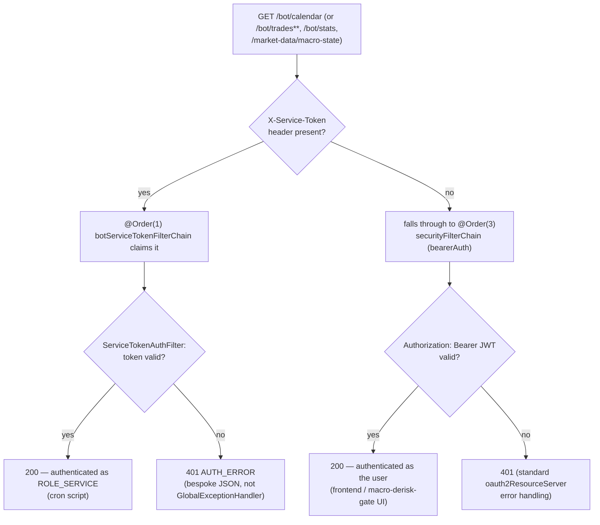

# ADR-089: Bot Module Cron GET Access via Conditional Service-Token Routing

**Date:** 2026-09-10
**Status:** Accepted
**Related:** `docs/architecture/03-api-contract.md` (Authentication section),
`docs/architecture/01-system-context.md` (Network and Security),
`docs/architecture/06-data-flow.md` §6 (Daily Asset News — the precedent this extends),
`.claude/tasks/bot-okx-tracking.task.md` ("Open questions" — GET-endpoint machine auth gap,
discovered 2026-09-04), `backend/src/main/java/pl/investing/config/SecurityConfig.java`
(`botServiceTokenFilterChain`), `ServiceTokenAuthFilter.java`, `ServiceTokenAuthAdapter.java`,
`infra/bot/daily-plan.sh`, `infra/bot/manage-position.sh`, `infra/bot/scalp-session.sh`,
`infra/bot/sync-calendar.sh`

## Context

The `bot` module (OKX macro-calendar trading-bot tracker, fully specced in
`bot-okx-tracking.task.md`) is implemented — entities/services/controllers under
`pl.investing.*.bot`, Flyway V63–V65 — but its two host-cron scripts have never actually run:

1. **The crontab entries were never installed.** `crontab -l` on the Pi today has only
   `infra/news/news-research.sh` and an unrelated app's script — nothing from `infra/bot/`.
2. **Even if the crontab were installed, `daily-plan.sh` would still fail**, because of a
   GET-endpoint auth gap discovered 2026-09-04 and confirmed still live: `SecurityConfig`'s
   `botServiceTokenFilterChain` (`@Order(1)`) matches `X-Service-Token` only on write methods:

   ```java
   boolean isBotMachinePath = path.equals("/bot/plans/ingest")
           || path.equals("/bot/calendar/sync")
           || path.equals("/bot/signals")
           || path.equals("/bot/trades")
           || path.startsWith("/bot/trades/");
   boolean isWrite = "POST".equals(method) || "PATCH".equals(method) || "PUT".equals(method);
   return isBotMachinePath && isWrite;
   ```

   `daily-plan.sh` needs to **GET** `/bot/calendar` and `/market-data/macro-state`. It has no real
   bearer JWT — its placeholder `cat /tmp/bot-jwt 2>/dev/null || echo dummy` is never populated by
   anything, so these two GETs 401 today and the script's `|| echo '{"page":{"total":0}}'`/`|| echo
   '{}'` fallbacks silently degrade it to an empty calendar and empty macro state. `daily-plan.sh`'s
   event-count check therefore always reads 0 and the script always takes the "no events today,
   post EMPTY plan, skip `claude -p`" branch. `manage-position.sh` and `scalp-session.sh` have the
   same problem for `GET /bot/trades/{id}`, `GET /bot/trades/{id}/ticks`, and `GET /bot/stats` —
   both scripts already send `X-Service-Token` on these calls (comments in `manage-position.sh`
   lines 22-28 already name this exact gap and point at this task) but get 401 until the matcher
   is widened.

   This machine-auth pattern (a static `X-Service-Token` header, validated by
   `ServiceTokenAuthFilter`/`ServiceTokenAuthAdapter` against the shared `NEWS_INGEST_TOKEN`
   secret — `BOT_INGEST_TOKEN` is an optional env-var alias the scripts also accept, but there is
   no separate server-side secret for it, see `infra/.env.example` lines 52-59) was reused from the
   news-ingest cron (`newsServiceTokenFilterChain`, `@Order(2)`) but, per the task file's own
   "Backend steps" item 7, was "never written up as their own ADR." This ADR gives the pattern its
   first proper write-up, scoped to the specific extension the bot module now needs: **GET** access
   for its cron/on-demand scripts.

### The naive fix would break the frontend

The obvious fix — add `"GET".equals(method)` to the existing `isWrite` check — is **wrong** and
was rejected. Unlike the four write-only paths (`/bot/plans/ingest`, `/bot/calendar/sync`,
`/bot/signals` POST, `/bot/trades` POST/PATCH/POST-actions), which no human caller ever hits, the
four read paths this task needs to open up are **dual-audience**: the web frontend already calls
`GET /bot/calendar`, `GET /bot/trades`, `GET /bot/stats` with an ordinary user `bearerAuth` JWT
(per the task file's API table), and `GET /market-data/macro-state` is an existing, already-live
endpoint consumed by the macro de-risk gate UI.

Spring Security routes each request to exactly **one** `SecurityFilterChain` — the first one
(by `@Order`) whose `securityMatcher` returns true — and `ServiceTokenAuthFilter` is strict and
terminal: if `X-Service-Token` is missing or wrong, it writes a 401 itself and never lets the
request continue down the chain (`ServiceTokenAuthFilter.doFilterInternal`, lines 40-50). So if
`botServiceTokenFilterChain`'s `securityMatcher` were simply widened to claim `GET /bot/calendar`
etc. unconditionally, every frontend request to those same paths — which never sends
`X-Service-Token` — would be intercepted by this chain and rejected with 401
`"Missing or invalid X-Service-Token"`, breaking the `/bot` page and the macro de-risk gate for
the actual human user. This is exactly the kind of mismatch the architect pass is supposed to
catch before Backend implements a plausible-looking but wrong `isWrite → isWrite || isRead` diff.

## Decision

### 1. Conditional (header-presence) chain routing, not a blanket GET carve-out

`botServiceTokenFilterChain`'s `securityMatcher` claims a **GET** request on the named read paths
**only when the caller actually presented an `X-Service-Token` header** (any non-null value —
validity is still checked, and still enforced strictly, by the unchanged
`ServiceTokenAuthFilter`/`ServiceTokenAuthAdapter` once the chain claims the request). A GET on
the same path with no `X-Service-Token` header simply isn't matched by this chain at all, so
Spring falls through to the existing `@Order(3)` `securityFilterChain` and is authenticated by the
normal `bearerAuth` JWT flow, completely unchanged. Write paths are untouched — they still match
unconditionally on path+write-method, exactly as today, because no human caller exists for them.

```java
@Bean
@Order(1)
public SecurityFilterChain botServiceTokenFilterChain(HttpSecurity http) throws Exception {
    http
            .securityMatcher(request -> {
                String path = request.getServletPath();
                String method = request.getMethod();
                if (path == null) return false;

                // Existing machine-only WRITE paths — unchanged, unconditional (no human
                // caller ever hits these).
                boolean isBotWritePath = path.equals("/bot/plans/ingest")
                        || path.equals("/bot/calendar/sync")
                        || path.equals("/bot/signals")
                        || path.equals("/bot/trades")
                        || path.startsWith("/bot/trades/");
                boolean isWrite = "POST".equals(method) || "PATCH".equals(method) || "PUT".equals(method);
                if (isBotWritePath && isWrite) return true;

                // NEW: cron-driven READS on paths the frontend ALSO calls with bearerAuth.
                // Claim the request here ONLY when a service token was actually presented —
                // otherwise fall through to the ordinary JWT bearer chain (@Order(3)) so the
                // frontend/macro-derisk-gate UI is completely unaffected.
                boolean isBotReadPath = path.equals("/bot/calendar")
                        || path.equals("/bot/trades")
                        || path.startsWith("/bot/trades/")
                        || path.equals("/bot/stats")
                        || path.equals("/market-data/macro-state");
                boolean isRead = "GET".equals(method);
                boolean hasServiceToken = request.getHeader(ServiceTokenAuthFilter.HEADER_NAME) != null;
                return isBotReadPath && isRead && hasServiceToken;
            })
            .sessionManagement(session -> session.sessionCreationPolicy(SessionCreationPolicy.STATELESS))
            .csrf(csrf -> csrf.disable())
            .authorizeHttpRequests(auth -> auth.anyRequest().authenticated())
            .addFilterBefore(new ServiceTokenAuthFilter(serviceTokenAuthAdapter), BasicAuthenticationFilter.class);
    return http.build();
}
```

`ServiceTokenAuthFilter`/`ServiceTokenAuthAdapter` need **no changes** — they keep their current
strict, constant-time-compared, terminal-401-on-mismatch behavior. Only the matcher predicate that
decides *whether this chain even sees the request* changes.

### Exact path list (kept as narrow as the existing write-path list — not a blanket "any GET")

| Path pattern | Method | Scope |
|---|---|---|
| `/bot/calendar` | GET | exact — `daily-plan.sh` |
| `/bot/trades` | GET | exact — trade list (swept in for free by reusing the same prefix rule as the write path; not currently called by any script, kept for consistency rather than inventing a second, diverging path list) |
| `/bot/trades/**` | GET | prefix — covers `/bot/trades/{id}` (`manage-position.sh`, `scalp-session.sh`), `/bot/trades/{id}/ticks` (`manage-position.sh`), and `/bot/trades/{id}/actions` (no script calls this GET today, but it's the natural future read for a strategist-loop action timeline, and comes for free from the same prefix) |
| `/bot/stats` | GET | exact — `manage-position.sh`, `scalp-session.sh` |
| `/market-data/macro-state` | GET | exact — `daily-plan.sh` |

Deliberately **excluded**: `GET /bot/signals` (no script needs it), `GET /bot/plans/**` (no script
needs it — `daily-plan.sh` only ever *writes* a plan via `POST /bot/plans/ingest`), `GET
/bot/equity` and `GET /bot/positions/open` (both under `BotStatsController`'s `/bot` mapping but
not named by any cron/on-demand script; add them the same way, header-gated, if a script ever
needs them — don't pre-open them speculatively). `GET /bot/control` stays bearer-only by design —
per the task file, the kill switch is deliberately human-only, never service-token.

### 2. Script-level follow-up (Backend, not just SecurityConfig)

The matcher fix alone does not fix `daily-plan.sh`: its two calendar reads and its macro-state
read (lines ~32, ~45-46) currently send `Authorization: Bearer $(cat /tmp/bot-jwt 2>/dev/null ||
echo dummy)` — never `X-Service-Token`. Under the new matcher, a request with no
`X-Service-Token` header falls through to the bearer chain regardless, and `"dummy"` (or a missing
file) is not a valid HS256 JWT there either, so it would still 401 unless the script itself is
also fixed. **Both changes are required together:**

- `SecurityConfig.botServiceTokenFilterChain` — widen per the code above (Backend).
- `infra/bot/daily-plan.sh` — change the three `curl` calls at lines ~32, ~45, ~46 from
  `-H "Authorization: Bearer $(cat /tmp/bot-jwt 2>/dev/null || echo dummy)"` to
  `-H "X-Service-Token: ${TOKEN}"`, mirroring how the same script's two `POST` calls (lines 21, 37,
  74) already do it. The `/tmp/bot-jwt` placeholder can be deleted once this lands — nothing else
  reads it.
- `manage-position.sh` / `scalp-session.sh` — **no script change needed**; both already send
  `X-Service-Token` on their GETs today (they just 401 until the matcher lands). Delete the
  now-resolved `# NOTE:` comment block in `manage-position.sh` lines 22-28.

### 3. Cron wiring (DevOps follow-up, host crontab — no Flyway/DB change)

Per the task file's "Cron" section, install on the Pi host (not inside Docker, same pattern as
`infra/news/news-research.sh`):

```
50 5 * * * /opt/investing-app/infra/bot/sync-calendar.sh
0  6 * * * /opt/investing-app/infra/bot/daily-plan.sh
```

Confirmed **not yet installed** — `crontab -l` today has neither line. This is host-crontab
state, not a schema or app-config change, so it is out of scope for a Flyway migration or this
ADR's own consequences; it's listed here only so Backend's SecurityConfig fix and DevOps's
crontab install are tracked as one unit of work with a single ADR pointer. `manage-position.sh` /
`watch-market.sh` / `scalp-session.sh` are **not** cron entries — they're triggered on-demand by
the bot itself (`POST /bot/trades/{id}/request-manage`), unchanged by this ADR.

### 4. Why conditional routing over the alternatives

- **Blanket GET carve-out** (rejected) — breaks the frontend, as shown above.
- **Split into separate machine-only endpoints** (e.g. `/bot/calendar/for-cron`) (rejected) —
  doubles the API surface for zero behavioral gain, and is exactly the kind of speculative
  complexity YAGNI/KISS argue against for a single-user, cost-free personal app. The response
  shape cron needs is identical to what the frontend already gets.
- **Merge JWT-bearer support into a new, separate chain for just these four paths** (a permissive
  filter that falls through on a missing header, paired with `.oauth2ResourceServer(...)` wired
  into that same new chain, so one chain tries both mechanisms) (rejected, see note below) — works,
  but duplicates the `backendJwtDecoder`/`jwtAuthenticationConverter` wiring the `@Order(3)` chain
  already owns, adds a new filter class and a new chain bean, and makes that chain responsible for
  two independent auth mechanisms instead of one. Header-presence routing on the *existing*
  `botServiceTokenFilterChain` achieves the identical "OR" outcome — a valid service token
  authenticates, a valid bearer JWT authenticates, anything else 401s — by picking *which*
  single-mechanism chain gets the request, rather than making one chain understand both. Simpler
  to reason about, and keeps every chain single-purpose (DRY: the JWT wiring is defined exactly
  once, in `@Order(3)`, no matter how many machine-auth carve-outs exist).

  **Found in the working tree while researching this ADR:** an uncommitted, untracked
  `backend/src/main/java/pl/investing/config/OptionalServiceTokenAuthFilter.java` already exists,
  implementing exactly this rejected alternative — a permissive filter (falls through to the JWT
  chain on a missing header, 401s on an invalid one) intended for a `SecurityConfig` bean named
  `dualAuthGetFilterChain` that **does not exist anywhere in `SecurityConfig.java`** (confirmed by
  `git diff`/grep — the only committed-in-progress `SecurityConfig` change is the write-only
  `botServiceTokenFilterChain` shown above, with zero reference to this filter). This is orphaned,
  half-finished work from an earlier pass at the same problem — it compiles standalone (present in
  `target/maven-status/.../inputFiles.lst`) but is wired into nothing and covered by no test.
  **Recommendation for Backend: delete `OptionalServiceTokenAuthFilter.java`** rather than finish
  wiring it — the securityMatcher-only fix above achieves the same behavior with less code and no
  duplicated resource-server config, per the DRY reasoning above. If Backend has a concrete reason
  to prefer the dual-filter-chain shape instead (e.g. wanting `ServiceTokenAuthFilter` itself to
  stay the *only* place that ever inspects the header, for a future audit-log hook), that's a
  legitimate call to make during implementation — but it should be a deliberate choice at that
  point, not two half-built designs left coexisting in the tree.
- **Recommended:** conditional/header-presence routing, as decided above — narrowest change,
  reuses the existing `ServiceTokenAuthFilter`/`ServiceTokenAuthAdapter` completely unmodified,
  and keeps the write-path matcher's proven, simple shape for the paths that are genuinely
  machine-only.

### Pattern evaluation

| Pattern/principle | Considered | Verdict |
|---|---|---|
| Chain of Responsibility | Yes — this *is* the existing shape (`@Order`-ed `SecurityFilterChain`s, each either claims a request or defers to the next) | Already in use; this ADR extends the existing chain's matcher predicate, introduces no new chain |
| Adapter | Yes — `ServiceTokenAuthAdapter` already adapts a raw header value into a Spring `Authentication` | Already in use, unmodified |
| Strategy (implicit: JWT vs. service-token as interchangeable auth strategies) | Yes | Already the de facto shape via multiple filter chains; not formalized into an explicit `Strategy` interface — YAGNI for two fixed strategies in a single-user app |
| A generic "multi-scheme" security abstraction (e.g. a reusable `EitherAuthenticationFilter`) | Considered | Rejected — one conditional boolean in one matcher lambda solves the actual problem; building a reusable abstraction for a pattern used twice (news write-only, bot read+write) is speculative for this app's size |
| Separate per-endpoint machine tokens (`BOT_INGEST_TOKEN` as a real, distinct secret) | Considered | Rejected — out of scope for this ADR; the existing shared-secret-with-alias-name behavior (`infra/.env.example` lines 52-59) is pre-existing, documented, and not what this task asked to change |

### Diagram — chain selection for a GET on a shared read path

No sequence/class diagram: no new entities, DTOs, or request/response shapes are introduced —
this is purely a routing decision inside `SecurityConfig`. The flowchart below is the only visual
that adds value, showing exactly how a `GET /bot/calendar` (or the other three shared read paths)
is routed today vs. under this decision.



**Legend:** the routing decision (top diamond) happens once, in the `securityMatcher` lambda,
before any authentication filter runs — it decides *which* chain gets the request, not *whether*
it's authenticated. Everything below each branch is existing, unmodified behavior.

## Consequences

- **Config-only change.** No DB schema change (no Flyway migration), no OpenAPI request/response
  shape change — `GET /bot/calendar`, `GET /bot/trades*`, `GET /bot/stats`, `GET
  /market-data/macro-state` keep returning exactly what they return today, for both callers. The
  only thing that changes is which `securityMatcher` claims a given request when
  `X-Service-Token` is present. Confirmed — no schema/contract drift to flag.
- **`docs/openapi/` correction, done as part of this ADR:** the `serviceTokenAuth` scheme
  description in `docs/openapi/components/security-schemes.yaml` previously claimed it was used
  "ONLY" by the news module — now corrected to describe both news's exclusive use and bot's
  split (write-only exclusive, four reads dual-credential), with the stale `(ADR-041)` citation
  removed (no such ADR file exists — see "Documentation debt" below). `npm run openapi:bundle` and
  `npm run openapi:lint` were re-run after this edit; lint's pre-existing 77 errors / 8 warnings
  are unchanged (confirmed via `git stash`/re-lint before vs. after — none originate from this
  file). **The `bot` module's paths do not exist in `docs/openapi/paths/` at all yet** — none of
  `/bot/calendar`, `/bot/plans/**`, `/bot/signals`, `/bot/trades/**`, `/bot/stats`,
  `/bot/control` are documented in the OpenAPI source tree today (confirmed — zero matches). This
  is a pre-existing gap, not something this ADR's security-matcher fix creates or needs to solve;
  it is tracked as its own documentation debt below. When bot's OpenAPI paths are eventually
  written, the four dual-audience `GET` operations should declare
  `security: [{bearerAuth: []}, {serviceTokenAuth: []}]` (either credential satisfies the request)
  per this ADR's decision — everything else in the bot module stays `bearerAuth`-only (reads) or
  `serviceTokenAuth`-only (writes), matching `SecurityConfig`.
- **Test coverage Backend should add:** a GET on each of the four paths with a valid
  `X-Service-Token` and no `Authorization` header succeeds; the same GET with a valid `Authorization:
  Bearer` JWT and no `X-Service-Token` header still succeeds (regression guard for the frontend);
  a GET with an invalid `X-Service-Token` present gets the bespoke 401 (not a fall-through to the
  bearer chain — presence of the header, even if wrong, must still claim the machine chain, or a
  wrong token would silently get a second chance against bearer auth, which is not the intended
  fail-closed behavior); the four excluded paths (`/bot/signals`, `/bot/plans/**`, `/bot/equity`,
  `/bot/positions/open`) remain bearer-only even with a valid `X-Service-Token` header present
  (matcher correctly scoped, not accidentally broad).
- **`daily-plan.sh` needs a script edit, not just the SecurityConfig change** — see "Script-level
  follow-up" above. Without it, the pipeline still runs on empty calendar/macro-state data even
  after the matcher lands.
- **Cron install is a separate DevOps action**, tracked here for traceability but not part of this
  ADR's own change set (host crontab, not Flyway/compose).
- This is the **second** machine-to-machine surface to reuse the `X-Service-Token` pattern (after
  news), and the **first** to need it on a path also served to a human user — future reuse of this
  pattern on a third dual-audience endpoint should copy the conditional/header-presence matcher
  shape from this ADR, not the news module's simpler unconditional-claim shape (which only ever
  worked because news's machine paths were never also human-facing).

## Documentation debt found while researching this ADR (not fixed here — out of scope)

Noted for the record rather than silently left for someone to rediscover:

- **`ADR-041` and `ADR-039` are cited by name in at least ten places** (`06-data-flow.md` ×5,
  `04-db-schema.md` ×1, `08-monorepo-layout.md` ×3, `12-portfolio-bpps-and-shared-packages.md` ×1,
  `ADR-064`, `ADR-077`, `ADR-079`) but **no such files exist under `docs/adr/`** — the ADR log
  jumps from nothing before ADR-055 straight through today's ADR-089, and the lowest-numbered file
  is `ADR-055-deposit-amount-uses-planned-not-actual.md`. This is exactly the gap the task file's
  own "Backend steps" item 7 already flagged for the bot/news machine-auth pattern specifically
  ("no such ADRs exist... write them properly if/when the architect pass covers this module") —
  this ADR resolves that one instance for bot, but the ADR-041 (news) and ADR-039 (MEXC bot
  DeMarker/isolation) references remain dangling. One instance was corrected as a side effect of
  this ADR's edit to `06-data-flow.md` §6; the rest were left untouched to keep this change
  proportionate to its actual scope.
- **`01-system-context.md` cites `docs/architecture/07-adrs.md`** ("ADR-002, ADR-031, ADR-032 for
  the full history") — that file does not exist in `docs/architecture/` (confirmed — only
  `00-stack-validation.md` through `12-portfolio-bpps-and-shared-packages.md` plus `diagrams/`
  exist, no `07-adrs.md`).
- **The entire `bot` module (6 tables, ~20 endpoints across `BotCalendarController`,
  `BotPlanController`, `BotSignalController`, `BotTradeController`, `BotStatsController`,
  `BotControlController`) has zero documentation** in `docs/architecture/03-api-contract.md`,
  `docs/architecture/04-db-schema.md`, and zero paths in `docs/openapi/` — it exists only in
  `.claude/tasks/bot-okx-tracking.task.md` and the running code. This ADR intentionally does not
  fill that gap (it would be a large, separate architecture pass, not a config-boundary fix) —
  flagged so it isn't mistaken for already covered once this ADR lands.

None of the above blocks Backend from implementing this ADR's `SecurityConfig` change.

## Amendment 2026-11-09 — mechanism (ADR-114 §6, task 191)

The credential per route is now read from each operation's OpenAPI `security` list (matched by
chi route pattern), not from path prefixes. Behaviour is unchanged for all 83 operations. Two
follow-ups: `GET /bot/trades/pending-scalp` was always served dual and the spec now says so
(`e05947e`). `GET /market-data/macro-state` is served **bearer-only** by the Go backend, unlike
this ADR's decision, so `daily-plan.sh`'s service-token read is refused. Restoring it is task 191
Q2.

## Amendment 2026-11-12: macro-state dual read restored in the Go backend

The Go port of the security chain (`cmd/server/botauth.go` `isDualRead`) had dropped the exact path
`GET /market-data/macro-state` from the table above, so `daily-plan.sh` got a 401 there and the
published plan said "MACRO_STATE returned UNAUTHORIZED" (no blendFactor / compositeZ / riskOff
reading). It is back in `isDualRead` (exact path, GET only; `/macro-state/history` and
`POST /macro-state/refresh` stay bearer-only) with routing-matrix test rows, and `getMacroState` in
the OpenAPI spec now lists `serviceTokenAuth` next to `bearerAuth`.

