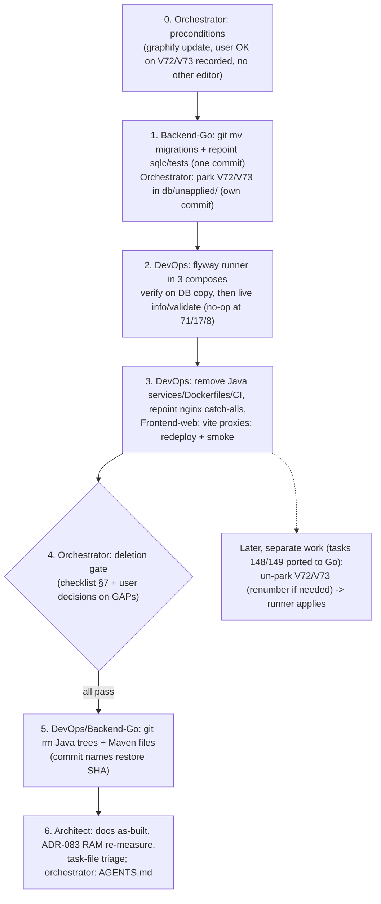

# ADR-098: Retiring Java — Migration Relocation, Flyway Runner, Go Repoint, Deletion Gate

**Date:** 2026-09-19
**Status:** Accepted (design; execution is the ordered plan in
`.claude/tasks/go-rewrite-phase-9-retire-java.task.md` — nothing in this ADR has been executed yet)
**Related:** `docs/adr/ADR-094-go-backend-rewrite.md` (strangler-fig migration; Decision 2 keeps Flyway),
`docs/adr/ADR-097-historia-scheduler-gap-and-backfill.md` (the incident this plan is designed not to
repeat), `docs/architecture/13-go-backend-target-architecture.md` §7 (Phase 9 row),
`.claude/tasks/134-flyway-v18-v46-checksum-drift.task.md`, `docs/adr/ADR-083-container-ram-consolidation.md`.

## Context

The user directed (2026-09-19): "we can delete java — if everything is committed; we can always
restore java from commits." All 3 Java containers are already stopped (commit `16e3433`) and every
domain incl. `/auth/token` is `GoOwned` on all 3 apps. Deleting `backend/`, `apps/*/backend/` and
`packages/shared/java/` is therefore mechanically easy — and dangerous for exactly one reason:
**those trees still hold things nothing else replaces.** ADR-097 was the same class of mistake (a
Java-side duty — the 23:00 snapshot — lost because its Go owner was gated off when Java stopped).
This ADR inventories every Java-side duty and dependency, decides where each goes, and orders the
work so the destructive step is last and gated.

Every fact below was verified against the working tree, the running compose stacks, and — for
Flyway — a **dry run on a streamed copy of all three live databases** (read-only `pg_dump` piped
into a throwaway Postgres 17.10 container; nothing written to the repo; live DBs untouched,
confirmed `max(version)=71` afterwards; throwaway container/network removed).

## Blocker inventory (each one is resolved by a Decision below)

| # | Blocker | Evidence |
|---|---|---|
| B1 | Flyway migrations exist **only** inside the Java trees: root `backend/src/main/resources/db/migration/` (71 tracked + V72/V73), portfolio-b `.../db/migration/` (16 files), portfolio-c (8 files). | `git ls-files` counts 71/16/8; live `flyway_schema_history` max version 71 / 17 / 8. |
| B2 | `V72__bot_hard_close_timeout.sql` and `V73__bot_trade_action_execution.sql` are **untracked**, not applied to live (max 71) — not restorable from git. User confirmed 2026-09-19 that no session is editing them. They belong to ADR-095/096 (tasks 148/149), designed against Java classes (`BotHardCloseWatcherService`, `BotScalpSessionService`) that were **never implemented**; the orchestrator verified zero Go or Java references to any column/value they introduce. **Decision (orchestrator, 2026-09-19): they must NOT be applied by the runner; live stays at V71.** | `git status`; live DB query; orchestrator grep of `backend-go` + `backend/src`; both apply cleanly on a real-data copy (dry run), so they are valid SQL to un-park later. |
| B3 | **Nothing outside Java applies migrations.** No Flyway service exists in any compose file; Spring ran it at startup (`spring.flyway.locations: classpath:db/migration`, `validate-on-migrate: false`). | grep of `infra/`, `infra-shared/`, `apps/*/infra/`. |
| B4 | Go code/tooling hard-depends on the Java paths: 3 `sqlc.yaml` files (71 + 16 + 8 explicit file lines) and **45 Go test files / 53 call sites** of `testsupport.StartMigratedPostgres(t, "<..>/backend/src/main/resources/db/migration")` (root 23 files/27 sites, portfolio-b 11/13, portfolio-c 11/13). No non-test Go code references the path. | grep, exhaustive. |
| B5 | **Portfolio B's live migration history cannot pass a default Flyway validation** — a finding that would have broken the new runner on first run (see Decision 2). | dry run: V2 and V5 checksum mismatches; V7 (`account_balances`) applied on live but **absent from the repo and from all git history** (portfolio-b was merged via a squashed subtree, `34aec92`). |
| B6 | Nginx's generic `location /api/`, `/portfolio-b/api/`, `/portfolio-c/api/` catch-alls still `proxy_pass` to the stopped Java containers (`backend:8080`, `backend-portfolio-b:8080`, `backend-portfolio-c:8080`). | `infra/nginx/nginx.conf` lines ~517-523, ~808-818, ~1064-1071. Static check: all 60 root / 21 portfolio-b / 21 portfolio-c OpenAPI paths already match an explicit Go location, so the catch-alls carry no spec'd traffic today. |
| B7 | Java-side duties with **no running Go owner** (Decision 5): BLS direct CPI/PPI actuals (ADR-093) has no Go implementation; live OKX execution is disarmed on Go. | grep for `api.bls.gov` in Go = empty; `BOT_LIVE_EXECUTION_ENABLED` and `OKX_*` not passed to `backend-go`. |
| B8 | Untracked / uncommitted content that Java deletion would destroy or that git cannot restore: `.github/workflows/backend-tests.yml` (whole `.github/` untracked), V72/V73, 32 modified `*IT.java`, `apps/portfolio-c/backend/.classpath`, `packages/shared/java/.../InflationMath{,Test}.java`. | `git status`. |

## Decisions

### 1. Neutral migration layout: per-app `db/migration/` (history-preserving `git mv`)

```
db/migration/                                  <- root app, database `investing`  (V1..V71)   SCANNED by Flyway, sqlc, Go tests
db/unapplied/                                  <- PARKED, root only: V72, V73 + README.md     NOT scanned by anything
apps/portfolio-b/db/migration/        <- database `portfolio-b`   (V1..V6, V8..V17)
apps/portfolio-c/db/migration/         <- database `portfolio-c`    (V1..V8)
```

Why this shape: it keeps the repo's existing asymmetric layout (each app owns its own tree:
`backend-go/`, `frontend-web/`, `infra/`, `docs/`); it is app-scoped, not "infra" (schema is a
contract owned by the Architect, not deployment config); and doc 13 §2 already describes
`sqlc.yaml` as pointing "at each app's `db/migration/` directory". `db/migration/` (DDL source of
truth) is distinct from `backend-go/db/` (sqlc queries + generated code + the migration test) —
both the docs and a one-paragraph README **one level up** (`db/README.md`, `apps/*/db/README.md` —
never inside `db/migration/`, because `testsupport.collectSQLFiles` copies every top-level file
of the migration dir into the Flyway container) must say so. **Rejected:** one shared
`migrations/{investing,portfolio-b,portfolio-c}/` dir (breaks per-app ownership); `infra-shared/migrations/`
(couples schema to the DB stack, and Compose `depends_on` cannot cross projects — see Decision 2).

**Mechanics (Backend-Go).**
- Tracked files: `git mv` only, byte-identical, in a commit that contains renames plus the
  path-only Go/sqlc edits of Decision 3 (rename detection stays at 100% because SQL content is not
  touched). Verify with `git log --follow` on V1 and V71 after the commit.
- **V72/V73 are parked, not migrated (orchestrator decision).** They are untracked, so `git mv` is
  impossible; the **orchestrator** does that move itself, in its own separate commit: plain `mv`
  into `db/unapplied/` (a **sibling** of `db/migration/`, never inside it), plus a short
  `db/unapplied/README.md`, then `git add` those three paths explicitly. The README must state:
  (1) these two files belong to tasks 148/149 / ADR-095/096 (bot hard-close timeout; bot trade
  action execution) and are **intentionally unapplied** — no Go or Java code uses their columns;
  (2) they must be moved back into `db/migration/` only when the Go implementation of ADR-095/096
  lands (that work needs the designs ported from Java classes to Go first); (3) versions **V72/V73
  stay reserved for them** — but Flyway applies in order (`outOfOrder` off), so if any other
  migration has meanwhile been numbered V74+ **and applied**, these two are still unapplied and
  must be **renumbered to the next free versions** when un-parked (safe: never applied), not
  moved back as-is. Because `db/unapplied/` is outside `db/migration/`, the runner's bind mount
  (`../db/migration:/flyway/sql`), sqlc's explicit file lists and every
  `StartMigratedPostgres(..., "…/db/migration")` call can never see them — Testcontainers suites
  then run against exactly V1..V71, i.e. the live schema. (Flyway's `filesystem:` locations scan
  **recursively**, which is why a sibling — not a subdirectory — is the required placement.)
  Gated on the orchestrator's recorded confirmation that no session still edits them (obtained
  from the user 2026-09-19). After relocation the old path is dead: any session still holding the
  old path in its instructions (`.claude/agents/{backend,architect,backend-go}.md` all name it)
  must be told.
- **Flyway validity after relocation (verified, not assumed).** Flyway keys on
  version + description + checksum; the checksum is a CRC32 of the parsed file *content*, and the
  history's `script` column is the bare filename (files sit at the location root). Neither depends
  on the directory. Dry run: files copied to a different path matched **all 71 applied root
  migrations (the only validate findings were V72/V73 "pending", which the parked layout now keeps
  out of the scanned dir) and 8/8 portfolio-c** against copies of the live history. The 2026-09-02
  repair of V18/V46/V60 (task 134) is holding: no root checksum drift remains.

### 2. Flyway runner: one one-shot `flyway` service **per app compose**, image `flyway/flyway:12.4.0`

Design (identical in `infra/compose.yml`, `apps/portfolio-b/infra/compose.yml`,
`apps/portfolio-c/infra/compose.yml`):

```yaml
  flyway:                              # service names follow the backend-go convention to avoid a DNS-alias
                                       # collision on the shared `investing-shared` network:
                                       # `flyway` (root) / `flyway-portfolio-b` / `flyway-portfolio-c`
    image: flyway/flyway:12.4.0        # MUST equal testsupport.DefaultFlywayImage (one pinned tag, tests == prod)
    platform: linux/arm64
    restart: "no"
    command: migrate                   # never `clean`; FLYWAY_CLEAN_DISABLED below is belt-and-braces
    environment:
      FLYWAY_URL: ${DB_URL}            # already a jdbc:postgresql://db-shared:5432/<db> URL — reused verbatim
      FLYWAY_USER: ${DB_USERNAME}      # per-DB owner role (investing_user / portfolio-b_user / portfolio-c_user), as Spring used
      FLYWAY_PASSWORD: ${DB_PASSWORD}
      FLYWAY_LOCATIONS: filesystem:/flyway/sql
      FLYWAY_CONNECT_RETRIES: "10"     # db-shared is a separate stack; tolerate it still coming up
      FLYWAY_CLEAN_DISABLED: "true"
    volumes:
      - ../db/migration:/flyway/sql:ro # relative to the compose file's dir -> that app's own db/migration.
                                       # Mount ONLY this dir (Flyway scans recursively); root's parked
                                       # db/unapplied/ (V72/V73) is a sibling and stays invisible.
    networks: [investing-shared]       # where db-shared lives
    security_opt: ["no-new-privileges:true"]
    mem_limit: 384m                    # dry run passed at 384m; it is a short-lived JVM, not steady-state RAM
  backend-go:                          # (backend-go-portfolio-b / backend-go-portfolio-c for siblings)
    depends_on:
      flyway:
        condition: service_completed_successfully
```

Why per-app runners rather than one in `infra-shared`: (i) **Compose `depends_on` cannot span
projects** — the backend-go services live in projects `investing`/`portfolio-b`/`portfolio-c`, `db-shared` in
`shared-infra`; only a same-project service can gate `backend-go`, which is what preserves the
"starting the app migrates first" semantics Spring gave for free; (ii) **no new secrets and no
credential co-location** — each app's `.env` already holds only its own `DB_*`, whereas a shared
runner would need all three passwords in one file, undoing ADR-083's per-DB-role isolation;
(iii) a schema change ships in the same `up -d` as the code that needs it. Cost: three ~15-line
stanzas — accepted (Compose extension fields cannot span files; a shared `include:` is more
machinery than three small copies, YAGNI). **Rejected:** golang-migrate/goose/embedded migrations
(ADR-094 §2: second history-table format on a live financial DB); baking migrations into an image
(bind mount is simpler and the Pi builds from the checkout anyway). Note the ADR-094 text said
`-alpine`; the as-built pin is the non-alpine `12.4.0` because that is what `testsupport` already
pins and the host already has; an `-alpine` arm64 manifest exists, so switching **both** in
lockstep is a later optional cleanup. Credentials are supplied only via the existing `.env`
substitution — no config file, nothing new to commit. `docker compose up -d` re-runs the runner
each time (idempotent no-op, a few seconds); a failing migration aborts `up` and leaves any
already-running `backend-go` untouched — fail-closed by design.

**Per-app validation policy (from the dry run — this is the important part).** Flyway CLI
validates on migrate by default; Spring did not (`validate-on-migrate: false`).

| DB | `flyway validate` on live-history copy | Runner setting |
|---|---|---|
| `investing` (root) | clean for all 71 applied (V72/V73 were the only findings, "pending" — now parked outside the scanned dir) | validation **on** (default) — first time drift can now be caught |
| `portfolio-c` | clean (8/8) | validation **on** |
| `portfolio-b` | **fails**: V2 + V5 checksum mismatch, V7 missing (pre-subtree-merge history) | `FLYWAY_VALIDATE_ON_MIGRATE: "false"` — behavior-identical to what Spring did; migrate is a verified no-op at V17 |

`ignoreMigrationPatterns` cannot mask a checksum mismatch, so `validateOnMigrate=false` is the only
non-mutating option for portfolio-b. The clean alternative is a metadata-only `flyway repair` on
`portfolio-b` (same class of action the user authorised for root in task 134) after which the override
can be dropped — **left as an open user decision**; this ADR does not require it. V7's effect is
neutralised on a fresh replay (V10 deletes the `settings` keys V7 seeded), so a from-scratch build
from the repo converges anyway.

**V72/V73 and the first run.** The runner applies nothing beyond V71 on first run, by layout
rather than by a flag: V72/V73 live in the parked, unmounted `db/unapplied/` (Decision 1), so the
runner's location contains exactly V1..V71 and `migrate` is a verified no-op against the live
history (dry run: "Schema public is up to date", version 71). No `FLYWAY_TARGET` gate is used — a
target pin would be a second mechanism that someone must remember to remove. Un-parking is a
future, deliberate act by whoever implements ADR-095/096 in Go: move (and, if needed,
renumber — see Decision 1) the files into `db/migration/`, add the sqlc list entries, take a
`pg_dump` into the gitignored `infra-shared/backups/` first, and let the runner apply them. For
that day it is already proven that both files apply cleanly on a real-data copy of the live DB
("Successfully applied 2 migrations … now at version v73", second run no-op, all nine new columns
present). This entire topic is decoupled from Java deletion: the deletion gate only needs the two
files preserved (and reachable in git) under `db/unapplied/`.

**Verification procedure before the runner touches live (DevOps).**
1. `docker compose config` on each compose file.
2. Throwaway copy: create a scratch Postgres 17.10 container + network; stream
   `docker exec shared-infra-db-shared-1 pg_dump -Fc --no-owner --no-privileges <db> | docker exec -i <scratch> pg_restore ...`
   (nothing to disk, never into the repo); run the exact runner image/env against it:
   `info`, `validate`, `migrate` (expect: root validate clean and migrate a no-op at 71; portfolio-c
   clean, no-op at 8; portfolio-b migrate a no-op at 17 with validation off).
3. Only then, against live: `docker compose run --rm flyway info` (read-only) and `validate`
   (read-only; root/portfolio-c), then `docker compose up -d backend-go` per app. Compare
   `select count(*), max(version::int) from flyway_schema_history` before/after (must be unchanged).

### 3. Go repoint: pure suffix substitution, sqlc output byte-identical

The old segment `backend/src/main/resources/db/migration` is replaced by `db/migration`; **the
relative prefix (`../../..` etc.) is unchanged**, so this is a mechanical `sed` over exactly the
inventoried files: 3 `sqlc.yaml` (95 lines) + 45 `*_test.go` (53 sites) + the 3 `db/migration_test.go`.
Traps (Backend-Go must not fall into): keep the lists as a path-only substitution — do not
regenerate them from a directory glob (V72/V73 are parked outside `db/migration/`, so a re-run
would happen to match today, but the substitution is the byte-identical guarantee); Go
integration tests skip under `-short`, so the proof runs must be **without** `-short`.
Proof: baseline first (`sqlc generate` in all 3 modules → `git diff --exit-code -- '**/db/sqlcgen'`
empty; record the full `go test ./...` result per module), repoint, then repeat — generated code
byte-identical and the same suites green (Docker/Testcontainers required; multi-minute on the Pi).
Also refresh the comments that call the directory "Java-owned" / cite the old path
(`sqlc.yaml` headers, `hack/gen-sqlc-schema-list.sh`, `backtest/studies/portfolio_macro_blend_backtest.py:66`).

### 4. Nginx: repoint the three generic API blocks to Go, do not delete them

Deleting `location /api/` would let `location /` (SPA `try_files … /index.html`) answer unknown
`/api/*` paths with a 200 HTML page. Repoint instead: `/api/` → `backend-go:8091`,
`/portfolio-b/api/` → `backend-go-portfolio-b:8092`, `/portfolio-c/api/` → `backend-go-portfolio-c:8093` (keep
`limit_req zone=api_limit`, which today sits **only** on these three blocks — note that explicit
Go blocks have never been rate-limited; whether to extend it is DevOps' call, not a Phase 9
requirement). Then rewrite the stale header/"Rollback: flip back to `$backend_upstream`/8080"
comment blocks (`grep -n 'Java\|backend_upstream\|8080' infra/nginx/nginx.conf`). Bot host scripts
(`infra/bot/*.sh`) and everything else reach the API via `http://localhost/api` through Nginx, so
they need no change. Vite dev proxies in `apps/{portfolio-b,portfolio-c}-investing-app/frontend-web/vite.config.ts`
target `http://localhost:8081` (the removed Java host port) and must be repointed (Frontend-web).

### 5. Java-duty parity matrix (the ADR-097 lesson made explicit)

Every `@Scheduled`/startup duty found in `backend/`, `apps/*/backend/`, `packages/shared/java/`:

| Java duty | Go owner | Enabled? |
|---|---|---|
| root `PriceCacheService` 15 min + `CacheWarmupListener` | `runScheduledPriceRefresh` (`backend-go/cmd/server/main.go`) | unconditional |
| root `MacroDataScheduler` (Fri 18:00, 1st 17:30, 5th 18:30) | `macro.StartScheduler` | unconditional |
| root `GusInflationSyncService` (15th 06:00 + startup) | `inflation.StartScheduler` | unconditional |
| root `HistoriaScheduler` 23:00 | `historia.StartScheduler` | `HISTORIA_SCHEDULER_ENABLED=true` in compose (ADR-097) |
| root `EventReleaseWatcherService` 1 s + `BotCalendarService` 04:00 purge | `trade.StartWatcher` + `calendar.StartScheduler` | `BOT_SCHEDULER_ENABLED=true` in compose (ADR-097) |
| portfolio-b/portfolio-c `PriceCacheService`, `CacheWarmupListener` | `marketdatacore.StartPriceRefreshScheduler` | unconditional |
| portfolio-b/portfolio-c `InflationSyncService` (15th + startup) | `inflationsync.StartScheduler` | unconditional |
| portfolio-b/portfolio-c `HistoriaScheduler` 23:00 | `historia.StartScheduler` | `HISTORIA_SCHEDULER_ENABLED=true` in compose (ADR-097) |
| portfolio-b/portfolio-c `HistoriaBackfillRunner` (ApplicationRunner) | `admin.StartBackfillRunner` | unconditional |
| **Flyway at startup** | **none today** | **Decision 2 (this ADR)** |
| **root BLS direct CPI/PPI actuals** (`BlsDirectActualsSyncService`/`BlsApiClient`, ADR-093/task 147, key `BLS_API_KEY`) | **none — no `api.bls.gov` code in Go** | **GAP** |
| **root live OKX execution** (`LiveExecutionService`, keys `OKX_*`) | `trade.LiveExecutionService`, gated by env `BOT_LIVE_EXECUTION_ENABLED` (default off) **and** `OKX_*` | **disarmed**: neither `BOT_LIVE_EXECUTION_ENABLED` nor `OKX_*`/`BLS_API_KEY`/`MARKET_DATA_PRICE_CACHE_TTL_MINUTES` are passed to the `backend-go` container (all set in `infra/.env`; `MARKET_DATA_PRICE_CACHE_TTL_MINUTES` is not read by Go at all) |

The two GAP rows are **deletion-gate items, not for this ADR to decide**: for each the user must
choose *port to Go* / *arm on Go (pass the env)* / *knowingly drop*. Facts for that decision
(read-only queries, 2026-09-19): `bot_control.trading_enabled = true`, `bot_trade` has 0 rows
(never traded), `bot_calendar_event` 324 rows of which 2 have `actual` populated. In-process Spring
`@EventListener` observers (`PositionChangedListener`, `FxRateRefreshListener`,
`PriceRefreshListener`) are covered by Go's direct calls in the ported services.
The `InflationMath` uncommitted diff (`months < 12` returns the raw cumulative figure) is **already
ported**: `backend-go/internal/historia/inflation.go` and `shared-go/historiaquery/math.go` both
carry the guard with tests — the Java diff is disposable.

### 6. What goes, what changes (exhaustive)

**Deleted (step d, after the gate):** `backend/`, `apps/portfolio-b/backend/`,
`apps/portfolio-c/backend/`, `packages/shared/java/`, root `pom.xml`, `mvnw`, `mvnw.cmd`,
`.mvn/`, `infra/backend/` (Dockerfile), `apps/{portfolio-b,portfolio-c}-investing-app/infra/backend/`
(Dockerfiles), `backend-go/hack/coexistence-smoke-test.sh` (Java-vs-Go comparator; obsolete). Ignored,
regenerable leftovers inside those trees (`target/`, `.classpath`, `.factorypath`, `.project`,
`.settings/`) go with them.
**Edited (step c):** the three compose files (remove `backend`/`backend-portfolio-b`/`backend-portfolio-c`
incl. their healthchecks and the `127.0.0.1:8081/8082` host ports; add `flyway`; add
`depends_on`; fix "Coexists with backend (Java)" comments and the nginx/frontend `depends_on`
comments; keep `SPRING_PROFILES_ACTIVE` and the JDBC-shaped `DB_URL` — Go's `shared-go/config`
still reads both), `infra/nginx/nginx.conf`, the two sibling `vite.config.ts`, `.dockerignore` and
`.gitignore` Java entries (cosmetic), `.env.example` files' "Spring Boot" comments,
`.github/workflows/backend-tests.yml` (Maven-only, **untracked** — never in git; see open decisions).
**Task files:** `129-shared-java-pom-*` and `133-appcds-spike` become moot → move to `done/` with a
one-line "moot: Java retired" note; `134` stays open (append the portfolio-b finding); `138`, `144`,
`147` (BLS — see GAP), `148`/`149` (Java-targeted handoffs for ADR-095/096 code that exists nowhere)
and `cross-portfolio-crypto-donor-waterfall` reference Java classes and need re-targeting to
Backend-Go or a "verify Go equivalent exists" note. **`.claude/worktrees/*`:** stale full copies
containing Java; do not touch, expect them in grep noise.
**Docs rewritten as-built (step e, Architect, only after (d) so they describe reality):**
`docs/architecture/08-monorepo-layout.md` (88 Java mentions), `12-portfolio-bpps-and-shared-packages.md`
(48), `00-stack-validation.md` (24), `01-system-context.md` (16), `10-refactoring-plan.md` (13),
`06-data-flow.md` (8), `04-db-schema.md` (line 5 path), `03-api-contract.md`, `02`, `05`,
`docs/architecture/13-…md` + `ADR-094` (final "historical — superseded by as-built" status line,
not deleted), `docs/adr/ADR-083-container-ram-consolidation.md` (re-measure the RAM table with
`docker stats` at steady state — its premise was JVM RAM; the Flyway runner is a transient JVM,
state that), the sibling `docs/architecture.md`/`CLAUDE.md` files.
**For the orchestrator (AGENTS.md is not edited here):** (1) orchestration table — Backend row
retired/"Java removed, history in git", Backend-Go row no longer "growing"; (2) "Go backend rewrite
(in progress)" section → as-built; (3) Quality gates — replace JPA/MapStruct rule with
sqlc/pgx→domain→OpenAPI DTO, "Secrets live in `.env` / Spring profiles" → `.env` (note
`SPRING_PROFILES_ACTIVE` is still the dev/prod switch Go reads); (4) Market-data line
"Call it from the Java backend (`yahoofinancejava`)" → Go `priceprovider`; (5) Project structure —
drop root `backend/`, add `backend-go/`, `db/migration/`, `packages/shared/go`; (6) "Rebuilding and
restarting" block — `docker compose build backend-go && docker compose up -d backend-go`, logs
`investing-backend-go-1`, startup check on the `backend-go listening` log line instead of
"Started InvestingAppApplication", add `docker compose run --rm flyway info`, and in the nginx
paragraph replace `backend`/`backend-portfolio-b`/`backend-portfolio-c` and the `http://backend:8080` example
with the `backend-go*` names/ports. **Obsolete agent files:** `.claude/agents/backend.md` (retire);
`architect.md` (lines 25, 118 migration path), `backend-go.md` (lines 105, 138 sqlc path),
`devops.md` (Java compose/healthcheck/Nginx examples) need path/example updates — listed, not
edited.

### 7. Deletion gate (explicit checklist — all must hold; the orchestrator signs it off)

1. **Preserved elsewhere:** `git ls-files db/migration apps/portfolio-b/db/migration apps/portfolio-c/db/migration`
   counts 71 / 16 / 8, and `git ls-files db/unapplied` lists V72, V73 and README.md (**tracked**, i.e.
   the orchestrator's commit has landed); the old directories contain no `*.sql`;
   `git log --follow` on V1/V71 reaches pre-move history.
2. **Nothing lost in the trees:** `git status --short -- backend apps/portfolio-b/backend apps/portfolio-c/backend packages/shared/java pom.xml mvnw mvnw.cmd .mvn infra/backend apps/*/infra/backend`
   shows **no** `??` and no ` M`/`M ` — the 32 `*IT.java` `.withReuse(true)` tweaks, portfolio-c
   `.classpath` and the two `InflationMath` files are the *known* modified set: each is explicitly
   discarded (`git checkout --` / `git rm`) with the orchestrator's OK, not left to chance.
   `git status --ignored` under those paths lists only `target/`, `.classpath`, `.factorypath`,
   `.project`, `.settings/`.
3. **Restore anchor recorded:** the last commit containing the Java trees is named in the deletion
   commit message (`git checkout <sha> -- backend apps/… packages/shared/java` restores everything).
4. **Go proof:** all 4 Go modules (`backend-go`, both `apps/*/backend-go`, `packages/shared/go/shared-go`)
   `go test ./...` **without `-short`** green from the relocated paths; `sqlc generate` byte-identical.
5. **Runner proof:** `flyway info`/`validate` recorded per DB on the live stack (root/portfolio-c validate
   ok, all no-ops at 71/8, portfolio-b no-op at 17) and `flyway_schema_history` row counts unchanged.
6. **Redeployed and smoke-tested, zero JVM:** `docker ps` shows no Java container; `/`, `/portfolio-b/`,
   `/portfolio-c/` load; authenticated GETs succeed per app (self-minted 10-min JWT per AGENTS.md's
   standing permission, called against the container directly); one unspec'd `/api/x` per app
   returns Go's 404 envelope (not 502, not HTML); a `POST /api/auth/token` with a bad token returns
   401 on all three; `infra/bot/daily-plan.sh`'s calendar endpoints answer through Nginx.
7. **Java-duty parity signed off:** every Decision 5 row shows its scheduler enabled in the running
   container's startup logs; both GAP rows have a recorded user decision.
8. **CI decision recorded** for the untracked workflow (below); no untracked Java-only file left
   un-triaged.

## Ordered plan (each step independently verifiable, committed before the next)



| Step | Owner | Output / proof |
|---|---|---|
| 0 | Orchestrator | user confirmation on V72/V73 recorded (done 2026-09-19); `graphify update .`; clean baseline of `git status` |
| 1 | Backend-Go (tracked files) + Orchestrator (V72/V73) | `git mv` + repoint per Decisions 1 and 3; sqlc byte-identical; Go suites green (no `-short`). Orchestrator separately parks V72/V73 + README in `db/unapplied/` and commits those three paths |
| 2 | DevOps | runner per Decision 2; DB-copy dry run, then live `info`/`validate`, unchanged history counts |
| 3 | DevOps (+ Frontend-web for vite) | Java services removed from compose (the Dockerfiles go in step 5 with the trees), nginx catch-alls to Go, redeploy, smoke per gate item 6 |
| 4 | Orchestrator | gate §7 + user decisions on: BLS, live OKX, CI, portfolio-b repair |
| 5 | DevOps or Backend-Go | `git rm` of the deletion set (Decision 6), commit message names restore SHA |
| 6 | Architect / Orchestrator | docs as-built, RAM table, AGENTS.md, task files, `graphify update .` |
| later | Backend-Go (+ Architect re-targeting 148/149) | port ADR-095/096 to Go, then un-park V72/V73 — independent of steps 1-6 |

## Pattern evaluation (software-design-excellence §1)

| Candidate | Verdict | Why |
|---|---|---|
| Strangler Fig | completed by this plan | last remnants (catch-alls, duties, Flyway) are removed |
| One-shot init container (job) for migrations | adopted | Compose-native ordering, JVM only transient |
| Shared runner in `infra-shared` | rejected | no cross-project `depends_on`; credential co-location |
| golang-migrate / goose / embedded | rejected | ADR-094 §2 |
| Config-file (`flyway.conf`) | rejected | env vars suffice, reuse existing `DB_*`, KISS |
| Compose `include:`/extension fields to DRY 3 stanzas | rejected | YAGNI; 3 × ~15 lines |
| Facade/abstraction over migration paths in Go tests | rejected | mechanical path swap; `testsupport` already is the one seam |

## Consequences

- Schema authority is finally tool-only-Flyway with no JVM in any app process; the runner is a
  short-lived container using the same pinned image as the Testcontainers fixture.
- Root and portfolio-c now get real drift detection; portfolio-b is knowingly exempt until a user-approved
  `repair` (metadata only).
- Rollback at every step: steps 1-3 are `git revert`; step 5 is `git checkout <sha> -- <paths>`;
  the runner leaves `flyway_schema_history` untouched unless `migrate` has work to do.
- Open user decisions: (1) BLS direct actuals — port / drop; (2) live OKX execution — arm on Go /
  keep shadow; (3) the untracked Maven-only `backend-tests.yml` — recommended: replace it with a Go
  workflow (`go test ./...` × 4 modules; GitHub-hosted runners provide Docker for Testcontainers),
  else delete; (4) portfolio-b `flyway repair` (optional); (5) re-target tasks 138/144/148/149 — in particular
  **ADR-095/096's designs target Java classes that were never built and must be ported to Go before
  they can ship** (V72/V73 stay parked and unapplied until then).
