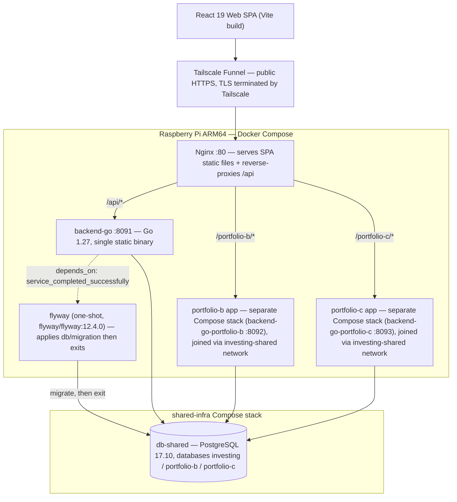
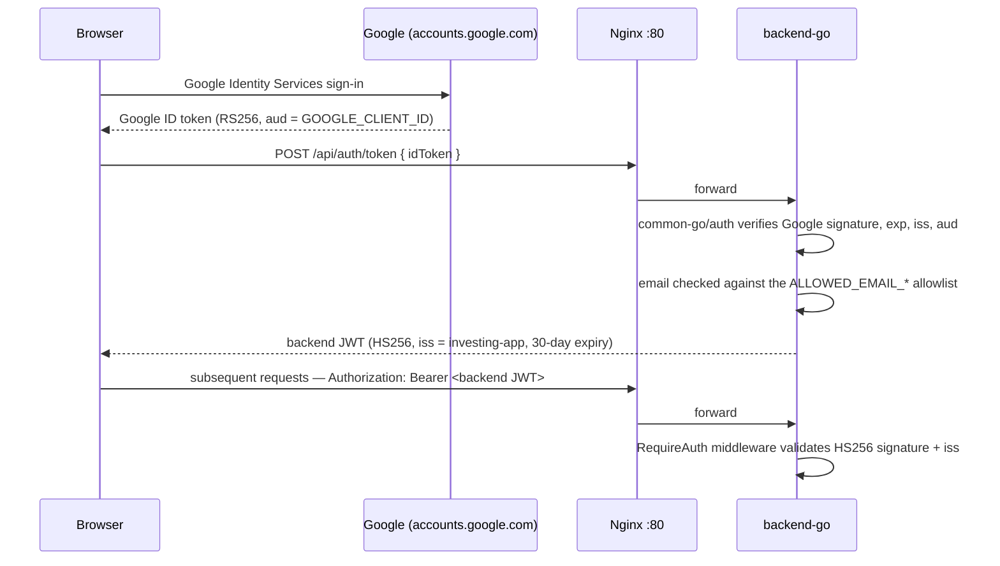

# 00 — Stack As-Built

> **Audience:** All agents. Describes the actual technology stack in production (as of 2026-09-19).
> This is a factual reference, not an evaluation document.

> **Go rewrite complete (2026-09-19, Phase 9, ADR-098):** all three apps (investing, portfolio-b, portfolio-c)
> run entirely on Go behind Nginx; the Java/Spring Boot backends, Maven tooling and
> `packages/shared/java` were deleted (commit `ff7878f`; restore anchor `2be75ba`). The design and
> migration record is `docs/architecture/13-go-backend-target-architecture.md` /
> `docs/adr/ADR-094-go-backend-rewrite.md` (both now historical). The one JVM still present anywhere is the
> transient Flyway CLI runner (below).

---

## Component & Deployment Diagram

Nginx terminates no TLS itself — it listens on plain HTTP `:80` inside its container. Tailscale Funnel (running on the Pi host, outside Docker) provides the public HTTPS endpoint and forwards into that port. This means the app is reachable from the public internet, not merely from Tailscale-enrolled devices — a materially different exposure model than "VPN-only," which is why application-level authentication exists (see below). Two other apps — "portfolio-b" (portfolio tracker for the user's dad) and "portfolio-c" (portfolio tracker for another family member, forked from portfolio-b 2026-07-30) — share this same Nginx via an external Docker network (`investing-shared`, referenced in `infra/compose.yml`) and are served under the `/portfolio-b/` and `/portfolio-c/` path prefixes respectively. All three databases live in one PostgreSQL instance in the separate `shared-infra` stack (`infra/shared/`). See `docs/architecture/12-portfolio-bpps-and-shared-packages.md` for the full topology and shared-package layout.

---

## Backend

| Component | As-Built | Notes |
|---|---|---|
| Language | Go 1.27 | `golang:1.27-alpine` build stage → `gcr.io/distroless/static-debian12:nonroot` runtime (no shell, static binary, `CGO_ENABLED=0`), ARM64 |
| HTTP router | chi v5 | `common-go/httpx` adds the response envelope, typed `AppError`, request logging |
| Contract → code | oapi-codegen v2.8 | `backend-go/openapi/server.gen.go` (`ServerInterface` + models) is generated from `docs/openapi.yaml` via `go generate`; never hand-edited |
| Build tool | `go build` (Go modules + `go.work`) | Four modules: `backend-go`, both siblings' `backend-go`, `packages/common/go/common-go`. No Maven, no Gradle |
| Database | PostgreSQL 17 | `postgres:17.10-alpine` (`db-shared`), ARM64 |
| Schema manager | Flyway CLI `flyway/flyway:12.4.0` (community), one-shot compose service per app | Versioned SQL only, in `db/migration/` (root V1–V71; siblings under `apps/*/db/migration/`). Nothing applies migrations at application startup |
| Data access | pgx v5 + sqlc v1.31 | Hand-written SQL in `backend-go/db/queries/*.sql`, generated typed code in `db/sqlcgen/` (CI fails on drift). No ORM; rows are mapped by hand to domain types, then to OpenAPI DTOs |
| Money / numbers | `shopspring/decimal` + `common-go/pgnum` | `NUMERIC` ⇄ decimal; no `float64` for money or units |
| HTTP clients | Hand-rolled `net/http` clients | `common-go/priceprovider` (Yahoo Finance v8 Chart API primary, Binance spot supplement, fallback provider, TTL cache), `backend-go/internal/marketdata/macro` (FRED, ECB, BoE, BoJ, chinadata.live and tip scrapers), `common-go/inflationsync` (GUS SDP), OKX client in `internal/bot/trade`. Each client is called directly by its consuming service. Historical OHLC for the four Virtune crypto ETNs that Yahoo cannot serve is reconstructed from Binance klines + Virtune's live coin-per-ETP ratio (ADR-085, `internal/linearregression/history.go`); the BiznesRadar HTML scrape (ADR-078) was retired 2026-09-02 (robots.txt) and never ported |
| XIRR | `common-go/xirr` (Brent, valuation date injected; ADR-112) | One implementation for all three apps' deposits and historia; replaces Apache Commons Math `BrentSolver` and the former bisection port |
| API docs | `docs/openapi.yaml` (bundled OpenAPI 3.1) | No live Swagger UI (springdoc went with Java); the spec is the contract and drives codegen |
| Connection pool | `pgxpool` via `common-go/config.ConnectDB` | `MaxConns 10`, health check 30 s, server-side `statement_timeout` 60 s and `idle_in_transaction_session_timeout` 5 min (ADR-110). Built from the same `DB_URL`/`DB_USERNAME`/`DB_PASSWORD` env vars Spring used (JDBC-shaped `DB_URL` is still accepted) |
| Concurrency | goroutines | Schedulers (macro, inflation, price/FX cache, historia 23:00 Warsaw, bot) are goroutines started from `cmd/server/main.go`; `HISTORIA_SCHEDULER_ENABLED` / `BOT_SCHEDULER_ENABLED` are `true` in production |
| Config | Environment variables via `common-go/config` (`caarlos0/env`, optional `.env` via godotenv) | `SPRING_PROFILES_ACTIVE` is still the dev/prod switch Go reads; secrets live in `.env`, never in code |
| Health | `GET /api/health-go` | Unauthenticated liveness route; distroless image has no shell, so there is no in-container `HEALTHCHECK` |
| Testing | `go test` + testcontainers-go v0.44 | Real Postgres 17 migrated by the same pinned Flyway image as production — the database is never mocked; external HTTP is stubbed with `httptest`. CI: `.github/workflows/go-tests.yml`, no `-short` |
| Authentication | Google OAuth ID token → backend-issued JWT + email allowlist | Not "none" — see **Authentication & Network Exposure** below |

**Why Go (ADR-094):** three always-on JVMs measured 385–507 MB RSS each on a Raspberry Pi already at ~95% swap (ADR-083). The three Go binaries idle at ~13–20 MiB each — see `docs/adr/ADR-083-container-ram-consolidation.md` (re-measured 2026-09-19).

**Why sqlc + pgx, not an ORM:** the schema is the contract (Flyway is its single source of truth) and the queries are few and explicit; sqlc turns the migration files plus hand-written SQL into type-checked Go with no reflection, and the compile step surfaces any query/schema drift. JPA-style entity graphs are not needed and were the source of several per-app divergences in the Java era.

**Why a hand-rolled Yahoo client, not a library:** community Yahoo Finance libraries had stale endpoint configuration and no room for custom error recovery. A plain `net/http` client gives full control over the endpoint, a browser-style User-Agent (to avoid being blocked) and timeouts, with no extra dependency.

**Flyway is the only JVM left, and it is transient.** The runner container is a Flyway CLI (Java) image with `mem_limit: 384m`; it runs `migrate`, exits (≈4 s), and `backend-go` starts only after it exits 0 (`depends_on: condition: service_completed_successfully`). It holds no steady-state RAM. Rationale and the rejected alternatives (golang-migrate/goose/embedded migrations) are in ADR-098 Decision 2.

**Known follow-ups (not built):** BLS direct CPI/PPI actuals (ADR-093, task 147) and the TradingEconomics PPI-YoY calendar enrichment (ADR-091) existed only in Java (in Go they are no-op stubs in `internal/bot/calendar`); the ADR-095/096 bot hard-close/trade-action designs were written against Java classes that were never built and are parked (`db/unapplied/V72`, `V73`) until ported to Go.

---

## Authentication & Network Exposure

The app is exposed to the **public internet** via Tailscale Funnel, not restricted to Tailscale-enrolled devices only. Application-level authentication exists because of that exposure — it is not optional or a future nice-to-have.

- Auth lives in `packages/common/go/common-go/auth` (`config`, `google`, `jwt`, `service`, `middleware`); the issuer string is a per-app literal in each app's `cmd/server/main.go` (`investing-app` / `portfolio-b` / `portfolio-c`). `POST /auth/token` is the one route reachable without a bearer token (`isPublicAuthToken` in `backend-go/cmd/server/botauth.go` for the root app; a path exception in `RequireAuth` for portfolio-b/portfolio-c).
- The root app's `smartAuth` dispatcher (`backend-go/cmd/server/botauth.go`) additionally accepts a static `X-Service-Token` header, instead of a Google-derived JWT, on machine-only routes (`POST /news/ingest`, `GET /news/assets`, `POST /bot/plans/ingest`, `POST /bot/calendar/sync`, `POST /bot/signals`, writes under `/bot/trades/*`) for the nightly host-cron news job and the bot scripts, which have no Google identity to present. A few reads (`GET /bot/calendar`, `/bot/trades`, `/bot/stats`) accept either credential. Everything else requires the backend JWT.
- Only one email is currently allow-listed (`ALLOWED_EMAIL_1` in `.env`), consistent with the single-user design; the allowlist supports adding more emails without a schema or code change.
- There is no user table, session store, or refresh-token flow — the backend JWT simply expires after 30 days (default `JWTExpiryDays`) and the client repeats the Google sign-in.
- `frontend-web` stores the backend JWT in a Zustand store with `persist` middleware (`frontend-web/src/lib/auth.ts`, `useAuthStore`) and attaches it as a Bearer token via an Axios request interceptor.

---

## Web Frontend

| Component | As-Built | Notes |
|---|---|---|
| Framework | React 19 | Stable concurrent rendering |
| Build tool | Vite 6 | Static SPA; output `/dist` served by Nginx |
| Language | TypeScript 5.7 (strict) | |
| Styling | Tailwind v4 | CSS-native `@import`; no `tailwind.config.js` |
| Components | shadcn/ui-style components in `src/components/ui/` (~19 files: button, dialog, form, table, tabs, etc.) | Built on the unified `radix-ui` package (v1.4.3), not individual `@radix-ui/*` packages. No `components.json` exists in the repo — components are hand-maintained, not CLI-scaffolded |
| Server state | TanStack Query v5 | All API data fetching |
| Tables | TanStack Table v9 | Deposits and crypto trades. The portfolio positions table is not a TanStack table since task 170: it is the common `GroupedPositionsTable`, CSS-grid rows with `role="table"` and no sorting |
| Charts | Recharts 2.x (primary — donut, area, bar, composed line) **+ `@nivo/treemap`** (the common `AssetAllocationTreemap`, the "Mapa alokacji" dialog on every app's portfolio page) | Nivo is a real, actively-used dependency, not experimental or dead |
| Routing | React Router v8 (unified `react-router` package) | `BrowserRouter` (not file-based) |
| Forms | React Hook Form 7 + Zod 4 | All create/edit forms |
| Global state | Zustand v5 | **Active**, not dead code: `useAuthStore` (`src/lib/auth.ts`) persists the backend JWT + decoded user profile to `localStorage` and drives the Axios auth interceptor. The `shared-ts` domain stores (`usePositionsStore`, `useSettingsStore`) remain unused — server state for domain data still goes through TanStack Query |
| Auth UI | `@react-oauth/google` | Renders the Google Sign-In button/prompt |
| Date utils | date-fns 4 | |
| Notifications | sonner | Toast notifications |
| Icons | lucide-react | |
| Node runtime | Node 24 (`node:24-alpine` build stage) | |

**Not installed:** TradingView Lightweight Charts (listed in early specs; never added).

---

## Shared TypeScript Package (`shared-ts/`, published as `@investing-app/shared`)

> **Deleted (task 158, 2026-09-22):** `shared-ts/` no longer exists; its code moved into each app's
> `frontend-web/src/api/` and `packages/common/ts` (removal record: `08-monorepo-layout.md`). This
> section describes it as it was, and `PortfolioSummaryBar`, named there, was
> itself deleted by task 170.

| Component | As-Built |
|---|---|
| HTTP client | Axios (`apiClient`) with `baseURL: "/api"`, 60s timeout, Zod-parsed responses |
| Schemas | Zod 3 schemas for all domain types and response envelopes |
| Utils | `formatPln`, `formatCurrency`, `formatPct`, `formatAssetUnits`, `computeXirr`, `computeDeployableCash`, `computeBelkaTax`, `computeCurrentAllocations`, `computeDeviation`, `classifyAllocation` |
| Stores | `usePositionsStore`, `useSettingsStore` — dead code in the web app; server state for domain data goes through TanStack Query instead |

**Correction from earlier drafts of this doc:** `shared-ts` is genuinely load-bearing for `frontend-web`, not a thin, mostly-unused layer. Every API call (`listPositions`, `createDeposit`, `getFxRates`, `createPurchaseSession`, and dozens more), every domain type, and the `apiClient` itself are imported from `@investing-app/shared` across the frontend. `formatPln` specifically **is** imported and used directly (`PortfolioSummaryBar`, `PortfolioValueLine`, `DepositsTable`, `TradesHistoryTable`, `crypto/tax`, and others) — the earlier claim that every page defines its own local copy no longer holds. The two Zustand stores are the only confirmed dead code left in this package.

---

## Infrastructure

| Component | As-Built | Notes |
|---|---|---|
| Reverse proxy | Nginx (`nginx:1.31-alpine` runtime image; `node:24-alpine` build stage compiles the React SPA) | Serves the React static build at `/`; proxies `/api/*` to `backend-go:8091` (and the generic `/portfolio-b/api/`, `/portfolio-c/api/` catch-alls to `backend-go-portfolio-b:8092` / `backend-go-portfolio-c:8093`); proxies `/portfolio-b/*` and `/portfolio-c/*` to the sibling frontends over the `investing-shared` external Docker network. Upstreams use a Docker-DNS `resolver` + variable `proxy_pass`, so a recreated container is re-resolved within ~10 s with no Nginx restart |
| Orchestration | Docker Compose v2, three app projects (`investing`, `portfolio-b`, `portfolio-c`) + `shared-infra` | `infra/compose.yml` (+ `apps/*/infra/compose.yml`, `infra/shared/compose.yml`) |
| Remote access | Tailscale Funnel | **Public HTTPS**, not VPN-only — see Authentication & Network Exposure above. TLS is terminated by Tailscale on the host, outside Docker; Nginx itself listens on plain HTTP `:80` |
| Container memory limits | Compose `mem_limit` (kernel-enforced): `backend-go*` 64m, Nginx/frontends 96m, `db-shared` 384m, Flyway runner 384m | Steady state: Go backends ~13–20 MiB each, Postgres ~60 MiB for all three databases (measured 2026-09-19, ADR-083). No JVM heap flags exist any more. The host's memory cgroup controller is enabled via `cgroup_memory=1 cgroup_enable=memory` in `/boot/firmware/cmdline.txt` |
| DB admin | pgAdmin 4 (`dpage/pgadmin4:9.18`) | `profiles: [dev]`; bound to `127.0.0.1:5050` only, never on the Tailscale/Funnel-facing interface |
| CI | GitHub Actions, `.github/workflows/go-tests.yml` | Build+test only (`go test ./...` without `-short`, the 4 Go modules, Testcontainers + the prod Flyway image, sqlc-drift check); no CD, no secrets |
| Target host | Raspberry Pi ARM64 | All images (`golang:1.27-alpine` build stage, `gcr.io/distroless/static-debian13:nonroot`, `postgres:17.11-alpine`, `flyway/flyway:13.10.3`, `nginx:1.31-alpine`, `node:24-alpine` build stage, `dpage/pgadmin4:9.18`) are ARM64 multi-arch. `platform: linux/arm64` is set explicitly per service in `compose.yml` |
| Authentication | Google OAuth → backend JWT + email allowlist | Not "none" — superseded the original Tailscale-only design once the app became reachable over the public internet via Funnel |

---

## Key Corrections from Original Spec

| Item | Original spec | Actual as-built |
|---|---|---|
| Backend language | Java 25 / Spring Boot 3.5 (Gradle Kotlin DSL), later Spring Boot 4.0.6 / Maven | **Go 1.27** (chi, pgx, sqlc, oapi-codegen); Java deleted 2026-09-19 (ADR-098) |
| Migrations at startup | Spring-embedded Flyway | One-shot `flyway/flyway:12.4.0` compose service per app; the backend waits for it to exit 0 |
| Yahoo Finance client | `yahoofinancejava` library | Hand-rolled `net/http` client (`common-go/priceprovider`) to `query2.finance.yahoo.com` v8 Chart API |
| Authentication | None (Tailscale VPN enrollment only) | Google OAuth ID token exchanged for a backend-issued JWT, plus an email allowlist — added once the app was exposed publicly via Tailscale Funnel |
| Network exposure | Tailscale WireGuard VPN, private only | Tailscale **Funnel** — a public HTTPS endpoint |
| Charts (web) | Recharts + TradingView Lightweight Charts | Recharts 2.x **+ `@nivo/treemap`** (actively used for the allocation treemap); TradingView Lightweight Charts never added |
| Zustand (web) | Installed but unused | Actively used for `useAuthStore` (JWT/session persistence); the `shared-ts` domain stores remain unused |
| `shared-ts` utilization | Thin, mostly-unused layer | Actively used for the Axios client, all API functions, Zod types, and most format utilities, including `formatPln` |
