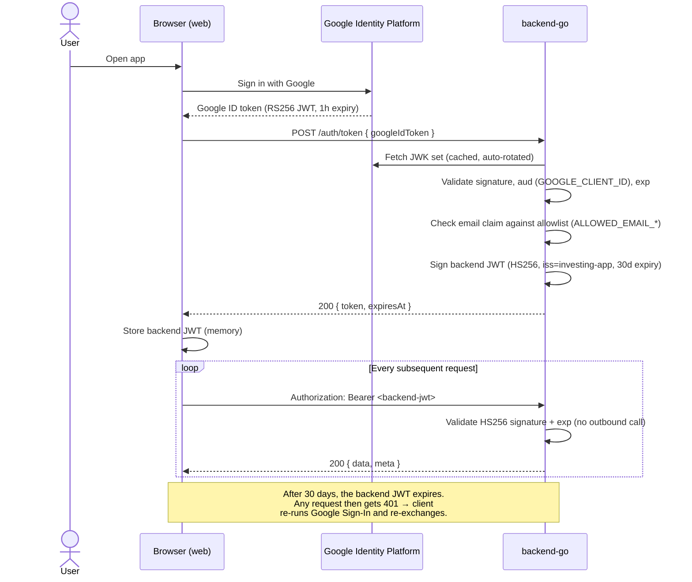
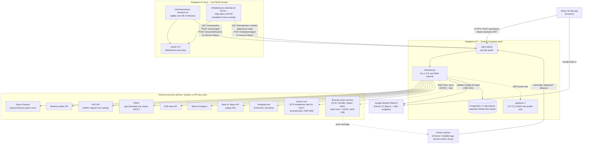

# 01 — System Context

> **Audience:** All agents. Describes what the running system looks like, how components connect, and what a user can actually do today.

---

## What the System Is

A personal investment-tracking web application replacing the "Finanse" Google Spreadsheet. Two allowlisted Google accounts, no shared/multi-tenant user model. Runs on a Raspberry Pi home server, exposed to the public internet via **Tailscale Funnel** (not VPN-only — see [User Access](#user-access) below) and gated by Google Sign-In plus a backend-issued JWT.

The system tracks:
- Multi-currency investment portfolio across XTB, Binance, and CHF savings (two sub-portfolios: Inwestycje and Emerytura)
- Monthly income, expenses, and tax obligations for a self-employed B2B contractor in Poland
- IKE/IKZE retirement account contributions and annual statutory caps
- Monthly DCA purchase planning with proportional rebalancing
- Crypto trade log for annual PIT-38 tax reporting
- Portfolio value history (daily snapshots)
- A macro liquidity de-risk gate (net-liquidity, US/Global M2) that adjusts target allocations
- An OKX macro-calendar BTC trading bot (calendar → daily plan → signals → trades, kill switch, stats); the earlier MEXC bot was dropped in `V57__drop_mexc_bot.sql`. Live OKX execution was armed on 2026-09-19 (real account, `OKX_DEMO_MODE=false`, `BOT_LIVE_EXECUTION_ENABLED=true`)
- Daily AI-researched news per held asset, ingested from a nightly host-side job

---

## Running Components

```
Raspberry Pi (ARM64, Docker Compose)
│
├── nginx:alpine  — port 80, published on all interfaces (0.0.0.0:80)
│   ├── Serves React web app static files (/), incl. the root-scope Web Push service worker /sw.js and /manifest.webmanifest (ADR-108)
│   ├── Proxies /api/* → backend-go :8091
│   └── Proxies /portfolio-b/* and /portfolio-c/* → the sibling apps' frontends and backend-go-portfolio-b :8092 / backend-go-portfolio-c :8093
│
├── backend-go (Go 1.27, static binary)  — port 8091 (internal only, no host port)
│   ├── REST API (all business logic, rebalancing, XIRR)
│   ├── Auth: validates Google ID tokens, issues/validates backend JWTs
│   ├── Price cache refresh (15-min TTL, parallel Yahoo Finance fetches)
│   ├── Historia scheduler (nightly 23:00 Warsaw time — daily portfolio snapshot)
│   ├── Bot schedulers (calendar sync/purge, release watcher) + OKX execution (live since 2026-09-19)
│   ├── Web Push sender (internal/push, ADR-108): fans the morning news outcome out to subscribed browsers; off without VAPID_*
│   └── Macro/inflation schedulers (Fridays 18:00 weekly; 1st 17:30 and 5th 18:30 monthly — net-liquidity/M2 refresh; GUS CPI sync on the 15th 06:00)
│
├── flyway (one-shot, flyway/flyway:12.4.0)  — applies db/migration then exits; backend-go starts after it succeeds
│
├── PostgreSQL 17  — NOT in this stack: `db-shared` in the separate `shared-infra` stack (port 5432, internal only),
│   │                databases investing / portfolio-b / portfolio-c, reached over the `investing-shared` network
│   └── Persistent volume: db-shared-data
│
└── pgAdmin 4  — 127.0.0.1:5050 (dev profile only, SSH tunnel required)

Raspberry Pi host (OUTSIDE Docker)
│
├── infra/news/news-research.sh — nightly cron (06:15 Warsaw time, installed manually,
│   not started automatically by compose): shells out to the host-installed `claude` CLI
│   (`claude -p --allowedTools WebSearch`) to research today's news per MAIN-portfolio
│   asset, then POSTs the result to the backend over the same internal network the
│   container stack uses (via nginx on localhost:80). It then reports the run's outcome
│   to `POST /news/notifications`, and the backend pushes it to subscribed browsers (ADR-108).
│
└── infra/bot/sync-calendar.sh (05:50) + infra/bot/daily-plan.sh (06:00) — the OKX
    macro-calendar trading-bot tracker's cron pair, specified in `bot-okx-tracking.task.md`
    and **installed** in the host crontab (verified 2026-09-19 via `crontab -l`: `50 5 * * *` and
    `0 6 * * *`). `daily-plan.sh` GETs `/bot/calendar` + `/market-data/macro-state` and POSTs a
    Claude-generated scenario plan to `/bot/plans/ingest`, all via `X-Service-Token`
    (ADR-089 — the machine-auth routing lives in `smartAuth`, `backend-go/cmd/server/botauth.go`). `manage-position.sh`/`scalp-session.sh`/`watch-market.sh` are on-demand, triggered
    by the bot itself, not cron entries.

These host cron jobs are the only data sources in the system that do not run inside Docker.
```

External calls from backend-go:
- `query2.finance.yahoo.com` — live asset prices and FX rates (no API key)
- Binance public API (`api.binance.com/api/v3/ticker/price`) — crypto spot prices
- `eea.okx.com` — OKX account balance, price and order placement for the trading bot (HMAC-signed; requires `OKX_API_KEY`/`OKX_API_SECRET`/`OKX_API_PASSPHRASE`; **places real orders since 2026-09-19** — the client defaults to `OKX_DEMO_MODE=true` and only an explicit `false` arms live trading)
- `api.stlouisfed.org` — FRED's official, key-authenticated `series/observations` REST API (free `FRED_API_KEY`) for net-liquidity components (WALCL, WDTGAL, RRPONTSYD), US M2 (M2SL), and FX series. The earlier keyless `fred.stlouisfed.org` CSV endpoint was actively blocking the Java HTTP client (ADR-046 §6); the Go `FredClient` uses the keyed API.
- `data-api.ecb.europa.eu` — keyless ECB series for Eurozone M2
- `www.bankofengland.co.uk` — keyless BoE series for UK M2
- `www.stat-search.boj.or.jp` — keyless Bank of Japan Time-Series Data Search API for Japan M2 (ADR-046)
- `chinadata.live` — keyless third-party JSON API for China M2 (ADR-046; best-effort, non-authoritative — not PBOC's own site, which only publishes Chinese-primary HTML tables)
- `www.virtune.com` — product-page scrape of the current coin-per-ETP entitlement ratio, used with Binance klines and Yahoo `USDPLN=X` to reconstruct daily OHLC for the four Virtune crypto ETNs Yahoo has no history for (ADR-085; `internal/linearregression/history.go`, 6 h cache). This replaced the BiznesRadar.pl HTML scrape (ADR-078), retired 2026-09-02 because BiznesRadar's robots.txt disallows it.
- Google's JWK endpoint — used to validate inbound Google ID tokens at `/auth/token` (`common-go/auth`)
- Browser push services: Google FCM (`fcm.googleapis.com`, Chrome/Android), Mozilla autopush (`*.push.services.mozilla.com`), Apple (`*.push.apple.com`, iOS only for the home-screen-installed app), Windows WNS (`*.notify.windows.com`). Web Push (RFC 8030), signed with VAPID (RFC 8292, `VAPID_*` in `infra/.env`) and end-to-end encrypted (RFC 8291) through `webpush-go` (MIT). The URL is each browser's stored subscription endpoint, restricted to these hosts. Free, no account. Best-effort, one message per device per send (ADR-108)
- `nfs.faireconomy.media` — keyless ForexFactory/FairEconomy calendar JSON feed (`ff_calendar_thisweek.json`/`..._nextweek.json`), the bot module's primary USD economic-calendar source (`internal/bot/calendar`, `ForexSource`)
- `tradingeconomics.com` — narrow second calendar source meant to fill ForexFactory's gap for USD `PPI YoY`/`Core PPI YoY` (ADR-091). **Java-only: in Go, `Orchestrator.SyncAll` calls no-op stubs for TradingEconomics and the BLS baseline** (`internal/bot/calendar/sync.go`) — port pending, along with BLS direct CPI/PPI actuals (ADR-093, `api.bls.gov`, also not ported). See `docs/architecture/06-data-flow.md` §10.

External calls from the host cron job (not the Docker container):
- The host-installed `claude` CLI (already authenticated under the existing subscription) with `--allowedTools WebSearch` — does real web research at no incremental API cost, per the project's cost-free constraint

The host cron job calls no notification service itself. The morning notification goes through the backend (ADR-108).

---

## User Access

Application-level authentication is live. Tailscale is **not** the security boundary — the app is reachable from the public internet via Tailscale Funnel — so the Google-OAuth allowlist plus the backend-issued JWT is the actual access gate.

### Auth flow



Key facts:
- The web client obtains a Google ID token via Google Sign-In, then `POST /auth/token`. The backend validates the token (JWK URI signature check + `aud` claim against `GOOGLE_CLIENT_ID` + `email` claim against an allowlist) and returns its own backend-signed JWT (HS256, `iss=investing-app`, 30-day expiry).
- Every subsequent request carries `Authorization: Bearer <backend-jwt>`. Validation is entirely local (HMAC verify) — no outbound call to Google on the hot path.
- **Two Google accounts are allowlisted** — `ALLOWED_EMAIL_1` and `ALLOWED_EMAIL_2` (both configured in `infra/.env`; only `ALLOWED_EMAIL_1` is documented in `infra/.env.example` at the time of writing).
- Only `GET /api/health-go` (liveness) and `/auth/token` (the token exchange endpoint itself) are unauthenticated. There is no Swagger UI any more (springdoc went with the Java backend); the contract is `docs/openapi.yaml`.
- **Path-based machine auth (`smartAuth`, `backend-go/cmd/server/botauth.go`)** sits in front of the normal backend-JWT check and validates a static `X-Service-Token` shared-secret header (`NEWS_INGEST_TOKEN`, constant-time compared) instead of a Google-issued JWT for routes whose callers are host cron scripts with no Google account / user identity (it replaces the two `@Order`-ed Spring filter chains):
  - **News, machine-only:** `GET /news/assets`, `POST /news/ingest` and `POST /news/notifications` (the ADR-108 Web Push fan-out). The user-facing news endpoints (`GET /news`, `GET /news/dates`) use the normal backend-JWT check like everything else.
  - **Bot, machine-only:** `POST /bot/plans/ingest`, `POST /bot/calendar/sync`, `POST /bot/signals`, writes under `/bot/trades/**` — `X-Service-Token` only, else 401.
  - **Bot, dual-audience reads:** `GET /bot/calendar`, `GET /bot/trades`/`/bot/trades/**`, `GET /bot/stats` accept either the service token or an ordinary bearer JWT, since the web frontend also calls them (ADR-089). This is the first machine-auth surface in the app that is also human-facing.
- Backend JWTs cannot be revoked individually — only by rotating `JWT_SECRET`, which invalidates every session at once. Acceptable for a two-user personal app.

*(This supersedes the original "no authentication" decision — Tailscale enrollment was the sole gate until Google OAuth + backend JWT auth was added; see `docs/architecture/07-adrs.md` ADR-002, ADR-031, ADR-032 for the full history.)*

### Available Routes

| Path | Page | What it does |
|---|---|---|
| `/login` | LoginPage | Google Sign-In button; only unauthenticated route |
| `/` | Redirect | Redirects to `/portfolio` |
| `/portfolio` | PortfolioPage | INWESTYCJE positions table with live values, XIRR stats bar, allocation treemap, rebalancing transfer dialog |
| `/retirement` | RetirementPage | EMERYTURA positions table, same layout as PortfolioPage but read-only |
| `/purchases` | PurchasesPage | Monthly purchase session: create plan, record actuals, mark complete |
| `/regression` | RegressionPage | Log-linear regression chart for any ticker (price, trendline, SD bands) |
| `/deposits` | DepositsPage | Capital deposit log, IKE/IKZE cap progress bars |
| `/history` | HistoryPage | Portfolio value vs deposits area chart over time |
| `/crypto` | CryptoPage | Crypto trade log, Binance transfer ledger |
| `/crypto/tax` | CryptoTaxPage | Annual PIT-38 tax summary per ticker |
| `/bot` | BotPage | OKX BTC trading bot: macro calendar, daily Claude plan, signals, positions, control/kill switch |
| `/trade-history` | TradeHistoryPage | Bot trade history |
| `/news` | NewsPage | Daily AI-researched news brief per MAIN-portfolio asset, browsable by day |
| `/settings` | SettingsPage | Cash snapshot entry, macro de-risk gate settings, Emerytura contribution setting, "Powiadomienia" (Web Push opt-in for this browser + test send, ADR-108) |

The `monthly_entries` feature (table, entity, controller, service, and the `/monthly` frontend route) was deliberately removed (Flyway `V26__drop_monthly_entries.sql`, commit "refactor: drop monthly entries, add V26/V27 migrations, portfolio/rebalancing cleanup") and does not exist in this design.

---

## Network and Security

| Boundary | Mechanism |
|---|---|
| User → Nginx | Public internet via **Tailscale Funnel**; Nginx binds `0.0.0.0:80` — no VPN enrollment is required to reach it |
| Client → backend-go (application layer) | Google Sign-In → `POST /auth/token` → backend-issued JWT (HS256, `iss=investing-app`, 30-day expiry) sent as `Authorization: Bearer` on every subsequent request |
| Nginx → backend-go | HTTP on the internal Docker bridge network (`investing-shared`) |
| backend-go → PostgreSQL | pgx over the `investing-shared` network to `db-shared` (a separate compose stack); `DB_URL` keeps its JDBC-shaped form, which `common-go/config` still parses |
| Host cron job → backend-go | `X-Service-Token` shared-secret header, checked by `smartAuth`: news (`GET /news/assets`, `POST /news/ingest`, `POST /news/notifications`) and bot write paths unconditionally; `GET /bot/calendar`, `/bot/trades*`, `/bot/stats` accept either the token or a bearer JWT — see ADR-089 |
| backend-go → browser push services (FCM, Mozilla, Apple, WNS) | Outbound HTTPS `POST` to the subscription endpoint with `Authorization: vapid t=…, k=…` (VAPID JWT signed with `VAPID_PRIVATE_KEY`) and an `aes128gcm` body only the subscribing browser can decrypt. Endpoints are capability URLs: stored in `push_subscriptions`, host-allowlisted at subscribe time, never logged (ADR-108) |
| Push service → browser | The vendor's own channel to the device. The app's service worker (`/sw.js`, root scope, no `fetch` handler, so it never touches `/portfolio-b/` or `/portfolio-c/` traffic) shows the notification |
| backend-go → Google JWK endpoint | Outbound HTTPS, used to validate Google ID tokens at `/auth/token` |
| backend-go → Yahoo Finance / Binance / ECB / BoE / BoJ / chinadata.live | Outbound HTTPS, no auth, no API key |
| backend-go → FRED (`api.stlouisfed.org`) | Outbound HTTPS, `api_key`-authenticated official REST API (`FRED_API_KEY`) |
| backend-go → OKX | Outbound HTTPS, HMAC-signed requests using `OKX_API_KEY`/`OKX_API_SECRET`/`OKX_API_PASSPHRASE` (this one places real orders since 2026-09-19, unlike the read-only market-data calls above) |
| Operator → pgAdmin | SSH tunnel only (`ssh -L 5050:localhost:5050 ...`); pgAdmin is never reachable on the public interface, `dev` profile only |

There is no per-request network-layer gate left to lean on — the Google-OAuth allowlist and the backend JWT **are** the security boundary. If `JWT_SECRET` or a Google OAuth credential ever leaked, the mitigation is rotating `JWT_SECRET` / the allowlist, not "re-enrolling a VPN device."

---

## System Context Diagram



Legend: dotted edges are optional paths (pgAdmin only through an SSH tunnel, Web Push only when `VAPID_*` is set and a browser has subscribed). Solid edges are used in normal operation.

---

## Docker Compose Topology

Services defined in `infra/compose.yml` (project `investing`):

```
flyway     flyway/flyway:12.4.0 (linux/arm64), one-shot: `migrate` against db-shared using
           ../db/migration, then exits; restart "no"; mem_limit 384m
backend-go depends_on: flyway (service_completed_successfully); port 8091 internal only;
           mem_limit 64m; on the `default` and `investing-shared` networks
nginx      "80:80"; depends_on: backend-go (started); mem_limit 96m; also joins the external
           `investing-shared` network so it can reach the sibling apps' frontends/backends
pgadmin    "127.0.0.1:5050:80"; profiles: [dev]
```

Postgres is not in this file: `db-shared` (postgres:17.10-alpine, volume `db-shared-data`) lives in
`infra/shared/compose.yml` (project `shared-infra`) and is reached over the external
`investing-shared` network — see `docs/architecture/12-portfolio-bpps-and-shared-packages.md` §6.

Rebuild commands (from `infra/`):
```bash
docker compose build backend-go && docker compose up -d backend-go   # runs the Flyway one-shot first
docker compose build nginx && docker compose up -d nginx             # SPA is built inside the nginx image
docker compose up -d --build                                          # full restart
docker compose run --rm --no-deps flyway info                         # read-only migration state
```

The database volume (`db-shared-data`) survives container recreation and is independent of this stack's lifecycle.

---

## Not Yet Built

- Google Sheets ETL migration job — data was seeded via Flyway seed migrations (V6, V13, V14, etc.); the one-time migration job was never executed
