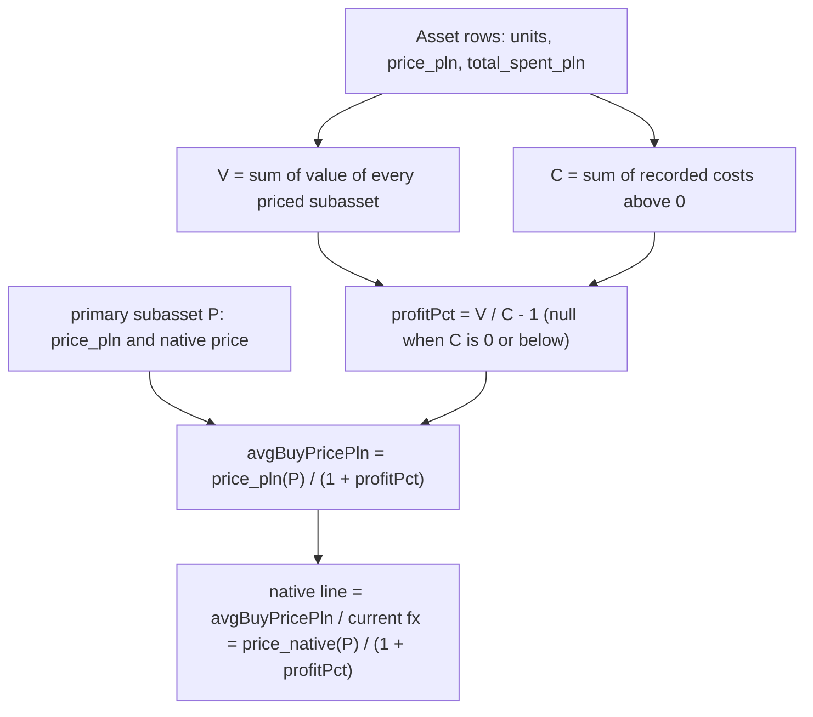
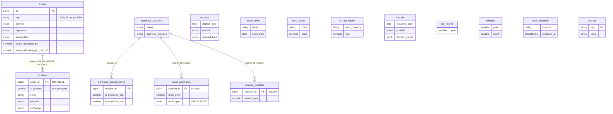

# 02 — Domain Model

> **Audience:** Backend and Frontend agents. Documents the entities, their purpose, relationships, and key design decisions as they actually exist in the Flyway migrations (V1 through V37 at time of writing). This file is self-contained — the standalone ADR log (`docs/architecture/07-adrs.md`, `docs/adr/`) has been retired; every decision relevant to the domain model is recorded here as current fact, not as a pointer to an ADR number.

---

## 1. Two Portfolios

The application tracks two distinct portfolios that share the `assets` and `positions` tables (§2.1) but must never be conflated:

- **MAIN** — main variable-contribution portfolio; pure-proportional, buy-only DCA; 39+ tradable positions across XTB and Binance. (Named `INWESTYCJE` before migration V22; renamed to the English `MAIN` for both the `portfolio_enum` value and every column/setting that referenced the old Polish name. All historical mentions of "Inwestycje" in this document now mean MAIN.)
- **RETIREMENT** — retirement fixed-contribution portfolio (1,000 PLN/month); simple proportional DCA; ~14 positions on XTB IKE/IKZE. (Named `EMERYTURA` before V22.)

Some instruments appear in both portfolios (Gold, BTC, ETH, SOL, DOGE, SUI, CIFR, MARA, HUT, COIN). Each portfolio stores only its own net units — no cross-portfolio subtraction at runtime (see Decision 1 below).

**MAIN is strictly buy-only, exactly like RETIREMENT.** Earlier revisions of the rebalancing engine (2026-06-21 through 2026-07-02) briefly added an automated "2× crypto trim" mechanism that could sell an overshooting crypto position and redistribute the proceeds. That mechanism was removed in full on 2026-07-05: `POST /purchase-sessions` never computes or emits a sell for portfolio-rebalancing reasons, for either portfolio. The "reduce a 10%-target asset back to ~15% when it overshoots to 20%+, swap the freed cash into gold" strategy (see root `CLAUDE.md`) is real and still followed by the user, but it is a manual, judgment-based action performed from the portfolio view (the "Sprzedaj" button), not something the planning algorithm automates. The only mechanism that can still make the *planner's* buy list contain a sell-shaped line item is the unrelated IKE/IKZE migration-triple (§2.13 `purchase_session_items`, `is_migration_sell`) — a statutory-capacity optimization that sells a wrapper subasset (an IKE/IKZE-held ETF/ETN of a crypto asset) and nets to zero overall crypto exposure, not a de-risking sell. See `05-rebalancing-algorithm.md` for the full algorithm.

---

## 2. Entities

### 2.1 `assets` and `positions` (the Asset / Subasset model)

Holdings are modeled as two tables in all three apps (task 156, deployed 2026-09-24):

- **`assets`** — the *logical* asset (Bitcoin, Gold, Nasdaq 100, or a single stock). It is the aggregate root: it carries the **target allocation**, exposure, asset class and display name, and its value is the sum of its subassets.
- **`positions`** — one row per concrete holding, called a **subasset** (`BTC-USD`, the Bitcoin Prime ETN, an Xetra gold ETC, ...). Every subasset belongs to exactly one asset through `asset_id`; exactly one subasset per asset is the **primary** (the default buy destination). A subasset never carries a target.

An asset with one holding has exactly one subasset, which is its primary. There is no separate "companion" concept: an ETF/ETN that wraps a crypto asset, a physical-gold ETC next to a gold ETN, or a PLN-hedged fund next to its UCITS twin are all simply further subassets of the same asset. Both MAIN and RETIREMENT rows live in the same tables, distinguished by `portfolio`; the same logical asset in the two portfolios (e.g. Bitcoin) is two separate `assets` rows.

**`assets` columns:**
- `id` — `BIGSERIAL` PK.
- `portfolio` — `portfolio_enum`: `MAIN` or `RETIREMENT`.
- `key` — stable logical slug, `UNIQUE (key, portfolio)`. Assets with several subassets carry a logical slug (`bitcoin`, `ethereum`, `solana`, `xrp`, `sui`, `gold`, `silver`, `chainlink`, `quantum` in main); single-holding assets keep their holding's ticker. The key is an immutable label: never derive it from a subasset ticker (the primary can change) and never join on it — join `positions.asset_id = assets.id`.
- `name` — display name (`VARCHAR(200)`), editable through `PUT /assets/{id}`.
- `exposure` — `exposure_enum`: `CRYPTO`, `METALS`, `CASH`, `QUANTUM`, `BONDS`, `EXPERIMENTS`, `EQUITY` — economic theme, orthogonal to `asset_class`. `QUANTUM` is defined but unreferenced after V37 reclassified its sole row (`QUTM.DE`) to `EXPERIMENTS`, and `CASH` joined it after V50/ADR-066 deleted the `PLN` row (`CHFPLN=X`, its only other member, was already gone) — Postgres has no `ALTER TYPE ... DROP VALUE`, so both values stay in the enum with zero live rows. PLN cash is no longer a position at all: the balance lives in `cash_positions` and feeds the 5% deployable-cash buffer directly.
- `asset_class` — `asset_class_enum`: `STOCK`, `CRYPTO`, `ETF`, `CURRENCY`. Its one behavioral job: the crypto-donor / ETF-substitution predicate of the purchase planner (`05-rebalancing-algorithm.md` §8) reads the **asset's** class, which stays stable when the primary changes. It is load-bearing for `XRP`: `XRP-USD` is `CRYPTO`-class with `EXPERIMENTS` exposure, so an exposure-only rule would silently drop it from the donor pool.
- `target_allocation_pct` — `NUMERIC(7,4)`, 0–100, nullable (`NULL` = no target, which is **not** the same as an explicit `0`, ADR-053). For MAIN assets this is the **risk-on-regime** target (see `target_allocation_pct_risk_off` below and `05-rebalancing-algorithm.md` for how the two are blended). For RETIREMENT it is the single, regime-independent target — RETIREMENT does not use the macro de-risk gate. Targets live **only** here: `positions` has no target columns.
- `target_allocation_pct_risk_off` — `NUMERIC(7,4)`, 0–100. The **risk-off-regime** counterpart to `target_allocation_pct` for MAIN assets. `NULL` means "identical to `target_allocation_pct`" — used for assets whose target does not move between regimes (gold, cash, the Experiments sleeve, and legacy zero-target rows). Only meaningful for MAIN; RETIREMENT assets leave this NULL and it is never read for them (portfolio-b/portfolio-c's `assets` carry the column always-NULL for cross-app code uniformity). The macro de-risk gate (`05-rebalancing-algorithm.md`) computes, every planning run, a continuous `blend_factor ∈ [0,1]` (0 = full risk-off, 1 = full risk-on, derived from net-liquidity and Global-M2 macro data — see `macro_state` in `05-rebalancing-algorithm.md`; orientation flipped by ADR-071, was 0=risk-on/1=risk-off under ADR-044) and linearly interpolates every MAIN asset's effective target: `effectiveTarget = riskOff × (1 − blend) + riskOn × blend`, where `riskOff` falls back to `riskOn` when this column is NULL. Because every asset uses the same scalar `blend`, and both regime tables independently sum to exactly 100%, the interpolated targets always sum to 100% for any `blend` — this is what lets the mechanism plug into the rebalancing engine's `ΣQ_i = A` invariant without special-casing. Live 2026-09-24: MAIN risk-on Σ = 100; the raw risk-off column sums to 97.5 over its 19 non-null rows and `COALESCE(risk_off, risk_on)` sums to 100.
- `created_at`, `updated_at` — `TIMESTAMPTZ`; `updated_at` is maintained by the shared `set_updated_at()` trigger.

**`positions` (subasset) key columns** — one row per (ticker, exchange, portfolio):
- `asset_id` — `BIGINT NOT NULL`, FK → `assets(id)` `ON DELETE CASCADE`. Group membership is this FK only; there is no string parent pointer.
- `is_primary` — `BOOLEAN NOT NULL DEFAULT false`, with a partial `UNIQUE (asset_id) WHERE is_primary` index (`positions_one_primary_uq`). The index enforces *at most one* primary per asset; *exactly one* is a service invariant (creating an asset marks its first subasset primary in the same transaction; set-primary flips exactly two rows in one transaction) backed by the migration-time tripwires. A flag was chosen over an `assets.primary_position_id` FK to avoid a cyclic FK.
- `ticker` — internal app ticker (e.g. `BTC-USD`, `ETCGLDRMAU.PL`, `IGLN.L`)
- `portfolio` — `portfolio_enum`: `MAIN` or `RETIREMENT` (always equal to its asset's portfolio)
- `exchange` — `exchange_enum`: `XTB`, `BINANCE`, `OTHER`. IKE/IKZE eligibility is **derived** from `exchange = 'XTB'` — there is no eligibility flag.
- `asset_class`, `exposure` — the row's own class/theme (the group-level values that matter live on the asset). The planner also reads the *row's* `asset_class` to tell a raw coin row (`CRYPTO`) from an ETF/ETN wrapper row (`05-rebalancing-algorithm.md` §8).
- `price_currency` — currency of the Yahoo Finance price feed
- `purchase_currency` — currency used to place the buy order on the broker platform. This is independent of `price_currency` — e.g. Binance-listed crypto is USD-priced but EUR-purchased, and every ordinary XTB subasset (stocks, ETFs, crypto pairs alike) is PLN-purchased regardless of its price currency; only the LSE/Xetra-listed ETF subassets (e.g. `IGLN.L`, `ISLN.L`) purchase in a non-PLN currency, because that is the currency the foreign listing actually trades in.
- `units_ike`, `units_ikze`, `units_regular_eur`, `units_regular_usd`, `units_regular_pln` — holdings split by account type; each portfolio stores only its own net units
- `total_spent_pln` — the row's **cost slot** (`NUMERIC(18,4)`, nullable). Only the **sum over an asset's rows** is meaningful: cost is maintained at the asset level (a sale scales every row that carries cost, not just the sold row) and the go-live cost of a whole group sits on the row that was head at import, so a per-row "average" is never derived or shown. `NULL` = no cost recorded on this row (its baseline is assumed to sit inside a sibling's group-level cost); `0` = the asset was sold out. Set-primary and re-home move nothing. See "Asset-level cost, profit and entry price" in §2.1.
- `avg_buy_price` — **deprecated**: the native-currency average from the go-live import, stale since go-live (no trade path writes it, no computation reads it, the UI does not show it). The displayed entry price is derived from `total_spent_pln`, never from this column.
- `company_backed` — `boolean NOT NULL DEFAULT true` (added V49, ADR-064; semantics broadened by ADR-079). True when the asset has its own distinguishable, individually-researchable narrative — a company's own events (earnings, product launches, partnerships, hacks, leadership, listings, legal/regulatory actions) for company-backed assets, **or** protocol/asset-intrinsic events for leaderless assets (protocol upgrades/proposals such as BIPs/EIPs, governance debates, hard forks, network security incidents, hash-rate/validator/on-chain activity, large-holder movements specific to that chain) — false only for basket/index/commodity vehicles and currency rows, which have no narrative distinguishable from their underlying holdings/rate. Asset-intrinsic, not portfolio-scoped: the same ticker in MAIN and RETIREMENT always agrees. All `STOCK` and `CRYPTO` subassets default `true`, including `BTC-USD` (base-layer, leaderless — no company or foundation governs it, unlike e.g. `SUI-USDT`'s Sui Foundation or `ETH-USD`'s Ethereum Foundation — but it still has its own protocol-level narrative: BIP debates, hard forks, hash rate, on-chain activity, worked example of the ADR-079 broadening); all `ETF` and `CURRENCY` subassets are `false` (index trackers, bond funds, gold, quantum-computing thematic basket, PLN cash, and every ETF/ETN wrapper subasset). `PositionService` computes this default from `assetClass` whenever `CreatePositionRequest.companyBacked` is omitted; `PUT /positions/{id}` can override it going forward (`UpdatePositionRequest.companyBacked`, null = unchanged) — this is how a future leaderless-but-newsworthy exception gets corrected without a code change. This is the sole gate for the nightly news-research job's asset scope, which reads **primary** MAIN subassets with `company_backed = true` (§6 in `06-data-flow.md`).
- `yahoo_ticker` — ticker string used for Yahoo Finance price fetching (e.g. `BTC-USD`, `igln.l`); the app-internal `ticker` and the Yahoo-facing `yahoo_ticker` diverge for several WSE listings, e.g. `positions.ticker = 'ETFPZUCASH.PL'` but `yahoo_ticker = 'ETFPZUCASH.WA'`

> **Dropped in V31:** `regression_weight` (`NUMERIC(7,4)`) and `regression_ticker` (`VARCHAR(50)`, added V14). MAIN rebalancing was originally a regression-band-weighted DCA (`T_i = R_i × S_i`, where `S_i` came from a 9-tier geometric weight table keyed on price-vs-long-run-log-trend); backtests showed the band weight carried approximately zero predictive signal while increasing concentration and drawdown, so MAIN became a **pure-proportional, buy-only DCA** (`T_i = R_i`) — structurally identical to RETIREMENT, differing only in its variable deployable-cash budget and its macro de-risk target overrides. The per-asset multiplier and its separate history-source ticker were dropped as dead columns. The standalone regression *analytics* feature (`GET /market-data/linear-regression`) is unaffected — it takes a `ticker` request param and never read `regression_ticker`.
>
> **Dropped in V75 (task 156):** `positions.is_companion_row`, `positions.companion_parent_ticker`, the `positions_companion_consistency` CHECK and both `positions.target_allocation_pct[_risk_off]` columns. The former companion model (a bare-string parent pointer with no FK) is fully replaced by the asset FK; portfolio-b dropped the same columns in V19 and portfolio-c in V10.

**Live shape (2026-09-24).** main: 58 subasset rows in 45 assets (34 MAIN + 11 RETIREMENT), of which 12 assets hold several subassets (8 MAIN, 4 RETIREMENT) — e.g. Bitcoin = `BTC-USD` (primary) + `PL.ETNVIRBTCP`; Gold = `ETCGLDRMAU.PL` (primary) + `IGLN.L` + `4GLD.DE`; XRP = `XRP-USD` + `PL.ETNVIRXRP`. portfolio-b: 36 rows in 25 assets (Nasdaq 100 = `SXRV.DE` primary + `ETFBNDXPL` + `NQSE`). portfolio-c: 8 rows, 8 assets.

**How the model behaves:**

- **Value aggregation.** An asset's `valuePln` is the sum of its subassets' values; portfolio totals, `currentPct` and `deviationPct` are all computed on the asset.
- **IKE/IKZE eligibility and substitution.** A subasset is IKE/IKZE-eligible iff it is XTB-listed. A CRYPTO asset with an XTB ETF/ETN wrapper subasset is bought through that wrapper in IKE/IKZE — including Binance-listed primaries (e.g. `XRP-USD` → `PL.ETNVIRXRP`), whose wrapper is bought on XTB instead. Details and the donor waterfall: `05-rebalancing-algorithm.md` §8.
- **Create** (`POST /positions`). A subasset is created either under an existing asset (`assetId`, same portfolio — otherwise `400` on `portfolio`; joins as non-primary, and `isPrimary: true` is accepted only for an asset that currently has no primary, else `409`) or under a brand-new asset (`newAsset{name, exposure, assetClass, targets}`; the new asset's key is this subasset's ticker and the subasset is its primary). Targets are only ever set through the asset. Because membership is an FK, an unknown `assetId` is a `404` and the free-text "orphan parent" failure class no longer exists. A duplicate ticker answers `409 DUPLICATE_ENTRY` (Decision 14).
- **Delete.** Deleting a non-primary subasset is a plain single-row delete. Deleting the **primary** while siblings remain is `409 CONFLICT` ("set a new primary first" — no silent leadership change). Deleting an asset's last subasset removes the asset row in the same operation, and `DELETE /assets/{id}` cascades to every subasset through the FK (Decision 12).
- **Set primary** (`POST /assets/{id}/primary {subassetId}`). A pure relabel: exactly two rows flip in one transaction; no units, cost basis, target or ticker move and no `asset_purchases` row is written — it is neither a buy nor a sell. The Σ targets == 100 tripwire (MAIN checks both regime tables; per portfolio) runs inside the same transaction and rolls the flip back on failure. Reversible: setting the demoted subasset primary again restores the exact prior state (Decision 13).
- **Re-home** (`PUT /positions/{id}` with `assetId`). Moves a **non-primary** subasset to another asset of the same portfolio. Same/absent `assetId` is ignored; a primary subasset answers `409`; an unknown asset `404`; another portfolio's asset `400` (field `assetId`). No units, cost basis or ticker move; `is_primary` stays false.
- **Edit targets** (`PUT /assets/{id}`). The only writer of targets: absent key = unchanged, explicit `null` = clear (no target, ≠ 0), range 0..100 only, and deliberately **no** Σ = 100 guard so a partial edit stays possible (the UI's Σ indicator relies on it).
- **Naming.** The UI shows the asset (`name`); subassets are drilled into under it. The shared UI's `AssetSelect` picks an asset when creating a subasset or re-homing one.

**Units are net per portfolio** (as of V9). MAIN rows store only the MAIN portfolio's units; RETIREMENT rows store only RETIREMENT's units. No runtime M-column deduction is applied. The V9 migration converted the previously gross (broker-total) MAIN values to net by subtracting RETIREMENT's share.

**Computed at the API layer (not stored), returned under `Asset.computed`:**

| Field | Formula |
|---|---|
| `unitsTotal` | Sum of all `units_*` columns of the asset's **primary** subasset (units of different instruments are never summed) |
| `pricePln` | the primary's price × fxRate (from cache) |
| `priceNative` | `pricePln / fxRate` (the primary's price back in its native `price_currency`) |
| `valuePln` | Σ over the asset's priced subassets of `units × pricePln` (an unpriced non-primary subasset contributes nothing) |
| `currentPct` | asset `valuePln / totalPortfolioValue` |
| `effectiveTargetAllocationPct` | See below — the target actually used right now, not necessarily the raw `target_allocation_pct` column |
| `deviationPct` | `(currentPct / effectiveTargetAllocationPct) - 1` |
| `profitPct` | `Σvalue / Σcost − 1` (a fraction: `0.1` = +10 %) where Σcost sums the recorded costs (`total_spent_pln > 0`) and Σvalue sums **every priced** subasset, cost or not (`positioncalc.GroupProfit`); `null` when Σcost ≤ 0. Same for every portfolio, RETIREMENT included (ADR-104) — see "Asset-level cost, profit and entry price" below |
| `avgBuyPricePln` | the asset's **entry price** in PLN per 1 unit of the primary: `pricePln(primary) / (1 + profitPct)` = `Σcost / (Σvalue / pricePln(primary))`; `null` whenever `profitPct` is `null`. Same for every portfolio, RETIREMENT included (ADR-104) |
| `avgBuyPriceNative` | the entry price in the **primary's own `price_currency`**: `avgBuyPricePln / fx` with fx the **current** PLN rate of that currency (the rate `priceNative` uses) `= priceNative / (1 + profitPct)`; equals `avgBuyPricePln` for a PLN primary; `null` whenever `avgBuyPricePln` is `null` or the rate is unavailable. Specified in the contract (task 161c-0); until the server emits it (161c-1) clients derive it from `avgBuyPricePln / (pricePln / priceNative)` |
| `equivalentUnits` | `valuePln / pricePln` — the asset's holdings expressed in units of the primary; `avgBuyPricePln × equivalentUnits = Σcost`. Optional; present whenever the primary is priced (contract 161c-0) |
| `costlessSubassets` | tickers of the priced subassets that hold units but have no recorded cost, listed only when an entry price exists; informational only — the UI no longer renders it (owner, 2026-09-29: only the asset-level average is shown). Contract 161c-0. Omitted when none |

**Asset-level cost, profit and entry price (tasks 156 / 161; live in all three apps since 2026-09-25).** Cost, profit and the entry price of an asset are three views of the same two sums, so they are consistent by construction. For an asset with subassets `s` (units `u_s` over all account buckets, PLN price `p_s`, recorded cost `c_s = total_spent_pln`) and primary `P` (PLN price `p_P`, native price `n_P` in its `price_currency`, current fx `φ = p_P / n_P`, `φ = 1` for PLN):

| Symbol | Meaning |
|---|---|
| `V` | Σ `u_s · p_s` over **every priced** subasset — including those with no recorded cost |
| `C` | Σ `c_s` over the subassets with `c_s > 0` — the recorded cost; where it sits among the rows is irrelevant to the sum |
| `π` | `profitPct = V / C − 1` (`positioncalc.GroupProfit`, one implementation for all three apps); `null` when `C ≤ 0` |
| `U` | `V / p_P` — primary-equivalent units: what today's holdings are worth in units of `P` |

```
entryPricePln    = C / U = C · p_P / V = p_P / (1 + π)      (= computed.avgBuyPricePln, per 1 unit of P)
entryPriceNative = entryPricePln / φ = n_P / (1 + π)        (in P's price currency, at the CURRENT fx)
consistency:  entryPricePln · U = C     and     p_P / entryPricePln − 1 = π
```



*Legend.* A pure function of the asset's **set** of rows plus the primary's current price — no history, no fetching, nothing primary-dependent stored. A set-primary flip changes only the `P` node.

- **Owner's example.** 0.5 BTC (cost 200 000 PLN) plus 5 000 ETN units (cost 100 000 PLN; one ETN = 0.0001 BTC), BTC 480 000 PLN (120 000 USD at fx 4.0), ETN 48 PLN: `V = 480 000`, `C = 300 000`, `π = +60 %`, entry `= 300 000 PLN = 75 000 USD` — the owner's 75k. Flip the primary to the ETN and the same rows give `48 / 1.6 = 30 PLN`; flip back and the answer is identical (same inputs, deterministic rounding).
- **The head row carries the group's go-live baseline.** The go-live import (main `V21__backfill_inwestycje_spent_and_avg_price.sql`, from the owner's Google Sheet, 2026-06-05 — whose own formula was `current_price / (1 + gain_pct)`) stored the **whole group's** cost on the row that was head at import: `BTC-USD`'s recorded cost is the cost of physical BTC **plus** the `PL.ETNVIRBTCP` ETN together (owner-confirmed). The non-primary rows (ETN, `4GLD.DE`, `IGLN.L`, `QUTM.DE`, …) carry `NULL` because their baseline is already inside that group cost. Convention: *the head row's cost is the group's go-live baseline; a sibling's NULL means "included in the group cost"; Σ over the asset is what is read.* That is why Σvalue counts every priced subasset even when it has no cost of its own (the first 156 version dropped their value while their cost stayed in the denominator — a group whose wrappers carry no cost of their own showed a far worse profit than its true one; corrected 2026-09-25). A subasset with a recorded cost but **no price** contributes neither its cost nor a value (never a cost without its value). A single-subasset asset yields exactly the pre-156 single-row formula.
- **Equivalence is measured at today's prices.** Holdings of a non-primary subasset are converted to primary units at today's prices (`U = V / p_P`), not at each purchase date, so no history is fetched. The two agree whenever the wrapper tracks the primary exactly and differ only through wrapper drift (ETN/ETC fees, premium): in the example above an ETN that drifted 2 % (47.04 PLN) gives `π = +58.4 %` and an entry of 303 030 PLN — **+1.0 %**. The native line moves with the **current** fx by design (the same 300 000 PLN is 75 000 USD at 4.0 and 78 947 USD at 3.8): the owner's rule is *"the average price in USD is the PLN average divided by the current dollar rate"*.
- **Primary flip.** `π` depends only on the asset's set of rows, never on which row is primary, so `entry(P′) / entry(P) = p_P′ / p_P`; `POST /assets/{id}/primary` (a pure relabel) changes nothing stored and the next read re-expresses the entry price in the new primary's terms, offline. If the new primary is **unpriced** (no `yahoo_ticker` / no `price_cache` row) the entry price is absent — never invented — and returns as soon as a price exists.
- **Known limitation.** A subasset held with **no** recorded cost that no sibling's baseline covers (e.g. bought after go-live without its cost being entered) adds its value to Σvalue only, inflating profit and lowering the entry price; the reviewed baselines below remove the known cases.

**How cost is maintained — asset-level average cost (shared kernel `packages/common/go/common-go/costbasis`, wired into all three apps 2026-09-25).** The kernel is pure (rows in, rows out; no DB, no network, no clock, no knowledge of which row is primary). Because only Σ over the asset is meaningful, a trade re-scales **every row that carries cost**, not just the traded row:

| Event | Effect on the asset's recorded cost |
|---|---|
| Sale of value `S` | `f = min(1, S / V_before)`; every row with a recorded cost × `(1 − f)`; `NULL` stays `NULL`; the rounding remainder goes to the largest row so the sum is exact (costs are rounded to 4 decimals). The sold row is valued at the sale price, the other rows at `price_cache`, unpriced rows are skipped. **Entry price and profit % are unchanged by any partial sale.** If no units remain (or everything is sold by value) every recorded cost becomes **exactly 0** — never via rounding |
| Buy of `paid` PLN on row `r` | `c_r += paid` — **only if the asset already has recorded cost or holds no units**. A buy on an asset that holds units but has no recorded cost invents nothing (a cost covering only the new units would understate the entry price). After a full sale the rebuy starts fresh (entry = rebuy price); after a partial sale it blends (1.0 BTC-equivalent at 80 000, sell 0.5, rebuy 0.5 at 100 000 ⇒ 90 000) |
| Same-asset swap (a transfer whose buy leg lands on the sold asset) | **Carries** cost: `γ = min(1, V_legs / proceeds)`; the matched share of the sold slice's released cost lands on the bought rows pro rata to leg value, the unmatched `(1 − γ)` share is a realized sale, and a leg value above the proceeds is a top-up bought at market (only on an asset that was tracked before). Asset cost, `V` and entry price are unchanged. The same instrument moving REGULAR → IKE/IKZE is the degenerate case: no change |
| Cross-asset transfer | The sold asset scales by its own `f` (it leaves at its own entry price); the bought asset's row gains the PLN paid (market) |
| Purchase-session completion | Netted **per asset** (`costbasis.PlanTrades`, one call from the pre-session state): with `S` = value sold and `B` = value bought in one asset (migration/donor sells against buys and compensating buys), `min(S, B)` carries cost, a buy excess `B − S` is a normal market buy, a sale excess `S − B` scales the cost by `(V − (S − B)) / V`; flows on different assets stay independent; the result does not depend on item order. A donor ETN sold to fund the physical asset's buy is therefore a swap (the asset's cost stays unchanged, instead of shifting as it would if the two legs were booked independently). A buy item with no executed/planned value is not counted |
| Manual `PUT /positions/{id}` | A units edit **never** changes cost; cost changes only through an explicit `totalSpentPln` edit (the reviewed correction path) |
| Set-primary, re-home | Nothing moves — pure relabels |

Worked fixtures (synthetic, all reproduced by `costbasis_test.go`): a BTC group with cost 100 000 on the head, value 80 000 (BTC-USD 60 000 + ETN 20 000), profit −20 % — selling the whole ETN gives `f = 0.25`, cost **75 000**, profit still −20 %; selling 0.01 BTC (3 000 PLN) gives cost **96 250**, profit −20 %. A gold group with cost 50 000, value 75 000, profit +50 % — selling all `4GLD.DE` (a NULL-cost row) gives `f = 0.2667`, cost **36 666.67**, profit +50 %. Realized P&L is intentionally **not** tracked (the entry price ignores it by design), and this average must not be reused for the Belka gain computation, which stays a separate per-account backend computation.

**Where it runs.** main: purchase-session completion (`purchasesession/execution.go`, one `PlanTrades` call for the whole session) and `POST /rebalancing-transfers` (`rebalancing/service.go`, `PlanTransfer`). portfolio-b and portfolio-c: `POST /purchases/confirm` (buys → `PlanTrades` without sales) and `POST /position-transfers` (`positiontransfer`, `PlanTransfer`). Each app's `internal/position/assetcost.go` is the glue: it builds kernel rows from the in-memory position state as it stood **before** the trade's units are applied, reads prices from `price_cache` (DB only — **no network call inside a trade transaction**), copies the result back, and writes the trade's own rows through `UpdatePositionDelta` (units and cost in one statement) and any other changed sibling row through `UpdatePositionCost`, all inside the trade's transaction, so cost and units commit or roll back together. Portfolio B has no recorded cost anywhere yet, so the buy rule keeps every portfolio-b asset untracked (buys invent no cost, sales change nothing, `profitPct`/`avgBuyPricePln` are `null`) until its reviewed baselines exist; portfolio-c's stored costs are the go-live baselines (`V3`/`V5`), which trades add to and scale.

**Cost that is still missing — owner-reviewed reconciliation (task 161a-4).** Correct total cost per asset is a data problem: a read-only dry-run per app lists stored cost, Σcost/Σvalue/profit/entry as computed, the evidence (go-live migration, ledger buys not reflected, holdings with no cost) and a proposed corrected cost; **nothing is written before the owner approves**, and the apply is a guarded idempotent Flyway data migration (`UPDATE … WHERE total_spent_pln IS NOT DISTINCT FROM <old>`). Typical gaps: a wrapper row with `NULL` cost although a DCA buy into it was booked; ledger buys never reflected in the stored cost; a go-live baseline that predates later buys (which inflates the profit % far above the true one); an app with no recorded cost at all — the owner supplies an average entry price (or total spent) per asset, stored as cost on the head row `= entryPricePln × Σvalue / pricePln(primary)`.

**RETIREMENT computes profit and entry price exactly like MAIN (ADR-104, 2026-10-18).** `profitPct`, `avgBuyPricePln`, `avgBuyPriceNative` and `costlessSubassets` come from the one shared `positioncalc.ComputeEntryPrice` for every asset of every portfolio; there is no portfolio branch in the entry-price path. RETIREMENT's cost is maintained by the same asset-level kernel rules as MAIN's, and is corrected the same way: a guarded data migration or an explicit `totalSpentPln` edit. *History:* from 2026-07-23 (ADR-056) to 2026-10-18, `computeFields` nulled these fields for RETIREMENT and the `/retirement` page hid the "Zysk %" column. RETIREMENT's recorded cost had no reviewed baselines then: several rows were `NULL` and the rest were "ledger-from-zero", so entry prices could sit far below the market price. The gate was lifted once Flyway V129–V147 had rebuilt RETIREMENT's whole ledger (Feb 2024 – Sep 2026) and `V148__ret_cost_run_entry_prices_167.sql` had written the cost of every RETIREMENT row. That cost came from a replay through the unmodified `costbasis.PlanTrades`; afterwards no RETIREMENT row is `NULL`. Known limitations of those baselines:
- One holding's units are a stand-in priced at earlier MAIN order prices.
- One ETN's cost is carried over unchanged.
- Bridge and transfer costs stay outside the entry price.
- Crypto bought from long-parked USDT is valued at market (NBP USD) on the purchase day.

**`effectiveTargetAllocationPct` (added 2026-07-06):** `PositionService` always resolved the
macro-blended target internally to compute `deviationPct` (§7.3 of
`05-rebalancing-algorithm.md`), but never surfaced that resolved number as its own field —
so the UI had no accurate value to display in a "Cel %" / target column short of
reimplementing the blend formula client-side (which `MacroRegimePanel.tsx` did, and which
drifted from the raw-target display used everywhere else once `blend_factor` started
actually computing non-null values). `effectiveTargetAllocationPct` closes that gap:

- **Null iff the asset's `target_allocation_pct` (the raw column) is null.** This covers the handful of legacy/experimental MAIN assets with no target
  at all (e.g. `ALGO-USD`, `FISV`, `GME`) — same null-ness as `deviationPct` shows for these
  assets today. It is deliberately **not** coerced to `0` in this case even though the
  in-memory macro-override map does that substitution internally for sum-conservation
  bookkeeping (§7.3) — that internal `0` must never leak out as a displayed target.
- **RETIREMENT assets, and MAIN assets when `rebalancing.macro_derisk_enabled =
  false`:** equals `target_allocation_pct` exactly — pass-through, no blending (RETIREMENT
  never uses the macro gate; see Decision 10 below).
- **MAIN assets with a non-null target, gate enabled:** the blended value,
  `riskOff × (1 − blend) + riskOn × blend` (§7.3; `blend` orientation flipped by ADR-071 —
  0 = full risk-off, 1 = full risk-on), using whatever `blend_factor` was current
  on the same `macro_state` row `GET /market-data/macro-state` reads.
- Computed independent of live price/valuation availability — it only depends on the
  asset's two stored target columns, the gate's enabled flag, and `macro_state`, so it
  can still be non-null even when `currentPct`/`deviationPct` are null because a price fetch
  failed for this position or the portfolio total couldn't be computed. The two structural
  "no live data at all" early-outs (no `yahoo_ticker` and not a CURRENCY; price fetch threw)
  still null out every computed field including this one, for a simple all-or-nothing
  contract in those edge cases.

**`deviationPct` zero-target sentinel (ADR-053, see `05-rebalancing-algorithm.md` §7.6 for the
full rationale):** the formula above is undefined when `effectiveTargetAllocationPct = 0`
(division by zero). `deviationPct` is a fixed sentinel, `1.0`, whenever
`effectiveTargetAllocationPct` is non-null and exactly `0` while `currentPct > 0` — flagging
that position as a sell candidate (any holding at all is entirely in excess of an explicit zero
target, e.g. `CHFPLN=X` after ADR-050) without pretending to measure a proportional "how far
over" that doesn't exist at target `0`. Positions with a **null** `effectiveTargetAllocationPct`
(legacy no-target assets) are unaffected and keep `deviationPct = null`,
exactly as before.

Implemented in `apps/main/backend-go/internal/position/computed.go` for MAIN and
`packages/common/go/common-go/positioncalc.ComputeFields` for portfolio-b/portfolio-c (no "effective vs. raw"
target distinction there — see §1 of `05-rebalancing-algorithm.md`, neither app uses the macro
de-risk gate) — that kernel never received the ADR-053 branch when it was extracted from
portfolio-b/portfolio-c's own pre-fix Java, a porting gap closed 2026-09-23 (see §7.6 of
`05-rebalancing-algorithm.md` for the full story). Closing that gap meant editing the identical
formula in two places the same day, so the formula core (the division, the target branch, and the
ADR-053 sentinel) is now single-sourced in `positioncalc.CurrentAndDeviationPct` — MAIN's
`computed.go` calls it too, after resolving its own multi-portfolio total and macro override
locally, the two genuinely MAIN-only steps that stay outside the shared function (§7.6). The
semantics above apply identically, and are now computed by the same shared code, across all three
apps.

Unique indexes: `positions (ticker, exchange, portfolio)` (`positions_uq`), `assets (key, portfolio)` (`assets_key_portfolio_uq`), and the partial `positions (asset_id) WHERE is_primary` (`positions_one_primary_uq`).

---

### 2.2 `deposits`

One row per capital deposit transaction — the **only** capital record in the system: `totalInvestedPln`, XIRR, and profit all derive from the full deposit series, nothing else. Covers both MAIN variable deposits and RETIREMENT fixed monthly contributions.

Key columns: `deposit_date`, `amount`, `currency`, `exchange`, `account_type`, `portfolio`, `comment`.

Used for:
- XIRR computation (full per-transaction series required; do not aggregate)
- IKE/IKZE annual cap tracking (`SUM(amount) WHERE account_type='IKE' AND year=?`)

Indexes: `(portfolio, deposit_date)` and `(account_type, deposit_date)`.

**Binance transfers are intentionally excluded from this table.** Money sent to Binance to fund crypto purchases used to be seeded into `deposits` with an invented MAIN/RETIREMENT split that does not exist in the source data, and that in turn caused an XIRR double-count/exclusion bug. It now lives exclusively in the separate `binance_transfers` side ledger (§2.4) — see that section for the full rationale. Genuine session-created Binance deposits (i.e. new capital actually committed via a completed purchase session, tagged with comment `'Auto from session #%'`) remain in `deposits` like any other exchange; only the flat historical/manual PIT-38 ledger rows were moved out.

---

### 2.3 `tax_returns`

One row per tax year. Records annual Polish Belka (19% capital gains tax) PIT-38 filings.

Columns: `year`, `gross_gain`, `tax_paid`, `effective_rate_pct`. Unique on `year`.

The effective rate may differ from 19% when losses in one asset offset gains in another.

---

### 2.4 `binance_transfers`

A flat side ledger mirroring the spreadsheet's "Wpłaty Binance" table (`Inwestycje!B146`). Added in V25. Its **sole purpose is the yearly PLN sum for PIT-38 crypto acquisition costs** — it is not a capital record and has no portfolio dimension (the source spreadsheet table has none either; free-text notes like "w tym EMERYTURA" are comments, not structure).

**Columns:**
- `transfer_date` — DATE, not null
- `amount_pln` — `NUMERIC(14,2)`, not null, `CHECK (amount_pln > 0)` — the canonical PIT-38 figure
- `amount_native`, `native_currency` — nullable and paired (`CHECK ((amount_native IS NULL) = (native_currency IS NULL))`); manual rows can carry the original EUR/GBP amount exactly like the sheet, migrated and session-sourced rows leave both NULL
- `comment` — nullable TEXT
- `source` — `VARCHAR(10) CHECK (source IN ('MANUAL', 'SESSION'))` — a VARCHAR+CHECK pair rather than a new Postgres enum type, following the same pattern as `crypto_trades.source` (two values, single consumer, no cross-table reuse)
- `session_id` — nullable FK to `purchase_sessions(id) ON DELETE SET NULL`
- `created_at` — TIMESTAMPTZ

Indexes: `transfer_date`, `session_id`.

**Why this table exists, not a column on `deposits`.** An earlier design (superseded) tried to treat `deposits WHERE exchange = 'BINANCE'` as the PIT-38 table directly, which conflated two independent streams: the capital series (deposits) and a side ledger distilled from it (overlapping money, not additional capital). That conflation caused a real bug — excluding Binance deposits from the XIRR cash-flow series to avoid double-counting also deleted genuine new capital from the return calculation the moment a purchase session bought crypto on Binance. The fix was to give the PIT-38 ledger its own table (mirroring the spreadsheet 1:1) and let `deposits` mean exactly one thing again: capital committed.

**Population:**
- `POST /purchase-sessions/{id}/complete` inserts **one** `source = 'SESSION'` row per completed session with a Binance purchase, `amount_pln` = the session's total effective Binance purchase value (an approximation of the actual transfer amount — assumes 100% of transferred funds are spent on crypto, the same assumption the spreadsheet makes), and `comment = "Auto from session #<id>"`.
- Manual rows (`source = 'MANUAL'`) are entered directly via `POST /binance-transfers`, optionally carrying the native EUR/GBP amount.
- V25 back-migrated all pre-existing V24-seeded historical rows out of `deposits` into this table as `source = 'MANUAL'`.

API: `GET /binance-transfers?year={optional}` (list + per-year PLN sums for all years, for the Crypto page's PIT-38 figure and year selector), `POST /binance-transfers`, `DELETE /binance-transfers/{id}`.

---

### 2.5 `inflation`

Monthly Polish CPI data. One row per (year, month). Unique on `(year, month)`.

Used to compute inflation-adjusted portfolio returns.

---

### 2.6 `cash_positions`

Snapshot-based cash tracker. Each row is one location-amount pair at a point in time. All rows sharing the same `recorded_at` timestamp form one snapshot.

Locations tracked: PKO, ZEN, Portfel gotówka, Lokaty.

`GET /cash-positions` returns only the most recent snapshot (MAX `recorded_at`). `POST /cash-positions` creates a new snapshot, replacing the logical current snapshot for calculations. Old snapshots are retained for history.

The deployable cash formula (MAIN only): `deployable = (SUM(latest snapshot) - retirementContribution - 0.05 × totalPortfolioValue) / 1.05` — sized so the leftover cash equals 5% of the **post-purchase** portfolio value (the divide-by-1.05 form solves `cashOnHand − A = 0.05 × (totalPortfolioValue + A)` for `A`; an earlier version sized the 5% buffer against the pre-purchase value, which under-reserved by about 0.17 percentage points of the post-purchase total).

---

### 2.7 `price_cache`

DB-backed ephemeral cache for Yahoo Finance prices. One row per ticker (unique). TTL: 15 minutes, enforced at the application layer.

Columns: `ticker`, `price`, `currency`, `price_pln`, `fetched_at`.

Survives backend restarts (preventing cold-start rate-limit spikes). Warmed up at startup and refreshed every 15 minutes via scheduler (up to 8 parallel fetches). The frontend topbar displays `fetched_at` to show data freshness.

---

### 2.8 `fx_rate_cache`

DB-backed cache for PLN exchange rates. One row per currency pair. Unique on `from_currency`.

Sources: Yahoo Finance tickers `EURPLN=X`, `USDPLN=X`, `CHFPLN=X`, `GBPPLN=X` (primary). Falls back to stale cache on failure — never throws if a stale rate exists. PLN = 1.0 is synthesized in code, not stored.

---

### 2.9 `historia`

Daily portfolio value snapshots for the Historia trend chart.

Columns: `snapshot_date`, `portfolio`, `total_deposits`, `portfolio_value`, `xirr` (nullable), `position_values` (JSONB, nullable; added V30), `created_at`. Unique on `(snapshot_date, portfolio)`.

`position_values` is a per-asset value breakdown at snapshot time (`ticker → value_pln`, mirrors the filtered map that sums to `portfolio_value`), captured going forward only from V30 — rows written before that migration keep it NULL and the chart tooltip simply omits the breakdown for those older dates.

Written by the nightly scheduler goroutine (`historia.StartScheduler`) at 23:00 Warsaw time (upsert — idempotent). Seeded with backfill data Oct 2025 – Jun 2026.

`zwrot` (return %) and `zysk` (profit PLN) are computed at query time from the stored fields — never persisted.

Note: `GET /historia` uses in-memory pagination (loads all rows matching the filter, then slices). This is acceptable for the current data volume.

---

### 2.10 `crypto_trades`

Per-transaction crypto buy/sell log for Polish PIT-38 annual tax reporting.

Columns: `trade_date`, `ticker`, `exchange`, `account_type`, `side`, `quantity`, `unit_price`, `price_currency`, `total_amount`, `amount_pln`, `source` (CHECK IN ('MIGRATION', 'MANUAL')), `notes`.

`amount_pln` is stored at trade time because the app does not retain historical daily FX rates. For manually entered trades, the user provides the PLN equivalent from their broker statement.

Only fiat-conversion events (BUY/SELL for PLN) are taxable in Poland. Crypto-to-crypto swaps are not taxable but may still be recorded here with a note.

No DELETE endpoint exists.

---

### 2.11 `settings`

Key-value store for UI-configurable application parameters.

PK = `key` (VARCHAR 100). Value is always TEXT; type coercion is the service layer's responsibility.

Current keys:

| Key | Default | Purpose |
|---|---|---|
| `retirement.monthly_contribution_pln` | `1000` | RETIREMENT fixed DCA budget (PLN); key renamed from `emerytura.monthly_contribution_pln` in V22 |
| `ike_annual_limit_pln` | `23472.00` | IKE annual contribution cap (2026) |
| `ikze_annual_limit_pln` | `9388.00` | IKZE annual contribution cap (2026) |
| `rebalancing.macro_derisk_enabled` | `true` | Gates whether the macro de-risk blend interpolation (see `target_allocation_pct_risk_off` above) applies at all for MAIN. `false` pins every MAIN position to its risk-on target regardless of the computed `blend_factor`. |

**Removed keys, for context:** `ism_pmi_value` / `ism_pmi_updated_at` (V1; the ISM PMI gate they drove was replaced by the macro liquidity de-risk gate and the settings deleted in V33). `rebalancing.macro_derisk_cut_factor` (V33) and `rebalancing.derisk_sink_gold_weight` / `rebalancing.derisk_sink_bond_pl_weight` / `rebalancing.derisk_sink_bond_de_weight` (V35) — these belonged to two now-superseded de-risk designs (a binary cut-and-redistribute mechanism, then a weighted-sink generalization of it) and were deleted in V37 when both were replaced by the continuous per-position target interpolation described under `target_allocation_pct_risk_off` above. There is no partial/hybrid mode — deleting rather than leaving inert rows avoids a future reader mistaking them for still-active config.

---

### 2.12 `purchase_sessions`

One row per monthly purchase workflow cycle. At most one session in `PLANNED` status at any time (enforced by a partial unique index: `WHERE status = 'PLANNED'`).

Columns: `status` (`PLANNED` or `DONE`), `planned_at`, `done_at`, `notes`, `retirement_budget_pln`, `main_budget_pln` (renamed from `emerytura_budget_pln` / `inwestycje_budget_pln` in V22), `portfolios_included` (`BOTH`, `MAIN`, `RETIREMENT` — enum values renamed from `INWESTYCJE`/`EMERYTURA` in V22).

A PLANNED session is created by `POST /purchase-sessions`, which runs the full rebalancing algorithm internally. The session becomes DONE via `POST /purchase-sessions/{id}/complete`, which writes to `asset_purchases` and updates `positions.units_*` atomically.

---

### 2.13 `purchase_session_items`

One row per (session, portfolio, ticker, account_type) in the generated plan.

FK → `purchase_sessions(id) ON DELETE CASCADE`.

Columns: `session_id`, `portfolio`, `ticker`, `account_type`, `planned_units`, `planned_value_pln`, `actual_units`, `actual_value_pln`, `price_pln_at_plan`, `is_migration_sell`, `is_migration_buy`.

- `is_migration_sell` and `is_migration_buy` are mutually exclusive (CHECK constraint).
- Migration sells have negative `actual_units`; buys have positive.
- When `actual_units` is NULL at completion time, `planned_units` is used as the fallback.
- Items with `actual_units = 0` are skipped (no `asset_purchases` row written).

**This is the only mechanism that can produce a sell-shaped line item in the plan, and it is not a portfolio-rebalancing sell.** When IKE/IKZE annual statutory capacity is exhausted, the crypto-donor mechanism (ADR-061/065) sells a crypto wrapper subasset held on IKE or IKZE, picked by a fixed order (BTC, ETH, SOL, XRP; `05-rebalancing-algorithm.md` §8.2), to free capacity, buys the originally-planned asset with that freed capacity, and buys real crypto on Binance/REGULAR to replace the sold ETF's crypto exposure — net effect: zero change in overall crypto exposure, a tax-account optimization for a buy that happens to route through a sell of a wrapper subasset. It is unrelated to, and unaffected by, the removal of MAIN's former automated de-risk trim mechanism (§1 above).

---

### 2.14 `asset_purchases`

Immutable audit log of executed transactions. Written atomically when a session is completed (or when an ad-hoc rebalancing transfer is recorded).

`session_id` is nullable (as of V15) to support ad-hoc transfers via `POST /rebalancing-transfers` without requiring an active session.

Columns: `session_id` (nullable FK), `portfolio`, `ticker`, `account_type`, `units_delta` (negative = sell), `price_pln`, `total_pln`, `trade_type` (added V45, ADR-057), `purchased_at`.

Migration sells are processed before buys during `completeSession()` to avoid CHECK constraint violations.

**`trade_type` (V45, ADR-057)** classifies why each row exists — it drives the trade-history
chart's dot color/shade (`GET /market-data/trade-chart`, `market-data/trade-chart/tickers`; see
`03-api-contract.md`). Six values: `DCA_BUY` (a regular `completeSession()` buy with neither
migration flag set), `MIGRATION_BUY` / `MIGRATION_SELL` (a `completeSession()` leg whose
`purchase_session_items.is_migration_buy` / `is_migration_sell` is true — see §2.13 above),
`REBALANCING_TRIM_SELL` / `REBALANCING_REINVEST_BUY` (a `RebalancingTransferService` leg,
`session_id IS NULL`, sign of `units_delta` distinguishes the two), and `SEED_IMPORT` (the V9
Part 7 synthetic backfill session — not a real trade). Backfilled once for every pre-existing
row by V45; written by all three producers going forward. This is a purely additive,
read-side classification — it changes no existing figure (cost basis, XIRR, deposit totals)
and adds no new write path; it does not interact with the buy-only/manual-sell-only invariant
(ADR-045) — see ADR-057 for the full backfill logic and verification against production data.

---

### 2.15–2.16 `mexc_deposit` and `mexc_snapshot` — dropped

Both tables (the MEXC trading-bot fund's deposit ledger and its daily per-asset snapshots) were dropped by
`V57__drop_mexc_bot.sql` together with the entire MEXC bot feature. Section numbers 2.15/2.16 are kept as a
tombstone so later cross-references (§2.17, Decision 9) stay stable. The OKX macro-calendar bot stores its state in
the `bot_*` tables (see the migration files and `04-db-schema.md`).

---

### 2.17 `asset_news`

One AI-researched news brief per (ticker, news_date), kept as **permanent, append-only history** — no pruning job, no latest-only overwrite. Added V32.

Columns: `ticker` (VARCHAR 20), `asset_name` (VARCHAR 200), `news_date` (DATE), `headline` (VARCHAR 300), `summary` (TEXT), `sentiment` (VARCHAR 10, `CHECK IN ('POSITIVE', 'NEUTRAL', 'NEGATIVE')`, nullable), `sources` (JSONB, not null, default `[]` — an array of `{title, url}` objects), `created_at`, `updated_at`.

Unique constraint: `(ticker, news_date)` — re-running the same day upserts rather than duplicates. Indexes: `news_date DESC`, `(ticker, news_date DESC)`. Reuses the `set_updated_at()` trigger function (defined in V1) for `updated_at`.

**Populated by a host cron job, not by the backend itself.** `infra/news/news-research.sh` runs nightly (06:15 Europe/Warsaw) **outside Docker**, on the Raspberry Pi host directly, because the already-installed-and-authenticated `claude` CLI (under the existing subscription) can do real web research via `claude -p --allowedTools WebSearch` at no incremental cost, while the backend container is a slim JRE image with no LLM SDK and the project's cost-free constraint rules out a paid API key. The flow is: `GET /news/assets` (MAIN-portfolio **primary** subassets with `company_backed = true`, ADR-064/ADR-079 — each asset carries `recentHistory`, up to `app.news.history-lookback-days` (default 7) days of its own past headline/summary/date, so the prompt can avoid re-reporting an ongoing story) → `claude -p` research → `POST /news/ingest`. **The backend never calls an LLM itself** — it only stores and serves what the host script pushes.

**Dedup (ADR-079) is prompt-primary, backend-defensive.** The main mechanism is semantic: `infra/news/prompt.md` instructs the model not to re-report a story already present in an asset's `recentHistory` unless there's a genuinely new, material development, and even then to report only what's new. As a backstop for when the model doesn't comply, `NewsService.ingest()` normalizes each incoming item's headline (trim/lowercase/collapse whitespace) and skips persisting it — logging rather than failing the batch — if an existing row for that ticker in the same lookback window has an exact normalized-headline match. This is deliberately dumb (exact string match only, no fuzzy/embedding comparison); genuinely reworded follow-up coverage of an ongoing story is the prompt rule's job to handle, not this guard's.

The two machine endpoints (`GET /news/assets`, `POST /news/ingest`) are guarded by a separate `X-Service-Token` shared-secret header scheme (`app.news.ingest-token` / env `NEWS_INGEST_TOKEN`, constant-time compared), scoped only to those two paths via a dedicated security filter chain — distinct from the Google-JWT bearer auth used by the user-facing `GET /news` / `GET /news/dates` endpoints. This is the first feature whose data depends on a non-Dockerized host process; a missed midnight run (Pi down, etc.) is an accepted gap, same precedent as the Historia nightly snapshot.

---

## 3. ENUMs

```sql
CREATE TYPE portfolio_enum           AS ENUM ('MAIN', 'RETIREMENT');
CREATE TYPE account_type_enum        AS ENUM ('IKE', 'IKZE', 'REGULAR');
CREATE TYPE exchange_enum            AS ENUM ('XTB', 'BINANCE');
CREATE TYPE asset_class_enum         AS ENUM ('STOCK', 'CRYPTO', 'ETF', 'CURRENCY');
CREATE TYPE exposure_enum            AS ENUM ('CRYPTO', 'METALS', 'CASH', 'QUANTUM', 'BONDS', 'EXPERIMENTS', 'EQUITY');
CREATE TYPE currency_enum            AS ENUM ('PLN', 'EUR', 'USD', 'CHF', 'GBP');
CREATE TYPE trade_side_enum          AS ENUM ('BUY', 'SELL');
CREATE TYPE session_status_enum      AS ENUM ('PLANNED', 'DONE');
CREATE TYPE portfolios_included_enum AS ENUM ('BOTH', 'MAIN', 'RETIREMENT');
CREATE TYPE trade_type_enum          AS ENUM ('DCA_BUY', 'MIGRATION_BUY', 'MIGRATION_SELL',
                                               'REBALANCING_TRIM_SELL', 'REBALANCING_REINVEST_BUY',
                                               'SEED_IMPORT'); -- added V45, ADR-057
```

Notes on how each enum got to its current shape:

- **`portfolio_enum` / `portfolios_included_enum`:** originally `('INWESTYCJE', 'EMERYTURA')` and `('BOTH', 'INWESTYCJE', 'EMERYTURA')`. V22 renamed the Polish values to English in place via `ALTER TYPE ... RENAME VALUE` (all existing rows updated automatically, no data migration needed) — `INWESTYCJE → MAIN`, `EMERYTURA → RETIREMENT`. The `purchase_sessions` columns `inwestycje_budget_pln` / `emerytura_budget_pln` were renamed to `main_budget_pln` / `retirement_budget_pln` in the same migration.
- **`asset_class_enum`:** the original V1 version had `METALS`, `CRYPTO_COIN`, `CRYPTO_MINING_STOCK`, `STOCK`, `CURRENCY`. V7 replaced this with the simpler `STOCK`, `CRYPTO`, `ETF`, `CURRENCY` classification and introduced the orthogonal `exposure_enum` (`CRYPTO`, `METALS`, `CASH`, `QUANTUM` at the time) to carry the economic-theme information the old asset classes had conflated with instrument type.
- **`exposure_enum`:** gained `BONDS` in V34 (ahead of seeding two bond-ETF de-risk sink positions, `ETFBCASH.PL` and `ZPR1.DE`, in V35), then `EXPERIMENTS` and `EQUITY` in V36 (ahead of V37's sliding-macro-regime-target migration, which reclassified a 15-position satellite/thematic sleeve to `EXPERIMENTS` and introduced two new broad equity-index ETFs, `ICGA.DE` and `NQSE.DE`, under `EQUITY`). Each enum-value addition is its own Flyway migration/transaction, separate from the migration that references the new value — Postgres does not allow `ALTER TYPE ... ADD VALUE` and a same-transaction reference to the new label.
- **`trade_type_enum`:** new in V45 (ADR-057), a brand-new type (not an `ALTER TYPE ... ADD VALUE` on an existing one), created for the trade-history chart's `asset_purchases.trade_type` column. Backfilled once for every pre-existing row using the write path each one came from — see §2.14 above and ADR-057 for the full classification/backfill logic.

---

## 4. ER Diagram

Conceptual view of all current live tables and their key relationships. Column-level detail lives in `04-db-schema.md`.



`positions`, `deposits`, `historia`, `tax_returns`, `crypto_trades`, and `purchase_sessions`/`purchase_session_items`/`asset_purchases` are linked only conceptually by the shared `portfolio_enum` discriminator, not by foreign keys — there is no `portfolios` table. `mexc_deposit`/`mexc_snapshot`, `asset_news`, `price_cache`/`fx_rate_cache`, and `cash_positions` are standalone: no FKs in or out, isolated by design (§2.15–2.17, §2.6–2.8).

---

## 5. Key Design Decisions

**Decision 1: Net-per-portfolio units (V9 migration).** MAIN (then INWESTYCJE) originally stored gross broker totals. V9 corrected this to net values (subtracting RETIREMENT's/EMERYTURA's share). No runtime M-column deduction exists anymore. The `asset_purchases` delta log always records portfolio-specific deltas directly against the net storage.

**Decision 2: Holdings are subasset rows grouped under a logical Asset (task 156).** Physical ETF/ETN alternatives to crypto and gold (Bitcoin Prime ETP, Xetra-Gold, iShares Physical Gold, iShares Silver, Staked ETH ETP, the ETNVIRSOL/ETNVIRXRP ETNs, and in portfolio-b the physical-coin, PLN-hedged and UCITS twins) are ordinary `positions` rows — subassets — that share an `assets` row with the holding they wrap. The API aggregates subasset values into the asset. This keeps the model uniform and queryable, and gives the target allocation a home that survives a change of primary. The earlier model (an `is_companion_row` flag plus a bare-string `companion_parent_ticker` pointer, with the target stored on the "main" row) was replaced because leadership was mutable and the pointer was an unvalidated string: every promote had to swap flags, move targets and cost basis and re-point siblings, and a typo'd parent silently created an invisible orphan. Rejected alternatives: a single table with a group-key column (same mutable-leadership flaw), an `assets.primary_position_id` FK (cyclic FK needing deferrable constraints — the `is_primary` flag with a partial unique index enforces the same invariant without a cycle), and a DB trigger to enforce exactly-one-primary (YAGNI — a service invariant plus migration-time tripwires suffice). Full pattern evaluation and the migration mapping: `docs/architecture/diagrams/156-asset-subasset-model.md`.

**Decision 3: Price/FX caches in PostgreSQL, not in-memory.** DB-backed caches survive backend restarts. Even with a fast-starting Go binary, this prevents hitting Yahoo Finance rate limits on every restart or redeploy.

**Decision 4: Snapshot semantics for cash_positions.** Each POST creates a new snapshot row rather than updating a balance. This preserves history and keeps the data model append-only.

**Decision 5: asset_purchases serves dual purpose.** It is both the session transaction log (when `session_id` is set) and the ad-hoc transfer log (when `session_id` is NULL, added in V15). Both use cases write net `units_delta` values that are applied directly to `positions.units_*`.

**Decision 6: PostgreSQL native ENUMs, not lookup tables, for all bounded classifications.** Rationale: ENUMs store as 4 bytes (cheaper than a VARCHAR + join for high-scan columns), enforce validity at the DB level without a join, and — critically — every value set here (account types, exchanges, currencies, asset classes) is dictated by fixed Polish financial regulation or a small, deliberately-curated set of economic-theme buckets, not by open-ended business configuration a non-technical user would need to edit. The accepted trade-off: adding a new value requires `ALTER TYPE ... ADD VALUE` in its own Flyway migration/transaction (Postgres forbids using a freshly-added enum label in the same transaction that added it), which is why every enum-extension in this schema (V22, V34, V36) is split into a values-only migration followed by a separate migration that uses the new values.

**Decision 7: Binance transfers live in a dedicated side-ledger table, not in `deposits`.** See §2.4. `deposits` means exactly one thing — capital committed — and every XIRR/cap/Historia computation reads it unfiltered; `binance_transfers` exists solely to reproduce the spreadsheet's flat PIT-38 ledger.

**Decision 8: (obsolete) MEXC bot financial tracking was isolated in its own tables.** The MEXC bot and both tables were removed in V57; the decision no longer applies and the number is kept so Decision 9 onward keep their references.

**Decision 9: Asset news is permanent history, not a latest-snapshot cache.** See §2.17. One row per `(ticker, news_date)`, upserted on re-run, never pruned — the news feed is meant to be browsable by day, not just "what's current."

**Decision 10: Two fully-specified regime tables plus a continuous blend, not a binary cut-and-redistribute rule.** See `target_allocation_pct_risk_off` in §2.1. An earlier design multiplied crypto targets by a fixed cut factor the instant a boolean risk-off signal flipped, producing a hard jump in every crypto and de-risk-sink target on every planning run. The current design instead stores two complete target tables per MAIN position (risk-on and risk-off, each independently summing to 100%) and interpolates continuously via a monthly-updated `blend_factor`, so a position's effective target moves gradually as the underlying macro score moves rather than jumping. This is a schema-level decision (the extra nullable column) that has no analogous concept for RETIREMENT, which does not use the macro gate at all.

**Decision 11: MAIN's rebalancing engine cannot emit a de-risking sell.** See §1 and §2.13. After three iterations of an automated "sell the crypto overshoot" mechanism (single hardcoded gold sink → user-configurable weighted multi-sink → proportional-to-underweight-positions routing), the user decided this class of automation should not exist at all: the trigger threshold, trim depth, and destination are all judgment calls better made by hand from the portfolio view. The schema carries no trace of the removed mechanism (it was pure application logic, no dedicated columns) — the only schema surface that can represent a sell in a generated plan is the pre-existing, unrelated IKE/IKZE migration-triple flag pair (`is_migration_sell`/`is_migration_buy` on `purchase_session_items`).

**Decision 12: deleting an asset cascades to its subassets; deleting a primary that still has siblings is refused (task 156, supersedes task 137's string-match cascade).** `DELETE /assets/{id}` removes the asset and, through the `positions.asset_id` FK (`ON DELETE CASCADE`), every subasset — irreversible, no confirmation at the API layer (the web UI owns the "are you sure" prompt). `DELETE /positions/{id}` deletes one subasset: a non-primary subasset is a plain single-row delete; deleting the last subasset also removes its now-empty asset in the same operation; deleting the **primary while siblings remain** answers `409 CONFLICT` ("set a new primary first"). The alternatives considered were (a) silently promoting a successor — rejected, an implicit leadership change contradicts the manual-judgment philosophy (a silent auto-pick is the same class of surprise as an automatic sell), and (b) leaving an asset with no primary — impossible by the exactly-one-primary invariant. The old bare-string cascade (delete parent, look up companions by `(companion_parent_ticker, portfolio)`) and its "silent orphan" failure mode no longer exist: membership is an FK.

**Decision 13: changing the primary is one atomic two-row flip via a dedicated action endpoint (task 156, supersedes task 142 / ADR-088's promote).** `POST /assets/{id}/primary {subassetId}` clears the asset's current primary flag and sets it on the named subasset in one transaction. It is a pure relabel: no units move, no `asset_purchases` row is written, no cost basis migrates (cost basis stays on the row that incurred it), no target moves (targets live on the asset), and there are no sibling pointers to re-point (membership is the `asset_id` FK). A `PUT` on a single subasset row was deliberately not extended with `isPrimary`: leadership is a two-row invariant (exactly one primary per asset), so it needs an operation that flips both rows or neither. The Σ targets == 100 tripwire (the rebalancing Step-6 precondition; MAIN checks both regime tables) runs first inside the same transaction and rolls the flip back on failure; because no target moves it passes by construction on a complete book and only fails when an in-progress target edit (which is deliberately not Σ-guarded) left the book off 100 — it is a `400 VALIDATION_ERROR`. A `subassetId` that does not belong to the asset is `400`; an unknown asset `404`. Available on MAIN and RETIREMENT alike. The operation needs no change to the crypto-donor / ETF-substitution mechanics (`05-rebalancing-algorithm.md` §8): the planner re-reads asset membership and primaries fresh from the DB on every request, so a flip committed before a later request starts is picked up with zero other code changes (the IKE/IKZE wrapper is identified by exchange and row class, not by primary status, so a re-headed crypto asset keeps buying through its ETN). Reversible: setting the demoted subasset primary again restores the exact prior state.

**Decision 14: a duplicate-key `positions` insert answers `409 DUPLICATE_ENTRY`, not a generic 500 (2026-09-23; implemented in all three apps).** `PositionService.Create()`'s uniqueness constraint (`positions_uq (ticker, exchange, portfolio)` in main, the bare-`ticker` `UNIQUE` column in portfolio-b, `positions_ticker_portfolio_uq (ticker, portfolio)` in portfolio-c) was never checked in application code in any of the three apps — a duplicate INSERT's raw pgx error (`SQLSTATE 23505`) fell through `httpx.WriteError`'s generic-error branch and answered an unhelpful `500 INTERNAL_ERROR`, even though the frontend (`CreatePositionDialog.tsx`, main and the shared portfolio-b/portfolio-c component) already special-cases `status === 409 || code === "DUPLICATE_ENTRY"` with a friendly "already exists" message — that branch was simply never reached for position creation. The same 4-line `errors.As(err, &pgconn.PgError{}) && Code == "23505"` check already existed twice in this app, independently, for other entities' `Create()` (`inflation/service.go`'s named `isUniqueViolation` helper, `taxreturns/service.go`'s inlined copy) — duplicated where it existed, absent where actually needed. Fixed by extracting one shared detector, `pgerr.IsUniqueViolation(err error) bool`, into a **new** package `packages/common/go/common-go/pgerr` (not into `common-go/httpx`, which hosts `AppError`/`NewConflictError` but is otherwise pure HTTP/JSON with zero Postgres coupling today — keeping it that way and giving the pgx-specific check its own small package matches this module's existing granularity for single-purpose concerns, e.g. `pgnum` for `pgtype.Numeric`↔`decimal.Decimal`, `bisectxirr`, `positioncalc`, `rebalancecalc`). `position.Service.Create()` in all three apps now calls it on the INSERT error path and returns `httpx.NewConflictError(httpx.CodeDuplicateEntry, "Resource already exists")` — the same generic message `inflation`/`taxreturns` already use, deliberately not a ticker-specific string, since main's and portfolio-c's constraints are composite (not bare-ticker) and the frontend renders its own hardcoded text for this case regardless of the wire message. `inflation`'s and `taxreturns`' existing checks were refactored to call the same shared helper (pure dedup, no behavior change, no test-assertion edits). `Update()` needed no change in any app — `ticker` (and portfolio-c's `portfolio`) is immutable via `UpdateInput` in all three; none of the three structs carries a ticker/portfolio field. Scope is deliberately limited to `position.Create()`'s duplicate-ticker case, mirroring the actual bug hit; every other unique-constrained `Create`/`Insert` path in the three apps (deposits, cash positions, etc.) is unaudited and out of scope here — a candidate follow-up, not spec'd.
