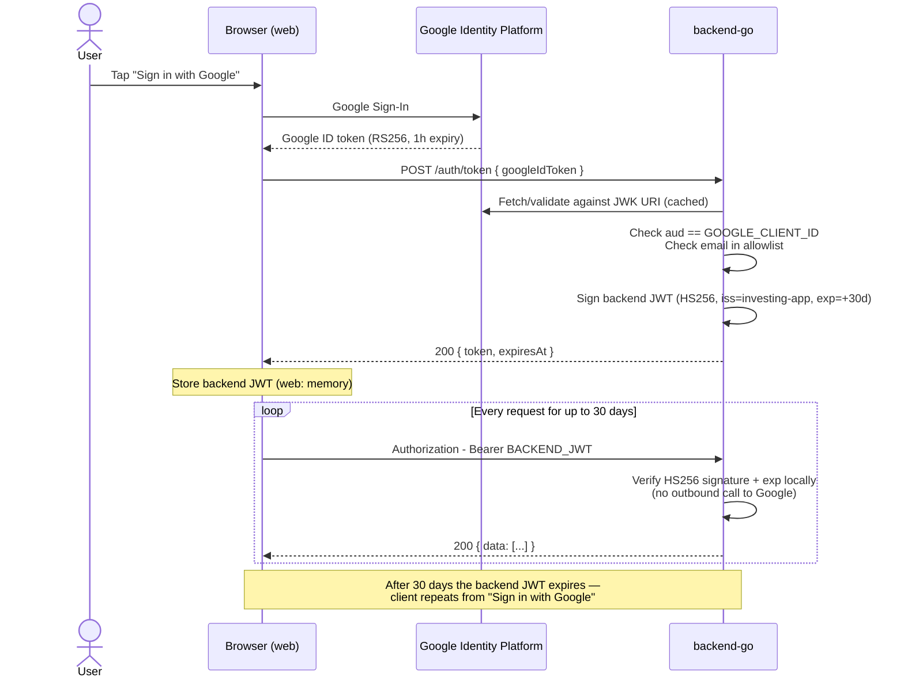
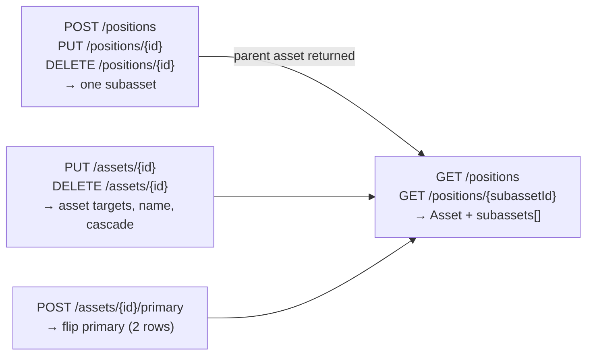
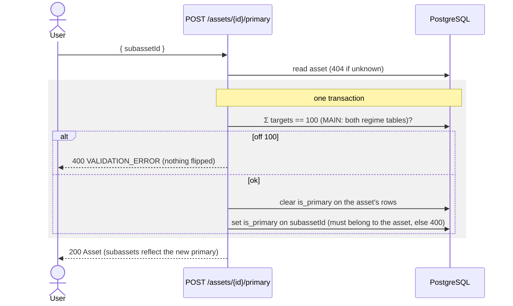
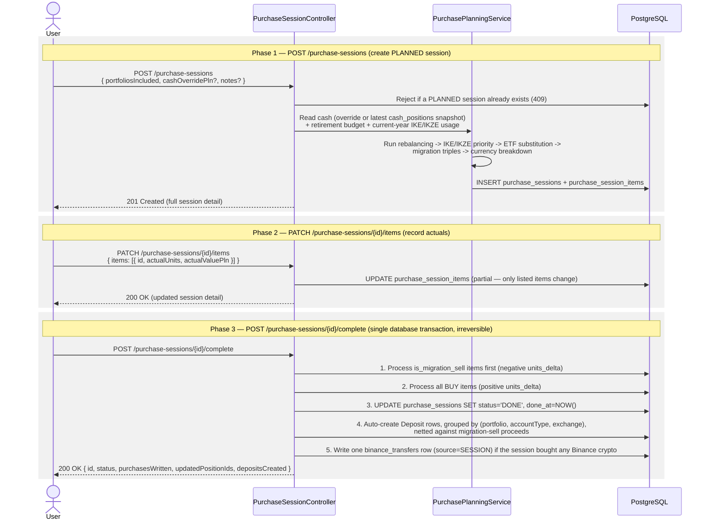

# 03 — API Contract

> **Audience:** All agents. Human-readable reference for all REST endpoints as they are actually implemented.
>
> **Base path:** `/api` (every route is mounted under `/api` in `backend-go/cmd/server/main.go`; Nginx proxies `/api/*` to `backend-go:8091`)
> **Production URL:** `http://your-hostname.tail-xxxxx.ts.net/api`
> **Local dev URL:** `http://localhost/api` via Nginx (`backend-go` :8091 is not published to the host)
>
> **Source of truth:** `docs/openapi.yaml` (bundled from `docs/openapi/`) is the contract; `backend-go/openapi/server.gen.go` is generated from it. The section headings below keep the Java-era `XxxController` names purely as domain-group labels — in Go each group is `backend-go/internal/<domain>` implementing the generated `ServerInterface`.
>
> **Response envelope rules:**
> - All list endpoints return `{ "data": [...], "meta": { "requestId", "timestamp" }, "page": { "number", "size", "total" } }`.
> - All single-resource endpoints return `{ "data": {...}, "meta": {...} }`.
> - All error responses return `{ "errors": [{ "code", "field", "message" }], "meta": {...} }`.
> - `meta.requestId` is the request's id: the same UUID is returned in the `X-Request-Id` response
>   header and appears as `request_id` in the backend logs (an inbound `X-Request-Id` that is a
>   valid UUID is reused).

---

## Idempotency-Key (money-moving POSTs, all three apps)

`POST /rebalancing-transfers`, `POST /deposits`, `POST /crypto-trades`, `POST /binance-transfers`
(main) and `POST /position-transfers`, `POST /purchases/confirm`, `POST /deposits` (portfolio-b, portfolio-c)
accept an optional `Idempotency-Key` header (ADR-111; contract:
`docs/openapi/components/parameters.yaml#/IdempotencyKey`). The web clients send one random UUID
per user intent (one dialog submission), reuse it for retries and rotate it after a success or when
the dialog closes.

| Request | Answer |
|---|---|
| first request with the key | processed; a 2xx answer is stored for 24 h |
| same key, same method + URI + body, after a 2xx | the stored status and body, header `Idempotent-Replayed: true`, nothing written |
| same key while the first is running, or after it ended with a 5xx | `409 IDEMPOTENCY_IN_PROGRESS` (outcome unknown: check the history) |
| same key, different method/URI/body | `422 IDEMPOTENCY_KEY_REUSED` |
| malformed key (empty, > 255 chars, not printable ASCII) | `400 VALIDATION_ERROR`, `field: Idempotency-Key` |
| a 4xx answer | not stored, so a corrected retry with the same key runs normally |

Without the header nothing is deduplicated (scripts and the bot never send it). Purchase-session
completion is idempotent by itself (status check under a row lock) and takes no key. Independently
of the header, all money writes of one app are serialised by one database advisory lock, so two
concurrent transfers can never both pass the "enough units" check (`08-monorepo-layout.md`
§Runtime rules).

---

## Internal and operational routes (not in `docs/openapi.yaml`)

| Route | Auth | Purpose |
|---|---|---|
| `GET /api/health-go` (all three apps; nginx `location =` per app) | none | Readiness: `200 {"data":{"service","status":"UP"}}` when the database answers a ping within 1 s, otherwise the error envelope with `503 SERVICE_UNAVAILABLE`. Used by the compose healthcheck (`/app/backend-go healthcheck`) |
| `POST /api/admin/historia/backfill-snapshot` (all three apps) | `bearerAuth` | ADR-097's one-off recovery for a missed nightly historia snapshot; never proxied for the UI, never linked |

Every other route is generated from the OpenAPI spec (`openapi.HandlerWithOptions`); nothing else is
hand-mounted.

---

## Authentication

The app is internet-reachable via Tailscale Funnel (not VPN-only), so every endpoint requires a credential except the two listed below. There are two auth mechanisms:

1. **`bearerAuth`** — a backend-issued JWT, required on every endpoint except `POST /auth/token`, `/actuator/health`, and the news/bot machine-only paths below.
2. **`serviceTokenAuth`** — a static shared-secret header. For the news module it is the *only* accepted credential on its two machine paths (`GET /news/assets`, `POST /news/ingest`). For the bot module it overlaps with `bearerAuth`: bot's write paths (`POST /bot/plans/ingest`, `POST /bot/calendar/sync`, `POST /bot/signals`, `POST`/`PATCH`/`POST .../actions` on `/bot/trades/**`) are `serviceTokenAuth`-only, same as news, but bot's read paths (`GET /bot/calendar`, `GET /bot/trades`/`/bot/trades/**`, `GET /bot/stats`, `GET /market-data/macro-state`) accept **either** credential — they're called by both the cron/on-demand host scripts (`X-Service-Token`) and the web frontend / macro de-risk gate UI (`bearerAuth`) (ADR-089). See the `serviceTokenAuth` subsection below for how that dual-audience routing works.

### `bearerAuth` — Google Sign-In + backend-issued JWT

Clients never send a Google ID token on ordinary requests. Instead, a Google ID token is exchanged **once per 30-day session** for a backend-issued JWT, which is what every subsequent request actually carries.

1. The client completes Google Sign-In via the Google Identity Platform and receives a short-lived Google ID token (RS256, 1-hour expiry, managed entirely by Google).
2. The client calls `POST /auth/token` with `{ "googleIdToken": "..." }`. This endpoint is the only unauthenticated write path in the API.
3. The backend validates the Google token against Google's JWK URI (`https://www.googleapis.com/oauth2/v3/certs`, cached and auto-rotated), checks the `aud` claim against the configured `GOOGLE_CLIENT_ID`, and checks the `email` claim against a hardcoded single-user allowlist. Any failure here is a 401.
4. On success, the backend signs its own JWT: HMAC-SHA256, `sub=<email>`, `iss=investing-app`, `exp = now + 30 days` (`app.security.jwt-expiry-days`). This is returned as `{ "token": "...", "expiresAt": "ISO8601" }`.
5. The client stores this backend JWT (web: memory/React context) and sends it as `Authorization: Bearer <token>` on every subsequent request for up to 30 days.
6. The backend validates the backend JWT **entirely locally** (HMAC verify + `exp`/`iss` check) — no outbound call to Google per request. Two separate `JwtDecoder` beans exist in `SecurityConfig`: `googleJwtDecoder` (RS256, JWK URI, used only inside `AuthService` for step 3) and `backendJwtDecoder` (HS256, shared secret, used by the resource server for every other protected request).
7. After 30 days the backend JWT expires and the client repeats from step 1. There is no refresh-token flow and no revocation list — revoking a session early would require rotating `JWT_SECRET`, which invalidates every session at once (acceptable for a single-user app).



**Unauthenticated paths:** `POST /auth/token`, `/actuator/health` (Docker healthcheck). Swagger UI / OpenAPI docs (`/swagger-ui/**`, `/api-docs/**`) require the same backend JWT as everything else — they are not public.

### `serviceTokenAuth` — `X-Service-Token` header (machine-only)

`GET /news/assets` and `POST /news/ingest` exist solely for the nightly host-cron news-research job (`infra/news/news-research.sh`), which runs as a plain OS process on the Raspberry Pi host — it has no Google account and cannot go through the flow above. These two paths are matched by a separate, `@Order(1)` `SecurityFilterChain` in `SecurityConfig` (`newsServiceTokenFilterChain`) that runs *before* the JWT chain, so they never fall through to bearer-auth handling.

- Header: `X-Service-Token: <token>`
- The backend compares the header value against `app.news.ingest-token` (env `NEWS_INGEST_TOKEN`) using `MessageDigest.isEqual` (constant-time, no timing side-channel).
- Missing or mismatched header → `401` with `{"errors":[{"code":"AUTH_ERROR","field":null,"message":"Missing or invalid X-Service-Token"}]}` (a bespoke shape, not the standard envelope — written directly by `ServiceTokenAuthFilter`, not `GlobalExceptionHandler`).
- The two user-facing news endpoints (`GET /news`, `GET /news/dates`) are **not** covered by this scheme — they use ordinary `bearerAuth` like every other read endpoint.
- A leaked service token can only call these two endpoints (bounded blast radius: tailnet-internal news-table spam, not a credential that reaches the rest of the API).

### `serviceTokenAuth` for the `bot` module — write-only paths + dual-audience reads (ADR-089)

The `bot` module (OKX macro-calendar trading-bot tracker) reuses the same `X-Service-Token`
mechanism and the same shared secret (`NEWS_INGEST_TOKEN` — `BOT_INGEST_TOKEN` is an accepted
env-var alias the host scripts use, but there is no separate secret validated server-side), via a
second, `@Order(1)` `SecurityFilterChain` (`botServiceTokenFilterChain`) that runs *before* both
the news chain and the JWT chain. Unlike news, bot's machine surface splits into two shapes:

**Write paths — machine-only, unconditional, exactly like news:** `POST /bot/plans/ingest`,
`POST /bot/calendar/sync`, `POST /bot/signals`, `POST /bot/trades`, and everything under
`POST`/`PATCH`/`POST /bot/trades/**` (`PATCH .../close`, `POST .../actions`, `POST .../ticks`,
`POST .../request-manage`). No human caller exists for any of these — the `securityMatcher`
claims them unconditionally, same as the news pattern.

**Read paths — dual-audience, claimed only when a service token is present:** `GET /bot/calendar`,
`GET /bot/trades` / `GET /bot/trades/**` (covers `/{id}`, `/{id}/ticks`, `/{id}/actions`), `GET
/bot/stats`, and `GET /market-data/macro-state`. These are called by **both** the cron/on-demand
host scripts (`infra/bot/daily-plan.sh`, `manage-position.sh`, `scalp-session.sh`) with
`X-Service-Token`, **and** by the web frontend (`/bot` page) / macro de-risk gate UI with an
ordinary `bearerAuth` JWT. The `securityMatcher` only claims a `GET` on these paths when the
request actually carries an `X-Service-Token` header (any value — validity is still checked
strictly by the unchanged `ServiceTokenAuthFilter` once claimed); if the header is absent, the
request falls straight through to the ordinary `@Order(3)` `bearerAuth` chain, unaffected. This
conditional routing exists specifically because these four paths are the first machine-auth
surface in the app that is also human-facing — see ADR-089 for the full reasoning, the rejected
alternatives (a blanket GET carve-out would 401 the frontend; a second machine-only endpoint would
needlessly duplicate the API surface), and the exact `securityMatcher` shape.

Deliberately **not** opened to `X-Service-Token`: `GET /bot/signals`, `GET /bot/plans/**` (no
script needs them today), `GET /bot/equity`, `GET /bot/positions/open` (add the same way, header-
gated, only if a script ever needs them), and `GET`/`PATCH /bot/control` (the trading kill switch
— deliberately human-bearer-only, never service-token, per the task spec).

---

## PositionsController — `/positions` and `/assets`

The portfolio is modeled as **Assets** with **Subassets** (`02-domain-model.md` §2.1). The `/positions` endpoints keep their paths but speak the asset vocabulary: list and read return **Assets**; the `{id}` in `/positions/{id}` is a **subasset** row id; writes on `/positions` create/edit/delete one subasset; `/assets/{id}` edits asset-level fields (targets, name) and `/assets/{id}/primary` changes which subasset is primary. All of this is identical in portfolio-b and portfolio-c (their own `docs/openapi.yaml`; only the unit-bucket fields of a subasset differ per app).



### Shapes

**`Asset`** (`data[]` of the list, `data` of every single-resource response): `id`, `key` (stable logical slug, unique per portfolio — a label, never a join key), `name`, `portfolio`, `exposure`, `assetClass`, `targetAllocationPct`, `targetAllocationPctRiskOff` (nullable — `NULL` on the risk-off column means "identical to `targetAllocationPct`"; interpolated between the two by the macro de-risk blend, see the Macro Data section below; never read for RETIREMENT), `computed`, `subassets[]`, `createdAt`, `updatedAt`.

**`Asset.computed`**: `unitsTotal`, `pricePln`, `priceNative` (these three are the **primary subasset's**), `valuePln` (Σ over the asset's priced subassets), `currentPct`, `effectiveTargetAllocationPct`, `deviationPct`, `profitPct`, `avgBuyPricePln`, `avgBuyPriceNative`, `equivalentUnits`, `costlessSubassets` (the last three are contract-only until the servers emit them — task 161c-1; every `computed` field is optional and a null field is omitted on the wire). `effectiveTargetAllocationPct` is the target `deviationPct` actually divides by — for a RETIREMENT asset, a MAIN asset with the macro gate disabled, or any asset with a null `targetAllocationPct`, it equals `targetAllocationPct` unchanged; for a MAIN asset with a non-null target while the gate is enabled, it's the risk-on/risk-off blend at the current `blendFactor` (`GET /market-data/macro-state`) — see `02-domain-model.md` §2.1 and `05-rebalancing-algorithm.md` §7.3. `deviationPct` follows the ADR-053 zero-target sentinel (`1.0`), computed on the asset. `profitPct` is the group profit `Σvalue / Σcost − 1` (a fraction: `0.1` = +10 %; `positioncalc.GroupProfit`, one implementation for all three apps): Σcost sums the recorded costs (`totalSpentPln > 0`) over the asset's subassets, Σvalue sums **every priced** subasset — including cost-less wrappers (live: Bitcoin's PLN ETN, Gold's `4GLD.DE`/`IGLN.L`, Quantum's `QUTM.DE`), because the go-live import stored the whole group's cost on the head row; a costed-but-unpriced subasset contributes neither side; `null` when Σcost ≤ 0 (portfolio-b today: no cost is recorded anywhere). **`avgBuyPricePln` is the asset's entry price**: PLN per 1 unit of the **primary** subasset, `pricePln / (1 + profitPct)` = `Σcost / (Σvalue / pricePln)`, so `avgBuyPricePln × (valuePln / pricePln) = Σcost` and `pricePln / avgBuyPricePln − 1 = profitPct`. It is derived from the recorded costs — never from the stored `avgBuyPrice` (a stale go-live value) and not as `avgBuyPrice × fxRate`. It is `null` whenever `profitPct` is `null`. Changing the primary re-expresses the same cost in the new primary's terms (`entry(P′) / entry(P) = price(P′) / price(P)`, a flip and flip back returns the identical value; an unpriced new primary yields `null`, never an invented number). Both compute per the above for every portfolio of every app: MAIN, RETIREMENT, portfolio-b and portfolio-c. RETIREMENT has done so since ADR-104 (2026-10-18), which removed ADR-056's RETIREMENT null-out once the V148 cost run gave RETIREMENT reviewed baselines. **`avgBuyPriceNative`** is the same entry price in the primary's own `priceCurrency`: `avgBuyPricePln / fx`, fx = the **current** PLN rate of that currency (the one `priceNative = pricePln / fx` uses), i.e. `priceNative / (1 + profitPct)` — the PLN cost is fixed, so the native line moves with the exchange rate by design ("the average price in USD is the PLN average divided by the current dollar rate"); equal to `avgBuyPricePln` for a PLN primary; `null` whenever `avgBuyPricePln` is `null` or the rate is unavailable. **`equivalentUnits`** = `valuePln / pricePln` (the asset's holdings in units of the primary; `avgBuyPricePln × equivalentUnits = Σcost`; present whenever the primary is priced). **`costlessSubassets`**: `string[]` of tickers of priced subassets that hold units but have no recorded cost, present only when an entry price exists ("cost of these assumed included in the group cost" — the known limitation). Full definition, the cost-maintenance rules and worked examples: `02-domain-model.md` §2.1 ("Asset-level cost, profit and entry price"). **Wire types:** every `computed` number is a JSON `number` and every field is nullable/omittable; the `Subasset.totalSpentPln` values are per-row storage slots — only their sum over the asset is meaningful, so a client shows cost and entry price at **asset level only**, never a per-row average.

**`Subasset`** (`subassets[]`, primary first, then by ticker): `id`, `assetId`, `isPrimary`, `ticker`, `name`, `portfolio`, `exchange`, `assetClass`, `priceCurrency`, `purchaseCurrency`, `unitsIke`, `unitsIkze`, `unitsRegularEur`, `unitsRegularUsd`, `unitsRegularPln`, `totalSpentPln` (the row's cost slot — nullable, `NULL` = no cost recorded, `0` = sold out; only the sum over the asset is meaningful, see `Asset.computed`), `avgBuyPrice` (**deprecated**: the stale go-live native average — not read by any computation and not displayed), `yahooTicker`, `companyBacked` (added ADR-064, broadened ADR-079 — true when the asset has its own distinguishable, individually-researchable narrative, which includes leaderless protocol-level assets like `BTC-USD` via protocol/on-chain events, not just company-backed ones; drives the nightly news-research job's asset scope, see the News section below and `02-domain-model.md` §2.1), and the computed per-row `pricePln`, `priceNative`, `valuePln`, `effectiveUnits`. A subasset has **no target field** — targets live only on the asset.

Units are net per portfolio — no runtime M-column deduction is applied (corrected in V9).

### GET `/positions`

Returns one **Asset per group** (not one row per `positions` row), each with live computed fields and its subassets nested.

Query params: `portfolio` (MAIN | RETIREMENT — renamed from INWESTYCJE/EMERYTURA in V22), `page` (default 0), `size` (default 20, max 100), `sort`. Assets are ordered by their primary subasset's ticker. An unfiltered request applies no macro de-risk override to MAIN assets' `effectiveTargetAllocationPct`/`deviationPct` (the override is loaded only for `?portfolio=MAIN`) — kept bug-for-bug from the Java original, see `05-rebalancing-algorithm.md` §8.

### GET `/positions/{id}`

`{id}` is a **subasset** id (row ids are unchanged by the model migration). The response is that subasset's **parent asset** with all subassets nested: `{ data: Asset, meta }`. 404 for an unknown id.

### POST `/positions`

Creates one **subasset**. Required: `ticker`, `name`, `portfolio`, `exchange` (`XTB` | `BINANCE`; portfolio-b/portfolio-c also accept `OTHER` for physical/fund holdings), `assetClass`, `priceCurrency`, `purchaseCurrency`, and **exactly one** of:

- `assetId` — attach to an existing asset of the same portfolio (a different portfolio answers `400` on `portfolio`; an unknown asset `404`). The new subasset joins as non-primary; `isPrimary: true` is accepted only when the asset currently has no primary (otherwise `409 CONFLICT`).
- `newAsset` `{ name, exposure, assetClass, targetAllocationPct?, targetAllocationPctRiskOff? }` — create a brand-new asset whose **first subasset is this one and is primary**; the new asset's `key` is this subasset's `ticker`. Targets are set here (range 0..100) and nowhere else on a create.

Neither or both → `400 VALIDATION_ERROR`. A top-level `targetAllocationPct` / `targetAllocationPctRiskOff` key (targets live on the asset) or a legacy `isCompanionRow` / `companionParentTicker` key is rejected with `400`. Optional: `exposure` (defaults to the new asset's / the target asset's), `yahooTicker`, `companyBacked` (added ADR-064, broadened ADR-079 — nullable; when omitted, the backend derives it from `assetClass`: `STOCK`/`CRYPTO` → `true`, `ETF`/`CURRENCY` → `false`; pass explicitly to override when a subasset's actual narrative doesn't match its class-level default). Returns `201` with the parent asset (base DTO, no computed fields yet); `409 DUPLICATE_ENTRY` on a duplicate **live** `(ticker, exchange, portfolio)` or a duplicate live asset key. **Restore (task 173):** when the natural key matches a soft-deleted subasset, or `newAsset`'s key matches a soft-deleted asset, that row is restored instead of inserted. The restored row keeps its `id`, units, cost basis and history. Required fields are overwritten with the request, optional ones are kept unless sent. Only the re-added subasset comes back (rules: `04-db-schema.md` "Soft delete"). An `assetId` that names a soft-deleted asset answers `404`.

### PUT `/positions/{id}`

Partial update of one **subasset**'s own fields — null fields in the request body are skipped. Updatable: `unitsIke`, `unitsIkze`, `unitsRegularEur`, `unitsRegularUsd`, `unitsRegularPln` (each ≥ 0), `totalSpentPln`, `avgBuyPrice` (deprecated), `name`, `assetClass`, `yahooTicker`, `companyBacked` (added ADR-064, broadened ADR-079 — this is how a `companyBacked` misclassification gets corrected after creation, e.g. a leaderless-but-newsworthy asset that should be `true`, the way `BTC-USD` itself was corrected by V58), and the optional **`assetId`**, which **re-homes** a non-primary subasset under another asset:

| `assetId` in body | Result |
|---|---|
| absent, or equal to the subasset's current asset | ignored (idempotent) |
| differs and the subasset is primary | `409 CONFLICT` — set another primary first, or delete and re-create it under the target asset |
| differs, target asset unknown | `404` |
| differs, target asset belongs to another portfolio | `400`, field `assetId` |
| differs, all checks pass | the subasset moves; it stays non-primary; no units, cost basis, targets or ticker move |

Every check runs before the single write, so a rejected edit changes nothing. **A units edit never changes cost** — cost changes only through an explicit `totalSpentPln` edit (the reviewed correction path; editing units up without cost lowers the entry price, and the UI says so). A top-level `targetAllocationPct` / `targetAllocationPctRiskOff` key is rejected with `400` — edit targets through `PUT /assets/{id}`. Returns `200` with the (new) parent asset.

### DELETE `/positions/{id}`

**Soft-deletes** one **subasset** (`deleted_at`, task 173). Nothing in the history is removed, and history never blocks the delete. A non-primary subasset is a single-row soft delete. Deleting the **primary** while live siblings remain → `409 CONFLICT` ("set a new primary first", no silent leadership change). Deleting an asset's last live subasset soft-deletes its asset in the same operation. `204`, `404` if not found or already deleted. The row disappears from every current-holdings view and stays in history; re-creating the same ticker restores it (`POST /positions`). There is no confirmation step at the API layer (the web UI owns the "are you sure" prompt).

### PUT `/assets/{id}`

Edits asset-level fields — **the only writer of targets**. Body `{ targetAllocationPct?, targetAllocationPctRiskOff?, name? }` (`targetAllocationPctRiskOff` is main-only and ignored for RETIREMENT assets). Each key is three-state: **absent = unchanged**, **explicit `null` = clear** (`NULL` = no target, which is not the same as `0` = explicit zero target, ADR-053), a number sets it. Numbers are range-validated to 0..100 (`400 VALIDATION_ERROR` otherwise) and there is deliberately **no** Σ = 100 guard, so partial edits stay possible (the UI's Σ indicator relies on it); Σ = 100 is enforced only as the set-primary tripwire below. Returns `200` with the asset (computed fields included), `404` for an unknown id. Implemented with the shared `httpx.Optional[T]` tri-state JSON field.

### DELETE `/assets/{id}`

Soft-deletes a whole asset and, in the same statement, every live subasset (task 173). History rows (transfers, purchase lots, sessions, historia) are untouched. `204`, `404` if not found or already deleted. Re-creating one of its tickers through `POST /positions` restores the asset.

### POST `/assets/{id}/primary`

Body `{ "subassetId": <int64> }`. Changes which subasset of the asset at `{id}` is primary — the replacement for the retired `POST /positions/{id}/promote`. A **pure relabel**: exactly two rows flip in one transaction (the old primary's flag clears, the named subasset's flag sets); no units move, no `asset_purchases` row is written, no cost basis, target or ticker moves, and there is no sibling re-pointing (membership is the `asset_id` FK, not a string). Because it moves nothing it is neither a buy nor a sell.

The portfolio's **Σ targets == 100** tripwire runs first, inside the same transaction, and the flip is rolled back / never happens on failure: per portfolio, MAIN checks both regime tables (`Σ targetAllocationPct` and `Σ COALESCE(targetAllocationPctRiskOff, targetAllocationPct)`), RETIREMENT and the sibling apps check the single table. Targets do not move, so on a complete book it passes by construction; it only fails when an in-progress target edit left the book off 100. Errors: `400 VALIDATION_ERROR` for a failed tripwire or a `subassetId` that does not belong to the asset; `404` for an unknown asset. Returns `200` with the asset — same shape as `GET /positions/{id}`, `subassets` reflecting the new primary. Reversible: setting the demoted subasset primary again restores the exact prior state. Available on MAIN and RETIREMENT assets alike.



### Error codes

`409` carries one of two codes: `DUPLICATE_ENTRY` (a unique constraint was violated on create) and `CONFLICT` (an asset-model rule — deleting or re-homing a primary that still has siblings, attaching a second primary). `CONFLICT` and `httpx.CodeConflict` are new with the asset model; `DUPLICATE_ENTRY` is unchanged.

---

## PurchaseSessionController — `/purchase-sessions`

The main monthly workflow, three phases: create a PLANNED session, record actuals after executing trades on the broker, complete it. At most one PLANNED session exists at a time.



### POST `/purchase-sessions`

Creates a new PLANNED purchase session. Runs the full rebalancing algorithm internally. At most one PLANNED session at a time (partial unique index); returns 409 if one exists.

Request body: `portfoliosIncluded` (BOTH | MAIN | RETIREMENT, required), `cashOverridePln` (optional, overrides cash_positions snapshot), `notes` (optional).

The backend runs the full plan algorithm:
1. Reads gross cash from the latest `cash_positions` snapshot (or `cashOverridePln`)
2. Computes net main cash for MAIN (ADR-033): `grossCash - retirementContribution`, then applies post-purchase 5% buffer (ADR-036): `(netCash - 0.05 × portfolio_value) / 1.05`
3. Reads Emerytura budget from `settings.retirement.monthly_contribution_pln`
4. Queries deposits for current-year IKE/IKZE usage
5. Runs rebalancing with IKE → IKZE → REGULAR priority allocation
6. Applies ETF substitution while IKE/IKZE capacity exists
7. Generates migration triples (ETF sell + mining stock buy + real crypto buy) when needed
8. Computes currency breakdown (xtbPln, xtbEur, xtbUsd, binanceEur, pkoCHF)
9. Persists `purchase_sessions` + `purchase_session_items`

Returns 201 with full session detail (items, currency breakdown, account limits).

**Account limits (`AccountLimitsDto`, embedded as `retirementLimitsRemaining`/`mainLimitsRemaining` on the session detail, both currently populated identically from the same year-scoped computation).** Computed by `PurchaseSessionService.computeLimits(year)`, which — like `DepositService.getAccountCapUsage()` above — now goes through the shared cap-usage computation (ADR-058), so both endpoints silently reflect the same manual correction (see below): `ikeUsedPln`/`ikzeUsedPln` (raw `SUM(deposits.amount)`, same figure as `AccountCapUsageItem.totalDepositedPln`), `ikeRemainingPln`/`ikzeRemainingPln` (**floored at zero** here — unlike `AccountCapUsageItem.remainingPln` — since this figure directly caps how much of a session's budget `PurchasePlanningService` may allocate to IKE/IKZE, and a negative budget must never be planned against), `ikeAnnualLimitPln`/`ikzeAnnualLimitPln` (unchanged, from `settings`).

### GET `/purchase-sessions/active`

Returns the current PLANNED session with full detail. 404 if no PLANNED session exists.

### PATCH `/purchase-sessions/{id}/items`

Updates actual quantities after broker execution. Request body: `{ "items": [{ "id", "actualUnits", "actualValuePln" }] }`. Partial updates supported — only listed items are changed. Returns updated session detail. Returns 409 if session is already DONE.

### POST `/purchase-sessions/{id}/complete`

Marks session DONE. Atomically (single database transaction):
1. Processes migration SELL items first (negative `units_delta`)
2. Processes all BUY items (positive `units_delta`)
3. Writes `asset_purchases` rows for each, and updates each touched asset's recorded cost (`positions.total_spent_pln`) with the shared asset-level average-cost kernel, **netted per asset** across the whole session: migration/donor sells against buys and compensating buys of the same asset are a swap that carries cost (only an imbalance is a sale or a market buy), other assets are independent, and a buy on an asset that holds units but has no recorded cost invents no cost (`02-domain-model.md` §2.1, "Asset-level cost, profit and entry price"). Prices come from `price_cache` — no network call inside the transaction
4. Sets `status = DONE`, `done_at = NOW()`
5. Auto-creates `Deposit` records — groups non-sell, non-zero items by `(portfolio, accountType, exchange)` (`exchange` derived from each item's `Position`), sums each group's **planned** PLN value per item, falling back to actual only when planned is null (`plannedValuePln ?? actualValuePln` — ADR-055; the deposit represents capital committed toward the IKE/IKZE statutory limit and XIRR's invested total, not post-fee invested value, so it deliberately does **not** use the same actual-preferring fallback as cost-basis tracking), then **nets migration-sell proceeds against the matching group** so the migration-triple IKZE re-buy (funded by intra-IKZE sale proceeds, statutory-limit-neutral) creates no deposit (ADR-035). Groups netted to ≤ 0 produce no row. Each deposit: `currency=PLN`, `depositDate=today` (Europe/Warsaw), `comment="Auto from session #<id>"` (ADR-033). Binance deposits are real new capital and count in XIRR.
6. Writes one `binance_transfers` side-ledger row (`source=SESSION`, `session_id` set) with the session's total effective Binance purchase value in PLN — skipped when the session has no Binance purchases (ADR-035).

Items with `actual_units = null` fall back to `planned_units`. Items with `actual_units = 0` are skipped. Migration sell items (`isMigrationSell = true`) are excluded from deposit creation. This operation is irreversible.

Returns 200 with `PurchaseSessionCompleteResponse`: session summary, list of updated position IDs, and `depositsCreated` (count of newly created deposit rows).

### DELETE `/purchase-sessions/{id}`

Cancels a PLANNED session. Returns 204. Returns 400 if session is already DONE.

### GET `/purchase-sessions`

Paginated list of DONE sessions in reverse chronological order. Query params: `page`, `size`.

---

## RebalancingTransferController — `/rebalancing-transfers`

### POST `/rebalancing-transfers`

Records an ad-hoc rebalancing transfer without a session. Writes to `asset_purchases` with `session_id = NULL` (V15 change). Updates `positions.units_*` atomically and keeps `positions.total_spent_pln` in sync with the **asset-level average-cost rule** (same kernel as purchase-session commit): the sale reduces the sold *asset's* recorded cost — every row that carries cost, not only the sold row — in proportion to the value sold (`units × pricePln`, the actual PLN proceeds); a buy leg on the **same asset** carries that cost (a same-asset swap leaves the asset's cost and entry price unchanged, up to a `γ = min(1, legs value / proceeds)` share), a buy leg on **another asset** adds the actual PLN paid (`units × pricePln`) at market; a sale that leaves no units sets the asset's cost to exactly 0. See `02-domain-model.md` §2.1. The web dialog collects actual transaction totals (PLN received / paid) and derives `pricePln = amountPln / units` before calling the API. Returns 200.

**Portfolio-scoped ticker resolution (ADR-063, `05-rebalancing-algorithm.md` §7.8).** The request carries a required top-level `portfolio` (MAIN or RETIREMENT) scoping the entire transfer — every leg's `ticker` resolves via the composite key `(ticker, portfolio)`, not ticker alone, since `positions` has a `(ticker, exchange, portfolio)` unique constraint and many tickers exist as separate rows in both portfolios (e.g. `HUT`, `SOL-USD`, `PL.ETNVIRSOL`). A ticker not found under the request's `portfolio` is a 404 even if it exists under the other portfolio. **Status: spec decided, not yet implemented** — see the task file referenced in ADR-063; the live endpoint still resolves by ticker alone until a Backend agent lands this.

**Wrapper lock (ADR-054, `05-rebalancing-algorithm.md` §7.7).** If the sold leg's `accountType` is `IKE` or `IKZE`, every buy leg's `accountType` must match it exactly — any other combination (including IKE↔IKZE) is rejected with `400 VALIDATION_ERROR` (`IllegalArgumentException`, same convention as the insufficient-units check). When the sold leg's `accountType` is `REGULAR`, buy legs may target `REGULAR`, `IKE`, or `IKZE` freely.

**Auto-deposit (ADR-054).** Each buy leg that lands in IKE or IKZE while the sold leg is `REGULAR` also writes one `Deposit` row (`amount = units × pricePln`, `currency = PLN`, `accountType`/`portfolio`/`exchange` taken from that leg/position, `depositDate = WarsawTime.today()`, auto-generated `comment`) — a genuine new IKE/IKZE contribution that counts against the annual cap (`GET /deposits/account-cap-usage`). Multiple qualifying legs in one transfer each get their own row (never merged). In-wrapper transfers (IKE→IKE, IKZE→IKZE) and REGULAR→REGULAR legs create no deposit. This is a second, independent auto-deposit writer alongside `POST /purchase-sessions/{id}/complete`'s own (grouped/netted) mechanism above — the two never interact.

---

## MarketDataController — `/market-data`

### GET `/market-data/prices`

Read-only, cache-only — **never triggers a refresh** and has no `forceRefresh` param. Returns whatever is currently in `price_cache` (updated by the 15-minute scheduler or by `POST /market-data/prices/refresh` below). Query param: `tickers` (comma-separated; omit for all).

Response `data[]`: `ticker`, `price`, `currency`, `pricePln`, `fetchedAt`.

### POST `/market-data/prices/refresh`

Synchronous refresh of all tracked ticker prices (waits until complete). Used by the topbar "Odśwież ceny" button. Up to 8 parallel Yahoo Finance / Binance fetches. Returns 200 with `PriceRefreshResult`: `total`, `succeeded`, `failures[]` (`{ ticker, reason }` for any ticker whose fetch failed).

### GET `/market-data/fx-rates`

Read-only, cache-only — **never triggers a refresh** and has no `forceRefresh` param (this is the one place the doc previously claimed such a param existed; the refresh path is the separate POST endpoint below). Returns PLN FX rates (EUR, USD, CHF, GBP) plus synthetic PLN=1.0, no query params.

Response `data[]`: `fromCurrency`, `rateToPln`, `source`, `fetchedAt`.

### POST `/market-data/fx-rates/refresh`

Force-refreshes all FX rates from Yahoo Finance. Returns stale cache on failure rather than erroring (never throws if a stale cache exists). Returns 204 No Content.

### GET `/market-data/linear-regression`

Implemented by the separate `LinearRegressionController` class (same `/market-data` base path). Regression chart data. Query params: `ticker` (required), `interval` (default `wk`), `fromDate`, `toDate`, `since` (integer, default 0 — number of future periods to extrapolate beyond the last data point). The regression is always fitted over the full available history; `fromDate`/`toDate` only filter the returned rows. Returns price series, trendline series, and ±1/2/3/4 SD band series for the RegressionPage chart.

### GET `/market-data/trade-chart/tickers` (ADR-057)

Ticker picker for the trade-history chart (§ below). Built from `DISTINCT asset_purchases.ticker` — every ticker ever traded, not `positions.ticker` alone (a fully-liquidated position is not deleted in the normal trim-to-target flow, but this list doesn't rely on that holding forever) — joined to `positions` for `name`/`yahooTicker`/`priceCurrency`. No query params; never triggers a Yahoo Finance call.

Response `data[]`: `ticker`, `name`, `yahooTicker`, `priceCurrency`, `tradeCount`, `firstTradeAt`, `lastTradeAt`. A sibling `excluded[]` (not a paginated `data` sub-field — a top-level array alongside `data`) lists tickers that couldn't be resolved: `{ ticker, reason }` where `reason` is `NO_POSITION_MATCH` (no `positions` row has this ticker — e.g. the position was renamed after the trade was recorded) or `MISSING_YAHOO_TICKER` (a matching `positions` row exists but its `yahoo_ticker` is NULL, so no price history can be fetched). Never a silent drop — every excluded ticker has a reason.

When the same ticker exists as more than one `positions` row (MAIN and RETIREMENT both hold it), display metadata is resolved from the lowest-`id` matching row — a "first match wins" convention that is fine here because this is cosmetic display metadata only, not a position being mutated. This is **not** the same as ticker→position resolution for a write: `PurchaseSessionService.completeSession` already resolves via a `(ticker, portfolio)` composite key (its `PositionKey` record), and `RebalancingTransferService.executeTransfer` is being fixed to do the same (ADR-063, `05-rebalancing-algorithm.md` §7.8) — ticker-alone "first match wins" for a mutating lookup was exactly the bug ADR-063 closes, not a convention worth reusing.

### GET `/market-data/trade-chart` (ADR-057)

Price series (raw close, no regression fit, no log transform — unlike `linear-regression` above) plus one marker per `asset_purchases` row for the ticker, aggregated across every portfolio and account type the ticker was ever traded under (no filter param — the per-trade portfolio/accountType breakdown lives inside each marker, for the hover tooltip). Query params: `ticker` (required, the internal app ticker, not the Yahoo symbol), `interval` (default `wk`), `fromDate`, `toDate` — both the price series and the returned trade markers are filtered to `[fromDate, toDate]`.

Non-PLN-denominated tickers (`Position.priceCurrency != PLN`) have their trade markers converted from `price_pln` to native currency via a nearest-calendar-date lookup in one historical FX OHLC series (`EURPLN=X`/`USDPLN=X`/`CHFPLN=X`/`GBPPLN=X`, same mapping `FxRateCacheService.YAHOO_FX_TICKERS` uses), fetched once per request over the same date window as the price series — at most 2 Yahoo Finance HTTP calls total (1 price series + 1 FX series), 0 extra calls when `priceCurrency = PLN`. Never silently substitutes a 1.0 FX rate on a missing series — see ADR-057.

Response `data`: `ticker`, `yahooTicker`, `priceCurrency`, `interval`, `priceSeries[]` (`{ date, close }`), `trades[]` (`{ id, purchasedAt, tradeType, portfolio, accountType, unitsDelta, pricePln, priceNative, totalPln, sessionId }` — `unitsDelta`'s sign is the buy/sell indicator, same convention as the `asset_purchases` column it's sourced from; `priceNative` is the Y-axis value to plot the marker at, matching `priceSeries`' units; `tradeType` is one of the six ADR-057 values and is the recommended dot color/shade key — recommended dot size key is `abs(totalPln)`, mirroring the Michael-Saylor-purchase-history-chart pattern the feature was modeled on). `tradeType = SEED_IMPORT` markers represent the one-time V9 spreadsheet-import backfill, not a real trade — recommended frontend treatment is muted color / excluded from the default view, not enforced by the API.

Errors reuse existing exception→status precedents rather than introducing a new response shape: `404` (`NoSuchElementException` — no trade history for the ticker, or no matching `positions` row, same `"Position not found for ticker: X"` message pattern `RebalancingTransferService` already uses), `400` (`IllegalArgumentException` — matching `positions` row has a NULL `yahoo_ticker`, or Yahoo returned no OHLC data at all, same as `linear-regression`'s existing `"No data found for ticker"` case), `503` (`PriceUnavailableException` — the required historical FX series could not be fetched, same mapping `FxRateCacheService` already produces).

Y-axis scale (linear vs. log) is a frontend rendering choice over the same raw numbers this endpoint returns — it does no log transform itself. Recommended default: **linear**, unlike `linear-regression`'s log default (this chart's purpose — comparing dot sizes across trades — reads more naturally on a linear axis, and the user's own request explicitly wanted a non-log option available).

This is a **read-only visualization of trades that already happened** — no new write path, no interaction with the buy-only/manual-sell-only invariant (ADR-045); the only way a sell is ever recorded remains the existing manual "Sprzedaj" button (`RebalancingTransferDialog.tsx` → `POST /rebalancing-transfers`), unchanged by this feature.

---

## Macro Data — `/market-data/macro-state` (still `MarketDataController`)

Backs the MAIN-portfolio macro liquidity de-risk gate: a continuous 0→1 `blendFactor` (0 = full risk-off, 1 = full risk-on — orientation flipped by ADR-071, was the reverse under ADR-044; 0.7 × z-score of net-liquidity YoY acceleration + 0.3 × z-score of Global-M2 YoY acceleration, 3-month smoothed, clipped) that linearly interpolates every MAIN position's target allocation between `targetAllocationPct` (risk-on) and `targetAllocationPctRiskOff` (risk-off) during purchase-session planning: `effectiveTarget = riskOff × (1 − blendFactor) + riskOn × blendFactor`.

### GET `/market-data/macro-state`

Read-only and cheap — reads the latest persisted `macro_state` row; **never** calls FRED/ECB/BoE (or the two newer China/Japan sources below) itself. The state is refreshed automatically on a schedule (`MacroDataScheduler`: Fridays 18:00 Europe/Warsaw for net liquidity; 1st and 5th of the month for Global M2 — see below); this endpoint just serves what's already stored.

Response `data`: `asOfDate`, `blendFactor` (0–1; 0 = full risk-off, 1 = full risk-on — ADR-071), `zone` (display-only label derived from `blendFactor`: `RISK_OFF` < 0.2, `MID_OFF` < 0.4, `NEUTRAL` < 0.6, `MID_ON` < 0.8, `RISK_ON` ≥ 0.8 — thresholds unchanged by ADR-071, only which label sits at which end), `compositeZ`, `smoothedZ`, `riskOff` (legacy boolean, telemetry only — no longer gates the rebalancing override directly), `deriskEnabled` (mirrors the `rebalancing.macro_derisk_enabled` setting), `netLiqLatestUsdMln`, `netLiqYoy`, `netLiqYoyAccel`, `netLiqRiskOff`, `globalM2LatestUsdMln`, `globalM2Yoy`, `globalM2YoyAccel`, `globalM2RiskOff`, `globalM2Stale` (true when the China/Japan M2 components need refreshing), `components[]` (`{ seriesCode, source, latestObservationDate, latestValue, stale }` — one row per input series; `source` is one of `FRED`/`ECB`/`BOE`/`BOJ`/`CHINADATA`/`TRADINGEC`/`PBC`/`YCHARTS`/`MANUAL`/`DERIVED`, the last three China codes being ADR-068's scraped tip sources (`PBC` added V62, PBOC's own site, still tip-only in code)), `computedAt`.

### GET `/market-data/macro-state/history`

Added ADR-069, backs the Settings page's macro blend-factor history chart. Returns **every**
persisted `macro_state` row (not just the latest) as an unpaginated `ListResponse`, ordered by
`asOfDate` ascending — same "cheap, read-only, never calls FRED/ECB/BoE/BoJ/chinadata.live"
guarantee as the GET above, served by a new `MacroStateRepository.findAllByOrderByAsOfDateAsc()`
query. Response `data[]` is a deliberately minimal per-row projection, not the full panel:
`asOfDate`, `blendFactor` (0–1, nullable during the bootstrap period), `zone` (same
`MacroZone.fromBlendFactor` derivation as above, nullable iff `blendFactor` is null). No
pagination — `macro_state` accumulates at most a handful of rows per week (weekly net-liquidity +
monthly Global-M2 triggers), the same scale reasoning already applied to
`GET /market-data/prices`/`GET /market-data/fx-rates`.

The frontend merges this live series with a frozen, pre-live backtest series
(`frontend-web/src/lib/macroBlendBacktest.ts`, 179 monthly points covering 2011-07 through
2026-05, recomputed from the backtest CSV's raw `smoothed_z` column under the **current** blend
formula — the CSV's own `blend` column is stale, computed with the pre-ADR-048/049 steepness
divisor, and was deliberately not used as-is), rendered dashed before the **2026-07-01** live-
cutover date and solid from this endpoint's data onward. Live accumulation only started
2026-07-01, so there is a one-month gap (June 2026) covered by neither series — rendered as a
break in the line, not interpolated.

### POST `/market-data/macro-state/refresh`

Forces an out-of-band recompute: fetches the FRED/ECB/BoE/BoJ/chinadata.live series, upserts `macro_observations`, recomputes derived series + YoY/acceleration + composite/smoothed z-score + `blendFactor`, and upserts today's `macro_state` row. Any manually-pasted China/Japan observation is used as-is if it is the freshest one on record for that series. This is the same work the scheduler does — this endpoint exists for an on-demand recompute. Returns 200 with the freshly computed state (same shape as GET above). **Called by the web frontend** from Settings → *Stan makro* → *Odśwież* (before 2026-08-04 that button only re-issued the GET, so it re-rendered the identical stored row and appeared to do nothing). Typical end-to-end cost measured 2026-08-04: **~11 s** for all 14 upstream fetches (nginx caps proxied requests at `proxy_read_timeout 30s`, so this fits with headroom; a hung upstream could still exceed it, in which case the backend transaction still commits — only the UI response is lost). The earlier note here that **FRED is non-functional is obsolete**: `FredClient` now uses the official key-authenticated `api.stlouisfed.org` API and all eight series fetch normally.

**China/Japan M2 sourcing (ADR-046).** `MacroDataService` fetches Japan M2 from the official
Bank of Japan Time-Series Data Search API (`BojClient`) and China M2 from chinadata.live
(`ChinaDataLiveClient`, a third-party aggregator — not PBOC's own site, which only publishes
Chinese-primary HTML tables; best-effort, not authoritative). Both clients are live in the
running code, wired into `MacroDataService` and all three `MacroDataScheduler` triggers. This
closed a gap that existed since ADR-042/044 shipped: the manual-paste path below had been the
only route for `M2_CN`/`M2_JP` and was never actually used in production (zero rows ever)
until these two clients shipped, which is why `globalM2Stale` had been `true` and
`blendFactor` `null` on every persisted state before this landed.

**FRED sourcing (ADR-046 §6).** The Go `FredClient` (`backend-go/internal/marketdata/macro/fetch.go`) supplies four of the
seven raw series above — the three net-liquidity legs (WALCL, WDTGAL, RRPONTSYD) and US M2 (M2SL) — plus all four FX
legs (EXUSEU, EXUSUK, EXCHUS, EXJPUS) used to convert the Euro/UK/China/Japan M2 legs to USD. It calls FRED's official
`api.stlouisfed.org/fred/series/observations` REST API, authenticated with a free, user-registered `FRED_API_KEY`. (The
Java backend's keyless `fred.stlouisfed.org/graph/fredgraph.csv` client was actively blocked at the TLS/bot-detection
layer, which had silently starved `net_liq_yoy_accel` and the US leg of `GLOBAL_M2_USD` and kept `blend_factor` from
computing; the keyed API is not blocked.)

### POST `/market-data/macro/m2-manual`

Fallback seam for the two Global-M2 components that don't have a first-party keyless API —
China (normally chinadata.live) and Japan (normally the Bank of Japan API), per ADR-046. Use
this only if the corresponding automated source is broken (or, until the follow-up
implementation above ships, as the sole way to populate these two series at all). Upserts one
`macro_observations` row (`source=MANUAL`) keyed by `(seriesCode, observationDate)`. Request
body: `seriesCode` (`M2_CN` | `M2_JP`), `observationDate`, `value` (M2 level in native-currency
millions — CNY for `M2_CN`, JPY for `M2_JP`; the backend converts to USD — the same convention
the automated clients use after their own ×100 unit correction). Does **not** itself recompute
the state — call `POST /market-data/macro-state/refresh` afterwards, or wait for the next
scheduled run. Returns 200 with the current (not yet recomputed) state. Not called by the web
frontend today.

---

## DepositsController — `/deposits`

### GET `/deposits`

Paginated list. Query params: `portfolio`, `accountType`, `exchange` (XTB | BINANCE), `year`, `page`, `size`. All parameters are optional and combinable.

**Deposits are the only capital record (ADR-035).** The Binance side ledger does NOT live in this table — it has its own `/binance-transfers` resource. Auto session deposits with `exchange=BINANCE` are real new capital and stay here.

### POST `/deposits`

Records a new deposit. Required: `depositDate`, `amount`, `currency`, `exchange`, `accountType`, `portfolio`. Optional: `comment`. Returns 201.

### GET `/deposits/xirr`

Computes XIRR for a portfolio. Query param: `portfolio` (required). Uses the deposit series for that portfolio + current portfolio value, valued today (Europe/Warsaw calendar date). Brent solver (`common-go/xirr.Solve`, ADR-112, the same solver every app uses for deposits and historia); date basis = whole days/365. `xirrPct` is null when there is no meaningful root (fewer than two flows, no sign change, no convergence, or an annualised loss beyond −99.9 %); the endpoint never fails because of the solver.

**Deposit scope (ADR-035):** ALL deposits count — the full series via `DepositRepository.findAllByPortfolioOrderByDepositDateAsc(portfolio)`, with no exchange exclusion. (ADR-034's `BINANCE` exclusion is superseded; it deleted genuine capital because session-created Binance deposits are real monthly cash.)

Response `data`: `portfolio`, `xirrPct`, `totalInvestedPln`, `currentValuePln`, `simpleReturnPct`, `yearsElapsed`, `computedAt`.

### GET `/deposits/account-cap-usage`

IKE/IKZE contribution cap usage for a given year. Query param: `year` (required). Caps read from `settings` (`ike_annual_limit_pln`, `ikze_annual_limit_pln`).

Response `data[]` (`AccountCapUsageItem`): `accountType`, `year`, `totalDepositedPln` (raw `SUM(deposits.amount)` for that account type/year), `annualCapPln`, `remainingPln` (silently incorporates any manual correction from `account_cap_adjustment` for this `(accountType, year)` — see below; **not** floored at zero — a negative value means the account is over-contributed for the year, which is meaningful information here), `utilizationPct` (arithmetically consistent with `remainingPln`).

### PUT `/deposits/account-cap-usage/adjustment`

Corrects the IKE/IKZE remaining limit for a given `(accountType, year)` (ADR-058) — the user types the real remaining amount they know is correct (e.g. read off a broker statement), not a signed delta. The backend solves for whatever internal `account_cap_adjustment` value makes the computed `remainingPln` equal exactly that figure, so a later deposit still moves the remaining figure by its own amount rather than freezing at whatever was last typed. Does **not** touch the statutory annual cap itself (still only edited via `PUT /settings/{key}`).

Request body: `accountType` (`IKE` | `IKZE`, required — `REGULAR` is rejected with `400 VALIDATION_ERROR`, since `REGULAR` has no statutory annual cap), `year` (required, `2021`–`2100`), `remainingPln` (required, signed — the asserted remaining limit).

```json
{ "accountType": "IKE", "year": 2026, "remainingPln": 3000.00 }
```

Idempotent upsert keyed by `(accountType, year)` — calling it twice for the same key updates the same row rather than creating a second one. Returns `200` (uniformly, for both the first-time create and subsequent updates — same convention `PUT /settings/{key}` already uses rather than distinguishing 201 vs 200) with the freshly-recomputed `AccountCapUsageItem` for that `(accountType, year)` — `remainingPln` in the response equals exactly what was typed:

```json
{ "data": { "accountType": "IKE", "year": 2026, "totalDepositedPln": 20472.00, "annualCapPln": 23472.00, "remainingPln": 3000.00, "utilizationPct": 87.21 }, "meta": { "requestId": "...", "timestamp": "..." } }
```

No dedicated `GET` for the correction alone — it round-trips through `GET /deposits/account-cap-usage` and every purchase-session response (`AccountLimitsDto`, above), which already carry the corrected `remainingPln` for prefill.

`400 VALIDATION_ERROR` for a missing/invalid field or `accountType = REGULAR`; no `404` case since this is an upsert (the row need not already exist).

---

## BinanceTransfersController — `/binance-transfers` (ADR-035)

Flat side ledger of money sent to Binance, distilled from monthly deposits (overlapping money, not additional capital). Sole purpose: yearly PLN sums for PIT-38 crypto acquisition costs (koszty uzyskania przychodu, field 9C). Mirrors the spreadsheet "Wpłaty Binance" table — **no portfolio column**.

### GET `/binance-transfers`

Query param: `year` (optional — filters `data` rows by `transferDate` year). Response (unpaginated): `{ data: BinanceTransfer[], yearlySums: [{ year, totalPln }], meta }`. `yearlySums` always covers all years regardless of the filter (year selector + PIT sum from one call); ordered by year descending. Rows ordered by `transferDate` descending.

`BinanceTransfer` fields: `id`, `transferDate`, `amountPln`, `amountNative` (nullable), `nativeCurrency` (nullable; paired with `amountNative`), `comment`, `source` (MANUAL | SESSION), `sessionId` (nullable, set on SESSION rows), `createdAt`.

### POST `/binance-transfers`

Manual row. Required: `transferDate`, `amountPln` (> 0). Optional: `amountNative` + `nativeCurrency` (must be supplied together), `comment`. Server sets `source=MANUAL`, `sessionId=null`. Returns 201 with the created row.

### DELETE `/binance-transfers/{id}`

Deletes any row (MANUAL or SESSION) — manual correction facility. Does not touch sessions, deposits, or positions. Returns 204, 404 if not found.

SESSION rows are written automatically by `POST /purchase-sessions/{id}/complete` (one row per session with Binance purchases, amount = total effective Binance purchase value in PLN — an approximation of the transfer amount).

---

## HistoriaController — `/history`

> **Note:** the underlying "Historia" feature (daily portfolio snapshots) is exposed at `/history`, not `/historia` — the controller's `@RequestMapping` and the frontend's `shared-ts` client both use `/history`. If you find `/historia` referenced anywhere else in this repo, that reference is stale.

### GET `/history`

Daily portfolio value snapshots. Query params: `portfolio` (MAIN | RETIREMENT; absent or `ALL` returns both portfolios merged and sorted by date ascending), `from` (date, defaults to 2000-01-01), `to` (date, defaults to 2100-12-31), `page` (default 0), `size` (default 50).

Implementation note: uses in-memory pagination (all matching rows loaded then sliced). Acceptable for current data volume.

Response `data[]` (`HistoriaEntryDto`): `id`, `snapshotDate`, `portfolio`, `totalDeposits`, `portfolioValue`, `xirr` (nullable, from DB), `returnPct` (computed at response time = `portfolioValue/totalDeposits - 1`), `profitPln` (computed = `portfolioValue - totalDeposits`), `positionValues` (nullable map of ticker → value_pln at snapshot time; `null` for pre-V30 rows), `createdAt`.

---

## CashPositionsController — `/cash-positions`

### GET `/cash-positions`

Returns the most recent snapshot only (all rows sharing the latest `recorded_at` timestamp). Locations: PKO, ZEN, Portfel gotówka, Lokaty.

### POST `/cash-positions`

Creates a new snapshot. All submitted rows share the same `recorded_at` timestamp. Old snapshots retained for history. Returns the new snapshot.

---

## CryptoTradesController — `/crypto-trades`

### GET `/crypto-trades`

Paginated list. Query params: `ticker`, `year`, `exchange`, `side`, `page`, `size`.

### POST `/crypto-trades`

Records a new trade. Required: `tradeDate`, `ticker`, `exchange`, `accountType`, `side`, `quantity`, `unitPrice`, `priceCurrency`, `totalAmount`, `amountPln`. Optional: `notes`. `source` defaults to `MANUAL`. Returns 201.

**No DELETE endpoint** — frontend permanently disables the delete button.

### GET `/crypto-trades/tax-summary`

Annual PIT-38 summary. Query param: `year` (required). Groups by ticker: `totalBuysPln`, `totalSellsPln`, `netGainPln` (sells - buys), `belka = max(0, netGain × 0.19)`. No FIFO/LIFO — raw PLN amounts at trade time. PIT-38 line mapping: 8C=totalSells, 9C=totalBuys, 10=netGain, 27=belka.

---

## TaxReturnsController — `/tax-returns`

### GET `/tax-returns`

Paginated list. Query params: `page`, `size`.

### POST `/tax-returns`

Records a new annual tax return. Required: `year`, `grossGain`, `taxPaid`, `effectiveRatePct`. Returns 201, 409 on duplicate year.

---

## InflationController — `/inflation`

### GET `/inflation`

Paginated list. Query params: `year`, `page`, `size`.

### POST `/inflation`

Records a new CPI data point. Required: `year`, `month`, `cpiValue`. Returns 201, 409 on duplicate.

### POST `/inflation/sync`

Upserts month-over-month CPI values from the GUS SDP API (fallback: stat.gov.pl CSV scrape). Returns 200 with `{ upserts }`. Also runs monthly via scheduler (15th, 06:00 Europe/Warsaw) and once on startup when stale.

---

## MEXC endpoints (`/mexc/*`) — removed

`MexcBotController`, `MexcDepositController` and `MexcPerformanceController` (`/mexc/bot/*`, `/mexc/deposits`,
`/mexc/holdings`, `/mexc/performance`, `/mexc/snapshots`) were removed together with the MEXC bot feature
(`V57__drop_mexc_bot.sql`). No such endpoint exists in the Go backend or in `docs/openapi.yaml`. The OKX
macro-calendar bot's endpoints (`/bot/*`) are specified in `docs/openapi/paths/bot.yaml`.

---

## NewsController — `/news`

Daily AI-researched asset news. A host cron job (`infra/news/news-research.sh`, NOT containerized — it runs directly on the Raspberry Pi host as user `wojtekrpi`) fires nightly at 06:15 Europe/Warsaw, calls `claude -p --allowedTools WebSearch` to research the last 24h of notable **inside-the-asset** news — a company's own earnings/product launches/partnerships/hacks/leadership/legal-regulatory events for company-backed assets, or protocol/asset-intrinsic events (protocol upgrades/proposals, governance debates, hard forks, network security incidents, hash-rate/on-chain/large-holder activity) for leaderless assets — never generic macro-price-attribution commentary (Fed decisions, rate cuts, ETF inflow/outflow narratives, broad market moves) — for every `companyBacked = true` MAIN-portfolio asset (its primary subasset), and POSTs the result to `POST /news/ingest`. `positions.company_backed` (ADR-064, broadened ADR-079) means the asset has its own distinguishable, individually-researchable narrative — it excludes only basket/index/commodity vehicles (gold, NASDAQ/China index trackers, bond funds, the quantum-computing thematic basket) and currency rows, while including individual companies (`MSTR`, `COIN`, `HUT`, …), project tokens with a foundation behind them (`SUI-USDT`, `ETH-USD`, …), and leaderless base-layer assets with their own protocol-level narrative (`BTC-USD`, corrected to `true` by V58/ADR-079). Each asset in `GET /news/assets`'s response also carries `recentHistory` (ADR-079) — its own last `app.news.history-lookback-days` (default 7) days of headline/summary/date — so the prompt can tell an already-reported story from a genuinely new development instead of starting cold every night; `NewsService.ingest()` additionally runs a lightweight normalized-exact-headline-match guard over the same window as a defensive backstop, skipping (not failing) an exact repeat. The backend never calls an LLM itself and never introduces an Anthropic API key or billing — it only stores and serves already-written summaries. Rows are kept as permanent history, one row per `(ticker, newsDate)` (unique — re-ingesting the same day upserts rather than duplicates); assets with nothing notable that day are simply omitted (no "no news" row, no TTL/pruning).

`GET /news` and `GET /news/dates` are user-facing and use the normal `bearerAuth` scheme like every other read endpoint. `GET /news/assets` and `POST /news/ingest` are machine-only, called only by the nightly cron script, and require the `serviceTokenAuth` (`X-Service-Token`) scheme instead — see the Authentication section above.

### GET `/news`

Returns one day's news feed. Query param: `date` (ISO `YYYY-MM-DD`, optional — defaults to the most recent date that has any news; returns an empty `data[]` if no news exists yet at all).

Response `data[]` (`NewsItemDto`): `id`, `ticker`, `assetName`, `headline`, `summary`, `sentiment` (nullable — `POSITIVE` | `NEUTRAL` | `NEGATIVE`), `sources[]` (`{ title, url }`, may be empty), `newsDate`, `createdAt`, `updatedAt`.

### GET `/news/dates`

Distinct dates that have news, most recent first — feeds the web history/day picker. Response `data[]`: a plain list of ISO dates.

### GET `/news/assets` (machine-only, `X-Service-Token`)

Returns the exact set of assets the nightly cron script should research: every **primary** MAIN-portfolio subasset with `companyBacked = true` (ADR-064, broadened ADR-079 — excludes PLN cash, `CHFPLN=X`, and all `ETF`-class basket/index/bond vehicles; includes `BTC-USD`, corrected by V58/ADR-079; the old `assetClass != CURRENCY` filter was replaced outright, not layered alongside this one, since `CURRENCY` rows always backfill/default to `companyBacked = false` and two overlapping scope filters is exactly the kind of drift this field exists to prevent). Response `data[]` (`NewsAssetDto`): `ticker`, `assetName`, `recentHistory[]` (ADR-079 — `{newsDate, headline, summary}` for up to `app.news.history-lookback-days` (default 7) days of that ticker's own past news, most-recent-first, empty array if none in the window; deliberately omits `sentiment`/`sources` to keep the payload — forwarded verbatim into the `claude -p` prompt by `news-research.sh`, no reshaping — small).

### POST `/news/ingest` (machine-only, `X-Service-Token`)

Upserts a batch of researched news items in one call. Request body: `{ "items": [IngestNewsItem, ...] }`, non-empty. Each `IngestNewsItem`: `ticker` (required), `assetName` (required), `headline` (required, max 300 chars), `summary` (required), `sentiment` (optional enum), `sources[]` (optional, `{ title, url }`), `newsDate` (required, ISO date). Upserts on `(ticker, newsDate)` — re-ingesting the same day for the same ticker updates the existing row rather than duplicating it. **Dedup backstop (ADR-079):** before upserting, each item's normalized headline (trim/lowercase/collapse whitespace) is compared against that ticker's existing rows in `[today - lookbackDays, today - 1]`; an exact match is skipped (logged, not counted in `upserted`) rather than failing the whole batch — defense in depth for when `prompt.md`'s semantic dedup rule isn't followed, not a fuzzy-matching system. Response: `{ "data": { "upserted": <count> }, "meta": {...} }` — `upserted` is the number of `asset_news` rows inserted or updated by this call (excludes any items skipped by the dedup backstop). Returns 200 (not 201 — this is a batch upsert, not a strict create).


### POST `/news/notifications` (machine-only, `X-Service-Token`)

Called once per run by `news-research.sh` with the run's outcome. The backend turns it into a
Web Push and sends it to every stored subscription (ADR-108). Body (`NotifyNewsReportRequest`):
`outcome` (`READY` | `NO_NEWS` | `NO_ASSETS` | `FAILED`), `newsDate` (ISO date), and `itemCount`
(an integer >= 1, required for `READY` and forbidden otherwise, else `422`). The client sends no
free text: the backend owns the Polish copy (ADR-108 §5). Response `200`
`{ "data": { attempted, delivered, pruned, failed } }`. A push-service failure is counted there
and is never an HTTP error. `503 PUSH_NOT_CONFIGURED` when `VAPID_*` is not set.

---

## Push — `/push` (Web Push opt-in, ADR-108)

Bearer JWT on every route (the default `smartAuth` branch). Design and sequences:
`docs/architecture/diagrams/172-web-push.md`.

| Method and path | Purpose | Success | Unconfigured |
| --- | --- | --- | --- |
| `GET /push/config` | `{enabled, vapidPublicKey?}`; the UI hides the card when `enabled` is false | `200` | `200 {enabled:false}` |
| `POST /push/subscriptions` | Upserts this browser's `PushSubscription.toJSON()` (`{endpoint, keys:{p256dh, auth}}`) on `endpoint`. The owner is the JWT principal; the label comes from `User-Agent`. The endpoint must be `https` on the push-service host allowlist, else `422`. Returns `PushSubscriptionInfo` (`id`, `deviceLabel`, `createdAt`, `updatedAt`, `lastSuccessAt?`) and never echoes the keys or the endpoint | `200` | `503` |
| `DELETE /push/subscriptions` | Body `{endpoint}` (never in the URL: the endpoint is a capability). Idempotent | `204` | `204` |
| `POST /push/test-notifications` | Sends `Powiadomienie testowe` to the caller's own subscriptions only. Returns the delivery report; with no subscriptions every count is 0 | `200` | `503` |

---

## SettingsController — `/settings`

### GET `/settings`

All settings as a flat list. Response `data[]`: `key`, `value` (always string), `updatedAt`.

### PUT `/settings/{key}`

Updates a single setting. Request body: `{ "value": "..." }`. Type validation per key at the service layer. Returns 200, 404 for unknown key.

---

## Endpoints Consumed by the Web Frontend

```
POST   /api/auth/token
GET    /api/positions
GET    /api/positions/{id}
POST   /api/positions
PUT    /api/positions/{id}
DELETE /api/positions/{id}
POST   /api/rebalancing-transfers
GET    /api/history
GET    /api/market-data/fx-rates
POST   /api/market-data/prices/refresh
GET    /api/market-data/linear-regression
GET    /api/market-data/macro-state
GET    /api/market-data/macro-state/history
GET    /api/market-data/benchmark-history
GET    /api/deposits
POST   /api/deposits
GET    /api/deposits/xirr
GET    /api/deposits/account-cap-usage
GET    /api/binance-transfers
POST   /api/binance-transfers
DELETE /api/binance-transfers/{id}
GET    /api/cash-positions
POST   /api/cash-positions
GET    /api/crypto-trades
POST   /api/crypto-trades
GET    /api/crypto-trades/tax-summary
GET    /api/settings
PUT    /api/settings/{key}
POST   /api/purchase-sessions
GET    /api/purchase-sessions/active
GET    /api/purchase-sessions
PATCH  /api/purchase-sessions/{id}/items
POST   /api/purchase-sessions/{id}/complete
DELETE /api/purchase-sessions/{id}
GET    /api/news
GET    /api/news/dates
```

Defined but not called by the web frontend: `GET /market-data/prices` (the frontend reads prices indirectly via `/positions`' computed fields and refreshes via `POST /market-data/prices/refresh`), `POST /market-data/fx-rates/refresh` (generated route like every other since task 174/181), `POST /market-data/macro-state/refresh`, `POST /market-data/macro/m2-manual`, `GET /tax-returns`, `POST /tax-returns`, `GET /inflation`, `POST /inflation`, `POST /mexc/bot/execute` (called internally by `MexcBotScheduler`; no longer called from Google Apps Script directly), `GET /news/assets` and `POST /news/ingest` (machine-only — called by the nightly host cron job, never by the web frontend).

---

## Key Omissions vs Original Spec

- **No `/rebalancing/calculate` endpoint.** Rebalancing runs internally inside `POST /purchase-sessions`. The separate `RebalancingController` was not implemented.
- **No DELETE for crypto trades.** Frontend permanently disables the delete button.
- **No `/positions/refresh-weights` endpoint.** Removed with the regression-band weighting (ADR-040); MAIN rebalancing is now pure-proportional DCA. The standalone regression *analytics* endpoint (`GET /market-data/linear-regression`) is unaffected and remains.
- **`/news/*` endpoints:** the news routes are mounted under the same `/api` base path as everything else and are authenticated like every other route (except the two machine-only host-cron endpoints, which use `X-Service-Token` — see `01-system-context.md`).
- **`infra/news/news-research.sh` is the only non-containerized piece of this app.** It runs directly on the Raspberry Pi host (not in Docker) because it needs the interactive `claude` CLI's existing authenticated subscription — a future "everything in Docker" refactor must not silently break it.

---

## Response Wrapper Types

All list endpoints under `/api` return one of two generic wrapper types instead of domain-specific list records:

- **`PagedResponse<T>`** — for paginated lists: `{ "data": [...], "meta": {...}, "page": { "number", "size", "total" } }`
- **`ListResponse<T>`** — for unpaginated lists: `{ "data": [...], "meta": {...} }`

Endpoints using `PagedResponse<T>`: `/positions`, `/deposits`, `/inflation`, `/tax-returns`, `/history`, `/crypto-trades`, `/purchase-sessions`.

Endpoints using `ListResponse<T>`-shaped (`{ data, meta }`) responses: `/cash-positions`, `/settings`, `/market-data/prices`, `/market-data/fx-rates`, `/news`, `/news/dates`, `/news/assets`, `/news/ingest` (single-object `data`), `/market-data/macro-state` and its two write endpoints (single-object `data`), `GET /market-data/macro-state/history` (list `data`, ADR-069 — full ordered history, distinct from the single-object current-state trio above), `GET /market-data/benchmark-history` (list `data`, ADR-070 — weekly closes of the whitelisted BTC-USD / ^NDX / GC=F / ^HSI overlay series for the blend chart, server-cached 12h), `GET /deposits/account-cap-usage` (bespoke `AccountCapUsageResponse` — unpaginated `{ data: [ikeItem, ikzeItem], meta }`, always exactly 2 elements), `PUT /deposits/account-cap-usage/adjustment` (single-object `data`, ADR-058).

Exceptions:
- `GET /binance-transfers` uses a bespoke unpaginated wrapper `{ data, yearlySums, meta }` — the `yearlySums` sibling carries the per-year PIT-38 totals (see BinanceTransfersController above).

The JSON shape is identical regardless of which generic wrapper is used. In Go these are the generics `httpx.PagedResponse[T]`, `httpx.ListResponse[T]` and `httpx.SingleResponse[T]` (`packages/common/go/common-go/httpx/envelope.go`).
