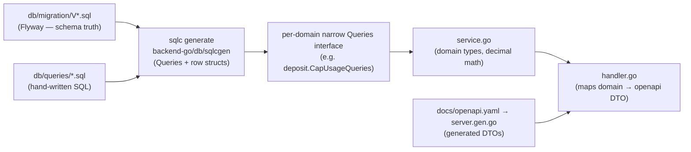

# 04 — Database Schema

> **Audience:** Architect and Backend-Go agents. Canonical DB reference for the root app's `investing`
> database. The authoritative, ever-growing list is the Flyway migration directory **`apps/main/db/migration/`**
> (head **V208**; task 173 adds V209). The sibling apps keep their own migrations in
> `apps/portfolio-b/db/migration/` (head **V19**, task 173 adds V20) and `apps/portfolio-c/db/migration/` (head **V13**, task 173 adds V14). V72/V73 (bot
> hard-close / trade-action execution, ADR-095/096) are parked unapplied in `apps/main/db/unapplied/` — their numbers are reserved, do not reuse them. Migrations are
> applied by the one-shot Flyway CLI runner in each app's compose, not by the application; sqlc reads the same
> files as its schema (`backend-go/sqlc.yaml`). The table sections below were last written in full at
> V57/V58 — the `assets` / `positions` sections reflect V74/V75 (task 156); for other V59–V71 changes read the migration files themselves; `db/README.md` explains the layout.
>
> **Rules:**
> - All schema changes go through Flyway versioned SQL files. No manual DDL. No `ddl-auto: update`.
> - PKs: `BIGSERIAL`. Money: `NUMERIC(18,4)`. Units/prices: `NUMERIC(18,8)`. Percentages: `NUMERIC(7,4)`. Never `FLOAT/DOUBLE`.
> - Timestamps: `TIMESTAMPTZ`. There is no ORM/`ddl-auto` any more: Flyway files are the only schema authority and sqlc generates the Go access code from them.
> - Never apply a migration from a dirty tree: V18/V46 drifted because they were applied to
>   production from uncommitted working-tree bytes (even a comment-only difference changes the
>   checksum — Flyway checksums every raw line, comments included) and then committed with
>   different bytes, silently tolerated by `validate-on-migrate: false` (task 134, resolved
>   2026-09-27: Flyway-version-upgrade cause ruled out, repair holding, validation ON).

---

## ER Diagram

Full column-level detail for every live table (a more conceptual, relationship-focused view lives in `02-domain-model.md §4`).

```mermaid
erDiagram
    purchase_sessions ||--o{ purchase_session_items : "session_id (cascade delete)"
    purchase_sessions ||--o{ asset_purchases : "session_id (nullable FK)"
    purchase_sessions ||--o{ binance_transfers : "session_id (nullable, SET NULL)"
    assets ||--|{ positions : "asset_id (FK, ON DELETE CASCADE)"

    assets {
        bigint id PK
        portfolio_enum portfolio
        text key "UNIQUE per portfolio, V74"
        varchar name
        exposure_enum exposure
        asset_class_enum asset_class
        numeric target_allocation_pct "7,4 NULL, risk-on regime"
        numeric target_allocation_pct_risk_off "7,4 NULL, risk-off regime"
        timestamptz created_at
        timestamptz updated_at
        timestamptz deleted_at "NULL = live (soft delete, task 173)"
    }
    positions {
        bigint id PK
        bigint asset_id FK "NOT NULL, V74"
        boolean is_primary "one per asset (partial UNIQUE), V74"
        varchar ticker "not unique alone"
        varchar name
        portfolio_enum portfolio
        exchange_enum exchange
        asset_class_enum asset_class
        exposure_enum exposure
        currency_enum price_currency
        currency_enum purchase_currency
        numeric units_ike "18,8"
        numeric units_ikze "18,8"
        numeric units_regular_eur "18,8"
        numeric units_regular_usd "18,8"
        numeric units_regular_pln "18,8"
        numeric total_spent_pln "18,4 NULL"
        numeric avg_buy_price "18,8 NULL"
        varchar yahoo_ticker "NULL"
        boolean company_backed "DEFAULT true, V49/ADR-064"
        timestamptz created_at
        timestamptz updated_at
        timestamptz deleted_at "NULL = live (soft delete, task 173)"
    }
    deposits {
        bigint id PK
        date deposit_date
        numeric amount "18,4"
        currency_enum currency
        exchange_enum exchange
        account_type_enum account_type
        portfolio_enum portfolio
        capital_source_enum capital_source "DEFAULT EXTERNAL, V47/ADR-059"
        text comment "NULL"
        timestamptz created_at
    }
    binance_transfers {
        bigint id PK
        date transfer_date
        numeric amount_pln "14,2"
        numeric amount_native "18,4 NULL"
        currency_enum native_currency "NULL"
        text comment "NULL"
        varchar source "MANUAL or SESSION"
        bigint session_id FK "NULL"
        timestamptz created_at
    }
    tax_returns {
        bigint id PK
        int year "unique"
        numeric gross_gain "18,4"
        numeric tax_paid "18,4"
        numeric effective_rate_pct "7,4"
        timestamptz created_at
        timestamptz updated_at
    }
    inflation {
        bigint id PK
        int year
        int month
        numeric cpi_value "7,4"
        timestamptz created_at
    }
    cash_positions {
        bigint id PK
        varchar location
        numeric amount_pln "18,4"
        timestamptz recorded_at
    }
    price_cache {
        bigint id PK
        varchar ticker "unique"
        numeric price "18,8"
        currency_enum currency
        numeric price_pln "18,8"
        timestamptz fetched_at
    }
    fx_rate_cache {
        bigint id PK
        currency_enum from_currency "unique"
        numeric rate_to_pln "18,8"
        varchar source
        timestamptz fetched_at
    }
    historia {
        bigint id PK
        date snapshot_date
        portfolio_enum portfolio
        numeric total_deposits "15,2"
        numeric portfolio_value "15,2"
        numeric xirr "8,6 NULL"
        jsonb position_values "NULL, V30"
        timestamptz created_at
    }
    crypto_trades {
        bigint id PK
        date trade_date
        varchar ticker
        exchange_enum exchange
        account_type_enum account_type
        trade_side_enum side
        numeric quantity "18,8"
        numeric unit_price "18,8"
        currency_enum price_currency
        numeric total_amount "18,4"
        numeric amount_pln "18,4"
        varchar source "MIGRATION or MANUAL"
        text notes "NULL"
        timestamptz created_at
    }
    settings {
        varchar key PK
        text value
        timestamptz updated_at
    }
    purchase_sessions {
        bigint id PK
        session_status_enum status
        timestamptz planned_at
        timestamptz done_at "NULL"
        text notes "NULL"
        numeric retirement_budget_pln "18,4 NULL"
        numeric main_budget_pln "18,4 NULL"
        portfolios_included_enum portfolios_included
        timestamptz updated_at "V20"
    }
    purchase_session_items {
        bigint id PK
        bigint session_id FK
        portfolio_enum portfolio
        varchar ticker
        account_type_enum account_type
        numeric planned_units "18,8 NULL"
        numeric planned_value_pln "18,4 NULL"
        numeric actual_units "18,8 NULL"
        numeric actual_value_pln "18,4 NULL"
        numeric price_pln_at_plan "18,8 NULL"
        boolean is_migration_sell
        boolean is_migration_buy
        timestamptz updated_at "V20"
    }
    asset_purchases {
        bigint id PK
        bigint session_id FK "NULL since V15"
        portfolio_enum portfolio
        varchar ticker
        account_type_enum account_type
        numeric units_delta "18,8"
        numeric price_pln "18,8"
        numeric total_pln "18,4"
        trade_type_enum trade_type "V45, ADR-057"
        timestamptz purchased_at
    }
    asset_news {
        bigint id PK
        varchar ticker
        varchar asset_name
        date news_date
        varchar headline
        text summary
        varchar sentiment "NULL, POSITIVE/NEUTRAL/NEGATIVE"
        jsonb sources
        timestamptz created_at
        timestamptz updated_at
    }
    push_subscriptions {
        bigint id PK
        varchar user_email "JWT principal, V204, ADR-108"
        text endpoint UK "capability URL, never logged"
        varchar p256dh
        varchar auth
        varchar device_label
        timestamptz created_at
        timestamptz updated_at
        timestamptz last_success_at "NULL"
    }
    macro_observations {
        bigint id PK
        varchar series_code
        varchar source "FRED/ECB/BOE/BOJ/CHINADATA/TRADINGEC/YCHARTS/MANUAL/DERIVED"
        date observation_date
        numeric value "20,4"
        timestamptz created_at
        timestamptz updated_at
    }
    macro_state {
        bigint id PK
        date as_of_date "unique"
        boolean risk_off
        numeric net_liq_latest_usd_mln "20,4 NULL"
        numeric net_liq_yoy "18,8 NULL"
        numeric net_liq_yoy_accel "18,8 NULL"
        boolean net_liq_risk_off "NULL"
        numeric global_m2_latest_usd_mln "20,4 NULL"
        numeric global_m2_yoy "18,8 NULL"
        numeric global_m2_yoy_accel "18,8 NULL"
        boolean global_m2_risk_off "NULL"
        boolean global_m2_stale
        numeric blend_factor "7,6 NULL, V37"
        numeric composite_z "18,8 NULL, V37"
        numeric smoothed_z "18,8 NULL, V37"
        timestamptz computed_at
        timestamptz created_at
        timestamptz updated_at
    }
    account_cap_adjustment {
        bigint id PK
        account_type_enum account_type "CHECK IN (IKE, IKZE)"
        int year "2021-2100"
        numeric adjustment_pln "12,2 signed, default 0"
        timestamptz created_at
        timestamptz updated_at
    }
```



`positions.asset_id` is the schema's group-membership FK (`positions → assets`, `ON DELETE CASCADE`). By contrast `asset_purchases`/`purchase_session_items`/`binance_transfers`/`crypto_trades`/`deposits` `ticker` columns are **not** real foreign keys to `positions.ticker` — ticker is a natural key reused across tables, and positions can in principle be renamed, so no FK/cascade rule is enforced (see "Out of scope / by design" judgment call under Column Type Rationale). The other real FK relationships are `purchase_session_items.session_id`, `asset_purchases.session_id`, and `binance_transfers.session_id`, all pointing at `purchase_sessions.id`.

**Deletion semantics.** Group membership is a real FK, so the database enforces the cascade: deleting an `assets` row deletes every subasset (`DELETE /assets/{id}`). Deleting a single subasset is application-checked: a non-primary subasset is a plain delete; the last subasset of an asset removes the asset in the same operation; the **primary** with siblings still present is refused (`409 CONFLICT`, "set a new primary first"). See `02-domain-model.md` Decision 12.

**Exactly one primary per asset.** The partial unique index `positions_one_primary_uq ON positions (asset_id) WHERE is_primary` enforces *at most* one in the database; *exactly* one is a service invariant (asset creation marks its first subasset primary atomically; set-primary flips exactly two rows in one transaction) backed by the V74/V18/V9 tripwires. There is deliberately no trigger (YAGNI — hidden logic in a single-user app) and no `assets.primary_position_id` FK (it would need a cyclic, deferrable FK).

---

## ENUMs

```sql
CREATE TYPE portfolio_enum           AS ENUM ('MAIN', 'RETIREMENT');         -- renamed in V22
CREATE TYPE account_type_enum        AS ENUM ('IKE', 'IKZE', 'REGULAR');
CREATE TYPE exchange_enum            AS ENUM ('XTB', 'BINANCE');
CREATE TYPE asset_class_enum         AS ENUM ('STOCK', 'CRYPTO', 'ETF', 'CURRENCY');
-- exposure = economic theme, orthogonal to asset_class (added V7; BONDS added V34;
-- EXPERIMENTS and EQUITY added V36. QUANTUM is defined but unreferenced since V37
-- reclassified its sole row (QUTM.DE) to EXPERIMENTS -- Postgres has no DROP VALUE.)
CREATE TYPE exposure_enum            AS ENUM ('CRYPTO', 'METALS', 'CASH', 'QUANTUM', 'BONDS',
                                               'EXPERIMENTS', 'EQUITY');
CREATE TYPE currency_enum            AS ENUM ('PLN', 'EUR', 'USD', 'CHF', 'GBP');
CREATE TYPE trade_side_enum          AS ENUM ('BUY', 'SELL');
-- purchase session workflow (added V9)
CREATE TYPE session_status_enum      AS ENUM ('PLANNED', 'DONE');
CREATE TYPE portfolios_included_enum AS ENUM ('BOTH', 'MAIN', 'RETIREMENT'); -- renamed in V22
-- trade-history chart classification (added V45, ADR-057)
CREATE TYPE trade_type_enum          AS ENUM ('DCA_BUY', 'MIGRATION_BUY', 'MIGRATION_SELL',
                                               'REBALANCING_TRIM_SELL', 'REBALANCING_REINVEST_BUY',
                                               'SEED_IMPORT');
-- deposits.capital_source discriminator (added V47, ADR-059) -- see Table: deposits below
CREATE TYPE capital_source_enum      AS ENUM ('EXTERNAL', 'INTERNAL_TRANSFER');
```

PostgreSQL ENUMs (not lookup tables) were chosen for every bounded classification in this schema: they're stored as 4 bytes (cheaper than `VARCHAR` on high-scan columns), enforce validity at the DB level without a join, and every value set here is stable and dictated by Polish financial regulation (account types, currencies) or fixed application taxonomy (exchanges, asset classes) — not business configuration that changes at runtime. The one recurring cost: adding a value requires `ALTER TYPE ... ADD VALUE` in its own non-transactional step (Postgres won't let a migration add a value and reference it in the same transaction — see the V34/V35 and V36/V37 pairs below), and Postgres has no `DROP VALUE` at all, so retired values (`QUANTUM`) sit unused forever once their last row is gone. Two narrow exceptions deliberately use `VARCHAR + CHECK` instead of a Postgres enum: `crypto_trades.source` / `binance_transfers.source` / `mexc_*` provenance-style columns, each single-consumer with only two legal values and no cross-table reuse — not worth a dedicated type.

Migration history for `asset_class_enum`: V1 created it with `METALS`, `CRYPTO_COIN`, `CRYPTO_MINING_STOCK`, `STOCK`, `CURRENCY`. V7 replaced it with the simpler `STOCK`, `CRYPTO`, `ETF`, `CURRENCY` and added `exposure_enum` for economic theme.

Migration history for `portfolio_enum` / `portfolios_included_enum`: V1 created them with Polish values `INWESTYCJE` / `EMERYTURA`; V22 renamed the values to `MAIN` / `RETIREMENT` (and renamed `purchase_sessions.emerytura_budget_pln` → `retirement_budget_pln`, settings key `emerytura.monthly_contribution_pln` → `retirement.monthly_contribution_pln`).

Migration history for `exposure_enum`: V7 created it (`CRYPTO`, `METALS`, `CASH`, `QUANTUM`). V34 added `BONDS` ahead of seeding the two bond-ETF de-risk sink positions (`ETFBCASH.PL`, `ZPR1.DE`) in V35. V36 added `EXPERIMENTS` (the 15-position satellite/thematic sleeve, reclassified off `CRYPTO`/`QUANTUM`) and `EQUITY` (the two new broad equity-index ETFs `ICGA.DE`, `NQSE.DE`) ahead of V37 using them. V50 (ADR-066) deleted the `PLN` position, leaving `CASH` with zero live rows alongside `QUANTUM` — neither value can be dropped from the enum, and `CASH` stays selectable for any future non-PLN cash-like position. Each enum-value addition is its own Flyway migration/transaction, separate from the migration that references the new value, because `ALTER TYPE ... ADD VALUE` cannot run in the same transaction as a statement that uses the new label.

---

## Table: `assets`

Added by V74 (task 156). One row per **logical asset** — the aggregate root that owns the target allocation; its concrete holdings are the `positions` rows that point at it (subassets, next section). Both portfolios share the table; `portfolio` discriminates, so the same logical asset held in MAIN and RETIREMENT is two rows.

| Column | Type | Notes |
|---|---|---|
| `id` | `BIGSERIAL PK` | The join key. Never join on `key` |
| `portfolio` | `portfolio_enum NOT NULL` | |
| `key` | `TEXT NOT NULL` | Stable logical slug. `UNIQUE (key, portfolio)` (`assets_key_portfolio_uq`). Multi-subasset assets: `bitcoin`, `ethereum`, `solana`, `xrp`, `sui`, `gold`, `silver`, `chainlink`, `quantum`; single-holding assets: the holding's ticker. Immutable label — nothing may assume it equals a subasset ticker |
| `name` | `VARCHAR(200) NOT NULL` | Display name; editable via `PUT /assets/{id}` |
| `exposure` | `exposure_enum NOT NULL` | Economic theme (group-level) |
| `asset_class` | `asset_class_enum NOT NULL` | Group-level class; the planner's crypto-donor / ETF-substitution predicate reads it (load-bearing for XRP: CRYPTO-class, EXPERIMENTS-exposure) |
| `target_allocation_pct` | `NUMERIC(7,4) NULL` | `assets_target_pct_range` CHECK `IS NULL OR 0..100`. `NULL` = no target, distinct from `0` = explicit zero (ADR-053). MAIN: the **risk-on-regime** target, interpolated with the risk-off column by the macro blend gate (`05-rebalancing-algorithm.md` §7.3). RETIREMENT: the single, regime-independent target |
| `target_allocation_pct_risk_off` | `NUMERIC(7,4) NULL` | `assets_target_pct_risk_off_range` CHECK. **Risk-off-regime** target (V37 semantics, moved from `positions` by V74); `NULL` = "identical to `target_allocation_pct`". Never read for RETIREMENT; portfolio-b/portfolio-c carry the column always-NULL for cross-app code uniformity |
| `created_at` | `TIMESTAMPTZ NOT NULL DEFAULT NOW()` | |
| `updated_at` | `TIMESTAMPTZ NOT NULL DEFAULT NOW()` | `assets_updated_at` trigger (`set_updated_at()`) |
| `deleted_at` | `TIMESTAMPTZ NULL` | Soft delete (main V209, portfolio-b V20, portfolio-c V14; task 173). `NULL` = live. See "Soft delete" below |

Sibling apps: **portfolio-b** has no `portfolio` column (single book), so its `assets.key` is globally `UNIQUE` (`assets_key_uq`); **portfolio-c** matches main (`portfolio`, `UNIQUE (key, portfolio)`, portfolios VARIABLE/FIXED). Σ `target_allocation_pct` per portfolio is 100 on the live book (main MAIN 100 risk-on, and `COALESCE(risk_off, risk_on)` 100; RETIREMENT 100; portfolio-b 100; portfolio-c VARIABLE 100 and FIXED 100). No DB constraint enforces the sum (deliberately — partial edits must stay possible); it is checked only as the set-primary tripwire.

---

## Table: `positions` (subassets)

One row per (ticker, exchange, portfolio) — a **subasset**: one concrete holding belonging to exactly one `assets` row. Both portfolios share this table; `portfolio` discriminates (and always equals the parent asset's `portfolio`).

| Column | Type | Notes |
|---|---|---|
| `id` | `BIGSERIAL PK` | Stable across the task-156 migration; `GET /positions/{id}` takes this id |
| `asset_id` | `BIGINT NOT NULL` | V74. FK → `assets(id)` `ON DELETE CASCADE` (`positions_asset_fk`). The only group-membership link |
| `is_primary` | `BOOLEAN NOT NULL DEFAULT false` | V74. Exactly one per asset = the default buy destination; partial `UNIQUE (asset_id) WHERE is_primary` (`positions_one_primary_uq`) |
| `ticker` | `VARCHAR(20) NOT NULL` | Internal app ticker |
| `name` | `VARCHAR(200) NOT NULL` | |
| `portfolio` | `portfolio_enum NOT NULL` | |
| `exchange` | `exchange_enum NOT NULL` | `XTB` = IKE/IKZE-eligible (derived, no flag) |
| `asset_class` | `asset_class_enum NOT NULL` | Refactored in V7; the planner reads the row class to tell a raw coin row (`CRYPTO`) from an ETF/ETN wrapper row |
| `exposure` | `exposure_enum NOT NULL` | Added V7; economic theme (the group-level value that drives behavior lives on `assets`) |
| `price_currency` | `currency_enum NOT NULL` | Currency of the Yahoo Finance price feed |
| `purchase_currency` | `currency_enum NOT NULL DEFAULT 'PLN'` | Broker order currency; added V2 |
| `units_ike` | `NUMERIC(18,8) NOT NULL DEFAULT 0` | Non-negative CHECK |
| `units_ikze` | `NUMERIC(18,8) NOT NULL DEFAULT 0` | Non-negative CHECK |
| `units_regular_eur` | `NUMERIC(18,8) NOT NULL DEFAULT 0` | Non-negative CHECK |
| `units_regular_usd` | `NUMERIC(18,8) NOT NULL DEFAULT 0` | Non-negative CHECK |
| `units_regular_pln` | `NUMERIC(18,8) NOT NULL DEFAULT 0` | Non-negative CHECK |
| `total_spent_pln` | `NUMERIC(18,4) NULL` | The row's **cost slot** in PLN; asset-level cost rule, only the sum per asset is meaningful — see "Cost basis (`total_spent_pln`)" below. `NULL` = no cost recorded, `0` = sold out. No CHECK or NOT NULL constraint; the readers treat `NULL` and `≤ 0` as "not recorded" |
| `avg_buy_price` | `NUMERIC(18,8) NULL` | **Deprecated.** Native price currency; the stale go-live value (main V21 backfill), rewritten only by a manual `PUT /positions/{id}`. No trade writes it and no computation or UI reads it (it is only echoed as `Subasset.avgBuyPrice`) — the entry price is derived from `total_spent_pln`. Kept for compatibility; a later migration may drop it |
| `yahoo_ticker` | `VARCHAR(50) NULL` | Used for price fetching |
| `company_backed` | `BOOLEAN NOT NULL DEFAULT true` | Added V49 (ADR-064); semantics broadened V58 (ADR-079). True when the asset has its own distinguishable, individually-researchable narrative — a company/team/foundation's own events, OR (broadened by ADR-079) protocol/asset-intrinsic events for a leaderless asset (protocol upgrades, governance, hard forks, hash-rate/on-chain activity — e.g. `BTC-USD`, flipped `true` by V58) — drives the nightly news-research job's asset scope (see `asset_news` below). `DEFAULT true` is a defensive DB-level backstop only; `PositionService` computes the real default from `assetClass` (`STOCK`/`CRYPTO` → true, `ETF`/`CURRENCY` → false) for any row created through the API |
| `created_at` | `TIMESTAMPTZ NOT NULL DEFAULT NOW()` | |
| `updated_at` | `TIMESTAMPTZ NOT NULL DEFAULT NOW()` | Maintained by trigger |
| `deleted_at` | `TIMESTAMPTZ NULL` | Soft delete (task 173). `NULL` = live. See "Soft delete" below |

Unique indexes: `(ticker, exchange, portfolio)` (`positions_uq`), partial `(asset_id) WHERE is_primary` (`positions_one_primary_uq`). Both cover soft-deleted rows too.

### Soft delete (`deleted_at`, task 173, all three apps)

No `assets` or `positions` row is hard-deleted. `DELETE /assets/{id}` sets `deleted_at = now()` on the asset and every live subasset in one statement (`SoftDeleteAsset`, a data-modifying CTE). `DELETE /positions/{id}` sets it on one subasset (`SoftDeletePosition`), keeping the existing rules: deleting the primary while live siblings exist → `409`, and deleting the last live subasset soft-deletes its asset. No app guards against deleting a subasset that still holds units, and none is added. `positions_asset_fk ON DELETE CASCADE` stays but never fires.

- **Live vs history reads.** Every query that serves *current holdings* filters `deleted_at IS NULL`, under its existing name: the portfolio overview, Σ-targets tripwire, rebalancing/purchase planner, transfer/sell lookups, cost-kernel members, tracked tickers for the price refresh, news scope, the historia snapshot input (current value/XIRR), and the by-id/by-ticker lookups (a deleted row answers `404`). History readers use explicit `…IncludingDeleted` queries or tables that never filter: `position_transfers`, `purchase_lots`, purchase history, purchase-session detail, `historia`, `asset_purchases` / the trade chart, the portfolio-b/portfolio-c backfill, and the offline `cmd/` tools. Full per-app query list: `docs/architecture/diagrams/173-asset-soft-delete.md` §5.
- **Invariants** (service-enforced, test-asserted): a live subasset belongs to a live asset; a live asset has exactly one live primary; a deleted row inside a live asset is never `is_primary`.
- **Restore.** `POST /positions` for a natural key that matches a soft-deleted row restores that row: same `id`, units, cost basis and history, `deleted_at = NULL`. A soft-deleted asset found by the subasset's old `asset_id` or by `key` is restored the same way. Required form fields are overwritten with the request. Optional ones (targets, `yahoo_ticker`, `exposure`, …) keep the old value unless the request sends one. Only the re-added subasset comes back; its deleted siblings stay deleted until each is re-added. The flow is §6 of the design doc above.
- **History FKs.** portfolio-b `purchase_lots_ticker_fk` / `position_transfers_ticker_fk` (→ `positions(ticker)`) and portfolio-c `purchase_lots_ticker_portfolio_fk` / `position_transfers_ticker_portfolio_fk` (→ `positions(ticker, portfolio)`) are **kept**. They can no longer block a delete, because rows are never removed. Main adds **no** history FKs: `asset_purchases`, `purchase_session_items`, `crypto_trades`, `binance_transfers` and `historia.position_values` reference `ticker` (± `portfolio`) without `exchange`, so no unique target exists, and they contain tickers hard-deleted before task 173. Soft delete already prevents new orphans.
- **Consequence.** A deleted ticker's `price_cache` row stops refreshing.
Indexes: `portfolio`, `exchange`. There are **no** target columns on `positions`.

**Cost basis (`total_spent_pln`), asset-level rule (task 161, live 2026-09-25 in main, portfolio-b and portfolio-c).** The cost stays a **row-level** column (compatible with the edit dialog, `UpdatePositionDelta`, the go-live data and set-primary as a pure relabel) but its meaning is **asset-level**: only the sum `C` over the rows of one `asset_id` (rows with `total_spent_pln > 0`) is read, by `positioncalc.GroupProfit` (profit `= V/C − 1`) and the entry price `avgBuyPricePln = price(primary)/(1 + profit)` (`02-domain-model.md` §2.1). Rejected: an `assets.total_spent_pln` column — it would need a migration folding rows into assets and would buy nothing the sum does not already give.

- **Convention.** Each asset's go-live cost lives on the row that was head at import; a sibling row's `NULL` means "its baseline is included in the group cost". Per-row averages are therefore never derived or shown.
- **`NULL` vs `0`.** `NULL` = no cost recorded on this row (a sibling covered by the head's group cost, or an untracked asset). `0` = the asset was sold out — the kernel writes an **exact** `0` on every recorded row when no units remain (never via rounding); `NULL` rows stay `NULL`. Readers count only `> 0` as recorded cost, so an all-`NULL`/`0` asset has no profit and no entry price (`null`, never a fabricated number). A buy on an empty asset starts fresh (`0 + paid`); a buy on an asset that holds units but has no recorded cost leaves it `NULL` (the buy rule never invents a cost that would cover only the new units — portfolio-b stays untracked until reviewed baselines exist).
- **Who writes it.** Only (a) the trade paths — through the shared pure kernel `packages/common/go/common-go/costbasis` (`ApplySale`, `ApplyBuy`, `PlanTransfer`, `PlanTrades`, per-app glue `internal/position/assetcost.go`): sale scales every recorded row by `1 − soldValue/assetValue`, same-asset swaps carry, purchase sessions are netted per asset — and (b) an explicit `totalSpentPln` edit through `PUT /positions/{id}` (`UpdatePositionFields`, full-row overwrite; the reviewed correction path) or a guarded Flyway data migration. A manual units edit never touches it. Persistence inside the trade's own transaction: the trade's rows through `UpdatePositionDelta` (the unit columns — five buckets in main/portfolio-b, the single `units` in portfolio-c — **and** `total_spent_pln` in one statement), every other changed sibling through `UpdatePositionCost` (`UPDATE positions SET total_spent_pln = $2 WHERE id = $1`), so cost and units commit or roll back together; prices are read from `price_cache` (no network in the transaction).
- **Repository/DTO boundary.** sqlc rows (`sqlcgen.Position`, `NUMERIC` as `pgtype.Numeric`) → `decimal.Decimal` in `PositionUnits`/kernel `Row` → `computed.*` floats in the OpenAPI DTO. The kernel is a pure function over plain structs (no store interface, no DB rows), so the same code serves the three apps' differing unit shapes (main/portfolio-b/portfolio-c each make their own `*PositionUnits` satisfy the three-method `costmember.Holding` seam; the shared `common-go/costmember` builds the `costbasis.Row`s and writes the result back, while `assetcost.go` keeps only the sqlc-typed price-map read and `PersistCosts`).
- **Corrections.** Known gaps (main `PL.ETNVIRBTCP`, portfolio-c's stale go-live baseline, portfolio-b's all-`NULL`, RETIREMENT) are repaired only through owner-reviewed, guarded, idempotent data migrations (`UPDATE … WHERE total_spent_pln IS NOT DISTINCT FROM <old>`; portfolio-c `V3`/`V5` are the precedent) — see `02-domain-model.md` §2.1.

**Units are net per portfolio** (since V9). MAIN stores only MAIN units; RETIREMENT stores only RETIREMENT units. No runtime M-column deduction. V9 migration ran a one-time subtraction to correct existing gross data (`GREATEST(0, ...)` guarded, to protect against a floating-point rounding edge case producing a tiny negative).

**Asset / Subasset migration (task 156; main V74 + V75, portfolio-b V18 + V19, portfolio-c V9 + V10; applied 2026-09-24).** An atomic two-step per app, both applied in the same deploy before the backend boots. **V_first** (V74/V18/V9) creates `assets`, adds `positions.asset_id` and `is_primary`, and backfills by a **data-driven sweep** — not hard-coded per-group literals:

1. Every old non-companion row becomes an asset in its own portfolio and stays its primary; targets (both regime tables in main), `asset_class` and `exposure` are copied from that row — the group's **live head** at deploy time (so a re-heading before the deploy is followed).
2. Every companion joins the asset of the row named by exact `(portfolio, companion_parent_ticker)` equality, in two passes so a wrapper-of-wrapper chain resolves.
3. Tripwires `RAISE EXCEPTION` (failing the whole deploy) on: an orphan companion (`asset_id` left NULL); an asset without exactly one primary (counted per asset, so an asset with zero subassets is caught); a companion row carrying a target; Σ targets not preserved between the old main rows and the new assets (per portfolio, both regime tables); and an unmapped or ambiguous multi-subasset group.
4. Multi-subasset groups get a logical slug `key` and `name` from an explicit member-ticker map (`bitcoin`, `ethereum`, `solana`, `xrp`, `sui`, `gold`, `silver`, `nasdaq-100` in portfolio-b; main adds `chainlink` and `quantum`; portfolio-c carries no map and RAISEs on any such group). Single-subasset assets keep `key = ticker` and their own name.
5. Targets are cleared off subasset rows, then `positions_asset_fk`, `asset_id SET NOT NULL`, `positions_one_primary_uq` and a temporary "no target on a subasset" CHECK are added.

**V_second** (V75/V19/V10) drops the temporary CHECK, `positions_companion_consistency` (main), `is_companion_row`, `companion_parent_ticker`, and both `positions.target_allocation_pct[_risk_off]` columns. Cost basis, units and tickers never move — they stay on the row that holds them. Live outcome: main 58 rows → 45 assets (34 MAIN + 11 RETIREMENT; 12 multi-subasset groups), portfolio-b 36 → 25, portfolio-c 8 → 8. Full mapping, tripwire list and verification log: `docs/architecture/diagrams/156-asset-subasset-model.md` §6/§8/§14.

**Dropped in V31 (`V31__drop_regression_columns.sql`, ADR-040):** `regression_weight` (`NUMERIC(7,4)`, formerly written by `RegressionWeightService`) and `regression_ticker` (`VARCHAR(50)`, added V14, formerly the separate ticker used for regression history). MAIN's rebalancing algorithm applied a per-asset regression-band multiplier `S_i` on top of the proportional base allocation `R_i` (`T_i = R_i × S_i`), where `S_i` came from a 9-band geometric weight table keyed on the asset's price relative to its own ~10-year log-linear trend. Backtests showed this multiplier carried approximately zero predictive signal while increasing concentration and drawdown, so MAIN became a **pure-proportional, buy-only DCA**: `T_i = R_i` (drop the multiplier and the subsequent renormalization — `R_i` already sums to the budget over the positive-deficit set). MAIN now mirrors RETIREMENT structurally; the only remaining differences are MAIN's variable deployable-cash budget and its macro de-risk target-interpolation overrides (see below). Both column drops are **irreversible** — recovering the data requires a DB restore. The standalone log-linear regression *analytics* feature (`LinearRegressionService` / `GET /market-data/linear-regression`) is unaffected: it takes a `ticker` request param and never read `regression_ticker`.

**`assets.target_allocation_pct_risk_off` and the macro blend gate (V37, ADR-044; orientation flipped by ADR-071; the column moved from `positions` to `assets` in V74):** every planning run computes a continuous `blend_factor ∈ [0,1]` in `macro_state` (0 = full risk-off, 1 = full risk-on — flipped by ADR-071 from the original ADR-044 orientation, which was the reverse) from net-liquidity and Global-M2 macro data, and linearly interpolates every MAIN asset's effective target: `effectiveTarget = riskOff × (1 − blend) + riskOn × blend`, where `riskOff` falls back to `riskOn` when this column is `NULL`. Because every asset uses the same scalar `blend` and both regime tables independently sum to exactly 100%, the interpolated targets always sum to 100% for any `blend`. This replaced an earlier binary cut+redistribute mechanism (ADR-042: a single hardcoded gold sink; ADR-043: a user-configurable weighted multi-sink of gold/`ETFBCASH.PL`/`ZPR1.DE`) — V37 retired the settings-driven cut-factor and sink-weight config entirely in favor of per-asset interpolation. `RETIREMENT` assets never populate this column (RETIREMENT doesn't use the macro de-risk gate).

**`company_backed` backfill (V49, ADR-064):** the column defaults `true` at the DDL level, so the
migration only needed to flip the exceptions:

```sql
UPDATE positions SET company_backed = false WHERE asset_class IN ('ETF', 'CURRENCY');
UPDATE positions SET company_backed = false WHERE ticker = 'BTC-USD' AND asset_class = 'CRYPTO';
```

Applied across both portfolios and every row, including the ETF/ETN wrapper rows that were then
`is_companion_row` rows (not scoped to MAIN or to primaries) because the property is intrinsic to
the asset, not to which portfolio or account holds it — wrapper rows are `ETF`-class in every current
case, so they land on `false` for free via the first statement, which is also the semantically
correct answer for an ETP/ETC wrapper.

**`company_backed` semantics broadened, `BTC-USD` flipped (V58, ADR-079):** ADR-064's test —
"does an accountable company/team/foundation exist" — was the wrong question; `BTC-USD` has no
company behind it but clearly has its own researchable narrative (protocol upgrades/proposals
such as BIPs, governance debates, hard forks, hash-rate/on-chain/large-holder activity). The
test is now "does the asset have its own distinguishable, individually-researchable narrative,"
which is strictly broader — every row that was `true` under ADR-064 stays `true`; only the
`false` side moved, and only for `BTC-USD`:

```sql
UPDATE positions SET company_backed = true WHERE ticker = 'BTC-USD' AND asset_class = 'CRYPTO';
```

The ETF/CURRENCY basket-vehicle reasoning from V49's first statement is untouched — those rows
correctly stay `false` under the broadened test too (a basket ETF still has no narrative
distinguishable from its underlying index). Audited against every migration touching
`positions` between V49 and V57: no other row was reclassified into a "leaderless but
newsworthy" state — `BTC-USD` remains the sole exception in either direction.

**Note on `regression_weight`'s CHECK bound:** V1 defined it as `NUMERIC(7,4)` CHECK `0–100` (matching the percentage-style bound copy-pasted from `target_allocation_pct`), even though the multiplier's actual runtime range was a 9-tier geometric scale (0.125–8.0) unrelated to a 0–100 percentage. This was a latent, harmless inconsistency in a column that no longer exists (dropped V31) — noted here only because a stale copy of this schema might still show the old bound.

---

## Table: `deposits`

One row per capital deposit transaction.

| Column | Type | Notes |
|---|---|---|
| `id` | `BIGSERIAL PK` | |
| `deposit_date` | `DATE NOT NULL` | |
| `amount` | `NUMERIC(18,4) NOT NULL` | CHECK > 0 |
| `currency` | `currency_enum NOT NULL` | Original deposit currency |
| `exchange` | `exchange_enum NOT NULL` | |
| `account_type` | `account_type_enum NOT NULL` | |
| `portfolio` | `portfolio_enum NOT NULL` | |
| `capital_source` | `capital_source_enum NOT NULL DEFAULT 'EXTERNAL'` | `EXTERNAL` or `INTERNAL_TRANSFER`; added V47 (ADR-059) |
| `comment` | `TEXT NULL` | |
| `created_at` | `TIMESTAMPTZ NOT NULL DEFAULT NOW()` | |

Indexes: `(portfolio, deposit_date)`, `(account_type, deposit_date)`.

Used for XIRR (do not aggregate; preserve per-transaction) and IKE/IKZE cap tracking.

**Deposits are the ONLY capital record (ADR-035), but not every row is external capital
(ADR-059).** An earlier design (ADR-034, superseded) excluded `exchange = BINANCE` rows from
XIRR to avoid double-counting against the separate PIT-38 ledger — that exclusion was wrong: it
deleted genuine new capital from the cash-flow series while terminal value still counted the
crypto positions. ADR-035 fixed that by moving the PIT-38 side ledger to its own table
(`binance_transfers`, below) so every row remaining in `deposits` is capital in the same sense.

ADR-054 (§7.7 of `05-rebalancing-algorithm.md`) then introduced a second kind of row that isn't
external capital either: `RebalancingTransferService`'s auto-deposit for a REGULAR-sold leg
funding an IKE/IKZE buy leg is the *same* MAIN-portfolio cash moving between two of the user's
own sub-accounts, not new money entering the portfolio — yet Polish law still counts it toward
the IKE/IKZE annual contribution cap, since the cap is about what entered the tax wrapper, not
about the portfolio's external cash-flow history. `capital_source` (ADR-059) resolves this
without a second `exchange`-style exclusion table:

- `EXTERNAL` (the default) — genuine new capital. Set on every manually entered deposit and on
  `PurchaseSessionService.completeSession()`'s auto-deposit.
- `INTERNAL_TRANSFER` — set only by `RebalancingTransferService`'s REGULAR→IKE/IKZE auto-deposit
  (identifiable by its `comment` prefix, `"Auto from rebalancing transfer: ..."`).
- **`XirrService.computeXirr` and `HistoriaScheduler.snapshotPortfolio`'s `total_deposits`
  filter to `capital_source = 'EXTERNAL'` only** — an internal transfer must not inflate
  Wpłacone/XIRR, since no external cash moved.
- **`ComputeCapUsage` (`backend-go/internal/deposit/capusage.go`) / its `SumDepositAmountByAccountTypeAndYear` sqlc query
  ignore `capital_source` entirely and keep summing every row** — the IKE/IKZE statutory cap is
  correctly charged for internal transfers too, since the cap tracks what entered the wrapper
  regardless of where it came from inside the user's own portfolio.

`POST /purchase-sessions/{id}/complete` auto-creates one deposit per `(portfolio, accountType, exchange)` group of non-sell, non-zero session items (ADR-033), so the user does not have to hand-enter a deposit after every purchase session. Each group's `amount` sums `plannedValuePln ?? actualValuePln` per item — the planned/target value is preferred, falling back to actual only when planned is null (ADR-055) — because `amount` feeds the IKE/IKZE statutory annual limit and XIRR's `totalInvestedPln`, both of which measure capital committed to the wrapper, not the post-fee/post-slippage value that survived execution. This is the opposite fallback order from `positions.total_spent_pln`/`AssetPurchase.totalPln` (cost basis), which correctly keeps preferring `actualValuePln` since P&L must reflect the real execution price. `Deposit` rows auto-created before ADR-055 under the old (actual-preferring) formula were corrected by a one-time backfill so historical cap-usage and XIRR totals are accurate. Migration-sell items and the migration-triple's limit-neutral IKZE re-buy are excluded from deposit creation — they don't represent new capital (ADR-033, amended by ADR-035 §4). Every deposit this block creates is `capital_source = EXTERNAL` — `completeSession()` always represents new capital entering the portfolio, never an internal reallocation, so it has no `INTERNAL_TRANSFER` case.

---

## Table: `binance_transfers`

Flat side ledger of money sent to Binance, distilled from monthly deposits (overlapping money, not additional capital). Mirrors the spreadsheet "Wpłaty Binance" table. Sole purpose: yearly `SUM(amount_pln)` = PIT-38 crypto acquisition cost. **No portfolio column** — the source spreadsheet table has no portfolio split either. Never read by XIRR, Historia, or cap-usage code.

| Column | Type | Notes |
|---|---|---|
| `id` | `BIGSERIAL PK` | |
| `transfer_date` | `DATE NOT NULL` | |
| `amount_pln` | `NUMERIC(14,2) NOT NULL` | CHECK > 0; canonical PIT figure |
| `amount_native` | `NUMERIC(18,4) NULL` | Original currency amount (manual rows) |
| `native_currency` | `currency_enum NULL` | CHECK: present iff `amount_native` present |
| `comment` | `TEXT NULL` | |
| `source` | `VARCHAR(10) NOT NULL DEFAULT 'MANUAL'` | CHECK IN ('MANUAL', 'SESSION') |
| `session_id` | `BIGINT NULL` FK → `purchase_sessions(id) ON DELETE SET NULL` | Set on SESSION rows |
| `created_at` | `TIMESTAMPTZ NOT NULL DEFAULT NOW()` | |

Indexes: `transfer_date`, `session_id`.

Added in V25 (ADR-035), superseding an earlier design (ADR-034) that conflated this side ledger with the main capital stream by seeding it directly into `deposits`. V25 copied the V24-seeded `exchange='BINANCE'` rows out of `deposits` (guarded by `comment NOT LIKE 'Auto from session #%'` so genuine session-created Binance deposits stayed) and deleted them from `deposits`. `source = 'SESSION'` rows are written by `POST /purchase-sessions/{id}/complete`: one row per session with the total effective Binance purchase value (an approximation of the transfer amount, assuming 100% of transferred funds are spent on crypto — the same assumption the source spreadsheet makes); the insert is skipped when the session's Binance purchase sum is 0. `source = 'MANUAL'` rows (including all rows migrated from V24) can carry the exact native-currency amount via `amount_native`/`native_currency`. API: `GET/POST /binance-transfers`, `DELETE /binance-transfers/{id}`; the list response includes per-year PLN sums for PIT-38.

---

## Table: `tax_returns`

Annual PIT-38 Belka tax history.

| Column | Type | Notes |
|---|---|---|
| `id` | `BIGSERIAL PK` | |
| `year` | `INTEGER NOT NULL` | CHECK 2021–2100; unique |
| `gross_gain` | `NUMERIC(18,4) NOT NULL` | |
| `tax_paid` | `NUMERIC(18,4) NOT NULL` | CHECK >= 0 |
| `effective_rate_pct` | `NUMERIC(7,4) NOT NULL` | CHECK 0–100 |
| `created_at` | `TIMESTAMPTZ NOT NULL DEFAULT NOW()` | |
| `updated_at` | `TIMESTAMPTZ NOT NULL DEFAULT NOW()` | Maintained by trigger |

Unique index: `(year)`.

---

## Table: `inflation`

Monthly Polish CPI data.

| Column | Type | Notes |
|---|---|---|
| `id` | `BIGSERIAL PK` | |
| `year` | `INTEGER NOT NULL` | CHECK 2000–2100 |
| `month` | `INTEGER NOT NULL` | CHECK 1–12 |
| `cpi_value` | `NUMERIC(7,4) NOT NULL` | |
| `created_at` | `TIMESTAMPTZ NOT NULL DEFAULT NOW()` | |

Unique index: `(year, month)`.

---

## Table: `cash_positions`

Snapshot-based cash tracker. All rows sharing the same `recorded_at` form one snapshot.

| Column | Type | Notes |
|---|---|---|
| `id` | `BIGSERIAL PK` | |
| `location` | `VARCHAR(100) NOT NULL` | e.g. PKO, ZEN, Portfel gotówka, Lokaty |
| `amount_pln` | `NUMERIC(18,4) NOT NULL` | CHECK >= 0 |
| `recorded_at` | `TIMESTAMPTZ NOT NULL DEFAULT NOW()` | All rows at same timestamp = one snapshot |

Index: `recorded_at DESC`.

`GET /cash-positions` returns only the latest snapshot (MAX `recorded_at`). Old snapshots retained for history.

---

## Table: `price_cache`

DB-backed ephemeral cache for Yahoo Finance prices. TTL 15 min, enforced at the application layer (survives a backend restart, unlike an in-memory cache).

| Column | Type | Notes |
|---|---|---|
| `id` | `BIGSERIAL PK` | |
| `ticker` | `VARCHAR(50) NOT NULL` | Unique |
| `price` | `NUMERIC(18,8) NOT NULL` | In native currency |
| `currency` | `currency_enum NOT NULL` | |
| `price_pln` | `NUMERIC(18,8) NOT NULL` | Converted to PLN at fetch time |
| `fetched_at` | `TIMESTAMPTZ NOT NULL DEFAULT NOW()` | |

Unique index: `ticker`. Index: `fetched_at DESC`.

---

## Table: `fx_rate_cache`

DB-backed cache for PLN FX rates (60 min TTL, same rationale as `price_cache`). One row per currency pair.

| Column | Type | Notes |
|---|---|---|
| `id` | `BIGSERIAL PK` | |
| `from_currency` | `currency_enum NOT NULL` | Unique |
| `rate_to_pln` | `NUMERIC(18,8) NOT NULL` | CHECK > 0 |
| `source` | `VARCHAR(20) NOT NULL` | 'YAHOO_FINANCE' or 'NBP_API'; CHECK added V18 |
| `fetched_at` | `TIMESTAMPTZ NOT NULL DEFAULT NOW()` | |

Unique index: `from_currency`. PLN=1.0 is synthesized in code — not stored.

---

## Table: `historia`

Daily portfolio value snapshots, persisted rather than recomputed on demand — XIRR is expensive and cannot be recomputed retroactively without historical prices (which are not stored).

| Column | Type | Notes |
|---|---|---|
| `id` | `BIGSERIAL PK` | |
| `snapshot_date` | `DATE NOT NULL` | |
| `portfolio` | `portfolio_enum NOT NULL` | |
| `total_deposits` | `NUMERIC(15,2) NOT NULL` | Cumulative deposits in PLN; CHECK >= 0 |
| `portfolio_value` | `NUMERIC(15,2) NOT NULL` | Market value in PLN; CHECK >= 0 |
| `xirr` | `NUMERIC(8,6) NULL` | NULL if computation failed that day |
| `position_values` | `JSONB NULL` | Per-asset value breakdown `{ticker: value_pln}` at snapshot time (V30). Same PLN-cash filter as `portfolio_value`, so values sum to it. NULL for snapshots taken before V30. Drives the per-asset breakdown in the value chart's hover tooltip. |
| `created_at` | `TIMESTAMPTZ NOT NULL DEFAULT NOW()` | |

Unique constraint: `(snapshot_date, portfolio)`.
Index: `(portfolio, snapshot_date)`.

`zwrot` and `zysk` computed at query time — never stored.

Seeded with backfill data Oct 2025 – Jun 2026. The nightly scheduler goroutine (23:00 Warsaw, `historia.StartScheduler`) upserts one row per portfolio per day going forward — idempotent, so a re-run on the same day just refreshes it. If the backend is down at 23:00, that day's snapshot is missed (a gap in the chart; recoverable via the ADR-097 ops endpoint). `position_values` is captured going forward from the scheduler (sheet-backfilled Oct 2025 – Jun 2026 rows have none).

**Reconstructed rows (V126, ADR-103, task 168):** the days before the first stored row (MAIN 2025-03-01..2025-10-11, RETIREMENT 2025-03-01..2025-10-12) are *model values* replayed from the `asset_purchases` ledger by `cmd/historiareplay` (production `historia.Service` over an as-of adapter; `position_values` filled, zero entries omitted). They are not snapshots, but by owner decision (2026-10-17) they are deliberately not marked in the table or the API (no `source` column) — the origin is documented here, in ADR-103 and in the V126 header; by data they are recognisable only by the date range and `created_at` = the V126 apply time. MAIN's join with the stored sheet-derived rows is a visible step (see ADR-103 §Verification).

---

## Table: `crypto_trades`

Per-transaction crypto trade log for PIT-38 tax reporting.

| Column | Type | Notes |
|---|---|---|
| `id` | `BIGSERIAL PK` | |
| `trade_date` | `DATE NOT NULL` | |
| `ticker` | `VARCHAR(20) NOT NULL` | e.g. BTC, ETH, DOGE |
| `exchange` | `exchange_enum NOT NULL` | |
| `account_type` | `account_type_enum NOT NULL` | |
| `side` | `trade_side_enum NOT NULL` | |
| `quantity` | `NUMERIC(18,8) NOT NULL` | CHECK > 0 |
| `unit_price` | `NUMERIC(18,8) NOT NULL` | CHECK > 0 |
| `price_currency` | `currency_enum NOT NULL` | |
| `total_amount` | `NUMERIC(18,4) NOT NULL` | quantity × unit_price in price_currency; CHECK > 0, added V18 |
| `amount_pln` | `NUMERIC(18,4) NOT NULL` | PLN at time of trade (for tax basis) |
| `source` | `VARCHAR(10) NOT NULL DEFAULT 'MANUAL'` | CHECK IN ('MIGRATION', 'MANUAL') |
| `notes` | `TEXT NULL` | |
| `created_at` | `TIMESTAMPTZ NOT NULL DEFAULT NOW()` | |

Indexes: `(ticker, trade_date)`, `trade_date`, `(exchange, trade_date)`.

---

## Table: `settings`

Key-value store for UI-configurable parameters. Values are always `TEXT`; type coercion happens at the service layer (`SettingService`).

| Column | Type | Notes |
|---|---|---|
| `key` | `VARCHAR(100) PRIMARY KEY` | |
| `value` | `TEXT NOT NULL` | Type coercion at service layer |
| `updated_at` | `TIMESTAMPTZ NOT NULL DEFAULT NOW()` | Maintained by trigger |

Live keys (`SettingKeys`):
- `retirement.monthly_contribution_pln` = `1000` (seeded as `emerytura.monthly_contribution_pln`; key renamed in V22) — RETIREMENT's fixed monthly DCA budget, and the amount netted out of MAIN's raw cash snapshot before the 5% buffer (ADR-033)
- `ike_annual_limit_pln` = `23472.00` (added V9)
- `ikze_annual_limit_pln` = `9388.00` (added V9)
- `rebalancing.macro_derisk_enabled` = `true` (added V33; gates whether the macro blend interpolation — §7 of `05-rebalancing-algorithm.md` — applies at all; `false` pins every MAIN position at its risk-on target)

**Retired keys:** `ism_pmi_value` and `ism_pmi_updated_at` (seeded V1, deleted V33 — the ISM PMI gate was replaced by the macro liquidity de-risk gate). `rebalancing.macro_derisk_cut_factor` (V33), `rebalancing.derisk_sink_gold_weight`, `rebalancing.derisk_sink_bond_pl_weight`, `rebalancing.derisk_sink_bond_de_weight` (all three V35) — all four deleted by V37 when the binary cut+redistribute mechanism was replaced by per-position `target_allocation_pct_risk_off` interpolation; there is no partial/hybrid mode, so the settings were removed rather than left inert.

---

## Table: `purchase_sessions`

One row per monthly purchase workflow cycle.

| Column | Type | Notes |
|---|---|---|
| `id` | `BIGSERIAL PK` | |
| `status` | `session_status_enum NOT NULL DEFAULT 'PLANNED'` | |
| `planned_at` | `TIMESTAMPTZ NOT NULL DEFAULT NOW()` | |
| `done_at` | `TIMESTAMPTZ NULL` | Required when status=DONE (CHECK) |
| `notes` | `TEXT NULL` | |
| `retirement_budget_pln` | `NUMERIC(18,4) NULL` | CHECK >= 0; renamed from `emerytura_budget_pln` in V22 |
| `main_budget_pln` | `NUMERIC(18,4) NULL` | CHECK >= 0; renamed from `inwestycje_budget_pln` in V22 |
| `portfolios_included` | `portfolios_included_enum NOT NULL DEFAULT 'BOTH'` | |
| `updated_at` | `TIMESTAMPTZ NOT NULL DEFAULT NOW()` | Added V20; maintained by trigger; bumped on the PLANNED→DONE transition |

**Partial unique index:** `CREATE UNIQUE INDEX ps_single_planned_uq ON purchase_sessions ((1)) WHERE status = 'PLANNED'` — enforces at most one PLANNED session at any time.

Indexes: `status`, `planned_at DESC`.

Introduced in V9 along with `purchase_session_items` and `asset_purchases`, as one migration.

---

## Table: `purchase_session_items`

One row per (session, portfolio, ticker, account_type) in the generated plan.

| Column | Type | Notes |
|---|---|---|
| `id` | `BIGSERIAL PK` | |
| `session_id` | `BIGINT NOT NULL` FK → `purchase_sessions(id) ON DELETE CASCADE` | |
| `portfolio` | `portfolio_enum NOT NULL` | |
| `ticker` | `VARCHAR(20) NOT NULL` | |
| `account_type` | `account_type_enum NOT NULL` | |
| `planned_units` | `NUMERIC(18,8) NULL` | CHECK >= 0 |
| `planned_value_pln` | `NUMERIC(18,4) NULL` | CHECK >= 0 |
| `actual_units` | `NUMERIC(18,8) NULL` | Negative only for migration sells |
| `actual_value_pln` | `NUMERIC(18,4) NULL` | |
| `price_pln_at_plan` | `NUMERIC(18,8) NULL` | CHECK > 0 |
| `is_migration_sell` | `BOOLEAN NOT NULL DEFAULT FALSE` | |
| `is_migration_buy` | `BOOLEAN NOT NULL DEFAULT FALSE` | |
| `updated_at` | `TIMESTAMPTZ NOT NULL DEFAULT NOW()` | Added V20; maintained by trigger; bumped whenever `actual_*` fields are recorded post-plan |

CHECK: `is_migration_sell` and `is_migration_buy` are mutually exclusive.
Unique constraint (added V18): `(session_id, portfolio, ticker, account_type)`.
Indexes: `(session_id, portfolio, ticker)`; a partial index on `session_id WHERE is_migration_sell OR is_migration_buy`.

---

## Table: `asset_purchases`

Immutable audit log of executed transactions. Serves dual purpose:
1. Session log when `session_id` is set (written by `completeSession()`)
2. Ad-hoc transfer log when `session_id` is NULL (written by `POST /rebalancing-transfers`, added V15)

| Column | Type | Notes |
|---|---|---|
| `id` | `BIGSERIAL PK` | |
| `session_id` | `BIGINT NULL` FK → `purchase_sessions(id)` | Nullable since V15 (originally `NOT NULL` in V9) |
| `portfolio` | `portfolio_enum NOT NULL` | |
| `ticker` | `VARCHAR(20) NOT NULL` | |
| `account_type` | `account_type_enum NOT NULL` | |
| `units_delta` | `NUMERIC(18,8) NOT NULL` | Positive = buy; negative = sell |
| `price_pln` | `NUMERIC(18,8) NOT NULL` | CHECK > 0 |
| `total_pln` | `NUMERIC(18,4) NOT NULL` | Can be negative for sells |
| `trade_type` | `trade_type_enum NOT NULL` | Added V45 (ADR-057) — see below |
| `purchased_at` | `TIMESTAMPTZ NOT NULL DEFAULT NOW()` | |
| `xtb_import_key` | `TEXT NULL` | Added V79 (ADR-100, format amended ADR-101, UNIQUE corrected ADR-102) — provenance key for XTB-imported lots (`{XTBACCT}:{PID}:{SIDE}:{YYYY-MM-DD}`, XTB account number e.g. `2792465:2227931052:BUY:2025-12-12`); full UNIQUE index (Postgres NULLs distinct — the plain `ON CONFLICT (xtb_import_key)` arbiter matches); NULL for every pre-V79 row |

Indexes: `(portfolio, ticker, purchased_at DESC)`, `session_id`. No index on `trade_type` —
table is personal-app scale (109 rows as of V45), and the chart query pattern
(`WHERE ticker = ? ORDER BY purchased_at`) is already covered by the ticker/date index above.

V9 also seeded one synthetic `DONE` session ("Initial import from Google Sheets", dated 2024-01-01) with one `asset_purchases` row per position × non-zero account-type bucket, so the transaction history is non-empty from day one.

**`trade_type` (V45, ADR-057) classifies why a row exists**, driving the trade-history
chart's dot color/shade (`GET /market-data/trade-chart`). Written by all three producers going
forward; backfilled once for every pre-existing row by V45's own migration:

- `DCA_BUY` — a regular `PurchaseSessionService.completeSession()` buy with neither migration
  flag set on its `purchase_session_items` row.
- `MIGRATION_BUY` / `MIGRATION_SELL` — a `completeSession()` leg where
  `purchase_session_items.is_migration_buy` / `is_migration_sell` is true (the IKE/IKZE
  migration triple, §2.13 of `02-domain-model.md`).
- `REBALANCING_TRIM_SELL` / `REBALANCING_REINVEST_BUY` — a `RebalancingTransferService`
  leg (`session_id IS NULL`); sign of `units_delta` picks sell vs. reinvest-buy.
- `SEED_IMPORT` — the V9 Part 7 synthetic backfill session ("Initial import from Google
  Sheets") — not a real trade event, included for API completeness only. Since V80
  (ADR-100) the same value also labels XTB-imported certain lots (`session_id IS NULL`,
  real execution dates, keyed by `xtb_import_key`): they are real trades, but the chart
  treats them exactly like seed rows (excluded from `tradeCount`, hidden by default) —
  a deliberate no-side-effects choice; V9 seed rows stay distinguishable via
  `session_id = 1` + `purchased_at = 2024-01-01` + `xtb_import_key IS NULL`.

**V45 backfill logic** (verified against production data before the migration was designed —
36 real-session rows all matched exactly one `purchase_session_items` row on
`(session_id, portfolio, ticker, account_type)`, the same unique key
`psi_session_portfolio_ticker_account_uq` (V18) enforces; 4 `session_id IS NULL` rows, 2
negative/2 positive; 69 seed rows): classify `session_id IS NULL` rows first (rebalancing,
by `units_delta` sign), then rows whose `session_id` is the seed session (must run before the
next step — the seed session has no `purchase_session_items` rows at all, so it would
otherwise fall through to the `DCA_BUY` default), then join every remaining row to
`purchase_session_items` for the migration flags. Full SQL in `docs/adr/ADR-057-trade-history-chart.md`.

---

## Tables: `mexc_deposit` and `mexc_snapshot` — dropped

Both tables (the MEXC bot's deposit ledger and per-asset daily snapshots) were dropped by
`V57__drop_mexc_bot.sql` together with the whole MEXC bot feature. The OKX macro-calendar bot uses the
`bot_*` tables instead (see the migration files).

---

## Table: `asset_news`

One row per `(ticker, news_date)`, kept as permanent history (no pruning, no latest-only
overwrite). Populated by a host cron job (`infra/news/news-research.sh`, runs OUTSIDE Docker on
the Raspberry Pi host) that calls headless `claude -p --allowedTools WebSearch` nightly at
06:15 Europe/Warsaw and POSTs results to `POST /news/ingest`. Scope (ADR-064, broadened
ADR-079): **primary** subassets (`is_primary`) of MAIN assets with `company_backed = true` — assets with
their own distinguishable, individually-researchable narrative, whether from a company/team/
foundation or from protocol-level events for a leaderless asset (excludes PLN cash, `CHFPLN=X`,
and all `ETF`-class basket/index/bond vehicles; includes the leaderless base-layer asset
`BTC-USD`, flipped `true` by V58).
Assets with nothing notable that day are simply omitted — there is no "no news" row.

**Dedup (ADR-079):** `GET /news/assets` attaches each asset's own last
`app.news.history-lookback-days` (default 7) days of `{newsDate, headline, summary}` so the
research prompt can recognize an already-reported story — this is the primary, semantic dedup
mechanism, driven by `infra/news/prompt.md`. `POST /news/ingest` additionally runs a normalized
exact-headline-match guard over the same window as a defensive backstop, skipping (not failing)
an exact repeat.

| Column | Type | Notes |
|---|---|---|
| `id` | `BIGSERIAL PK` | |
| `ticker` | `VARCHAR(20) NOT NULL` | Matches `positions.ticker` (not a real FK) |
| `asset_name` | `VARCHAR(200) NOT NULL` | Display name, denormalized from `positions.name` at ingest time |
| `news_date` | `DATE NOT NULL` | Date the research covers (host-script run date, Europe/Warsaw) |
| `headline` | `VARCHAR(300) NOT NULL` | |
| `summary` | `TEXT NOT NULL` | ~2-3 sentences, AI-written |
| `sentiment` | `VARCHAR(10) NULL` | CHECK IN ('POSITIVE', 'NEUTRAL', 'NEGATIVE') |
| `sources` | `JSONB NOT NULL DEFAULT '[]'::jsonb` | `[{title, url}]` |
| `created_at` | `TIMESTAMPTZ NOT NULL DEFAULT NOW()` | |
| `updated_at` | `TIMESTAMPTZ NOT NULL DEFAULT NOW()` | Maintained by trigger; bumped on same-day re-ingest upsert |

Unique constraint: `(ticker, news_date)` — re-running the same day's research upserts rather than
duplicates.
Indexes: `news_date DESC` (latest-day / date-list queries), `(ticker, news_date DESC)` (per-asset
history lookups).

`GET /news` defaults to the latest `news_date` present (`MAX(news_date)`); `?date=` selects a
specific day. `GET /news/dates` returns `DISTINCT news_date` descending, for the web history
picker. Read endpoints use the existing Google-JWT bearer auth; the two machine endpoints (`GET
/news/assets`, `POST /news/ingest`) used by the host script instead require a dedicated
`X-Service-Token` header (a single shared secret, constant-time compared, scoped to only those
two paths via its own `@Order(1)` `SecurityFilterChain`) — this is the first table in the schema
whose write path is machine-authenticated rather than the user's own Google-JWT session.

---

## Table: `macro_observations`

One row per `(series_code, observation_date)`: raw macro series (Fed balance sheet, TGA, reverse
repo, US/EU/UK M2 from FRED/ECB/BOE, China/Japan M2 from BOJ/CHINADATA, plus the ADR-068 TRADINGEC/YCHARTS China-M2 tip scrapes) and derived series (net
liquidity, Global M2 in USD) that feed the macro liquidity de-risk gate. China/Japan M2 are
automated (`BojClient` — Bank of Japan Time-Series API; `ChinaDataLiveClient` — chinadata.live, a
best-effort third-party aggregator, not PBOC's own site), wired into `MacroDataService` and live
in the running code (ADR-046 §1-§5) — `POST /market-data/macro/m2-manual` (`source = MANUAL`)
remains as a fallback if either automated source ever breaks. Derived series carry
`source = DERIVED`. Values are native-currency millions (USD millions for derived series) — each
automated client applies its source's native "100 million [currency]" reporting unit ×100 before
storage, matching the manual-paste convention. **FRED (`source = 'FRED'`)** is fetched
through FRED's official key-authenticated REST API (`FRED_API_KEY`; the Go `FredClient` in
`internal/marketdata/macro/fetch.go`) — the earlier keyless CSV endpoint had been blocking the Java HTTP
client (ADR-046 §6), which had left `WALCL`/`WDTGAL`/`RRPONTSYD`/`M2SL` and the four FX series stale.

| Column | Type | Notes |
|---|---|---|
| `id` | `BIGSERIAL PK` | |
| `series_code` | `VARCHAR(20) NOT NULL` | e.g. `WALCL`, `M2SL`, `M2_CN`, `NETLIQ`, `GLOBAL_M2_USD` |
| `source` | `VARCHAR(10) NOT NULL` | CHECK IN ('FRED', 'ECB', 'BOE', 'BOJ', 'CHINADATA', 'TRADINGEC', 'PBC', 'YCHARTS', 'MANUAL', 'DERIVED') — `BOJ`/`CHINADATA` added V38 (ADR-046); `TRADINGEC`/`YCHARTS` added V52 (ADR-068) as scraped **tip** sources that extend `M2_CN` past the `CHINADATA` backbone; `PBC` added V62 (PBOC's own site, still tip-only in code). Precedence for `M2_CN`: `MANUAL` = `CHINADATA` > `TRADINGEC` = `PBC` > `YCHARTS`; a scrape only ever writes months strictly newer than the newest `CHINADATA` row, so it self-heals the moment the backbone catches up |
| `observation_date` | `DATE NOT NULL` | |
| `value` | `NUMERIC(20,4) NOT NULL` | |
| `created_at` | `TIMESTAMPTZ NOT NULL DEFAULT NOW()` | |
| `updated_at` | `TIMESTAMPTZ NOT NULL DEFAULT NOW()` | Maintained by trigger |

Unique constraint: `(series_code, observation_date)`.
Index: `(series_code, observation_date DESC)`.

Added V33, replacing the earlier (already non-functional) ISM PMI gate with a macro liquidity
de-risk gate. Extended V38 (ADR-046) to add the `BOJ`/`CHINADATA` source values ahead of the
follow-up client implementation that will actually populate them — the schema change has landed,
but `M2_CN`/`M2_JP` still have zero rows as of today (the manual-paste-only path was never used in
production) until that implementation ships. Written and read by `MacroDataService`.

---

## Table: `macro_state`

Derived macro liquidity regime, one row per `as_of_date` (the latest net-liquidity observation
date the row was computed against). Upserted by `MacroDataService` and read cheaply by the
rebalancing hot path.

| Column | Type | Notes |
|---|---|---|
| `id` | `BIGSERIAL PK` | |
| `as_of_date` | `DATE NOT NULL` | Unique |
| `risk_off` | `BOOLEAN NOT NULL` | `netLiqRiskOff AND globalM2RiskOff`; legacy binary state, superseded as the driver of position targets by `blend_factor` (V37) but still computed and stored |
| `net_liq_latest_usd_mln` | `NUMERIC(20,4) NULL` | |
| `net_liq_yoy` | `NUMERIC(18,8) NULL` | |
| `net_liq_yoy_accel` | `NUMERIC(18,8) NULL` | 3-month change in the YoY growth rate |
| `net_liq_risk_off` | `BOOLEAN NULL` | |
| `global_m2_latest_usd_mln` | `NUMERIC(20,4) NULL` | |
| `global_m2_yoy` | `NUMERIC(18,8) NULL` | |
| `global_m2_yoy_accel` | `NUMERIC(18,8) NULL` | |
| `global_m2_risk_off` | `BOOLEAN NULL` | |
| `global_m2_stale` | `BOOLEAN NOT NULL DEFAULT FALSE` | True when the China/Japan M2 components are older than the monthly staleness threshold — currently the single `STALE_DAYS = 45` constant in `MacroDataService` (shared across all monthly-cadence components); ADR-046 accepts splitting this into `NETLIQ_STALE_DAYS = 14` / `M2_STALE_DAYS = 90` once the automated BoJ/chinadata.live legs ship (same follow-up implementation task), since a 45-day threshold would false-flag the ~66-day publish lag those sources will have. In practice `global_m2_stale` has been `true` on every row so far, since China/Japan have never had a row to be non-stale. When stale, the prior `risk_off` state is held rather than re-confirmed |
| `blend_factor` | `NUMERIC(7,6) NULL` | Added V37. `clip(0.5 + smoothed_z / 0.5, 0, 1)` (divisor last changed `1.0` → `0.5` by ADR-049; leading-term sign flipped from `−` to `+` by ADR-071, `05-rebalancing-algorithm.md` §7.2). 0 = full risk-off, 1 = full risk-on (orientation flipped by ADR-071 — was the reverse under ADR-044; `V53__flip_blend_factor_orientation.sql` inverted every pre-existing row via `1 - blend_factor`). Drives the per-position `target_allocation_pct`/`target_allocation_pct_risk_off` interpolation in `MacroDeriskGate`. CHECK 0–1. `NULL` while there is insufficient history to compute a smoothed z-score (bootstrap period) |
| `composite_z` | `NUMERIC(18,8) NULL` | Added V37. `0.7 × zscore(net-liq YoY accel) + 0.3 × zscore(Global-M2 YoY accel)`, each an expanding, no-lookahead z-score vs. its own history. Debug telemetry input to `smoothed_z`/`blend_factor` |
| `smoothed_z` | `NUMERIC(18,8) NULL` | Added V37. 3-month rolling average of `composite_z` |
| `computed_at` | `TIMESTAMPTZ NOT NULL` | |
| `created_at` | `TIMESTAMPTZ NOT NULL DEFAULT NOW()` | |
| `updated_at` | `TIMESTAMPTZ NOT NULL DEFAULT NOW()` | Maintained by trigger |

Unique constraint: `(as_of_date)`.
Index: `(as_of_date DESC)`.

Added V33 (`risk_off` and its net-liq/Global-M2 components) as part of the ISM-PMI-gate replacement; extended V37 with `blend_factor`/`composite_z`/`smoothed_z` when the binary cut+redistribute mechanism (ADR-042/043) was replaced by the continuous per-position interpolation described under `positions.target_allocation_pct_risk_off` above (ADR-044).

---

## Table: `account_cap_adjustment`

Manual correction for the IKE/IKZE annual contribution-limit "remaining" figures (ADR-058).
One row per `(account_type, year)` that has ever been corrected — **absence of a row is the
common case and means "no correction" (`adjustment_pln = 0`)**, not an error; the table starts
empty. This exists because the app's own bookkeeping (`settings.{ike,ikze}_annual_limit_pln`
minus `SUM(deposits.amount)` for that account type/year) can drift from the real
broker/tax-office-tracked remaining limit by a few grosze — rounding accumulated over many
small transactions. The user corrects this by typing the real remaining amount directly (e.g.
"3000 PLN left"); the backend solves for the signed `adjustment_pln` delta that produces exactly
that remaining figure and stores only the delta — not the typed value itself — so a later
deposit still moves the remaining figure by its own amount rather than freezing at whatever was
last typed. It is a **narrow, additive correction layered on top of the computed usage**, not a
rewrite of the statutory cap (still only edited via `PUT /settings/{key}`).

| Column | Type | Notes |
|---|---|---|
| `id` | `BIGSERIAL PK` | |
| `account_type` | `account_type_enum NOT NULL` | `CHECK (account_type IN ('IKE', 'IKZE'))` — `REGULAR` has no statutory annual cap at all, so a `REGULAR` row would be meaningless |
| `year` | `INTEGER NOT NULL` | `CHECK (year BETWEEN 2021 AND 2100)` — same range as `tax_returns_year_range` |
| `adjustment_pln` | `NUMERIC(12,2) NOT NULL DEFAULT 0` | **Signed** (no non-negative check) — the drift can go either direction. Added to the computed usage side of the arithmetic: `remainingPln = annualCapPln − totalDepositedPln + adjustment_pln` |
| `created_at` | `TIMESTAMPTZ NOT NULL DEFAULT NOW()` | |
| `updated_at` | `TIMESTAMPTZ NOT NULL DEFAULT NOW()` | Maintained by trigger; bumped on every upsert |

Unique constraint: `(account_type, year)` — also the only lookup pattern this table needs
(upsert by key, read by key), so no separate index — same "tiny table, functional index would
be over-engineering" reasoning already applied to the (since-dropped) `mexc_deposit` table's
year-extraction queries.

Written by `PUT /deposits/account-cap-usage/adjustment` (upsert — the request carries the
user-asserted `remainingPln`, and `AccountCapUsageService.upsertAdjustment` computes and stores
the `adjustment_pln` delta that produces it). Read by the shared cap-usage computation both
`DepositService.getAccountCapUsage()` (`GET /deposits/account-cap-usage`) and
`PurchaseSessionService.computeLimits()` (embedded `AccountLimitsDto`) now call — see
`03-api-contract.md` for the full request/response shapes.

Added V46.

---

## Table: `push_subscriptions`

**Flyway `V204__push_subscriptions.sql`** (ADR-108, task 172). V204 is the next free number on
`main` as of 2026-10-26 (highest applied: `V203__swap_isln_silver_to_ret_for_gold_167.sql`).
Re-check with `ls apps/main/db/migration | sort -V | tail -1` and `git ls-tree origin/main
apps/main/db/migration/` before creating the file, and take the next free number if another
session has landed one.

One row per browser push subscription (one per browser profile per device). Upserted on
`endpoint` by `POST /push/subscriptions`. Deleted by `DELETE /push/subscriptions`, or during a
send when the push service answers `404`/`410`. There is no time-based retention. News
notifications go to every row. The test send goes to the rows whose `user_email` is the caller.
The `endpoint` is a capability URL, and `p256dh`/`auth` are key material: none of the three is
ever logged or returned in a DTO. ERD and lifecycle: `docs/architecture/diagrams/172-web-push.md` §6.

Exact DDL (Backend-Go copies it verbatim, with this header comment):

```sql
-- V204__push_subscriptions.sql
-- Web Push subscriptions (ADR-108, task 172). One row per browser subscription, upserted on
-- endpoint by POST /api/push/subscriptions, deleted on unsubscribe or when the push service
-- answers 404/410. endpoint is a capability URL and p256dh/auth are key material: never log them.

CREATE TABLE push_subscriptions (
    id              BIGSERIAL     PRIMARY KEY,
    user_email      VARCHAR(320)  NOT NULL,
    endpoint        TEXT          NOT NULL,
    p256dh          VARCHAR(128)  NOT NULL,
    auth            VARCHAR(64)   NOT NULL,
    device_label    VARCHAR(100)  NOT NULL,
    created_at      TIMESTAMPTZ   NOT NULL DEFAULT NOW(),
    updated_at      TIMESTAMPTZ   NOT NULL DEFAULT NOW(),
    last_success_at TIMESTAMPTZ,

    CONSTRAINT uq_push_subscriptions_endpoint UNIQUE (endpoint),
    CONSTRAINT push_subscriptions_endpoint_https
        CHECK (endpoint LIKE 'https://%' AND char_length(endpoint) <= 2048),
    CONSTRAINT push_subscriptions_user_email_not_blank CHECK (btrim(user_email) <> ''),
    CONSTRAINT push_subscriptions_keys_not_blank CHECK (p256dh <> '' AND auth <> '')
);

CREATE INDEX idx_push_subscriptions_user_email ON push_subscriptions (user_email);

-- Reuse the existing set_updated_at() trigger function (defined in V1__init.sql).
CREATE TRIGGER push_subscriptions_updated_at
    BEFORE UPDATE ON push_subscriptions
    FOR EACH ROW EXECUTE FUNCTION set_updated_at();
```

sqlc queries (`apps/main/backend-go/db/queries/push_subscriptions.sql`). The DTO boundary runs
from the sqlc row to `push.Subscription` to `openapi.PushSubscriptionInfo`:

| Query | SQL shape |
| --- | --- |
| `UpsertPushSubscription :one` | `INSERT … VALUES ($user_email, $endpoint, $p256dh, $auth, $device_label) ON CONFLICT (endpoint) DO UPDATE SET user_email = EXCLUDED.user_email, p256dh = EXCLUDED.p256dh, auth = EXCLUDED.auth, device_label = EXCLUDED.device_label, updated_at = NOW() RETURNING *` (the explicit `updated_at` also covers an upsert that changes no value) |
| `DeletePushSubscriptionByEndpoint :exec` | `DELETE FROM push_subscriptions WHERE endpoint = $1` |
| `DeletePushSubscriptionByID :exec` | `DELETE FROM push_subscriptions WHERE id = $1` |
| `ListPushSubscriptions :many` | `SELECT * FROM push_subscriptions ORDER BY id` |
| `ListPushSubscriptionsByUser :many` | `SELECT * FROM push_subscriptions WHERE user_email = $1 ORDER BY id` |
| `MarkPushSubscriptionSuccess :exec` | `UPDATE push_subscriptions SET last_success_at = NOW() WHERE id = $1` (this fires the trigger too, which is harmless) |

## Table: `idempotency_keys` (all three databases, ADR-111)

Technical table behind the `Idempotency-Key` header on money-moving POSTs (`03-api-contract.md`
§Idempotency-Key). One row per key the web client sent; written and read only by
`common-go/idempotency` (hand-written pgx SQL, no sqlc queries). Identical DDL in `investing`,
`portfolio-b` and `portfolio-c`: main `V210__idempotency_keys.sql`, portfolio-b `V21__…`, portfolio-c `V15__…`.

| Column | Type | Notes |
|---|---|---|
| `id` | `BIGSERIAL PK` | |
| `idem_key` | `VARCHAR(255) NOT NULL` | The client's key (printable ASCII). `UNIQUE (idem_key)` — the middleware's `INSERT … ON CONFLICT DO NOTHING` is the concurrency guard |
| `request_hash` | `CHAR(64) NOT NULL` | Hex SHA-256 of `METHOD SP request-URI NL body`; a different hash for the same key → `422 IDEMPOTENCY_KEY_REUSED` |
| `status` | `VARCHAR(12) NOT NULL DEFAULT 'IN_PROGRESS'` | `CHECK IN ('IN_PROGRESS','COMPLETED')`. A plain CHECK, not an ENUM: a technical value set owned by middleware code, never shown in the UI |
| `response_code` | `SMALLINT NULL` | Stored 2xx status; `CHECK (response_code IS NULL OR response_code BETWEEN 200 AND 299)` |
| `content_type` | `VARCHAR(100) NULL` | Stored `Content-Type` |
| `response_body` | `BYTEA NULL` | Stored body, replayed byte-for-byte |
| `created_at` | `TIMESTAMPTZ NOT NULL DEFAULT NOW()` | Indexed (`idempotency_keys_created_at_idx`); rows older than 24 h are deleted by the middleware before each insert |
| `completed_at` | `TIMESTAMPTZ NULL` | |

`CHECK ((status = 'COMPLETED') = (response_code IS NOT NULL AND completed_at IS NOT NULL))` keeps a
record either fully in progress or fully completed. No foreign keys: the table records HTTP
exchanges, not domain facts. A 4xx answer deletes the row; a 5xx or a crash leaves it
`IN_PROGRESS` until the 24 h purge (retries answer `409` meanwhile — never a second write).

---

## Table: `bot_execution` (main only, ADR-114) — designed, migration pending

> **Status (2026-11-09): DESIGNED, NOT BUILT** (task 191 step S3, Flyway `V211__bot_execution_journal.sql`,
> exact DDL in `docs/architecture/diagrams/191-bot-live-execution-fix.md` §7).

Write-ahead journal of live OKX entries. One row per release-cluster attempt is inserted **before**
the entry market order is sent. It records what is known about that order, so a deploy, DB error
or crash can never leave a filled position with no trace. Written only by `internal/bot/trade`
(`LiveExecutionService` through `trade.Service`). Not on the API. Rows are never deleted.

| Column | Type | Notes |
|---|---|---|
| `id` | `BIGSERIAL PK` | |
| `cl_ord_id` | `VARCHAR(32) NOT NULL UNIQUE` | `bot` + cluster event time (UTC, `yyyyMMddHHmmss`) + `e`; sent as OKX `clOrdId`. The unique key is the exactly-once guard per cluster across restarts (`INSERT … ON CONFLICT DO NOTHING`) |
| `cluster_event_time` | `TIMESTAMPTZ NOT NULL` | |
| `side` | `VARCHAR(10) NOT NULL` | `CHECK IN ('LONG','SHORT')` |
| `leverage` | `SMALLINT NOT NULL` | `CHECK 1..10` (net leverage) |
| `sz_contracts` | `NUMERIC(18,1) NOT NULL` | Requested contracts (lot 0.1) |
| `ct_val` | `NUMERIC(18,8) NOT NULL` | Live `ctVal` at sizing time (USD per contract) |
| `ref_price` | `NUMERIC(18,2) NOT NULL` | BTC price the sizing and SL trigger used |
| `quantity_btc` | `NUMERIC(18,8) NOT NULL` | Sizing quantity, as on `bot_trade.quantity` |
| `equity_usd` / `margin_usd` | `NUMERIC(18,4) NOT NULL` | Sizing inputs (evidence for the order-vs-model question, task 191 Q1) |
| `sizing_confidence` | `NUMERIC(3,2)` | |
| `state` | `VARCHAR(20) NOT NULL DEFAULT 'INTENT'` | `INTENT`, `NOT_FILLED`, `PROTECTED`, `RECORDED`, `EMERGENCY_CLOSED`, `UNPROTECTED`, `UNKNOWN` (plain `CHECK`; lifecycle in D191 §4). Attention states: stale `INTENT`, `PROTECTED` without `trade_id`, `UNPROTECTED`, `UNKNOWN` (partial index `idx_bot_execution_attention`) |
| `okx_ord_id` / `okx_algo_id` | `VARCHAR(64)` | OKX ids once known |
| `filled_contracts` | `NUMERIC(18,1)` | `accFillSz`. The SL is sized from this, not from `sz_contracts` |
| `trade_id` | `BIGINT FK → bot_trade(id) ON DELETE SET NULL` | Set in the same transaction that writes the `bot_trade` row |
| `last_error` | `TEXT` | |
| `created_at` / `updated_at` | `TIMESTAMPTZ NOT NULL DEFAULT NOW()` | |

---

## Column Type Rationale

| Type | Used for |
|---|---|
| `NUMERIC(18,4)` | Money — PLN amounts, cost basis |
| `NUMERIC(18,8)` | Crypto units, prices, FX rates (8 decimal places = 1 satoshi) |
| `NUMERIC(20,8)` / `NUMERIC(20,4)` | macro-observation values — wider integer part than `18,x` since macro series (Fed balance sheet, M2, net liquidity, all in millions) can run larger than typical portfolio PLN amounts |
| `NUMERIC(7,4)` | Percentages, CPI |
| `NUMERIC(7,6)` | `macro_state.blend_factor` — a 0–1 fraction, needs more decimal precision than a percentage |
| `NUMERIC(15,2)` | Portfolio value snapshots in historia (2dp sufficient for chart display) |
| `NUMERIC(14,2)` | `binance_transfers.amount_pln` — matches the source spreadsheet's 2dp PLN figures |
| `NUMERIC(12,2)` | `account_cap_adjustment.adjustment_pln` — small, hand-entered PLN amount (signed) |
| `INTEGER` | year, month (widened from SMALLINT in V3 to match the then-JPA `int` mapping; sqlc now maps it to `int32`) |
| `TIMESTAMPTZ` | All timestamps (RPi runs Europe/Warsaw; storing UTC prevents DST bugs) |

**Denormalized unit columns (`positions.units_ike`/`units_ikze`/`units_regular_eur`/`units_regular_usd`/`units_regular_pln`)** are a deliberate departure from 3NF, not an oversight: the five account-type/currency combinations are fixed by Polish financial regulation, the denormalized layout eliminates a join on every value computation, and at ~30 positions the data volume is trivial. The trade-off is that `computeUnitsTotal()`-style logic must be updated in every place it's duplicated if a sixth combination is ever added — currently consolidated on `Position.computeUnitsTotal()`.

**Deliberately out of scope / by design** (not schema gaps): no FK from `asset_purchases.ticker` / `crypto_trades.ticker` / etc. to `positions.ticker` (ticker is a natural key reused across tables; positions can be renamed, and a FK would require cascade rules that complicate the position lifecycle); `BIGSERIAL` everywhere even where row counts will never approach `SERIAL`'s range (personal-app scale, harmless); non-sargable `EXTRACT(YEAR FROM ...)` queries in `DepositRepository`/`CryptoTradeRepository` (both tables are tiny; a functional index would be over-engineering); no row-level security (single-user app).

---

## Triggers

An `updated_at` trigger automatically maintains timestamps on: `positions` (V1), `tax_returns` (V1), `settings` (V1), `purchase_sessions` (V20), `purchase_session_items` (V20), `asset_news` (V32), `macro_observations` (V33), `macro_state` (V33), `account_cap_adjustment` (V46), `assets` (V74).

```sql
CREATE OR REPLACE FUNCTION set_updated_at() RETURNS TRIGGER AS $$
BEGIN NEW.updated_at = NOW(); RETURN NEW; END; $$ LANGUAGE plpgsql;
```

(`monthly_entries` also had this trigger from V1 until the table was dropped in V26 — see below.)

---

## Dropped table: `monthly_entries`

`monthly_entries` (one row per calendar month: income, tax, living-expense, and investment-outflow columns from the Finanse spreadsheet's "Finanse" sheet) was created in V1 and **dropped in V26** (`V26__drop_monthly_entries.sql`, `DROP TABLE IF EXISTS monthly_entries;`). The entity, repository, service, controller, and DTOs were all removed from the backend at the same time — there is no surviving code path that reads or writes this table. It is documented here only as a historical note for anyone encountering a reference to it in an old ADR or a pre-V26 snapshot of this doc; there is nothing left to migrate to or reason about.

---

## Data-access layer (as-built, Go)

How rows reach the API — the DTO/mapper/repository boundary for `backend-go` (and identically the siblings):



- **Rows → domain:** sqlc row structs (`pgtype.Numeric`, `pgtype.Timestamptz`, generated enum types) are converted by hand to
  domain types in each package; `NUMERIC` becomes `shopspring/decimal` via `common-go/pgnum` (no `float64` for money/units).
- **Domain → API:** handlers map to the oapi-codegen-generated DTOs; database rows are never serialized directly.
- **Asset / Subasset mapping (`internal/position`):** `assets` rows decode to `assetInfo`, `positions` rows to `decoded` (both via `pgnum`); the service regroups subassets by `asset_id` and builds one `AssetDTO` per asset (`subassets[]` = `SubassetDTO`, primary first then by ticker) with computed fields folded at the asset level; the handler maps these onto the generated `openapi.Asset` / `openapi.Subasset`. Queries live in `db/queries/asset.sql` (`ListAllAssets`, `GetAssetByID`, `InsertAsset`, `UpdateAssetFields`, `DeleteAsset`, `ClearAssetPrimary`, `SetSubassetPrimary`) and `db/queries/position.sql`. `PUT /assets/{id}` uses the shared `httpx.Optional[T]` (absent / null / value) for its nullable target fields. portfolio-b and portfolio-c mirror this with their own units shapes. Shared helpers: `positioncalc.GroupProfit` / `CurrentAndDeviationPct` (asset-level profit and deviation) and `pgerr.IsUniqueViolation` (unique-violation → `409 DUPLICATE_ENTRY`).
- **Transactions:** every multi-statement unit runs through `common-go/pgtx.Runner` (a generic wrapper over
  `pgx.BeginFunc`, rollback deferred); each package keeps its own `TransactFunc` type, which the runner's result is
  assignable to. Money-writing transactions (positions, deposits, purchase lots, transfer records, purchase-session
  completion) use `pgtx.SerializedRunner`: the first statement is `SELECT pg_advisory_xact_lock(MoneyWriteLockKey)`,
  so money writes in one database never overlap, and the reads that feed the write are made inside the same
  transaction (ADR-111). Pool policy: `config.ConnectDB` (MaxConns 10, `statement_timeout` 60 s,
  `idle_in_transaction_session_timeout` 5 min).
- **Repository abstraction:** there is no generic repository layer. Each package declares the small `Queries` interface it needs
  (Go structural typing over the sqlc-generated `*Queries`, which is also what makes pure unit tests with fakes possible);
  integration tests use the real `*Queries` against Testcontainers Postgres migrated by the prod Flyway image. Cross-package
  reads use the reader's narrow interface (`deposit.CapUsageQueries` is consumed by `purchasesession`).
- **sqlc schema list:** each `sqlc.yaml` lists the migration files explicitly and in numeric order
  (`backend-go/hack/gen-sqlc-schema-list.sh`), because sqlc sorts a directory lexicographically and Flyway's unpadded numbering
  would misorder `V45` before `V9`. Adding a migration means re-running that script.
