# 05 — Rebalancing Algorithm

> **Audience:** Backend-Go agent. Authoritative specification for the rebalancing calculator as implemented.
>
> **Important:** There is NO standalone `/rebalancing/calculate` endpoint. Rebalancing runs internally inside `POST /purchase-sessions` (via `internal/purchasesession/planning.go` → `internal/rebalancing` → the MAIN / RETIREMENT strategies in `internal/rebalancingcalc`).
>
> **Java-era names (2026-09-19):** the algorithm and rules in this document are language-independent and were ported to Go with unchanged behavior (Phase 9 retired the Java code, ADR-098). Where the text names Java classes — `PurchasePlanningService`, `RebalancingService`, `MainRebalancingStrategy`/`RetirementRebalancingStrategy`, `MacroDeriskGate`, `MacroDataService`/`MacroDataScheduler`, `FredClient`, `RebalancingTransferService`, `PositionKey` records, `@Transactional` — read them as the Java-era implementation. Go equivalents: strategies, valuation and the macro de-risk gate in `backend-go/internal/rebalancingcalc` (`strategy.go`, `macroderisk.go`, `valuecomputation.go`) and, for portfolio-b/portfolio-c, `packages/common/go/common-go/rebalancecalc`; macro data refresh in `backend-go/internal/marketdata/macro`; purchase sessions in `internal/purchasesession`; transfers in `internal/rebalancing` (root) and `internal/positiontransfer` (portfolio-b/portfolio-c). The Java sources remain in git history (restore anchor `2be75ba`).

> **Permanent architectural invariant (ADR-045): the purchase-planning endpoint — and any
> future rebalancing automation added to this codebase — must never compute or emit a sell.**
> Reducing an overweight position is always a deliberate, manual action the user takes from the
> portfolio view (the "Sprzedaj" button on `/portfolio`), never something `POST
> /purchase-sessions` or a successor decides on the user's behalf. This rule was violated once,
> incrementally, by the 2× crypto trim rule (introduced ADR-042, re-plumbed by ADR-043/044) and
> deliberately reversed by ADR-045 after the user restated the constraint directly and
> unconditionally. Any change that reintroduces algorithmic sell/trim logic into a rebalancing
> strategy or `PurchasePlanningService` — however well-backtested — is out of spec and must be
> rejected in review, not merged. The one narrow exception, the IKE/IKZE crypto-donor sell (§8), is
> not a rebalancing sell at all: it exists purely to shuffle tax-advantaged capacity for a *buy*,
> never to reduce a position's target — see §8's explicit carve-out for why it is unaffected.
> (The migration triple's earlier double-buy bug, and the narrower same-wrapper collision found
> as a follow-up, are both resolved — see §8's status note and ADR-061
> (`docs/adr/ADR-061-generalized-ikze-ike-crypto-donor-waterfall.md`) for the current spec, which
> also fixes a third, previously-unflagged defect: the compensating buy used to target the item
> *being funded*, not the crypto actually sold, so a donor's real exposure was never restored.)

---

## 1. Two Distinct Algorithms

| Feature | Inwestycje (MAIN) | Emerytura (RETIREMENT) |
|---|---|---|
| Budget | Variable deployable cash (cash − 5% buffer, with M-column / retirement-contribution deduction) | Fixed from `settings.retirement.monthly_contribution_pln` (default 1000 PLN) |
| Weighting | 12-step pure-proportional DCA | 8-step pure-proportional DCA |
| Buffer | 5% of **post-purchase** portfolio value reserved as PLN cash (ADR-036) | None |
| Macro de-risk gate | Overrides `target_allocation_pct` in-memory for every position via a continuous risk-on/risk-off blend (§7) — ADR-044 | Not used |

**Both strategies are now pure-proportional DCA** (ADR-040). The regression-band weighting was
removed from MAIN — its per-asset multiplier added no return (≈ zero information coefficient)
while adding concentration and drawdown. The only remaining differences between MAIN and
RETIREMENT are:

- **Budget source:** MAIN uses a variable deployable-cash budget (gross cash minus the earmarked
  retirement contribution — the M-column deduction — minus the 5% post-purchase PLN buffer);
  RETIREMENT uses a fixed monthly contribution.
- **Macro de-risk overrides (ADR-044, supersedes ADR-042/043's cut+redistribute mechanism):** MAIN
  applies in-memory `target_allocation_pct` overrides that linearly interpolate every position's
  target between a fully-specified risk-on table and a fully-specified risk-off table, using a
  continuous `blend_factor ∈ [0,1]` driven by net-liquidity/Global-M2 momentum (§7); RETIREMENT does
  not. (This replaces the removed ISM PMI gate — ADR-016 — and the binary cut+redistribute gate —
  ADR-042/043.)

Both algorithms guarantee the allocated total equals the budget exactly. The **DCA buy step is
buy-only** — an over-target asset simply receives no new allocation. **MAIN is strictly buy-only,
exactly like RETIREMENT** (ADR-045): the 2× crypto trim rule that used to auto-sell overshoot
positions and redistribute the proceeds was removed — see §7.4 below. The user reduces an
overweight position by hand from the portfolio view when they judge it's time (per the strategy
note in CLAUDE.md: "when an asset target is 10%, but rises to 20%+, I reduce this asset to 15%
and swap the cash to Gold" — that is now purely a manual action, not something this endpoint
computes or emits).

---

## 2. Prerequisite: Value Computation

The tradable unit the algorithms operate on is the **asset** — one `assets` row together with all of its subassets (`02-domain-model.md` §2.1; task 156). Before running either algorithm, compute `value_pln` for every asset:

```
units_total(s) = units_ike + units_ikze + units_regular_eur + units_regular_usd + units_regular_pln
               (per subasset s; all stored as net per-portfolio values since V9 — no deduction applied)

price_pln(s) = price × fxRate[price_currency]
               (if price_currency = PLN, no conversion needed)

value_pln(a) = SUM over every subasset s of asset a of  units_total(s) × price_pln(s)
```

An asset with a single subasset reduces to `units_total × price_pln`. Everywhere below, the index `i` in `N_i`, `C_i`, `Q_i`, `R_i`, `V_i`, `DO_i` ranges over **assets**: `C_i` is the asset's target (`assets.target_allocation_pct`, never a subasset column), and the sums `ΣQ_i`, `ΣV_i`, `ΣDO_i` have exactly one term per asset — the same cardinality and values as the pre-156 one-term-per-group formulation, just regrouped by the `asset_id` FK instead of a parent-ticker string match. That equivalence is why the whole §10 invariant table and the strategy tests carry over unchanged (design record: `docs/architecture/diagrams/156-asset-subasset-model.md` §7, §11, §14.3).

The rebalancing inputs and outputs stay keyed by the asset's **primary subasset's ticker**: every buy-list item's `ticker` is its asset's primary (the default buy destination, so the planned buy lands there), and the per-asset deviation map used as donor-tiebreak context (§8.2) is keyed the same way. Grouping, self-exclusion and the owed-compensating-buy map use the asset **id** instead — never `assets.key`, which is an immutable label. `deviationPct` (including the §7.6 sentinel) is computed on the asset; the §7.5 thresholds and the transfer dialog's group-level math (`computeSuggestedSellUnits`, the ticker-target map) read those asset-level numbers.

**Failure contract (deliberate divergence, not drift).** MAIN's `computeValues` (`backend-go/internal/rebalancingcalc/valuecomputation.go`) fails loudly (`503`) when a priced subasset's price is unavailable; the shared `rebalancecalc` used by portfolio-b/portfolio-c soft-skips an unpriced subasset. Only the grouping concept is unified across the three apps.

---

## 3. Inwestycje (MAIN) Algorithm — 12 Steps (pure-proportional DCA)

Since ADR-040 the MAIN strategy is a **pure-proportional, buy-only DCA** — structurally
equivalent to the RETIREMENT flow (Section 4). There is no per-asset regression multiplier:
the final PLN allocation follows directly from the proportional base `R_i`.

**Inputs:**
- `A` = `deployableCashPln` = `(cashOnHandPln − 0.05 × totalPortfolioValuePln) / 1.05`; if A ≤ 0, return empty buy list  
  (`cashOnHandPln` is the **net** figure after subtracting `retirementContrib` from gross cash — see Section 6)
- `N_i` = `value_pln(i)` per asset
- `C_i` = `target_allocation_pct(i) / 100`
- `X_i` = `purchase_currency(i)`

| Step | Formula | Description |
|---|---|---|
| 1 | `D_i = C_i × A` | Pro-rata share of deployable cash (informational) |
| 2 | `O_i = N_i + D_i` | Projected value after deposit |
| 3 | `O_total = ΣO_i` | Total projected portfolio (= `N_total + A`) |
| 4 | `P_i = C_i × O_total` | Target value |
| 5 | `Q_i = P_i − N_i` | Deficit (positive) or surplus (negative) |
| 6 | Assert `\|ΣQ_i − A\| < 0.01` | Invariant check |
| 7 | `Q_pos = Σ(Q_i > 0)` | Sum of positive deficits only |
| 8 | `R_i = A × Q_i / Q_pos` if `Q_i > 0`, else 0 | Proportional base allocation |
| 9 | `V_i = R_i` | Final PLN allocation per asset (`ΣV_i = A` by construction — no regression weighting, no renormalization) |
| 10 | `U_i = V_i / fxRate[X_i]` (or `V_i` if PLN) | Convert to purchase currency (informational) |
| 11 | `W_i = V_i / price_pln(i)` | Units to buy |
| 12 | Sort output by `deviationPct ASC` | Most underweight first |

```mermaid
flowchart TD
    In["Inputs: A = deployableCashPln\nN_i = value_pln(i)\nC_i = target_allocation_pct(i) / 100"] --> S1
    S1["① D_i = C_i × A\n(pro-rata share, informational)"] --> S2
    S2["② O_i = N_i + D_i\n(projected value after deposit)"] --> S3
    S3["③ O_total = ΣO_i\n(= N_total + A)"] --> S4
    S4["④ P_i = C_i × O_total\n(target value)"] --> S5
    S5["⑤ Q_i = P_i − N_i\n(deficit if positive, surplus if negative)"] --> Chk
    Chk{"⑥ &#124;ΣQ_i − A&#124; &lt; 0.01 ?"}
    Chk -- "no" --> Throw["throw RebalancingInvariantException\n(targets don't sum to 100%)"]
    Chk -- yes --> S7
    S7["⑦ Q_pos = Σ(Q_i &gt; 0)\n(sum of positive deficits only)"] --> Gate
    Gate{"Q_pos = 0 ?\n(all positions over target)"}
    Gate -- yes --> Empty["Return empty buy list"]
    Gate -- no --> S8
    S8["⑧ R_i = A × Q_i / Q_pos  if Q_i&gt;0, else 0\n(proportional base allocation)"] --> S9
    S9["⑨ V_i = R_i\n(final PLN allocation — ΣV_i = A, no renormalization)"] --> S10
    S10["⑩ U_i = V_i / fxRate[purchase_currency(i)]\n(informational — what to wire, not units)"] --> S11
    S11["⑪ W_i = V_i / price_pln(i)\n(units to buy)"] --> S12
    S12["⑫ Sort buy list by deviationPct ASC\n(most underweight first)"] --> Out["Buy list (BUY-ONLY: every V_i ≥ 0)"]
```



Because `R_i = A × Q_i / Q_pos` already sums to `A` over the positive-deficit set, `V_i = R_i`
needs no normalization — the old regression-weighted `T_i = R_i × S_i` step and its
`norm = A / ΣT_i` correction are removed entirely.

**BUY-ONLY invariant:** every `V_i ≥ 0`. Over-target assets (`Q_i ≤ 0`) receive `R_i = 0` and are
never sold to rebalance.

**Step 10 vs 11:** `U_i` answers "how much of the purchase currency do I need" (e.g. EUR
to wire to Binance before converting to USDC) and is display-only. Units must come from
the PLN allocation divided by the PLN price: `purchase_currency` (what the user pays with)
and `price_currency` (what Yahoo quotes) are independent, so `U_i / price_native` is wrong
whenever they differ (e.g. SOL-USD: USD-priced, PLN-purchased — the quotient inflated
units by the USD/PLN rate).

**Edge case:** If all positions are over-allocated (`Q_pos = 0`), return empty buy list.

---

## 4. Emerytura (RETIREMENT) Algorithm — 8 Steps (pure-proportional DCA)

Pure-proportional, buy-only DCA on a fixed 1000 PLN budget (same shape as MAIN since ADR-040;
the only difference is the fixed budget and the absence of the ISM PMI gate).

**Inputs:** `A` = `monthlyContributionPln`; `N_i` = `value_pln(i)` for EMERYTURA positions; `C_i` = `target_allocation_pct(i) / 100`.

| Step | Formula | Description |
|---|---|---|
| 1 | `M_i = N_i + C_i × A`; `M_total = ΣM_i` | Post-deposit projected value (informational) |
| 2 | `P_i = C_i × M_total` | Target value |
| 3 | `O_i = P_i − N_i` | Theoretical deficit |
| 4 | Assert `\|ΣO_i − A\| < 0.01` | Invariant |
| 5 | `P_sum_positive = Σ(O_i > 0)` | Sum of positive deficits |
| 6 | `DO_i = A × O_i / P_sum_positive` if `O_i > 0`, else 0 | Actual deposit (PLN) |
| 7 | `DQ_i = DO_i / fxRate[X_i]` (or `DO_i` if PLN) | Convert to purchase currency (informational) |
| 8 | `DR_i = DO_i / price_pln(i)` | Units to buy (same rule as Inwestycje step 11) |

```mermaid
flowchart TD
    In["Inputs: A = monthlyContributionPln\nN_i = value_pln(i)\nC_i = target_allocation_pct(i) / 100"] --> S1
    S1["① M_i = N_i + C_i × A ; M_total = ΣM_i\n(post-deposit projected value, informational)"] --> S2
    S2["② P_i = C_i × M_total\n(target value)"] --> S3
    S3["③ O_i = P_i − N_i\n(theoretical deficit)"] --> Chk
    Chk{"④ &#124;ΣO_i − A&#124; &lt; 0.01 ?"}
    Chk -- no --> Throw["throw RebalancingInvariantException"]
    Chk -- yes --> S5
    S5["⑤ P_sum_positive = Σ(O_i &gt; 0)"] --> Gate
    Gate{"P_sum_positive = 0 ?"}
    Gate -- yes --> Empty["Return empty buy list"]
    Gate -- no --> S6
    S6["⑥ DO_i = A × O_i / P_sum_positive  if O_i&gt;0, else 0\n(actual PLN deposit)"] --> S7
    S7["⑦ DQ_i = DO_i / fxRate[purchase_currency(i)]\n(informational)"] --> S8
    S8["⑧ DR_i = DO_i / price_pln(i)\n(units to buy)"] --> Out["Buy list, sorted deviationPct ASC"]
```



---

## 5. Purchase Currency per Asset

`purchase_currency` is stored on each `positions` row (subasset). Key mappings — corrected 2026-07-02 (ADR-043):
the two rows below previously listed `price_currency`, not `purchase_currency`, as the "typical
purchase_currency"; the live-DB-confirmed `purchase_currency` for every ordinary XTB subasset
is `PLN` regardless of `price_currency`. Per CLAUDE.md, this pre-existing doc/data mismatch is
flagged, not silently carried forward.

| Exchange | Typical purchase_currency | price_currency (for context) | Notes |
|---|---|---|---|
| XTB, ordinary subassets (primaries and standalone holdings) | **PLN** | USD, EUR, or PLN | CIFR, MARA, HUT, COIN, CRCL, MSTR, FISV, GME, BTC-USD, ETH-USD, SOL-USD, QUTM.DE, XAD6, gold (ETCGLDRMAU), the two de-risk sink ETFs ETFBCASH.PL / ZPR1.DE (ADR-043), the four positions added by ADR-044 — ICGA.DE, SXRV.DE *(listed as NQSE.DE at ADR-044 time — see the EQUITY table's ticker-drift note below)*, IREN, WULF — and QDV5.DE (India, ADR-087) — user funds all of these from the XTB PLN account; XTB auto-converts |
| XTB, foreign-listed ETF/ETN wrapper subassets (foreign-exchange ETPs, IKE/IKZE ETF substitution, §8) | matches price_currency | USD or EUR | IGLN.L (USD/USD), ISLN.L (USD/USD), 4GLD.DE (EUR/EUR) — substituted-in wrappers are bought directly in their listing currency; Bitcoin Prime ETP / Staked ETH ETP are the PLN-denominated exception (PLN/PLN) |
| BINANCE | EUR | USD | User deposits EUR to Binance regardless of asset USD pricing |

---

## 6. Deployable Cash Formula (Inwestycje)

Three-step computation introduced in ADR-033:

```
grossCashPln      = SUM of latest cash_positions snapshot
                    (or cashOverridePln from request if supplied)

retirementContrib = settingService.getRetirementMonthlyContributionPln()
                    (from settings.retirement.monthly_contribution_pln; default 1000 PLN)

cashOnHandPln     = max(0, grossCashPln − retirementContrib)
                    (net main-portfolio cash after earmarking retirement contribution)

deployableCashPln = (cashOnHandPln − 0.05 × totalPortfolioValuePln) / 1.05
```

Where:
- `totalPortfolioValuePln` = SUM of `value_pln` for all INWESTYCJE tradable positions (pre-purchase).
  Since ADR-066 this is simply the whole map — PLN cash is no longer a position, so the
  `!"PLN".equals(key)` filter that used to guard this sum (and the identical ones in
  `XirrService` and `HistoriaScheduler`) is gone. The resulting figure is unchanged; what
  changed is `PositionService.computePortfolioTotals`, the one total that had *not* been
  filtering cash out, so `/positions` `currentPct` now shares this same denominator.
- The 5% buffer is the PLN cash reserve applied to the **net** figure, not the gross figure.
- The `/ 1.05` sizes the buffer against the **post-purchase** portfolio (ADR-036): solving
  `cashOnHand − A = 0.05 × (totalPortfolioValue + A)` for `A` gives the formula above, so the
  leftover cash after the session equals exactly 5% of the portfolio value *including* the new buys.

If `deployableCashPln ≤ 0`, no trades are planned and an empty buy list is returned.

`grossCashPln` is **not persisted** — it exists only in-memory on `RebalancingResultDto` during planning (ADR-033); it is not stored on the `purchase_sessions` row and not exposed through the API. The strategy's budget input `A` is `deployableCashPln` (net cash minus the 5% buffer), consistent with Section 3.

---

## 7. Macro Liquidity De-risk Gate — Sliding Regime Blend (ADR-044; supersedes ADR-042/043's cut+redistribute mechanism; target tables last revised by ADR-099 (was ADR-074, was ADR-067, was ADR-066, was ADR-054, was ADR-052, was ADR-051, was ADR-050, was ADR-047); blend steepness last revised by ADR-049 (was ADR-048); blend orientation flipped by ADR-071 — 0 = full risk-off, 1 = full risk-on; manual sell-assist thresholds last revised by ADR-048)

> **Supersedes the ISM PMI gate** (ADR-016) and the binary cut+redistribute mechanism
> (ADR-042, sink destination generalized by ADR-043). This section documents the algorithm
> as implemented: `MacroDeriskGate` was rewritten to the interpolation-only shape below —
> the ADR-042/043 cut+redistribute code path (fixed gold/bond sinks, `exposure = CRYPTO`
> filtering, `effectiveSinkWeights`) no longer exists in the class. The historical
> backtest rationale for the 0.7/0.3 weighting and the full risk-on/risk-off tables per
> ticker are not repeated here — §7.2 and §7.3 below fully specify the mechanism a
> maintainer needs to operate or tune it.

`MacroDeriskGate`'s shape is an in-memory `target_allocation_pct` override — a pure function
returning a `ticker → overridden pct` map that `RebalancingService` passes into
`MainRebalancingStrategy` (MAIN only; RETIREMENT is unchanged; it modifies no DB rows) — the
override is computed by **per-position linear interpolation between two fully-specified target
tables**, not by cutting `exposure = CRYPTO` targets and redistributing the freed weight to a
sink set.

### 7.1 Inputs

The same two liquidity series feed the mechanism, computed and persisted by the existing
scheduled `MacroDataService` job (`macro_state` table; the rebalancing hot path never
calls out to any of the seven HTTP clients below — it only reads the persisted state):

- **Net liquidity** (weekly, primary): `NETLIQ = WALCL − WDTGAL − RRPONTSYD` (three FRED
  series via `FredClient`). `netLiqYoY(t) = NETLIQ(t)/NETLIQ(t−52w) − 1`;
  `netLiqYoYAccel(t) = netLiqYoY(t) − netLiqYoY(t−13w)`. **`FredClient` was
  non-functional through 2026-07-06** (ADR-046 §6): its then-keyless
  `fred.stlouisfed.org` CSV endpoint blocked Java HTTP clients at the TLS/bot-detection
  layer (8/8 reproducible), so `NETLIQ` received no fresh data. **That fix has since
  shipped and this paragraph's warning is historical** — `FredClient.BASE_URL` is now the
  official key-authenticated `https://api.stlouisfed.org` REST API, and the task file it
  used to point at has moved to `.claude/tasks/done/`. Verified live 2026-08-04: all eight
  FRED series fetch in 0.3–1.2 s each, and `macro_observations` holds `WALCL`/`WDTGAL` to
  2026-07-29, `RRPONTSYD` to 2026-07-31, `M2SL` to 2026-06-01.
- **Global M2** (monthly, confirming gauge): `GLOBAL_M2_USD = US(M2SL, FredClient) +
  EuroArea(EcbClient) + UK(BoeClient) + China(ChinaDataLiveClient) + Japan(BojClient)`. All
  five legs are automated HTTP fetches run by the same scheduled job (ADR-046) — China from
  chinadata.live (a best-effort, non-authoritative third-party aggregator; no
  machine-parseable free first-party China M2 source exists) and Japan from the official
  Bank of Japan Time-Series Data Search API. `POST /api/market-data/macro/m2-manual`
  (`source = MANUAL`) remains available as a fallback for either leg if its automated
  source ever breaks.
  **China M2 tip extension (ADR-068, 2026-08-04):** chinadata.live is a *snapshot*
  aggregator and lags PBOC's own publication — it sat on 2026-05 into August 2026 while
  June had been out since mid-July. Because `computeGlobalM2` only accepts a month where
  US + EuroArea + China + Japan are *all* present, that one lagging leg capped
  `GLOBAL_M2_USD` at May even though the other four had June, and pushed `M2_CN` past
  `M2_STALE_DAYS`. Two scraped **tip** sources — `TRADINGEC` (tradingeconomics.com) and
  `YCHARTS` (ycharts.com) — now extend the series forward. A third tip source, `PBC`
  (PBOC's own site, added V62), still tip-only in code. They are *not* history sources:
  each returns at most the single latest month, chinadata.live remains the backbone for
  2015→present, and `extendChinaM2Tip` writes only months **strictly newer** than the
  newest `CHINADATA` row. That makes the arrangement self-healing — once chinadata.live
  publishes the month a scrape covered, the backbone upsert reclaims that row and the
  scrape stops applying. Precedence is `MANUAL` = `CHINADATA` > `TRADINGEC` = `PBC` > `YCHARTS`,
  and every scraped point must clear plausibility guards (not future-dated, ≤18 months past
  the backbone, within ±30% of the backbone value) before it can reach `blend_factor`.
  Every alternative machine-readable API was probed and rejected as paid, blocked, or
  staler — see ADR-068 for the full table. **The US leg shares `FredClient`'s outage described above**, so
  `GLOBAL_M2_USD` has also not been getting fresh US data even though its other four legs
  (EuroArea/UK/China/Japan) are healthy — this is why `blend_factor` below has still not
  been observed to compute a real value even now that the China/Japan gap is closed.
  `globalM2YoYAccel` uses the same YoY-then-3-month-acceleration formula.
  **UK-consistent basket (2026-09-27):** UK is the only optional leg, so a month can enter
  `GLOBAL_M2_USD` before BoE publishes it. Every Global-M2 YoY (the `macro_state` telemetry
  and each month of the blend series) therefore compares a consistent basket: when UK is
  present in only one of the two compared months, its USD value is subtracted from that
  side, so both sides are US+EA+CN+JP. When both or neither side has UK, the stored totals
  are compared as-is. The persisted `GLOBAL_M2_USD` level series is unchanged (it still
  includes UK whenever UK is available); `computeGlobalM2` returns the per-month UK leg
  alongside it for this adjustment. Without this, a late UK print made the latest YoY look
  ~UK-share (a few %) lower, which dragged the 3-month acceleration and `blend_factor`
  toward risk-off until the next refresh.
- **Staleness cadence:** `NETLIQ_STALE_DAYS = 14` (weekly cadence) and `M2_STALE_DAYS = 90`
  (monthly cadence — sized with ~24 days of margin above the ~66-day gap observed under
  fully healthy BoJ/chinadata.live operation, since each source's real publication lag
  stacks on top of the month-start dating convention) are both live in
  `COMPONENT_CADENCE_DAYS` and `isGlobalM2CoreStale()` (ADR-046).

The `macro_state.risk_off` boolean (`netLiqYoYAccel<0 AND globalM2YoYAccel<0`) and its
inputs are **retained as telemetry** — still useful raw signal — but **no longer directly
gate the rebalancing override**; `blend_factor` (§7.2) does that now.

### 7.2 The blend factor (ADR-044; steepness divisor tightened by ADR-048, then ADR-049; orientation flipped by ADR-071)

```
composite_z = 0.7 × zscore(net-liq YoY accel) + 0.3 × zscore(Global-M2 YoY accel)
              [each z-score is an EXPANDING, no-lookahead z-score vs its own history]
smoothed    = 3-month rolling average of composite_z
blend       = clip(0.5 + smoothed / 0.5, 0, 1)     [0 = full risk-off, 1 = full risk-on;
                                                     divisor = 0.5 as of ADR-049; sign flipped
                                                     from "−" to "+" by ADR-071, see below]
```

`blend_factor`, `composite_z`, and `smoothed_z` are persisted on `macro_state` (added by
Flyway V37) by the same scheduled job that already computes `net_liq_yoy_accel` etc. —
same reasoning as why that acceleration figure is stored rather than only the final
boolean. Named zones (`blend<0.2` RISK-OFF, `[0.2,0.4)` MID-OFF, `[0.4,0.6)` NEUTRAL,
`[0.6,0.8)` MID-ON, `blend≥0.8` RISK-ON) are **display-only labels computed at the API
layer** from `blend_factor` — not a separate stored column, not separate target tables.
(ADR-071 flipped which label sits at which end; the `0.2/0.4/0.6/0.8` thresholds themselves
are unchanged.) This calibration (the 0.7/0.3 weighting, the 3-month smoothing window) is a
deliberate, already-backtested choice (`backtest/results/study_summary/` studies 07–09)
documented in ADR-044 and is not re-derived here. **The steepness divisor was tightened from
2.0 to 1.0 by ADR-048, then from 1.0 to 0.5 by ADR-049** (`MacroDataService.BLEND_STEEPNESS_DIVISOR`,
§7.2.1–§7.2.2 below) — same `clip(0.5 + smoothed_z / divisor, 0, 1)` shape, same inputs,
only the divisor constant changed each time (the leading term's sign is the orientation flip
from ADR-071, unrelated to the divisor). **Current live value: 0.5 (ADR-049).** Unlike
ADR-048, ADR-049 is backed by a genuine walk-forward divisor-selection backtest (study #21)
rather than an ad-hoc in-sample comparison — see §7.2.2.

#### 7.2.1 Blend steepened: divisor 2.0 → 1.0 (ADR-048, 2026-07-10) — superseded by ADR-049

**Context.** Occupancy data from ADR-044's own backtests showed `blend_factor` spending only
7–10% of months in the RISK_ON zone and 7–17% in RISK_OFF under the `/2.0` divisor — full
convergence toward either risk extreme was rare, so a strong macro signal still produced a
fairly muted de-risk/re-risk reaction in the per-position target interpolation (§7.3). Later
ad-hoc backtesting (beyond studies 07–09, not separately committed to `backtest/`) compared
`/2.0` against `/1.0` and `/0.5` across 13y/8y/5y/3y/1y windows on the demo portfolio:
steepening to `/1.0` (and, more so, `/0.5`) improved XIRR and/or max drawdown at most windows,
because it lets the same `smoothed_z` input push `blend_factor` further toward 0 or 1 instead
of clustering near the NEUTRAL midpoint.

**Decision.** `BLEND_STEEPNESS_DIVISOR` changes from `2.0` to `1.0` — doubling the blend's
sensitivity to the same macro input. Nothing else in the formula changes: same 0.7/0.3
z-score weights, same 3-month smoothing, same interpolation mechanics (§7.3), same zone
boundaries (§7.2).

**Caveats (recorded, not blockers — the user made this call explicitly with these trade-offs
in view):**

- **Not walk-forward validated.** The comparison ran in-sample against the same historical
  window each z-score's own expanding baseline is fit against; behavior on data the formula
  hasn't already seen is unverified.
- **Trim-overshoot severity increases when it fires.** In one continuous fire-frequency
  backtest pass, ETH's max overshoot ratio — how far a position runs past its effective
  target before the manual sell-assist (§7.5) would flag it — rose from ~5× under `/2.0` to
  ~10× under `/1.0`. A steeper blend re-risks more aggressively once net liquidity turns up,
  giving overweight positions more room to run before the next flag. Worth monitoring; not a
  reason to revert.

**Does not touch the buy-only invariant (ADR-045).** `MainRebalancingStrategy` still never
sells anything — the blend only changes *where* the risk-on/risk-off interpolation lands for
each position's target, never whether the strategy can emit a negative allocation. See §7.4.

#### 7.2.2 Blend steepened further: divisor 1.0 → 0.5, walk-forward validated (ADR-049, 2026-07-13)

**Context.** ADR-048's own doc admitted its 2.0→1.0 change was "ad-hoc backtesting... not
walk-forward validated." Study #21
(`backtest/results/study_summary/21_adr048_blend_steepness_walkforward.md`) built the walk-
forward test that gap called for: a 36-month burn-in (2011-07..2014-06, defaulting to
divisor=2.0), then annual checkpoints at which all three candidate divisors (2.0/1.0/0.5) are
independently re-simulated over the trailing 36 months and the best-trailing-Sharpe candidate
is selected and applied out of sample for the next 12 months, chaining the result into one
continuous 2011-07..2026-06 track record. This is the **first change to this constant backed
by a genuine walk-forward selection protocol** rather than an in-sample comparison.

**Findings (12 annual checkpoints, 2014-06..2025-06).** Divisor=1.0 — ADR-048's chosen
value — was **never selected at any checkpoint**. Divisor=2.0 (the pre-ADR-048 value) was
selected at the 6 earlier checkpoints, 2015-06 through 2020-06. Divisor=0.5 was selected at
2014-06 and then at **every checkpoint from 2021-06 through the most recent, 2025-06** (6
consecutive years), including right now (trailing-36-month Sharpe at 2025-06: 2.0 → 1.16,
1.0 → 1.29, 0.5 → 1.40). The split between 2.0 and 0.5 tracks a real regime difference
(calmer 2015-2020 vs. the post-2021 environment), but the walk-forward process's own most
recent and most sustained signal — the only one relevant to the constant's *current* live
value — points to 0.5, not 1.0.

Separately, ADR-048's own stated justification for its change (ETH trim-overshoot severity
roughly doubling, ~5×→~10×) did not reproduce in this reconstruction: found ~5.27×→4.84×
(1.0 vs. 2.0), essentially flat. Overshoot at 0.5 specifically was found higher (6.51×) than
at either 1.0 or 2.0 — steepening the blend further does increase how far a position can run
before the manual sell-assist (§7.5) would flag it, an expected consequence of letting the
blend swing closer to the risk-on/risk-off extremes, worth the same "monitor, not a blocker"
treatment ADR-048 gave it.

**Decision.** `BLEND_STEEPNESS_DIVISOR` changes from `1.0` to `0.5`. Nothing else in the
formula changes: same 0.7/0.3 z-score weights, same 3-month smoothing, same interpolation
mechanics (§7.3), same zone boundaries (§7.2).

**Does not touch the buy-only invariant (ADR-045).** Same as §7.2.1 — the blend only changes
*where* the risk-on/risk-off interpolation lands for each position's target, never whether
`MainRebalancingStrategy` can emit a negative allocation.

### 7.3 Per-asset target interpolation (replaces the cut+redistribute override)

Every MAIN asset carries **two** stored targets (columns of `assets`, task 156):
`target_allocation_pct` (risk-on, `blend=1`) and the new, nullable
`target_allocation_pct_risk_off` (risk-off, `blend=0`; `NULL` means "identical to the
risk-on value" — most positions, e.g. the Experiments sleeve, do not move between
regimes). (ADR-071 flipped which `blend` value each regime corresponds to; the two stored
columns themselves — names and values — are unaffected.) The override is:

```
riskOn  = asset.target_allocation_pct
riskOff = asset.target_allocation_pct_risk_off ?? riskOn    (NULL-coalesce)
effectiveTarget(asset) = riskOff × (1 − blend) + riskOn × blend
```

computed for **every** MAIN asset — one interpolated target per asset, keyed by its primary subasset's ticker (not just `exposure = CRYPTO`, unlike
ADR-042/043) when `rebalancing.macro_derisk_enabled = true`; when disabled, every position
sits at its risk-on target regardless of `blend_factor` (equivalent to pinning
`blend = 1`). The full risk-on/risk-off target tables — every bucket down to individual
tickers, each summing to exactly 100% — are given in full below (§7.3.1); the Experiments
bucket is the 17-ticker satellite sleeve reclassified out of CRYPTO/QUANTUM, carrying an
identical, unchanging 2.5% combined target in both regimes.

#### 7.3.1 Full regime tables (current, as of 2026-09-26 — ADR-099, was ADR-074, was ADR-067, was ADR-066, was ADR-054, was ADR-052, was ADR-051, was ADR-050, was ADR-047)

The safe-assets bucket (Gold + Bonds; cash was unaffected at the time — ADR-066 has since
removed the CASH bucket entirely) was capped lower —
risk-on safe assets ≤ 20% (was 40%), risk-off safe assets ≤ 40% (was 60%) — with the
freed weight routed entirely into the two existing equity-index positions, `NQSE.DE`
(Nasdaq-100) and `ICGA.DE` (MSCI China), rather than into bonds or cash. **Bonds are the
lever that gets cut to zero in risk-off, not Gold or Cash**: a prior backtest
([[onchain-and-derisk-destination]]) already found gold beats a bond-ETF de-risk
destination on both return and drawdown, so trimming bonds first (down to 0% in both
regimes) rather than trimming Gold/Cash further is the backtest-informed choice. Gold
itself absorbs the entire risk-on cut (30.0 → 10.0) since Gold alone already exceeded the
new 20% risk-on safe-assets cap; Gold's risk-off value is unchanged at 30.0, but — because
risk-on and risk-off now genuinely diverge for Gold for the first time — it is stored as
an explicit `target_allocation_pct_risk_off = 30.0000` rather than relying on the `NULL`
"same as risk-on" shortcut it used before. Crypto and Experiments are untouched by
ADR-047. (Both are also untouched by ADR-050, below.)

**ADR-050 (2026-07-13) reverses ADR-047's risk-off premium on NQSE.DE/ICGA.DE and replaces
it with a reinstated bond sink** — CASH, BONDS, and EQUITY are the only buckets it touches;
Crypto, Metals, and Experiments are unchanged. Study #22
(`backtest/studies/nqse_icga_defensiveness_check.py`, results in
`backtest/results/nqse_icga_defensiveness_check.md`) tested whether NQSE.DE and ICGA.DE —
the two positions ADR-047 gave a risk-off *overweight* to, on the theory that broad equity
exposure absorbs de-risked safe-asset weight reasonably — actually behave defensively
during risk-off, and found they don't: both show near-zero/weak correlation to gold and
normal-to-elevated liquidity beta, and both got crushed during the dominant
2021-12..2023-01 risk-off episode while gold rose (NQSE.DE −28%/−35% drawdown, ICGA.DE
−11%/−32% drawdown, across the study's two measurement windows). Their ADR-047 risk-off
premium was not earning any actual defensive value, so ADR-050 claws it back and puts real
defensive assets in its place:

- `CHFPLN=X` (CHF Savings) is **retired as a target position** — `target_allocation_pct`
  and `target_allocation_pct_risk_off` both go to `0.0`. The `positions` row and its
  existing holding/history are **preserved, not deleted** — the same zero-target-not-
  delete pattern ADR-047 used for Gold's cut and V39 used for the original Bonds zeroing.
- The two bond ETFs already seeded by ADR-043 — `ETFBCASH.PL` (PLN Treasury/Bond, Beta ETF
  WSE) and `ZPR1.DE` (SPDR Bloomberg 1-3 Month T-Bill UCITS ETF, USD) — are **reinstated as
  the real risk-off-only defensive sink**: `0.0` risk-on / `10.0` risk-off each (Σ 20.0
  risk-off), funded entirely by clawing back NQSE.DE/ICGA.DE's risk-off value to their
  pre-ADR-047 risk-on baseline (NQSE.DE 28.5 → 18.5, ICGA.DE 14.0 → 9.0). Bonds remain
  exactly `0.0` in risk-on, by explicit design — they are a risk-off-only sink, never
  bought outright. **Note:** this pushes the combined Gold+Bonds "safe-assets" risk-off
  weight to 50.0 (30.0 + 20.0), above the 40% risk-off cap the paragraph above describes
  ADR-047 as having set. That cap was a property of ADR-047's own gold/equity trade-off,
  not a standing constraint — ADR-050 is a later, independent decision that reinstates a
  bond sink ADR-047 had zeroed, and the user confirmed these exact numbers directly; the
  40% figure above should be read as historical (describing what ADR-047 did at the time),
  not as a live invariant the current tables still satisfy.
- PLN cash stays flat at `5.0` in both regimes, unchanged and **not** absorbing any of the
  above — explicit design constraint, so it no longer sums with CHF to `10.0`.
  *(Superseded by ADR-066, 2026-08-04: the PLN row is deleted and its 5.0 pp go to EQUITY.
  The 5% deployable-cash buffer of §3 is a separate mechanism and survives untouched.)*
- The risk-on-only gap left by zeroing CHF (5.0 percentage points, since neither Bonds nor
  Cash may absorb it under the constraints above) is routed into a small risk-on-only
  equity top-up split evenly across NQSE.DE/ICGA.DE (+2.5/+2.5, taking them to 21.0/11.5
  risk-on), consistent with ADR-047's own preference for routing freed risk-on weight into
  equities rather than cash/bonds.

Net effect: NQSE.DE and ICGA.DE now genuinely diverge by regime in the ordinary direction —
more equity exposure risk-on, less risk-off — rather than ADR-047's shape, where they
carried a *larger* weight specifically in risk-off. This is a data-only change
(`target_allocation_pct` / `target_allocation_pct_risk_off` on 6 `positions` rows); it adds
no new `exposure_enum` value (`BONDS`/`CASH`/`EQUITY` already exist from V34/V36) and does
not touch the buy-only invariant (ADR-045) or the blend mechanics (§7.2).

**ADR-051 (2026-07-14) is a same-session numeric correction to ADR-050 immediately above —
not an independent policy change backed by fresh backtest evidence, the way ADR-050 itself
was.** Immediately after ADR-050 landed, the user revised its target numbers directly, in
the same working session: Gold's risk-on weight is raised back up, the two bond ETFs'
risk-off weight is trimmed to a smaller sink, and NQSE.DE/ICGA.DE absorb the resulting
swing on both sides of the ledger. Study #22's finding that NQSE.DE/ICGA.DE are not
genuinely defensive (the basis for ADR-050, above) still stands and is not revisited here —
ADR-051 only re-weights how much each *other* bucket (Gold vs. Bonds) carries, not whether
NQSE.DE/ICGA.DE deserve a risk-off premium (they don't, per ADR-050).

Two independent swings are involved, and NQSE.DE/ICGA.DE absorb both, each split evenly
across the two tickers:

- **Risk-on side:** Gold's risk-on weight rises 10.0 → 20.0 (+10.0), funded by cutting
  NQSE.DE and ICGA.DE's risk-on weight by −5.0 each (NQSE.DE 21.0 → 16.0, ICGA.DE
  11.5 → 6.5).
- **Risk-off side:** the two bond ETFs (`ETFBCASH.PL`, `ZPR1.DE`) are trimmed from 10.0 to
  5.0 risk-off each (Σ 20.0 → 10.0, a −10.0 swing), with the freed weight routed into
  NQSE.DE and ICGA.DE's risk-off weight, +5.0 each (NQSE.DE 18.5 → 23.5, ICGA.DE
  9.0 → 14.0).

Gold's risk-off weight (30.0) and both bond ETFs' risk-on weight (0.0, still a risk-off-only
sink per ADR-050) are unchanged. Incidentally, this also brings the combined Gold+Bonds
"safe-assets" risk-off weight back down to 40.0 (30.0 + 10.0) — exactly the 40% risk-off
cap the ADR-047 paragraph above describes, which ADR-050 had pushed to 50.0 (see the
**Note** in the ADR-050 bullet list above); that is a side effect of this correction, not
something it was designed to restore.

The even 50/50 split of each swing across NQSE.DE and ICGA.DE was **the implementing
session's own judgment call, not something the user separately confirmed digit-by-digit** —
the user's instruction was "NQSE.DE/ICGA.DE should absorb the swing," and the even split was
chosen to match the 50/50-split convention already used twice earlier in this same session
(the CHF-freed weight split evenly across the two bond ETFs, and ADR-050's own risk-on
equity top-up split evenly across NQSE.DE/ICGA.DE). If a future correction wants an uneven
split between the two equity tickers, that is a fresh decision this document has not made.

This is a data-only change to 5 `positions` rows (`ETCGLDRMAU.PL`, `ETFBCASH.PL`, `ZPR1.DE`,
`NQSE.DE`, `ICGA.DE`); Crypto, Cash, and Experiments are untouched, and it adds no new
schema. It does not touch the buy-only invariant (ADR-045) or the blend mechanics (§7.2).

**ADR-052 (2026-07-14) is a same-session, risk-off-only reshuffle confined entirely to the
CRYPTO bucket — it does not touch Gold, Cash, Bonds, Equity, or Experiments, and it does not
touch any risk-on value anywhere.** Directly following the Gold/Bonds/Equity correction in
ADR-051 above, the user gave a further instruction the same session, this time confined to
Crypto's risk-off column: raise BTC-USD's risk-off weight and fund it by trimming the five
crypto-mining-company positions (`CIFR`, `MARA`, `HUT`, `IREN`, `WULF`) that sit alongside it
in the bucket. BTC-USD's risk-off target rises 11.0 → 12.0 (+1.0); each of the five mining
positions is cut from 0.3 to 0.1 risk-off (−0.2 each, −1.0 combined). The two swings cancel
exactly (+1.0 − 1.0 = 0.0), so the CRYPTO bucket's own risk-off total stays at exactly 15.0 —
no other bucket needs to move, and the full portfolio risk-off table (Grand totals, below)
still sums to exactly 100.0 with zero rows outside these 6 touched.

Risk-on values for all 6 tickers are unchanged, and both risk-on and risk-off values for the
bucket's other 5 positions (`ETH-USD`, `SOL-USD`, `COIN`, `SUI-USDT`, `DOGE-USD`) are
unchanged. This is a data-only change to 6 `positions` rows; it adds no new schema and does
not touch the buy-only invariant (ADR-045) or the blend mechanics (§7.2).

**ADR-054 (2026-07-28) rebalances the bond split within the existing 10.0% risk-off bond
bucket from 50/50 (5.0 PL + 5.0 US) to 75/25 (7.5 PL + 2.5 US).** Reason: ZPR1.DE (USD
T-bills) incurs a ~1% currency-exchange fee when bought from a PLN XTB account, consuming
roughly 25-30% of the 3-4% yield. ETFBCASH.PL (PLN treasury/bond ETF) has no such FX drag
and is the preferred destination. The bond bucket total (0.0 risk-on / 10.0 risk-off) is
unchanged, so no other position moves. This is a data-only change to 2 `positions` rows; it
adds no new schema and does not touch the buy-only invariant (ADR-045) or the blend
mechanics (§7.2).

**ADR-074 (2026-08-18) cuts ETH-USD's CRYPTO target by 3.0pp (risk-on and risk-off alike, in
the same ~10% ratio ETH already carried) and uses the freed weight to promote two positions
out of EXPERIMENTS into the CRYPTO bucket: Chainlink (`LINK-USD`) and Ondo (`ONDO-USD`), each
landing at 1.5% risk-on / 0.15% risk-off — the same "risk-off = 10% of risk-on" convention
every other non-BTC CRYPTO position already uses (`SOL-USD`, `COIN`, `SUI-USDT`, `DOGE-USD`,
the 5 mining stocks).** ETH-USD: 13.0/1.3 → 10.0/1.0 (−3.0/−0.3). LINK-USD and ONDO-USD each
gain +1.5/+0.15, so the two promotions together absorb exactly the 3.0/0.3 ETH-USD gives up —
the CRYPTO bucket's own totals are unchanged at Σ50.0 risk-on / Σ15.0 risk-off, now spread
across 13 positions instead of 11.

**`ONDO-USD` is a data-bug fix, not a new position.** The row already existed under the
wrong `ticker` value: `OLAS-USD` (portfolio MAIN, exchange BINANCE, exposure EXPERIMENTS,
created 2026-06-15 by the sliding-macro-regime-target migration) has always carried
`name = 'Ondo'` and `yahoo_ticker = 'ONDO-USD'` — it has priced and displayed as Ondo since
creation, just under the wrong internal ticker (`OLAS-USD` is the real ticker for a different
project, Autonolas, which this portfolio has never held). The row has zero holdings on every
unit column and a null cost basis, so renaming its `ticker` to `ONDO-USD` is holdings-free and
loses no history. There is no separate Autonolas/OLAS position anywhere in the portfolio; if
the user ever wants to track real OLAS, that needs a genuinely new row with its own ticker,
not this one.

Both promotions leave EXPERIMENTS: `LINK-USD`'s departure frees the 0.4/0.4 it held there
(EXPERIMENTS carries flat risk-on = risk-off), and `OLAS-USD`'s rename+promotion frees its
0.1/0.1. The 0.4 freed by `LINK-USD` leaving is spent funding three same-session EXPERIMENTS
bumps — `TAO-USDT` 0.1 → 0.3 (+0.2), `XRP-USD` 0.2 → 0.3 (+0.1), `ZEC-USD` 0.1 → 0.2 (+0.1),
summing to exactly +0.4. The EXPERIMENTS bucket total is unchanged at Σ2.5 flat both regimes,
now 17 positions instead of 19.

**Live-DB verification caught a gap in that accounting.** It netted `LINK-USD`'s 0.4/0.4
departure against the three same-session bumps but forgot that `OLAS-USD`'s own 0.1/0.1 *also*
leaves the bucket when that row is renamed/promoted to `ONDO-USD` in CRYPTO — the two
departures were never both funded. Live DB after the migration showed EXPERIMENTS at
Σ2.4/Σ2.4 (not 2.5) and the grand total at 99.9/99.9 (not 100.0); CRYPTO itself was exactly
right and unaffected. The fix is `QUTM.DE` 0.5 → 0.6 (+0.1 risk-on and risk-off alike), which
closes the gap `OLAS-USD`'s departure had left open — the bucket lands at exactly Σ2.5 risk-on
/ Σ2.5 risk-off across 17 positions, as originally intended, just via a slightly different
route than first described.

Because every swing cancels within its own bucket once `QUTM.DE`'s correction is included, the
Grand totals table below needs no changes — this is a conservation-neutral reshuffle across two
buckets, applied by V54 and a same-day follow-up migration correcting `QUTM.DE` (see migration
history) as 6 `UPDATE`s total and zero `INSERT`s. It adds no new schema and does not touch the
buy-only invariant (ADR-045) or the blend mechanics (§7.2).

**ADR-099 (2026-09-26) scales the CRYPTO bucket's risk-on target from Σ50.0 to Σ60.0 and funds
the +10.0pp from EQUITY's risk-on target (Σ27.5 → Σ17.5). Risk-off is not touched in either
bucket.** Every CRYPTO asset's risk-on value is multiplied by exactly 1.2, so the proportions
inside the bucket (as ADR-074 left them) are preserved and every new value is exact at one
decimal. The three EQUITY assets give up the 10.0pp pro-rata (× 17.5/27.5), rounded to one
decimal as ADR-067 did — 14.3 + 1.6 + 1.6 still closes exactly at 17.5. Gold, Bonds and
Experiments are unchanged, and both grand totals stay 100.0. Consequences: the §7.5 1.5×
sell-assist trigger scales with the targets (BTC-USD flags at 36% at full risk-on, was 30%;
SXRV.DE at ~21.5%, was 33.75%), and the regime spread widens (CRYPTO 35.0 → 45.0pp, EQUITY
15.0 → 25.0pp), so any move of `blend_factor` shifts proportionally more weight between the
two buckets; a fully risk-off book is identical to before. Data-only change to 16 `assets`
rows; no schema or code change, buy-only invariant (ADR-045) and blend mechanics (§7.2)
unaffected.

**CRYPTO** (13 positions; Σ 60.0 risk-on / 15.0 risk-off — risk-on scaled ×1.2 from Σ50.0 by
ADR-099; ETH-USD cut and two EXPERIMENTS promotions landed by ADR-074; risk-off unchanged by
ADR-099 and still as redistributed by ADR-052 (BTC-USD up, the 5 mining-stock positions down))

| ticker | risk-on % | risk-off % |
|---|--:|--:|
| BTC-USD | 24.0 *(was 20.0 — scaled ×1.2 by ADR-099)* | 12.0 *(was 11.0 — raised by ADR-052)* |
| ETH-USD | 12.0 *(was 10.0 — scaled ×1.2 by ADR-099; 13.0 before that — cut by ADR-074, funding the two promotions below)* | 1.0 *(was 1.3 — cut proportionally by ADR-074)* |
| SOL-USD | 6.0 *(was 5.0 — scaled ×1.2 by ADR-099)* | 0.5 |
| COIN | 3.6 *(was 3.0 — scaled ×1.2 by ADR-099)* | 0.3 |
| SUI-USDT | 3.6 *(was 3.0 — scaled ×1.2 by ADR-099)* | 0.3 |
| LINK-USD | 1.8 *(was 1.5 — scaled ×1.2 by ADR-099; new to this bucket — promoted from EXPERIMENTS by ADR-074)* | 0.15 *(new — ADR-074)* |
| ONDO-USD | 1.8 *(was 1.5 — scaled ×1.2 by ADR-099; new to this bucket — promoted from EXPERIMENTS by ADR-074; ticker renamed from `OLAS-USD`, see prose above — not a brand-new row)* | 0.15 *(new — ADR-074)* |
| CIFR | 1.2 *(was 1.0 — scaled ×1.2 by ADR-099)* | 0.1 *(was 0.3 — cut by ADR-052)* |
| MARA | 1.2 *(was 1.0 — scaled ×1.2 by ADR-099)* | 0.1 *(was 0.3 — cut by ADR-052)* |
| HUT | 1.2 *(was 1.0 — scaled ×1.2 by ADR-099)* | 0.1 *(was 0.3 — cut by ADR-052)* |
| IREN | 1.2 *(was 1.0 — scaled ×1.2 by ADR-099)* | 0.1 *(was 0.3 — cut by ADR-052)* |
| WULF | 1.2 *(was 1.0 — scaled ×1.2 by ADR-099)* | 0.1 *(was 0.3 — cut by ADR-052)* |
| DOGE-USD | 1.2 *(was 1.0 — scaled ×1.2 by ADR-099)* | 0.1 |

**METALS** (1 position; Gold — changed by ADR-047, revised by ADR-051)

| ticker | risk-on % | risk-off % |
|---|--:|--:|
| ETCGLDRMAU.PL | 20.0 *(was 10.0 under ADR-050; 30.0 under ADR-047 before that)* | 30.0 *(unchanged since ADR-050)* |

Since task 156 (V74) targets live on the logical asset, not on a ticker: Gold is asset `gold`
(MAIN), whose subassets are `ETCGLDRMAU.PL`, `IGLN.L` and `4GLD.DE` — the 20.0/30.0 target
covers all three together. The same holds for every multi-subasset asset in these tables
(`bitcoin` = BTC-USD + PL.ETNVIRBTCP, `ethereum`, `solana`, `chainlink`, `sui`, `xrp`,
`quantum` = QUTM.DE + WQTM.DE, …); the ticker column names one member for readability.

**CASH** — **bucket removed entirely by ADR-066 (2026-08-04).** `PLN` (5.0 flat) was deleted
from `positions`; `CHFPLN=X` had already been retired to a `0.0`/`0.0` target by ADR-050 and
its row is no longer in the live DB either. `exposure_enum` keeps the `CASH` label with zero
live rows — the same state `QUANTUM` has been in since V37, since Postgres has no
`ALTER TYPE ... DROP VALUE`.

PLN cash is a funding buffer, not an investment, and three of the four totals in the codebase
already treated it that way (see the table in ADR-066). It is still entered in Settings, still
lands in `cash_positions`, and still drives `deployableCashPln` via the 5% buffer formula in
§3 — that rule is completely unchanged. What ends is its 5.0% *target* and its presence as a
row in `MainRebalancingStrategy`, where `N_i` = the cash balance had been silently inflating
`O_total` and every other position's projected target value.

CHFPLN=X was the motivating example for §7.6/ADR-053: any CHF value still held against an
explicit `0.0` target is exactly the case that formula couldn't flag before (division by an
explicit zero, not a null target) — holding it trips the "Sprzedaj" sell badge instead of
sitting invisibly `deviationPct = null` forever. That rationale is why ADR-066 *deleted* the
PLN row rather than zeroing its target: a hard-zero target on cash would have tripped the same
badge, which is meaningless advice for a funding buffer.

**BONDS** (2 positions; Σ 0.0 risk-on / Σ 10.0 risk-off — changed by ADR-050, reversing ADR-047; trimmed by ADR-051; split rebalanced 75/25 PL/US by ADR-054; PLN leg swapped ETFBCASH.PL → ETFPZUCASH.PL by V59, targets unchanged)

| ticker | risk-on % | risk-off % |
|---|--:|--:|
| ETFPZUCASH.PL ("Obligacje PLN") | 0.0 *(unchanged)* | 7.5 *(was 5.0 — raised by ADR-054; funded by cutting ZPR1.DE. Ticker was ETFBCASH.PL until V59 (2026-08-26): Beta ETF sold, PZU floating-rate treasury ETF bought, same targets)* |
| ZPR1.DE ("Obligacje USD") | 0.0 *(unchanged)* | 2.5 *(was 5.0 — cut by ADR-054; 1% FX fee on USD bonds eats ~25-30% of yield, making PL bonds more efficient)* |

**EQUITY** (3 positions; Σ 17.5 risk-on / 42.5 risk-off — changed by ADR-050, re-weighted by
ADR-051, raised by ADR-066 to absorb the 5.0 pp freed by removing PLN cash, re-divided into
round numbers by ADR-067, split into a third ticker (India) by ADR-087, and cut pro-rata in
risk-on from Σ27.5 to Σ17.5 by ADR-099 to fund CRYPTO's +10.0pp; risk-off untouched. Earlier
revisions of this heading and ADR-087 stated the post-ADR-087 risk-on total as 30.0 — an
arithmetic slip: 22.5 + 2.5 + 2.5 = 27.5, which is what the live data held and V77 asserted)

| ticker | risk-on % | risk-off % |
|---|--:|--:|
| SXRV.DE (Nasdaq-100) | 14.3 *(was 22.5 — cut pro-rata by ADR-099; 20.0 under ADR-067/ADR-066; 19.5556 under ADR-066 before rounding; 16.0 before that)* | 27.5 *(unchanged since ADR-067)* |
| ICGA.DE (MSCI China) | 1.6 *(was 2.5 — cut pro-rata by ADR-099; 7.5 under ADR-067; 7.9444 under ADR-066 before rounding; 6.5 before that)* | 7.5 *(was 15.0 under ADR-067)* |
| QDV5.DE (MSCI India) | 1.6 *(was 2.5 — cut pro-rata by ADR-099; new row, ADR-087)* | — *(new row, ADR-087)* → 7.5 |

**Ticker drift, found while making the ADR-087 change:** every prior ADR here (050/051/066/067)
and migration V51 call the Nasdaq-100 row `NQSE.DE`. The live `positions` row is actually
`SXRV.DE` (`name='NASDAQ'`), holding exactly the values V51 left `NQSE.DE` at. The instrument
was swapped directly against the live DB at some point with **no Flyway migration and no doc
update** recording it — this table now uses the ticker that is actually live. If you know why
NQSE.DE became SXRV.DE, that history is still missing and worth a migration/ADR of its own.

**There is no standing convention for dividing a swing between these tickers.** ADR-050
and ADR-051 split earlier swings 50/50 — an implementing session's judgment call, flagged as
such in ADR-051's own text. ADR-066 split its 5.0 pp *pro-rata*, to avoid drifting the
Nasdaq:China ratio as a side effect of a cash-removal change, but that produced repeating
decimals. ADR-067 replaced those with round figures the user set directly, keeping the bucket
total fixed so no other position moved. ADR-087 breaks that pattern on purpose: China's 5.0pp
risk-on cut splits evenly into Nasdaq (+2.5) and the new India row (+2.5), and China's existing
15.0% risk-off premium (China's gold-cut-destination role from ADR-050) is halved between China
and India rather than reduced, leaving Nasdaq's risk-off value untouched — so both EQUITY
totals stay exactly where ADR-067 left them (27.5 risk-on, 42.5 risk-off). Each revision still picks its own split; neither 50/50 nor pro-rata nor "hold the bucket
total fixed" is a rule.

**EXPERIMENTS** (17 positions; Σ 2.5 flat both regimes — total unchanged, membership and four
weights changed by ADR-074: `LINK-USD` and `OLAS-USD` both left the bucket (the latter renamed
to `ONDO-USD` and promoted, not deleted — see CRYPTO table above); the 0.4 `LINK-USD` freed
funds `TAO-USDT`/`XRP-USD`/`ZEC-USD`, and the 0.1 `OLAS-USD` freed — missed in the original
accounting, caught by live-DB verification — funds `QUTM.DE`'s +0.1, see prose above)

| ticker | risk-on % | risk-off % | ticker | risk-on % | risk-off % |
|---|--:|--:|---|--:|--:|
| QUTM.DE | 0.6 *(was 0.5 — raised by ADR-074 to close a 0.1pp conservation gap)* | 0.6 *(was 0.5)* | FET-USD | 0.1 | 0.1 |
| TAO-USDT | 0.3 *(was 0.1 — raised by ADR-074)* | 0.3 *(was 0.1)* | TRX-USD | 0.1 | 0.1 |
| XRP-USD | 0.3 *(was 0.2 — raised by ADR-074)* | 0.3 *(was 0.2)* | FLIP-USD | 0.1 | 0.1 |
| CRCL | 0.2 | 0.2 | ZANO-USD | 0.1 | 0.1 |
| HBAR-USD | 0.2 | 0.2 | TRAC-USD | 0.1 | 0.1 |
| ZEC-USD | 0.2 *(was 0.1 — raised by ADR-074)* | 0.2 *(was 0.1)* | XPL-USD | 0.1 | 0.1 |
| MSTR | 0.1 | 0.1 | ALGO-USD | 0.0 | 0.0 |
| FISV | 0.0 | 0.0 | GME | 0.0 | 0.0 |
| LOFI-USDT | 0.0 | 0.0 | | | |

**Grand totals**

| Bucket | risk-on % | risk-off % |
|---|--:|--:|
| Crypto | 60.0 *(was 50.0 — raised by ADR-099)* | 15.0 |
| Metals (Gold) | 20.0 | 30.0 |
| Cash | — *(bucket removed by ADR-066; was 5.0 / 5.0)* | — |
| Bonds | 0.0 | 10.0 |
| Equity (Nasdaq + China + India) | 17.5 *(14.3 + 1.6 + 1.6; was 27.5 — cut by ADR-099)* | 42.5 *(27.5 + 7.5 + 7.5)* |
| Experiments | 2.5 | 2.5 |
| **Total** | **100.0** | **100.0** |

ADR-047's shape (this table's Metals/Bonds/Equity split as of 2026-07-07) was applied by
Flyway `V39__safe_assets_to_equities_rebalance.sql`. ADR-050's revision (Cash/Bonds/Equity
only) was applied by `V40__chf_to_bonds_swap.sql` and `V41__reinsert_bond_positions.sql`.
ADR-051's revision above (Metals/Bonds/Equity only, correcting ADR-050's own numbers) is
applied by `V42__gold_bonds_correction.sql`. ADR-052's revision above (Crypto risk-off
column only, reshuffling BTC-USD vs. the five mining-company positions) is applied by
`V43__crypto_risk_off_reshuffle.sql`. ADR-054's revision above (bond-split 75/25 PL/US) is applied by `V48__polish_bond_split.sql`. ADR-066's revision above (Cash bucket deleted, its 5.0 pp routed into Equity) is applied by `V50__remove_pln_position.sql`, and ADR-067's numeric correction to that split (round numbers, EQUITY bucket totals unchanged) by `V51__equity_split_round_numbers.sql`. ADR-074's revision above (CRYPTO/EXPERIMENTS reshuffle: ETH-USD cut funding the LINK-USD/ONDO-USD promotions, plus the OLAS-USD→ONDO-USD ticker-rename bug fix and the TAO-USDT/XRP-USD/ZEC-USD bumps) is applied by V54 and a same-day follow-up migration correcting QUTM.DE (see migration history) — the follow-up closes the 0.1pp EXPERIMENTS conservation gap V54 left open (`QUTM.DE` 0.5 → 0.6). ADR-087's India carve-out (EQUITY only) is applied by `V66__india_split_from_china.sql` (with `V67__fix_nqse_sxrv_rename_gap.sql` closing the NQSE.DE→SXRV.DE rename gap). ADR-099's revision above (CRYPTO risk-on ×1.2 to Σ60.0, EQUITY risk-on pro-rata to Σ17.5, risk-off untouched) is applied by `V77__crypto_60_percent_risk_on.sql` — a guarded, idempotent, data-only migration on `assets` (the V76 pattern) that asserts each asset's explicit risk-off value and both regime totals, and is gated on a MAIN `ONDO-USD` row (the V68 gate), so from-scratch builds such as Testcontainers suites are left untouched.

**Known divergence: from-scratch build vs. the live book (verified 2026-09-26).** The tables
above describe the **live** database. Replaying `apps/main/db/migration/V1..V77` into an empty
Postgres (what every Testcontainers suite and a disaster-recovery rebuild do) does **not**
reproduce them, because several live edits were made directly in the DB without a migration
(the same class of drift as NQSE.DE→SXRV.DE above and V68's stopgap). A from-scratch MAIN book
differs as follows (risk-on / risk-off):

| asset | live (tables above) | from-scratch replay |
|---|---|---|
| ONDO-USD | CRYPTO 1.8 / 0.15 | **missing** (never inserted by any migration; V68) |
| ZEC-USD, FET-USD, TRAC-USD | EXPERIMENTS 0.2 / 0.1 / 0.1 | **missing** |
| COIN | CRYPTO 3.6 / 0.3 | 4.0 / 0.4 |
| SUI-USDT | CRYPTO 3.6 / 0.3 | 2.0 / 0.2 |
| ALGO-USD, LOFI-USDT | EXPERIMENTS 0.0 | **CRYPTO** 0.1 / NULL each |
| FISV, GME | EXPERIMENTS 0.0 | CRYPTO 0.0 |
| CRCL | 0.2 | 0.3 |
| QUTM.DE | 0.6 / 0.6 | 2.2 / 0.85 (V68 absorbs the missing ONDO/ZEC weight) |
| crypto-bucket targets from V77 (ADR-099) | applied | **not applied** (V77 is gated on ONDO-USD) |

Consequences: from-scratch totals still sum to 100.0 in both regimes (V68's guard), but the
per-bucket split is not the live one (from-scratch CRYPTO Σ48.7 risk-on, EXPERIMENTS Σ3.8).
Tests must therefore never assert live target values against a migrated-from-scratch DB — seed
the rows they need (the V76/V77 test pattern). Closing the gap properly needs a migration that
reconstructs the missing rows from the live DB's actual data (the reconciliation V68 already
asks for); until then, the live-data-guarded migrations (V76, V77) are the safe pattern for
target changes.

**Sum-conserving by construction:** because `Σ riskOnTarget = Σ riskOffTarget = 100` and
the *same* `blend` scalar interpolates every ticker, `Σ effectiveTarget =
(1−blend)×100 + blend×100 = 100` for every `blend ∈ [0,1]` — this is what lets the
mechanism plug into the Step 6 invariant (`|ΣQ_i − A| < 0.01`, requires `ΣC_i = 1`)
without any redistribution bookkeeping. `MacroDeriskGate.SINK_TICKERS`,
`GOLD_TICKER`/`BOND_PL_TICKER`/`BOND_DE_TICKER`, and `effectiveSinkWeights(...)` (the
ADR-042/043 machinery) have been removed — there is no "freed weight" to redistribute
anymore, since every ticker's target comes directly from its own two stored values.

**Turnover:** this is the property the blend design was chosen for — a per-position target
now slides gradually every month as `blend_factor` moves, instead of jumping the instant a
boolean flips. Backtested median swing: ~1.6 percentage points/month for the crypto sleeve,
vs. ADR-042/043's ~35pp instant jump.

**API exposure (added 2026-07-06):** this `effectiveTarget(position)` value — the exact
same number `RebalancingService`/`MainRebalancingStrategy` plan purchases against — is now
also returned to every `/positions` caller as `computed.effectiveTargetAllocationPct` (see
`02-domain-model.md` §2.1 for the field's full nullability rules and `03-api-contract.md`
for the response shape). Before this, `PositionService` resolved this same value internally
purely to compute `computed.deviationPct` and never surfaced it as a number of its own —
which was invisible while `blend_factor` was reliably `NULL` (collapsing to the risk-on
value, i.e. identical to the raw `targetAllocationPct` column) but became a real
"page shows a stale target" bug the moment `blend_factor` started actually computing
non-zero values (ADR-046). `PositionService` and `MacroDeriskService` are the single
resolution path for this number; the frontend must read it rather than re-deriving it.

### 7.4 The 2× Trim Rule — Removed (ADR-045)

**The 2× crypto trim rule no longer exists.** Earlier revisions of this document (and
ADR-042/043/044) described a mechanic where any `exposure = CRYPTO` position reaching
≥ 2× its effective (interpolated) target was auto-sold down to ~1.5× target, with the
proceeds redistributed — first to a fixed gold sink (ADR-042), then a weighted multi-sink
set (ADR-043), then proportionally to underweight positions using the primary DCA's
`Q_i / Q_pos` weights (the ADR-044 simplification). **ADR-045 deletes the entire mechanism.**
The user now reduces an overweight position manually from the portfolio view — the
"reduce 10%→20%+ back to 15%" strategy noted in CLAUDE.md still describes what the user
does, it is just no longer automated by `POST /purchase-sessions`.

MAIN's buy list can therefore never contain a negative `allocatedPln`/`unitsToBuy` entry
— see §10 (Test Invariants) and ADR-045 for the full rationale and consequences. `positions`
retains `target_allocation_pct_risk_off` and the macro de-risk gate (§7.1–§7.3) is
unaffected — de-risking still shifts *targets* (steering future buys toward safer assets);
it simply never triggers a sell anymore, for any reason.

### 7.5 Manual Sell-Assist UI Thresholds — tightened 200%/150% → 150%/100% (ADR-048)

Since ADR-045 removed all algorithmic selling, the *only* way an overweight position gets
trimmed — on **either** the MAIN or RETIREMENT (Emerytura) portfolio — is the user's own
judgment call from that portfolio's view (the "Sprzedaj" button, §7.4). Two frontend-only
rules exist purely to assist that manual decision. Both live in one file shared by all three apps,
`packages/common/ui/src/portfolio/model/rebalanceStatus.ts`, and both are portfolio-agnostic: they
take a position's own `deviationPct`, value and effective target, and know nothing about which book
it belongs to.

- **`deviationStatus(deviationPct)`** sets the status: `> 0.5` SELL, `> 0.05` OVER, `< −0.05`
  UNDER, otherwise (and for `null`) OK.
- **`computeTrimExcessPln(valuePln, effectivePct, totalPln)`** is the one trim formula:
  `max(0, valuePln − effectivePct / 100 × totalPln)`, the PLN to sell to bring the position back
  to exactly 1.0× its effective target.

**One formula, two consumers.** The portfolio table's SELL figure (`formatRebalanceFigure` in the
same file: "~25,0 tys. zł", or "całość, N zł" for a zero target) and the transfer dialog's pre-fill
both call `computeTrimExcessPln`. The dialog side is `computeSuggestedSellUnits` in the shared
`packages/common/ui/src/PositionTransferDialog.tsx`: it divides the excess by the selected
candidate's PLN price, rounds to 4 decimals, and the pre-fill effect caps the result at the units
held in the default sell account. Both sides use the same inputs:

- **Total:** Σ `computed.valuePln` over the portfolio-scoped assets (`buildPositionsModel` in the
  table; `computeTotalPortfolioValuePln` in the dialog).
- **Effective target:** main maps `computed.effectiveTargetAllocationPct ?? targetAllocationPct`
  (`effectiveTargetPct()` in the table; `toTransferAsset` in main's `RebalancingTransferDialog.tsx`).
  That is the macro-blended target on MAIN and the raw target on RETIREMENT. portfolio-b and portfolio-c have
  no macro gate and pass `targetAllocationPct`.

`packages/common/ui/src/portfolio/model/sellAmountEquality.test.ts` pins the equality on the
34-row MAIN snapshot fixture: for every SELL row, the dialog's pre-filled PLN equals the table
figure to within half a 0.0001-unit step × price (the dialog's unit rounding), and a zero target
pre-fills the whole position. The one designed difference: when the default sell account holds
fewer units than the excess (a holding split across accounts), the dialog pre-fills what that
account holds, while the table shows the asset-level total.

**Where the button is.** In main, `/portfolio` (MAIN) and `/retirement` (RETIREMENT) both render
`MainPortfolioScreen` (`apps/main/frontend-web/src/components/portfolio/`), which passes
`onSellClick` to the shared `PortfolioView` **only in edit mode** and opens
`RebalancingTransferDialog`, main's wrapper over the shared dialog (§7.9). In portfolio-b and portfolio-c the
common `PortfolioPage` passes `onSellClick` in every mode and opens each app's
`PositionTransferDialog` wrapper. The status column never shows a percentage: SELL shows the
amount above, and OVER/UNDER/OK show `current% − effective%` in percentage points (the old "+70 %"
badge was read as a return). The two rules carry no weight in `MainRebalancingStrategy`,
`RetirementRebalancingStrategy`, `PurchasePlanningService`, or
`RebalancingTransferService.executeTransfer` (which just records whatever units/amounts the
user submits, with no threshold logic of its own — separately, ADR-054 (§7.7 below) adds a
same-wrapper validation and an auto-deposit side effect to this same method, and ADR-063
(§7.8 below) adds a required top-level `portfolio` field so each leg resolves via the
composite `(ticker, portfolio)` key rather than ticker alone; neither is a percentage-based
threshold, so this statement is unaffected by either addition):

| Rule | Location | Was (before ADR-048) | Now |
|---|---|---|---|
| Sell-flag trigger | `portfolio/model/rebalanceStatus.ts`, `deviationStatus()` | `deviationPct > 1.0` → flags "SELL" at ≥200% of `effectiveTargetAllocationPct` | `deviationPct > 0.5` → flags at ≥150% of target |
| Suggested sell-down amount | `portfolio/model/rebalanceStatus.ts`, `computeTrimExcessPln()`, called by the table's SELL figure and by `PositionTransferDialog.computeSuggestedSellUnits()` | pre-fills a sell-down leaving the position at `1.5 ×` its effective target | pre-fills a sell-down leaving the position at `1.0 ×` (exactly) its effective target |

**Rationale.** The fire-frequency audit (`backtest/results/study_summary/` study #15) plus
later ad-hoc chat-session tests found the 200%/150% pair too loose to be a useful manual aid
in practice — it has not fired at all for the user's own crypto-heavy book since April 2022,
over four years quiet — while the tighter 150%/100% pair fires meaningfully more often,
giving the user an actionable, judgment-assisting signal instead of a threshold that rarely
lights up.

**Scope, explicitly.** This changes only *when the button turns red* and *what number the
dialog suggests*, on either portfolio page. It does not reintroduce any automated sell path:
`MainRebalancingStrategy` and `RetirementRebalancingStrategy` are both unaffected, still
strictly buy-only (§7.4, ADR-045), and this UI-assist logic has zero interaction with that
invariant — a position flagged at 150% of target still receives no buy-side allocation change
from the planner, and nothing here is called by `POST /purchase-sessions`. The user still
presses "Sprzedaj" and submits the trade by hand, whether on the MAIN or RETIREMENT view; these
constants only change where the visual cue and the pre-filled suggestion sit.

### 7.6 Zero-Target Positions Now Trip the Sell Flag (ADR-053, 2026-07-22)

**Context.** §7.5's `deviationPct > 0.5` sell-flag threshold only ever fires through the
proportional formula `currentPct / effectiveTargetAllocationPct − 1` (§2 / `02-domain-model.md`
§2.1), which is undefined at `effectiveTargetAllocationPct = 0` (division by zero). The
implementation guarded that division by leaving `deviationPct` `null` whenever the effective
target was exactly `0` — correct for a **null** target (legacy no-target
assets like `ALGO-USD`, `FISV`, `GME`) but wrong for an **explicit** `0` target: a position
like `CHFPLN=X`, retired to `target_allocation_pct = target_allocation_pct_risk_off = 0.0` by
ADR-050 (§7.3.1) while its `positions` row and existing holding are deliberately preserved, held
real value with no way to ever surface a sell flag for it. This was the single clearest sell
candidate in the whole portfolio — any holding at all is entirely in excess of a hard zero
target — and it was silently exempt from the exact mechanism designed to flag it.

**Decision.** When `effectiveTargetAllocationPct` is non-null and exactly `0` while `currentPct`
is `> 0` (the position holds nonzero value), `PositionService` sets `deviationPct` to a fixed
sentinel, `1.0`, instead of leaving it `null`. `1.0` was chosen over two alternatives:

- **A proportional/epsilon-denominator formula** (dividing by a tiny floor instead of zero) was
  rejected — the resulting number scales with how much is held and with whatever epsilon is
  picked, producing an arbitrarily large, confusing figure (e.g. "+999999900%") for no added
  information. The severity signal for a hard-zero target is binary (hold anything → flag it),
  not continuous, so a number that pretends to measure "how far over" is manufacturing false
  precision.
- **A dedicated boolean field** (e.g. `isZeroTargetOverride`) was rejected as unnecessary
  contract surface — `effectiveTargetAllocationPct` (already returned by the API since
  2026-07-06, §7.3) already tells any caller "target is exactly 0" directly. A numeric
  `deviationPct` sentinel that reuses the existing `> 0.5` SELL threshold needs no
  `shared-ts`/OpenAPI schema addition and no new field for clients to learn.

`1.0` was picked as a bounded value safely above the `0.5` SELL threshold (§7.5) that still reads
as a sane "+100 %" in any client that renders the deviation as a percentage without
special-casing it. The current portfolio table never shows the deviation as a percentage. For
this case it checks the effective target itself (`effectivePct === 0` in `formatRebalanceFigure`,
not the sentinel) and shows "całość, N zł" (sell the whole position, N = its value), since there
is no meaningful "% over" framing when the target itself is zero. `deviationStatus()`'s threshold
logic needs nothing: the sentinel already exceeds `0.5`.

**Unaffected:**

- **Null-target assets** (legacy `ALGO-USD`/`FISV`/`GME`) — `effectiveTargetAllocationPct`
  stays `null` for these regardless (§7.3.1 / `02-domain-model.md` §2.1), so the new sentinel
  branch — gated on `effectiveTargetAllocationPct != null` — never runs for them; they remain
  unflagged, exactly as before.
- **The rebalancing engine.** `MainRebalancingStrategy`/`RetirementRebalancingStrategy` never
  read `deviationPct` for allocation decisions (§3 step 12 / §4 sort only use it to order an
  already-computed buy list), and a `Q_i ≤ 0` (over-target) position already receives `R_i = 0`
  regardless of how `deviationPct` is displayed. This is a pure UI-flagging fix — the buy-only
  invariant (ADR-045) is untouched.
- **The manual sell mechanics.** `RebalancingTransferService.executeTransfer` has no target-based
  restriction today and needs none — it already lets any position be sold via the "Sprzedaj"
  button regardless of target. The dialog's pre-fill handles `effectiveTargetPct = 0` with no
  special case: `computeTrimExcessPln(valuePln, 0, total)` = the whole value, so it suggests
  selling the full position down to zero (§7.5).

**Status: implemented for MAIN.** `apps/main/backend-go/internal/position/computed.go`'s
`computeFields` carries the `else if effectiveTargetAllocationPct != nil && cp.Sign() > 0` branch,
using `zeroTargetDeviationSentinel = decimal.NewFromInt(1)`; covered by
`TestComputeFields_ZeroTargetWithNonzeroValue_UsesSentinelDeviation` in
`apps/main/backend-go/internal/position/service_test.go`. The shared portfolio table's
"Rebalansowanie" column shows "całość, N zł" for this case, as described above (all three apps). The
implementation task (`.claude/tasks/done/zero-target-sell-flag-fix.task.md`) is done and archived.

**portfolio-b/portfolio-c porting gap (found + closed 2026-09-23).** portfolio-b and portfolio-c don't carry their own
copy of this branch — both route through the shared kernel,
`packages/common/go/common-go/positioncalc.ComputeFields`. That kernel was extracted during the
Go rewrite (ADR-094) as a "direct port" of portfolio-b/portfolio-c's own pre-ADR-053 Java
`PositionService.computeFields` — the original ADR-053 fix task only ever touched MAIN's Java
`PositionService.java`, so portfolio-b/portfolio-c's Java never had the branch, and the Go extraction
faithfully (if accidentally) ported that gap forward. Symptom: an explicit-zero-target position
with nonzero value (e.g. a retired asset held for wind-down) never tripped the SELL badge in
portfolio-b/portfolio-c, even though the manual "Sprzedaj" position-transfer itself has no target
restriction and works correctly once triggered by hand — this was purely the same
automatic-flagging gap ADR-053 already fixed for MAIN, never carried over to the shared kernel.
Closed by adding the identical `else if` branch (same sentinel, `decimal.NewFromInt(1)`, same
guard shape) to `positioncalc.ComputeFields` — portfolio-b's and portfolio-c's own `internal/position/computed.go`
wrapper files need no change; they already pass `d.TargetAllocationPct` straight through with no
"effective vs. raw" distinction to worry about (portfolio-b/portfolio-c have no macro de-risk gate, §1
above). This is a bug-parity fix, not a new design decision — ADR-053's reasoning above already
covers it in full, so no new ADR number was opened for it.

**Formula core now single-sourced (2026-09-23).** Closing the porting gap above required editing
the identical `currentPct`/`deviationPct`/zero-target-sentinel formula in two places the same
day — `positioncalc.ComputeFields` (portfolio-b/portfolio-c, above) and MAIN's own
`apps/main/backend-go/internal/position/computed.go` `computeFields` — because both independently
reimplement it and nobody had unified them. That is exactly the class of drift the fix above had
just reintroduced once already; leaving it duplicated keeps the door open for a third recurrence.
The formula core — once a scalar `totalPortfolioValuePln` and a resolved `targetPct` are in
hand — is now extracted into one function:

```go
// packages/common/go/common-go/positioncalc/positioncalc.go
func CurrentAndDeviationPct(valuePln, totalPortfolioValuePln decimal.Decimal,
    targetPct *decimal.Decimal) (currentPct, deviationPct *decimal.Decimal)
```

— in the same package that already owns `zeroTargetDeviationSentinel` and the rest of
portfolio-b/portfolio-c's computed-fields math. `positioncalc.ComputeFields` now calls it internally (no
change in portfolio-b/portfolio-c's external behavior); MAIN's `computeFields` calls it too, after MAIN's own
multi-portfolio total lookup (`portfolioTotals[p.Portfolio]`) and macro de-risk override resolution
(`rebalancingcalc.ResolveTargetPct`, §7.3) — both genuinely MAIN-only steps that stay in
`computed.go`, not folded into the shared function. Only the piece that was byte-identical across
all three apps — the division, the `targetPct > 0` branch, and the ADR-053 sentinel branch — is
shared; total-resolution and target-resolution around it stay separate per app (multi-portfolio +
macro gate vs. single portfolio + no gate), the same "one small seam, not a merged base class"
approach `UnitsTotaler` already uses for the one genuinely-varying step inside `ComputeFields`
itself (package doc comment, `positioncalc.go`). MAIN's local `zeroTargetDeviationSentinel` var in
`computed.go` is retired; `positioncalc.zeroTargetDeviationSentinel` is now the single source of
truth for all three apps. Pure internal refactor — no change to any position's
`currentPct`/`deviationPct` output in any app; `TestComputeFields_ZeroTargetWithNonzeroValue_UsesSentinelDeviation`
(MAIN's copy in `service_test.go:212`, and the shared-kernel copies in `positioncalc_test.go`)
passes unmodified, along with the other 3 `positioncalc_test.go` cases added alongside it.

**Pattern evaluation:**

| Candidate | Verdict | Why |
|---|---|---|
| Extract function / single source of truth (DRY) | adopted | The formula had already drifted once (the porting gap above) from being duplicated; a third copy was about to be added the same day it was fixed a second time |
| Strategy | rejected | Exactly one algorithm, not a family selected at runtime — YAGNI |
| Shared seam/interface (as `UnitsTotaler` uses for `ComputeFields`'s one varying step) | rejected | No varying step inside the extracted formula itself — the variance (multi-portfolio lookup, macro override) lives entirely in the callers, before the shared function runs; a plain pure function is the whole answer |
| Template Method | rejected | No invariant skeleton with pluggable steps, just a leaf calculation |

### 7.7 Wrapper-Locked Transfers + Auto-Deposit for REGULAR→IKE/IKZE (ADR-054, 2026-07-22)

**Context.** `RebalancingTransferService.executeTransfer` (§7.5) lets the user sell one position
out of any sub-account (IKE, IKZE, REGULAR/PLN/EUR/USD) and buy into any other sub-account,
independently chosen per buy leg, with zero cross-account validation. Real Polish IKE/IKZE
mechanics do not allow this freedom: money already inside IKE or IKZE can only be reinvested
within that same wrapper — moving IKE cash to IKZE, IKZE cash to IKE, or IKE/IKZE cash out to a
REGULAR account is not a legitimate single-step transfer (each carries real tax/eligibility
consequences the user does not want silently modeled as an ordinary swap). REGULAR cash, by
contrast, may fund anything — REGULAR→REGULAR (ordinary rebalancing) or REGULAR→IKE/IKZE (a
genuine new statutory contribution — the "sell CHF on REGULAR → deposit into IKE → buy GOLD"
flow the user described directly). Separately, `DepositService` tracks IKE/IKZE annual
contribution-cap usage purely from manually entered `Deposit` rows
(`findAllByAccountTypeAndYear`) — `executeTransfer` never wrote to that table, so a
REGULAR→IKE/IKZE transfer silently understated cap usage unless the user remembered to log a
matching deposit by hand.

**Decision.** Two changes to `RebalancingTransferService.executeTransfer`, both keyed on
`accountType` alone — currency/sub-bucket is irrelevant to either rule:

1. **Wrapper lock (reject, 400).** If `sold.accountType` is `IKE` or `IKZE`, every buy leg's
   `accountType` must equal `sold.accountType` exactly; any other combination (IKE→IKZE,
   IKE→REGULAR, IKZE→IKE, IKZE→REGULAR) is rejected via `IllegalArgumentException` — the same
   convention this method already uses for its insufficient-units check, mapped by the existing
   `GlobalExceptionHandler` to `400 VALIDATION_ERROR`; no new exception type or error code.
   When `sold.accountType` is `REGULAR`, every buy leg may be `REGULAR`, `IKE`, or `IKZE` freely,
   exactly as today.
2. **Auto-deposit (REGULAR→IKE/IKZE only).** For each buy leg that passes validation with
   `sold.accountType = REGULAR` and `buy.accountType ∈ {IKE, IKZE}`, the service also writes one
   `Deposit` row: `amount = buy.units × buy.pricePln`, `currency = PLN` (hardcoded, not derived
   from the leg), `accountType = buy.accountType`, `portfolio = buyPosition.portfolio`,
   `exchange = buyPosition.exchange`, `depositDate = WarsawTime.today()`,
   `capitalSource = INTERNAL_TRANSFER` (ADR-059 — this is the same MAIN-portfolio cash moving
   between sub-accounts, not new external capital, so it must count toward the IKE/IKZE annual
   cap but must be excluded from XIRR/Historia's `total_deposits`; see §9 and
   `06-data-flow.md §3a`), `comment` auto-generated naming the source transfer. In-wrapper
   transfers (IKE→IKE, IKZE→IKZE) and REGULAR→REGULAR legs create no deposit at all — they move
   no capital across the wrapper boundary, so they must not inflate annual cap usage either.

**Matrix (accept / reject / deposit-trigger), by `sold.accountType` × each `buy[i].accountType`:**

| sold → buy[i] | REGULAR | IKE | IKZE |
|---|---|---|---|
| **REGULAR** | Accept, no deposit | Accept, **auto-deposit** (IKE, amount = leg PLN total) | Accept, **auto-deposit** (IKZE, amount = leg PLN total) |
| **IKE** | Reject (400) | Accept, no deposit | Reject (400) |
| **IKZE** | Reject (400) | Reject (400) | Accept, no deposit |

The check and the deposit trigger are both evaluated **per buy leg**, not once for the whole
request: a single REGULAR-sold, multi-leg transfer that buys into both IKE and IKZE (e.g. sell
REGULAR CHF, buy Gold on IKE and an index ETF on IKZE in the same transfer) is allowed and
produces **two** separate `Deposit` rows — one per IKE/IKZE-destined leg, each carrying that
leg's own PLN total. They are never merged into one combined deposit, matching the existing
one-`AssetPurchase`-row-per-leg audit pattern this method already uses.

**Currency is never ambiguous.** `pricePln` (hence `buy.units × buy.pricePln`) is documented and
enforced by construction as a PLN-denominated per-unit price (§7.5 above /
`RebalancingTransferLeg.pricePln` in the OpenAPI spec) — the web dialog always derives it as
`amountPln / units` from a PLN total the user enters directly. There is therefore no non-PLN
edge case for the auto-deposit to guard against the way `DepositService.createDeposit` must for
manually entered deposits (it rejects a non-PLN `currency` on IKE/IKZE) — the auto-created row
simply hardcodes `currency = PLN` and never routes through `DepositService`/
`CreateDepositRequest` at all. `RebalancingTransferService` builds the `Deposit` entity directly
via an injected `DepositRepository` and saves it in the same `@Transactional` method, mirroring
how it already builds `AssetPurchase` entities directly rather than through a request DTO (and
how `PurchaseSessionService`'s own, separate auto-deposit step already does the same thing) —
position deltas, audit rows, and the new deposit rows commit or roll back together as one unit.

**Execution order.** Validation (ticker existence, units sufficiency, and the new wrapper-lock
check) all run before any position mutation, consistent with every other check in this method.
The new `Deposit` rows are built during the same per-buy-leg loop that already applies unit
deltas and builds `AssetPurchase` audit rows (so they reuse that leg's already-computed
`buyTotal`), and are persisted via `saveAll` right alongside the `AssetPurchase` batch — after
the position deltas, same transaction, exactly the timing the existing audit records use.

**Frontend gating (the rule is `allowedBuyAccountIds` in main's `RebalancingTransferDialog.tsx`; the
`<Select>` it restricts lives in the shared `PositionTransferDialog`, §7.9).** The buy-account `<Select>` (`BuyLegRow`)
now restricts its options based on the sold leg's wrapper, computed once in the parent from
`soldSubAccount`: sold IKE → only IKE offered; sold IKZE → only IKZE offered; sold REGULAR_* →
all five sub-accounts offered, unchanged. This is preferred over relying solely on the backend's
400: the dialog already computes `buyableTickers` reactively from `position.portfolio`, so
gating buy-account options from `soldSubAccount` is the same shape of change, and it is
substantially better UX to make the invalid combination unselectable than to let the user fill
out a whole multi-leg form and only discover the rejection at submit time. The backend
validation is retained regardless of the UI gating (never trust client-side validation alone),
and a lightweight client-side pre-check mirrors it in `onSubmit` as a defense-in-depth guard
against a stale selection surviving a fast account switch.

**Unaffected:**

- The buy-only invariant (ADR-045) and the macro de-risk gate (§7.1–§7.3) — this section is
  entirely about `RebalancingTransferService`, which `MainRebalancingStrategy`/
  `RetirementRebalancingStrategy`/`PurchasePlanningService` never call.
- `PurchasePlanningService`'s own, separate auto-deposit mechanism
  (`03-api-contract.md`, `POST /purchase-sessions/{id}/complete` step 5 — ADR-033/035) — that
  path groups items by `(portfolio, accountType, exchange)` and nets migration-sell proceeds
  against the matching group before writing one deposit per surviving group. This is a second,
  independent auto-deposit writer: it never nets (each ad-hoc transfer leg is already a single
  atomic user-entered amount, not a computed migration step) and always writes exactly one row
  per qualifying buy leg. Both writers target the same `deposits` table and both feed
  `DepositService.getAccountCapUsage` identically once written (cap usage sums every row
  regardless of `capital_source` — ADR-059); they **diverge** for XIRR/Historia, since
  `PurchaseSessionService`'s auto-deposit is always `capitalSource = EXTERNAL` (real new
  capital) while this section's auto-deposit is always `INTERNAL_TRANSFER` (excluded from
  `totalInvestedPln`/`total_deposits` — see §9, ADR-059). They do not interact with or net
  against each other.
- The IKE/IKZE migration-sell described in §8 — that mechanism is a `PurchasePlanningService`
  account-capacity optimization for a *buy*, an entirely separate code path from
  `RebalancingTransferService`, and untouched by this change.

**Status: implemented.** `RebalancingTransferService.executeTransfer` enforces the wrapper lock
and writes the auto-deposit as described above; `RebalancingTransferDialog.tsx` gates the buy-
account `<Select>` per the sold leg's wrapper. (`.claude/tasks/done/wrapper-transfer-restriction.task.md`
has the original implementation spec, retained for history.)

### 7.8 Portfolio-Scoped Ticker Resolution + Wrapper Subassets in the Buy and Sell Legs (ADR-063, 2026-07-30; sell-leg symmetry added by ADR-075, 2026-08-20; asset vocabulary since task 156)

**Context — two bugs found together, one of them already caused real data drift.**
`RebalancingTransferService.executeTransfer` (§7.5–§7.7) resolved every leg — the sold leg and
each buy leg — against a **ticker-alone** map (`positionRepository.findAll().stream().collect(
Collectors.toMap(Position::getTicker, identity(), (a, b) -> a))`, "first match wins"). But
`positions` has a `(ticker, exchange, portfolio)` unique constraint, not a ticker-alone one —
many tickers (`HUT`, `SOL-USD`, `ETH-USD`, `PL.ETNVIRSOL`, `PL.ETNVIRETH`, and others) exist as
separate rows in both MAIN and RETIREMENT. On 2026-07-30, a HUT→XAD6 transfer on the RETIREMENT
portfolio resolved its two legs to two *different* portfolios' rows, splitting one transfer's
`asset_purchases` audit trail across `portfolio=MAIN` and `portfolio=RETIREMENT`. Corrected by
hand in the live DB; the resolution bug itself is what this section (and ADR-063) fixes.

Separately, and independently: the transfer dialog's buy-ticker dropdown (`buyableTickers`) was
originally built only from the top-level list of positions, which never contained the XTB-listed
ETN alternatives to raw crypto (`PL.ETNVIRSOL`/`PL.ETNVIRETH`, added in the V27 migration — then
"companion rows"), so a user trimming a crypto position held on IKE/IKZE could never select the
wrapper ETN as the rebuy target — defeating the wrapper's entire purpose (§2,
`02-domain-model.md` §2.1). Since task 156 those ETNs are ordinary subassets of the same asset and
every `GET /positions` asset carries them in `subassets[]`, so the dialog flattens each asset's
`subassets` (primary first, then by ticker) for both legs.

**Decision.**

1. **`RebalancingTransferRequest` gains a required, top-level `portfolio` field** (not per-leg —
   a single transfer is always within one portfolio's book; the sold leg and every buy leg
   always share it). `RebalancingTransferService.executeTransfer` resolves every leg via a
   composite key, mirroring the fix `PurchaseSessionService.completeSession` already applied to
   the identical problem:
   ```java
   // Java-era illustration (Go uses a composite map key struct with the same fields)
   record PositionKey(String ticker, Portfolio portfolio) {}
   Map<PositionKey, Position> positionByKey = positionRepository.findAll().stream()
       .collect(Collectors.toMap(
           p -> new PositionKey(p.getTicker(), p.getPortfolio()), identity(), (a, b) -> a));
   ```
   scoped by `req.portfolio()` — `new PositionKey(leg.ticker(), req.portfolio())` for the sold
   leg and every buy leg. A ticker that doesn't exist under the request's `portfolio` is a 404,
   even if it exists under the *other* portfolio — silently falling through to the wrong
   portfolio's row is exactly the bug being closed. `exchange` stays out of the key: a ticker
   never collides across exchanges within one portfolio, only across portfolios.
2. **`RebalancingTransferDialog.tsx`'s buy-ticker list is built from every asset's
   `subassets` (primary first, then by ticker), not the top-level list alone.** No new backend
   endpoint is needed — `Asset.subassets[]` already carries every wrapper subasset with its own
   `ticker`/`price`/`units` (§2, `02-domain-model.md`). The `marketPricePln` lookup used to
   prefill a buy leg's amount (`BuyLegRow`) resolves against the same flattened list, so it
   prefills for wrapper tickers too.
3. **(ADR-075, 2026-08-20) The sold leg selects from that same flattened list, not just the
   clicked row.** Point 2 above originally flattened only for the *buy* side —
   `RebalancingTransferDialog.tsx`'s sold leg was hard-coded to whichever position the dialog was
   opened for, rendered as a fixed `<Badge>` with no `<Select>` at all. A wrapper row (e.g.
   `PL.ETNVIRETH`, the XTB-listed ETN alternative to real spot `ETH-USD`) only appeared inside
   the expanded subasset sub-rows with no sell trigger of its own, so it could
   never be chosen as the sold leg — only the asset's primary could — even though
   `RebalancingTransferService.executeTransfer` has always resolved the sold leg exactly the same
   way as every buy leg: via the `(ticker, portfolio)` composite key from point 1 above, with a
   units-sufficiency check and no primary/wrapper-based restriction anywhere in resolution or
   validation. The gap was purely in the dialog's UI, not the contract. The dialog renders a
   sold-ticker `<Select>` built from the same flattened `subassets` list used for `buyableTickers`
   (primary first, then by ticker), defaulted to the clicked asset's primary — so existing
   behavior is unchanged unless the user deliberately picks a wrapper subasset — with `sellSubAccounts`,
   `availableUnitsForSubAccount`, and `sellMarketPricePln` re-derived from whichever ticker is
   currently selected rather than fixed to the `position` prop. See ADR-075 for the full
   rationale; this is a **symmetric extension** of point 2's buy-side flattening, not a
   replacement for it — both the sold leg and every buy leg now draw from the identical
   flattened ticker list.

**Why a required top-level field, not per-leg.** A `RebalancingTransferRequest` with a
`portfolio` on each leg would let the request shape itself imply "one leg could be MAIN and
another RETIREMENT" — a transfer that has never been, and should never be, a legal operation
(there is no cross-portfolio "sell here, buy there" concept anywhere else in this app). A single
top-level field makes that invariant structurally impossible to violate from the request shape
alone, rather than relying on a service-layer check that every leg's portfolio matches.

**Unaffected:** the wrapper lock and auto-deposit mechanics (§7.7, ADR-054) are orthogonal —
both operate per leg on `accountType`, already resolved after the (now portfolio-scoped)
position lookup, and need no change. The manual sell-assist UI thresholds (§7.5, ADR-048) are
unaffected — they read the asset's own `deviationPct`, already resolved correctly since the
user always opens the dialog from one specific portfolio's positions-table row.

**Status: ADR-063 (points 1–2) and ADR-075 (point 3, sold-leg symmetry) both implemented.**
`RebalancingTransferService.executeTransfer` resolves every leg via the `(ticker, portfolio)`
composite key described above, and the shared transfer dialog builds both its buy-ticker list
and its sold-ticker `<Select>` from each asset's flattened `subassets` (helpers in
`packages/common/ui/src/PositionTransferDialog.tsx`: `buildSellCandidates`/`buildTickerOptions`),
defaulting the sold ticker to the clicked asset's primary and re-deriving `sellSubAccounts`,
`availableUnitsForSubAccount`, and `sellMarketPricePln` from the currently selected candidate.
(`.claude/tasks/done/rebalancing-transfer-portfolio-scoping.task.md` has the original
implementation spec, retained for history.) No backend change was needed — the endpoint already
supported selling any ticker within the portfolio.

### 7.9 `RebalancingTransferDialog.tsx` Is Now a Thin Wrapper Over a Shared Component (task 136, 2026-09-03)

**Context.** The Sprzedaj-flow dialog described in §7.5–§7.8 above was, until this change, a
fully independent ~826-line component, duplicated (with real, non-cosmetic divergence — see
below) as `apps/portfolio-b/frontend-web/src/components/PositionTransferDialog.tsx`
(812 lines) and `apps/portfolio-c/frontend-web/src/components/PositionTransferDialog.tsx`
(709 lines). A `dirtyFields`-guarded polling-stability fix (background positions-query refetches
must never clobber a field the user already touched) had to be hand-applied to all three files
independently — the trigger for extracting the shared logic once.

**Decision.** `packages/common/ui/src/PositionTransferDialog.tsx` now owns the form lifecycle,
the sell-candidate/buy-option/target-gap derivation (`buildSellCandidates`,
`computeSuggestedSellUnits`, `buildTickerTargetMap` — byte-for-byte-equivalent algorithms across
all three apps' prior copies, differing only in which `Asset`/`Subasset` fields they read),
and the `dirtyFields`-guarded prefill effects. `RebalancingTransferDialog.tsx` here is now a thin
wrapper: it adapts root's `Asset`/`Subasset` into the shared
component's structural `TransferAssetLike`/`TransferSubassetLike` shapes, supplies root's 5-option account dimension
(`IKE`/`IKZE`/`REGULAR_PLN`/`REGULAR_EUR`/`REGULAR_USD`) plus the ADR-054 wrapper-lock rule
(§7.7) as `accountDimension.allowedBuyAccountIds`, supplies root's copy strings ("Przenieś
wartość" / 5% imbalance tolerance, vs. the shared default "Sprzedaj" / 1%), and injects
`createRebalancingTransfer` as `submitTransfer` — still posting to root's own
`/rebalancing-transfers` endpoint, unchanged. Full prop contract, class diagram, and sequence
diagram: `docs/architecture/diagrams/136-shared-transfer-dialog.md`.

**What did not change.** Root's backend (`RebalancingTransferController`/
`RebalancingTransferService`/`RebalancingTransferRequest`, ADR-054's wrapper lock + auto-deposit,
ADR-063/075's portfolio-scoped resolution) is untouched — this was a frontend-only extraction.
Root still posts to a different endpoint with a different DTO shape (`regularCurrency` field)
than portfolio-b/portfolio-c's shared `pl.shared.dto.transfer.PositionTransferRequest` — see the diagram
doc §3 for why that backend divergence is out of this task's scope, not silently glossed over.

**Status: implemented (task 136).** All three apps' sell dialogs are thin wrappers over
`packages/common/ui/src/PositionTransferDialog.tsx`. Since task 170 its `computeSuggestedSellUnits`
takes the excess from `computeTrimExcessPln`, the same function the portfolio table's SELL figure
calls (§7.5).

---

## 8. PurchasePlanningService — IKE/IKZE Priority and the Crypto-Donor Waterfall

`PurchasePlanningService` wraps the rebalancing strategies and adds the IKE/IKZE account
allocation, ETF substitution, and crypto-donor capacity logic.

> **Status: both ADR-061's five-step waterfall and ADR-065's cross-portfolio donor-pool
> extension are implemented and live.** The two-step new-deposit waterfall (steps 1 and 3
> below, ADR-060), the generalized crypto-sell steps (2 and 4), the deferred reconciliation
> pass, the two-tier self-first-then-fallback donor lookup, the donor-portfolio-attributed
> compensating buy, the narrowed self-exclusion, and the cross-portfolio tiebreak context all
> exist in `PurchasePlanningService` as described in §8.2 below. See
> `docs/adr/ADR-061-generalized-ikze-ike-crypto-donor-waterfall.md` for the base algorithm and
> `docs/adr/ADR-065-cross-portfolio-crypto-donor-waterfall.md` for the extension and its worked
> examples.

### 8.1 The five-step per-item waterfall (ADR-060 + ADR-061)

For each asset in the buy list, IKE and IKZE are processed as an ordered, cumulative waterfall
against the item's `allocatedPln` — **IKE is fully exhausted, new-deposit room *and* any crypto
it holds that can be sold, before IKZE is touched at all**:

1. **IKE new-deposit (ADR-060).** If `ikeRemaining > 0`, allocate
   `ikeFillPln = min(ikeRemaining, remaining)` to IKE — full amount if IKE alone covers it,
   otherwise every last PLN of remaining IKE room (partial). `ikeRemaining -= ikeFillPln`.
2. **IKE crypto-sell (ADR-061 + ADR-065).** If `remaining > 0` after step 1: find the best
   sellable crypto wrapper subasset held in **IKE** — first within this item's own portfolio, then, only
   if that portfolio's own IKE donor pool has nothing eligible left, within the *other*
   portfolio's IKE donor pool (§8.2's self-first-then-fallback rule, ADR-065) — and sell up to
   `min(remaining, donor's live IKE balance)` of it, using the freed capacity to buy this item's
   own tax-wrapper-eligible ticker into IKE. Merges into step 1's row if it already booked one for
   this item (same ticker, same account) — never a second row.
3. **IKZE new-deposit (ADR-060), for whatever's left.** If `remaining > 0` and
   `ikzeRemaining > 0`, allocate `ikzeFillPln = min(ikzeRemaining, remaining)` to IKZE, same
   full-or-partial rule. `ikzeRemaining -= ikzeFillPln`.
4. **IKZE crypto-sell (ADR-061 + ADR-065, generalizes the old "migration triple").** Same as step
   2, targeting IKZE, with the same self-portfolio-first-then-other-portfolio-fallback rule — this
   is what used to be the migration triple's step 1–2, now usable by *any* `ikeIkzeEligible` item,
   not only assets that have a wrapper subasset of their own, and able to draw on either logical portfolio's
   holdings of the donor.
5. **True remainder → plain REGULAR/Crypto-Exchange purchase.** `remaining` after steps 1–4, if
   still `> 0`, buys the item's own ticker directly on `AccountType.REGULAR` — this is the item's
   *own* ordinary purchase, not a compensating buy (see §8.2's reconciliation pass, which may
   later merge into this exact row).

IKE always gets first claim, at both layers (new-deposit *and* sell), even when IKZE alone could
have covered the item — a deliberate priority order, not "try either account." This is a
**no-op versus the pre-ADR-060 all-or-nothing check** whenever `ikeRemaining`/`ikzeRemaining` was
already `0` or already `>= allocatedPln`, and a **no-op versus ADR-060 alone** whenever no
sellable crypto exists anywhere in either portfolio (steps 2/4 never find a donor, in either
tier, and skip) — see ADR-060 for the original motivating scenario (a Nasdaq ETF purchase leaving
~3000 PLN of IKZE room a China ETF item previously skipped entirely), ADR-061 for the crypto-donor
scenario (a US ETF item previously unable to benefit from crypto sitting in IKZE at
all), and ADR-065 for the cross-portfolio scenario (a MAIN-only session previously unable to
benefit from crypto sitting idle in RETIREMENT's own IKE/IKZE holdings, and vice versa).

**Whole-item accounting identity:**
`ikeFillPln + ikeSellPln + ikzeFillPln + ikzeSellPln + trueRemainderPln == allocatedPln`, always,
regardless of which steps fire.

**ETF substitution:** While IKE or IKZE capacity exists (new-deposit or crypto-sell-financed),
a crypto asset is bought through its **wrapper subasset** — the IKE/IKZE-eligible ETF/ETN of the
same asset (e.g. Bitcoin Prime ETP instead of BTC, ETNVIRSOL instead of SOL) — because ETF
purchases inside IKE/IKZE avoid Belka tax (19%). The substituted item carries the **wrapper's**
ticker, units (`fillPln / wrapper price_pln`), and `price_pln_at_plan` — never the primary's
figures. Eligibility is derived from the leg's own `exchange` (XTB = eligible, no flag), and the
substitution predicate is `asset.asset_class = CRYPTO` **and** the asset has a wrapper. Gold
(`ETCGLDRMAU.PL`) is **not** substituted — its asset class is `ETF`, not `CRYPTO`, so its primary
is directly IKE/IKZE-eligible and buys its own ticker at every step above, identical in shape to a
plain US/China ETF item. It has no special-cased "self-funds-itself via its own wrapper" path any
more — see §8.2.

**Which subasset is "the wrapper" (identified by exchange and row class, not by primary status).**
For an asset `a`, the wrapper is the **first XTB subasset (ticker order) whose row `asset_class`
is not `CRYPTO`** — i.e. an ETN/ETF wrapping the coin, as opposed to the raw-coin row. It is
deliberately not "the non-primary XTB subasset": after the owner re-heads a crypto asset onto its
ETN through set-primary (§8.3), the primary *is* the wrapper, and IKE/IKZE buys and donor sells
must keep landing on the ETN rather than on the raw XTB coin row. On every current asset this is
the same row the pre-156 companion lookup returned.

**Binance-listed primaries:** Binance-listed assets cannot be held on IKE/IKZE directly, but one
with an XTB-listed wrapper subasset (e.g. `XRP-USD` → `PL.ETNVIRXRP`) is eligible **through** the
wrapper. Binance assets without a wrapper always fall to a plain REGULAR purchase (step 5 only —
steps 1–4 never fire for them, since `ikeIkzeEligible` is false).

### 8.2 The crypto-donor mechanism (ADR-061; cross-portfolio scope by ADR-065)

**Any crypto wrapper subasset with a live balance in IKE or IKZE (whether or not it is over target) —
first within the recipient item's own portfolio, then, only if that portfolio's own pool can't cover
it, within the *other* logical portfolio's holdings of the same physical account type (ADR-065) — is
a valid sell candidate for freeing capacity for *any* buy-list item, chosen by a fixed order (below).** Not just items in the same crypto family, and not just
wrapper-eligible items. This replaces the old "migration triple," which only let a
wrapper-eligible item (BTC/ETH/SOL/XRP/Gold) sell its wrapper to fund *itself*, and which —
because its compensating buy always targeted the item being processed, not the crypto actually
sold — never restored the sold crypto's own exposure. A US ETF or China ETF with no wrapper of
its own could never benefit at all.

**Donor pool is crypto-only.** Only subassets of assets whose `asset_class = CRYPTO` — read from
the **asset**, stable across a change of primary — are ever sellable donors
(`BTC-USD`/`ETH-USD`/`SOL-USD`/`XRP-USD`'s wrapper subassets). The pool is defined as *every*
subasset of a CRYPTO asset with a live IKE/IKZE balance, primary included; today every crypto
primary holds zero IKE/IKZE units, so that is numerically the wrapper-only pool. **Gold's
subassets (`IGLN.L`, `4GLD.DE`) are never in the donor pool** — Gold can be a *recipient* of freed capacity
(§8.1) but is never itself sold to free room for something else. This is the one deliberate
asymmetry in the mechanism.

**Live, decrementing balance, seeded once per session, shared across the whole run.** Unlike
`Position.getUnitsIke()`/`getUnitsIkze()` (a static snapshot), the donor pool is tracked as a
mutable `(portfolio, accountType, subassetTicker) → remainingSellablePln` balance, seeded once at
the top of `computePlan` and decremented in place as sells happen across *both* the RETIREMENT and
MAIN passes — so a donor drained by an earlier item (in either portfolio pass) is correctly
unavailable to a later one. It is keyed by portfolio, because RETIREMENT's and MAIN's own holdings
of the same ticker are genuinely separate subasset rows (unique constraint
`(ticker, exchange, portfolio)`) whose unit counts can diverge at any time.

**Cross-portfolio fallback reflects physical-account reality (ADR-065).** The two `Position` rows
for, say, `PL.ETNVIRBTCP` under MAIN and under RETIREMENT are frequently units of the *identical*
real brokerage holding, just logically split across the app's two portfolio books. ADR-061
originally kept donor search portfolio-scoped because its own worked example never crossed
portfolios, not because a cross-portfolio search was found wrong — ADR-065 revisits that choice.
`findBestCryptoDonor` is now **two-tier**:

1. **Self-portfolio tier (unchanged from ADR-061).** Search the recipient item's own portfolio's
   donor pool first, exactly as before.
2. **Cross-portfolio fallback tier (ADR-065, new).** Only if tier 1 finds no eligible candidate
   (empty after the live-balance and self-donation filters), search the *other* portfolio's donor
   pool for the same account type, ranked by the same fixed order.

Because `computePlan` still processes RETIREMENT's pass before MAIN's (unchanged sequencing), and
`sellableCryptoPln` is one shared, run-wide decrementing map, the fallback tier always sees
whatever the other portfolio's pass has *already* consumed by the time it runs: if both buy lists
are present this session, RETIREMENT services its own needs first (tier 1, then tier 2 into
MAIN's still-fresh pool if needed), and only genuinely leftover RETIREMENT capacity is visible to
MAIN's later tier-2 lookups. If RETIREMENT's list is empty this session (not selected), its pool
is never touched by a RETIREMENT pass at all and is available to MAIN's fallback tier **in full**.
Symmetrically, because RETIREMENT's pass runs first, if RETIREMENT itself needs tier 2, MAIN's
pool is entirely untouched at that point and is available in full — a natural, accepted
consequence of the unchanged pass order, not a special case. This is a deliberate, accepted
first-come-first-served shape (see "Accepted order-dependence," ADR-065 §6) — not a fairness- or
reservation-managed share.

**Selection: a fixed order, no target or deviation input (owner decision 2026-11-09, task 192).**
Among eligible donors in whichever tier is active (live balance `> 0`, this account, that tier's
portfolio) the first in this order donates: `PL.ETNVIRBTCP` (BTC), `PL.ETNVIRETH` (ETH),
`PL.ETNVIRSOL` (SOL), `PL.ETNVIRXRP` (XRP). A crypto wrapper not in the list (for example
`ETNVIRLINK.PL`) ranks after XRP, alphabetically by ticker. The order is the `cryptoDonorOrder`
list in `purchasesession/planning.go`. Nothing about the position's weight, target or `deviationPct`
takes part, so a position being over target never causes or steers a sell (ADR-045). The order
decides only which crypto's future gains leave the tax-free account: every donor sell is paired with
a compensating buy of the same crypto on REGULAR/Binance (below), so the allocation is the same
whichever donor is picked. A single sell step tries **one** candidate (the best) and caps at its
capacity — it does not fall through to a second-best donor within the same step. The session
computes the rebalancing buy list only for the portfolios it includes; the other portfolio's
deviations are not needed.

**Self-donation is excluded — within the same-portfolio tier only (scope narrowed by ADR-065).** A
recipient item may never sell its own crypto family's wrapper subasset, held in *its own* portfolio, to
fund itself — the same-portfolio candidate pool excludes every donor subasset belonging to the
recipient's own asset (same `asset_id`). Without this, a sell row and a buy row would target the identical
`(portfolio, ticker, account)` tuple, violating `psi_session_portfolio_ticker_account_uq`; the
exclusion also correctly falls through to the next-best *different* donor rather than giving up on
the mechanism entirely. (This is the same edge case
`.claude/tasks/done/ikze-migration-same-companion-collision.task.md` flagged — the file name predates the asset model; ADR-061 resolves it.)

**The cross-portfolio fallback tier applies no such exclusion.** A MAIN recipient drawing on
RETIREMENT's own holding of the *same* crypto family's wrapper subasset (e.g. MAIN's `BTC-USD` item
selling RETIREMENT's `PL.ETNVIRBTCP`) can never collide on the unique constraint — the sell row
lands under `(RETIREMENT, PL.ETNVIRBTCP, account)` while the recipient's buy row lands under
`(MAIN, PL.ETNVIRBTCP, account)`, two different tuples by construction (tier-2 candidates are
always filtered to the portfolio *other than* the recipient's own). It is also not the
economically pointless trade the same-portfolio exclusion guards against: RETIREMENT's exposure
genuinely moves to a compensating `REGULAR`-account rebuy (a real wrapper downgrade for
RETIREMENT) while MAIN gains IKE/IKZE placement it would not otherwise have gotten — exactly the
reallocation this extension exists to allow, not a degenerate case to suppress. This is a
deliberate architect judgment call (ADR-065 §3), not explicitly spelled out by the user's own
decisions — flagged here because naively reusing the same exclusion predicate across both tiers
would silently and incorrectly block a legitimate cross-portfolio trade.

**Deferred reconciliation — the compensating buy is resolved once, at the end of `computePlan`,
against the crypto's actual DONOR portfolio (corrected by ADR-065).** Every sell accumulates its
PLN into `owed[(portfolio, sold subasset's asset id)]` — as of ADR-065, that `portfolio` **must be
the donor's own `Position.getPortfolio()`**, not the currently-processing pass's portfolio
parameter, whenever the two differ (i.e. whenever the cross-portfolio fallback tier fired).
Concretely: if a MAIN item draws 2000 PLN of `PL.ETNVIRBTCP` capacity from a position whose
`Position.getPortfolio() == RETIREMENT`, the compensating buy is owed to RETIREMENT's Bitcoin asset
— and lands on its primary subasset (`BTC-USD` today) — restoring RETIREMENT's own crypto exposure — never to `(MAIN, "BTC-USD")`, even though the item
that *triggered* the sale was MAIN's. The live-balance `SellKey` follows the same rule: both the
balance lookup/decrement and the sell row booked via `upsertSubassetRow` must key off
`donor.getPortfolio()`. The recipient-side write (the item's own new-deposit row, or its own
wrapper-substitution buy) is **unaffected** — it stays keyed by the recipient's own portfolio,
exactly as before; only the donor-side sell row and the owed compensating buy switch to the
donor's actual portfolio. Resolution is still deferred to a single pass after **both** the
RETIREMENT and MAIN passes complete (unchanged from ADR-061 §5): for each
`(portfolio, asset)` with `owed > 0`, merge into an existing `REGULAR` row for the asset's primary
ticker+portfolio if one exists (recompute `plannedUnits` fresh, set `isMigrationBuy = true`), else
append a new standalone row. The reconciliation pass emits its compensating buys in a **deterministic
order — (portfolio, primary ticker)** — so the planned item order is stable across runs (the pre-156
order came from map iteration and was arbitrary, so any fixed order is behavior-compatible).

**Unique-constraint discipline — every place two writes can now target the same tuple:**

| Two writes racing for the same tuple | Resolution |
|---|---|
| Item's own IKE new-deposit fill vs. its own IKE crypto-sell buy (§8.1 steps 1/2) | Merge into the same row |
| Item's own IKZE new-deposit fill vs. its own IKZE crypto-sell buy (§8.1 steps 3/4) | Merge into the same row |
| Two *different* recipient items drawing on the *same* donor + account in one run | Merge the sell rows together (new — the shared decrementing donor pool makes this reachable for the first time) |
| End-of-run reconciliation merging `owed` into a REGULAR row that may already exist | Merge (see above) |
| A recipient would otherwise donate to itself, same portfolio | Guarded, not merged — same-portfolio-tier self-donation exclusion prevents the sell from ever being proposed |
| Cross-portfolio fallback donation of the recipient's *own* crypto family (e.g. a MAIN recipient sells RETIREMENT's own wrapper subasset of the recipient's own crypto) — ADR-065 | **Never collides, not guarded** — the sell and buy rows differ in their `portfolio` component by construction (tier-2 candidates are always the portfolio *other than* the recipient's own), so no exclusion is needed or applied |

```mermaid
flowchart TD
    Item["Buy-list item i\n(ticker, allocatedPln)"] --> Init["remaining = allocatedPln"]
    Init --> S1{"ikeRemaining > 0?"}
    S1 -- yes --> IkeNew["① IKE new-deposit (ADR-060)\nikeFillPln = min(ikeRemaining, remaining)\nikeRemaining -= ikeFillPln; remaining -= ikeFillPln"]
    S1 -- no --> S2
    IkeNew --> S2{"remaining > 0 AND\nikeIkzeEligible?"}
    S2 -- yes --> IkeSell["② IKE crypto-sell (ADR-061 + ADR-065)\nfindBestCryptoDonor(portfolio, IKE, exclude=self):\ntier 1 = own portfolio's IKE pool (self-excluded)\ntier 2 = OTHER portfolio's IKE pool if tier 1 empty (no self-exclusion)\nsellPln = min(remaining, donor's live IKE balance)\nsell donor keyed by donor.portfolio; merge/buy item's own ticker into IKE (recipient's own portfolio)\nowed[donor.portfolio, donor's asset] += sellPln; remaining -= sellPln"]
    S2 -- no --> S3
    IkeSell --> S3{"remaining > 0 AND\nikzeRemaining > 0?"}
    S3 -- yes --> IkzeNew["③ IKZE new-deposit (ADR-060)\nikzeFillPln = min(ikzeRemaining, remaining)\nikzeRemaining -= ikzeFillPln; remaining -= ikzeFillPln"]
    S3 -- no --> S4
    IkzeNew --> S4{"remaining > 0 AND\nikeIkzeEligible?"}
    S4 -- yes --> IkzeSell["④ IKZE crypto-sell (ADR-061 + ADR-065)\nfindBestCryptoDonor(portfolio, IKZE, exclude=self):\nsame two-tier rule as step ②, targeting IKZE\nowed[donor.portfolio, donor's asset] += sellPln; remaining -= sellPln"]
    S4 -- no --> S5
    IkzeSell --> S5{"remaining > 0?"}
    S5 -- yes --> Regular["⑤ Plain REGULAR purchase\nof remaining, item's own ticker\n(isMigrationBuy = false)"]
    S5 -- no --> Done0["Done — this item fully placed"]
    Regular --> Done0

    Done0 -.->|"after BOTH RETIREMENT\nand MAIN passes"| Recon
    Recon["Reconciliation pass, once per (donorPortfolio, donor asset)\nwith owed &gt; 0 — portfolio is the DONOR's, not the recipient's (ADR-065)"] --> RFind{"REGULAR row already\nexists for this ticker, this portfolio?"}
    RFind -- yes --> RMerge["Merge: plannedValuePln += owed\nrecompute units fresh\nisMigrationBuy = true"]
    RFind -- no --> RNew["Append new standalone row\nAccountType.REGULAR, isMigrationBuy = true"]
```



**Partial capacity cap:** If a donor doesn't hold enough live balance to cover the full `remaining` at that step, the sell (and the item's own matching buy) is capped at the donor's available capacity; whatever's left keeps falling through the remaining waterfall steps, ending at step 5's plain REGULAR purchase if nothing else absorbs it.

**Not a portfolio-rebalancing sell (ADR-045):** `is_migration_sell` above is an
account/tax-capacity optimization for a *buy* — it exists only to free IKE/IKZE headroom so a
different asset can be bought tax-efficiently, now from either IKE or IKZE, and now from either
logical portfolio's own holdings (ADR-065). This is unrelated to, and unaffected by, the removal
of the 2× trim rule (§7.4): "the purchases endpoint never sells to rebalance the portfolio" and
"the purchases endpoint sometimes sells a crypto wrapper subasset — possibly one attributed to the other
logical portfolio — to shuffle tax-advantaged capacity" are two independent statements that can
both be true at once — do not conflate them. ADR-065 widens *where* this already-accepted
exception is allowed to look for a donor; it changes nothing about *what kind* of sell it performs
or *why* it fires.

**Downstream deposit accounting — direct tracking replaces group-level netting (corrected by
ADR-065).** `PurchaseSessionService`'s Step 4 deposit auto-creation (`06-data-flow.md` §Phase 3,
ADR-033/035/055/065) used to reconstruct "how much of a `(portfolio, accountType, exchange)`
group's total is genuine new capital" by summing non-sell items in that group and subtracting
whatever `is_migration_sell` PLN happened to also land in the *same* group. That reconstruction
was only ever correct because a donor and the recipient it financed always shared a `portfolio`
under ADR-061 — the sell and the buy it financed were always in the same group, so subtracting one
from the other left exactly the real-capital remainder. **ADR-065 breaks that assumption by
construction** (a donor's sell row is now booked under the donor's own portfolio, while the buy
row it financed is booked under the recipient's, which can differ) — so as of ADR-065, group-level
netting is no longer reliable and is replaced:

`PurchasePlanningService.computePlan` now returns, alongside the existing
`List<PurchaseSessionItem>`, an authoritative `newDepositPlnByBucket: Map<(Portfolio, AccountType),
BigDecimal>` — the exact sum of each portfolio's own `ikeFillPln`/`ikzeFillPln` (§8.1 steps 1/3),
computed at the point those steps run, **before** any sell-financed top-up (steps 2/4) is merged
into the same row. This figure is never contaminated by sell-financing, regardless of which
portfolio's pool financed it, so it needs no post-hoc reconstruction. Step 4 now looks up this
value directly for every `IKE`/`IKZE` group instead of summing-then-netting; `REGULAR` groups are
**unchanged** — summed exactly as before, since the compensating buy (always `AccountType.REGULAR`,
always attributed to the donor's own portfolio per the reconciliation fix above) always represents
real new capital, matching physical reality (rebuying crypto on Binance/XTB-regular to restore
sold exposure genuinely costs new cash), regardless of which portfolio triggered the original sale.
See ADR-065's "Deposit accounting" section for the full correctness argument and the concrete
numeric case (a MAIN-triggered, RETIREMENT-donor sale) that the old group-netting formula silently
mis-recorded.

### 8.3 Changing the Primary (Set-Primary) Is Safe Here By Construction (task 156; formerly ADR-088 promote)

**Context.** `POST /assets/{id}/primary` (`02-domain-model.md` §2.1, `03-api-contract.md`) lets the user change which subasset of an asset is its primary — a pure two-row `is_primary` flip (Decision 13 in `02-domain-model.md`). This section's own worked examples (`BTC-USD` ↔ `PL.ETNVIRBTCP`, etc.) are exactly the kind of asset a set-primary could target, so it is worth stating explicitly, not just leaving implicit, that nothing in §7.8/§8 needs to change.

**Why it's safe.** Every place this document's donor/substitution mechanism reads asset membership or `is_primary` does so from rows fetched fresh at the top of the current request (`computePlan`'s `allPositions`, `completeSession`'s per-item `(ticker, portfolio)` lookup, the transfer service's per-request lookup) — there is no cross-request cache anywhere in this pipeline keyed by ticker, primary status, or membership. A set-primary that has already committed is therefore picked up correctly and automatically by the very next planning/transfer/completion request. `completeSession` resolves each `PurchaseSessionItem` by its own stored `(ticker, portfolio)`, so a set-primary that happens *between* a session's creation and its completion changes nothing about how that already-`PLANNED` session settles; it only affects what the *next* planning run computes. The one behavior that deliberately follows the primary is the buy destination: a re-headed asset's REGULAR buys and its compensating (donor-reconciliation) buys land on the **new** primary, and its macro de-risk target stays on the asset. The IKE/IKZE wrapper is identified by exchange and row class (§8.1), not by primary status, so IKE/IKZE buys and donor sells keep landing on the ETN after a crypto asset is re-headed onto it (covered by `TestComputePlan_WrapperFollowsRehead`).

**Not a rebalancing sell, not a donor-mechanism change.** Set-primary never sells, buys, or moves a unit or a cost basis — it relabels which subasset is the asset's default buy destination. It has no interaction with the buy-only invariant (ADR-045) and adds no new sell path alongside the one already carved out in §8.2.

### 8.4 Asset-model implementation notes (task 156, deployed 2026-09-24)

The waterfall was re-expressed on the Asset / Subasset vocabulary with the math unchanged. Verified by a golden test (`TestComputePlan_AssetBijection_MatchesLegacyGroupOutcomes`), a manual-sell-only assertion (`TestComputePlan_ManualSellOnly_NoSellWithoutPairedBuy`), and a one-off differential run on the owner's real data — old pre-156 planner vs. new, identical inputs, 4 budget scenarios, 166 plan items including 2-11 donor-waterfall legs per scenario: **identical**. The places where the implementation made a vocabulary decision the design left open:

1. **Wrapper = first XTB subasset whose row class is not `CRYPTO`** (§8.1), and the substitution/donor predicate reads the **asset's** `asset_class` — not "the non-primary XTB subasset".
2. **Donor set = all subassets of CRYPTO assets with a live IKE/IKZE balance** (§8.2), primary included; numerically identical to the old companion-only pool because every crypto primary holds zero IKE/IKZE today.
3. **Buy-item position lookup is by `(ticker, portfolio)`**, not first-by-ticker (`BTC-USD` exists in both portfolios).
4. **The compensating-buy block is emitted in deterministic `(portfolio, primary ticker)` order** (§8.2).
5. **Rebalancing/deviation maps stay keyed by the primary subasset's ticker** (one entry per asset); grouping, self-exclusion and the owed map use the asset id.
6. **The Σ targets == 100 set-primary tripwire is a `400 VALIDATION_ERROR`**, no dedicated error code (`CONFLICT` 409 is reserved for deleting/re-homing a primary that still has siblings).
7. **Kept bug-for-bug from the Java original:** an unfiltered `GET /positions` applies no macro de-risk override to MAIN assets' `effectiveTargetAllocationPct`/`deviationPct` — the override is loaded only for `?portfolio=MAIN`.

The macro de-risk (ADR-044) interpolation (§7.3) was re-keyed from positions to assets (one interpolated target per MAIN asset, keyed by its primary's ticker); the blend math is unchanged. Design record and per-row proof table: `docs/architecture/diagrams/156-asset-subasset-model.md` §7, §7.1, §14.

---

## 9. XIRR Computation

`GET /deposits/xirr?portfolio=X` calls `XirrService`.

```
cashFlows = for each deposit in scope (ordered ASC):
    { date: deposit_date, amount: -(amount × fxRate) }   // negative = outflow

cashFlows += { date: TODAY, amount: +currentPortfolioValuePln }  // positive = terminal

Solve: NPV(r) = Σ(cashFlow_k / (1 + r)^((date_k - date_0) / 365.0)) = 0
```

Brent's method on [−0.999, 10] (`common-go/xirr.Solve`, ADR-112 — one solver for every app, deposits and historia). Tolerance: 1e-7 absolute and relative. Max iterations: 1000. Returns null when there is no root in range or it does not converge (does not throw). The valuation date (`TODAY`) is passed in by the caller as the Europe/Warsaw calendar date. Historical FX conversions use today's rate (approximation; acceptable since most historical deposits are PLN-denominated).

**Deposit scope — external capital only (ADR-035, narrowed by ADR-059):** the series is the
portfolio's deposit list filtered to `capital_source = 'EXTERNAL'` — no exchange exclusion (the
Binance PIT-38 side ledger lives in the separate `binance_transfers` table and never enters the
XIRR series at all; ADR-034's `BINANCE` exclusion from `deposits` is superseded — it deleted
genuine new capital). The `capital_source` filter is narrower and different in kind: it excludes
`RebalancingTransferService`'s REGULAR→IKE/IKZE auto-deposit rows (§7.7), which *are* real
`deposits` rows and *do* count toward the IKE/IKZE annual cap, but represent an internal
reallocation of MAIN-portfolio cash rather than new external capital, so they must not inflate
`totalInvestedPln`/XIRR. See ADR-059 and `06-data-flow.md §3a`.

---

## 10. Test Invariants

| Invariant | Tolerance |
|---|---|
| `\|ΣQ_i − A\| < 0.01` (Inwestycje step 6) | ±0.01 PLN |
| `\|ΣV_i − A\| < 0.01` (Inwestycje step 9) | ±0.01 PLN |
| `\|ΣDO_i − A\| < 0.01` (Emerytura step 6) | ±0.01 PLN |
| No asset receives `V_i < 0` (BUY-ONLY) | Both algorithms, unconditionally (ADR-045: no trim/sell path exists for either strategy) |
| No buy-list item has `allocatedPln < 0` | Both algorithms — since ADR-045 removed the 2× trim rule, MAIN's buy list can no longer contain the negative `allocatedPln`/`unitsToBuy` sell entries the old trim mechanism used to emit; the buy-list-level invariant and the internal `V_i`-level invariant above are now the same guarantee for MAIN, not two separate ones |
| Empty buy list when `A ≤ 0` | — |
| Empty buy list when all assets are over-allocated (`Q_pos = 0`) | — |
| Subasset values fold into their asset's `value_pln` | — |
| Planner output on the asset model equals the pre-156 group-model output on the same inputs (golden + differential test, §8.4) | exact |
