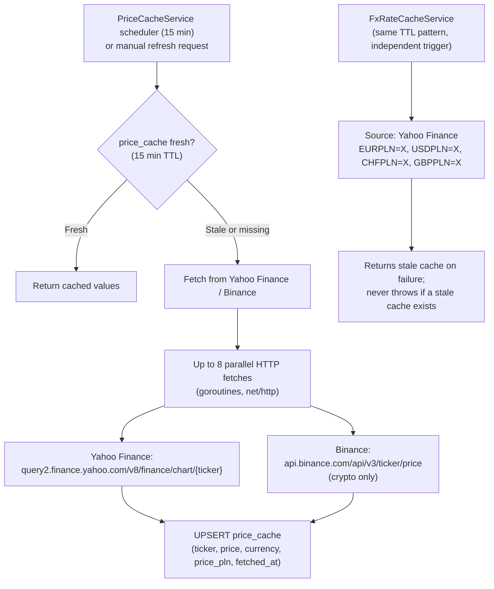
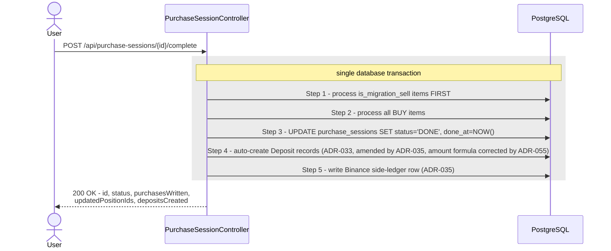
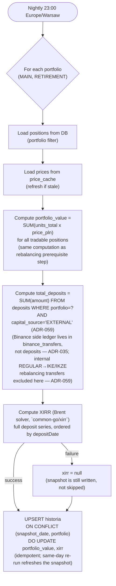
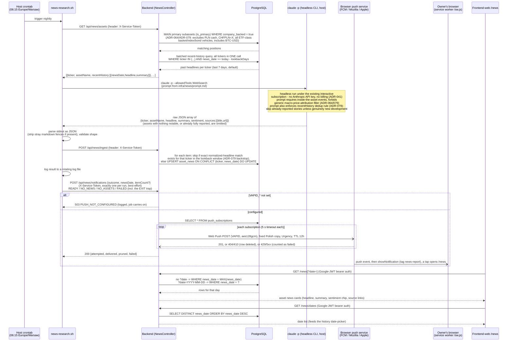
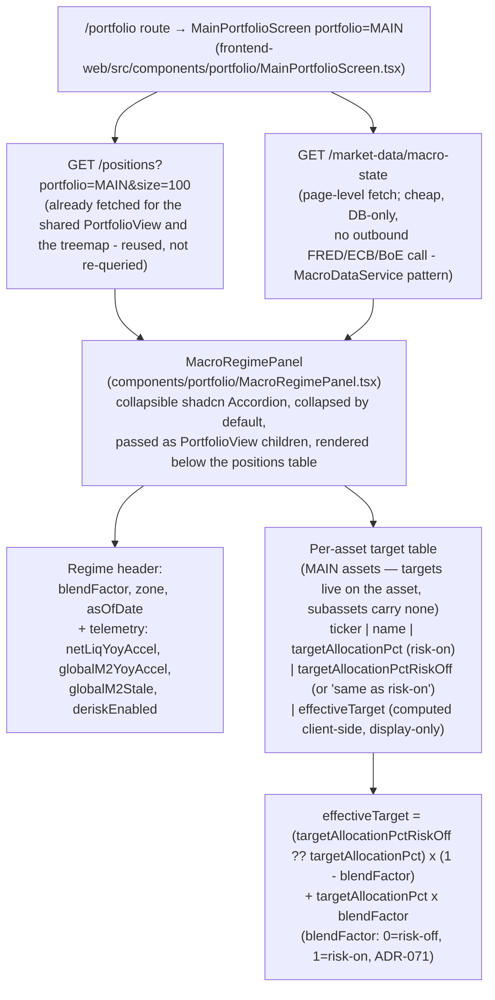
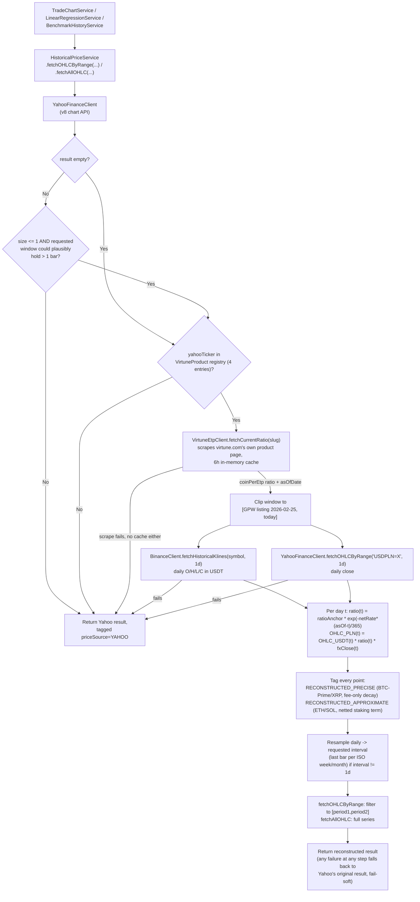
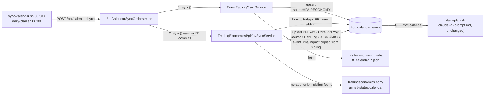
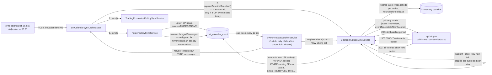
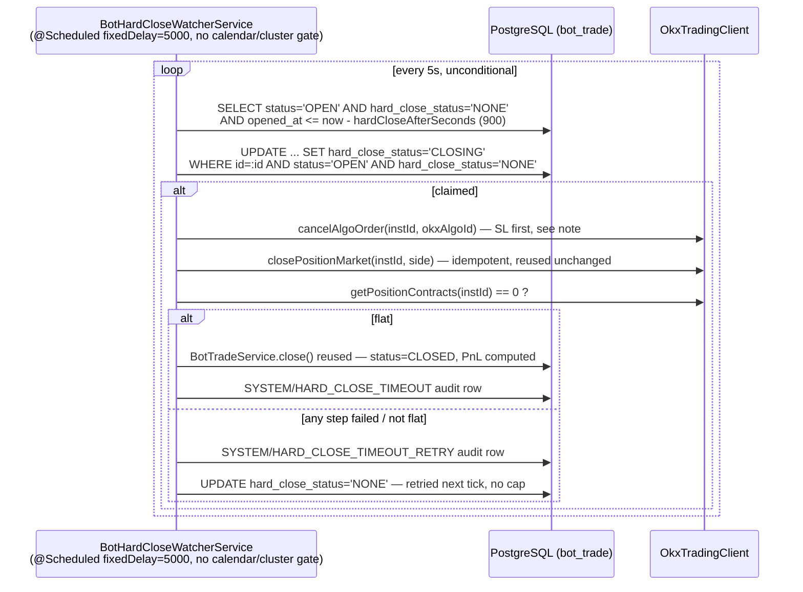
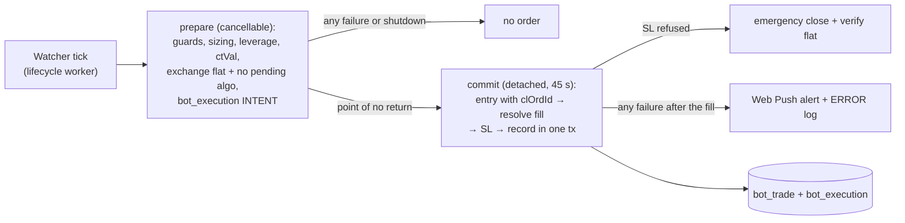

# 06 — Data Flow

> **Audience:** All agents. Describes how data moves through the system for the main runtime flows.

---

## 1. Price Refresh Cycle

Two triggers: (a) scheduled every 15 minutes via `PriceCacheService`, (b) manual via `POST /market-data/prices/refresh` (topbar button in the web frontend).



`price_pln` is computed at fetch time: `price × fxRate`. Subsequent reads from `price_cache` use the stored `price_pln` directly — no live FX lookup during position value computation.

FX rates: `GET /market-data/fx-rates` always includes synthetic PLN=1.0 (not stored in DB).

---

## 2. Purchase Session Lifecycle

The main monthly workflow. Three phases: create plan → record actuals → complete.

### Phase 1: Create PLANNED session (POST /purchase-sessions)

```mermaid
sequenceDiagram
    actor User
    participant API as PurchaseSessionController
    participant Plan as PurchasePlanningService
    participant Rebal as Rebalancing strategies
    participant DB as PostgreSQL

    User->>API: POST /api/purchase-sessions
    API->>DB: Validate no existing PLANNED session (partial unique index)
    API->>DB: Read cash: cashOverridePln, or MAX(recorded_at) cash_positions -> SUM(amountPln)
    API->>Plan: compute deployable cash (INWESTYCJE)
    Plan->>DB: totalPortfolioValuePln (PositionService, via price_cache)
    Plan-->>API: deployable = (cash - 0.05 x totalValuePln) / 1.05<br/>(post-purchase buffer, ADR-036)
    API->>DB: Read Emerytura monthly budget from settings
    API->>DB: Query current-year IKE/IKZE deposit totals
    API->>Rebal: InwestycjeRebalancingStrategy (13-step)
    API->>Rebal: EmeryturaRebalancingStrategy (8-step)
    Rebal-->>API: buy lists with deviationPct
    API->>Plan: apply IKE -> IKZE -> REGULAR priority allocation
    Plan-->>API: ETF substitution while capacity exists;<br/>migration triples (ETF sell + mining stock + real crypto) when needed
    API->>API: compute currency breakdown<br/>(xtbPln, xtbEur, xtbUsd, binanceEur, pkoCHF)
    API->>DB: INSERT purchase_sessions + purchase_session_items
    API-->>User: 201 Created (full session detail)
```

### Phase 2: Record actuals (PATCH /purchase-sessions/{id}/items)

User executes trades on XTB/Binance, then records what they actually bought.

```mermaid
sequenceDiagram
    actor User
    participant API as PurchaseSessionController
    participant DB as PostgreSQL

    User->>API: PATCH /api/purchase-sessions/{id}/items
    API->>DB: UPDATE purchase_session_items<br/>SET actual_units=?, actual_value_pln=?<br/>(partial update; only listed items changed)
    API-->>User: 200 OK (updated session detail)
```

### Phase 3: Complete session (POST /purchase-sessions/{id}/complete)

Atomic — entire operation in one database transaction (`internal/purchasesession/lifecycle.go`). Irreversible.



Step detail:

- **Step 1 — migration sells first.** For each `is_migration_sell` item: `INSERT asset_purchases` (negative `units_delta`) → `positions.units_[account_type] -= |units_delta|`.
- **Step 2 — all BUY items.** For each: `INSERT asset_purchases` (positive `units_delta`) → `positions.units_[account_type] += units_delta`. Null `actual_units` falls back to `planned_units`; a `0` `actual_units` is skipped entirely.
- **Step 3 — status flip.** `UPDATE purchase_sessions SET status='DONE', done_at=NOW()`.
- **Step 4 — auto-create Deposit records (ADR-033, amended by ADR-035, amount formula corrected by ADR-055, IKE/IKZE grouping replaced by direct tracking per ADR-065):**
  - Filter: exclude `is_migration_sell=true` items and zero-effective-units items.
  - Group remaining items by `(portfolio, accountType, exchange)` — exchange derived from `item.position.exchange` (XTB or BINANCE).
  - For each group: `SUM(plannedValuePln ?? actualValuePln)` — **the planned/target PLN value is preferred, falling back to actual only when planned is null** (ADR-055). The IKE/IKZE statutory annual limit ("wpłata") and XIRR's `totalInvestedPln` both measure *capital committed*, not *post-fee invested value* — if the user decides to invest 1000 PLN and broker fees/FX slippage eat 21 PLN of it on execution, they still committed 1000 PLN of capital; the fee is a cost incurred inside the account, not a shrinkage of the deposit. This is the opposite preference order from cost-basis tracking (`AssetPurchase.totalPln` / `positions.total_spent_pln`, computed earlier in the same method), which deliberately keeps preferring `actualValuePln` — cost basis and P&L must reflect what was really paid, while the deposit/capital-committed figure must not. Before ADR-055 this block preferred `actualValuePln ?? plannedValuePln` (the reverse), which silently under-counted the deposit whenever execution fees/slippage made the actual value smaller than planned — e.g. a RETIREMENT session that should have brought the running annual total to exactly 30 000 PLN instead showed 29 979 PLN. Existing `Deposit` rows created under the old formula were corrected by a one-time backfill (see ADR-055) so historical cap-usage/XIRR totals are accurate, not just sessions completed after the fix.
  - **`IKE`/`IKZE` groups (status: implemented, ADR-065):** the deposit amount is looked up
    directly from `newDepositPlnByBucket`, an authoritative `(Portfolio, AccountType) →
    BigDecimal` map returned by `PurchasePlanningService.computePlan` alongside its item list —
    the exact sum of that portfolio's own `ikeFillPln`/`ikzeFillPln` new-deposit fills (ADR-060,
    `05-rebalancing-algorithm.md` §8.1 steps 1/3), captured *before* any crypto-sell-financed
    top-up (steps 2/4) is merged into the same row. No group-level sell-netting subtraction is
    performed for these groups; `is_migration_sell` rows remain excluded from ever contributing
    to a deposit, but nothing is subtracted from anything else either. **Why the previous formula
    (net migration-sell proceeds found in the same `(portfolio, accountType, exchange)` group
    against that group's total, floored at 0) is retired:** it was only ever correct because an
    IKE/IKZE crypto-donor sale (ADR-061, generalized to both accounts and to any buy-list
    recipient, not just a crypto's own family; write-layer collision fixed by ADR-062) and the
    buy it financed always shared a `portfolio` — the sell and the offsetting buy were always in
    the same group, so subtracting one from the other left exactly the real-capital remainder.
    ADR-065 lets a donor sale be booked under a *different* portfolio than the buy it financed
    (the donor's own portfolio, restoring that portfolio's own crypto exposure — see
    `05-rebalancing-algorithm.md` §8.2), so the sell and its offsetting buy can now land in two
    different groups; netting within one group alone can silently discard a real deposit (the
    sell-heavy group nets toward/past 0, swallowing that portfolio's own unrelated new-deposit
    fills) or fabricate one (the buy-heavy group has no matching sell to net against, so its
    sell-financed portion is wrongly counted as new capital). See ADR-065's "Deposit accounting"
    section for the full proof and worked numeric case.
    **Implementation note (create→complete request-boundary bridge, not spelled out by
    ADR-065 itself):** `newDepositPlnByBucket` is computed once, in `createSession` (Phase 1),
    but consumed here in `completeSession` (Phase 3) — two separate HTTP requests, routinely
    hours or days apart while the user executes trades by hand. Since the ADR is explicit this
    value must stay in-memory (no new column, no new table), `PurchaseSessionService` bridges
    the gap with a `Map<Long sessionId, Map<GroupKey, BigDecimal>>` cache, populated when the
    session is saved and consumed (single-use) at the start of Step 4. A cache miss — most
    plausibly a JVM restart between create and complete, a real possibility for this
    single-instance Raspberry Pi deployment — falls back to the pre-ADR-065 group-sum-then-
    subtract reconstruction for IKE/IKZE groups, i.e. exactly today's behavior before this ADR,
    never worse than it was. This bridge is an implementation-level judgment call the ADR left
    open (it specifies *what* `newDepositPlnByBucket` must contain and that it must not be a DB
    column, not *how* it survives the request boundary), flagged here for visibility rather than
    left implicit in code alone.
  - **`REGULAR` groups: unchanged.** Summed exactly as before — `REGULAR` rows are never
    `is_migration_sell`, and the compensating buy (always `AccountType.REGULAR`, attributed to the
    donor's own portfolio per ADR-065) always represents real new capital regardless of which
    portfolio's sale triggered it (rebuying crypto on Binance/XTB-regular to restore sold exposure
    genuinely costs new cash) — it is never netted against anything.
  - `INSERT deposits (portfolio, accountType, exchange, amount, currency=PLN, depositDate=TODAY (Europe/Warsaw), comment="Auto from session #<id>")` → IKE/IKZE cap usage and XIRR update automatically (no manual entry needed). **All** deposits — including `exchange='BINANCE'` — count in XIRR/`totalInvestedPln` (ADR-035; Binance session buys are real new monthly capital).
- **Step 5 — Binance side-ledger row (ADR-035):**
  - `sum = SUM(effective PLN of non-sell items whose position.exchange = BINANCE)`.
  - If `sum > 0`: `INSERT binance_transfers (transfer_date=TODAY (Europe/Warsaw), amount_pln=sum, source='SESSION', session_id, comment="Auto from session #<id>")`. Purchase value PLN is an approximation of the transfer amount. This row is **NOT** a cash flow; it never enters XIRR or `total_deposits`.

Sells are processed before buys to prevent CHECK constraint violations (a sell-then-buy on the same ETF within one transaction could momentarily go negative).

Steps 4 and 5 run within the same transaction — if deposit or ledger creation fails the entire completion rolls back.

Also see Phase 1's cash computation (ADR-033, buffer sizing corrected by ADR-036):

```
grossCashPln      = override ?? SUM(latest cash_positions snapshot)
retirementContrib = settings.retirement.monthly_contribution_pln
cashOnHandPln     = max(0, grossCashPln - retirementContrib)   // net main cash
deployableCashPln = (cashOnHandPln - 0.05 × totalPortfolioValuePln) / 1.05   // post-purchase buffer, ADR-036
```

`grossCashPln` exists only in-memory on `RebalancingResultDto`; it is not persisted on the `purchase_sessions` row. `cashOnHandPln` (the net-of-retirement figure) is what the rebalancing algorithm and the session actually use. `max(0, ...)` handles the case where the raw cash snapshot is smaller than the retirement contribution (e.g. cash recorded right after the EMERYTURA transfer) — `deployableCashPln` then floors at ≤ 0 and the session correctly returns an empty INWESTYCJE buy list. The 5% buffer (ADR-036) is sized against the **post-purchase** portfolio value, not the pre-purchase value: solving `cashOnHand − A = 0.05 × (totalPortfolioValue + A)` for the budget `A` gives the `/1.05` divisor above, so the leftover cash after executing the session is exactly 5% of the MAIN tradable value *after* the new buys are added (e.g. gross cash 20,000 zł, retirement contribution 1,000 zł, MAIN value 200,000 zł: the old pre-buffer formula leaves about 4.8% post-purchase; the corrected formula leaves exactly 5.00%). EMERYTURA is unaffected — it always uses the fixed `settings.retirement.monthly_contribution_pln` budget and has no buffer.

---

## 3. Historia Snapshot (Nightly Scheduler)

`historia.StartScheduler` (`backend-go/internal/historia/scheduler.go`), started from `cmd/server/main.go` when `HISTORIA_SCHEDULER_ENABLED=true` (set in all three compose files) — runs every night at 23:00 Europe/Warsaw. (The Java `HistoriaScheduler` `@Scheduled` bean is gone; the 2026-09-18 missed snapshot from stopping Java before enabling this flag is ADR-097.)



If the backend is down at 23:00, that day's snapshot is missed (gap in the Historia chart). Acceptable for a single-user personal app; a missed day can be recovered with the internal ops endpoint `POST /api/admin/historia/backfill-snapshot` (ADR-097 — not in the OpenAPI spec, never proxied through Nginx).

---

## 3a. Binance Transfer Ledger (ADR-035)

`binance_transfers` is a flat side ledger of money sent to Binance, distilled from monthly deposits — overlapping money, not additional capital. Its only consumer is the yearly PIT-38 crypto acquisition-cost sum. No portfolio dimension.

This table exists because the earlier design (ADR-034, now superseded) conflated the capital stream with the PIT side ledger: it treated `deposits` rows with `exchange = BINANCE` as *both* real capital *and* the PIT-38 source, then tried to fix the resulting double-count by excluding those rows from XIRR and `totalInvestedPln`. That exclusion silently deleted real capital from the cash-flow series every time a session bought crypto on Binance, while the terminal portfolio value still counted the crypto positions — an overstatement that compounded monthly. ADR-035 restores a single capital stream (`deposits` means exactly one thing: capital committed) and moves the PIT-38 figure to its own dedicated, spreadsheet-shaped table.

```
Writes:
    ├─ V25 migration: one-time move of the V24-seeded rows out of deposits
    │   (copy deposit_date→transfer_date, amount→amount_pln, comment; source='MANUAL';
    │    then DELETE those rows from deposits)
    ├─ Session completion (Phase 3, Step 5): one row per session with Binance buys
    │   (source='SESSION', session_id, amount_pln = total Binance purchase value)
    └─ POST /binance-transfers: manual rows (source='MANUAL'),
        optionally with native amount + currency, like the spreadsheet

Reads:
    └─ GET /binance-transfers?year=
        ├─ data: ledger rows (optionally filtered by year)
        └─ yearlySums: SELECT EXTRACT(YEAR FROM transfer_date), SUM(amount_pln)
                       GROUP BY 1 — the PIT-38 figure per year (always all years)
```

Ledger rows never enter XIRR, `totalInvestedPln`, Historia `total_deposits`, or IKE/IKZE cap usage — those all read `deposits` only. `DELETE /binance-transfers/{id}` is available for manual correction (single-user app, no soft-delete needed).

**A second, narrower exclusion lives inside `deposits` itself (ADR-059).** Unlike the Binance
ledger — which was moved to its own table because it never belonged in `deposits` at all — a
`RebalancingTransferService` auto-deposit for a REGULAR-sold leg funding an IKE/IKZE buy leg
(§7.7 of `05-rebalancing-algorithm.md`, ADR-054) genuinely is a `deposits` row, because it must
still count toward the IKE/IKZE annual contribution cap. It is tagged
`capital_source = 'INTERNAL_TRANSFER'` (default for every other row is `EXTERNAL`) so that XIRR
and Historia's `total_deposits` — which measure *external* cash entering the portfolio — can
filter it out, while `AccountCapUsageService`, which measures what entered the tax wrapper
regardless of source, keeps summing it unconditionally.

---

## 4. Position Value Computation (Used by Multiple Flows)

This computation is shared between rebalancing, XIRR, and the Historia snapshot:

```
For each asset a (task 156: one `assets` row and all its subassets s):

    1. price_pln(s) = price_cache[yahoo_ticker(s)] × fxRate[price_currency(s)]
       (if price_currency = PLN: price_pln = price directly)

    2. units_total(s) = units_ike + units_ikze + units_regular_eur
                      + units_regular_usd + units_regular_pln
       (all net per-portfolio; no cross-portfolio deduction since V9)

    3. value_pln(a) = SUM(units_total(s) × price_pln(s))
                      for all subassets s of asset a  (joined by asset_id)

    4. totalPortfolioValue = SUM(value_pln(a)) for all assets in the portfolio
```

---

## 5. MEXC Bot Execution Flow — removed

The MEXC futures bot (DeMarker-driven tiered sell/buy, its deposit ledger and performance snapshots)
was dropped entirely in `V57__drop_mexc_bot.sql` (tables `mexc_snapshot`, `mexc_deposit`); its
controllers, `/mexc-bot` route and endpoints no longer exist in the Java-era code, the Go backend or
the OpenAPI contract. The OKX macro-calendar trading bot replaced it — see §10 (calendar sync), §11
(post-trade Claude trigger), §12 (BLS actuals), §13/§14 (designed, not built). The section is kept as a
tombstone so old references to "§5" are not silently reassigned.

---

## 6. Daily Asset News (Host Cron, ADR-041)

The only flow in this app where the trigger lives OUTSIDE Docker — a cron job on the Raspberry
Pi **host** (user `wojtekrpi`), not an in-process scheduler goroutine of the backend. Runs nightly at **06:15
Europe/Warsaw** via `infra/news/news-research.sh` (no longer aligned with the Historia snapshot's
23:00 run, §3 — the two jobs run independently). Running at 06:15 rather than 00:00 keeps the
research and the stamped `newsDate` safely clear of the midnight boundary (a run firing exactly
at 00:00 would stamp the *new* day's date for news gathered about the day that just ended); running
in the early morning rather than late at night also means the research captures the full prior
day's developments, including the US market close and any overnight/Asian-session news, rather
than potentially running before the US session has even finished for the day.



Key properties:

- The backend never calls an LLM. It is purely a store-and-serve layer for what the host script
  already wrote — this keeps the cost-free constraint intact (no `ANTHROPIC_API_KEY` in any
  `.env` / environment profile). The `claude` CLI is already installed and authenticated on the Pi host under
  the interactive Claude Code / Claude subscription; running it headless with `--allowedTools
  WebSearch` performs real-time web research at no incremental cost.
- `GET /news/assets` and `POST /news/ingest` are the only two endpoints that use the
  `X-Service-Token` header (constant-time compared against `app.news.ingest-token` / env
  `NEWS_INGEST_TOKEN`) **exclusively**, with no `bearerAuth` fallback, because neither has a
  human-facing counterpart — the caller is always a cron script, never a logged-in user.
  `SecurityConfig` wires this as a second, ordered `SecurityFilterChain`: one matching
  `/news/ingest` + `/news/assets` checking the service token, and the existing one (still
  `@Order` after it) covering everything else including `/news` and `/news/dates`.
  The `bot` module (OKX macro-calendar trading-bot tracker) reused this same `X-Service-Token`
  scheme for its own cron/on-demand scripts (`botServiceTokenFilterChain`, `@Order(1)`) rather than
  inventing a third mechanism — but had to extend the pattern rather than copy it verbatim: several
  of bot's reads (`GET /bot/calendar`, `/bot/trades*`, `/bot/stats`, `GET
  /market-data/macro-state`) are also called by the web frontend with an ordinary bearer JWT, which
  news's machine paths never were. `botServiceTokenFilterChain` claims those specific GETs only
  when an `X-Service-Token` header is actually present, falling through to the normal JWT chain
  otherwise, so the frontend is unaffected; bot's write paths remain unconditional/machine-only
  exactly like news's two endpoints. See ADR-089 for the full reasoning and the rejected
  alternatives. Any future machine-to-machine endpoint should reuse `X-Service-Token`, and should
  copy ADR-089's conditional-routing shape (not the simpler unconditional shape above) if it will
  ever also be called by a logged-in user on the same path.
- If the host cron job fails to run (Pi rebooted, script error, `claude` CLI auth expired), that
  night's news is simply missing for that day — same accepted-gap precedent as the Historia
  nightly snapshot (§3 above). No retry/backfill mechanism is planned. A script error after
  `infra/.env` is loaded sends a failure notification (next bullet) **as long as the backend is
  up**. A run that never starts (Pi off at 06:15, cron missing) and a run made while the backend is
  down both send nothing. There is no backend-side "report overdue" check (ADR-108 §3). So no
  notification by about 07:00 means: open `/news`. If today's date is missing, check
  `infra/news/news-research.log` on the Pi.
- **Phone notification (Web Push, ADR-108).** The script reports exactly one structured outcome
  per run to `POST /news/notifications` (`X-Service-Token`): `READY` with `itemCount`,
  `NO_NEWS`, `NO_ASSETS`, or `FAILED` (from `fail()` or, for an unexpected `set -e` abort, the
  `EXIT` trap). It uses `curl --max-time 30 --retry 2 --retry-delay 5 --retry-connrefused`. A
  failed call is logged and swallowed, and the job's exit code never changes. The backend owns
  the Polish copy and maps `READY` to Urgency `normal`, `NO_*` to `low` and `FAILED` to `high`.
  It sends with tag `news-report`, TTL 12 h and click-through `/news` to **every** row of
  `push_subscriptions`. A `404`/`410` from the push service deletes the row. Anything else non-2xx
  is counted as `failed`, with no retry queue. The payload holds only a count and the run date (on
  failure, also the log's path). It is encrypted end to end to the browser, so the push service
  cannot read it. Without `VAPID_*` the endpoint answers `503 PUSH_NOT_CONFIGURED`, and the
  script logs it and carries on. Devices opt in on `/settings` ("Powiadomienia"), which also has
  the test-send button. Flows and diagrams: `docs/architecture/diagrams/172-web-push.md`.
- `asset_news` is permanent history, not a TTL cache: rows are never deleted, and a same-day
  re-run upserts via `(ticker, news_date)` rather than duplicating. Growth is trivial for
  PostgreSQL (roughly 15–20 MAIN non-currency assets × 365 days/year, minus omitted no-news days).
- **Scope is gated by `positions.company_backed` (ADR-064, broadened ADR-079), not
  `asset_class`.** Earlier this section's scope was "every MAIN, non-companion, non-currency
  position" — that let broad-basket ETFs (gold, NASDAQ/China index trackers, bond funds, a
  quantum-computing thematic basket) leak into a job meant to surface asset-specific headlines.
  ADR-064 then over-corrected by also excluding `BTC-USD` on the theory that "leaderless" meant
  "no researchable news" — wrong, since a leaderless base-layer asset can still generate real
  news from protocol upgrades/proposals, governance debates, hard forks, hash-rate/on-chain/
  large-holder activity. ADR-079 broadened the test from "has a company/team/foundation" to
  "has its own distinguishable, individually-researchable narrative," which `BTC-USD` satisfies,
  and flipped it back to `true` (`V58`). `NewsService.assetsToResearch()` filters on
  `companyBacked = true` alone — `CURRENCY` rows are excluded as a consequence of always
  backfilling/defaulting to `companyBacked = false`, not via a second, separately-maintained
  filter clause. `prompt.md` requires inside-the-asset events/decisions (company events for
  company-backed assets; protocol/on-chain events for leaderless ones) and explicitly forbids
  generic macro-price-attribution content — Fed decisions, rate cuts, ETF inflow/outflow
  narratives, broad market moves ("price crashed because of Fed rate hikes," "ETFs bought a lot
  of BTC") — independent of the scoping question.
- **Dedup (ADR-079) is prompt-primary, backend-defensive — not fuzzy matching.** The nightly
  prompt previously had no memory of past days, so an ongoing multi-day story (a court case, a
  hack investigation, a slow governance vote) could be re-reported as new every night.
  `GET /news/assets` now attaches each asset's own `recentHistory` — up to
  `app.news.history-lookback-days` (default `NewsProperties.historyLookbackDays = 7`) days of
  `{newsDate, headline, summary}`, fetched in one batched query across all researched tickers
  (not N+1) — and `prompt.md` instructs the model to skip a story already in that list unless
  there's a genuinely new, material development, reporting only what's new when there is.
  `NewsService.ingest()` backstops this with a normalized-exact-headline-match guard over the
  same window: an exact repeat is skipped (logged, not counted in the response's `upserted`)
  rather than failing the whole batch, catching only verbatim non-compliance, not genuinely
  reworded follow-up coverage (that's the prompt rule's job). One config value
  (`app.news.history-lookback-days`) drives both the history window and the guard window, so
  they can never drift apart.
- Two deployable artifacts must be kept in sync for this one feature: `infra/news/news-research.sh`
  (+ `infra/news/prompt.md`) on the host, and the backend's `internal/news` package (handler + service) in
  Docker. Unlike every other feature in this app, this one is **not** fully containerized.
- News content is web-only (per ADR-041). The push notification only says that the report
  exists and links to `/news`.

---

## 7. Cross-Sheet Origin Map

Shows where the seeded data originated (migration) and where ongoing writes come from:

| Data | Original source | Live updates via |
|---|---|---|
| positions, targets, weights | V6 seed migration SQL | `PUT /positions/{id}`, `POST /purchase-sessions/{id}/complete` |
| deposits | V13 seed migration SQL | `POST /deposits`, auto-created on `POST /purchase-sessions/{id}/complete` |
| binance_transfers | V25 move of V24-seeded rows | `POST /binance-transfers`, auto-created on session complete |
| cash_positions | Manual entry in SettingsPage | `POST /cash-positions` |
| crypto_trades | V13 seed migration SQL | `POST /crypto-trades` |
| historia | V13/V14 backfill + nightly scheduler | Nightly scheduler goroutine (`historia.StartScheduler`, 23:00 Warsaw) |
| settings | V1/V9 seed INSERT | `PUT /settings/{key}` |
| price_cache | On startup warm-up | 15-min scheduler + manual refresh |
| fx_rate_cache | On startup warm-up | 15-min scheduler + lazy fetch |
| asset_news | None (first rows on first cron run) | Nightly host cron (`infra/news/news-research.sh`) → `POST /news/ingest` (ADR-041) |

Note: The Google Sheets ETL migration job was not executed. Data was seeded directly via Flyway migration SQL files (V6 positions seed, V13 historical data seed).

`monthly_entries` (originally seeded via V13, updated via `POST`/`PUT /monthly-entries`) was dropped entirely in `V26__drop_monthly_entries.sql` and no longer exists — the table and its API are gone, not just deprecated.

---

## 8. Macro Regime Panel (Portfolio Page, ADR-044 UI)

**Status: shipped.** ADR-044 first landed the continuous risk-on/risk-off blend backend-only (V36/V37: `positions.target_allocation_pct_risk_off`, `macro_state.blend_factor`/`composite_z`/`smoothed_z`) with no frontend consumer; that gap is now closed. The panel is read-only — no new mutations, no new endpoints.



Properties:
- Implemented in `frontend-web/src/components/portfolio/MacroRegimePanel.tsx`. `MainPortfolioScreen` (the container both main portfolio routes render, task 170) passes it as the `children` slot of the shared `PortfolioView` for the MAIN book only, so it renders inside the page column directly below the positions table. It is built on the shadcn `<Accordion>` already used elsewhere in the repo (precedent: `routes/crypto/tax.tsx`). Page structure: `12-portfolio-bpps-and-shared-packages.md` §5.1.
- Both source endpoints carry every field the panel needs — confirmed against `docs/openapi.yaml`'s `PositionDto`/`CreatePositionRequest`/`UpdatePositionRequest` schemas (`targetAllocationPctRiskOff`) and the `MacroState` schema (`blendFactor`, `zone`, `compositeZ`, `smoothedZ`, `globalM2Stale`). No OpenAPI contract change was needed for this feature.
- `effectiveTarget` mirrors the formula in `05-rebalancing-algorithm.md` §7.3 exactly (ADR-044's original interpolation, orientation flipped by ADR-071) but is computed in the browser purely for display — it does not call, preview, or replace `MainRebalancingStrategy`'s own interpolation used at purchase-session planning time. When `blendFactor` is `null` (bootstrap period, insufficient history), the position behaves as pure risk-on — the same collapse-to-risk-on the backend itself uses (equivalent to pinning `blendFactor = 1` post-ADR-071, was `0` under the original ADR-044 orientation). Same "computed at the client/API layer, never stored" spirit as `currentPct`/`deviationPct` on positions (§02-domain-model.md).
- No pagination concerns: `size=100` already covers the ~39 MAIN rows in one page (confirmed in the actual query: `listPositions({ portfolio: "MAIN", size: 100 })`).
- `shared-ts`'s `positionSchema` (`targetAllocationPctRiskOff`) and `macroStateSchema` (`blendFactor`/`zone`/`compositeZ`/`smoothedZ`/`globalM2Stale`) already carry every field the panel consumes — this was the one blocking gap identified when this section was first specified, and it has since been closed; there is no longer a stale `cutFactor` field in `macroStateSchema` to clean up.

---

## 9. Historical OHLC Fetch — Yahoo Finance with Virtune Coin-Entitlement Reconstruction (ADR-085)

Yahoo Finance's v8 chart API has no historical series at all for four Virtune crypto ETPs
(`ETNVIRBTCP.WA`/`ETNVIRETH.WA`/`ETNVIRSOL.WA`/`ETNVIRXRP.WA`) — any request wider than a couple
of days collapses to exactly one point (today's latest quote), regardless of the window asked
for. An earlier design (ADR-078) planned to fill this by scraping BiznesRadar.pl; that was
blocked when its own robots.txt check found the exact path it needed disallowed. `ADR-085`
replaces the fallback **source**, keeping the same facade shape and trigger condition: these are
physically-backed ETPs whose price can be reconstructed from three things that are each
independently, reliably fetchable — the ETP's own disclosed coin-entitlement ratio (scraped
from Virtune's own product pages, which unlike BiznesRadar have a permissive `robots.txt`), the
underlying crypto's spot price history (Binance), and USD/PLN FX history (Yahoo's `USDPLN=X`
ticker, which — unlike these four — has full real history).

`HistoricalPriceService` (`pl.investing.service`) sits in front of `YahooFinanceClient` and, on
the same thin/empty trigger as before, reconstructs a daily PLN price series for exactly these
four tickers via `VirtuneEtpClient` (new — scrapes one number, the current coin-per-ETP ratio)
and `BinanceClient.fetchHistoricalKlines` (new method on the existing client). Every other
ticker's calls are unaffected. `TradeChartService`, `LinearRegressionService`, and
`BenchmarkHistoryService` call `HistoricalPriceService` instead of `YahooFinanceClient` directly
for historical OHLC; live-quote fetches (`YahooFinanceClient.fetchPrice`) are untouched. (A
fourth service, `DeMarkerService`, is referenced elsewhere in these docs as a caller of the same
Yahoo OHLC methods for the MEXC bot feature — but as of this writing no such class, nor any
MEXC-prefixed backend code, actually exists in the codebase; that's a pre-existing doc/code
divergence unrelated to this ADR, noted here rather than corrected.)



Key properties (full rationale, the reconstruction math, and the confirmed research this rests
on are in `docs/adr/ADR-085-virtune-etp-coin-entitlement-reconstruction.md`):
- **Trigger is unchanged from ADR-078**: empty Yahoo result, or `size() <= 1` while the requested
  window spans more than one bar at the requested interval — built directly from the confirmed
  Yahoo failure signature (always exactly one point, always today's date, regardless of window
  width), independent of which source answers the fallback.
- **The reconstruction formula**: `netAnnualRate = stakingYieldAnnual − feeAnnual` (0 staking
  term for BTC-Prime/XRP), applied as backward exponential decay from today's live-scraped ratio:
  `ratio(t) = ratioAnchor × exp(−netAnnualRate × (asOfDate − t)/365)`. Confirmed against
  Virtune's own worked example (100 ETH, 2% staking, 1.40% fee → 100.60 ETH after one year —
  additive netting, not compounded). Anchored on **today's** live ratio and decayed backward
  (not the launch ratio projected forward) since only the ~6-month GPW-listed window
  (2026-02-25–today) needs reconstructing, and Virtune discloses the current ratio, not a
  historical series or the exact launch ratio.
- **Confidence is explicitly two-tiered, surfaced via a `priceSource` field** (`YAHOO` /
  `RECONSTRUCTED_PRECISE` / `RECONSTRUCTED_APPROXIMATE`) on `TradeChartPricePoint`,
  `BenchmarkHistoryPoint` (per-point), and `RegressionResponse.data` (one field for the whole
  series, since `trendline`/`sdBands` are derived and have no independent source). BTC-Prime and
  XRP have no staking variable — a single disclosed, fixed fee decay, high confidence. ETH and
  SOL additionally net a disclosed-but-not-historically-published staking-yield figure held
  constant across the window — meaningfully wider error bars, and SOL wider still than ETH (ETH
  discloses a "≥75% of rewards reinvested" floor; SOL discloses no equivalent commitment at all).
- **Scope is an explicit 4-entry static registry** keyed on `yahoo_ticker`
  (`VirtuneProduct` — slug, Binance symbol, fee, staking yield, confidence tier per ticker), not
  a general "any thin ticker" fallback. An unmapped ticker never triggers reconstruction.
- **No new table, no Flyway migration** — matches the existing pattern of fetching historical
  series live on every request; `VirtuneEtpClient`'s ratio lookup uses a 6-hour in-memory cache
  (not DB-backed) since the underlying figure only changes about once a day on Virtune's side.
- **Fail-soft everywhere**: a failure in the Virtune scrape, the Binance klines fetch, or the
  Yahoo FX leg all fall back to returning Yahoo's original (possibly still-thin) result — never a
  new failure mode for the calling services.
- **History — the BiznesRadar-based ADR-078 version is gone.** It lived in the Java `packages/shared/java`
  and was invoked on every startup of the sibling apps' backends, scraping a robots.txt-disallowed
  BiznesRadar path. The call sites were removed 2026-09-02 (commit `eab7c39`) and the unreferenced
  `BiznesRadarClient`/`HistoricalPriceService` classes were deleted with the Java trees in Phase 9
  (ADR-098). The Go backend implements only the ADR-085 Virtune reconstruction
  (`backend-go/internal/linearregression/history.go`: `VirtuneClient`, 6 h cache).

---

## 10. Bot Calendar Sync — ForexFactory + TradingEconomics PPI YoY Enrichment (ADR-091)

The `infra/bot/` leveraged-BTC-scalping module's calendar (`bot_calendar_event`) has two
upstream sources, not one. **Status (2026-09-19): implemented in the Java backend, then lost with its deletion — in Go, `Orchestrator.SyncAll` (`backend-go/internal/bot/calendar/sync.go`) calls no-op stubs for the TradingEconomics enrichment and the BLS baseline; only ForexFactory is live.** Porting it (task 145) is a Backend-Go follow-up. The class names below (`ForexFactorySyncService`, `TradingEconomicsPpiYoySyncService`, `BotCalendarSyncOrchestrator`) are the Java-era design; the Go equivalents are `ForexSource` and `Orchestrator`.

`ForexFactorySyncService` remains the primary source: it fetches
`nfs.faireconomy.media/ff_calendar_{thisweek,nextweek}.json` (free, no-auth) and upserts every
USD/other-currency event it carries, including scheduling (`eventTime`) and impact rating —
unchanged by this section.

ForexFactory's feed has a confirmed, narrow gap: it carries `PPI m/m`/`Core PPI m/m` for USD but
no `PPI y/y`/`Core PPI y/y` row at all (CPI has no equivalent gap — `CPI y/y`/`Core CPI y/y` are
both present). A second source, `TradingEconomicsPpiYoySyncService`, closes exactly that gap by
scraping `tradingeconomics.com/united-states/calendar` (unauthenticated, server-rendered HTML,
Jsoup — no Cloudflare challenge, confirmed via response headers) for two known `data-symbol`
rows (`UNITEDSTAPROPRICHA` = PPI YoY, `USACPPY` = Core PPI YoY), reading only `actual`/
`consensus`/`previous`. It runs **after** `ForexFactorySyncService` in the same
`/bot/calendar/sync` call (`BotCalendarSyncOrchestrator`, ordering is load-bearing, not
incidental) and only does the TE fetch at all when a same-day `PPI m/m`/`Core PPI m/m` sibling
row already exists — so on the ~350 days/year with no PPI release, `tradingeconomics.com` is
never called. The new `PPI YoY`/`Core PPI YoY` rows reuse their sibling's `eventTime` and
`impact` verbatim (TE's own page has no impact rating and no machine-parseable timezone, so it
is never trusted for either), and are written with `source = "TRADINGECONOMICS"` into the same
`bot_calendar_event` table — no new entity, no Flyway migration.

Because the new rows share `eventTime` with their m/m siblings, they land in the exact same
same-timestamp cluster `infra/bot/prompt.md` already knows how to handle (its own worked example
is literally the 12:30 UTC PPI/Core-PPI/Claims cluster) — `daily-plan.sh` and `prompt.md` require
no changes; `claude -p` picks up the new events through the existing generic
`GET /bot/calendar` → `CALENDAR` JSON path.



See `docs/architecture/diagrams/145-ppi-yoy-calendar-enrichment.md` for the full class/sequence
diagrams and pattern evaluation, and `docs/adr/ADR-091-ppi-yoy-calendar-enrichment.md` for the
sources evaluated (ForexFactory, Investing.com, FXStreet, TradingEconomics's paid API, EconPulse,
BLS/FRED) and why TradingEconomics's public calendar page was chosen over each.

---

## 11. Post-Trade Claude Trigger — Outbox Flag + Host Launcher (ADR-092)

Closes the gap between the automated OKX entry (ADR-090) and the already-existing
post-trade advisory scripts (`infra/bot/scalp-session.sh`, `manage-position.sh`,
`watch-market.sh`, `manage-prompt.md`), which nothing ever invoked. Required order:
**(1)** actuals refresh fast → **(2)** algorithm opens the position → **(3)** ONLY THEN
Claude launches and reads the open position back to confirm.

```mermaid
sequenceDiagram
    participant Watch as EventReleaseWatcherService<br/>(1s DB tick)
    participant Orch as BotCalendarSyncOrchestrator
    participant Exec as LiveExecutionService
    participant DB as PostgreSQL (bot_trade)
    participant Launch as scalp-launcher.sh (host, 10s loop)
    participant Scalp as scalp-session.sh <tradeId>
    participant Claude as claude -p (host)

    Watch->>Orch: maybeRefresh() ≤ every 5s in watch window<br/>(T-30s → T+300s; skip while 429-backed-off)
    Orch->>DB: fresh actuals into bot_calendar_event
    Watch->>Watch: match surprise → net cluster → sizing
    Watch->>Exec: execute() (kill switch checked)
    Exec->>DB: PLACED: persist trade + scalp_session_status='PENDING'<br/>(same tx; all other outcomes leave 'NONE')
    DB-->>Launch: GET /bot/trades/pending-scalp (X-Service-Token, 10s poll)
    Launch->>DB: POST /bot/trades/{id}/scalp-claim<br/>(atomic PENDING→RUNNING; 409 = already claimed)
    Launch->>Scalp: setsid ./scalp-session.sh <tradeId> & (detached)
    Scalp->>DB: GET /bot/trades/{id} (read-back-to-confirm)
    Scalp->>Claude: claude -p (manage-prompt.md + TRADE json)
    loop ~60s beats, hard timeout 900s
        Claude->>Scalp: watch-market.sh <id> 60 5 (market window)
        Claude->>DB: POST /bot/trades/{id}/actions (HOLD/TRAIL_SL/PARTIAL/FULL_CLOSE)
    end
    Launch->>DB: POST /bot/trades/{id}/scalp-finish → 'DONE' + SYSTEM action rows
```

Key properties (full rationale in `docs/adr/ADR-092-post-trade-claude-trigger.md`):

- **Refresh is 5 s, not 20 s** (`actualsRefreshSeconds` default). Worst-case catch is one
  period + FF upstream lag + ~1–2 s match/execute — at 5 s the bot realistically catches
  the print at ~5–8 s, inside the ~10 s target and clear of the ~30 s pointless tail. The
  429→5 min-backoff mechanics are unchanged: while backed off the watcher skips the
  outbound refresh but keeps evaluating DB state every 1 s, so backoff delays `actual`
  *arrival*, never the reaction once it is there. Split FF-fast/TE-slow throttles are a
  documented follow-up, not this change (TE's sibling gate already limits it to PPI days).
- **Backend never spawns `claude`.** The `claude` CLI + subscription auth live on the Pi
  host (same precedent as the news flow, §6 — the trigger lives OUTSIDE Docker). The
  backend only writes intent (`PENDING`); the host launcher (systemd user service,
  `Restart=always`, 10 s poll, global `flock` + per-trade atomic claim) launches
  `scalp-session.sh` detached. A 1-min cron was rejected as launcher cadence (adds 0–60 s
  before Claude starts — a large fraction of the 15-min window).
- **Trigger fires ONLY on `Outcome.PLACED` with non-null `tradeId`.** `SKIPPED_*`,
  `FAILED`-with-null, `EMERGENCY_CLOSED` (already flat), `FAILED`-with-`tradeId`
  (row untrustworthy), and the duplicate-window-after-fill orphan (live position, **no**
  row for the script to address) never auto-launch — the last two are human-path only
  (`manage-position.sh` by hand / OKX UI + reconcile). See the ADR's normative matrix.
- **Single-flight:** `maxConcurrentTrades=1` (ADR-090) + atomic claim + a `RUNNING` row is
  never auto-reclaimed (fail-closed; human resets to `PENDING` to relaunch). At most one
  scalp session per trade across any backend/launcher restart combination.
- **Safety:** kill switch gates entries, not management (an already-`OPEN` trade keeps its
  session even if the switch flips off after entry); the exchange-side SL placed at entry
  (price-based) is the only automated backstop today; the backend's own time-based hard close designed in
  ADR-095 (§13) is not built — Claude is advisory only. `scalp-session.sh` itself is
  otherwise unchanged: its opening `GET /bot/trades/{id}` is the read-back-to-confirm step, no
  new position-passing plumbing was needed.

---

## 12. BLS Direct-Fetch CPI Actuals — Primary Path + Fallback, Freshness Detection (ADR-093)

**Status (2026-09-19): built only in the deleted Java backend (behind `app.bot.bls.enabled=false`, never
enabled) — NOT ported to Go.** No `api.bls.gov` client exists in `backend-go`; the Go calendar orchestrator
calls a no-op BLS baseline stub. Porting it is a separate follow-up task (task 147). This section documents
the design as built in Java, for that port.

A real 2026-09-11 12:30 UTC CPI release exposed two independent data-acquisition failures in the
existing ForexFactory-only pipeline: FF self-rate-limited (`429`) from its own tightened 5s
polling cadence, and separately its own upstream feed lagged the real release by ~4.5 minutes even
once the rate limit cleared — an order of magnitude beyond what `actuals-refresh-seconds`/
`stale-after-seconds` had been tuned against. Net result that day: zero trade, and the
`stale-after-seconds` gate was never even exercised, since no data arrived in time to reach it.
The official BLS Public Data API v2 (`api.bls.gov/publicAPI/v2/timeseries/data/`) is a legitimate,
free, unauthenticated-capable endpoint that reports the same release directly from its source, with
a different (and that day, uncorrelated) failure mode: an HTTP 503 storm during the exact release
second, recovering within a few minutes.

`BlsDirectActualsSyncService` (new) becomes the de facto primary writer of `bot_calendar_event.actual`
for CPI specifically, **without disabling or "racing" ForexFactory** in the literal sense —
`ForexFactorySyncService` remains completely unchanged as the sole `eventTime`/`impact`/`forecast`
authority and keeps attempting to write `actual` exactly as before. Both write into the **same**
FF-authored row (never a new one — CPI rows and their scenario ladder already exist by release
time, unlike ADR-091's TE-PPI-YoY case which creates brand-new rows for a genuine FF gap), and
`EventReleaseWatcherService`'s existing 1-second DB-tick architecture (ADR-090 §2) already ensures
whichever source's value lands in the database first is what the very next tick trades on — no new
race-orchestration code is needed, only one corequisite bug fix: neither `ForexFactorySyncService`
nor `TradingEconomicsPpiYoySyncService` may overwrite a known `actual` with a blank one on a
re-sync that hasn't caught up yet (previously both did this unconditionally).



Key properties (full rationale in `docs/adr/ADR-093-bls-direct-cpi-actuals.md`, diagrams in
`docs/architecture/diagrams/147-bls-direct-actuals.md`):

- **Freshness is a period-code comparison against a pre-captured baseline, never "did the HTTP
  call succeed."** A 200 OK returning last month's data during the pre-release window is an
  explicit "not fresh yet" outcome — no write, no backoff, just wait for the next poll tick. The
  baseline (per series, `(year, periodNum)`) is captured once per release day, hours before
  release, piggybacking on the existing 05:50/06:00 cron sync — specifically so the baseline
  capture itself is never exposed to the release-second congestion or the "Database is locked"
  transient state observed as early as 14 minutes pre-release.
- **BLS's two distinct failure shapes** — HTTP 503, and a 200 OK carrying a
  `"Database is locked for Series X"` message — are both treated as soft, retryable failures with
  backoff + jitter, never as success and never as a fatal abort. An empty `data[]` array (today's
  real dry-run `IndexError`) is guarded before any indexed access.
- **Per-event and per-day request caps** (`maxRequestsPerEvent=10`, `maxRequestsPerDay=20` by
  default) bound quota spend on exactly the day BLS is struggling, which is also the day this
  feature matters most; free BLS registration (500/day) is a stated operational prerequisite
  before relying on this in production, not required to build or test it.
- **m/m uses the seasonally-adjusted series, y/y uses the not-seasonally-adjusted series** — never
  the reverse — rounded `HALF_UP` to one decimal place and formatted (`"0.3%"`, `"-0.1%"`) to
  round-trip through the existing `NumericEventValueParser` unmodified.
- **CPI only in this pass** — PPI's BLS series IDs are unverified; the architecture (a
  per-indicator-family descriptor) is shaped to absorb PPI additively once verified, mirroring
  ADR-091's own narrow-scoping precedent.
- **`actual_source` is a new column, deliberately separate from `source`** — `source` keeps
  meaning "who scheduled this row" (unchanged); `actual_source` means "who last supplied the
  current `actual` value" (`BLS_DIRECT`, or null for the pre-existing FF/TE-only behavior).
- **Not enabled.** `app.bot.bls.enabled=false` by default; flipping it requires a separate,
  explicit go-ahead per ADR-093's Consequences, the same demo-gate discipline ADR-090 established
  for OKX live execution, applied here to a data-acquisition feature.

---

## 13. Backend Hard-Close Timeout Enforcement for `bot_trade` (ADR-095)

> **Status (2026-09-19): DESIGNED, NOT BUILT — in either language.** ADR-095 was written against Java classes
> (`BotHardCloseWatcherService`, `OkxTradingClient`, `BotTradeService`) that were never implemented and that
> no longer exist; no Go code implements a hard-close watcher. Its migration is parked unapplied
> (`db/unapplied/V72__bot_hard_close_timeout.sql`). It must be ported to Go before V72 is un-parked. Note the
> operational consequence: live OKX execution is armed (2026-09-19), so today an open bot position is protected
> only by the exchange-side stop-loss placed at entry and by a human — there is no backend time-based
> hard close. The class names in this section are the Java-era design, to be re-expressed in Go.

Investigating why `infra/bot` scripts behave the way they do surfaced that
`scalp-launcher.sh` (ADR-092's host-side launcher) had never actually been installed as a
systemd service since ADR-092 shipped — zero scalp sessions had ever auto-launched in
production — and, independently, that **"the executor's own hard 15-minute close,"** claimed as
an existing safety backstop throughout ADR-092/`manage-prompt.md`/`scalp-session.sh`, never
existed: no `@Scheduled` method anywhere touched `bot_trade` rows to force-close a stale open
position. Until this section's mechanism, the only things that could ever end an open bot-opened
position were the price-based exchange-side SL, or a human. (A related, larger, **separate**
finding — Claude's advisory actions posted to `POST /bot/trades/{id}/actions` are audit-log-only
and were never wired to actually execute on OKX at all — is tracked as its own follow-up, not
built here; see ADR-095's Consequences.)



Full diagrams + legend: `docs/architecture/diagrams/148-hard-close-timeout.md`. Full rationale,
alternatives, and open risks: `docs/adr/ADR-095-backend-hard-close-timeout.md`.

Key properties:

- **Runs entirely in-process in the backend container** — no dependency on
  `scalp-launcher.sh`/`scalp-session.sh`/the `claude` CLI/its host-side subscription auth being
  installed, running, or having ever run. This is the load-bearing property: a real independent
  backstop cannot share a failure domain with the thing it backstops, and the launcher's
  silent-never-installed incident is exactly that failure domain.
- **5s poll, not the 1s tick `EventReleaseWatcherService` uses** — the position is continuously
  SL-protected the whole time, so only the *worst-case overshoot* past the 900s deadline needs
  bounding (≤5s typical), not a fast-decaying news-reaction window. A separate `@Scheduled` class
  (SRP), not folded into `EventReleaseWatcherService.doTick()`, which early-returns on empty
  calendar clusters — hard-close monitoring must never depend on that.
- **Cancels the SL algo order before market-closing, not after.** The SL was placed as a
  standalone conditional order (`OkxTradingClient.placeStopLossAlgo`), never linked via
  `attachAlgoOrds` — a separate market close does not auto-cancel it. Left uncancelled, it can
  fire later on an unrelated price move and open an unintended position. Cancel-first means a
  failure here leaves the trade visibly `OPEN` (retried, monitored) rather than `CLOSED` with a
  silent dangling order.
- **Claim fails OPEN, not closed** — the opposite of ADR-092's `scalp_session_status=RUNNING`
  (never auto-reclaimed). A failed OKX attempt reverts `hard_close_status` `CLOSING→NONE` and
  retries every 5s tick, unconditionally, no cap. This diverges deliberately: ADR-092's session
  still has the SL and this job as backstops if it dies; this job is currently one of only two
  automated backstops that exist at all, so it cannot fail closed after one attempt.
- **Reuses existing idempotent primitives** — `OkxTradingClient.closePositionMarket` (already a
  no-op when flat) and `BotTradeService.close` (already computes PnL, already guards
  already-closed) are called unchanged, not reimplemented.

---

## 14. Bot Trade Action Execution — Wiring Claude's Scalp-Session Decisions to OKX (ADR-096)

> **Status (2026-09-19): DESIGNED, NOT BUILT.** Same situation as §13: ADR-096 targets Java classes
> (`BotTradeActionService`, `BotTradeActionExecutionService`, `BotPositionCloseExecutor`) that were never
> built; `V73__bot_trade_action_execution.sql` is parked in `db/unapplied/`. `POST /bot/trades/{id}/actions`
> still persists an audit row only. To be ported to Go (together with §13) before V73 is un-parked.

Section 13's investigation flagged, but deliberately deferred, a second, more severe gap:
`POST /bot/trades/{id}/actions` — the endpoint the host-side scalp session calls to post
`SET_SL`/`SET_TP`/`TRAIL_SL`/`PARTIAL_CLOSE`/`FULL_CLOSE` decisions — persisted only an audit
row. It never called OKX. A live 15-minute scalp session's every non-`HOLD` decision was a no-op
on the exchange; the position was managed exactly as if Claude had never been consulted, with only
the entry-time price-based stop-loss (and, once section 13's mechanism ships, the time-based hard
close) actually able to touch the position.

```mermaid
sequenceDiagram
    participant Sh as scalp-session.sh (Claude, via curl)
    participant Svc as BotTradeActionService
    participant Exec as BotTradeActionExecutionService
    participant DB as PostgreSQL (bot_trade / bot_trade_action)
    participant Close as BotPositionCloseExecutor
    participant Okx as OkxTradingClient

    Sh->>Svc: POST /bot/trades/{id}/actions {actionType, price, quantity, reasoning}
    Svc->>DB: INSERT bot_trade_action (execution_status='NOT_APPLICABLE') — always written first
    Svc->>Exec: execute(tradeId, actionType, req)
    Exec->>DB: UPDATE hard_close_status='CLOSING' WHERE status='OPEN' AND hard_close_status='NONE'<br/>— SAME atomic claim section 13's watcher uses, reused unchanged
    alt claim lost (watcher already closing it, or trade not OPEN)
        DB-->>Exec: 0 rows
        Exec-->>Svc: SKIPPED — no OKX call
    else claimed
        alt FULL_CLOSE
            Exec->>Close: closeFully(trade) — shared with BotHardCloseWatcherService
            Close->>Okx: cancel SL algo, cancel TP algo, market-close, verify flat
            Exec->>DB: BotTradeService.close() — status=CLOSED; lock LEFT at CLOSING (terminal)
        else PARTIAL_CLOSE
            Exec->>Okx: reduce-only market order at config-computed % of open size
            Exec->>DB: quantity -= closed amount; realized_pnl_pln += realized PnL;<br/>resize existing SL/TP at same price, new size
            Exec->>DB: release lock (non-terminal)
        else SET_SL / TRAIL_SL / SET_TP
            Exec->>Okx: cancel existing algo (if any), place new one at req.price()
            Exec->>DB: store new algo id + trigger price; release lock (non-terminal)
        end
    end
    Svc->>DB: UPDATE bot_trade_action execution_status/execution_error/executed_quantity
    Svc-->>Sh: 200 { ...action fields..., executionStatus, tradeStatus, tradeRemainingQuantity }
```

Full diagrams + legend: `docs/architecture/diagrams/149-trade-action-execution.md`. Full
rationale, alternatives, and open risks: `docs/adr/ADR-096-bot-trade-action-execution.md`.

Key properties:

- **The section 13 position-mutation lock (`bot_trade.hard_close_status`) is reused, not
  duplicated, as a general "who may currently call OKX for this trade" guard** — every one of the
  five action types claims it before touching OKX, not just `FULL_CLOSE`. This closes the concrete
  race between a live `TRAIL_SL` cancel-and-replace and the hard-close watcher's own algo-cancel on
  the same order id. `FULL_CLOSE` claims it as a terminal transition (identical to the watcher);
  the four non-terminal types release it back to `NONE` themselves once done, success or failure —
  the one generalization beyond section 13's original two-actor design.
- **`FULL_CLOSE` shares `BotPositionCloseExecutor` with `BotHardCloseWatcherService`** — the same
  cancel-SL/cancel-TP/market-close/verify-flat sequence, single-sourced, with each caller keeping
  its own, genuinely different retry shape around it (the watcher retries forever; this endpoint
  attempts once and returns synchronously).
- **`TRAIL_SL` and `SET_SL` are the same OKX-level operation** (cancel the existing standalone
  conditional SL order, place a new one at the requested price) — kept as two enum values purely
  for audit-trail readability. `SET_TP` is new, mirroring the SL mechanism on an independent
  second standalone conditional order (`bot_trade.okx_tp_algo_id`).
- **`PARTIAL_CLOSE` is server-sized** (`BotExecutionProperties.partialClosePct`, default 50%, not
  the client-submitted quantity), shrinks `bot_trade.quantity` to the remaining open size, banks
  the realized PnL of the closed fraction into `bot_trade.realized_pnl_pln` (added back on top at
  final close), and always resizes any existing SL/TP at the same trigger price rather than
  betting on unverified OKX behavior for a stale-sized reduce-only order against a smaller
  position.
- **Failure is signaled in the response body (`executionStatus`), not the HTTP status line** —
  verified that Claude reads raw `curl` stdout inside its own tool-call loop, which does not
  surface HTTP status by default; a 4xx/5xx alone risked going unnoticed inside a live real-money
  session. The response also carries fresh `tradeStatus`/`tradeRemainingQuantity`, since
  `scalp-session.sh` fetches trade state only once at session start and never re-polls it —
  making this response Claude's only feedback channel if another actor (typically the hard-close
  watcher) has already closed or resized the position mid-session.

---

## 15. Live OKX Execution — Prepare, Commit, Journal (ADR-090, ADR-114)

> **Status (2026-11-09): the first half below describes the code today. The rework is DESIGNED,
> NOT BUILT** (task 191, steps S1–S8). The normative design, the failure matrix and the diagrams
> are in `docs/architecture/diagrams/191-bot-live-execution-fix.md` (D191).

**Today.** `Watcher.evaluateCluster` nets a same-timestamp cluster and calls
`LiveExecutionService.Execute`. The order of work is: flag → kill switch → BTC price → OKX equity
→ sizing → set-leverage → `ctVal` → **market entry** → `trade.Service.Create` (DB insert and the
max-1-concurrent / 60 s duplicate / kill-switch guards) → stop-loss algo → audit + outbox
`PENDING`. Everything after the entry runs on the watcher's root context, which every deploy's
SIGTERM cancels, and the watcher goroutine is not awaited. A DB error, a guard refusal (any stale
`OPEN` row, since nothing closes rows when the exchange SL fires) or a deploy at that moment leaves
a filled leveraged position with no stop-loss and no row (task-174 F1.1 + D191 §1).

**After task 191.**



- **Guards before the order.** The same 409 checks `POST /bot/trades` uses run before the entry.
  After a fill, the position is recorded without guards: refusing to record a real position only
  hides it.
- **Protection never waits on the database.** The SL is placed first. The trade row, its audit
  columns, outbox `PENDING` and the journal update commit in one transaction, retried within the
  budget.
- **Exactly once per cluster.** `bot_execution.cl_ord_id` (`UNIQUE`, derived from the cluster
  time) is inserted before the order, so a restart inside the release window cannot send a second
  order. An unknown entry outcome is resolved with `GET /trade/order?clOrdId=` and then the
  position size. That works because prepare proved the exchange was flat beforehand.
- **Shutdown waits.** The watcher is a `lifecycle.Group` worker. Main's worker budget is 60 s and
  compose `stop_grace_period` is 90 s, so a deploy lets an in-flight commit phase finish.
- **Startup preflight (read-only).** It logs equity, position and pending algos, resolves stale
  journal rows with read-only lookups, and pushes one summary when something needs a human. It
  never places or cancels orders.
- **Alerts** (Polish, `/bot` link, tag per `clOrdId`): unprotected position, unknown order state,
  position unrecorded, emergency close, trading blocked by an `OPEN` row or by a foreign position /
  pending SL on the exchange. With the DB down, the alert degrades to the log, since push reads its
  subscriptions from the DB.
- **Auth** for every bot route comes from its OpenAPI `security` list, matched by route pattern.
  The credentials are the same as before (D191 §9 table).
- **Open owner decision (F5.1):** orders today are worth the sized margin, while the books
  multiply P&L by the leverage. Recommended: keep the orders and fix the books (task 191 Q1).

---
