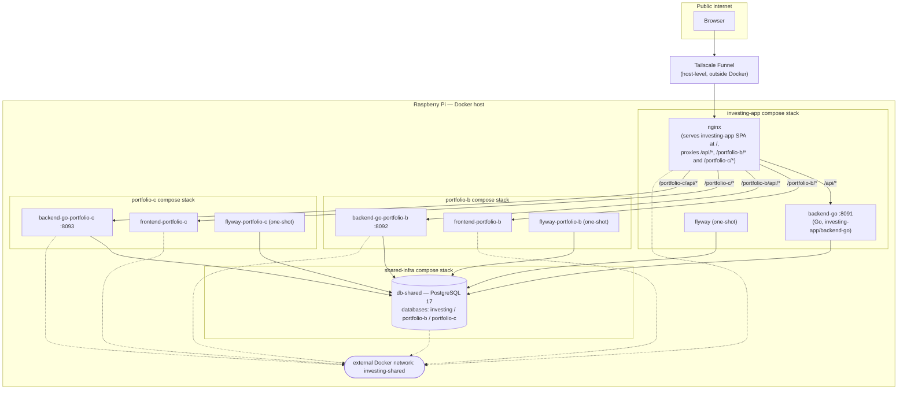
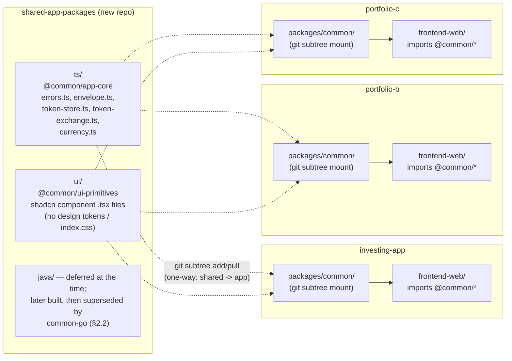
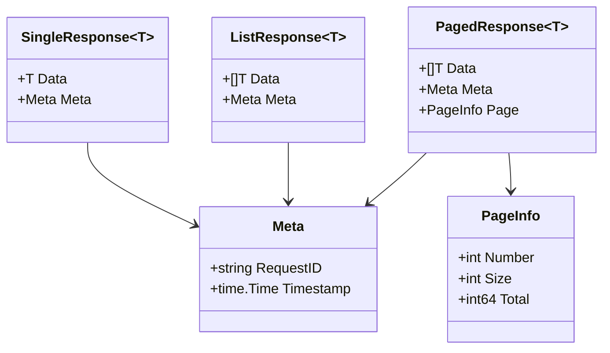
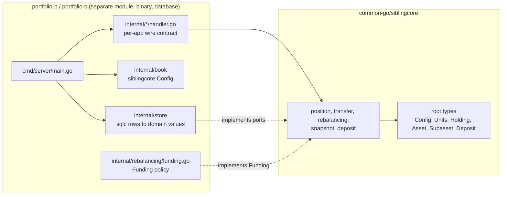
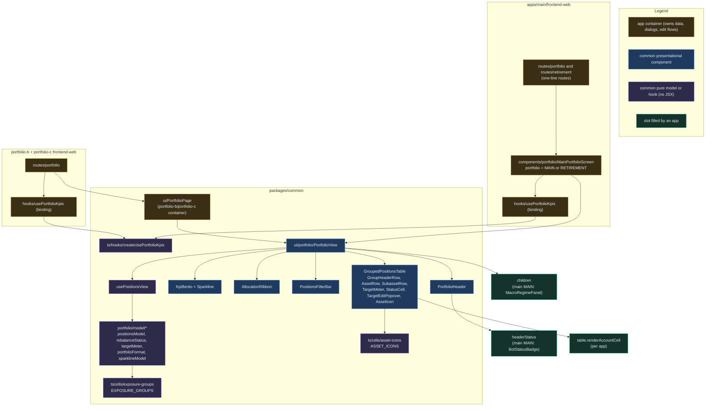
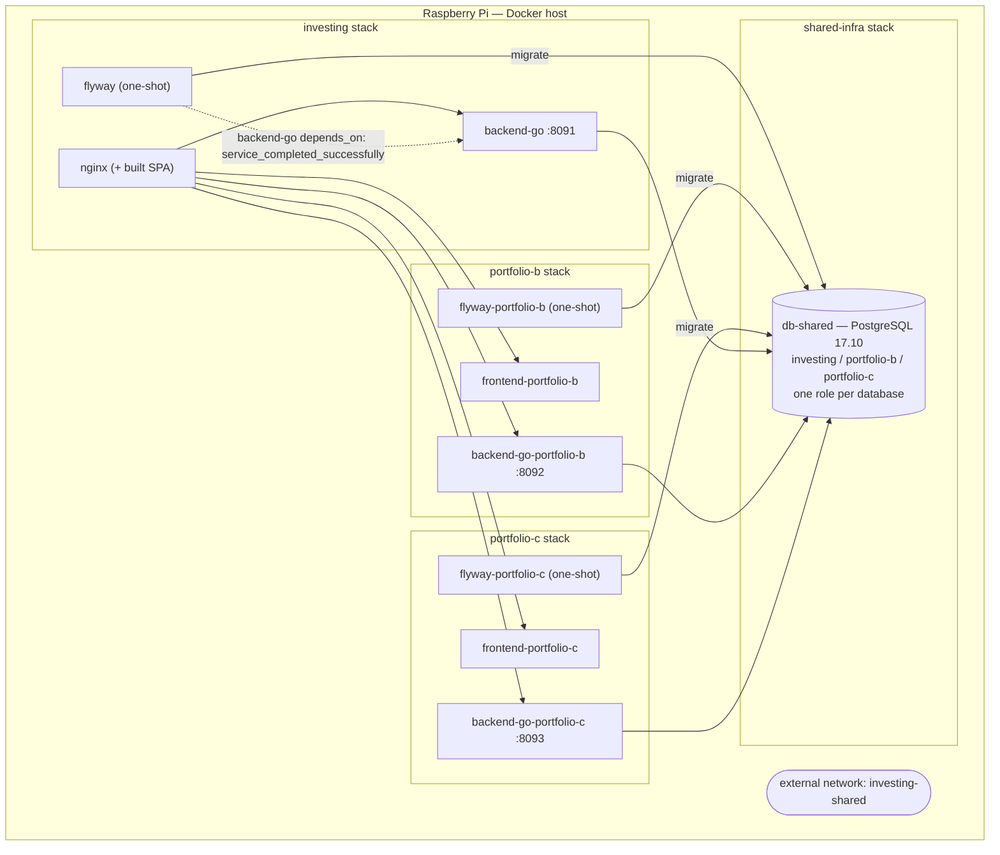

# 12 — Sibling Apps and Shared Packages

> **Audience:** All agents, especially DevOps and Frontend-web when picking up work involving the
> sibling apps. This doc covers the relationship between investing-app and its two sibling
> apps — `08-monorepo-layout.md` covers investing-app's own internal directory structure and is
> readable entirely on its own without this file. §1–2 cover code-level deduplication (done); §3
> covers the separate repo-consolidation move (ADR-077, done 2026-08-21) that folded all three
> apps into one git repository while keeping them independently deployable — §3 is the current
> reality for repo layout; §1's diagram still describes the accurate runtime/deployment topology,
> but its "three independent repos" framing predates §3 and is now historical.

> **As-built (2026-09-19):** all three apps' backends are Go (`backend-go/`,
> `apps/{portfolio-b,portfolio-c}-investing-app/backend-go/`, shared code in `packages/common/go/common-go/`).
> The Java/Spring Boot backends, the Maven parent POM and `packages/shared/java` were deleted in
> Phase 9 of the Go rewrite (ADR-098, commit `ff7878f`; restore anchor `2be75ba`). Sections below
> that narrate the Java-era extraction (ADR-076/078/082, the parent-POM Dockerfile change) are kept
> as history and marked as such; §2.2 is the current shared-backend-code reference.

> **Rename (2026-10-24, ADR-105 / task 169):** the cross-app code folder `packages/shared/` (npm
> `@shared/*`, Go module `investing-app/shared-go`) is now `packages/common/` (`@common/*`,
> `investing-app/common-go`), and this file lists the current names. This file keeps its name
> (`12-sibling-apps-and-shared-packages.md`) so existing links keep working. Where history below still
> says `packages/shared/java`, that really was the (now deleted) Java tree's path.

> **Sibling Go service core (plan of record, 2026-11-04, ADR-113 / batch 180):** the portfolio-b and
> portfolio-c backends' service layer (positions, transfers, rebalancing calculate/confirm/history,
> historia snapshots, deposits) moves into one `common-go/siblingcore`, parameterised by each app's
> portfolio set and unit-bucket set; both apps stay separate deployables. §2.2.1 is the reference.
> This reverses ADR-076 §2's "stays app-local indefinitely" for those Go services only.

> **Portfolio page (2026-10-24, ADR-106 / task 170):** all three apps render one shared
> `PortfolioView` with slate tokens, IBM Plex Sans and one icon map. §5.1 is the current
> reference. Older §5.2 entries that name the deleted tables, summary bars, icon maps or per-app
> treemap colours carry a "Superseded (task 170)" note.

---

## 1. Runtime topology — one shared Nginx, three independent Compose stacks

(Repo layout described in this section as "independent repos" is historical, pre-2026-08-21 —
see §3 for the current one-repo reality. The deployment topology below is the as-built one, including the
shared Postgres of §6.)

investing-app is one of three sibling portfolio-tracker apps deployed together on the same
Raspberry Pi, all reachable publicly through the same Tailscale Funnel endpoint, fronted by
investing-app's own Nginx container:



**As of 2026-08-21 (ADR-077, §3), all three apps live in one git repo** (investing-app hosts;
portfolio-b and portfolio-c were folded in via `git subtree add --squash` as `apps/portfolio-b/`
and `apps/portfolio-c/`) — each still has its own independent Go module (`backend-go`), npm
workspace (via root-level workspace globs), and Compose stack. CI is build-and-test only
(`.github/workflows/go-tests.yml`: `go test ./...` without `-short` for the four Go modules against
real Postgres via Testcontainers — no CD, no secrets); deploys are driven entirely by hand from each
app's own `infra/compose.yml` on the Pi (investing-app's own rebuild commands are documented in
the root `AGENTS.md`; portfolio-b's and portfolio-c's `CLAUDE.md` files, nested under their own `apps/<name>/`
directory, document the same pattern for themselves). The old standalone portfolio-b
and portfolio-c checkouts still exist on disk, renamed with an `archive-` prefix — kept
only because squashed subtree history means they're the sole remaining copy of each app's
pre-fold-in commit-level history, not because they're live in any way.

**Infra footgun — fixed.** As of 2026-08-21, all three apps' `infra/compose.yml` carry explicit
top-level `name:` fields (`investing` / `portfolio-b` / `portfolio-c`), eliminating what had been a
Compose project-name collision between investing-app and portfolio-b (both previously
defaulted to `infra`, the basename of their containing directory). This was unrelated to code
deduplication and tracked/fixed independently (`.claude/tasks/done/76-*.task.md`).

**Code duplication, measured:** all three repos were bootstrapped from the same starting point.
portfolio-b and portfolio-c in particular are close forks (portfolio-c forked from portfolio-b on 2026-07-30, package
renamed `pl.portfolio-b.*` → `pl.portfolio-c.*` (Java-era package names), domain simplified to a 2-bucket `VARIABLE`/`FIXED` model).
A large amount of plumbing — the JWT/Google-OAuth auth stack's *mechanism* (not its per-app
config), HTTP client scaffolding, the response-envelope DTO shapes, shadcn/ui component
primitives, and Axios/Zod client scaffolding — is near-identical across all three, but each
app's domain model (`Position`, bucket enums, currency handling) has diverged for good reason
and is not a dedup candidate. ADR-076 records the file-level verification behind the plan below.

---

## 2. Shared-package extraction — a small vendored shared-packages repo, apps stay separate deployables

**Status: all three phases done, as of 2026-08-24.** Phase 1 (TypeScript) went live and was
verified in production on 2026-08-21. ADR-076 recorded that decision and the full reasoning
(including the specific footguns ruled out — hardcoded per-app JWT issuer strings, per-app
HTTP-status behavior in exception handling, load-bearing per-app `baseURL` values, and the
deliberately-diverged Prism Ledger design tokens). Everything in §2.1 now exists on disk in all
three apps and has been Docker-rebuilt and smoke-tested through each app's real deployed
container (`.claude/tasks/76-*.task.md` through `78-*.task.md`, now in `.claude/tasks/done/`).

Backend-side sharing followed a different path: a Java `packages/shared/java` extraction was
built in 2026-08 (ADR-078/ADR-082) and then superseded wholesale by the Go rewrite — the current
shared backend code is `packages/common/go/common-go` (§2.2).

**This is a separate, already-settled decision from the repo-consolidation plan in §3 below —
do not conflate them.** This section is about *code* deduplication (one copy of some
TypeScript files, vendored into three still-separate repos). §3 is about *repo* consolidation
(one git repository instead of four) — a distinct, later decision (ADR-077) that changes where
`packages/common/` and the two sibling apps physically live, without touching what's described
in this section.

A fourth, dedicated repo — **`shared-app-packages`** — holds only verified-safe, zero-domain-
coupling code. It is not merged into any app's git history; each app vendors it as a single
`git subtree` mount at `packages/common/`, refreshed later via `git subtree pull`:



Sync is one-way and explicit: a change lands in `shared-app-packages` first, then each
consuming app runs `git subtree pull --prefix=packages/common <url> main --squash` on its own
schedule. No app pushes domain-specific changes back upstream into the shared repo.

**This diagram describes the state as of ADR-076/tasks 76–78 — still accurate for investing-app
today.** §3 below describes what changes once ADR-077's repo consolidation lands: portfolio-b's and
portfolio-c's own `packages/common/` subtree mounts (the `LPKG`/`MPKG` boxes above) get deleted
entirely, and both apps consume investing-app's copy of `packages/common/` directly instead —
at which point this "one-way subtree sync into three repos" picture stops applying to them
(it continues to describe how `packages/common/` *originated*, historically, but not how it's
maintained going forward).

### 2.1 What moves (Phase 1 — TypeScript only)

| Package | Contents | Excluded (stays per-app) |
|---|---|---|
| `@common/app-core` | `client/errors.ts`, `schemas/envelope.ts`, `auth/token-store.ts`, `auth/token-exchange.ts`, `utils/currency.ts`, plus round-1/round-2 additions folded in as they landed: `auth/create-auth-store.ts` (task 89), `hooks/useRefreshPrices.ts` (task 86), `utils/preload-error-recovery.ts` (ad hoc, §5) — and, round 2 task 100: `utils/query.ts` (`isAxiosNotFound`, byte-identical pure axios-error-shape check, 3-way — each app's own `lib/queryUtils.ts` is now a re-export shim), `utils/date.ts` (`CURRENT_YEAR` 3-way; `YEAR_OPTIONS` portfolio-b/portfolio-c-only — root doesn't export it, has no year dropdown), and `routes.ts` (`ROUTES` + `AppRoute` type, portfolio-b/portfolio-c-only — root's own `lib/routes.ts`, 12 routes vs. portfolio-b/portfolio-c's 5, stays fully local and untouched, same divergence pattern as root's bigger route surface elsewhere in this doc) | `client/axios-instance.ts` — `baseURL` is a load-bearing per-app path prefix (`/api` vs `/portfolio-b/api` vs `/portfolio-c/api`, driven by Nginx routing) and interceptor wiring differs per app |
| `@common/ui-primitives` | 23 primitives: 21 shadcn `components/ui/*.tsx` files — the original 17 (round 1, byte-identical or whitespace-only vs portfolio-b) plus `badge.tsx` and `card.tsx` (round 2, task 98) plus `checkbox.tsx` and `pagination.tsx` (round 2, task 99) — portfolio-b's and portfolio-c's copies were byte-identical to each other and now re-export `@common/ui-primitives/badge` / `.../card` / `.../checkbox` / `.../pagination`. `checkbox.tsx`/`pagination.tsx` are portfolio-b/portfolio-c-only — investing-app has no counterpart (it uses `radio-group.tsx`/`slider.tsx`/`switch.tsx` instead) — the mirror image of the root-only exclusions listed next. Plus `ErrorBoundary.tsx` (round 2, task 101) — not a shadcn `components/ui/` file but folded into the same package since it's a UI concern, not domain logic: byte-identical across all three apps at 39 lines with zero import/copy divergence, the cleanest extraction found across either audit round — every other entry in this row needed either a re-export-plus-local-override split (badge/card) or a portfolio-b/portfolio-c-only carve-out (checkbox/pagination); this one needed no parameterization at all. Each app's local `components/ErrorBoundary.tsx` is now a 1-line re-export shim; call sites needed no changes. Round 2 task 100: `lib/utils.ts` (`cn`, the clsx+tailwind-merge helper) — previously imported only internally by the primitive components themselves — is now also re-exported directly by each app's own top-level `lib/utils.ts` (3-way), eliminating what had been a byte-identical 6-line duplicate file in all three apps. Plus `ProtectedRoute.tsx` (round 2, task 102) — the one entry in this row that is not a pure re-export: at the time it was written, root's `lib/auth.ts` was a separate custom Zustand store not yet unified with portfolio-b/portfolio-c's shared `createAuthStore` (§5's task 89 note originally documented that root was excluded from the `createAuthStore` extraction and kept its own shape); that has since changed — commit `93fe569` (2026-08-26) migrated root onto `createAuthStore("auth")` too, so all three apps now share one auth-store implementation. The `isAuthenticated: boolean` injected-prop design (rather than the shared component calling a hook internally) survives that migration unchanged and is not undone by it — it was chosen so the shared component doesn't hardcode any one app's auth-store import, which is still true now that root's import shape matches portfolio-b/portfolio-c's. Each app's local `components/ProtectedRoute.tsx` is a thin wrapper that reads its own `useAuthStore((s) => s.isAuthenticated)` and passes the boolean down to `SharedProtectedRoute` from `@common/ui-primitives/ProtectedRoute`; as of ADR-081 it also reads and passes `hasHydrated` (§5, hydration-race bullet) — `useAuthStore((s) => s.hasHydrated)`. All three `App.tsx` call sites (`<Route element={<ProtectedRoute />}>`) are unchanged | Design tokens / `index.css` / Tailwind theme config; root's own `badge.tsx`/`card.tsx`, which stay local, non-re-exporting files — root's divergence there is narrow and quantified, not structural: `badgeVariants`' base class string adds `tabular-nums`, and `CardTitle`'s className adds `font-display`, one extra Tailwind utility token each on top of the otherwise-shared markup/variant structure. Don't read "excluded" as "very different" — it means root layers one extra class on top; `radio-group.tsx`/`slider.tsx`/`switch.tsx` (investing-app-only, no counterpart — mirror image of `checkbox.tsx`/`pagination.tsx` above) |

#### 2.1.1 History chart — 3-way shared feature component (task `history-chart-shared`, 2026-10-21)

The redesigned two-panel history chart is the first **shared chart feature component** (not a
primitive) to become 3-way shared. Design/contract:
`docs/architecture/diagrams/history-chart-shared-design.md`.

| Moved to shared | Location | Notes |
|---|---|---|
| Chart container | `packages/common/ui/src/PortfolioValueLine.tsx` | Presentation-only; props `{ data, height?, positions?, blendPoints? }`; no TanStack Query, no `apps/*` imports; replaces the old `@ts-nocheck` shim |
| Pure model, panels, band | `packages/common/ui/src/history/{historyChartModel.ts,HistoryPanels.tsx,ProfitBand.tsx}` | Moved from main; behaviour unchanged |
| Structural contract | `packages/common/ui/src/history/historyChartTypes.ts` | `HistoriaEntryLike`, `WallPositionLike`, `BlendPointLike`; no app imports |
| Palette object | `packages/common/ui/src/lib/historyChartColors.ts` | 15 `var(--history-*)` refs; package-private |
| History tokens | `packages/common/ui/src/history-chart-tokens.css` | `--history-*` light (`:root`) + dark (`.dark`), imported by `base.css` after `design-tokens.css`; `design-tokens.css` itself untouched |
| Blend colour scale | `packages/common/ts/src/utils/macro-blend-color.ts` | `blendToColor`, re-exported from `@common/app-core`; main's `lib/macroBlendColor.ts` deleted |

**Removed:** the legacy 8-key **hex** `HISTORY_CHART_COLORS` in
`packages/common/ts/src/utils/chart-colors.ts` (zero consumers after the replacement) and main's
per-app `--history-*` block in `theme-main.css`. The other investing-app oklch tokens in
`chart-colors.ts` (`FALLBACK_PALETTE`, `ASSET_PALETTE`, `EXPOSURE_BASE`, `BENCHMARK_COLORS`,
`REGIME_FILL`/`REGIME_SWATCH`, `REGRESSION_BAND_COLORS`) are unchanged and remain per-app values.

**Stays per-app (by design):** API clients + query keys + loading/error states in the thin
wrappers; main-only positions + macro-blend fetching; `HistoriaDialog.tsx` and `HistoryPage.tsx`
shells and their call sites. Portfolio B/portfolio-c wrappers already fetched positions and needed no
contract change. Sibling history charts now render the redesign palette instead of the old hex
palette — intended; per-app overrides can be added later via `theme-<app>.css`.

### 2.2 Shared backend code — `packages/common/go/common-go` (as-built, Go)

The backends are Go (ADR-094, ADR-098). The earlier Java shared-code stack — the Maven parent POM,
`packages/shared/java` (`pl.shared:investing-shared-java`, 118+ files of DTOs, enums, JPA entities,
GoF-pattern classes and Template-Method service bases, ADR-078/ADR-082) — was deleted with the Java
backends in Phase 9 (commit `ff7878f`; last commit containing it: `2be75ba`). Its role is now played by
one Go module, **`investing-app/common-go`** (`packages/common/go/common-go/`), consumed by all three
`backend-go` modules through `go.work` and a relative `replace` directive.

**Deliberately not shared (verified divergence, unchanged by the language change):** the backend-issued
JWT `iss` claim is a per-app literal (`investing-app` / `portfolio-b` / `portfolio-c`, set in each app's
`cmd/server/main.go`); the root app alone carries the path-based `smartAuth` dispatcher (host-cron
service-token routes: news ingest, bot scripts); each app's sqlc queries, generated code, OpenAPI
spec, HTTP handlers and Flyway migrations stay in its own tree; main's position/rebalancing domain
stays in main. For portfolio-b and portfolio-c the service layer above sqlc is moving into `siblingcore`
(§2.2.1, plan of record); what stays per sibling app, and why, is listed there.

**Status of the task-163 rows below (checked 2026-11-04):** the entries marked "task 163" (`decx`,
`costmember`, `httpx.DecodeJSON`/`SplitCommaList`, `config.MustConnectDB`, `pgnum.Date`,
`pgerr.NotFoundOr`) describe the task-163 design, which was paused on 2026-09-28. None of them is on
disk yet. Batch 179 builds them (`docs/architecture/diagrams/174-remediation-design.md` §2.7), with
two changes: `config.ConnectDB` replaces `MustConnectDB` (batch 176) and `decx.FromFloatPtr` is not
created. Batch 178 replaces `bisectxirr` and the Brent copies with one `xirr` package (ADR-112).

**Planned inventory changes from batches 176–179** (design:
`docs/architecture/diagrams/174-remediation-design.md` §2 and §7; fold each into the table below
when its batch lands, then delete it from this list):

| Batch | Change to the table below |
|---|---|
| 176 (ADR-110) | new rows `pgtx` (transaction runners), `lifecycle` (worker `Group`, `Guard`, `Run`, `Probe`); `httpx` + `NewServer`, `HealthHandler`; `config` + `PoolConfig`, `ConnectDB` (replaces the planned `MustConnectDB`) — all 3 apps |
| 177 (ADR-111) | `pgtx` + `SerializedRunner` / `MoneyWriteLockKey`; new row `idempotency` (Idempotency-Key middleware + pgx store) — all 3 apps |
| 178 (ADR-112) | new row `xirr` (`Solve`, `Summarize`) — all 3; row `bisectxirr` removed; `historiaquery` loses `SolveXirr` (`CashFlow` = `xirr.Flow`); `marketdatacore`, `inflationsync`, `historiascheduler` now also used by main |
| 179 | the task-163 helpers above become real (minus `MustConnectDB`, `FromFloatPtr`, `SplitCommaList`); `marketdatacore` + `Handler`, `settingscore` + `Handler` (both now all 3 apps); `positioncalc` + `SubassetRow`, `OrderSubassets`, `PrimaryOf`; `rebalancecalc` + `PricesRefreshedAt` |
| 182 | `httpx` + `RequestID`, `RequestIDFrom`, the 503 `Unavailable()` mapping |

| common-go package | Purpose | Used by |
|---|---|---|
| `httpx` | `{data, meta}` / `{data, meta, page}` / error envelope (generic `SingleResponse[T]`, `ListResponse[T]`, `PagedResponse[T]`), typed `AppError`, chi router + request logging. Task 156 added `Optional[T]` (a three-state absent / `null` / value JSON field, so `PUT /assets/{id}` can tell "leave unchanged" from "clear the target") and the `CodeConflict` (`CONFLICT`, 409) error code for asset-model conflicts. Task 163 added `DecodeJSON` (malformed body → 422 `VALIDATION_ERROR`) and `SplitCommaList` (the `?tickers=` parser) | all 3 |
| `auth` | HS256 backend JWT sign/verify, Google RS256 ID-token verification, email allowlist, `RequireAuth` middleware, service-token middleware, `Service.Exchange` behind `POST /auth/token` | all 3 |
| `config` | `os.Getenv`-based typed config (still honours `SPRING_PROFILES_ACTIVE` as the dev/prod switch) + optional `.env` loading + `MustConnectDB` (fail-fast pgxpool bootstrap from `PostgresDSN`, task 163) | all 3 |
| `pgnum` | pgtype ⇄ domain values: `pgtype.Numeric` ⇄ `shopspring/decimal` (money/units never touch `float64`) and `Date(t)` → `pgtype.Date` of t's calendar date at UTC midnight (task 163) | all 3 |
| `decx` | Decimal at the HTTP edge: `ToFloat`/`ToFloatPtr`/`FromFloatPtr` (OpenAPI float64 DTO mapping — display only, never fed back into math) + `ValidatePercentRange(field, v)` (the `@DecimalMin(0)/@DecimalMax(100)` target check); keeps `httpx` decimal-free (task 163) | all 3 |
| `pgerr` | `IsUniqueViolation(err)` — classifies a pgx error as SQLSTATE 23505 so services answer `409 DUPLICATE_ENTRY` instead of a generic 500; plus `NotFoundOr(err, notFound, op)` — `pgx.ErrNoRows` → 404 with the caller's message, anything else wrapped as `op: err` (task 163; the per-domain `notFoundOrErr` helpers delegate to it and keep their own wire messages); kept out of `httpx`, which stays free of any DB import (`02-domain-model.md` Decision 14) | all 3 (`position.Create`; main also `inflation`, `taxreturns`) |
| `priceprovider` | Yahoo Finance + Binance price/FX fetch, TTL cache, fallback | all 3 |
| `marketdatacore` | Price/FX cache service + refresh scheduler | portfolio-b, portfolio-c (root has its own richer `marketdata`) |
| `rebalancecalc` | Pure valuation + proportional-allocation + purchase-history math. Its `PositionInput` still carries the adapter fields `IsCompanionRow`/`CompanionParentTicker`, which each app's `decode.go` now derives from `!is_primary` and asset membership so non-primary subassets fold into their primary's entry — one entry per asset (task 156; the field names are a leftover of the pre-156 model, the behavior is asset-level) | portfolio-b, portfolio-c (root keeps `internal/rebalancingcalc` — regression/macro-derisk divergence) |
| `accountcash`, `settingscore` | Account-cash deduction and key/value settings cores | portfolio-b, portfolio-c |
| `historiaquery` | Paginated historia read + inflation enrichment + XIRR; its `warsaw.go` (`WarsawLocation`/`NowInWarsaw`/`WarsawDate`/`NextDailyFire`) is also the shared Europe/Warsaw clock | portfolio-b, portfolio-c (read kernel); `NowInWarsaw` all 3 (deposit/purchasesession/rebalancing "today", task 163) |
| `inflationsync` | GUS/SDP CPI client + scheduler (§13) | portfolio-b, portfolio-c (root has `internal/inflation`) |
| `testsupport` | `StartMigratedPostgres(t, ".../db/migration")` — real Postgres 17 + the pinned `flyway/flyway:12.4.0` CLI image (same tag as production) | every integration test |
| `authexchange` | `POST /auth/token` handler (`Handler` + `Exchanger` seam + `NewHandler`) — byte-identical ×3, moved verbatim (task 158 G1) | all 3 |
| `bisectxirr` | Portfolio B/portfolio-c bisection XIRR solver (`CashFlow` + `XirrResult` + `ComputeXirrResult`) — deliberately separate from `historiaquery`'s Brent solver: different numerical method, faithful-port requirement (task 158 G2) | portfolio-b, portfolio-c |
| `positioncalc` | Position computed-fields math (`UnitsTotaler` one-method seam + `ComputeFields` + `SubPositionValues`) — per-app DTO shapes stay local (task 158 G3). Also owns `CurrentAndDeviationPct` — the `currentPct`/`deviationPct`/ADR-053-sentinel formula core, extracted 2026-09-23 after the same formula had to be fixed in both this package and MAIN's own `computed.go` on the same day (`05-rebalancing-algorithm.md` §7.6) — and `GroupProfit` (task 156 / 161a-1), the asset-level profit `Σvalue / Σcost − 1` (Σcost = recorded costs > 0, Σvalue = every priced subasset incl. NULL-cost ones because the go-live import put the group's whole cost on the head row; a costed-but-unpriced subasset contributes neither side; `ok=false` when Σcost ≤ 0; order-independent, so a set-primary flip cannot change it — rule corrected 2026-09-25, see `02-domain-model.md` §2.1) | portfolio-b, portfolio-c (`ComputeFields`, `SubPositionValues`, `CurrentAndDeviationPct`, `GroupProfit`); root/MAIN (`CurrentAndDeviationPct` and `GroupProfit` — the two functions in this package MAIN calls, since MAIN's multi-portfolio total resolution and ADR-044 macro-override resolution stay in its own `computed.go`) |
| `historiascheduler` | Historia background-job launch: nightly 23:00-Warsaw loop (`SchedulerEnabled` + `RunDaily` snapshot-closure seam) + startup backfill runner (`Backfiller` + `RunBackfillOnce`) (task 158 G4+G5, folded) | portfolio-b, portfolio-c |
| `costbasis` | Pure asset-level average-cost kernel (`Row`, `ApplySale`/`ApplyBuy`/`PlanTransfer`/`PlanTrades`, `ChangedRows`) — value in, value out, no DB/clock (task 161a-1, `02-domain-model.md` §2.1) | all 3 |
| `costmember` | The kernel's in-memory write-back edge: `Holding` seam (`UnitsTotal`/`CostPln`/`SetCostPln`, implemented by each app's `*position.PositionUnits`), generic `Member[H]` (each app aliases `CostMember = costmember.Member[*PositionUnits]`), `Rows`, `Apply`, `PlanTransfer`. Kept out of `costbasis` because it mutates caller state. `PersistCosts`/`CostWriter`/price-map readers stay per app (sqlc-typed) (task 163) | all 3 |
| `siblingcore` (+ `position`, `transfer`, `rebalancing`, `snapshot`, `deposit`) | **Planned, batch 180 (ADR-113).** The sibling service core: domain types (`Config`, `Units`, `Holding`, `Asset`, `Subasset`, `Deposit`), consumer-side `Store` ports, one service per domain, the `rebalancing.Funding[S]` policy port. §2.2.1 | portfolio-b, portfolio-c |

**Pattern evaluation — what became of the Java GoF/Template-Method core (ADR-078):** Go has no
inheritance, so the abstract-service-base hierarchy collapsed rather than being ported: Template
Method → plain functions taking small interfaces or closures (`rebalancecalc`), Strategy → function
values, Factory/Facade/Proxy/Flyweight → constructors and the `priceprovider` cache, Observer/
Command/Mediator → not needed (dropped, YAGNI). Nothing was added speculatively. Until ADR-113 a
shared package existed only where portfolio-b↔portfolio-c (or all three) had byte-identical logic; ADR-113
widens that for the two siblings to code that differs only by portfolio set or unit-bucket set
(§2.2.1).

**Response envelopes** are Go generics in `httpx` (`Single(data)`, `List(items)` — nil normalised to
`[]` never `null` — and `Paged(items, PageInfo)`), all stamping `Meta{requestId, timestamp}`:



*Legend:* the three generic envelope structs are the whole pattern — constructors `Single`/`List`/
`Paged` are plain Static Factory functions; no Builder/Visitor was considered for a two- or
three-field envelope (YAGNI). The OpenAPI schema names (`PositionSingleResponse`,
`DepositsPagedResponse`, …) are hand-authored by the Architect and decoupled from these Go types;
`packages/common/ts/src/schemas/envelope.ts`'s `apiResponseSchema<T>()` is the matching Zod helper.

### 2.2.1 Sibling service core — `common-go/siblingcore` (plan of record, ADR-113, batch 180)

**Status:** designed 2026-11-04, not built. Batch 180 runs after batches 176–179 and consumes their
helpers (`pgtx`, `lifecycle`, `config.ConnectDB`, `idempotency`, `xirr`, `decx`, `pgerr`,
`costmember`). Design, exact Go signatures and diagrams:
`docs/architecture/diagrams/180-siblingcore-design.md`. Execution: `.claude/tasks/180-siblingcore.task.md`.

**Why.** portfolio-b and portfolio-c began as a fork. Measured on 2026-11-04 (comments and blank lines removed,
module path normalised), 81 % of portfolio-b's backend code is identical to portfolio-c's. Almost all of the
rest is two data-shaped differences: the **portfolio set** (portfolio-b has one book, portfolio-c has
`VARIABLE` and `FIXED`) and the **unit-bucket set** (portfolio-b keeps units in 5 account-type columns,
portfolio-c in one `units` column). portfolio-b behaves like portfolio-c with a single fixed portfolio.

**Target structure.**



*Legend:* Ports & Adapters. The core declares narrow `Store` ports over its own domain types; each
app's one adapter (`internal/store.Queries`) implements them over that app's sqlc code. Dotted
arrows point from an implementation to the package that owns the interface (Dependency Inversion).

**Per-app configuration** (`internal/book`, one `siblingcore.Config` per app):

| | portfolio-b | portfolio-c |
|---|---|---|
| Portfolios | `{WholeBook}` (the empty portfolio: the adapter ignores it and messages omit it) | `{VARIABLE, FIXED}` (bound as `portfolio_enum`) |
| Unit buckets | `IKE_TATA`, `IKE_MAMA`, `IKZE_TATA`, `IKZE_MAMA` (record purchase lots), `INNE` (no lots) | one `SingleBucket` (`units`) |

`Units` is an immutable value keyed by bucket (`Of`, `Total`, `Add`, `With`). It replaces both apps'
`PositionUnits` structs and portfolio-b's 5-way account-type switches.

**What moves to siblingcore and what stays per app:**

| Area | Goes to siblingcore | Stays per app (reason) |
|---|---|---|
| Positions / assets | the whole service (list, get, create with restore, update, re-home, set primary, delete), computed fields, Σ-target guard | handler (wire: 5 unit fields vs `units`, `portfolio`) |
| Manual sell-assist transfers | `ExecuteTransfer` incl. cost-basis planning | handler |
| Rebalancing | `Calculate` / `Confirm` / `History` skeleton, donut, confirm plan, lot rule | **`Funding` policy** (genuinely different: portfolio-b deploys `min(monthly contribution, IKE/IKZE cash)`, splits buys over accounts and deducts account cash on confirm; portfolio-c takes the deposit from the request with a FIXED default) and the handler |
| Historia | the snapshotter and the every-portfolio scheduler job | `historiaquery` read adapter, handler, `InflationBase` constant |
| Deposits | list, create, XIRR summary | handler |
| Admin backfill | the units rewind through purchase lots **and position transfers** (Europe/Warsaw day of the transfer) and the scaling tail (`siblingcore/backfill`, task 190) | the orchestration (portfolio-b: 2026-07-14 cutoff, subasset folding, CHF/GBP pricing; portfolio-c: one pass per portfolio, no folding yet). Runs at every startup and via `POST /admin/history/backfill-position-values` (ADR-097) |
| Account cash | — (kernel already shared) | table-shape adapter and handler (4 IKE/IKZE balances vs one balance per portfolio) |
| Wiring | — | `main.go`, per-app literals (port, JWT issuer, service name) |

Optional later waves: one shared sqlc query set for the four reference tables that are
column-identical in both apps (`price_cache`, `fx_rate_cache`, `settings`, `inflation`), and shared
wire structs for the endpoints whose only wire difference is the `portfolio` field.

**Rules this adds.** A change to a siblingcore package runs both siblings' full test suites (each
app's Testcontainers integration tests are the parity guard for the shared code). A portfolio-c-only or
portfolio-b-only need is met with a `Config` value or a port method; if the two apps ever diverge for
real, the package moves back into the app.

### 2.3 Docker build-context impact

- **`infra/nginx/Dockerfile`** (all apps): build context is the repo root; it `COPY`s
  `packages/common/ts`, `packages/common/ui` alongside that app's `frontend-web/` before
  `npm install`, and the root `package.json` lists them in `workspaces`. (Until task 158,
  2026-09-22, a per-app `shared-ts/` was `COPY`d here too — deleted with those dirs.)
- **`infra/backend-go/Dockerfile`** (all apps): build context is the repo root too (`..` for
  investing-app, `../../..` for portfolio-b/portfolio-c). It copies `go.mod`/`go.sum` of `packages/common/go/common-go`
  and of the app's `backend-go` first (module-download layer cache), then the sources, and builds a
  static `CGO_ENABLED=0 GOARCH=arm64` binary into `distroless/static-debian12:nonroot`. It does not use
  `go.work` — each `backend-go` carries its own `replace` to common-go, so the image builds only the two
  modules it ships.

### 2.4 Sequencing — done

1. ~~Compose project-name collision fix~~ — done (`name:` in all three compose files).
2. ~~Scaffold shared packages, prove end-to-end in investing-app~~ — done and verified.
3. ~~Propagate to portfolio-b, then portfolio-c~~ — done and verified for both.
4. ~~Shared backend code~~ — the Java route (parent POM, `packages/shared/java`, 2026-08-23/24) was
   completed and then superseded: the Go rewrite (ADR-094; Phase 9 complete 2026-09-19, ADR-098)
   replaced it with `common-go` (§2.2). Deferred task `.claude/tasks/79-*.task.md` is in `done/`.

Verification at each step was build output + Docker rebuild/logs + authenticated `curl` smoke
tests against the redeployed container — **not** screenshots (headless Chromium is broken on
this Pi).

---

## 3. Target state — repo consolidation (done, ADR-077, executed 2026-08-21)

**Status: done**, as of 2026-08-21. ADR-077 (`docs/adr/ADR-077-repo-consolidation-monorepo.md`)
records the full decision and reasoning; this section now documents the topology as current
fact — `.claude/tasks/80-*.task.md` through `84-*.task.md` all landed and were verified (see
§3.4). **This was a distinct decision from §2 above** — §2 deduplicated *code* across three
still-separate repos; this section consolidated the *repos themselves* into one, so that a
`packages/common/` edit is immediately live for all three apps with no `git subtree pull` step,
while all three apps keep building and deploying as fully independent units (three Docker
images, three Postgres databases, three `docker compose` stacks — no domain-model merging, no
change to runtime architecture or the request-routing picture in §1's diagram, which stays
accurate after this landed).

### 3.1 Why investing-app hosts, and why the layout is asymmetric, not symmetric

investing-app is the consolidation target: richest history (76+ ADRs, 12 architecture docs,
114 commits vs. portfolio-b's 6 and portfolio-c's 4), most complex app. Not contested.

What *is* a deliberate departure from a naive "every app under `apps/`" layout: **investing-app's
own application code stays at the repo root — `backend-go/`, `db/`, `frontend-web/`,
`shared-ts/`, `infra/`, `docs/`, `.claude/`, `backtest/`, `boot.sh` are untouched by this
migration.** Only its two siblings gain a new `apps/` prefix:

```mermaid
flowchart TB
    subgraph repo["investing-app (single repo, post-consolidation)"]
        direction TB

        subgraph root["repo root — unchanged, investing-app's own app"]
            IBACK["backend-go/ + db/migration/"]
            IWEB["frontend-web/"]
            ISH["shared-ts/"]
            IINFRA["infra/ (compose.yml, nginx/, backend-go/Dockerfile)"]
            IDOCS["docs/ (this doc, ADRs, OpenAPI — investing-app's own)"]
        end

        PKG["packages/common/{ts,ui}\n— ONE canonical copy, edited in place,\nno subtree pull for any of the 3 apps anymore"]

        subgraph appsdir["apps/ — NEW, only the two siblings"]
            subgraph lapp["apps/portfolio-b/"]
                LBACK["backend-go/ + db/migration/"]
                LWEB["frontend-web/"]
                LSH["shared-ts/"]
                LINFRA["infra/ (compose.yml, nginx/Dockerfile — context: ../../.. )"]
                LDOCS["docs/ — portfolio-b's own architecture.md + adr/, NOT merged with investing-app's"]
            end
            subgraph mapp["apps/portfolio-c/"]
                MBACK["backend-go/ + db/migration/"]
                MWEB["frontend-web/"]
                MSH["shared-ts/"]
                MINFRA["infra/ (compose.yml, nginx/Dockerfile — context: ../../.. )"]
                MDOCS["docs/ — portfolio-c's own architecture.md + adr/, NOT merged with investing-app's"]
            end
        end

        PKG -.->|"npm workspace,\nread directly, no sync step"| IWEB
        PKG -.-> LWEB
        PKG -.-> MWEB
    end
```



Reasons, in order of weight:

1. **Zero Docker/build-context risk for investing-app itself.** Nothing physically moves under
   the repo root, so investing-app's own backend and `infra/nginx/Dockerfile`
   need no edits at all — not even re-verification. Given investing-app is the largest and most
   actively developed of the three, this removes it entirely from the migration's blast radius.
2. **Preserves a real host-cron dependency.** The nightly ADR-041 news-research job is a
   crontab entry hardcoding `~/Claude-Code/investing-app/infra/news/news-research.sh`
   — an absolute path outside all four repos, invisible to any in-repo tooling. Moving
   investing-app's own `infra/` would require a crontab edit this migration has no way to verify
   from inside a repo. The asymmetric layout makes that edit unnecessary instead of requiring it.
3. **Delivers the actual goal regardless.** "One clone" and "atomic shared-code edits" only
   require one repo and one physical copy of `packages/common/` — not uniform nesting depth
   across all three apps.

A fully symmetric layout (investing-app's own code also moved under `apps/investing-app/`) was
considered and rejected as pure mechanical churn for an aesthetic win only — see ADR-077 §1 for
the full comparison.

**Update 2026-09-22 (supersedes the above):** the main app's code DID move to `apps/main/`
(`backend-go/`, `frontend-web/`, `db/` — module names, service names, and all internal relative
paths unchanged, so the move was mechanical and fully gated). Only the platform runtime stays
at root (`infra/` incl. edge Nginx + `shared/` DB stack, `docs/`, `backtest/`, tooling) — the
crontab constraint from point 2 above was unaffected since `infra/news/` never moved. Reason 1
(repo-root tooling) still holds: `package.json`, `go.work`, `.github/`, `boot.sh` remain root-level.

### 3.2 Docker build-context changes

The general rule this plan leans on: **a relative path between two locations that move
together as one unit needs no edit; only a path that must reach *outside* the moved subtree
does.** Concretely, across all 6 Dockerfiles (2 per app) at ADR-077 time:

- **investing-app's own 2 Dockerfiles: unchanged**, both content and the compose `context:`
  values that select them — nothing moved.
- **portfolio-b's and portfolio-c's backend Dockerfiles (2 files): unchanged content at ADR-077 time** (then
  Java; since replaced by `infra/backend-go/Dockerfile`, §2.3). Their compose paths were relative to
  the compose file's own directory; since the backend and `infra/` move together under
  `apps/<name>/`, the same relative expression still resolved correctly.
- **portfolio-b's and portfolio-c's `infra/nginx/Dockerfile` + the `frontend-*` service's `context:` (2
  files): real edits**, because the frontend build must now reach the monorepo root for the
  unified `package.json` and the canonical `packages/common/`. `context: ..` (their own former
  repo root) becomes `context: ../../..` (three levels up from `apps/<name>/infra/` to the
  monorepo root), `dockerfile: infra/nginx/Dockerfile` becomes `dockerfile:
  apps/<name>/infra/nginx/Dockerfile`, and inside the Dockerfile every `COPY` of that app's own
  `shared-ts/`/`frontend-web/` gains an `apps/<name>/` prefix. The `packages/common/...` `COPY`
  lines stay textually identical — that directory was already at the build-context root before
  (as each app's own ADR-076 subtree mount) and still is now (as the monorepo's one canonical
  copy). Full before/after text for both files is in ADR-077 §4.
- **Root `package.json`'s `workspaces` array keeps one glob entry** (`apps/*/frontend-web`),
  not explicit paths — a Docker build that only copies its own
  `apps/<name>/` subtree (or none at all, for investing-app's own build) would fail `npm
  install` against an explicit path to a sibling app's workspace that was never copied into
  that particular image. Globs resolve against whatever's actually present on disk per build.
  (Until task 158 this paragraph also covered an `apps/*/shared-ts` glob — those dirs and
  their `@*-app/shared` packages are deleted; per-app API code now ships inside each
  frontend's own `src/api/`.)

**Update 2026-08-23 (history):** the Java parent-POM extraction forced all three backend Dockerfiles to
the repo-root build context (`..` for investing-app, `../../..` for portfolio-b/portfolio-c). The Go
`infra/backend-go/Dockerfile`s keep exactly that convention (§2.3) — so both the frontend and
backend stacks build from the repo root.

### 3.3 Disposition of `shared-app-packages` and the existing subtree mounts

- `shared-app-packages` (GitHub repo): **archived, not deleted** — zero cost to keep, real
  rollback value, and it's the only one of the four repos with real hosted remote history.
  No further `git subtree pull` from it after this lands; `packages/common/` is edited in place.
- portfolio-b's and portfolio-c's own `packages/common/` subtree mounts (physically separate copies of the
  same content, from §2): **deleted in the same migration that folds each app in**, not left as
  a transitional state — the moment either app's full tree lands under `apps/<name>/` (bringing
  a duplicate `packages/common/` with it), that duplicate is removed before any Docker rebuild.
  Keeping duplicates alongside the canonical root copy would immediately reintroduce the exact
  drift risk §2 was written to solve.

### 3.4 Sequencing — all done

1. ~~Pre-flight audit~~ — **done** (`.claude/tasks/done/80-*.task.md`): re-verified crontab/
   systemd/git-remote/branch/worktree state, snapshotted DB row-count baselines (investing 56,
   portfolio-b 33, portfolio-c 6), got explicit user sign-off on target branch (`feat/backend`) and the
   downtime window.
2. ~~`git subtree add --squash` portfolio-b then portfolio-c into `apps/<name>/`~~ — **done**
   (`.claude/tasks/done/81-*.task.md`): each followed by removing that app's own duplicate
   `packages/common/` and copying its gitignored `infra/.env` to the new location.
3. ~~Root `package.json`/Docker rewrite~~ — **done** (`.claude/tasks/done/82-*.task.md`): glob
   workspace entries, regenerated the one root lockfile, rewrote both apps' `frontend-*` compose
   build context and `nginx/Dockerfile` COPY/WORKDIR paths. Backend Dockerfiles and
   `backend-*`/`db-*`/`pgadmin-*` compose blocks untouched, confirmed via diff.
4. ~~Cutover~~ — **done** (`.claude/tasks/done/83-*.task.md`): portfolio-b then portfolio-c stopped from
   their old location and rebuilt from the new one, then investing-app's own `nginx` image
   rebuilt (its lockfile changed in step 3). All three DB row counts matched the step-1 baseline
   exactly; full 6-path smoke test through investing-app's real nginx returned all 200s. One
   unplanned finding: `investing-nginx-1` needed a manual restart after portfolio-c's cutover, since
   nginx doesn't re-resolve `proxy_pass` hostnames on its own after a container is recreated
   with a new IP — portfolio-b happened to avoid this by IP-allocation luck, portfolio-c did not.
5. ~~Cleanup~~ — **done** (`.claude/tasks/done/84-*.task.md`): CLAUDE.md diffs applied (root,
   portfolio-b's, portfolio-c's) after the user's explicit sign-off on the exact diffs; `shared-app-packages`
   archived on GitHub; both old standalone checkouts renamed to `archive-portfolio-b`/
   `archive-portfolio-c` rather than deleted; fresh host-automation check found no new
   cron/systemd entries.

Full detail, exact before/after file contents, and every **HUMAN CONFIRMATION GATE** that was
honored during execution: ADR-077 and the task files themselves (moved to `.claude/tasks/done/`).

---

## 4. Module ownership additions

| Directory | Owning agent |
|---|---|
| `shared-app-packages` repo | DevOps scaffolds the repo/subtree mechanics; Frontend-web owns the actual package contents once mounted. Archived, not actively maintained, once §3 lands. |
| `packages/common/` (investing-app repo root; canonical for all 3 apps) | Frontend-web for `ts`/`ui`, Backend-Go for `go/common-go` |
| `db/migration/` (root and each `apps/*/db/migration/`) | Architect (Flyway DDL); Backend-Go regenerates sqlc |
| `go.work` + `.github/workflows/go-tests.yml` | Backend-Go (modules) + DevOps (CI) |
| `apps/portfolio-b/`, `apps/portfolio-c/` (once §3 lands) | Same per-app agent ownership as today, just nested one level deeper — see each app's own `CLAUDE.md` |

This extends, not replaces, the Module Ownership table in `08-monorepo-layout.md`.

---

## 5. Cross-app UX-consistency fixes (ongoing, tracked as individual tasks)

A 2026-08-21 review (`.claude/tasks/85-*.task.md` through `97-*.task.md`) compared the three
apps' `frontend-web/` beyond what §1–4 covers (generic primitives/utils) — page-level
components, hooks, and behavioral differences between apps that implement the same concern.
Findings became individual gated task files rather than one bulk change, since the payoff and
risk differ per finding; see the task files for full detail. Architecture-relevant outcomes are
folded in here as they land:

> **Note (2026-09-19):** entries below that name Java classes, Spring properties or `packages/shared/java`
> describe the pre-Phase-9 implementation. The behavior and the frontend/UX outcomes still hold; the
> backend code they refer to was ported to Go (`backend-go/internal/<domain>`, `common-go`) and the Java
> sources deleted (ADR-098, restore anchor `2be75ba`).

§5.1 describes the portfolio page as it is now. §5.2 is the chronological log of extractions and
fixes. Log entries that name a component task 170 deleted carry a **Superseded (task 170)** note
that points back to §5.1.

### 5.1 Portfolio page: one `PortfolioView` for all three apps (task 170, ADR-106)

The portfolio page is the same component in every app: main `/portfolio` (MAIN) and `/retirement`
(RETIREMENT), portfolio-b `/portfolio`, and portfolio-c `/portfolio` (both books). It is one presentational
`PortfolioView` in `packages/common/ui/src/portfolio/`, centred at a 1400 px maximum: a header, a
four-card KPI bento with a sparkline, an allocation ribbon, filter chips with search, and a
positions table grouped by exposure. Each app keeps only a **container** that owns the data, the
dialogs and the edit flows. App-specific behaviour enters only through slots and callbacks, never
through an app id inside common code.

Every figure comes from endpoints all three backends already had: `GET /positions`,
`GET /deposits/xirr`, `GET /history?from=` and the cache-only `GET /market-data/prices` (it never
triggers a fetch). There is no backend or contract involvement. The reasoning and the rejected
alternatives are in `docs/adr/ADR-106-portfolio-view-redesign.md`. The meter geometry, status and
formatting rules, with their test fixtures, are in `diagrams/170-portfolio-redesign.md` §5–§7.



**Legend and patterns.**

- **Container / presentational split (Template Method by composition).** `PortfolioView` is the
  single composition, so the order and spacing of header, KPIs, ribbon, filters and table cannot
  drift between apps. The containers (gold) fetch and own dialogs; the view (blue) renders. This is
  SRP: no common component holds an API client.
- **Strategy by injection.** The green slots and the `table` callbacks are the only places an
  app's own code appears inside the view. Nothing in common branches on an app.
- **Factory function.** `createUsePortfolioKpis(sources)` follows `createUseRefreshPrices`: each
  app binds its own XIRR, history and price clients and query keys in a 10-line hook.
- **Pure view model.** Grouping, filtering, meter geometry, status, sparkline and formatting are
  pure functions in `portfolio/model/` (violet), unit-tested without the DOM. Rows receive a
  prepared row model and never reach into `asset.computed` (Law of Demeter).
- **Rejected (YAGNI):** TanStack Table grouping (no sorting, visibility or resizing in the design;
  grouping is a reduce over CSS-grid `role="table"` rows), a state library for filters (one hook),
  and merging main's container into `PortfolioPage` (main's edit flows in `useAssetActions`
  differ and were not edited; a later dedupe task can merge them).

#### 5.1.1 Modules and where they live

Paths are under `packages/common/` unless the row says otherwise.

| Module | Home | Role, props and slots |
| --- | --- | --- |
| `PortfolioView` | `ui/src/portfolio/PortfolioView.tsx` | Page composition. Props: `title`, `bookTag?`, `headerStatus?`, `positions {data, isPending, isError}`, `kpis`, `refresh`, `actions`, `table`, `children?`. Loading, error and empty states go through `PageShell` below the always-rendered header and KPIs. |
| `PortfolioHeader` | `ui/src/portfolio/` | Title and book tag, "Ceny z …" (max `fetchedAt`), and the edit, history, treemap and add actions; `status` slot. |
| `KpiBento`, `Sparkline` | `ui/src/portfolio/` | Wycena całkowita with a 7/30-day sparkline, Zysk / strata, Wpłacony kapitał, XIRR. Input: `PortfolioKpis`. |
| `AllocationRibbon` | `ui/src/portfolio/` | "Udział" and "Cel" bars per exposure group, with a legend showing each group's deviation in p.p. |
| `PositionsFilterBar` | `ui/src/portfolio/` | Chips (Wszystkie, one per group, Sprzedaj) and the search box. |
| `GroupedPositionsTable` | `ui/src/portfolio/` | CSS-grid `role="table"` with sticky column and group headers, an edit-mode actions column, and a footer with the target sum ("Suma celów", internal `TargetAllocationSum`) and the meter legend. |
| `GroupHeaderRow`, `AssetRow`, `SubassetRow` | `ui/src/portfolio/` | The rows. `SubassetRow` renders the app's `renderAccountCell`. |
| `TargetMeter`, `StatusCell`, `TargetEditPopover` | `ui/src/portfolio/` | The "Udział wobec celu" meter; the "Rebalansowanie" cell (dot, label, figure; a button when `onSellClick` is given); the inline Cel % editor, which calls the injected `targetEdit.update` (`PUT /assets/{id}`) and shows the 4xx message. |
| `AccountChips`, `AssetIcon` | `ui/src/portfolio/` | Per-account unit chips (used by main's and portfolio-b's account cells); the asset icon, or a monogram when there is none or the image fails. |
| `tableLayout.ts`, `types.ts` | `ui/src/portfolio/` | Grid templates and focus and hit-area classes; the structural types (`PortfolioAssetLike`, `PortfolioSubassetLike`, `PositionsTableSlots`, `PortfolioViewProps`). |
| `usePositionsView` | `ui/src/portfolio/usePositionsView.ts` | Filter, search query (applied through `useDeferredValue`), open groups, per-filter-session overrides, expanded assets. State machine: `diagrams/170-portfolio-redesign.md` §6. |
| `portfolio/model/*` | `ui/src/portfolio/model/` | Pure: `positionsModel` (groups, rows, chips, ribbon, target sum), `rebalanceStatus` (`deviationStatus`, `computeTrimExcessPln`, `formatRebalanceFigure`, `effectiveTargetPct`, `groupMeterStatus`), `targetMeter`, `portfolioFormat`, `sparklineModel`. Exported as `@common/ui-primitives/portfolio/model/*`. |
| `createUsePortfolioKpis` | `ts/src/hooks/usePortfolioKpis.ts` | `(sources) => (scope) => PortfolioKpis`. Three queries (XIRR, history from today − 31 days, prices), all `staleTime` and `refetchInterval` 60 s. |
| `EXPOSURE_GROUPS`, `exposureGroupOf` | `ts/src/utils/exposure-groups.ts` | §5.1.2. |
| `ASSET_ICONS`, `resolveAssetIcon`, `getAssetIconUrl` | `ts/src/utils/asset-icons.ts` and `asset-icons/*.svg` | §5.1.3. |
| `AssetAllocationTreemap` | `ui/src/AllocationTreemap.tsx` | "Mapa alokacji" of all three apps: one leaf per asset, grouped and coloured by `exposureGroupOf`. Each app's `components/charts/AllocationTreemap.tsx` is a one-line re-export of it. The generic `AllocationTreemap` with an injected `colorForExposure` stays exported underneath. |
| `PortfolioPage` | `ui/src/PortfolioPage.tsx` | portfolio-b/portfolio-c container: positions query, asset and subasset delete, set-primary with undo toast, edit mode. Props include `title`, `bookTag?`, `useKpis`, `useRefreshPrices`, `updateAsset`, `renderAccountCell`, `defaultCollapsedExposures?` and the component slots `EditDialog`, `CreateDialog`, `TransferDialog`, `Treemap`, `HistoryDialog`. |
| `MainPortfolioScreen` | `apps/main/frontend-web/src/components/portfolio/` | main's container for both books (its two routes are one-liners). Edit flows through `useAssetActions`; sell through `RebalancingTransferDialog`. |
| `BotStatusBadge` | `apps/main/frontend-web/src/components/portfolio/` | Link to `/bot`. The tooltip shows the next two calendar events and the latest plan; the label summarises open OKX positions. |
| per-app glue | each app | `hooks/usePortfolioKpis.ts` (the binding) and `renderAccountCell`: main shows IKE / IKZE / REG PLN / EUR / USD via `AccountChips` (crypto folds the regular buckets into one "BINANCE" chip); portfolio-b shows IKE tata / IKE mama / IKZE tata / IKZE mama / Inne via `AccountChips`; portfolio-c shows a plain "{units} szt." span. |

What the slots carry per app:

| Slot or rule | main MAIN | main RETIREMENT | portfolio-b | portfolio-c |
| --- | --- | --- | --- | --- |
| `bookTag` | "Main" | "Emerytura" | none | `PORTFOLIO_LABELS`: "Wspólny" / "Drugi" |
| SELL clickable | edit mode only | edit mode only | always | always |
| Sell dialog | `RebalancingTransferDialog` → `POST /rebalancing-transfers` | same | `PositionTransferDialog` → `POST /position-transfers` | same |
| `headerStatus` | `BotStatusBadge` | none | none | none |
| `children` (below the table) | `MacroRegimePanel` | none | none | none |
| `defaultCollapsedExposures` | `["EXPERIMENTS"]` | none | none | none |
| Target-edit title | "Cel % (risk-on)" | "Cel %" | "Cel %" | "Cel %" |
| Effective target | macro-blended `computed.effectiveTargetAllocationPct` | equal to the raw target | raw target (field absent) | raw target (field absent) |

The effective target is `computed.effectiveTargetAllocationPct ?? targetAllocationPct` everywhere.
When some asset's base and effective targets differ by more than 0.05 (only main MAIN while the
macro gate is moving targets), the ribbon caption, "Suma celów **bazowych**" and the "cel bazowy"
legend item appear. No app flag drives this.

**Removed by task 170**, and where the behaviour lives now:

| Removed | Now |
| --- | --- |
| common `PositionsTable.tsx`, `SubassetRows.tsx`, `EntryPriceCell.tsx`, `ProfitPctCell.tsx` | `GroupedPositionsTable` and its rows. The native-currency price and entry moved into the price cell's `title`. |
| common `PositionsTableStatus.tsx` (`deviationStatus`, `DeviationStatusBadge`, `TargetAllocationSum`) | `portfolio/model/rebalanceStatus.ts` (`ON_TARGET` is now `OK`), `StatusCell`, the table footer |
| common `PortfolioSummaryBar.tsx`; main, portfolio-b and portfolio-c `components/PortfolioSummaryBar.tsx`; main `components/PrismValue.tsx` and its `.prism-number` CSS | `KpiBento` + `createUsePortfolioKpis` |
| main `components/tables/PositionsTable.tsx`, `components/portfolio/BotPortfolioWidget.tsx`; portfolio-b and portfolio-c `components/tables/PositionsTable.tsx` | `PortfolioView` via `MainPortfolioScreen` / `PortfolioPage`; `BotStatusBadge` |
| `ts/src/utils/asset-icon-resolver.ts` (`createAssetIconResolver`), `ts/src/utils/portfolio-b-portfolio-c-asset-icons.ts`, main's `STOCK_ICONS` / `ETF_ICONS` in `lib/assetIcons.ts` | `ts/src/utils/asset-icons.ts`; every app's `lib/assetIcons.ts` re-exports `getAssetIconUrl` |
| the portfolio-b/portfolio-c neon palette in `chart-colors.ts` (`ASSET_CLASS_COLORS`, `EXPOSURE_COLORS`, `PORTFOLIO_B_PORTFOLIO_C_FALLBACK_PALETTE`, `colorForAssetClass`, `colorForExposure`), portfolio-b and portfolio-c `lib/chartColors.ts`, main's `colorForExposure` | `EXPOSURE_GROUPS` (§5.1.2). `chart-colors.ts` keeps main's oklch chart tokens and `EXPOSURE_LABELS_PL` / `labelForExposure`. |
| shell-only CSS utilities with no consumer left (`psychedelic-bg*`, `sidebar-aurora-blob`, `iridescent-border`, `topbar-iridescent`, `btn-primary-glow`, `glow-*`, `gradient-text-psychedelic`, `gradient-text-violet-cyan`, `neon-border-violet`, `text-neon-magenta`) | slate tokens (§5.1.4) |

#### 5.1.2 Grouping by exposure

Rows are grouped by the asset's `exposure`. Each group has one colour everywhere: ribbon, chips,
group-header swatch and treemap. `EXPOSURE_GROUPS` in `packages/common/ts/src/utils/exposure-groups.ts`
is the single source. The colours are literal hexes in TypeScript, not CSS variables, because
nivo's treemap writes SVG presentation attributes, where `var()` does not resolve. Labels come from
`EXPOSURE_LABELS_PL`. A new exposure value is one entry in the table (OCP).

| Exposure | Label | Colour | Used in |
| --- | --- | --- | --- |
| CRYPTO | Krypto | `#9D8CF8` | all apps |
| METALS | Metale | `#D8B45C` | all apps |
| EQUITY (main), STOCKS (portfolio-b, portfolio-c) | Akcje | `#4DB6C3` | all apps |
| BONDS | Obligacje | `#8297BE` | main |
| EXPERIMENTS | Eksperymenty | `#6B7588` | main |
| COMMODITIES | Surowce | `#956725` (bronze) | portfolio-b, portfolio-c |
| CURRENCY | Waluta | `#9B46B4` (magenta) | portfolio-b, portfolio-c |
| CASH | Gotówka | `#9B46B4`, shared with CURRENCY (same concept, never in the same app) | main, unused today |
| QUANTUM | Quantum | `#956725`, shared with COMMODITIES (never in the same app) | main, unused today |
| any other value | the raw value | `#6B7588` | fallback |

- **Origin.** CRYPTO, METALS, EQUITY/STOCKS, BONDS and EXPERIMENTS are the owner's hexes.
  COMMODITIES and CURRENCY were chosen by the Architect and pass the palette validator's CVD and
  normal-vision checks against the siblings' set (CVD ΔE 10.1, normal ΔE 17.3, dark mode on
  `#0B0F17`). The owner's Akcje / Obligacje pair is below the validator's floor (normal ΔE 9.3); it
  is kept because the owner fixed those hexes. Colour never carries identity alone: every swatch
  sits next to its text label, and ribbon segments have 2 px gaps and a `title`.
- **Group order.** Σ `valuePln` descending, ties by label (`localeCompare("pl")`). Chips and ribbon
  segments use the same order. Colour follows the exposure, never the rank.
- **Row order inside a group.** `valuePln` descending, ties by name. There is no column sorting.
- **Collapse.** `defaultCollapsedExposures` sets which groups start collapsed (main MAIN:
  EXPERIMENTS). Nothing in common names an exposure. While a chip or a search is active, groups
  without a match are hidden and the others open; leaving the filter restores the browse state.
- **Group aggregates** (value, share, meter, P/L) always describe the whole group, also while
  filtering. A group's meter is never coral: SELL is a per-asset decision.

#### 5.1.3 Asset icons

`ASSET_ICONS` in `packages/common/ts/src/utils/asset-icons.ts` is one map for all three apps, keyed
by subasset ticker; the caller passes the asset's primary ticker. `resolveAssetIcon(ticker,
assetClass)` returns the map entry whatever the class, else for CRYPTO the CoinCap logo derived from
the exchange symbol, else `null`. Nothing is derived from an asset name or a guessed domain. FLIP,
LOFI and XPL use CoinGecko URLs because CoinCap 404s for them. Gold and silver bars, five flags
(CN, IN, US, PL, CH) and a quantum atom are bundled SVGs in `asset-icons/`. Vite inlines them as
data URIs, and they must be used as ``, never inlined into the DOM (several reuse
`clipPath id="c"`). Favicons (Nasdaq-100 trackers, company and ETF-issuer sites) render padded on a
white circle. `AssetIcon` renders a monogram when the resolver returns `null` or the image fails to
load. `getAssetIconUrl` is a compatibility wrapper for main's 20 px icons (`MacroRegimePanel`,
`AssetActionDialogs`), and every app's `lib/assetIcons.ts` is a one-line re-export of it.

#### 5.1.4 Tokens, font and shell

**Palette.** `packages/common/ui/src/design-tokens.css` defines a slate palette as hex constants in
`:root`, identical in every app. The `.dark` block (all three apps render `class="dark"`) maps the
shadcn tokens onto it.

| Token group | Values |
| --- | --- |
| Surfaces | `--surface-ground` #0B0F17, `--surface-card` #121926, `--surface-table` #0E141F, `--surface-group` #131A27, `--surface-group-hover` #182130, `--surface-input` #0F1520 |
| Hairlines | `--hairline` 8 % white, `--hairline-soft` 5 %, `--hairline-strong` 10 % |
| Text | `--text-1` #E7ECF3, `--text-soft` #C9D1DD, `--text-2` #A3AFC2, `--text-caption` #8592A6 |
| Gain / loss | `--gain` #10B981 (text `--gain-text` #34D399), `--loss` #F43F5E (text `--loss-text` #FB7185; also `--destructive`) |
| Status | OVER `--status-over` #E8B04B (text #EBC06A), UNDER `--status-under` #6AA8F0 (text #8CBCF5, fill 45 %), OK `--status-ok` #7D8BA1 (dots and bars only) |
| Meter | `--meter-track`, `--meter-fill`, `--meter-faint`, `--meter-marker`, `--meter-base` |

- **Accent per app.** The per-app hue survives only in the accent: `--primary` and `--ring` are
  `oklch(0.80 0.10 var(--theme-hue-accent))` and `--accent` is the same at 14 %. Each app sets
  `--theme-hue-accent` in its own `theme-<app>.css`: main 245, portfolio-b 300, portfolio-c 150. It drives the
  selected chip, the primary button, the focus ring and the sidebar's active item.
- **Tailwind.** Every token is mapped in `@theme inline` as `--color-<name>`, so components write
  `bg-surface-card`, `text-text-caption`, `text-gain-text` and so on. The only hexes in TSX are the
  exposure-group colours (§5.1.2).
- **Contrast.** Every text token is at least 4.5:1 on every surface. The worst cases are
  `--text-caption` on group-hover (5.13) and `--loss-text` on group-hover (6.01). The accent fill
  with `#0B0F17` text is about 10:1 in all three apps. Full table: `diagrams/170-portfolio-redesign.md`
  §8.3.
- **Numbers.** `body` sets `font-variant-numeric: tabular-nums` app-wide.

**Font.** IBM Plex Sans is self-hosted through `@fontsource/ibm-plex-sans` (OFL-1.1, a dependency of
`packages/common/ui`; no Google request). `packages/common/ui/src/sans-font.css` imports weights
400, 500 and 600 and sets `--font-sans`; `base.css` imports it next to `mono-font.css` (IBM Plex
Mono, `--font-mono`). The subpath is exported as `@common/ui-primitives/sans-font.css`. The
`@fontsource` files declare a `unicode-range` per subset, so the latin-ext glyphs Polish needs load
on demand.

**Shell (`packages/common/ui/src/AppLayout.tsx`, all three apps).**

- The ground is flat `--surface-ground`. The shell no longer renders `NebulaCanvas`; main's login
  page still does.
- The desktop sidebar is `bg-sidebar` and sticks full-height on large screens; the mobile sheet is
  `bg-sidebar`. The top bar is `bg-background/80` with a hairline bottom border and no glow.
- **Sticky headers.** The document is the only scroll container. The content column is
  `min-w-0 overflow-x-clip` (clip is not a scroll container) and publishes
  `--app-sticky-top: 3.5rem`, the top bar's height; `<main>` has no `overflow`. The positions
  table's column header sticks at `--app-sticky-top` and the group headers 41 px below it. Below
  about 1160 px the table scrolls sideways in its own box, and its headers then stick inside that
  box only. A visible side effect: the top bar now stays at the top on every page.

#### 5.1.5 The SELL figure and the transfer dialog

The SELL amount in the "Rebalansowanie" column and the transfer dialog's pre-filled amount come
from one function, `computeTrimExcessPln` in `portfolio/model/rebalanceStatus.ts` (trim back to
1.0× the effective target, ADR-048). `sellAmountEquality.test.ts` pins their equality. The full
rule, the thresholds and the one designed difference are in `05-rebalancing-algorithm.md` §7.5.

### 5.2 Extraction and consistency log (tasks 85–157)

- **Portfolio route error handling (task 96, done):** investing-app's `routes/portfolio/index.tsx`
  previously unmounted the entire page (header, action buttons, `PortfolioSummaryBar`) on a
  positions-fetch error, leaving a bare error message with no way to retry short of a full
  reload. Fixed to match portfolio-b's/portfolio-c's existing "partial degrade" pattern: the page shell
  stays mounted unconditionally, and only the `PositionsTable` itself is swapped for an inline
  `role="alert"` message on error. **If/when a shared `PageShell` is extracted (task 91), this
  partial-degrade behavior must be its default** — the old full-unmount shape must not resurface
  as the "simple" starting point for the shared component.
  **Superseded (task 170):** `PortfolioSummaryBar` and `PositionsTable` no longer exist. The rule
  holds in the shared `PortfolioView` (§5.1): the header and KPI cards always render, and only the
  ribbon, filters and table go through `PageShell`.
- **investing-app auth-store migration (task 85, done):** investing-app's `frontend-web/src/lib/auth.ts`
  previously reimplemented its own module-level token variable and JWT-parsing logic instead of
  using `@common/app-core`'s token-store, which portfolio-b/portfolio-c already consumed. Migrated to the
  same `setToken`/`clearToken`/`AuthUser` pattern as both siblings. This surfaced a real gap
  while migrating, not just duplication: investing-app's `axios-instance.ts` had no response
  interceptor for 401s, and `main.tsx` never called `setUnauthenticatedHandler` — so an
  expired/revoked token never bounced the user back to `/login` globally. investing-app had
  instead grown its own parallel fix, a component-scoped `UnauthenticatedWatcher` wrapping the
  protected route subtree with its own axios interceptor + explicit `navigate("/login")`, fully
  redundant with `ProtectedRoute`'s existing reactive redirect once `isAuthenticated` flips
  false. Both were removed in favor of the shared `triggerUnauthenticated()`/
  `setUnauthenticatedHandler` wiring, matching portfolio-b/portfolio-c exactly.
- **`useRefreshPrices` hook extraction (task 86, done):** verified byte-identical mutation/toast/
  status-machine logic across all three apps, differing only in which app's generated
  `refreshPrices` client function was called. Extracted as `createUseRefreshPrices(refreshPrices)`
  in `@common/app-core` (`packages/common/ts/src/hooks/useRefreshPrices.ts`), taking a minimal
  structural `PriceRefreshResult` type rather than importing any app's generated type. Each app's
  own `hooks/useRefreshPrices.ts` is now a 2-line wrapper. First hook (i.e. first React-dependent
  code) added to `@common/app-core` — `packages/common/ts/package.json` gained
  `react`/`@tanstack/react-query`/`sonner` as `peerDependencies` (not `dependencies`, to avoid a
  second React copy); all three apps already pin identical versions of those three packages, so
  this introduced no version-resolution risk. Establishes the pattern for any future shared React
  hooks: peer-depend on the framework packages, never bundle them.
- **`AllocationTreemap.tsx` extraction (task 87, done):** verified near-identical treemap-build/
  render logic across all three apps. Extracted to `packages/common/ui/src/AllocationTreemap.tsx`
  using a structural `PositionLike<E extends string>` type (not any app's generated `Position`
  type) — `E` is generic because each app's `Exposure` enum has a different literal value set
  (the Prism Ledger design tokens stay per-app, injected via a required `colorForExposure`
  callback prop rather than imported inside the shared component). `formatPln` is imported
  directly from `@common/app-core` (already shared since ADR-076) rather than injected. Each
  app's own `components/charts/AllocationTreemap.tsx` is now a thin wrapper supplying its own
  `colorForExposure` from its local `lib/chartColors.ts` — **route-file call sites needed zero
  changes**, since the per-app wrapper keeps the original public API (`positions`, `height`) and
  injects the color function internally. `packages/common/ui/package.json` gained
  `@nivo/treemap` as a `peerDependency` (all three apps already pinned the identical `^0.99.0`)
  and `@common/app-core` as a regular `dependency`.
  **Superseded (task 170):** the treemap now looks the same in all three apps.
  `AssetAllocationTreemap` in the same file maps assets to leaves and colours them with
  `exposureGroupOf` (§5.1.2); each app's `components/charts/AllocationTreemap.tsx` is a one-line
  re-export of it, and no app supplies its own `colorForExposure` any more.
- **`DepositsTable.tsx` extraction (task 88, done — portfolio-b/portfolio-c only, 2-way not 3-way):** the
  investing-app-vs-portfolio-b diff work item 1 called for turned out to be a real column-shape
  difference, not an additive column as first guessed: investing-app's table renders
  `depositDate`/`accountType`/`exchange`/`amount` (no `comment` column, even though its `Deposit`
  schema has a `comment` field it simply doesn't display), while portfolio-b/portfolio-c render
  `depositDate`/`amount`/`comment` — investing-app has no `accountType`/`exchange` concept on
  deposits at all. **Scoped down to portfolio-b/portfolio-c only**, matching the precedent set by
  `LoginPage.tsx` in task 89. portfolio-b's and portfolio-c's versions turned out to be **byte-identical**
  (not even the speculated portfolio-c `portfolio` column — portfolio-c doesn't render one), so both are now
  a 1-line re-export shim: `export * from "@common/ui-primitives/DepositsTable";`. Extracted using
  a structural `DepositLike` type. `packages/common/ui/package.json` gained
  `@tanstack/react-table` and `date-fns` as `peerDependencies` (identical pinned versions in all
  three apps). investing-app's own `DepositsTable.tsx` is untouched and not part of this
  extraction.
- **`createAuthStore` + `LoginPage` extraction (task 89, done — portfolio-b/portfolio-c only, 2-way):**
  after task 85, portfolio-b's and portfolio-c's `lib/auth.ts` already delegated token storage to
  `@common/app-core`'s token-store; the two files differed only in one storage-key literal
  (`"portfolio-b-auth"` vs `"portfolio-c-auth"`) and duplicated the same Zustand-store/JWT-parsing
  scaffolding. Extracted as `createAuthStore(storageKey)` in
  `packages/common/ts/src/auth/create-auth-store.ts` (also now the canonical home of the
  `AuthUser` type — both apps' own `shared-ts/src/auth/types.ts` are now 1-line re-export shims,
  matching the existing `token-store.ts` shim pattern in the same directory). Both apps'
  `lib/auth.ts` are now 2-line calls: `export const useAuthStore = createAuthStore("portfolio-b-auth")`
  (portfolio-c: `"portfolio-c-auth"`). `pages/LoginPage.tsx` (identical except one title string) is now
  `packages/common/ui/src/LoginPage.tsx`, taking `title`, `login`, and `exchangeGoogleToken` as
  props rather than importing any app's own `lib/auth.ts`/`lib/authApi.ts` — keeps the shared
  component free of per-app import coupling. **investing-app excluded from `LoginPage.tsx`**
  — its version is a real Prism Ledger visual redesign (60/66 lines differ), not a cosmetic
  rename, and stays local. `packages/common/ts/package.json` gained `zustand` and
  `packages/common/ui/package.json` gained `@react-oauth/google`/`react-router` as
  `peerDependencies` (portfolio-b/portfolio-c pin identical versions of all three).
  **`createAuthStore` itself is no longer portfolio-b/portfolio-c-only:** as of commit `93fe569`
  (2026-08-26, "unify web and mobile on shared UI primitives"), investing-app's own
  `frontend-web/src/lib/auth.ts` was migrated onto `createAuthStore("auth")` too — it is now
  `export const useAuthStore = createAuthStore("auth");` plus a re-export of
  `extractUserFromBackendJwt`, replacing the standalone Zustand store task 89 originally left
  in place. All three apps now share one `createAuthStore` implementation and, with it, one
  hydration-timing bug and one fix — see the `ProtectedRoute` correction and the new bullet
  below (ADR-081).
- **`PageShell` extraction (task 91, done — partial, scoped to 3 of the 5 candidate routes):**
  the task's own Context claim ("every route under `routes/{history,deposits,portfolio,purchases,
  settings}`") did not survive a per-file check, as the task itself anticipated — `purchases` and
  `settings` compose independent sub-sections with their own loading state, not a single
  page-level `isPending`/`isError` query trio, in any of the three apps; excluded entirely.
  `packages/common/ui/src/PageShell.tsx` wraps **only** the `isPending`/`isError`/`children`
  trio — deliberately not the route's title/header, since header layout genuinely varies
  (plain `<h1>`, flex header with action buttons, header + summary bar) in a way that would force
  an ill-fitting shape. Migrated: **`history`** (3-way, all three apps — investing-app's
  `PageHeader` component sits outside `PageShell` unaffected), **`deposits`** (3-way — portfolio-b/
  portfolio-c's top-level route trio, and investing-app's `PortfolioDepositsSection` sub-component,
  called twice for MAIN/RETIREMENT; its custom 4-row skeleton is passed via `loadingSkeleton` to
  preserve the exact prior row count), **`portfolio`** (2-way, portfolio-b/portfolio-c only — investing-app's
  portfolio route has its own distinct early-`isPending`-return shape from task 96 and was left
  untouched). **Side effect:** investing-app's `PortfolioDepositsSection` skeleton previously had
  no `aria-label` (task 95's finding) — `PageShell` always sets one from the required
  `loadingLabel` prop, so this migration fixed that gap as a natural consequence; task 95's
  remaining scope narrows to the unrelated `mexc-bot` occurrence of the same bug shape.
- **Stale-deploy chunk-loading fix (2026-08-21, all three apps, ad hoc — not part of batch
  85–97):** user reported "Failed to fetch dynamically imported module" on investing-app after
  refreshing. Root cause: none of the three apps' `infra/nginx/nginx.conf` set any
  `Cache-Control` header, so a browser tab open across a redeploy could hold a stale `index.html`
  (via browser heuristic caching) referencing Vite's content-hashed route-chunk filenames from
  the *previous* build — filenames a new deploy's `dist/assets/` no longer contains at all (each
  build fully replaces the directory). Directly caused by this session's own high redeploy
  frequency. Fixed in all three `infra/nginx/nginx.conf`: `location /` (serves `index.html` and
  the SPA fallback) now sends `Cache-Control: no-cache` so every navigation always revalidates;
  a new `location /assets/` sends `Cache-Control: public, max-age=31536000, immutable` — safe
  since Vite's filenames are content hashes, never reused across builds. Also added
  `setupPreloadErrorRecovery()` to `packages/common/ts/src/utils/preload-error-recovery.ts`
  (exported from `@common/app-core`, called once from each app's `main.tsx`): listens for Vite's
  `vite:preloadError` event and auto-reloads the tab once per session, so a user who still hits
  this mid-session (deploy landed between page-load and a lazy-route navigation) recovers without
  needing to know to refresh manually. Verified via `curl -D -` against `/`, `/portfolio-b/`,
  `/portfolio-c/`, and one hashed asset in each — correct headers confirmed on all six.
- **`PortfolioValueLine.tsx` extraction (task 103, done — portfolio-b/portfolio-c only, 2-way):** portfolio-b's
  and portfolio-c's `components/charts/PortfolioValueLine.tsx` were byte-identical except for two
  import-path lines (`@portfolio-b/shared` vs `@portfolio-c/shared`), both exactly 156 lines.
  Extracted verbatim to `packages/common/ui/src/PortfolioValueLine.tsx` using a structural
  `HistoriaEntryLike` prop type (`snapshotDate`/`totalDeposits`/`portfolioValue`/`xirr`/
  `returnPct`/`profitPln`) rather than importing either app's generated `HistoriaEntry` Zod
  type — the same structural-typing pattern `AllocationTreemap`'s `PositionLike` established in
  task 87. `formatPln` is imported directly from `@common/app-core`, also matching
  `AllocationTreemap`. Both apps' local `components/charts/PortfolioValueLine.tsx` are now 1-line
  re-export shims: `export * from "@common/ui-primitives/PortfolioValueLine"`; call sites
  (`routes/history/index.tsx`, `components/charts/HistoriaDialog.tsx`) needed no changes.
  `packages/common/ui/package.json` gained `recharts: ^2.14.0` as a new `peerDependency` — the
  first shared/ui component built on Recharts rather than Nivo (`AllocationTreemap` uses
  `@nivo/treemap`); the two chart libraries now coexist as separate peer deps in the same
  package. **investing-app excluded, per the task's original scoping** — its own
  `PortfolioValueLine.tsx` is 503 lines, a genuinely richer chart (crypto-trading/regression-band/
  macro overlays reflecting investing-app's broader domain elsewhere in the app), not a cosmetic
  variant — the same exclusion framing as `LoginPage.tsx` (task 89) and `DepositsTable.tsx`
  (task 88): real feature divergence, not styling noise. investing-app's own
  `PortfolioValueLine.tsx` is untouched and not part of this extraction. This is the second
  chart-type component extracted into `@common/ui-primitives` (after `AllocationTreemap`, task
  87); like the other non-primitive entries in this bullet list (`AllocationTreemap`,
  `DepositsTable`, `LoginPage`, `PageShell`), it is **not** folded into the "23 primitives" count
  in the §2.1 table row above — that count tracks only the shadcn-style/utility set (`components/
  ui/*.tsx`, `ErrorBoundary`, `ProtectedRoute`, `lib/utils.ts`), not the larger feature components
  documented as their own bullets here.
- **`HistoriaDialog.tsx` extraction (task 104, done — 3-way, all three apps):** unlike task 103's
  `PortfolioValueLine` split (portfolio-b/portfolio-c only, investing-app excluded for owning a richer
  chart), the *dialog chrome* here is identical across all three apps — same `Dialog`/
  `DialogContent`/`DialogHeader` structure, sizing, and loading/error/empty-state copy — so the
  shell extracts 3-way even though the chart it wraps doesn't. Extracted to
  `packages/common/ui/src/HistoriaDialog.tsx` as `HistoriaDialog<T extends HistoriaEntryLike =
  HistoriaEntryLike>`, injecting **two** collaborators rather than one:
  `useHistoriaQuery: (open: boolean) => { data: T[] | undefined; isPending: boolean; isError:
  boolean }` — a real hook, called by the shell itself as `useHistoriaQuery(open)` rather than
  passed a pre-fetched result object, so each app's own `useQuery`'s `enabled: open` re-fetch
  behavior survives the extraction — and `renderChart: (entries: T[]) => ReactNode`, so the shell
  never hardcodes an import of any specific `PortfolioValueLine`. The `renderChart` injection is
  load-bearing, not just tidy: investing-app's own local `PortfolioValueLine` (503 lines, excluded
  from task 103) consumes investing-app's generated `HistoriaEntry` type, which carries a required
  `portfolio: "MAIN" | "RETIREMENT"` field the lean `HistoriaEntryLike` doesn't have — a
  non-generic shell typed to `HistoriaEntryLike` failed `tsc` for investing-app. Making the shell
  generic over `T` (investing-app instantiates it with its own `HistoriaEntry`; portfolio-b/portfolio-c
  default to `HistoriaEntryLike`) resolved this without loosening the type for anyone.
  `titleSuffix?: string` covers investing-app's `" — {portfolio}"` title treatment; portfolio-b/portfolio-c
  omit it. Each app's own `components/charts/HistoriaDialog.tsx` is now a thin wrapper with its
  **original public `Props` type unchanged** (portfolio-b/portfolio-c: `{ open, onOpenChange }`;
  investing-app: `{ portfolio, open, onOpenChange }`) — zero call-site changes in
  `routes/history/index.tsx`, `routes/portfolio/index.tsx`, or `routes/retirement/index.tsx`.
  portfolio-b's and portfolio-c's `useHistoriaQuery` are module-scope hooks (portfolio-c's calls `usePortfolio()`
  internally); investing-app's is a closure nested inside its wrapper component, since it must
  close over the `portfolio` prop. No new `packages/common/ui` dependencies — reuses the
  already-shared `Dialog`/`Skeleton` primitives and the `HistoriaEntryLike` type from
  `PortfolioValueLine.tsx` (task 103). **New precedent**, beyond `AllocationTreemap`'s single
  `colorForExposure` injection (task 87): a shared shell can inject *two* collaborators at once —
  a query hook and a render function — plus a generic type parameter to bridge a lean shared type
  and a richer app-specific one. The resulting shape, "shared UI shell + app-owned data fetching +
  app-owned chart rendering," is worth reaching for again on any future dialog or panel that wraps
  a query and a visualization together, rather than trying to force the visualization itself into
  the shared shell.
- **`PurchaseHistoryCard.tsx` extraction (task 105, done — portfolio-b/portfolio-c only, 2-way):** same shape
  as task 103's `PortfolioValueLine` split. portfolio-b's and portfolio-c's `components/
  PurchaseHistoryCard.tsx` were byte-identical except for two import-path lines (`@portfolio-b/
  shared` vs `@portfolio-c/shared`), both exactly 87 lines. Extracted verbatim to `packages/common/
  ui/src/PurchaseHistoryCard.tsx` using structural `PurchaseLotLike`/`PurchaseSessionLike` prop
  types rather than importing either app's generated Zod types — the same structural-typing
  pattern as `AllocationTreemap`'s `PositionLike` (task 87) and `PortfolioValueLine`'s
  `HistoriaEntryLike` (task 103). `formatPln` comes from `@common/app-core`; `Card`/etc. from the
  already-shared `card.tsx` primitive (task 98) — no new dependencies. Both apps' local
  `components/PurchaseHistoryCard.tsx` are now 1-line re-export shims; their one call site,
  `PurchaseHistoryList.tsx`, needed no changes — its build passing with zero TS errors confirms
  the narrower structural types accept the full generated `PurchaseLot`/`PurchaseSession` objects
  it passes in, with no casts required. **investing-app excluded, no counterpart exists**: its
  purchase/trade concept lives under a differently-named, differently-structured
  `routes/trade-history/`, not a file-name match to diff against.
  **`PurchaseHistoryList.tsx` reviewed and declined**, same reasoning as round-1 task 94
  (`.claude/tasks/done/94-purchase-history-portfolio-dimension-not-safe-to-unify.task.md`): portfolio-c's
  wrapper reads `usePortfolio()` and passes the result into `usePurchaseHistory(portfolio)` while
  portfolio-b's calls `usePurchaseHistory()` with no arg — the same portfolio-dimension hook coupling
  task 94 already found load-bearing, not stylistic. `PurchaseHistoryList.tsx` is just a 2-line
  consumer of that already-declined hook, so no action was taken on it.
- **`AppLayout.tsx` extraction (task 106, done — portfolio-b/portfolio-c only, 2-way):** the largest single
  file extracted into `@common/ui-primitives` so far, at 259 lines. portfolio-b's (217 lines) and
  portfolio-c's (219 lines) local `AppLayout.tsx` differed by only ~10 lines total — one import path,
  portfolio-c's extra `<PortfolioSwitcher />` top-bar child, one `className` tweak to make room for it,
  and the brand-name string appearing twice (desktop `<aside>` title, mobile `Sheet` header).
  Everything else — the `NebulaCanvas` background, the sidebar shell (`aurora-blob`, `h-14` title
  bar), `SidebarNav`/`NAV_ITEMS`/`NavLinkItem`, the `Sheet`-based mobile nav, `TopBar` wiring, and
  `PageFallback` — was identical. The real duplication was never a logo/icon asset: neither app
  renders any brand mark today, both are plain `gradient-text-tri` text — the ~200 lines actually
  worth sharing were the sidebar/nav/mobile-sheet chrome itself, maintained as two full separate
  copies just to swap one text string (and, for portfolio-c, add one top-bar child). Extracted to
  `packages/common/ui/src/AppLayout.tsx` with `brand: { label: string; mark?: ReactNode }` (`mark`
  renders before `label` in both the desktop title bar and the mobile `Sheet` title; `undefined`
  for both apps today) and `topBarExtra?: ReactNode` (portfolio-c's `<PortfolioSwitcher />` slot; when
  present, `cn("text-sm text-muted-foreground capitalize", topBarExtra && "hidden md:inline")`
  also shrinks the `currentDate` span to make room). `NAV_ITEMS`/`SidebarNav` needed no injection
  at all — the nav item list turned out to be byte-identical between the two apps and already
  consumes the shared `ROUTES` from `@common/app-core` (task 100). Two collaborators are injected
  as real hooks, called by the shell during render rather than passed pre-fetched result objects —
  the same pattern `HistoriaDialog` established for `useHistoriaQuery` (task 104):
  `useFxRates: () => { data: FxRateLike[] | undefined }` (`FxRateLike = { fromCurrency: string;
  rateToPln: number }`, injected because `getFxRates` is bound to a different backend client
  instance per app) and `useRefreshPrices: () => { refresh: () => void; isRefreshing: boolean;
  status: "idle" | "ok" | "warn" | "err" }` — the latter was already a per-app-bound factory since
  round-1 task 86 (`createUseRefreshPrices`), so injecting it here is plumbing an already-shared
  thing through the new shell, not a new sharing decision. Both apps' local `components/
  AppLayout.tsx` are now thin ~26–28-line wrappers passing their own `brand.label`, the two hooks,
  and (portfolio-c only) `topBarExtra`. **investing-app excluded, per the task's original scoping** —
  its own `AppLayout.tsx` (262 lines) diverges by real Prism Ledger structure, not cosmetic noise:
  a decorative `brand-mark` span before the brand text, `font-display` on the text itself, and a
  `gap-2.5` title-bar row to make room for the mark — the same exclusion framing as `LoginPage.tsx`
  (task 89) and `PortfolioValueLine.tsx` (task 103). investing-app's own `AppLayout.tsx` is left
  completely untouched. Worth flagging as a *possible* future 3-way follow-up, not committed to
  here: the shared `brand` prop's `{ label, mark? }` shape was deliberately designed to be
  forward-compatible with investing-app's brand-mark + `font-display` pairing, so a later
  migration wouldn't need to reshape the prop — but per the task's explicit scope discipline, that
  migration is not this task's job. Both apps' builds pass with zero TS errors; behavior was
  confirmed via dist-bundle grep (portfolio-c's bundle contains the `PortfolioSwitcher`'s aria-label
  string, portfolio-b's doesn't) rather than a screenshot (headless Chromium is broken on this Pi).
- **AppLayout 3-way follow-up (task 153, done 2026-09-19 — investing-app joins the shared shell):**
  the "possible future follow-up" above, forced early by a real PWA bug: the shared shell's mobile
  `SheetContent` combined `fixed` (from `sheetVariants`) with `psychedelic-bg-animated` (sets
  `position: relative`) — same `@layer utilities`, same specificity, so the later rule won and the
  drawer rendered as a relative block below the phone viewport (only symptom: hamburger "does
  nothing" in the installed Portfolio B/Portfolio C apps; desktop unaffected — sidebar doesn't use `Sheet`).
  investing-app never had the bug because its local copy used an inline background instead of the
  class. Shared `AppLayout.tsx` grew `NavSection { title?, items }` / `NavItem { label, to, icon,
  end? }` types plus an optional `navSections?` prop (default: the flat 5-item portfolio-b/portfolio-c list —
  their wrappers untouched), section titles render with the `eyebrow` class only when a section
  holds >1 item, and the brand bars now match investing-app exactly (`gap-2.5`, `font-display`,
  `flex-row` sheet header). The sheet fix is Main's proven pattern: no `psychedelic-bg-animated`,
  `overflow-hidden` + inline `oklch(0.09 0.04 272 / 95%)` background (consistent with the already
  hardcoded 272 desktop sidebar in all three apps). investing-app's `AppLayout.tsx` is now a ~70-line
  wrapper (its 7 nav sections, brand-mark orb via the existing `mark` slot, `useFxRates`/
  `useRefreshPrices` injection) and its `NebulaCanvas.tsx` re-exports the shared one — which also
  removed a dead 6th blob div (`nebula-blob-6` has no CSS rule in any bundle). `PageHeader` stays
  deliberately unshared (Prism redesign vs plain). Verified with headless Chromium + minted JWTs at
  a 412×915 viewport: `#mobile-nav` opens at `y=0` full-height in all three apps, zero JS errors.
  Side fix in the same task: sibling frontend nginx confs used a literal `proxy_pass
  http://backend-portfolio-b/portfolio-c:8080` (retired Java backends) — any container recreate since the Java
  retirement would boot-loop on `[emerg] host not found in upstream`. Now resolver + variable like
  the main nginx (the `/api/` block there is vestigial anyway — main Nginx routes sibling API
  traffic itself).
  **Superseded in part (task 170):** the shell no longer renders `NebulaCanvas` or the aurora blob;
  the sidebar and the mobile sheet use `bg-sidebar` instead of the inline `oklch(0.09 0.04 272 / …)`
  background; the content column is `overflow-x-clip` rather than `overflow-hidden`, so the top bar
  and the portfolio table's headers actually stick (§5.1.4).
- **`CreatePositionDialog.tsx` extraction (task 107, done — portfolio-b/portfolio-c only, 2-way):** portfolio-b
  (342 lines) and portfolio-c (347 lines) differed by ~10 lines, all of it portfolio-c's portfolio dimension:
  one extra `usePortfolio()` read, one extra `PORTFOLIO_LABELS` import, `portfolio` added to the
  submitted body, and a dialog-title suffix. Extracted to `packages/common/ui/src/
  CreatePositionDialog.tsx` from portfolio-b's source as the base, adding two optional props:
  `portfolio?: string` and `titleSuffix?: string`. The component locally redeclares the
  `exchangeSchema`/`assetClassSchema`/`exposureSchema`/`currencySchema` enum literals rather than
  importing either app's per-app generated `shared-ts` package — those enums are identical in both
  apps' generated schemas today, but the packages themselves are separate generated artifacts, so
  importing one would wire the shared component to one app's codegen output. It takes an injected
  `createPosition: (body: CreatePositionRequestLike) => Promise<unknown>` prop, the same
  per-app-bound-mutation injection shape as `useRefreshPrices` (task 86) and `useHistoriaQuery`
  (task 104), with `CreatePositionRequestLike` a structural type covering every field the form
  submits and `portfolio` optional — the same structural-typing pattern as `AllocationTreemap`'s
  `PositionLike` (task 87), `PortfolioValueLine`'s `HistoriaEntryLike` (task 103), and
  `PurchaseHistoryCard`'s `PurchaseLotLike`/`PurchaseSessionLike` (task 105). portfolio-b's wrapper
  passes its real `createPosition` straight through — it type-checks because `CreatePositionRequestLike`
  is structurally assignable to portfolio-b's narrower request type, which has no `portfolio` field at
  all. portfolio-c's wrapper could **not** do a direct pass-through: portfolio-c's real `createPosition`
  requires `portfolio: Portfolio` as a non-optional, narrowly-typed field, and the shared type's
  optional `string` isn't assignable to that narrower type. portfolio-c's wrapper instead adapts:
  ```ts
  function handleCreatePosition(body: CreatePositionRequestLike) {
    return createPosition({ ...body, portfolio } satisfies CreatePositionRequest);
  }
  ```
  This pass-through/adapter split is a reusable pattern for future injected-mutation extractions:
  when one app's real type has only *extra optional* fields versus the shared structural type, a
  direct pass-through works (portfolio-b's case here, and the general case so far); when one app's real
  type is *narrower/stricter* than the shared type (a field the shared type leaves optional is
  required and precisely typed on the real side, as with portfolio-c's `portfolio: Portfolio`), the
  wrapper needs an adapter function, not just a prop pass-through — TypeScript will not silently
  paper over that direction of mismatch. The `portfolio: undefined` omission-from-JSON-body
  behavior (portfolio-b's case, since it never passes `portfolio` at all) was verified against both
  apps' actual `axios-instance.ts` configs — neither sets a custom `transformRequest` — confirming
  the key is correctly omitted from the request body exactly as it was before extraction, rather
  than assumed. **investing-app excluded, untouched**: its own `CreatePositionDialog.tsx` (370
  lines, a 134-line diff vs. portfolio-b's) is a genuinely deeper asset-roster/field-set divergence
  given investing-app's broader domain (crypto exposure, more asset classes) — the same exclusion
  framing as `LoginPage.tsx` (task 89), `PortfolioValueLine.tsx` (task 103), and `AppLayout.tsx`
  (task 106). **Contrast with task 112** (`EditPositionDialog.tsx`/`PositionTransferDialog.tsx`,
  declined, same portfolio-b/portfolio-c position-editing file family): that pair's portfolio-b/portfolio-c divergence is
  *structural* — portfolio-b carries 5 separate IKE/IKZE unit fields and a whole account-type-picker
  helper stack that portfolio-c's simplified single-`units` model has no equivalent for — whereas this
  file's divergence was *purely additive*, one extra optional value threaded through an otherwise
  identical form. That's the dividing line between the two verdicts in the same file family: additive
  divergence unifies behind an optional prop, structural divergence (a reshaped field set, not just
  an added one) does not. Both apps' builds pass with zero TS errors; both local
  `components/CreatePositionDialog.tsx` files are now thin wrappers, and their call sites
  (`routes/portfolio/index.tsx` in both apps) needed no changes.
- **`assetIcons.ts` icon-resolver extraction (task 108, done — 3-way, all three apps, mechanism
  only, zero shared data):** genuinely different shape from the 2-way-only full-component
  extractions above (`PortfolioValueLine`, `PurchaseHistoryCard`, `AppLayout`,
  `CreatePositionDialog`) — all three apps participate here, but no actual ticker→icon-URL data
  moves anywhere. Extracted `gfav(domain: string)` (Google's favicon-service URL builder) and a
  generic `createAssetIconResolver({ stockIcons, etfIcons, metalsIcons?, cryptoOverrides,
  cryptoSuffixPattern? })` factory to `packages/common/ts/src/utils/asset-icon-resolver.ts`, plus
  a shared `DEFAULT_CRYPTO_ICON_OVERRIDES` constant (the single `XPL-USD` entry, verified
  byte-identical across all three original files). Each app's own `lib/assetIcons.ts` is now just
  a call to the factory with its own locally-kept `STOCK_ICONS`/`ETF_ICONS`/`METALS_ICONS` maps —
  no per-ticker mapping left its app. `METALS` is resolved only when `metalsIcons` is supplied
  (portfolio-b/portfolio-c pass one; root has no separate METALS lookup and omits the param). This
  mirrors a "shape shared, data stays local" pattern round-1 task 92 had *sketched*, not
  built, for `chartColors.ts`'s resolver — a proposed `createColorResolver<T>(map,
  fallbackPalette)` factory, with per-app color values and enum key sets meant to stay
  excluded, same idea as here. **Correction:** task 92 was filed as a "low value, likely
  decline" finding behind a human-confirmation gate and was **never actually
  implemented** — no `packages/common/ts/src/utils/color-resolver.ts` or
  `createColorResolver` function exists anywhere in the repo, despite this bullet (until
  this correction) describing that shape as if it were a live, shared thing. Task 109
  below performs the real, value-level `chartColors.ts` merge for portfolio-b/portfolio-c, written
  fresh rather than built on top of any task-92 module. **Crypto-suffix-regex
  normalization (deliberate, piggybacked on the refactor, not an accidental behavior change):**
  portfolio-b's/portfolio-c's original crypto-suffix-strip regex was `-USD$` only; root's was the broader
  `-USDT?$`. Rather than preserving that divergence via a per-app override, the factory's default
  `cryptoSuffixPattern` was set to the broader `-USDT?$` and portfolio-b/portfolio-c were widened onto it.
  Verified behavior-preserving for both today: `-USDT?$` is a strict superset of `-USD$` (every
  ticker the old regex matched still matches identically), and a repo-wide grep confirmed
  portfolio-b/portfolio-c hold zero `-USDT`-suffixed tickers today — that suffix only exists in root's own DB
  migrations (`SUI-USDT`, `TAO-USDT`, `LOFI-USDT`). The change is a real, verified improvement
  bundled into the extraction on purpose, not a side effect of moving code around.
  **Superseded (task 170):** `asset-icon-resolver.ts`, `createAssetIconResolver` and the per-app
  maps are deleted. One `ASSET_ICONS` map in `packages/common/ts/src/utils/asset-icons.ts` serves all
  three apps (§5.1.3); the `-USDT?$` CoinCap derivation survives inside `resolveAssetIcon`.
- **Full `chartColors.ts` value merge for portfolio-b/portfolio-c (task 109, done — portfolio-b/portfolio-c only,
  2-way):** **distinct from, and not built on top of, task 92** — see the correction in the
  bullet above. Task 92 only ever *proposed* a resolver-*shape* extraction and was never
  implemented; this task is a full, standalone extraction of the actual file, written fresh, with
  both shape and values included. Confirmed portfolio-b's and portfolio-c's `lib/chartColors.ts` are
  **byte-identical, including every hex value** — `ASSET_CLASS_COLORS` (`CRYPTO: "#f7a800"`,
  `ETF: "#00e5ff"`, `STOCK: "#bf5fff"`, `CURRENCY: "#39ff60"`, `METALS: "#ffd700"`),
  `EXPOSURE_COLORS` (same 5-key set plus `STOCKS`/`COMMODITIES` naming), an 8-color
  `FALLBACK_PALETTE`, and even the inline comments (`// molten amber-gold`, etc.) — not a
  coincidence of similar taste but an artifact of portfolio-c forking from portfolio-b on 2026-07-30 with
  neither file touched since. investing-app's palette (oklch tokens, a 7-key `EXPOSURE_COLORS`
  set with no portfolio-b/portfolio-c equivalent keys — `QUANTUM`/`BONDS`/`EXPERIMENTS`/`EQUITY` vs.
  `STOCKS`/`COMMODITIES`) is confirmed genuinely different, so task 92's exclusion of
  investing-app stands unchanged; only the portfolio-b/portfolio-c pair, which task 92 never checked against
  *each other*, turned out to have zero divergence. Extracted the full file to
  `packages/common/ts/src/utils/chart-colors.ts`: `ASSET_CLASS_COLORS`, `EXPOSURE_COLORS`,
  `FALLBACK_PALETTE`, `colorForAssetClass`, `colorForExposure`, using locally-declared
  `AssetClassLike`/`ExposureLike` literal union types rather than importing either app's
  generated enum type — verified directly against both apps' actual `shared-ts/src/schemas/
  enums.ts` Zod schema files that the 5-key sets are truly identical, not assumed. Both apps'
  `lib/chartColors.ts` are now named re-exports: `export { ASSET_CLASS_COLORS, EXPOSURE_COLORS,
  FALLBACK_PALETTE, colorForAssetClass, colorForExposure } from "@common/app-core"` — a plain
  root import, not a `@common/app-core/chart-colors` subpath, matching the existing
  `dateConstants.ts`/`routes.ts`/`queryUtils.ts` re-export pattern (`packages/common/ts/
  package.json` has no `exports` subpath map, only a root `main`/`types`). investing-app's own
  `lib/chartColors.ts` (oklch-based, 7-key Prism Ledger tokens) is left untouched apart from the
  history-chart fork removed by task `history-chart-shared` (§2.1.1) — same exclusion framing as
  `LoginPage.tsx` (task 89), `PortfolioValueLine.tsx` (task 103), and
  `AppLayout.tsx` (task 106), and consistent with task 92's still-valid reasoning for
  investing-app specifically. Both apps' builds pass with zero TS errors; the one call site per
  app (`AllocationTreemap.tsx`, which takes `colorForExposure` as an injected prop per task 87)
  needed no casts. Verified in the built JS bundles that the hex values flow through correctly.

  **Explicit decision (2026-08-26, round-3 audit) — one file, two non-overlapping per-app sections,
  blessed as intentional, not scope creep:** `packages/common/ts/src/utils/chart-colors.ts` as it exists
  today holds more than the 5 portfolio-b/portfolio-c exports described above — it also holds investing-app's own,
  entirely separate oklch token set (`FALLBACK_PALETTE`, `ASSET_PALETTE`, `EXPOSURE_BASE`,
  `BENCHMARK_COLORS`, `REGIME_FILL`/`REGIME_SWATCH`, `REGRESSION_BAND_COLORS` — the history-chart
  fork `HISTORY_CHART_COLORS` was removed by task `history-chart-shared`, see §2.1.1), which
  root's own `lib/chartColors.ts` imports directly from `@common/app-core` rather than declaring
  locally. This was flagged mid-round-3-audit as a possible contradiction of ADR-076's and task 92's
  "investing-app's palette stays completely untouched" framing, and put to the user as an explicit
  decision rather than assumed either way. **Ruling: bless it — no split.** The reasoning: both halves
  are config-only values (color hex/oklch codes) with zero behavioral coupling between them — there is no
  logic, no shared function body, nothing one app's edit could break for another by being in the same
  file. "One shared module, two non-overlapping per-app sections of config data" is a materially
  different, and lower-risk, shape than sharing behavior — less code than two separate near-empty files,
  with nothing to keep in sync since the sections don't overlap. This is **narrower than it might first
  read**: it is not a decision to unify the actual palette values, and does not touch investing-app's
  rendered colors — the 2026-07-23 Prism Ledger redesign remains a deliberate, already-shipped, untouched
  visual identity. `colorForExposure`'s investing-app variant (root's own `lib/chartColors.ts`, keyed on
  the 7-value `Exposure` type) and the portfolio-b/portfolio-c variant (this file's `colorForExposure`, keyed on the
  5-value `ExposureLike` type) also correctly remain two separate functions — only the *storage location*
  of the underlying constants is shared, not the functions that read them. The one real improvement that
  came out of surfacing this — renaming the portfolio-b/portfolio-c fallback palette to
  `PORTFOLIO_B_PORTFOLIO_C_FALLBACK_PALETTE` (re-exported as `FALLBACK_PALETTE` at each consuming app's own
  `lib/chartColors.ts` boundary) so it stops colliding in name with investing-app's differently-valued
  `FALLBACK_PALETTE` in the same file — is reflected in the export list above and stands regardless.
  **Precedent for future findings:** identical-or-near-identical *config/data* (not business logic)
  sitting in separate per-app files purely by historical accident, where consolidating into one shared
  module with per-app sections would be strictly less code and carries no behavioral-coupling risk, is
  now a first-class extraction category alongside true byte-identical sharing — distinct from, and a
  lower bar than, the "must be genuinely reusable, not just co-located" standard applied to services/
  components elsewhere in this doc.

  **Superseded (task 170):** the portfolio-b/portfolio-c half of this file is gone. The treemap now colours by
  `EXPOSURE_GROUPS` (§5.1.2), which left `ASSET_CLASS_COLORS`, `EXPOSURE_COLORS`,
  `PORTFOLIO_B_PORTFOLIO_C_FALLBACK_PALETTE`, `colorForAssetClass` and `colorForExposure` with no consumer, so
  they were deleted along with portfolio-b's and portfolio-c's `lib/chartColors.ts`. `chart-colors.ts` now holds
  only main's oklch chart tokens plus `EXPOSURE_LABELS_PL` / `labelForExposure`. main's
  `lib/chartColors.ts` keeps its re-exports (`EXPOSURE_COLORS` still feeds `tradeTypeColors`) but lost
  `colorForExposure`.

- **Polish display-label maps for `Exposure`/`AssetClass` (planned):** `AllocationTreemap.tsx`
  (`name: exposure` on the group node) and `PositionsTable.tsx` (the "Ekspozycja" column's
  `<Badge>{info.getValue()}</Badge>`) both render the raw English enum string. The fix is
  `EXPOSURE_LABELS_PL: Record<string, string>` in the same `chart-colors.ts`, plus a
  `labelForExposure(exposure, fallback = exposure)` helper alongside `colorForExposure` — looked
  up at render time in both shared components, no new props needed since both already sit behind
  `@common/app-core`. Unlike the colors above, this one Record is **not** split into per-app
  sections mirroring `EXPOSURE_BASE`'s two-halves shape: labels carry no design-token identity or
  behavioral coupling the way color values do, so one unified superset Record (matching
  `EXPOSURE_BASE`'s existing key set: `CRYPTO`/`METALS`/`CASH`/`QUANTUM`/`BONDS`/`EXPERIMENTS`/
  `EQUITY`/`STOCKS`/`COMMODITIES`/`CURRENCY` → `Krypto`/`Metale`/`Gotówka`/`Quantum`/`Obligacje`/
  `Eksperymenty`/`Akcje`/`Akcje`/`Surowce`/`Waluta`) is the simpler, lower-risk shape — translations
  match the existing `EXPOSURE_OPTIONS` precedent in `CreatePositionDialog.tsx`. Confirmed (via
  grep across both `PositionsTable.tsx` variants) that `assetClass` today drives only logic
  (crypto-icon lookup, unit formatting) and is never rendered as a raw badge — so a matching
  `ASSET_CLASS_LABELS_PL` is deliberately **not** added yet; add it only if/when an actual
  AssetClass-label UI leak shows up (YAGNI — don't extend the pattern speculatively).
  **Now (task 170):** `EXPOSURE_LABELS_PL` / `labelForExposure` exist as described. There is no
  "Ekspozycja" column any more: the exposure is the portfolio table's grouping key, labelled through
  `EXPOSURE_GROUPS`. The asset class is now rendered (the "Aktywo" cell's subtext), so the trigger
  above fired: `assetClassLabel()` in `portfolio/model/portfolioFormat.ts` maps it to Polish
  (Krypto, Akcja, ETF, Metal, Waluta).

- **`PageHeader.tsx` extraction (task 110, done — portfolio-b/portfolio-c only, 2-way):** the widest single-
  component blast radius of any extraction so far, measured by call sites touched, despite the
  component itself being small — both apps' `portfolio`, `deposits`, `history`, `purchases`, and
  `settings` route files (5 routes × 2 apps = 10 files) all hand-rolled the identical
  `<div className="flex items-center justify-between gap-4"><h1 className="text-2xl
  font-semibold">{title}</h1><div className="flex gap-2">{actions}</div></div>` title-and-actions
  row. Extracted to `packages/common/ui/src/PageHeader.tsx` with `{ title: string; actions?:
  ReactNode; className?: string }` props; all 10 route files now render `<PageHeader title={...}
  actions={...} />`. **Distinct from, and complementary to, `PageShell` (task 91), not
  overlapping:** `PageShell` wraps only the `isPending`/`isError`/`children` loading triad that
  sits *below* the header in a route; `PageHeader` is the title+actions row that sits *above*
  `PageShell` — two separate pieces of the same route skeleton, each independently extractable
  (and independently scoped: `PageShell` migrated some routes 3-way, `PageHeader` here is
  portfolio-b/portfolio-c-only throughout). investing-app's own existing `components/PageHeader.tsx` (part of
  the Prism Ledger redesign) is the naming/shape precedent this mirrors — `eyebrow`/`description`
  props, `font-display text-3xl font-semibold tracking-tight` title styling — but it is
  **explicitly not migrated onto the shared version**: the shared component's plain `text-2xl
  font-semibold` matches what portfolio-b/portfolio-c already had, and forcing investing-app's richer
  Prism-Ledger typography onto it (or the reverse, thinning investing-app down to the shared
  shape) would be an unrequested visual change either way. Same "shared version deliberately
  simpler, richer app excluded" pattern as `AppLayout`'s `brand` slot (task 106). The shared
  component always renders the outer `flex items-center justify-between gap-4` row and wraps
  `actions` in an inner `flex gap-2` div even for routes that previously had a single un-wrapped
  button (`deposits`) or no actions at all (`history`, `purchases`, `settings`) — reasoned as
  visually inert (a one-child flex container, or one button wrapped in a `gap-2` div, adds no
  visible spacing). `settings/index.tsx` in both apps kept its distinct outer container
  (`p-6 space-y-8 max-w-2xl` vs. the other four routes' `p-6 space-y-6`) unchanged — only its
  header row was migrated. That exception is a reminder, not an incidental detail: "does this
  route match the skeleton" was verified file-by-file, not assumed from a `grep` pass — the same
  caution `PageShell` (task 91) already learned the hard way, whose own Context claim of "every
  route" didn't survive per-file checking once `purchases`/`settings` turned out to compose
  independent sub-sections instead of one page-level loading triad. Both apps' builds pass with
  zero TS errors, each producing a distinct `PageHeader-*.js` chunk. investing-app's own routes
  were not touched — out of scope.
- **`PositionsTable.tsx` partial alignment (task 111, done — portfolio-b/portfolio-c only, 2-way; follow-up
  to task 93, not a re-litigation of it):** **Superseded (task 170): every file this bullet and its
  task-137 and task-156 follow-ups name (`PositionsTable.tsx`, `PositionsTableStatus.tsx`,
  `SubassetRows.tsx`, `DeviationStatusBadge`, `TargetAllocationSum`, and main's own
  `components/tables/PositionsTable.tsx`) is deleted.** All three apps now render one
  `GroupedPositionsTable` (§5.1). The `renderAccountCell(sub, assetClass)` injection and the
  generics over the app's own subasset type survive as `PositionsTableSlots.renderAccountCell` and
  `PortfolioAssetLike<TSub>`. The rest of this bullet is history. task 93
  (`.claude/tasks/done/93-positions-table-not-safe-to-unify.task.md`) correctly declined a *full*
  merge of this file — collapsing portfolio-c's simplified single-`units` domain model back into
  portfolio-b's 5-way `IKE_TATA`/`IKE_MAMA`/`IKZE_TATA`/`IKZE_MAMA`/`INNE` account breakdown, or
  building a generic N-way sub-account renderer, both genuinely add complexity for a
  legitimately-diverged piece. That verdict was correct for the file *as a whole* but did not
  preclude sharing the parts of the same file that sit entirely outside the account-breakdown
  divergence — task 111 identifies and extracts exactly those parts, so a reader who has only
  seen task 93 should not conclude `PositionsTable.tsx` is closed to any sharing. Three pieces
  extracted to `packages/common/ui/src/`:
  - `PositionsTableStatus.tsx` — `deviationStatus`, `DEVIATION_STATUS_BADGE`,
    `DeviationStatusBadge`, and `TargetAllocationSum` (the manual sell-assist / 1.5x-trim status
    badge logic and the Σ Cel health-check display), verbatim, byte-identical in both apps'
    originals.
  - `SubPositionRows.tsx` — the sub-position row-rendering logic (ticker/name/value/price cells).
    **This corrects the task's own Context section**, which had framed this piece as "kept fully
    local" alongside `AccountBreakdown`; a line-by-line read found it was actually ~90% identical
    between the two apps — only the single "Cel % + Aktual. %" `TableCell` genuinely diverges (5-way
    IKE/IKZE badges in portfolio-b vs. a plain unit-count span in portfolio-c). That one cell is injected via a
    `renderAccountCell(sub, assetClass)` callback prop instead of being hardcoded, so portfolio-b's
    wrapper still owns its own local `AccountBreakdown` component unchanged (passed in as the
    callback) and portfolio-c's wrapper passes its own inline span — same injected-renderer pattern task
    87/88 established, applied one level deeper inside the file than the task originally scoped.
  - `PositionsTable.tsx` — everything else: columns, sorting, pagination, expand/collapse, and
    table markup.

  Both `SubPositionRows` and `PositionsTable` are **generic** over `TSub extends SubPositionLike`
  / `TPosition extends PositionLike<TSub>` (the same precedent `HistoriaDialog<T extends
  HistoriaEntryLike>`, task 104, established), and here too the genericity is load-bearing, not a
  style choice: portfolio-b's `AccountBreakdown` requires `unitsIkeTata`/`unitsIkeMama`/etc. as
  non-optional fields, portfolio-c's inline renderer requires `effectiveUnits` — no single fixed
  structural type can carry both fields as required without making them optional on the other
  side, which breaks each renderer's own prop types and forces a cast. Making the shared
  components generic instead lets each app's wrapper flow its own real `Position`/`SubPosition`
  type straight through `renderAccountCell`, with zero casts anywhere in either app.

  One TanStack Table API fix fell out of the generic conversion: `createColumnHelper<TPosition>()
  .accessor("name", ...)` (the string-key overload) does not resolve against a generic type
  parameter — TanStack's `DeepKeys<T>` utility can't do it — so the `name`, and by extension the
  `computed?.valuePln`/`targetAllocationPct`/etc. accessors, were all written using the
  function-accessor form with an explicit `id` (`columnHelper.accessor((row) => row.name, { id:
  "name", ... })`) instead of the string-key form. Behaviorally identical; a different API surface
  only, forced by genericity.

  One further divergence surfaced beyond what the task anticipated: `handleTargetPctSaved`'s
  `invalidateQueries` call used a hardcoded `["positions"]` array literal in portfolio-b versus
  `queryKeys.positions.all` in portfolio-c. Verified both resolve to the byte-identical value
  `["positions"]`, so the shared component hardcodes that literal directly rather than taking a
  query-key as an injected prop — the two apps' behavior was never actually different, just
  spelled two ways.

  investing-app's own `PositionsTable.tsx` (767 lines, broadly divergent — diff hunks scattered
  across nearly the whole file rather than concentrated, plus a different `deviationStatus`
  signature) was left completely untouched, per the task's original scoping — same exclusion
  framing as every other richer-investing-app-variant entry in this list. Both portfolio-b's and
  portfolio-c's builds pass with zero TS errors and zero casts; the one call site per app
  (`routes/portfolio/index.tsx`) needed no changes.

  **Status-badge full parity (task 137, done — portfolio-b/portfolio-c only, 2-way; narrows one specific
  divergence task 111 deliberately left in place, not a re-litigation of it):** task 111's own
  Context section named "a different `deviationStatus` signature" as one of the reasons
  investing-app's `PositionsTable.tsx` was excluded from the extraction — that exclusion of the
  *file as a whole* stands, but the shared `DeviationStatusBadge` it did extract was left
  presenting differently from investing-app's own status badge: plain English labels
  (SELL/OVER/UNDER/OK), custom className colors, and no click behavior, versus investing-app's
  Polish labels (Sprzedaj/Za dużo/Za mało/OK), shadcn Badge `STATUS_VARIANT` mapping
  (destructive/outline/default/secondary), a deviation-% suffix (e.g. "+52%"), and — when status
  is SELL — the badge itself doubling as the click target that opens the sell dialog. Task 137
  brings `DeviationStatusBadge` (`packages/common/ui/src/PositionsTableStatus.tsx`) to that same
  presentation and clickability, and removes the separate `"Akcje"` display column
  (`packages/common/ui/src/PositionsTable.tsx`, previously rendering a standalone "Sprzedaj"
  button for SELL rows) as redundant now that the badge itself is the click target — matching
  investing-app, which never had a separate actions column for this. Everything else about the
  task-111 extraction (the `TSub extends SubPositionLike` / `TPosition extends
  PositionLike<TSub>` generics, the `renderAccountCell` injection pattern, the extraction
  boundary between `PositionsTableStatus.tsx`/`SubPositionRows.tsx`/`PositionsTable.tsx`) is
  untouched by this task. investing-app's own `frontend-web/src/components/tables/
  PositionsTable.tsx` remains the (still untouched) reference implementation this change matches
  against, not a target of it. One nuance deliberately not ported: investing-app's badge also
  special-cases "cel 0%" against `effectiveTargetAllocationPct` (ADR-044's dynamic macro-blend
  target) — portfolio-b/portfolio-c have no such field or concept, so only the label/variant/clickability/
  deviation-suffix pattern was brought over, not that special case.

  **Task 156 update (Asset / Subasset model; main's own table joined the shared `SubassetRows` +
  `PositionsTableStatus` afterwards):** `SubPositionRows.tsx` was renamed
  `SubassetRows.tsx` (`SubassetLike`, `onSetPrimaryClick`/`settingPrimaryId` replace the promote props,
  primary badge, delete on every row) and `PositionsTable`'s row type became `AssetLike<TSub extends
  SubassetLike>` (rows are Assets; targets are written via `updateAsset`, `PUT /assets/{id}`). The
  generics rationale above is unchanged. Prop-shape table: `diagrams/156-frontend-shared-extraction.md`
  ("156 addendum"); model: `diagrams/156-asset-subasset-model.md` §9/§10/§13.4.

- **Self-hosted font-loading — `mono-font.css` extraction (task 114, done — genuinely 3-way
  shared, all three apps including root; scope broadened mid-execution beyond the task file's
  original framing):** the task file's original title/scope was "portfolio-b/portfolio-c adopt
  investing-app's font-loading mechanism" — each sibling getting its own local copy of the same
  `@fontsource/ibm-plex-mono` imports, a 2-way duplication of lines already present in root, not
  a real extraction. The user explicitly redirected mid-execution to make this a genuine 3-way
  shared extraction instead, including root itself. New file `packages/common/ui/src/
  mono-font.css` holds the three `@fontsource/ibm-plex-mono/{400,500,600}.css` imports plus a
  `@theme { --font-mono: "IBM Plex Mono", ui-monospace, "SFMono-Regular", monospace; }` block;
  `packages/common/ui/package.json` gained `@fontsource/ibm-plex-mono: ^5.3.0` as a real
  `dependency` and a new CSS subpath export, `"./mono-font.css": "./src/mono-font.css"`,
  alongside the existing `"./lib/utils"` entry. All three apps' `src/index.css` now do
  `@import "@common/ui-primitives/mono-font.css";` in place of each defining its own
  font-loading. **Root's own `--font-display`/`--font-sans` tokens and its
  `@fontsource-variable/space-grotesk`/`@fontsource-variable/sora` imports stay completely local
  and untouched** — only the `IBM Plex Mono`/`--font-mono` piece became shared; root's
  `package.json` had its previously-direct `@fontsource/ibm-plex-mono` dependency removed (now
  purely transitive via `packages/common/ui`). portfolio-b/portfolio-c never had a local `--font-mono`
  token at all — it now comes purely from the merged shared `@theme` block. Same "shared version
  deliberately excludes the richer app's brand-specific piece" pattern as `AppLayout`'s `brand`
  slot (task 106) and `PageHeader`'s exclusion of investing-app's own richer component (task
  110). **New technical precedent worth flagging beyond this specific extraction:** this
  confirms Tailwind v4's CSS `@import` resolver respects a workspace package's `exports` map for
  CSS subpaths (not just JS import specifiers), and that multiple `@theme` blocks split across
  separately-`@import`-ed files merge correctly into one theme at build time — no fallback to
  per-app duplicate `--font-mono` declarations was needed. Future shared CSS (not just shared
  TS/TSX) is now a proven option for this monorepo's shared-package pattern, not just a
  theoretical one. Verified via build output: all three apps' `dist/assets/` contain their own
  `ibm-plex-mono-*.woff2`/`.woff` files (sharing the CSS/import doesn't share the compiled binary
  font assets — each app still bundles its own copy, as expected), and all three apps' compiled
  CSS was grepped directly to confirm the `--font-mono` declaration is present; root's
  `--font-display`/`--font-sans`/Space-Grotesk/Sora output was confirmed unaffected. The optional
  work item 2 (`Sora Variable` as a shared body font for portfolio-b/portfolio-c) was explicitly asked about
  and **declined by the user**, not merely deferred for lack of time — not implemented.
  **Since task 170** the same mechanism also ships the UI font: `sans-font.css` (IBM Plex Sans via
  `@fontsource/ibm-plex-sans`, `--font-sans`) sits next to `mono-font.css` and is imported by the
  shared `base.css` (§5.1.4). Root's Space Grotesk / Sora tokens were already removed by ADR-086.

- **`portfolio-b-portfolio-c-asset-icons` + `deposit-form` + `usePurchaseHistory` + `PortfolioSummaryBar` extractions (2026-08-25, done — portfolio-b/portfolio-c only, 2-way, zero-logic tier):** final sweep of byte-identical or hook-injection-only duplications left after round 2. **Superseded in part (task 170):** `portfolio-b-portfolio-c-asset-icons.ts` is deleted (now `ASSET_ICONS`, §5.1.3) and every app's `PortfolioSummaryBar` is deleted (now `KpiBento` fed by `createUsePortfolioKpis`, §5.1); `deposit-form` and `usePurchaseHistory` are unchanged.
  - `utils/portfolio-b-portfolio-c-asset-icons.ts` (`@common/app-core`): portfolio-b's and portfolio-c's `lib/assetIcons.ts` were **byte-identical** (60 lines, same `STOCK_ICONS`/`ETF_ICONS`/`METALS_ICONS` maps and `GOLD_ICON`/`SILVER_ICON` constants, both already using `createAssetIconResolver` from task 108). Extracted the full icon-map + `getAssetIconUrl` construction to shared; both apps now `export { getAssetIconUrl } from "@common/app-core"` (1-line shim). investing-app excluded — its maps are `PL.ETNVIRBTCP`/`IREN`/`WULF` etc., no `METALS_ICONS`.
  - `schemas/deposit-form.ts` (`@common/app-core`): `routes/deposits/schemas.ts` (`depositFormSchema` + `DepositFormValues`, `z.object({ depositDate, amount, comment })`) byte-identical in portfolio-b/portfolio-c; investing-app's schema is `superRefine` + `currency`/`exchange`/`accountType`/`portfolio` (14-line diff) and stays local. Extracted to shared; both apps now `export { depositFormSchema } from "@common/app-core"`.
  - `hooks/usePurchaseHistory.ts` (`@common/app-core`): `createUsePurchaseHistory<P,T>(fetcher, buildKey)` generic factory (`P` tuple) mirrors `createUseRefreshPrices` (task 86) — `useQuery({ queryKey: buildKey(...args), queryFn: () => fetcher(...args) })`. portfolio-b: `createUsePurchaseHistory(getPurchaseHistory, () => queryKeys.purchaseHistory.list())`; portfolio-c: `createUsePurchaseHistory(getPurchaseHistory, (portfolio) => queryKeys.purchaseHistory.list(portfolio))`. Resolves task 94's open thread: the hook itself now unifies; `PurchaseHistoryList.tsx` wrappers stay local (just a `usePurchaseHistory()` vs `usePurchaseHistory(portfolio)` call + identical pending/error/empty UI) — not merged, low payoff.
  - `PortfolioSummaryBar.tsx` (`@common/ui-primitives`): the `Stat`/`Divider`/`card-psychedelic` layout + `pln`/`pct` formatters were byte-identical (portfolio-b 81 vs portfolio-c 84 lines, only the `useQuery`/`usePortfolio` preamble differed). Extracted presentational `PortfolioSummaryBar({ data, isPending }: { data?: XirrDataLike, isPending })` to shared; per-app wrappers now only hold the query (`portfolio-b: queryKeys.xirr.all`/`computeXirr()`; `portfolio-c: queryKeys.deposits.xirr(portfolio)`/`computeXirr(portfolio)` + `usePortfolio()`), passing `data?.data` down. investing-app excluded — its `PortfolioSummaryBar` is `PortfolioSummaryBar({ portfolio: PortfolioType })` with `queryKeys.xirr.portfolio(portfolio)` and Prism `MAX`/`RETIREMENT` split, same exclusion framing as `PortfolioValueLine`/`CreatePositionDialog`.

- **`DecimalInput` — locale-safe decimal entry (task 126, designed 2026-08-27, ADR-080;
  implementation pending):** every price/amount/unit entry field in all three apps uses
  `<Input type="number">`, which only accepts the decimal separator matching the browser/OS
  locale — on a Polish-locale system the numpad decimal key sends `,` while the field (rendered
  `en`) expects `.`, so the keystroke is silently dropped and the user cannot type a decimal at
  all. `DecimalInput` (to land at `packages/common/ui/src/decimal-input.tsx`, beside `Input`) is
  an Adapter over `Input`: renders `type="text" inputMode="decimal"` instead, and normalizes
  every keystroke via a standalone exported `normalizeDecimalInput(raw: string): string` — strip
  chars outside `[0-9.,-]`, collapse to one decimal separator (first `.`/`,` wins, converted to
  `.`; a wayward second separator is dropped without truncating already-typed digits), at most
  one leading `-`. It does no validation itself (min/max/required stay in each field's zod
  schema, unchanged) and is uncontrolled exactly like `Input` — `ref` passes straight through, so
  `register(...)` spreads keep working unmodified except one required change:
  `valueAsNumber: true` (relies on the `type="number"`-only `input.valueAsNumber` browser API,
  always `NaN` on `type="text"`) becomes
  `setValueAs: (v) => (v === "" ? undefined : Number(v))`. Plain `useState`-controlled fields
  (not RHF-registered) need a per-call-site fix, not a `DecimalInput`-side one: keep the input's
  *string* value in local state while typing and coerce to `Number` only at submit/blur, since a
  controlled field that round-trips through `Number()` every keystroke drops a trailing `.` and
  makes a decimal impossible to finish typing. Full API, exact normalization algorithm, and the
  RHF/`useState` migration patterns are normative in ADR-080
  (`docs/adr/ADR-080-decimal-input-shared-primitive.md`); this entry becomes "done" once
  frontend-web implementation (root `investing-app` + `packages/common/ui`, then
  `apps/portfolio-b`/`apps/portfolio-c`) lands and is verified.

- **Auth-store hydration race — Android PWA re-login bug (2026-09-01, ADR-081; implementation
  landed 2026-09-02, device verification pending):** `createAuthStore`'s Zustand `persist`
  middleware restores the persisted session
  (`token`/`expiresAt`/`user`/`isAuthenticated`) from `localStorage` **asynchronously**; the
  in-memory default the first render sees is always `isAuthenticated: false`, regardless of
  what's stored. `ProtectedRoute` (shared) reacted to that default immediately —
  `<Navigate to="/login" replace />` the instant `isAuthenticated` was `false`, with no way to
  tell "actually logged out" from "hydration hasn't finished yet" — and no `LoginPage.tsx`
  watched for a delayed `isAuthenticated` flip to recover from a wrong bounce. On a warm
  browser tab hydration usually wins the race (or the tab is already hydrated from a prior
  visit), so the bug is intermittent there; on an Android home-screen PWA launch, every launch
  is a cold JS process with no warm state, so the race is lost almost every time — the user is
  bounced to a real login screen and must complete a fresh Google Sign-In even with a
  perfectly valid 30-day backend JWT still in storage. Fix: `createAuthStore` gains a
  `hasHydrated: boolean` field (default `false`, flipped `true` inside `onRehydrateStorage`'s
  returned callback, which `persist` guarantees runs exactly once after hydration completes
  regardless of whether storage held anything). `ProtectedRoute` (shared) gains a
  `hasHydrated` prop and renders nothing while `!hasHydrated`, deferring the redirect decision
  until hydration is known-complete; each app's local `ProtectedRoute.tsx` wrapper passes
  `hasHydrated={useAuthStore((s) => s.hasHydrated)}` through, same thin-wrapper shape already
  used for `isAuthenticated`. Applies identically to all three apps since all three now share
  one `createAuthStore`/`ProtectedRoute` implementation (see the correction above). Purely
  client-side — no API, DTO, or DB change. Full reasoning in ADR-081
  (`docs/adr/ADR-081-auth-store-hydration-gate.md`). Implementation was already written when
  this bug resurfaced as a live symptom on portfolio-b's `/portfolio` — a pre-hydration API call
  going out with no `Authorization` header, 401ing, and the `PageShell` fallback in
  `packages/common/ui/src/PageShell.tsx` rendering "Błąd ładowania danych" (the same race,
  a different visible symptom than the login-redirect ADR-081 was written against). All three
  apps (`tsc --noEmit`, all three) typecheck clean, all three frontends
  (`investing-nginx`/`frontend-portfolio-b`/`frontend-portfolio-c`) were rebuilt and redeployed
  2026-09-02, and the built bundles were confirmed to contain the `hasHydrated` gate via
  `grep` inside each running container (headless-Chromium screenshot verification is broken
  on this Pi — see `docs/architecture` verification notes elsewhere in this doc). Still open:
  an actual cold Android home-screen PWA launch, which only the user can perform.

- **Position-list Zod schemas rejected `non_absent`-serialized nulls (2026-09-02, no ADR — a
  bugfix, not a design decision):** while diagnosing the portfolio-b symptom above, fixing the auth
  race only got the positions query further before failing — `listPositions()`'s
  `positionListResponseSchema.parse(r.data)` (`shared-ts/src/client/positions.ts` in each app)
  threw on every row. Root cause: `spring.jackson.default-property-inclusion: non_absent` (each
  app's `application.yml`) makes Jackson **omit** a null field from the JSON entirely rather
  than emit it as `"field": null`. Several `computed`/`Position`/`SubPosition` fields are
  legitimately null on real rows — `computedPositionFieldsSchema`'s `profitPct`/
  `avgBuyPricePln` are only populated when a position has `totalSpentPln` recorded
  (`PositionMetricsCalculator.java`), and `companionParentTicker` is null for every
  non-companion position (the majority — 25 of portfolio-b's 33 rows), `yahooTicker` is null for
  `CURRENCY`-class rows (e.g. portfolio-b's `CHF` position). The hand-authored Zod schemas
  (`schemas/positions.ts`, one copy per app — this domain-specific layer was never part of the
  `@common/app-core`/`@common/ui-primitives` extraction in §2.1) declared these fields
  `.nullable()` without `.optional()`, so Zod required the key to be *present* (null was fine,
  *absent* was not) — a mismatch that was latent until whichever backend rebuild first actually
  applied `non_absent` (a separate already-fixed-but-then-uncommitted YAML nesting bug —
  `spring.jackson.write.default-property-inclusion` isn't a real Spring Boot property path, so
  the setting was a silent no-op until the `write:` nesting was removed). Fix: every field that
  can legitimately be absent under `non_absent` now parses via a local `nnum()`/`nstr()` helper
  (`z.number()/.string().nullish().transform((v) => v ?? null)`) in all three apps'
  `schemas/positions.ts`, normalizing "absent" and "explicit null" to the same `null` output —
  so the inferred `Position`/`SubPosition` TS types are unchanged (`| null`, never adds
  `| undefined`) and no downstream component needed touching. Verified against a real
  authenticated response (portfolio-b backend, `curl`, temporarily and narrowly reopened read-only
  for `GET /positions` and `GET /deposits`, then reverted and redeployed before this note was
  written — `packages/shared/java/src/main/java/pl/shared/config/SecurityConfig.java` carries
  no trace of it, confirmed via `git diff`) — the real 24-row payload parses cleanly with the
  fix and threw 8+ errors per row without it. **Not yet done:** the same `non_absent`-vs-Zod
  gap likely exists in other per-app `schemas/*.ts` files (deposits, historia, settings, etc.)
  wherever a field is `.nullable()` without `.optional()`/`.nullish()` — this note only covers
  `positions.ts`, the one confirmed broken. A full audit is flagged as a follow-up, not done
  here under a live-outage clock.

**Round-2 audit (2026-08-21, `.claude/tasks/98-*.task.md` through `114-*.task.md`, pending user
triage):** a second dedup pass beyond what round 1 (85–97) covered — remaining shadcn primitives
(`badge`/`card`/`checkbox`/`pagination`), small foundational `lib/` helpers (`utils.ts`'s `cn()`,
`queryUtils.ts`, `routes.ts`), `ErrorBoundary`/`ProtectedRoute`/`PortfolioValueLine`/
`HistoriaDialog`/`PurchaseHistoryCard`/`AppLayout`/`CreatePositionDialog`, the `assetIcons.ts`
icon-resolver mechanism, a full portfolio-b/portfolio-c `chartColors.ts` value merge (refining task 92), a
shared `PageHeader` for portfolio-b/portfolio-c modeled on investing-app's existing component, a partial
(non-`AccountBreakdown`) alignment of `PositionsTable.tsx` following up on task 93, two further
domain-divergence declines (`EditPositionDialog`/`PositionTransferDialog`, `PortfolioSummaryBar`),
and a Category B recommendation that portfolio-b/portfolio-c adopt investing-app's self-hosted `@fontsource`
font-loading mechanism (not its specific brand typeface). None of these are authorized yet — see
the individual task files for the **HUMAN CONFIRMATION GATE** on each.

- **`PositionTransferDialog.tsx` extraction (task 136, contract designed 2026-09-03 — reverses
  the round-2 decline above, implementation is Frontend-web's follow-up):** the round-2 decline
  just above treated this dialog as domain-divergent and left it per-app. That verdict is
  superseded for this one item, with explicit user authorization, once the actual divergence was
  diffed precisely: it is a parameterizable **account/sub-account option list**
  (root: `IKE`/`IKZE`/`REGULAR_PLN`/`REGULAR_EUR`/`REGULAR_USD` with an ADR-054 wrapper-lock rule;
  portfolio-b: `IKE_TATA`/`IKE_MAMA`/`IKZE_TATA`/`IKZE_MAMA`/`INNE`, unrestricted; portfolio-c: no account
  dimension at all, flat single-pool units) — the same shape `AppLayout`'s `NAV_ITEMS` already
  parameterizes for a different component, not the structural/behavioral kind of divergence
  `PortfolioSummaryBar` (still declined, untouched by this task) represents — see below for root's
  design-token/CSS convergence, decided separately (ADR-086) after this bullet was first written.
  `packages/common/ui/src/PositionTransferDialog.tsx`
  now owns the form lifecycle, the `dirtyFields`-guarded polling-stability prefill effects (the
  bug fix that triggered this extraction — see `05-rebalancing-algorithm.md` §7.9), and the
  sell-candidate/buy-option/target-gap derivation algorithms, which were byte-for-byte-equivalent
  across all three apps' prior copies modulo which `Position` fields they read. Each app's own
  `RebalancingTransferDialog.tsx` (root) / `PositionTransferDialog.tsx` (portfolio-b, portfolio-c) is now a
  thin wrapper: adapts its real `Asset`/`Subasset` type (task 156) into the shared component's
  structural `TransferAssetLike`/`TransferSubassetLike` shapes, supplies its own account-option list + copy strings +
  imbalance tolerance, and injects its own real API call (`createRebalancingTransfer` /
  `executePositionTransfer`) as `submitTransfer` — **root included**, unlike every other
  `PositionTransferDialog`-adjacent entry in this section (`EditPositionDialog`,
  `PortfolioSummaryBar`, `CreatePositionDialog` in §2.1, `PositionsTable.tsx`'s `AccountBreakdown`)
  which stay per-app. Full prop contract, class diagram, and sequence diagram:
  `docs/architecture/diagrams/136-shared-transfer-dialog.md`. **Not part of this task:** the
  backend wire contract stays 2-way (portfolio-b/portfolio-c share `pl.shared.dto.transfer.*` at
  `/position-transfers`; root keeps its own separate `/rebalancing-transfers` endpoint/DTO with an
  extra `regularCurrency` field) — the frontend abstraction boundary (`submitTransfer`) absorbs
  that difference without requiring backend unification, and unifying the backend contract itself
  remains a distinct, not-yet-scoped decision.
  **Now:** implemented (all three wrappers exist). Task 170 later deleted `PortfolioSummaryBar` and
  the per-app positions tables named above (§5.1), and the dialog's sell pre-fill now takes its
  excess from `computeTrimExcessPln`, the same function as the table's SELL figure
  (`05-rebalancing-algorithm.md` §7.5).

- **Shared design-token system — portfolio-b/portfolio-c half (task 125 §3 steps 1-3, done 2026-08-26):**
  portfolio-b's and portfolio-c's `index.css` (762 lines each) were proven byte-identical in shape, 224
  differing lines, every one a numeric hue literal inside an `oklch(...)` call. Extracted the
  full shared shape to `packages/common/ui/src/design-tokens.css` — the `@custom-variant dark`
  declaration, the `@theme inline` mapping block, the complete shadcn-shape `:root`/`.dark`
  variable set, all keyframes, and the `nebula-canvas`/`conic-halo`/glow/gradient-text utility
  classes — with every one of those 224 differing hue literals parameterized into 7 `--theme-
  hue-*` custom properties (`primary`/`secondary`/`surface`/`foreground`/`accent`/`popover`/
  `glow`, interpolated straight into `oklch()`'s hue channel) plus one full-color
  `--theme-chart-1` token (`.dark`'s `--chart-1` differs in lightness/chroma too, not just hue,
  between apps — see below). Four spectrum hues stay **fixed** across every consuming app,
  not theme-varying at all: `--chart-2` acid green (140), `--chart-3` hot magenta (320),
  `--chart-4` electric cyan (200), `--chart-5` golden amber (65) — used throughout
  `gradient-text-psychedelic`, `card-psychedelic`'s border, `nav-active-glow`,
  `topbar-iridescent`. Each app's own tiny theme file sets its 7 hues plus `--theme-chart-1`
  under `[data-app-theme="<app>"]`, an attribute set **statically** in that app's `index.html`
  (alongside the pre-existing static `class="dark"`) — deliberately not JS-set at boot, to avoid
  a flash-of-unthemed-content window:
  - `theme-portfolio-b.css`: `295/278/280/285/300/272/290`, `--theme-chart-1: oklch(0.68 0.32 295)`
    (reuses its own primary hue directly — far enough from every fixed spectrum hue, 25°+, that
    no separate lightness/chroma tuning was needed).
  - `theme-portfolio-c.css`: `145/144/142/143/150/148/146`, `--theme-chart-1: oklch(0.72 0.24 165)`
    (a deliberately distinct teal-green, **not** a reuse of its own primary 145 — portfolio-c's primary
    sits only 5° from the fixed acid-green `--chart-2` at 140, so reusing it directly would have
    made `--chart-1`/`--chart-2` nearly indistinguishable).
  Both apps' own `index.css` shrank to `@import`s (`tailwindcss`, `mono-font.css`,
  `design-tokens.css`, their own `theme-<app>.css`) plus the pre-existing `@source`
  registrations — zero color tokens or utility classes remain locally defined in either app.
  Verified byte-identical to the pre-refactor hardcoded values via compiled-CSS grep (not a
  screenshot — headless Chromium is broken on this Pi), both Docker images rebuilt/redeployed,
  both live containers `docker exec`-grepped to confirm. **Root was explicitly out of scope for
  this half** — see the next bullet for its own, separately-decided convergence.
  **Superseded in part (task 170):** the `--theme-hue-*` mechanism and the per-app
  `theme-<app>.css` files remain, but the `.dark` ground, cards and text are now app-independent
  slate constants and the per-app hue drives only the accent (`--theme-hue-accent`, §5.1.4). The
  shell-only utilities that lost their last consumer (`psychedelic-bg*`, `sidebar-aurora-blob`,
  `iridescent-border`, `topbar-iridescent`, glows, `gradient-text-psychedelic`) are deleted. What
  remains still has consumers: the nebula and `conic-halo` (the `NebulaCanvas` component, now used
  only by main's login page), `card-psychedelic` (main's login page), `glass` (`card.tsx`),
  `nav-active-glow` and `gradient-text-tri` (the sidebar).

- **Root's own convergence onto the same mechanism (ADR-086, decided 2026-09-03 — target state
  specified, implementation pending: `.claude/tasks/139-root-design-tokens-and-font-convergence.
  task.md` then `.claude/tasks/140-root-shared-component-consumption.task.md`):** task 125 left
  root's half behind an explicit human-confirmation gate — converging root meant reversing
  several individually-reviewed exclusions (ADR-076's design-token exclusion; tasks 89, 103, 106,
  110, 114) and changing investing-app's shipped 2026-07-23 "Prism Ledger" visual identity. The
  user was asked directly this session and chose **root becomes Psychedelic** — investing-app
  adopts portfolio-b/portfolio-c's maximalist multi-neon structural design (not the reverse), with its own
  distinct hue, matching the user's original framing verbatim ("Psychedelic for main app").
  Target state, once tasks 139/140 land:
  - **Root's hue** joins the same 7-slot mechanism as portfolio-b/portfolio-c: `--theme-hue-primary: 230`
    (electric blue) `/secondary: 218/surface: 222/foreground: 226/accent: 245/popover: 215/
    glow: 235`, `--theme-chart-1: oklch(0.68 0.32 230)` (reused directly, same reasoning as
    portfolio-b's — root's primary sits 30°+ from every fixed spectrum hue). Chosen specifically
    *not* from the gold/amber/magenta/cyan range, since those hues are already the four fixed
    spectrum colors every app's palette carries as supporting hues — reusing one as root's
    *primary* would blend it into color already present everywhere, defeating the "distinct
    identity" goal.
  - **Fonts fully converge, not just the mono tier**: root's `--font-display`/`--font-sans`
    tokens and the `@fontsource-variable/{space-grotesk,sora}` imports (task 114 had explicitly
    left these root-only) are removed outright — root adopts portfolio-b/portfolio-c's default Tailwind sans
    stack, with no per-app font token at all. `--font-mono` (IBM Plex Mono, task 114, already
    3-way shared) is unaffected.
  - **Backgrounds converge structurally to 5 nebula blobs**, not 6 — root's former 6th blob
    duplicated its 5th's treatment (same restrained-gold styling, mirrored position); no blob-
    count parameter was added to `design-tokens.css` for one redundant decorative element (YAGNI).
  - **`AppLayout`'s nav prop generalizes** from a flat `NavItem[]` to `sections: NavSection[]`
    (`{ title?: string; items: NavItem[] }`) to accommodate root's grouped, titled nav sections
    (a genuine shape difference task 125's own "just more nav items" framing under-described) —
    backward-compatible: portfolio-b/portfolio-c wrap their existing flat list as one untitled section,
    rendering unchanged. `AppLayout`'s `brand.mark` slot (already designed forward-compatible in
    task 106) takes root's `.brand-mark` orb with no shape change.
  - **`PageHeader` gains optional `eyebrow`/`description` props** (task 110 had explicitly left
    these root-only, reasoning they were presentational — re-evaluated as real informational
    content, not decoration, so preserved via additive props rather than dropped) — unused, and
    so behaviorally invisible, at portfolio-b's/portfolio-c's existing call sites.
  - **`card.tsx` fully converges** (root drops its local override and consumes
    `@common/ui-primitives/card` directly) — its only differentiator, a `font-display` class, is
    moot once the font token is gone. **`badge.tsx` stays local, unaffected** — its `tabular-
    nums` addition is a deliberate, orthogonal ADR-076 exception, not part of this convergence.
  - **Root's `portfolio` route migrates onto the shared `PageShell`** (its `history`/`deposits`
    routes already do, 3-way, since task 91) — the only route still on its own task-96
    early-return shape, which already matches `PageShell`'s own default partial-degrade behavior.
  - **Explicitly excluded, staying local** (data-shape/domain divergence, not a "look"
    difference): `PortfolioValueLine.tsx`, `LoginPage.tsx`, `lib/chartColors.ts`'s actual
    palette *values* (root's `Exposure` type has a different 7-key shape, not just different
    colors for the same keys — already ruled "no split" on 2026-08-26, restated, not
    re-litigated, by ADR-086), `PortfolioSummaryBar.tsx`, `PositionsTable.tsx`'s
    `AccountBreakdown`.
  - **Three root-only decorative mechanisms carry forward as additive CSS** in a new
    `theme-main.css` (no portfolio-b/portfolio-c counterpart to converge with — root's own product surface,
    not a palette/font/background/layout choice): `PrismValue`'s `.prism-number` chromatic-
    aberration effect, `.eyebrow` (now also used by `PageHeader`'s prop and `AppLayout`'s
    section titles), `.brand-mark`, and a `table { font-variant-numeric: tabular-nums; }` rule
    (numeric-alignment behavior, not decoration — portfolio-b/portfolio-c's shared base has no equivalent).
  Full reasoning, pattern evaluation, and the exact values: `docs/adr/
  ADR-086-root-design-system-convergence.md`. UML (theme-cascade flowchart +
  `AppLayout`/`PageHeader` class diagram, each with a legend): `docs/architecture/diagrams/
  139-root-design-system-convergence.md`. Verification plan mirrors portfolio-b/portfolio-c's precedent
  (build + compiled-CSS/JS grep + Docker rebuild/redeploy grep, since headless Chromium remains
  broken on this Pi) plus an explicitly-flagged, grep-non-substitutable human visual pass across
  all 12 of root's routes, light and dark, before this is considered done.
  **Superseded in part (task 170):** the sans font is no longer the default Tailwind stack but IBM
  Plex Sans for all three apps (§5.1.4); the dark palette is slate with the per-app hue only in the
  accent; `PrismValue` and its `.prism-number` CSS are deleted (its last consumer, main's summary
  bar, was replaced by `KpiBento`); and `PortfolioSummaryBar` and `PositionsTable` no longer exist
  in any app, so the two exclusions above that name them are moot. `.eyebrow`, `.brand-mark` and the
  `table` tabular-nums rule remain in `theme-main.css`.

- **Frontend second-wave extraction (task 156, contracts designed 2026-09-20 — implementation is
  Frontend-web's follow-up, phased A/B/C):** the similarity audit behind the task file found 53
  same-relative-path files at ≥70% across the three `frontend-web/` trees; 7 are scoped for
  extraction, everything else stays per-app (thin adapters with nothing left, deliberately divergent
  richer-main variants, and the deferred `RebalancingPanel` confirm-shape divergence). All 7 follow
  the `CreatePositionDialog` injection precedent (inject API fns/hooks/slots as props, mirror enums
  locally, never import `@*-app/*` from `packages/common/*`) and the `HistoriaDialog` two-collaborator
  shape where a shell wraps a query plus a renderer. Phase A (portfolio-b/portfolio-c only, mechanical):
  `PurchaseHistoryList` (hook injection — portfolio-c's portfolio threading absorbed, task 94's open thread
  closed), `SingleSettingSection` (config props for key/title/label/copy — the page shells stay local),
  `createQueryKeys({ scoped })` factory in `@common/app-core` (exact key values preserved; main's
  73-line key set untouched), `DepositsPage` (form+shell owned by shared; portfolio-c's portfolio threaded
  through a `createDeposit` adapter, main's 455-line cap-bar page untouched). Phase B (3-way incl.
  main): `EditPositionDialog` — the biggest win — with a `unitFields: {key,label}[]` config (main:
  IKE/IKZE/EUR/USD/PLN + `companyBacked`; portfolio-b: tata/mama/inne; portfolio-c: single `units`), injected
  `assetClassOptions` (main's schema has no METALS, hence injection not a mirrored union), and a
  `showCompanyBacked` gate, plus a new shared `switch.tsx` primitive copied from main's (the only app
  that has one); `HistoryPage` with `header` + `renderChart` slots so main keeps its local PageHeader
  and richer chart while portfolio-b/portfolio-c use the shared ones. Phase C (portfolio-b/portfolio-c only): `PortfolioPage`
  via 7 slot components (the existing dialog/table/bar wrappers, unchanged) + `title`/`api`/
  `usePositionsQuery`/`invalidatePositions` props; main excluded at 55% (bot/macro/cascade divergence).
  Full component diagram (with legend), per-extraction prop tables, and adapter sketches:
  `docs/architecture/diagrams/156-frontend-shared-extraction.md`.
  **Superseded in part (task 170):** `PortfolioPage` no longer takes the table and summary-bar
  slots. It renders the shared `PortfolioView` and takes `useKpis`, `useRefreshPrices`,
  `updateAsset`, `renderAccountCell` and `defaultCollapsedExposures` instead, keeping its five
  dialog and treemap component slots. main is still not on `PortfolioPage`, but its own
  `MainPortfolioScreen` renders the same `PortfolioView` (§5.1).
- **Shell-convergence extractions (task 157, contracts designed 2026-09-21 — implementation is
  Frontend-web's follow-up, S1–S4):** main adopts the shell pieces portfolio-b/portfolio-c already source from
  shared: S1 — main `main.tsx` (37 lines) becomes a `bootstrapApp` call with `basename` omitted
  (`bootstrap.ts` gains optional `basename`, omitted-when-empty; equivalence to today's bare
  `<BrowserRouter>` proven against installed react-router@7.18.3); S2 — `AppShell` gains optional
  `extraRoutes: {path, element}[]` + `indexElement` (defaults reproduce portfolio-b/portfolio-c trees exactly;
  main passes 8 extras + `Navigate → /portfolio`, landing URL preserved); S3 — the three 12-line
  `index.css` files' byte-identical 3 `@import`s move to new shared `base.css`, per-app files keep
  theme import + `@source` + comment in identical cascade order; S4 — only `lib/api.ts` ×3 is
  deleted (zero importers); `lib/authApi.ts` ×3 kept (load-bearing per-app `apiClient` binding) and
  `lib/auth.ts` ×3 kept (zustand singleton owners — `createAuthStore` has no memoization); S5 —
  main `chartColors.ts` thinning ruled out (YAGNI: typed map must stay local, ≤8-line win; task 170
  later removed its `colorForExposure`, which lost its only consumer, the treemap).
  Full contracts, proofs, and per-item reading lists: §157 of
  `docs/architecture/diagrams/156-frontend-shared-extraction.md` and
  `.claude/tasks/157-shell-convergence-extraction.task.md`.

---

## 6. Runtime resource footprint and the shared-Postgres decision (ADR-083, implemented 2026-09-02; re-measured 2026-09-19)

**§1–5 above are about code-level and repo-level sharing (`packages/common/`, one git history)
and explicitly preserved runtime independence — three app images, three databases, three
`docker compose` stacks.** This section is the one place that framing was deliberately relaxed:
RAM on the Raspberry Pi. ADR-083 (`docs/adr/ADR-083-container-ram-consolidation.md`) holds the
reasoning and the before/after numbers.

**As-built runtime footprint (measured 2026-09-19, steady state, `docker stats --no-stream`):**

| Component | investing | portfolio-b | portfolio-c | Total |
|---|---|---|---|---|
| Go backend (`backend-go*`, `mem_limit: 64m`) | 13 MiB | 18–20 MiB | 18–20 MiB | ~53 MiB |
| nginx / static frontend (`mem_limit: 96m`) | 9 MiB | 6 MiB | 6 MiB | ~22 MiB |
| PostgreSQL 17.10 (`db-shared`, one instance, `mem_limit: 384m`) | 60 MiB — shared by all three databases | | | ~60 MiB |
| Flyway runner (`flyway*`, `mem_limit: 384m`) | exits after `migrate` (~4 s wall) — zero steady-state RAM | | | 0 |
| **Investing suite** | | | | **~135 MiB** |

At the ADR-083 baseline (2026-09-02, three Spring Boot JVMs + three Postgres processes) the same
suite used ~1,641 MB. The JVM share of that (1,299 MB) is gone; no JVM of this app remains in any
steady-state container (the Flyway runner is a transient JVM, and the one `java -jar app.jar` visible
in `ps` on the host belongs to the unrelated `receipts` app). The host is still under swap pressure
(2 GiB zram swap ~85–95% used before and after), but that pressure now comes from other tenants
(editors, agent CLIs, Home Assistant, containerd/dockerd, the receipts JVM), not from this suite.



**What ADR-083 decided and where it stands:**

- **One Postgres instance, three databases, in its own compose stack — done (task 132).**
  `infra/shared/compose.yml` (project `shared-infra`), service `db-shared`, databases
  `investing`/`portfolio-b`/`portfolio-c`, each with its own role (`REVOKE CONNECT ... FROM PUBLIC` /
  `GRANT CONNECT ... TO <role>`), reached over the external `investing-shared` network. It is a
  separate stack so an app's routine rebuild/`down` cannot take the other apps' database with it.
  Split by database, not schema, so each app's `flyway_schema_history` stays fully independent.
  The old per-app `db*` containers were stopped, not removed; their volumes are the rollback path.
- **Enforced memory limits — done (task 131).** Compose `mem_limit:` on every service (the earlier
  `deploy.resources.limits` blocks were inert outside Swarm). The host's memory cgroup controller had
  also been disabled at boot; `cgroup_memory=1 cgroup_enable=memory` in
  `/boot/firmware/cmdline.txt` fixed that, so limits are kernel-enforced. The companion JVM `-Xmx`
  caps and the AppCDS spike (task 133) are **moot** — no steady-state JVM remains.
- **JVM merge, nginx/frontend merge — rejected**, and the JVM question no longer exists: the three
  independent Go binaries cost ~53 MiB combined, so keeping their per-app divergence (JWT issuer,
  service-token routes, exception→status mapping — §2.2) costs nothing worth a multi-tenant merge.
- **pgAdmin** stays behind `profiles: [dev]` in every compose file; none runs.

See `.claude/tasks/done/131-*.task.md` and `.claude/tasks/done/132-*.task.md` for execution detail,
and ADR-083's "Re-measurement (2026-09-19)" section for the full before/after table and method.

## §13 Shared CPI inflation (GUS SDP) on all history charts (2026-09-09)

All three apps overlay a CPI-based break-even line + real return on the portfolio history
chart so investments read against inflation (the original cumulative-% line was replaced by
the break-even line in §13.2). Source is the free, keyless GUS SDP API
(CC BY 4.0): indicator 639 (MoM CPI to 2025, COICOP 1999) + 2874 (from 2026, COICOP 2018),
`id-sposob-prezentacji-miara=2` (previous-month=100), `id-okres` 247–258 = Jan–Dec.
The GUS CSV download survives only as fallback inside the client.

Shared code (`packages/common/go/common-go`): `inflationsync` (GUS SDP client, throttled ~3 req/s
with one 429 retry — unthrottled year-looping gets HTTP 429 and leaves Swiss-cheese tables, which
renders as a flat inflation line — plus the monthly scheduler, 06:00 on the 15th Europe/Warsaw, and the
startup backfill when stale) and `historiaquery` (compounding `CumulativeFactor`/`CumulativeSince`,
`Annualized`, `InflationAdjustedDeposits` and the `RealReturn` derived from it), which the
portfolio-b/portfolio-c historia services call to enrich each snapshot. Root has its own `internal/inflation`
(sync) + `internal/historia`, which imports the same `historiaquery` math and keeps only
`BaselineFor(portfolio)` (MAIN/RETIREMENT's separate baselines).

Per-app (separate DBs, so separate tables): `inflation` table via Flyway (root: V1, portfolio-b: V17,
portfolio-c: V8), sqlc queries, sync service (`POST /inflation/sync`), +2 nullable DTO fields on the
historia response. The baseline (annualized inflation's start month) is investing start, not chart
start: MAIN 2022-08, RETIREMENT 2024-02, portfolio-b 2017-01, portfolio-c 2026-07 (all match first deposits in
db-shared).

Frontend: portfolio-b/portfolio-c charts are thin wrappers over shared `PortfolioValueLine`
(inflation lines came free); main app keeps its own richer copy. Sibling zod historia
schemas gained the two optional fields (zod strips unknown keys otherwise).

Gotchas hit (Java era, kept for the lesson): (1) root must not component-scan the shared package (controller
route collisions, ADR-078) — moot in Go, where nothing registers itself implicitly. (2) Root's old
`GusInflationClient` was deleted after migrating to the shared client.

### §13.1 Annualized inflation + timing-aware real return (2026-09-09)

Two follow-ups, same shared-first shape (`InflationMath` + `enrich` hook, per-app baselines):

- `annualizedInflationPct` (CAGR since investing start, per snapshot) — the like-for-like
  benchmark for XIRR ( nominal XIRR ~13.6%/yr vs ~5.1%/yr inflation on portfolio-b data).
  Shown by default.
- `realReturnPct` is now timing-aware: V / Σ(depositᵢ × P_end/Pᵢ) − 1, i.e. each deposit
  inflated from its own month (portfolio-b: +32.3% true vs −8.7% naive Fisher on the same
  snapshot — naive assumes every złoty was deposited at baseline, but ~80% of portfolio-b's
  deposits landed in 2025–2026). Root converts non-PLN deposits at current FX, same
  approximation as `totalDeposits`. Missing current-month CPI falls back to latest
  available. Frontend schemas gained the field; no chart-structural changes.

### §13.2 Break-even line replaces cumulative-% inflation (2026-10-02)

`cumulativeInflationPct` (cumulative CPI % since the app's fixed baseline) carried little
information next to the PLN deposits line, so it was removed from the API, zod schemas and charts
and replaced by **`inflationAdjustedDeposits`** — a PLN line drawn on the same axis as
`totalDeposits`:

- Value at snapshot date d = Σ depositᵢ × CPI factor(month(depositᵢ) → month(d)) over deposits dated
  on or before d (`historiaquery.InflationAdjustedDeposits`). It is "how much I must hold now so my
  deposits kept their purchasing power": `portfolioValue` above the line = real gain, below = real
  loss. With zero inflation it equals `totalDeposits`, so the two lines run together and the gap
  between them is exactly the inflation drag.
- Same per-deposit timing as the earlier timing-aware `realReturnPct`, which is now derived from
  it (`portfolioValue / inflationAdjustedDeposits − 1`, `historiaquery.RealReturn`) so the % and
  PLN views can never disagree. Deposits dated after the snapshot are excluded (the old real return
  filtered by month, so a later same-month deposit briefly dented earlier daily snapshots).
- Root FX caveat is unchanged: non-PLN deposits convert at the current rate, the same
  approximation as the stored `totalDeposits`.
- `annualizedInflationPct` (needs the per-app baseline) and `realReturnPct` are kept.
- The line is on by default ("Wpłaty + inflacja"); it replaces the cumulative toggle in both the
  shared `PortfolioValueLine` (portfolio-b/portfolio-c) and root's own chart.
- Root's `internal/historia/inflation.go` math copy was deleted: root now imports
  `common-go/historiaquery` (one tested copy for all three apps). XIRR remains duplicated.

### §14. shared-ts deletion — per-app src/api/ + injected apiClient (task 158, 2026-09-22)

The three per-app `shared-ts/` workspaces (`@investing-app/shared`, `@portfolio-b/shared`,
`@portfolio-c/shared`) are deleted. The D2-union design (port everything into `@common/app-core`)
was rejected during 158's architect phase on ADR-076(b) evidence: same-named enums carry
different VALUES per app (root `MAIN|RETIREMENT`+IKE/IKZE vs portfolio-c `VARIABLE|FIXED`), and
deposits/historia/market-data diverge at domain level — unification would re-validate one app's
positions against another app's domain. End state:
- `@common/app-core` gains only the domain-free `client/axios-instance.ts`: one `apiClient`
  singleton whose `baseURL` each app injects once via `configureApiClient` in `main.tsx`
  (`/api`, `/portfolio-b/api`, `/portfolio-c/api` — the load-bearing Nginx prefix stays per-app, mirroring
  the `bootstrapApp`/`createUseRefreshPrices` once-per-app precedents). Everything else shared
  was already there (auth incl. `AuthUser`, envelope, errors, currency, hooks, routes).
- Each frontend owns `src/api/{client,schemas}/` — its former shared-ts content moved UNMERGED
  via history-preserving renames, plus a per-app `api/index.ts` barrel. Dropped, not moved:
  per-app `axios-instance` (replaced by injection), `errors`/`envelope`/`currency`/`token-*`
  copies (app-core canonical), verified-unused Zustand stores.
- Import rewiring was scripted per line (app-core symbols vs api-union symbols; 105 statements,
  zero unknowns) and gated by `tsc --noEmit` per app plus `vite build` ×3 and all three nginx
  image builds. `package-lock.json` was regenerated from scratch (the incrementally-updated lock
  kept stale workspace entries — clean reinstall; `@*-app/shared` deps removed from the three
  frontend `package.json`s).
