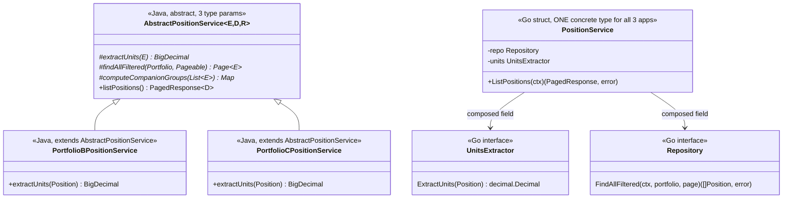
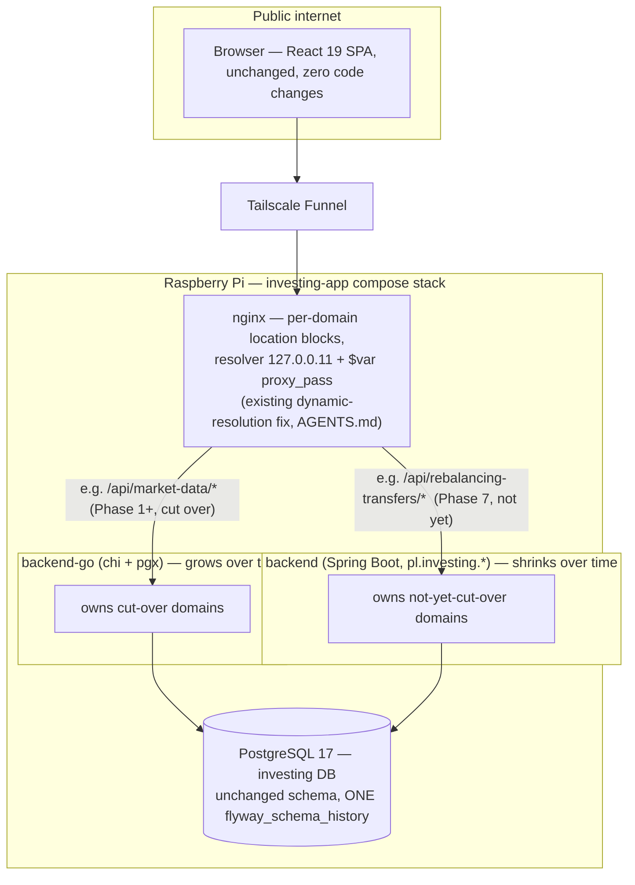
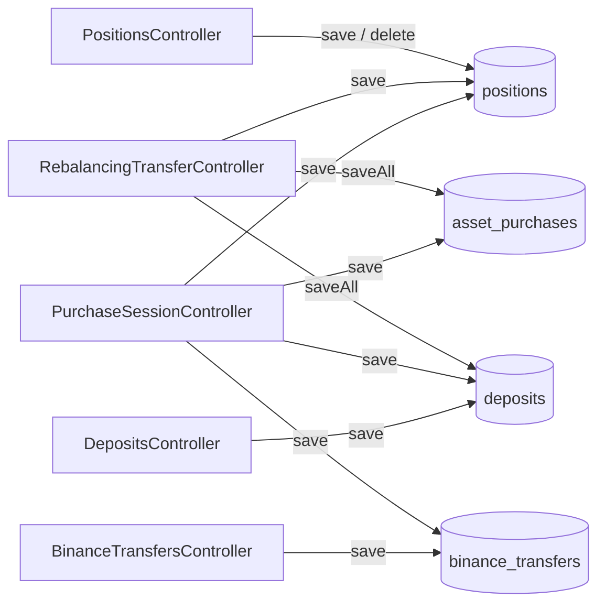

# 13 — Go Backend Target Architecture

> **Status: historical — superseded by as-built (Phase 9 complete 2026-09-19, ADR-098).**
> This doc is the design record of the Go backend rewrite: why Go, the stack, the strangler-fig
> coexistence design and the 10-phase sequencing. The rewrite is finished — Java/Spring Boot is
> deleted (commit `ff7878f`, restore anchor `2be75ba`) and all three apps run on Go
> (`backend-go` :8091, `backend-go-portfolio-b` :8092, `backend-go-portfolio-c` :8093). It is **not** the
> current-state reference: for how the system is built today read
> `docs/architecture/00-stack-validation.md`, `08-monorepo-layout.md` and
> `12-portfolio-bpps-and-shared-packages.md`. Where this doc says "planned", "target" or
> "coexists with Java", read it as a description of the migration path, not of the running system;
> the package layout in §4 differs in detail from what was built (e.g. shared code is
> `packages/common/go/common-go`, migrations live in `db/migration/`, applied by a one-shot Flyway
> runner). Deliberately kept, not deleted, as the record of *why*.
>
> **Original audience note:** All agents, especially the Backend-Go agent and DevOps. The text below
> is unedited apart from this banner and was written as a **target-state** design as of 2026-09-14
> (when zero Go code existed). See `docs/adr/ADR-094-go-backend-rewrite.md` for the
> Context/Decision/Consequences record this doc expands on — that ADR is the "why," this doc is the
> "what, in full detail."

---

## 0. Scope and non-goals

This doc covers: the Go tech stack, the package layout for the new Go modules (shared + one per
app), the strangler-fig coexistence/routing design, the idiomatic-Go equivalent of the existing
Java GoF pattern map, and the complete phase/domain sequencing table.

**Out of scope for this doc (per the task that produced it):** no Go code, no Java code changes,
no `.claude/agents/backend-go.md` agent definition, no `.claude/tasks/*.task.md` task files, no
`AGENTS.md` edits. Those are the orchestrator's follow-up work, using this doc as input.

**Frontend is unaffected.** `frontend-web`, `shared-ts`, `packages/common/ts`, `packages/common/ui`
stay exactly as they are through the entire migration — every phase below preserves the existing
REST contract (`docs/openapi/` source → `docs/openapi.yaml` bundle) byte-for-byte at the wire
level; only which process answers a given path changes.

---

## 1. Pattern & principle evaluation (migration mechanics)

This is a deployment/integration-architecture decision, not a domain-code one — the relevant
vocabulary is enterprise-integration and PoSA patterns, evaluated per the
`software-design-excellence` skill:

| Candidate | Verdict | Why |
|---|---|---|
| Strangler Fig | **adopted** | Exactly the mechanism the user specified: incremental, per-domain cutover, both backends live simultaneously against the same DB, no big-bang rewrite-then-switch |
| Anti-Corruption Layer | **adopted** | Each Go domain package's repository layer talks to the *existing* Postgres schema on its own terms (pgx + sqlc-generated types) without importing any Hibernate/JPA-shaped assumption (e.g. no `@Version` optimistic-locking column exists today, so none is invented) — keeps the Go domain model clean of Java ORM residue |
| Branch by Abstraction | considered, **rejected as a code-level construct** | Nginx's per-path routing (§4.1) already gives an *external*, HTTP-level branch-by-abstraction; an *internal* in-process abstraction layer would only earn its keep if Go and Java shared one process, which they never do here — building one would be speculative (YAGNI) |
| Facade | **adopted** | Each domain's oapi-codegen-generated `ServerInterface` implementation is a thin Facade over the Go service layer — mirrors the existing Java shape, which doc 12 already confirms is "thin — delegating only" |
| Strategy | **adopted, carried forward** | `PriceProvider`, `RebalancingStrategy` — genuinely idiomatic Go interfaces already (per the user's own decision #6); no redesign needed, just a direct port |
| Decorator | **adopted, carried forward** | `CachingPriceProviderDecorator` — a Go function wrapping another Go value of the same interface type; *more* natural in Go than in Java (no subclassing ceremony at all) |
| Template Method (as a Java abstract-class hierarchy) | **rejected as inheritance; survives as composition** | See §5 — Go has no classes, so the hierarchy that exists solely to work around that constraint in Java has no reason to exist in Go. The *behavior* (share an algorithm skeleton, vary one step) survives as a struct holding an interface field or a higher-order function taking the one varying step as a parameter |
| Singleton (as a named pattern/class) | **rejected** | A package-level `sync.Once`-guarded variable is already Go's idiomatic singleton when one is genuinely needed (e.g. a shared `*pgxpool.Pool`); no `singleton.AppConfigSingleton`-style wrapper type is needed |
| Command (as an object with `Execute`/`Undo`) | **rejected for most domains, re-evaluated once (Phase 5 — bot trading)** | Matches the Java shared-core's own "Remaining (deferred, low ROI)" verdict on `Command` for transfer-undo (audit immutability makes undo meaningless there). Bot trading is the one place a `Command`-shaped audit trail is arguably justified — see Phase 5's design-improvement note — but even there it's `Execute`+`Audit`, not `Execute`+`Undo` |
| Visitor | **rejected** | Go has no double dispatch; a type-switch or a plain interface method is a better fit for the one real use case this pattern served (historia position-value computation) |
| Iterator / Memento / Caretaker (as named types) | **rejected as ceremony; survive as plain data** | A Go slice already iterates; a Go struct copied by value already is a memento. See §5 smell #3 |

YAGNI/KISS is the tie-breaker throughout, same as every prior ADR in this repo.

---

## 2. Go tech stack

Full reasoning, version verification, and the GraalVM alternative analysis live in ADR-094 §2–3.
This table is the reference summary:

| Component | Pick | Notes |
|---|---|---|
| Language | Go, `go 1.27` directive in every `go.mod` | Toolchain fetched on demand via `GOTOOLCHAIN=auto` — the Pi's system `go` binary stays at 1.24.4; no manual reinstall needed |
| HTTP routing | `github.com/go-chi/chi/v5` on top of stdlib `net/http` | Thin, zero-dependency, 100% `net/http`-compatible; `chi.Mount()` gives one sub-router per domain package, matching the per-domain cutover model directly |
| DB driver | `github.com/jackc/pgx/v5` | `lib/pq` is confirmed maintenance-mode (last significant feature work years ago); pgx v5 is the actively maintained, actively released driver (pushed as recently as 2026-09-07) |
| DB access / codegen | `sqlc` (compiles hand-written SQL + the *existing* Flyway schema into typed Go) | Rejected GORM — see §3; `sqlc.yaml`'s `schema:` path points directly at each app's `db/migration/` directory, so Go never gets its own copy of the schema to drift |
| Migrations | **Flyway itself**, via the standalone `flyway/flyway:<version>-alpine` Docker image (ARM64-supported) | Not golang-migrate/goose — see ADR-094 §2 for the reconciliation-risk reasoning. Runs as a one-shot init container before either backend starts; zero JVM dependency inside the app process itself |
| OpenAPI codegen | `github.com/oapi-codegen/oapi-codegen/v2` (v2.8.0+, first version with real OpenAPI 3.1 support) | Generates chi-compatible `ServerInterface` + types directly from `docs/openapi.yaml` — the same bundle the frontend's hand-kept Zod schemas track, so Go and TypeScript never see two different "sources of truth" |
| Auth — backend JWT | `github.com/golang-jwt/jwt/v5` | HS256 validation of the backend-issued JWT, direct port of `backendJwtDecoder`'s contract (issuer check, expiry, `ALLOWED_EMAIL_*` claim) |
| Auth — Google ID token | `google.golang.org/api/idtoken` (Google's own official, actively maintained Go client library) | Verifies the RS256 Google ID token at the `/auth/token` exchange step — direct port of `googleJwtDecoder`; deliberately not one of the many low-star third-party `google-auth-id-token-verifier` forks turned up in research (a sign of an unmaintained original) |
| Integration testing | `github.com/testcontainers/testcontainers-go` against real `postgres:17.10-alpine` | Same "never mock the database" gate as the Java side; the Postgres fixture is migrated via the same Flyway CLI container used in prod, so Go integration tests assert against literally the same schema Java's Testcontainers tests do |
| Structured logging | stdlib `log/slog` | JSON handler in prod, text handler in dev — zero new dependency |
| Config / profiles | Typed struct read via `os.Getenv` (or `github.com/caarlos0/env/v11` for tag-based parsing) + `github.com/joho/godotenv` loading `.env.dev`/`.env.prod` selected by `APP_ENV` | Mirrors Spring's `dev`/`prod` profile split; reuses the exact `.env` file location/variable-name conventions DevOps already manages, so no `.env` fork during the transition |
| Dependency injection | Explicit constructor wiring in `cmd/server/main.go` | No wire/fx/dig — 21 controllers (root) does not justify a DI framework; the composition root is literal, greppable documentation of the dependency graph |
| Build / deploy | Multi-stage Docker: `golang:1.27-alpine` build stage → `CGO_ENABLED=0 GOOS=linux GOARCH=arm64 go build` → `gcr.io/distroless/static-debian12` (or `alpine` if a shell is wanted for ops parity) runtime stage | Single static binary, no JVM, no class loading. Expected idle RSS: **15–40MB**, vs. the ADR-083-measured 385–507MB per Spring Boot JVM today — an order of magnitude reduction. Treat this as a directional estimate, not a promised number, until Phase 1 ships and is measured on this exact Pi (same honesty standard ADR-083 held itself to for its own AppCDS estimate) |

---

## 3. Why not GORM (DB-access reasoning specific to this domain model)

This project's domain is JPA/entity-heavy with MapStruct-style DTO mapping, and `docs/architecture/02-domain-model.md`/`04-db-schema.md` are explicit that computed fields (`value_pln`,
`deviation_pct`, `units_total`, XIRR, etc.) are **never persisted** — they're computed at the API
layer on every read. An ORM's row-in-object-out model, with its lazy-loading proxies and
change-tracking, adds real runtime machinery for exactly zero benefit on a domain that already
treats "load row, compute derived fields in a plain function, return DTO" as the whole shape of
every read. `sqlc` matches this domain better: you write the SQL (mirroring the hand-written JPQL/
native queries already in `PositionRepository.findAllFiltered`/`findAllByCompanionParentTickerIn`
today), it generates typed Go structs + functions — the same contract-first "define the shape,
generate the boilerplate" philosophy MapStruct already uses for DTOs, just one layer earlier in
the pipeline. `sqlx` is kept as an documented fallback for the rare genuinely dynamic query sqlc's
static-SQL model can't express (none identified yet in this domain).

---

## 4. Package layout

```
investing-app/                                  (repo root, unchanged Java paths stay as-is)
├── packages/common/
│   ├── ts/, ui/, java/                          unchanged (java/ shrinks over time as domains retire)
│   └── go/
│       └── common-go/                           NEW — pl.shared's Go equivalent
│           ├── go.mod                            module path e.g. investing-app/common-go; go 1.27
│           ├── auth/                             JWT validation (golang-jwt/v5), Google idtoken
│           │                                      verification, email-allowlist chi middleware —
│           │                                      direct port of SecurityConfig/SecurityProperties/
│           │                                      GoogleJwtAuthenticationConverter
│           ├── httpx/                            chi router helpers; ListResponse[T]/PagedResponse[T]/
│           │                                      SingleResponse[T] as Go generics — direct
│           │                                      equivalent of pl.shared.dto.common + Envelopes
│           ├── priceprovider/                    PriceProvider interface, Yahoo/Binance
│           │                                      implementations, CachingDecorator (Strategy +
│           │                                      Decorator, ported cleanly — see §5)
│           ├── config/                           typed env/profile loader (godotenv + struct tags)
│           └── testsupport/                      testcontainers-go Postgres fixture: spins up
│                                                   postgres:17.10-alpine, runs the app's real
│                                                   Flyway CLI container against it before tests run
├── backend/                                      Java, Spring Boot — shrinks as phases land
├── backend-go/                                   NEW — root app's Go backend, coexists with backend/
│   ├── go.mod                                    replace-directive to ../packages/common/go/common-go
│   │                                              (single repo, no versioning ceremony needed)
│   ├── cmd/server/main.go                        composition root — explicit wiring, builds
│   │                                              pgxpool → sqlc queriers → services → chi router
│   ├── internal/
│   │   ├── marketdata/                            Phase 1
│   │   ├── inflation/ | taxreturns/ | cashpositions/ | settings/     Phase 2
│   │   ├── historia/                              Phase 3
│   │   ├── cryptotrades/ | linearregression/ | tradechart/ | binancetransfers/   Phase 4
│   │   ├── news/ | bot/                           Phase 5 (bot/ itself has calendar, control,
│   │   │                                           plan, signal, stats, trade sub-packages)
│   │   ├── position/ | rebalancing/ | purchasesession/ | deposit/    Phase 7 — these four
│   │   │                                           packages import each other directly, in-process,
│   │   │                                           because they share write-transactions against
│   │   │                                           positions/deposits/asset_purchasess (see §6.3) —
│   │   │                                           exactly mirroring how they already call each
│   │   │                                           other directly in Java today, not a regression
│   │   └── rebalancingcalc/                        Phase 7 — pure read-only computation (port of
│   │                                               RebalancingService/AbstractProportionalStrategy/
│   │                                               MainRebalancingStrategy/RetirementRebalancingStrategy/
│   │                                               MacroDeriskGate/MacroDeriskService/
│   │                                               ValueComputationService), imported by both
│   │                                               position/ and purchasesession/ — added by task
│   │                                               150's design review after being found load-bearing
│   │                                               for both and unassigned to any phase (see
│   │                                               .claude/tasks/150-architect-output.md Finding 1)
│   ├── db/queries/*.sql                            hand-written SQL, sqlc input
│   ├── sqlc.yaml                                   schema: ../backend/src/main/resources/db/migration
│   │                                               (points at the EXISTING Flyway dir — no copy)
│   └── openapi/                                    oapi-codegen-generated ServerInterface + types,
│                                                    regenerated via `go generate` from
│                                                    ../docs/openapi.yaml
├── apps/portfolio-b/backend-go/           same shape, smaller (7 controllers)
└── apps/portfolio-c/backend-go/            same shape, smaller (7 controllers)
```

**Why a local `replace` directive instead of a versioned module registry:** this is a private,
single-repo monorepo with no CI and no remote registry requirement (matches the existing
`packages/shared/java` Maven multi-module pattern, which uses local `<module>` aggregation, not a
published artifact). A Go workspace file (`go.work`) at the repo root, listing every Go module
(`common-go`, `backend-go`, both siblings' `backend-go`), gives local cross-module editing with
`go build`/`go test` resolving to on-disk source with zero publish step — the direct Go analogue
of the Maven parent-POM aggregation already in place for Java.

---

## 5. Idiomatic pattern mapping — where the Java hierarchy collapses

The Java side (`packages/shared/java`, per `.claude/tasks/done/shared-backend-refactor.task.md`
and `docs/architecture/12-portfolio-bpps-and-shared-packages.md` §2.5) implements a genuinely
comprehensive GoF pattern map — Template Method service bases for 8 domains, plus Composite,
Visitor, Memento, Command, Mediator, Prototype, Singleton, Flyweight. Some of that is real,
load-bearing design (Strategy, Decorator, Adapter, Facade survive unchanged in spirit). A
meaningful part of it exists specifically because Java has no other way to share an algorithm
skeleton across 3 apps' diverged entity shapes without either duplicating the skeleton or writing
an abstract class. Go removes that constraint entirely — interfaces are structural, and functions
are first-class values — so porting the *class hierarchy* 1:1 would be carrying a workaround for a
problem Go doesn't have. Per the user's explicit instruction, here is where that hierarchy
collapses, named concretely rather than silently ported:



*Legend:* the Java side needs one abstract base class plus one concrete subclass per app because
sharing an algorithm skeleton while varying one step requires inheritance in that language. The Go
side needs **zero** inheritance and **one** concrete `PositionService` type total — each app's
`main.go` constructs it with a different pair of interface values. This is Strategy/Bridge-via-
composition replacing Template-Method-via-inheritance: identical behavior, no hierarchy to
navigate, one fewer concept for a future reader to learn per domain.

**Named smells — do not carry these over as-is:**

1. **The generic, multi-type-parameter Abstract-Factory/repository-factory layer** speculatively
   proposed for cross-app entity production (`PortfolioEntityFactory<T>`/`RepositoryFactory` in the
   original Java audit) never actually got built beyond a proposal, and for good reason — the real
   divergence (portfolio-b's 5-column units vs. portfolio-c's single `units` vs. root's `SubPositionDto`
   companions) was fully resolved by Bridge (`UnitsExtractor<T>`) alone. **Do not build this in
   Go either.** One small interface per genuinely-varying step, composed into a plain struct, is
   the entire solution — confirmed by the fact the Java side never needed the factory layer once
   Bridge was in place.
2. **The 8-domain Template Method service-base hierarchy itself**
   (`AbstractHistoriaService`/`AbstractDepositService`/`AbstractXirrService`/
   `AbstractAccountCashService`/etc.) is a correct, well-executed Java answer to "no multiple
   inheritance, need to share an algorithm skeleton." In Go, each of these collapses to either a
   single generic function (Go generics, since 1.18) or a struct holding 1-2 interface fields for
   the step(s) that actually vary — never a parametrized abstract base with required override
   points. Concretely: `AbstractProportionalStrategy`'s six-step Template Method
   (`buildRows→computeTarget→allocate→computeUnits→makeItem→allocateToAccounts`) becomes one pure
   Go function, `AllocateProportional(rows []Row, targets []Target) []BuyListItem`, taking the one
   step that genuinely differs per app (`allocateToAccounts`) as a passed-in `func(...)` value —
   not an interface with six required methods for five steps that are identical everywhere.
3. **Iterator/Memento/Caretaker/Visitor "behavioral quartet"** (`pl.shared.history` — built for
   historia pagination-with-undo) is real Java ceremony solving a real Java problem (no first-class
   functions, no natively-immutable value copies). In Go, a slice already iterates, a struct copied
   by value already is a memento, and there is no undo requirement anywhere in the historia domain
   today (root's own `HistoriaCaretaker`/`Memento` were additive, not something portfolio-b/portfolio-c's
   plain-pagination version was ever missing functionally). The Go historia package should be a
   paginated query plus a snapshot struct — full stop. If undo is ever a real product requirement,
   add it then, as a slice of snapshots — not preemptively as a four-type-name pattern suite.
4. **`Command` as an object with `Execute()`/`Undo()`** — the Java shared core's own audit trail
   already concluded transfer-undo is meaningless here (financial-transfer immutability), and left
   this pattern unfilled ("Remaining (deferred, low ROI)"). Go closures are a complete substitute
   for the one place Command-as-a-value might matter (Phase 5's bot-trading audit trail, see §7) —
   no `Command` interface type needed, a `func(ctx) error` plus a logged audit record is enough.

---

## 6. Coexistence / strangler-fig design

### 6.1 Nginx routing split

Nginx already does per-app path routing today (`/portfolio-b/*`, `/portfolio-c/*` → sibling stacks — see doc
12 §1 and `AGENTS.md`'s "nginx dynamic upstream resolution" section). The same mechanism extends
one level deeper, per domain, within investing-app's own `/api/*` prefix:



Each domain gets its own `location` block (mirroring the existing per-portfolio-bpp pattern), e.g.:

```nginx
resolver 127.0.0.11 valid=10s;
set $backend_go backend-go;
set $backend_java backend;

location /api/market-data/ {
    proxy_pass http://$backend_go:8081;
}
location /api/rebalancing-transfers/ {
    proxy_pass http://$backend_java:8080;
}
```

The two gotchas already documented in `AGENTS.md` for the portfolio-b/portfolio-c routing apply identically
here and must not be re-discovered the hard way: (1) a `set` variable in `proxy_pass` defeats
nginx's automatic prefix-rewrite, so no `rewrite` directive is needed here (no path-prefix
stripping — `/api/market-data/*` on both sides), but *is* still needed anywhere the Go and Java
mount points differ; (2) `resolver` + `set` must be declared before any `rewrite ... break` in the
same location. `backend-go` is a brand-new Compose service name — no collision risk with the
existing `backend`/`backend-portfolio-b`/`backend-portfolio-c` names.

**Routing-granularity trap — a shared URL prefix does not imply a shared phase (flagged by
Backend-Go during Phase 1's implementation, 2026-09-15, confirmed by the Architect against the
controller source directly).** `/api/market-data/*` is not owned end-to-end by
`MarketDataController`. `LinearRegressionController` (`/market-data/linear-regression`) and
`TradeChartController` (`/market-data/trade-chart*`) sit under the same URL prefix but are separate
controller classes, assigned to Phase 4 — not Phase 1 or Phase 1B. A naive single
`location /api/market-data/ { proxy_pass http://$backend_go:...; }` rule, written the way the
example block above suggests, would silently route Phase 4's not-yet-migrated
linear-regression/trade-chart traffic to Go as a side effect of cutting over Phase 1 or 1B — a
real correctness bug, not a hypothetical one, since both share the exact same path segment
(`/market-data`) the example above uses as its whole match. **The fix: any phase whose controller
does not own its full URL prefix needs path-level, not prefix-level, Nginx `location` blocks** —
e.g. separate `location /api/market-data/prices` / `location /api/market-data/fx-rates` blocks
(Phase 1) and `location /api/market-data/macro-` / `location /api/market-data/benchmark-history`
blocks (Phase 1B), left distinct from a future `location /api/market-data/linear-regression` /
`location /api/market-data/trade-chart` pair (Phase 4) until Phase 4 actually cuts over. This
applies again whenever a future phase shares a prefix with a not-yet-migrated one — check every
phase's controller-to-prefix mapping for this before writing its Nginx config, don't assume one
prefix implies one controller implies one phase.

**Addendum (Phase 1B ARCHITECT spec, 2026-09-15).** Two staleness items surfaced while speccing
1B, recorded here so a later reader doesn't re-discover them: (1) Flyway V62 added a ninth
`macro_observations.source` value (`PBC`, first-party PBOC scrape, still tip-only in code via
`ChinaM2Chain.fetchTips`), but docs `03-api-contract.md` (§macro-state `components[].source`
list), `04-db-schema.md` (the `source` CHECK list), and `05-rebalancing-algorithm.md` (the
`M2_CN` precedence note) still list only the pre-V62 eight — the migration + `MacroDataService`
are authoritative (9 codes); `docs/openapi/` was fixed in the same change. (2) `nginx.conf`
already holds an exact-match `location = /api/market-data/macro-state/refresh` block with 180s
timeouts pointing at Java — the 1B cutover must retarget *that* block to `backend-go` (keeping
the timeouts), and 1B should use exact-match per-path blocks consistent with Phase 1's
precedent rather than the `location /api/market-data/macro-` prefix sketch above.

### 6.2 Per-domain cutover lifecycle

```mermaid
stateDiagram-v2
    [*] --> JavaOwned
    JavaOwned --> GoShadow: Go implementation deployed;\nNginx still routes this domain's\npaths to Java; Go hit only via\ninternal smoke test / curl, not\nreal traffic
    GoShadow --> GoOwned: Nginx location block for this\ndomain's path prefix flipped to\nbackend-go
    GoOwned --> JavaOwned: ROLLBACK — flip the same\nlocation block back to backend\n(Java) on any production bug;\nno DB migration needed either way\nsince schema is untouched
    GoOwned --> JavaRemoved: after an agreed burn-in\nperiod, delete the Java\ncontroller/service/repository\nfor this domain from backend/
    JavaRemoved --> [*]
```



Revertibility is structural, not aspirational: because both backends read/write the *same* tables
with the *same* schema, the rollback transition is a one-line Nginx config edit + reload — no data
migration, no dual-write reconciliation, no "which copy is authoritative" question, since there is
only ever one copy of the data.

### 6.3 Shared Postgres access safety — the write-ownership audit

The user's own question — "does `RebalancingTransferController` write tables also touched by
`PositionsController`?" — was checked directly against the current source, not assumed. The
answer is yes, and the coupling is wider than that one pair:



*Legend:* four controllers (`PositionsController`, `RebalancingTransferController`,
`PurchaseSessionController`, `DepositsController`) converge on `positions`/`deposits`/
`asset_purchases` — verified via direct source inspection of `RebalancingTransferService.java`
(imports `Position`, `AssetPurchase`, `Deposit`; calls `positionRepository.save`,
`assetPurchaseRepository.saveAll`, `depositRepository.saveAll`) and `PurchaseSessionService.java`
(imports the same three plus `BinanceTransfer`). **Conclusion: these four controllers cannot be
split across Go and Java independently without either (a) one backend making an internal HTTP/gRPC
call into the other for every write — extra latency and a new failure mode on the most
money-critical path in the app, rejected as unnecessary complexity — or (b) cutting the whole
cluster over as one atomic phase.** This drives Phase 7 below: it is deliberately one phase, not
four.

*Correction (Phase 0, 2026-09-14):* the actual Flyway-created table names are plural
(`asset_purchases`, `purchase_sessions`, `purchase_session_items`, `binance_transfers`) — this doc
originally used the singular Java entity-class-derived names throughout §4 and §6.3. Fixed
here and in the master task / phase task files / `backend-go` agent definition after Backend-Go's
Phase 0 implementation surfaced the mismatch against the real schema (via `sqlc`'s schema
introspection, not assumption). Verify table names against the live Flyway migrations rather than
this doc's prose if the two ever disagree again.

`BinanceTransfersController` is a partial exception worth calling out rather than glossing over:
its own CRUD endpoints have no dependency on the positions/deposits/asset_purchases cluster and can
cut over independently (Phase 4) — but the `binance_transfers` *table* itself is also written by
`PurchaseSessionController` on session completion. The safe reading: Phase 4 moves
`BinanceTransfersController`'s read/list/manual-entry endpoints to Go, while the
purchase-completion-triggered insert path into `binance_transfers` stays Java-owned until Phase 7
lands. This must be verified against the exact `PurchaseSessionService` write path before Phase
4's task file is written — flagged here as a concrete open item, not assumed safe.

**Everywhere else, the "one side owns writes per table at a time" invariant holds cleanly** —
`price_cache`/`fx_rate_cache` (market data), `inflation`, `tax_returns`, `cash_positions`,
`settings`, `historia` (write path — its read dependency on `positions` is read-only and safe
regardless of which backend currently owns `positions`), `crypto_trades`, `asset_news`, and every
`bot_*` table are each written by exactly one controller/domain apiece, with no second writer
found anywhere else in the codebase for those tables. This was checked directly (grep across
`backend/src/main/java/pl/investing/service/` for each entity's repository type), not assumed from
the controller list alone.

### 6.4 Auth continuity

Both backends validate the same backend-issued HS256 JWT against the same `JWT_SECRET` and the
same `ALLOWED_EMAIL_*` allowlist — `common-go/auth` reads the identical env vars
`SecurityProperties` reads today (see ADR-094 §2 for the exact library picks). The
`/auth/token` Google-ID-token exchange endpoint (currently handled inline in
`SecurityConfig`/`platform/auth/*`, not a dedicated controller) stays on whichever backend is
"the front door" at any given point in the migration — recommended to be the **last** thing cut
over (bundled with Phase 9's decommission), since every other domain's auth depends on it working
identically regardless of which backend answers a given API call. Until then, both backends simply
validate bearer tokens issued by the one Java-owned `/auth/token` endpoint — no dual-issuer
problem, since there is only ever one issuer.

### 6.5 Rollback mechanism

Covered structurally in §6.2's state diagram: an Nginx `location` block flip, no data migration,
reversible at the speed of an Nginx config reload (`nginx -s reload`, sub-second, no container
restart required — consistent with the existing dynamic-resolver fix already in place for
portfolio-bpp routing). The only per-domain precondition for a clean rollback is that the domain's
Go implementation made no schema changes Java's model doesn't already understand — guaranteed by
this migration never touching Flyway migrations for behavioral reasons (schema changes, if any are
ever needed, remain their own independent Flyway migration, applied once, read by both backends
identically — no different from how a schema change is handled today with Java alone).

---

## 7. Phase / domain sequencing

10 phases (0 through 9), plus one lettered sub-phase (1B). Grouped 1–7 controllers per phase (never
all 21 at once, never all one-at-a-time) per risk and coupling, not per raw controller count. Full
write-coupling reasoning for Phase 7 is in §6.3; everything else was checked for absence of
cross-domain writes the same way.

**Why 1B is a lettered sub-phase, not a renumbered Phase 2:** `MarketDataController` turned out to
be bigger than this doc's original Phase 1 scoping — it also serves macro-state/benchmark-history/
manual-M2 (`MacroDataService`/`BenchmarkHistoryService`), which the original phase table never
assigned to any phase at all (found by Backend-Go during Phase 1's implementation, 2026-09-15).
Two options were weighed: fold it into a widened Phase 1, or give it its own phase. Folding it in
was rejected — by the time this gap surfaced, Phase 1's Go implementation for prices/FX rates was
already built and tested against the narrower scope, and macro-state's risk/complexity profile is
genuinely different (8 external data providers instead of 2, and its output directly feeds Phase
7's live rebalancing de-risk gate) rather than a natural extension of "read a cache, call two
HTTP APIs." A **new, distinct phase** is the more honest fit. It is numbered **1B** rather than
renumbering the existing Phase 2 (and cascading through 3–9) because that renumbering would have
touched every phase task file, several Go source comments, `sqlc.yaml`/compose references, and
this doc's own cross-references — a large, error-prone, purely-cosmetic change for zero design
benefit (YAGNI). 1B sits between Phase 1 and Phase 2 in execution order but is parallel-eligible
with Phase 2 once Phase 1 itself has landed (see the 1B row below) — it does not block Phase 2's
start.

**Why 8B is a lettered sub-phase, not folded into Phase 9:** the same class of gap as 1B —
portfolio-b/portfolio-c's shared `SettingsController`/`MarketDataController` (prices/fx only) are real, live,
working Java domains this doc's phase table never assigned to anyone (Phase 2's App(s) column says
"investing" only; Phase 6/8's portfolio-b/portfolio-c rows never mention them) — found by task 152's
Java-retirement-readiness review, triggered by the user asking whether Java containers could be
turned off yet (they could not, for this reason plus the `/auth/token` gap Phase 9 already owned).
Unlike 1B, this surfaced *after* Phases 6 and 8 already shipped and burned in, so there was no
in-flight phase left to widen. Folding it into Phase 9 was considered and rejected: Phase 9's own
acceptance gate is "zero JVM processes anywhere," which stays unreachable while portfolio-b/portfolio-c have
no Go equivalent for two live domains — hiding that real domain-migration engineering (Go
implementation, coexistence smoke test, Nginx flip, burn-in) inside a phase named "retire Java"
would mislabel it, not simplify it. Lettered 8B rather than a renumbered Phase 9/10 for the same
YAGNI reason 1B wasn't renumbered. Full reasoning: task 152 §2, `docs/architecture/diagrams/152-auth-token-and-8b-scoping.md` §3.

| Phase | Domain(s) / Controllers | App(s) | Tables owned | Risk / coupling | Design-improvement opportunity |
|---|---|---|---|---|---|
| **0** | Shared Go foundation — no domain traffic yet. `common-go` module (auth, httpx envelopes, priceprovider, config, testsupport); `backend-go` skeleton scaffolded in all 3 apps; oapi-codegen wired to each app's OpenAPI bundle; a throwaway health-check endpoint deployed behind Nginx to prove the coexistence mechanism end-to-end | investing, portfolio-b, portfolio-c | none | None — no real traffic | Establish the composition-and-interfaces idiom (§5) once, here, as the pattern every later phase follows, instead of re-deriving "how do we do Strategy in Go" per phase |
| **1** | `MarketDataController` — **prices + FX rates only**: `getPrices`/`refreshPrices`/`getFxRates`/`refreshFxRates`. (The controller's macro-state/benchmark-history/manual-M2 endpoints are Phase 1B, not this phase — see below.) | investing | `price_cache`, `fx_rate_cache` | Lowest — read-mostly, external-HTTP-dependent (Yahoo, Binance); worst case is a stale price, not a wrong balance | Introduce a real `PriceProvider` interface (Yahoo/Binance) + caching Decorator — fixes the explicitly-documented Java gap ("No `PriceProvider` interface — each client is called directly," doc 00) |
| **1B** | `MarketDataController` — **macro-state + benchmark-history + manual-M2**: `getMacroState`/`getMacroStateHistory`/`refreshMacroState`/`upsertManualM2`/`getBenchmarkHistory`, backed by `MacroDataService`/`BenchmarkHistoryService` | investing | `macro_state`, `macro_observations` | Low on write-ownership grounds (single writer; the read dependency on `settings` — `SettingService.isMacroDeriskEnabled()` — is read-only and safe regardless of who currently owns `settings`, same pattern as Historia's read-only dependency on `positions`) but a materially larger external-integration surface than Phase 1: 8 external HTTP clients (`FredClient`, `EcbClient`, `BoeClient`, `BojClient`, `ChinaDataLiveClient`, `PbcChinaM2Client`, `TradingEconomicsChinaM2Client`, `YChartsChinaM2Client`) vs. Phase 1's 2 (Yahoo, Binance), and its output (`blendFactor`, ADR-044) feeds Phase 7's live rebalancing de-risk gate — correctness here has downstream money consequences even though nothing in this phase writes a money-critical table directly. Parallel-eligible with Phase 2 (no table or write overlap) once Phase 1 lands | Port `MacroDataService`'s 8-client fetch fan-out as a slice of small `PriceProvider`-shaped fetch functions (Strategy, same shape Phase 1 establishes for Yahoo/Binance) instead of one large service method coordinating all 8 inline — the fan-out, not the blend-factor math itself, is what benefits from decomposition here |
| **2** | `InflationController`, `TaxReturnsController`, `CashPositionsController`, `SettingsController` | investing | `inflation`, `tax_returns`, `cash_positions`, `settings` | Low — simple independent CRUD, no cross-writes, low traffic | Replace `SettingKeys`' stringly-typed key sprawl with a small typed Go registry (name + type + default declared once, compile-time checked) instead of porting the string-key pattern verbatim |
| **3** | `HistoriaController` | investing | `historia` (writes); reads `positions` (read-only, safe regardless of who owns Positions) | **Write-path now GoOwned (2026-09-19, ADR-097).** The scheduled-cron equivalent was built as a plain `time.Timer`-based daily loop (`historia/scheduler.go`), not `robfig/cron` (YAGNI — one fixed daily time needs no cron-expression parser); `HISTORIA_SCHEDULER_ENABLED=true` now makes Go the sole 23:00 Warsaw historia-snapshot writer in all 3 apps — Java's own scheduler cannot run (its container is stopped, commit `16e3433`). That container-stop ran one day ahead of this flip (incident 153), producing a missed 2026-09-18 snapshot in every app's `historia` table, backfilled via a new `BackfillSnapshot`/`snapshotPortfolioAsOf` admin-only capability — see ADR-097 for the full incident record and backfill design | Drop the Iterator/Memento/Caretaker/Visitor ceremony (§5 smell #3) — plain paginated query + slice-based snapshot |
| **4** | `CryptoTradesController`, `LinearRegressionController`, `TradeChartController`, `BinanceTransfersController`\* | investing | `crypto_trades`, `binance_transfers`\* | Low-medium. \*`BinanceTransfersController`'s own endpoints move now; the `binance_transfers` insert-on-purchase-completion path stays Java-owned until Phase 7 (§6.3) — verify exact write path before scoping this phase's task file | PIT-38 tax-summary and DeMarker-indicator computations are pure slice transforms — good fit for allocation-free Go functions, no service-layer ceremony needed |
| **5** | `NewsController` + bot subsystem (`BotCalendarController`, `BotControlController`, `BotPlanController`, `BotSignalController`, `BotStatsController`, `BotTradeController`) | investing | `asset_news`, `bot_*` (fully schema-isolated — zero write overlap with anything else) | Schema-isolated but **not low-stakes** — the bot subsystem places real live trades (OKX, per ADR-090); treat with money-critical care despite zero table coupling. Recommend a manual feature-flag on the Go bot's live-execution path during burn-in, on top of the standard Nginx rollback. **Watcher/purger scheduler write-path now GoOwned (2026-09-19, ADR-097):** `BOT_SCHEDULER_ENABLED=true` followed the identical shadow-gate-left-off pattern as Phase 3's historia scheduler (incident 153, no observed harm since `bot_trade` was empty at the time) — Go is now the sole 1s release watcher + 04:00 purge, Java cannot run it (container stopped). `BOT_LIVE_EXECUTION_ENABLED` remains a fully separate, still-OFF gate for actual OKX order placement, unaffected by this flip | Root's largest single cluster (7 controllers) — a justified, non-speculative use of `Command` (`Execute`+`Audit`, not `Undo`) for the trade-action audit trail is worth evaluating concretely here, unlike the YAGNI'd Command use elsewhere |
| **6** | portfolio-b + portfolio-c: `HistoriaController`, `InflationController`, `AccountCashController`, `AdminController` — **parallel-eligible with investing's Phases 2–5**, gated only on Phase 0 | portfolio-b, portfolio-c | each app's own `historia`/`inflation`/`account_cash` tables — separate Postgres databases, zero cross-app risk | Low, and explicitly independent of investing's own phase progress | portfolio-b/portfolio-c's controllers are ~90-95% identical after package-name normalization (per the shared-backend-refactor audit) — in Go, `common-go` can hold the *entire* generic implementation, not just interfaces, parameterized only by DB connection + 1-2 enum literal sets — going further than Java's per-app entity-subclassing floor allowed |
| **7** | investing's core cluster: `PositionsController`, `RebalancingTransferController`, `PurchaseSessionController`, `DepositsController` — **cut over atomically, not domain-by-domain** — plus **`internal/rebalancingcalc/`** (no controller of its own; port of `RebalancingService`/`AbstractProportionalStrategy`/`MainRebalancingStrategy`/`RetirementRebalancingStrategy`/`MacroDeriskGate`/`MacroDeriskService`/`ValueComputationService`, load-bearing for both `PositionsController` and `PurchaseSessionController` — added by task 150's design review, see `.claude/tasks/150-architect-output.md` Finding 1) | investing | `positions`, `deposits`, `asset_purchases`, `purchase_sessions`, `purchase_session_items`, `binance_transfers` (write path); `rebalancingcalc` itself is read-only | **Highest in the migration.** Manual-sell-only business rule lives here; real money/tax consequences; four controllers converge on the same tables (§6.3) — cannot be safely split across backends | `PurchasePlanningService` (729 LOC) + `PurchaseSessionService` (694 LOC) is this codebase's closest thing to a God Service (flagged by its own line count in the shared-backend-refactor audit; LOC pairing corrected 2026-09-17 per task 150 — the two files' sizes had swapped relative to the original audit after ADR-060/061/065's crypto-donor waterfall grew `PurchasePlanningService`). The Go port splits this into three independently-testable collaborators: `lifecycle.go` (session state, 2-value `PLANNED`/`DONE` — not 3, corrected per task 150 Finding 2), `planning.go` (IKE/IKZE purchase-planning math, zero DB dependency), `execution.go` (exactly `completeSession`'s body — the only part touching the money-cluster tables) — a real SRP fix, not just a language port |
| **8** | portfolio-b + portfolio-c's core cluster: `PositionsController`, `RebalancingController`, `DepositsController`, **`PositionTransferController`** (4th controller, added per task 151 Finding 1 — shared verbatim by both apps, backs the "Sprzedaj" manual-sell-assist button, writes `positions`+`position_transfers`) — cut over atomically per app | portfolio-b, portfolio-c | each app's own `positions`/`deposits`/`purchase_lots`/`position_transfers` tables; **portfolio-b only** also reads+writes `account_cash_snapshot` — already Phase 6 `GoOwned` (task 151 Finding 2; portfolio-c's cluster is fully table-disjoint from Phase 6) | Money-critical but structurally simpler than Phase 7 — single portfolio, fewer account types, no PurchaseSession-equivalent complexity. Portfolio B's cross-phase coupling to `common-go/accountcash.Service` (in-process Go call, not a new HTTP hop) is the one real added wrinkle | `common-go/rebalancecalc` (new, shared by **both** apps — confirmed materially shareable further than root's Phase 7, whose `rebalancingcalc` stayed investing-app-only) holds `AllocateProportional`, the one pure-function collapse of `AbstractProportionalStrategy`'s six-step Template Method, taking the single genuinely-per-app step (`allocateToAccounts`) as a passed-in function value — no interface, no base class (§5 smell #2). Confirmed dead, do not port: `RebalancingStrategyFactory`/`RebalancingMediator` (portfolio-b-only), `PositionTransferCommand` (shared) — zero live callers (task 151 Finding 3) |
| **8B** | portfolio-b + portfolio-c's `SettingsController` (`GET /settings`, `PUT /settings/{key}`) + `MarketDataController` prices/fx-rates only (`GET/POST /market-data/prices[/refresh]`, `GET/POST /market-data/fx-rates[/refresh]`; **not** macro-state/benchmark — that's root-only, doc 13's own separate `MarketDataController`) — both shared byte-identical classes across portfolio-b/portfolio-c per ADR-078, found unassigned to any phase by task 152's Java-retirement-readiness review | portfolio-b, portfolio-c | each app's own `settings`, `price_cache`, `fx_rate_cache` tables — zero cross-app risk, same per-app isolation as Phase 6/8 | Low — read-mostly, no write-ownership coupling, byte-identical Java source across both apps; root already has a proven, tested Go shape for both narrower domains (`backend-go/internal/settings` Phase 2, `backend-go/internal/marketdata` Phase 1 prices/fx scope) | Single new `common-go` package (e.g. `common-go/settingscore` + reuse of Phase 1's `PriceProvider`/caching-Decorator shape for market-data), parameterized by DB connection, shared by both apps' composition roots — same kernel-sharing precedent as Phase 6's `accountcash` and Phase 8's `rebalancecalc` (task 152 §2) |
| **9** | Retire Java entirely, **plus** `/auth/token` (Google ID-token exchange) migration, all 3 apps — the one domain deliberately deferred to dead last (doc 13 §6.4; task 152 confirmed nothing changes that call) | investing, portfolio-b, portfolio-c | — | Decommission all 3 Spring Boot JVM containers, remove Maven tooling and `backend/`/`apps/*/backend/`; the Flyway CLI container remains — now the *only* thing in the stack still called "Flyway," with zero JVM dependency. `/auth/token`'s Go exchange logic was already built and unit-tested in Phase 0 (`common-go/auth/{config,google,jwt,service,middleware}.go`), deliberately left unwired — Phase 9 wires it, not builds it from scratch. Two concrete bugs found by task 152 must be fixed before cutover: (1) the generated route is mounted *inside* the authenticated middleware group in all 3 apps — would lock out the very endpoint that issues the first token, fix via one path/method exception in the existing single auth-dispatch chokepoint (`smartAuth` root, `RequireAuth` portfolio-b/portfolio-c); (2) `ValidateGoogleIDToken`'s error isn't typed as `*httpx.AppError`, so an invalid Google token would 500 instead of the contractually-required 401 — wrap as `httpx.NewAuthError(401, ...)`. Full sequence diagrams: `docs/architecture/diagrams/152-auth-token-and-8b-scoping.md` §1-2 | Re-measure and update ADR-083's RAM table with real post-migration numbers; revisit whether `infra-shared`'s Postgres consolidation assumptions still hold once no JVM is present at all |

**Cross-app note, confirmed by direct source inspection, not assumed:** the bot/trading subsystem
(Phase 5) and market-data/macro-state/news/crypto-trades/linear-regression/trade-chart/
cash-positions/tax-returns/purchase-session complexity (Phases 1, 1B, 2 partial, 4) are
**investing-app-only** —
`apps/portfolio-b/backend/` and `apps/portfolio-c/backend/` have no service
directories for any of these (confirmed via direct `ls` of both apps' `service/` packages: 17
files each, covering only `AccountCash`, `Deposit`, `Historia`(+backfill), `Inflation`(sync),
`PositionDeltaApplicator`, `Position`, `PositionTransfer`, `PriceCache`, `PurchaseConfirm`,
`PurchaseHistory`, `Rebalancing`(+`rebalancing/` subpackage), `Setting`(Keys+Service), `Xirr`) —
this is a materially larger investing-only surface than "bot/macro stuff looks root-only" implied;
confirmed root-only extends to essentially everything in Phases 1, 2, 4, and 5.

---

## As-built addendum (2026-09-19)

Facts recorded when Phase 9 closed the migration, so this historical doc is not read as the
current state:

- **Result:** every domain of all three apps, including `POST /auth/token`, is served by Go; Nginx's
  generic `/api/`, `/portfolio-b/api/`, `/portfolio-c/api/` catch-alls now point at `backend-go`,
  `backend-go-portfolio-b`, `backend-go-portfolio-c` (not deleted, ADR-098 Decision 4). The Java trees, Maven
  tooling, Java Dockerfiles and the Java-vs-Go smoke-test script are deleted.
- **Migrations:** Flyway remains the schema authority, but the files moved out of the Java trees to
  `db/migration/` (root V1–V71) and `apps/{portfolio-b,portfolio-c}-investing-app/db/migration/`; a one-shot
  `flyway/flyway:12.4.0` compose service per app applies them (the only JVM left, transient, 384m
  limit) and `backend-go` `depends_on` it with `service_completed_successfully`. Unapplied V72/V73 are
  parked in `db/unapplied/`. (§2/§4's "Flyway CLI init container remains" premise was wrong — no such
  container existed while Spring ran migrations; it was built in Phase 9.)
- **Schedulers:** the historia 23:00 snapshot and the bot schedulers run on Go
  (`HISTORIA_SCHEDULER_ENABLED=true`, `BOT_SCHEDULER_ENABLED=true`, ADR-097).
- **Bot execution:** live OKX execution was armed on 2026-09-19 on a real account
  (`OKX_DEMO_MODE=false`, `BOT_LIVE_EXECUTION_ENABLED=true`; risk limits are the
  `DefaultExecutionConfig` values in `backend-go/internal/bot/trade/config.go`, ported verbatim from
  the old `application.yml`). Task 191 (ADR-114, designed 2026-11-09) reworks the execution path:
  guards before the order, SL before persisting, a commit phase detached from shutdown, the watcher
  as a `lifecycle.Group` worker, a write-ahead `bot_execution` journal, a typed OKX client, and
  route auth derived from the OpenAPI `security` lists. See `06-data-flow.md` §15.
- **Not ported (Java-only duties, follow-up tasks):** BLS direct CPI/PPI actuals (ADR-093, task 147);
  the TradingEconomics PPI-YoY calendar enrichment and BLS baseline capture exist in Go only as no-op
  stubs in `internal/bot/calendar` (`Orchestrator.SyncAll`).
  The ADR-095 (backend hard-close timeout) and ADR-096 (trade-action execution) designs were written
  against Java classes that were never built and must be ported to Go before `db/unapplied/V72`/`V73`
  are un-parked.
- **CI:** `.github/workflows/go-tests.yml` (`go test ./...` without `-short` for the four Go modules).

## Post-migration remediation (task 174 review, 2026-11-04)

The 2026-11-04 review changed facts this historical doc describes; the current rules live in
`08-monorepo-layout.md` §Runtime rules and `04-db-schema.md`:

- **§5's single `PositionService` with a `UnitsExtractor` seam was never built.** The three apps kept
  three position services; the portfolio-b/portfolio-c pair is merged by batch 180 (siblingcore, ADR-113), main's
  stays its own.
- **Graceful shutdown** (§2/§4 "graceful shutdown in main.go") is now `common-go/lifecycle`: owned
  and awaited background workers, per-tick panic recovery, synchronous bind, ordered drain
  (ADR-110). The bot goroutines are excluded by owner decision.
- **Transactions** go through `common-go/pgtx`; money writes are serialised by one advisory lock
  per database and money POSTs accept `Idempotency-Key` (ADR-111).
- **XIRR** is one Brent implementation, `common-go/xirr` (ADR-112); the siblings' bisection port is
  gone.

---

**Status: historical — superseded by as-built (Phase 9 complete 2026-09-19, ADR-098).**
