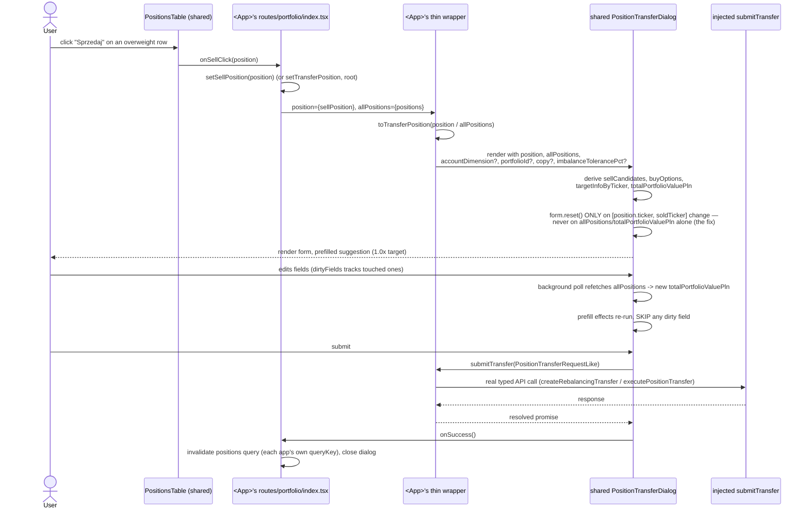

# 136 — Shared `PositionTransferDialog` (Sprzedaj flow)

> **Audience:** Frontend-web, before touching `RebalancingTransferDialog.tsx` (root) or either
> app's `PositionTransferDialog.tsx`. Read this file's diagrams and legends before writing any
> code — this is the committed contract task 136 delegates against. Cross-reference:
> `docs/architecture/05-rebalancing-algorithm.md` §7.9 (root's business rules that stay
> root-only), `docs/architecture/12-portfolio-bpps-and-shared-packages.md` §5 (extraction record,
> same format as `AllocationTreemap`/`DepositsTable`/`CreatePositionDialog`).

> **Task 156 update (Asset / Subasset model):** the type names below are the pre-156 vocabulary.
> In `packages/shared/ui/src/PositionTransferDialog.tsx` `TransferSubPositionLike` is now
> `TransferSubassetLike` and `TransferPositionLike` is `TransferAssetLike` (the old name survives only as a
> deprecated alias that no app imports any more — main's adapter migrated in its 156 frontend wave); `subPositions`
> is now `subassets` (the old key and `isCompanionRow` are still read as deprecated fallbacks nobody feeds any more). The portfolio-b/portfolio-c
> adapters feed an Asset as the sell target (own ticker/price/units = its primary subasset's; target,
> current %, `valuePln` = the Asset's group numbers). Behavior (sell-assist thresholds, suggest-exact-target
> math, polling-stability effects) is unchanged. See `156-frontend-shared-extraction.md` "156 addendum".

## 0. Pattern evaluation

| Pattern / principle | Considered | Verdict |
|---|---|---|
| **Adapter** (Position→`TransferPositionLike`, id-string ↔ real `accountType`/`regularCurrency`) | Yes | **Adopted.** Each app's Position/SubPosition shape and account-field names genuinely differ (`unitsIke*` vs `unitsIkeTata*` vs none); an adapter function per wrapper is the correct seam — matches the `PositionLike<E>` precedent in `AllocationTreemap.tsx` and `DepositLike` in `DepositsTable.tsx`. |
| **Strategy** (injected `submitTransfer`, `accountDimension.allowedBuyAccountIds`) | Yes | **Adopted.** The actual POST call and the ADR-054 wrapper-lock rule are behaviors that vary per app, not data — injected functions, not a switch on an app-id prop. Mirrors `CreatePositionDialog`'s injected `createPosition`. |
| **Template Method** (shared component owns the form lifecycle/effects skeleton; per-app pieces are the hooks) | Yes | **Adopted, implicitly** — the component owns `useForm`/`useFieldArray`/the dirtyFields-guarded prefill effects (the fix this task must not lose); wrappers only supply data/config, never re-implement the effects. |
| **Generics on `TPosition`** (parameterize the component by each app's real `Position` type) | Yes | **Rejected — YAGNI/KISS.** A structural `TransferPositionLike` interface (like `PositionLike<E>`) gives the same decoupling without generic-parameter noise at every call site; the three real `Position` types are structurally close enough that a plain adapter function is simpler than a generic type parameter threaded through the whole component. |
| **Facade over three per-app request DTOs** (one shared Zod schema in `packages/shared/ts`) | Yes | **Rejected, scope boundary.** The three request shapes are genuinely different at the wire level (root: `regularCurrency` + own `/rebalancing-transfers` endpoint/DTO under `pl.investing.dto.transfer`; portfolio-b/portfolio-c: `pl.shared.dto.transfer.PositionTransferRequest` at `/position-transfers`, portfolio optional/required respectively). Unifying the wire contract is a separate, larger backend decision out of this task's scope — see §3 below. The frontend abstraction boundary is `submitTransfer`, which absorbs this without requiring wire-level unification. |
| **Singleton / global store for dialog state** | No | Not applicable — dialog open/close is ordinary per-route `useState`, unchanged by this extraction. |

YAGNI ruled out: no `accountType` enum shared across apps (kept as opaque `string` ids), no attempt to also unify the two different backend endpoints (out of scope, flagged not fixed).

---

## 1. Type contract — class diagram

```mermaid
classDiagram
    class TransferSubPositionLike {
        +string ticker
        +string name
        +number|null pricePln
        +Record~string,number~? unitsByAccount
        +number? units
    }
    class TransferPositionLike {
        +number|null targetAllocationPct
        +number|null currentPct
        +number valuePln
        +boolean? isCompanionRow
        +TransferSubPositionLike[]? subPositions
    }
    TransferPositionLike --|> TransferSubPositionLike : extends

    class TransferAccountOption {
        +string id
        +string label
    }
    class TransferAccountDimension {
        +TransferAccountOption[] options
        +allowedBuyAccountIds(soldId) string[]?
        +formatUnits(units) string?
    }
    TransferAccountDimension "1" o-- "*" TransferAccountOption

    class TransferDialogCopy {
        +string dialogTitlePrefix
        +string soldSectionLabel
        +string buySectionLabel
        +string|null soldHelperText
        +string submitLabel
        +string submitPendingLabel
    }

    class PositionTransferLegLike {
        +string ticker
        +string? accountType
        +number units
        +number pricePln
    }
    class PositionTransferRequestLike {
        +string? portfolio
        +PositionTransferLegLike sold
        +PositionTransferLegLike[] buys
    }
    PositionTransferRequestLike "1" o-- "1" PositionTransferLegLike : sold
    PositionTransferRequestLike "1" o-- "*" PositionTransferLegLike : buys

    class PositionTransferDialog {
        <<packages/shared/ui/src/PositionTransferDialog.tsx>>
        +position TransferPositionLike|null
        +allPositions TransferPositionLike[]
        +accountDimension TransferAccountDimension?
        +portfolioId string?
        +submitTransfer(body) Promise
        +copy Partial~TransferDialogCopy~?
        +imbalanceTolerancePct number?
        +onClose() void
        +onSuccess() void
    }
    PositionTransferDialog ..> TransferPositionLike : uses
    PositionTransferDialog ..> TransferAccountDimension : uses
    PositionTransferDialog ..> TransferDialogCopy : uses
    PositionTransferDialog ..> PositionTransferRequestLike : builds & submits

    class RebalancingTransferDialog_root {
        <<frontend-web/src/components/RebalancingTransferDialog.tsx>>
        toTransferPosition(Position) TransferPositionLike
        accountId to accountType/regularCurrency split
        submitTransfer = createRebalancingTransfer(...)
        allowedBuyAccountIds = ADR-054 wrapper lock
    }
    class PositionTransferDialog_portfolio-b {
        <<apps/portfolio-b/.../PositionTransferDialog.tsx>>
        toTransferPosition(Position) TransferPositionLike
        submitTransfer = executePositionTransfer
        no allowedBuyAccountIds (unrestricted)
        formatUnits = formatAssetUnits(units, assetClass)
    }
    class PositionTransferDialog_portfolio-c {
        <<apps/portfolio-c/.../PositionTransferDialog.tsx>>
        toTransferPosition(Position) TransferPositionLike, no unitsByAccount
        accountDimension = undefined
        submitTransfer = body =>  executePositionTransfer({...body, portfolio})
    }

    RebalancingTransferDialog_root ..> PositionTransferDialog : wraps, injects config
    PositionTransferDialog_portfolio-b ..> PositionTransferDialog : wraps, injects config
    PositionTransferDialog_portfolio-c ..> PositionTransferDialog : wraps, injects config
```

**Legend.** `TransferSubPositionLike`/`TransferPositionLike` are the normalized shape every
wrapper adapts its own generated `Position`/`SubPosition` type into — field names, not the
per-account unit columns, are what differ per app (root: `unitsIke`/`unitsIkze`/
`unitsRegularEur`/`unitsRegularUsd`/`unitsRegularPln`; portfolio-b: `unitsIkeTata`/`unitsIkeMama`/
`unitsIkzeTata`/`unitsIkzeMama`/`unitsInne`; portfolio-c: none, flat `units`). `accountType` on
`PositionTransferLegLike` is an **opaque string** — the shared component never interprets it
beyond "the id the user picked in the Konto `<Select>`." Splitting a composite id like
`"REGULAR_EUR"` back into root's real `{accountType:"REGULAR", regularCurrency:"EUR"}` wire
shape happens inside root's own `submitTransfer` closure, not in the shared component — this is
root-only wire logic (see §3).

---

## 2. Submit flow — sequence diagram (shared across all three wrappers)



**Legend.** The dirtyFields-guarded prefill behavior (root's existing fix, and the one just
hand-applied to portfolio-b/portfolio-c) is drawn as an explicit step inside the shared component — it is
now written **once**, inside `PositionTransferDialog.tsx`, not reproduced per app. Who calls
`invalidateQueries` differs today (root's `RebalancingTransferService` wrapper does not call
`useQueryClient` itself, relying on the route's `onSuccess`; portfolio-b/portfolio-c's wrappers do call it
inside their own `onSuccess`) — this stays a wrapper-level/route-level choice, not something the
shared component should standardize, since it already works correctly both ways.

---

## 3. What stays root-only (not absorbed by this extraction)

Two genuine, backend-enforced behaviors are root-specific and are **not** part of the shared
component's contract — they live entirely inside root's `RebalancingTransferDialog.tsx` wrapper
and root's own backend (`pl.investing.controller.RebalancingTransferController` /
`pl.investing.service.RebalancingTransferService` / `pl.investing.dto.transfer.RebalancingTransferRequest`
at `POST /rebalancing-transfers`) — a **separate endpoint and DTO from portfolio-b/portfolio-c's shared
`pl.shared.controller.PositionTransferController` / `pl.shared.dto.transfer.PositionTransferRequest`
at `POST /position-transfers`**. Backend unification for this concern is therefore **2-way
(portfolio-b+portfolio-c), not 3-way** — root was never migrated onto the shared Java DTO (it carries an
extra `regularCurrency` field the shared `SoldLegDto`/`BuyLegDto` don't have). This is orthogonal
to the frontend extraction below (the shared dialog abstracts over `submitTransfer` regardless of
which endpoint/DTO shape it targets), but is recorded here so nobody mistakes this task for also
unifying the backend contract — it does not, and that remains a separate, larger, not-yet-scoped
decision.

1. **ADR-054 wrapper lock** (`docs/architecture/05-rebalancing-algorithm.md` §7.7) — IKE/IKZE
   sold-leg locks every buy leg to the same wrapper; REGULAR sold-leg allows any destination.
   Exposed generically as the optional `accountDimension.allowedBuyAccountIds` hook; only root's
   wrapper supplies a non-trivial implementation. Backend-enforced (400) independently of the UI.
2. **ADR-054 auto-deposit side effect** and **ADR-063/075 portfolio-scoped `(ticker, portfolio)`
   resolution + companion-row flattening for both legs** — these are root `executeTransfer`
   behaviors, invisible to the frontend contract entirely (the shared dialog already flattens
   `subPositions` for every app identically, matching what all three apps' current dialogs
   already do — this was never root-only in the frontend, only the backend auto-deposit write is).
