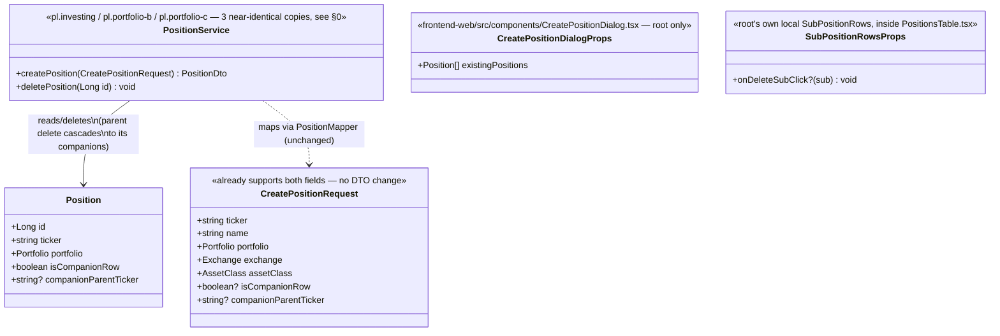
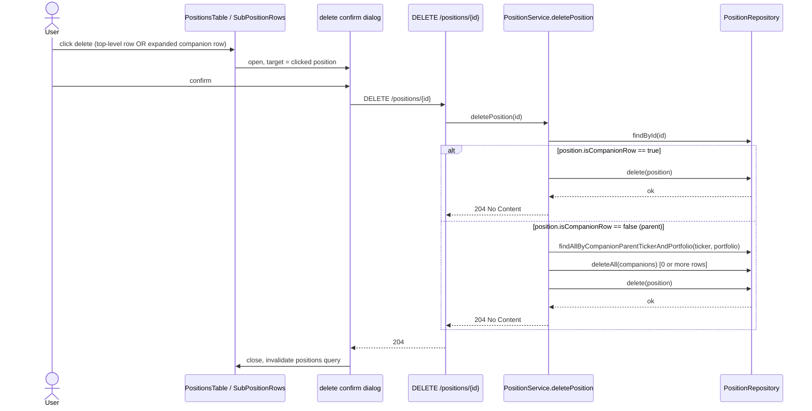

# 137 — Companion-row add/delete via Edit-portfolio UI

> **Audience:** Backend and Frontend-web, before touching any of `CreatePositionDialog.tsx`,
> `PositionsTable.tsx`/`SubPositionRows.tsx`, or `PositionService.deletePosition` in any of the
> three apps. Read this file's diagrams and legends before writing any code — this is the
> committed contract task 137 delegates against. Cross-reference: `docs/architecture/02-domain-model.md`
> §2.1 (companion-row CRUD paragraph) and Decision 12, `docs/architecture/04-db-schema.md`
> (`positions` table + the FK/cascade note), `docs/openapi/paths/positions.yaml` (`delete:`
> operation — cascade, no error case for a parent with companions).

## 0. Pattern evaluation

| Pattern / principle | Considered | Verdict |
|---|---|---|
| **Domain exception + centralized handler** (`PositionHasCompanionsException` → `@ExceptionHandler`, a 409-block on delete) | Yes | **Considered and rejected on reconsideration.** This was this task's initial design (mirroring `PlanSessionAlreadyExistsException`/`SessionAlreadyDoneException`'s pattern in `pl.investing.exception.GlobalExceptionHandler`) and was briefly implemented, then reverted the same day: it adds friction with no real safety benefit in a single-user app where the user themselves initiated the delete, and it was a behavior change from what the app had always done. See Decision 12 in `02-domain-model.md` for the full rationale. No such exception class exists in the final design — `deletePosition` has no error branch for "parent has companions." |
| **Guard clause / fail-fast** (look up companions before touching either row, in `deletePosition`) | Yes | **Adopted.** The companion lookup runs before any row is deleted — parent and companions are then deleted together in one `@Transactional` method, no partial-mutation risk. |
| **Chain of Responsibility** (companion-existence check as a validation handler, mirroring portfolio-b's `TickerValidationHandler`/`TargetPctValidationHandler` in `createPosition`) | Yes | **Rejected — YAGNI.** The delete-time logic is a single lookup + delete-both, not a multi-step pipeline. portfolio-b's chain exists because `createPosition` already has two independent validators; introducing a handler chain for one unconditional cascade adds indirection with no extensibility need in view. |
| **Strategy** (pluggable delete policy — cascade / restrict / orphan — selected by config) | Yes | **Rejected — YAGNI.** Single-user app, one correct policy (cascade — Decision 12), no scenario needs to switch policies at runtime. A `Strategy` interface with one real implementation is pure indirection. |
| **Adapter — reuse already-loaded data as the parent-ticker picker's source** (no new endpoint) | Yes | **Adopted.** The Edit-portfolio page already holds the full `Position[]` from its `listPositions` query; the dropdown filters that client-side to non-companion tickers in the current portfolio. No new query, no Facade. |
| **Template Method — de-duplicate the 3 apps' near-identical `PositionService.deletePosition`** | Yes | **Considered, not adopted in this task.** Confirmed by reading all three: `pl.investing`, `pl.portfolio-b`, `pl.portfolio-c` each carry their own copy of the same cascade bug, with minor signature differences (`findAllByCompanionParentTicker` vs `...AndPortfolio`) and per-app event publishing. De-duplicating into `packages/shared/java` is a real, larger refactor — flagged as a good follow-up, but this task fixes the bug identically in three places rather than blocking the fix on that refactor (scope discipline over cleverness). |

YAGNI also ruled out a dedicated "reassign companion parent" endpoint — `PUT /positions/{id}` already exists and `UpdatePositionRequest` could grow that field later if the two-step delete/reassign flow proves annoying in practice; not built speculatively now.

---

## 1. Type & exception contract — class diagram



**Legend / key decisions:**
- No new exception type or `@ExceptionHandler` registration in any of the three apps —
  `deletePosition` has a single success path (delete parent + its companions, or delete a
  standalone/companion row) and no "parent has companions" error branch to route through
  `GlobalExceptionHandler`. See §0's pattern-evaluation row on the domain-exception approach for
  why it was tried first and reverted.
- `CreatePositionRequest`/`Position` need **zero** DTO/entity changes — `isCompanionRow` and
  `companionParentTicker` have existed on both since the companion-row feature was first built.
  This task is UI + delete-policy only.
- `existingPositions` on root's `CreatePositionDialog` is new — today it has no visibility into
  the rest of the portfolio at all (see §2).

---

## 2. Sequence — create a companion row (investing-app-root)

```mermaid
sequenceDiagram
    actor User
    participant Page as portfolio/index.tsx
    participant Dialog as CreatePositionDialog.tsx
    participant API as POST /positions
    participant Svc as PositionService.createPosition

    Note over Page: `data` (listPositions, size 100,\nportfolio=MAIN) already in memory —\nno new query needed
    User->>Page: click "Dodaj pozycję"
    Page->>Dialog: open, existingPositions = data.data
    Dialog->>Dialog: user checks "Sub-pozycja (wariant innej pozycji)"
    Dialog->>Dialog: parent-ticker <Select> populated from\nexistingPositions.filter(!isCompanionRow)
    User->>Dialog: pick parent ticker, fill remaining fields, submit
    Dialog->>API: {..., isCompanionRow: true, companionParentTicker}
    API->>Svc: createPosition(req)
    Svc-->>API: 201 PositionDto (unchanged code path)
    API-->>Dialog: 201
    Dialog->>Page: onSuccess() -> invalidate positions query
    Page->>Page: table refetches; new row appears\nnested under its parent on expand
```

**Legend:** no new backend behavior here — `createPosition` already accepts and persists both
companion fields. The only thing this task adds on the create side is the frontend affordance
(toggle + dropdown) that lets a user reach the existing capability at all. The dropdown, not free
text, is what prevents a typo'd `companionParentTicker` from ever reaching the API — there is
deliberately no new backend-side existence validation added for this (see §0 YAGNI note and
`02-domain-model.md` §2.1): single-user, UI-only entry point, consistent with the DB's own CHECK
constraint validating only presence, not existence, of the referenced ticker.

---

## 3. Sequence — delete decision (parent vs. companion leaf)



**Legend / key decisions:**
- **Cascade is the final, intentional design — not an oversight.** `deletePosition` looks up
  companions by `(companion_parent_ticker, portfolio)` and deletes them in the same transaction as
  the parent, whether zero or several are found; there is no error branch for "parent has
  companions." This task's first pass briefly replaced this with a `409 POSITION_HAS_COMPANIONS`
  block, then reverted it the same day — see Decision 12 in `02-domain-model.md` for the three
  options weighed (cascade / silent-orphan / 409-block) and why cascade won. Cascading also
  restores the app's pre-existing behavior across all three apps, so no other code path (value
  aggregation, IKE/IKZE eligibility) needs to change.
- **Leaf delete needs no new logic** — the `if (position.isCompanionRow)` branch already existed
  and already did exactly the right thing (plain delete, no companion lookup). Confirmed, not
  changed.
- No confirm-dialog error state to design for this flow — the response is always `204`, whether
  or not companions were removed alongside the parent. The confirm dialog's copy may still want to
  warn the user *before* they confirm when the target has companions (e.g. "this will also delete
  N companion row(s)"), as a UX courtesy, but that is advisory only — nothing blocks on it.
