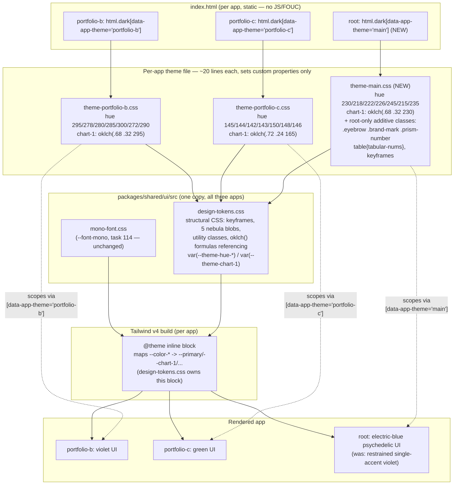

# Root Design-System Convergence — Diagrams (task 139/140, ADR-086)

Companion diagrams for root (investing-app's own `frontend-web`) converging onto the shared
`packages/shared/ui/src/design-tokens.css` mechanism already proven for
`apps/portfolio-b`/`apps/portfolio-c` (task 125 §3 steps 1-3, shipped
2026-08-26). Read this file, plus ADR-086 and
`docs/architecture/12-portfolio-bpps-and-shared-packages.md` §5, before implementing task 139 or
task 140.

## 1. Theme-token cascade — how root's own hue reaches rendered pixels

Same mechanism portfolio-b/portfolio-c already use (a static `data-app-theme` attribute selecting a small
per-app hue file, layered under one shared structural stylesheet); this diagram shows root
joining it as a third leaf, plus where root's own additive (non-hue) CSS sits in the cascade.



**Legend / decisions encoded here:**
- **Strategy pattern, declaratively:** which hue set applies is selected entirely by a data
  attribute, not by branching code — the same "Strategy via CSS custom property" shape task 125
  already established for portfolio-b/portfolio-c. Root adopts it unchanged; no new mechanism is invented.
- **Template Method:** `design-tokens.css` is the fixed algorithm (blob shapes, gradient stop
  counts, keyframe timings, utility-class structure); each `theme-<app>.css` fills in the "hook
  points" (`--theme-hue-*`, `--theme-chart-1`). Root's file fills the same hooks — it does not
  get a parallel structural copy.
- **root's additive classes are a Decorator, not a fork:** `.eyebrow`/`.brand-mark`/
  `.prism-number`/the `table` tabular-nums rule have no portfolio-b/portfolio-c counterpart to converge
  with (`PrismValue`, the `eyebrow`/`description` PageHeader props, and the `brand-mark` span
  are root-only widgets — see diagram 2). They live in `theme-main.css`, layered on top of the
  shared structural base, exactly the same "shared base + small per-app addition" shape ADR-076
  already blessed for root's `badge.tsx` (`tabular-nums`) — not a new precedent.
- **What does NOT change:** `mono-font.css` (task 114, already 3-way shared) is untouched.
  `--font-display`/`--font-sans` and the `@fontsource-variable/{space-grotesk,sora}` imports are
  **deleted**, not converged into a token — root's typography now comes from Tailwind's default
  sans stack, identically to portfolio-b/portfolio-c (no `--font-display`/`--font-sans` keys exist in
  `design-tokens.css`'s `@theme inline` block at all).

## 2. Shared-component prop-shape generalization — `AppLayout` and `PageHeader`

Root's `AppLayout`/`PageHeader` differ from portfolio-b/portfolio-c's **shared** versions by more than
color: root's nav is grouped into titled sections (portfolio-b/portfolio-c's shared `AppLayout` only ever
took a flat `NavItem[]`), and root's `PageHeader` carries real informational content
(`eyebrow`/`description`) the shared `PageHeader` has no prop for. Both gaps are closed by
**generalizing** the shared component's contract (backward-compatible optional additions) rather
than dropping root's content or forking a second component — the same "structural type +
per-app adapter" shape this doc already uses for `PositionLike`/`HistoriaEntryLike`/etc.

```mermaid
classDiagram
    class NavItem {
        +string label
        +string to
        +ReactNode icon
    }
    class NavSection {
        +string title?
        +NavItem[] items
    }
    class AppLayoutProps {
        +Brand brand
        +NavSection[] sections
        +ReactNode topBarExtra?
        +useFxRates() Hook
        +useRefreshPrices() Hook
    }
    class Brand {
        +string label
        +ReactNode mark?
    }
    class SharedAppLayout {
        <<packages/shared/ui>>
        +render() JSX
    }
    class PageHeaderProps {
        +string title
        +string eyebrow?
        +string description?
        +ReactNode actions?
    }
    class SharedPageHeader {
        <<packages/shared/ui>>
        +render() JSX
    }

    class RootAppLayoutWrapper {
        <<frontend-web, thin>>
        +NAV_SECTIONS NavSection[]
        +brand: mark=.brand-mark span
    }
    class Portfolio BAppLayoutWrapper {
        <<apps/portfolio-b, thin>>
        +sections: [{title: undefined, items: NAV_ITEMS}]
    }
    class Portfolio CAppLayoutWrapper {
        <<apps/portfolio-c, thin>>
        +sections: [{title: undefined, items: NAV_ITEMS}]
        +topBarExtra: PortfolioSwitcher
    }

    AppLayoutProps o-- Brand
    AppLayoutProps o-- "many" NavSection
    NavSection o-- "many" NavItem
    SharedAppLayout ..> AppLayoutProps : consumes
    SharedPageHeader ..> PageHeaderProps : consumes

    RootAppLayoutWrapper --> SharedAppLayout : adapts NAV_SECTIONS (already grouped) 1:1
    Portfolio BAppLayoutWrapper --> SharedAppLayout : adapts flat NAV_ITEMS into 1 untitled section
    Portfolio CAppLayoutWrapper --> SharedAppLayout : adapts flat NAV_ITEMS into 1 untitled section

    note for AppLayoutProps "sections replaces the old flat NavItem[] prop.\nBackward-compatible: a single {title: undefined, items}\nentry renders byte-identically to today's flat list\n(no eyebrow row, since the shared component only\nrenders a section eyebrow when title is truthy AND\nitems.length > 1 — root's own existing conditional,\nnow promoted into the shared component)."
    note for PageHeaderProps "eyebrow/description are additive optional props,\nnot present in portfolio-b/portfolio-c call sites today (both\nomit them, rendering identically to the pre-change\nshared PageHeader). Root's call sites keep passing\nreal content — this is a capability extension, not a\ncolor/font change, because eyebrow/description carry\ninformation, not decoration (see ADR-086 for why this\nis excluded from the 'pure visual preference' test)."
```

**Legend / decisions encoded here:**
- **Adapter pattern:** each app's `AppLayout.tsx`/`PageHeader.tsx` stays a thin, app-local wrapper
  that adapts its own real nav data / real content into the shared component's structural
  contract — exactly the shape already established for `PortfolioValueLine`'s
  `HistoriaEntryLike`, `AllocationTreemap`'s `PositionLike`, etc. No shared component ever imports
  an app-generated type.
- **Open/Closed:** `SharedAppLayout`/`SharedPageHeader` are extended (new optional
  fields/generalized prop shape) rather than modified in a way that breaks portfolio-b/portfolio-c's
  existing call sites — both continue to compile and render unchanged with zero prop updates
  beyond the mechanical `NavItem[]` → `[{ items: NavItem[] }]` wrap task 140 performs for them.
- **Card/Badge primitives:** `card.tsx` converges fully (its only differentiator, the
  `font-display` class, disappears once the token is gone) — root drops its local override and
  consumes `@shared/ui-primitives/card` directly, same as portfolio-b/portfolio-c. `badge.tsx` is
  **unaffected and out of scope** — its `tabular-nums` addition is orthogonal to this convergence
  (already a blessed, deliberate one-class local override per ADR-076 §2.1) and stays as-is.
- **`PageShell`:** root's `history`/`deposits` routes already consume the shared `PageShell`
  (task 91, 3-way). Only the `portfolio` route remains on its own early-return shape (task 96)
  — task 140 migrates it too, now that task 96's fix already made its behavior match `PageShell`'s
  existing partial-degrade default. Not shown as a separate diagram: the change is "swap one
  route's loading/error markup for `<PageShell>`," not a new contract.
