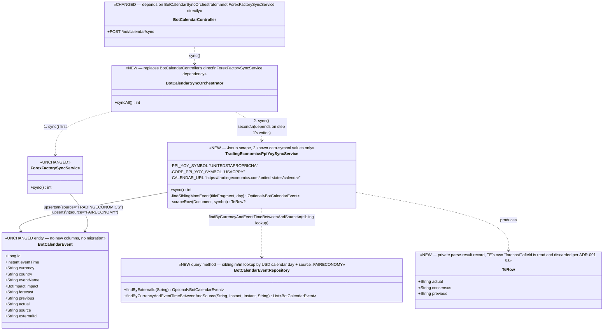

# 145 — PPI YoY / Core PPI YoY calendar enrichment (TradingEconomics, USA-only)

> **Audience:** Backend, before touching `ForexFactorySyncService`, `BotCalendarEvent`,
> `BotCalendarEventRepository`, or `BotCalendarController`. Read this file's diagrams and
> legends first — this is the committed contract task 145 delegates against. Cross-reference:
> `docs/adr/ADR-091-ppi-yoy-calendar-enrichment.md` (full rationale, sources evaluated,
> consequences), `docs/architecture/06-data-flow.md` §10, `.claude/tasks/145-ppi-yoy-calendar-enrichment.task.md`.

## 0. Pattern evaluation

| Pattern / principle | Considered | Verdict |
|---|---|---|
| **Strategy + Spring `List<BotCalendarSyncSource>` fan-out** (each sync source implements a common interface, orchestrator iterates all of them) | Yes | **Rejected.** The TradingEconomics sync has a real, correctness-critical dependency on ForexFactory's sync having already committed its sibling `PPI m/m`/`Core PPI m/m` rows in the same invocation (Decision #2, ADR-091) — a generic, order-unspecified `List<T>` fan-out would hide and could silently break that ordering. Two named, explicitly sequenced calls in a small orchestrator is simpler and cannot get the order wrong. YAGNI also applies: there are exactly two sources, not an open-ended set. |
| **Explicit two-step orchestrator** (`BotCalendarSyncOrchestrator.syncAll()` calls FF then TE, sums counts) | Yes | **Adopted.** Same shape `ForexFactorySyncService.sync()` already uses internally (this-week + next-week, summed) — one more level of the identical pattern, no new abstraction invented. |
| **Adapter** (wrap TE's scraped HTML fields into the same shape `ForexFactorySyncService` already upserts) | Yes | **Adopted, informally.** `TradingEconomicsPpiYoySyncService` produces the same `BotCalendarEvent` shape FF does; no separate DTO/adapter class needed since both write directly to the one entity — a formal `Adapter` class would be ceremony over a same-shape write. |
| **Template Method** (shared base class for "fetch → parse → upsert" between `ForexFactorySyncService` and the new TE service) | Yes | **Rejected — YAGNI.** The two sources differ enough in shape (JSON feed with dozens of events vs. HTML scrape for exactly 2 known symbols, sibling-lookup dependency) that a shared template would mostly be overridden, not reused. Revisit only if a third source appears with genuinely matching shape. |
| **Reuse `BotCalendarEvent`/`BotCalendarEventRepository`/`BotCalendarEventDto` as-is (no new entity/table)** | Yes | **Adopted.** `source` and globally-unique `external_id` already exist precisely to let multiple upstreams write into one table (ADR-091 §4) — a second entity would duplicate the whole read path (`BotCalendarService.list`, the frontend calendar view, `daily-plan.sh`'s queries) for no benefit. |
| **Jsoup HTML parsing, matching `BiznesRadarClient`'s existing style** (ADR-078) | Yes | **Adopted.** Same library already a dependency (`packages/shared/java/pom.xml`), same `RestClient` + explicit `User-Agent` header pattern already proven against a similar unauthenticated public-page scrape. No new parsing dependency. |
| **Live TE indicator-history AJAX endpoint** instead of the public calendar page | Yes | **Rejected.** Unnecessary — the public `/united-states/calendar` page already server-renders `actual`/`previous`/`consensus` with no further request (ADR-091). Chasing the AJAX widget would be more code for a worse (less-verified) result. |
| **FRED/BLS actual-value + trailing-average heuristic as the primary implementation** | Yes | **Rejected for now, documented as deferred fallback (ADR-091 §6).** A real, working, verified free consensus source (TE) exists — building a lower-confidence synthetic-consensus pipeline as the *primary* path would be solving a problem that doesn't exist yet. Revisit only if TE scraping proves unreliable in production. |
| **Generalizing to other countries/indicators** (CNY/JPY y/y rows, which FF already has) | Yes | **Rejected — explicit user instruction.** Scope is USA PPI y/y + Core PPI y/y only. |

---

## 1. Type contract — class diagram



**Legend / key decisions:**
- `BotCalendarEvent` gains **zero columns**. `source="TRADINGECONOMICS"` and the existing
  `forecast`/`previous`/`actual` free-text columns carry everything the new rows need.
- `TeRow` is a private parsing intermediate inside `TradingEconomicsPpiYoySyncService`, not a
  new public DTO — nothing outside that service needs TE's own `forecast` field (discarded, see
  ADR-091 §3), so there is no reason to plumb it further.
- `BotCalendarSyncOrchestrator` is the **only** new piece of control flow. It exists solely to
  make the FF-then-TE ordering explicit and testable in isolation (mock both services, assert
  call order), rather than burying a two-line "call FF, then call TE" sequence inside the
  controller.
- `external_id` for TE rows is `hash("TE|" + eventTime + "|" + title + "|" + currency)` —
  the `"TE|"` prefix guarantees no collision with FairEconomy's identity hash even though the
  hash function itself is the same (`ForexFactorySyncService.hash`, reused as-is or copied
  — Backend's call whether to extract a shared `pl.investing.service.bot.CalendarEventHashing`
  one-liner or duplicate the 3-line method; either is fine, not worth a diagram-level decision).

---

## 2. Sequence — sync + downstream scenario generation

```mermaid
sequenceDiagram
    participant Cron as sync-calendar.sh (05:50)\n/ daily-plan.sh (06:00)
    participant Ctrl as BotCalendarController
    participant Orch as BotCalendarSyncOrchestrator
    participant FF as ForexFactorySyncService
    participant TE as TradingEconomicsPpiYoySyncService
    participant Repo as BotCalendarEventRepository
    participant TEPage as tradingeconomics.com/united-states/calendar
    participant Plan as daily-plan.sh (claude -p step)

    Cron->>Ctrl: POST /bot/calendar/sync (X-Service-Token)
    Ctrl->>Orch: syncAll()
    Orch->>FF: sync()
    FF->>FF: fetch thisweek.json + nextweek.json
    FF->>Repo: upsert rows (source=FAIRECONOMY),\nincl. "PPI m/m" / "Core PPI m/m" if present today
    Repo-->>FF: ok
    FF-->>Orch: upserted count

    Orch->>TE: sync()
    TE->>Repo: findByCurrencyAndEventTimeBetweenAndSource\n("USD", today 00:00, today 24:00, "FAIRECONOMY")
    Repo-->>TE: today's FAIRECONOMY rows
    alt no "PPI m/m" row found today
        TE-->>Orch: 0 (nothing to enrich — most days)
    else "PPI m/m" sibling found
        TE->>TEPage: GET /united-states/calendar
        TEPage-->>TE: server-rendered HTML (Jsoup Document)
        TE->>TE: locate data-symbol='UNITEDSTAPROPRICHA' row,\nparse actual/consensus/previous
        alt row not found / markup changed
            TE->>TE: log warning, skip PPI YoY this run\n(fail-soft, same pattern as FF's per-URL try/catch)
        else row found
            TE->>Repo: upsert BotCalendarEvent\n(eventName="PPI YoY", eventTime=sibling.eventTime,\nimpact=sibling.impact, forecast=consensus,\nsource="TRADINGECONOMICS")
        end
        Note over TE: repeat identically for\ndata-symbol='USACPPY' ("Core PPI YoY")\nagainst the "Core PPI m/m" sibling
        TE-->>Orch: upserted count (0, 1, or 2)
    end
    Orch-->>Ctrl: total upserted
    Ctrl-->>Cron: 200 {upserted: N}

    Note over Plan: later, same run of daily-plan.sh
    Plan->>Ctrl: GET /bot/calendar?from=today&to=+7d&size=50
    Ctrl-->>Plan: CALENDAR array — now includes PPI YoY / Core PPI YoY\nat the SAME eventTime as PPI m/m / Core PPI m/m
    Plan->>Plan: claude -p (prompt.md, UNCHANGED)\nbuilds 7-scenario ladder per event;\nPPI YoY joins the existing 12:30 UTC cluster\nautomatically (prompt.md already handles\nsame-eventTime clusters generically)
    Plan->>Ctrl: POST /bot/plans/ingest
```

**Legend / key decisions:**
- **The sibling lookup is the gate.** On the (large majority of) days with no PPI release at
  all, `TradingEconomicsPpiYoySyncService.sync()` does one cheap repository query, finds
  nothing, and returns immediately — it does **not** fetch `tradingeconomics.com` every day,
  only on the ~12 days/year PPI actually posts. This keeps request volume to TE minimal by
  construction, not just by cron cadence.
- **Fail-soft on scrape failure**, mirroring `ForexFactorySyncService.fetchAndUpsert`'s existing
  per-URL try/catch: a markup change or blocked request degrades to "no PPI YoY row today," never
  to a failed `/bot/calendar/sync` call or a broken FF sync.
- **`infra/bot/daily-plan.sh` and `infra/bot/prompt.md` are unchanged** — shown in the diagram
  only to make explicit that the new rows reach `claude -p` through the exact existing
  `GET /bot/calendar` → `CALENDAR` JSON → prompt path, and that `prompt.md`'s existing
  same-`eventTime`-cluster handling (its own worked example: "Core PPI m/m + PPI m/m +
  Unemployment Claims all at 12:30 UTC") is what absorbs the new events with zero prompt
  changes, because Decision #2 (ADR-091) makes `PPI YoY`'s `eventTime` identical to `PPI m/m`'s.
- **Ordering enforcement**: `BotCalendarSyncOrchestrator.syncAll()` calls `ForexFactorySyncService.sync()`
  to completion (it's `@Transactional`, per the existing class) before calling
  `TradingEconomicsPpiYoySyncService.sync()` — never in parallel, never TE-first. This is the
  one invariant Backend must not accidentally refactor away (e.g. by switching to a `List<T>`
  fan-out later without re-reading this diagram).
