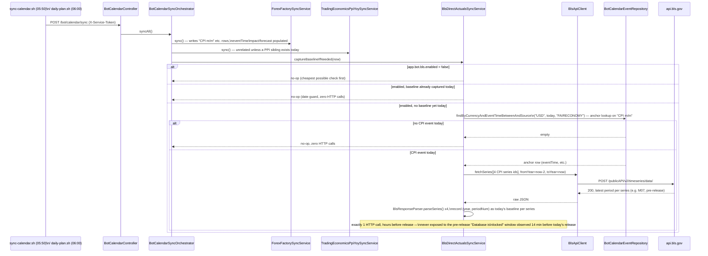
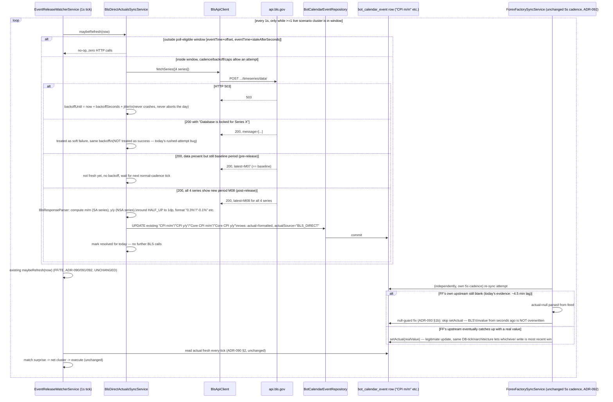
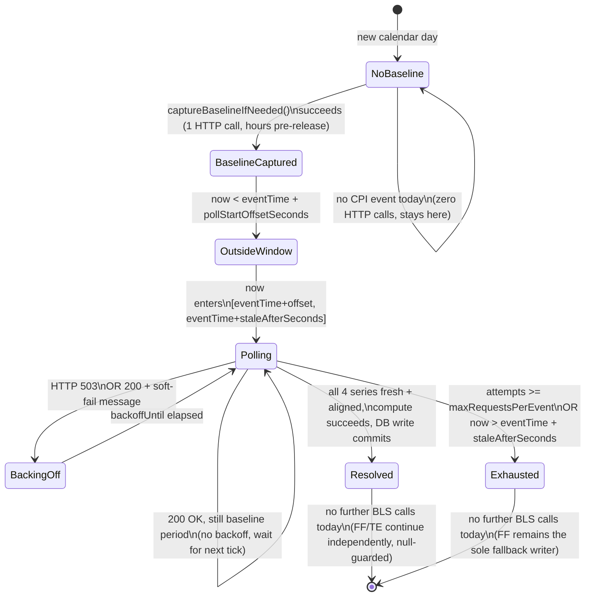

# 147 — BLS direct-fetch CPI actuals (primary path + fallback), freshness detection

> **Audience:** Backend, before touching `EventReleaseWatcherService`, `BotCalendarSyncOrchestrator`,
> `ForexFactorySyncService`, `TradingEconomicsPpiYoySyncService`, or `BotCalendarEvent`. Read this
> file's diagrams and legends first — this is the committed contract task 147 delegates against.
> Cross-reference: `docs/adr/ADR-093-bls-direct-cpi-actuals.md` (full rationale, alternatives
> considered, consequences), `docs/architecture/06-data-flow.md` §12,
> `.claude/tasks/147-architect-output.md` (file-by-file Backend handoff),
> `.claude/tasks/147-bls-direct-fetch-race.task.md` (the day's empirical findings this rests on).

## 0. Pattern evaluation

| Pattern / principle | Considered | Verdict |
|---|---|---|
| **Race primitive** (`CompletableFuture.anyOf`, dedicated executor racing FF/TE/BLS concurrently) | Yes | **Rejected.** ADR-093 §1c: the existing 1-second DB-tick architecture (ADR-090 §2) already resolves "first fresh write wins" once a source's own missing data is never allowed to blank out a previously-written value (§1b's null-guard fix). Building a race primitive on top would duplicate behavior the architecture already provides for free, and would still need its own freshness arbiter to avoid the task's flagged "fast-but-stale beats slow-but-correct" risk — solving an already-solved problem with more code and more failure surface (new thread pool on a 768 MB Pi, matching ADR-090's own rejection of per-event dedicated threads for the identical resource reason). |
| **Adapter** (BLS's raw index-level JSON shaped into the same `bot_calendar_event.actual` string convention FF/TE already write) | Yes | **Adopted, informally** — same posture as ADR-091's TE service: no separate DTO/adapter class, `BlsDirectActualsSyncService` computes the formatted string directly and writes to the existing entity. A formal `Adapter` class would be ceremony over a same-shape write, identical reasoning to ADR-091 §"informally adopted". |
| **Strategy + `List<BotCalendarSyncSource>` fan-out** for a third source | Yes | **Rejected**, same reasoning ADR-091 already established and re-confirmed here: BLS-direct's lifecycle (baseline-once-per-day, then a narrow high-frequency poll window with its own backoff/quota state) is shaped nothing like FF's (always-fetch) or TE's (sibling-gated single fetch) — forcing all three into one interface would produce an interface that fits none of them well. Two small, explicit, differently-timed integration points (§2 below) are simpler and cannot silently reorder anything load-bearing. |
| **Template Method** (shared fetch→parse→upsert base class across FF/TE/BLS) | Yes | **Rejected — YAGNI**, same conclusion ADR-091 reached for FF/TE: three sources with three genuinely different shapes (JSON feed of dozens of events; 2-symbol HTML scrape with a sibling-lookup gate; 4-series POST API with a stateful per-event poll/backoff/freshness machine) would mostly override a shared template, not reuse it. |
| **State machine (explicit)** for BLS's per-event poll lifecycle (`NO_BASELINE → BASELINE_CAPTURED → POLLING → RESOLVED` / `EXHAUSTED`) | Yes | **Adopted** — see the `stateDiagram-v2` below. This is exactly the kind of small, bounded, safety-relevant lifecycle the design-principles skill calls out `State`/`stateDiagram-v2` for; making the transitions explicit is what lets the two BLS failure shapes (503, "Database is locked") and the two hard caps (per-event, per-day) be reasoned about independently of the surrounding poll-cadence code. |
| **Pure static functions for period-parsing/comparison/computation** (`BlsResponseParser`) | Yes | **Adopted** — direct reuse of the precedent `NumericEventValueParser` and ADR-090's own extracted `matchSurprise`/`netCluster` static functions already set: side-effect-free, independently table-testable, no Spring context needed for the highest-risk numeric logic (m/m vs y/y series selection, year-rollover handling) in the whole feature. |
| **Reuse `BotCalendarEvent`/`BotCalendarEventRepository` as-is, update in place rather than create new rows** | Yes | **Adopted, with a twist ADR-091's TE precedent did not need**: CPI rows and their scenarios already exist by the time BLS-direct runs (ADR-093 §2), so this must be an `UPDATE` of the FF-authored row, never an `INSERT` of a new one — the opposite operation from what TE does for PPI YoY, for a structurally different reason (a pre-existing gap vs. a pre-existing row needing a faster overwrite). |
| **New `bot_calendar_event.source` value** (`"BLS_DIRECT"`, task's own suggested shape) | Yes | **Rejected in favor of a new, separate `actual_source` column.** `source` means "who authored `eventTime`/`impact`/`forecast`" throughout the existing code (TE's own sibling-gate query filters on it with that exact meaning). Overloading it to also mean "who last wrote `actual`" would make `source="BLS_DIRECT"` on a CPI row lie about who scheduled it, and would silently change the semantics TE's own existing query relies on. See ADR-093 §8. |
| **Generalizing to PPI in the same pass** | Yes | **Rejected — explicit deferral**, PPI series IDs unverified; see ADR-093 §6. Architecture (per-indicator-family descriptor) is shaped to absorb it additively later. |

---

## 1. Type contract — class diagram

```mermaid
classDiagram
    class BotCalendarEvent {
        +Long id
        +Instant eventTime
        +String currency
        +String eventName
        +BotImpact impact
        +String forecast
        +String previous
        +String actual
        +String source
        +String actualSource
        <<actualSource is NEW (V71) — separate from source,\nsee pattern evaluation table>>
    }

    class BotCalendarEventRepository {
        +findByCurrencyAndEventTimeBetweenAndSource(...) List~BotCalendarEvent~
        <<UNCHANGED — reused verbatim, same query TE's\nsibling lookup already uses>>
    }

    class ForexFactorySyncService {
        +sync() int
        <<CHANGED — one-line null-guard fix on actual only,\nADR-093 §1b>>
    }

    class TradingEconomicsPpiYoySyncService {
        +sync() int
        <<CHANGED — same one-line null-guard fix,\napplied for consistency, CPI-inert today>>
    }

    class BlsApiClient {
        -baseUrl String
        -registrationKey String
        +fetchSeries(List~String~ seriesIds, int fromYear, int toYear) JsonNode
        <<NEW — thin RestClient wrapper, POST + JSON body,\n5s/10s timeouts matching ForexFactorySyncService's shape>>
    }

    class BlsResponseParser {
        +parseSeries(JsonNode) List~BlsDataPoint~
        +isSoftFailure(JsonNode) boolean
        +findLatest(List~BlsDataPoint~) Optional~BlsDataPoint~
        +findPriorMonth(List~BlsDataPoint~, BlsDataPoint latest) Optional~BlsDataPoint~
        +findSameMonthPriorYear(List~BlsDataPoint~, BlsDataPoint latest) Optional~BlsDataPoint~
        +computePctChange(BigDecimal latest, BigDecimal prior) BigDecimal
        +format(BigDecimal pct) String
        <<NEW — pure static functions, no Spring, table-tested\n(mirrors NumericEventValueParser's own shape)>>
    }

    class BlsDataPoint {
        +int year
        +int periodNum
        +BigDecimal value
        <<NEW record>>
    }

    class BlsDirectActualsSyncService {
        -Map~Instant,EventPollState~ pollState
        -Map~String,BlsBaseline~ baselineBySeries
        +captureBaselineIfNeeded(Instant now) void
        +maybeRefresh(Instant now) void
        <<NEW — orchestration/backoff/quota, delegates all\nnumeric work to BlsResponseParser>>
    }

    class EventPollState {
        +int attempts
        +Instant lastAttemptAt
        +Instant backoffUntil
        +boolean resolved
        <<NEW record/holder, keyed by anchor eventTime>>
    }

    class BlsDirectProperties {
        +boolean enabled = false
        +String baseUrl
        +String registrationKey
        +long pollIntervalSeconds = 3
        +long pollStartOffsetSeconds = 0
        +long backoffSeconds = 3
        +long backoffJitterMaxSeconds = 1
        +int maxRequestsPerEvent = 10
        +int maxRequestsPerDay = 20
        <<NEW @ConfigurationProperties(prefix="app.bot.bls")>>
    }

    class BotCalendarSyncOrchestrator {
        +syncAll() int
        <<CHANGED — 3rd step: captureBaselineIfNeeded()>>
    }

    class EventReleaseWatcherService {
        +doTick(Instant now) void
        <<CHANGED — maybeRefresh(now) call added\nalongside the existing FF/TE maybeRefresh>>
    }

    BotCalendarSyncOrchestrator ..> ForexFactorySyncService : 1. sync()
    BotCalendarSyncOrchestrator ..> TradingEconomicsPpiYoySyncService : 2. sync()
    BotCalendarSyncOrchestrator ..> BlsDirectActualsSyncService : 3. captureBaselineIfNeeded()
    EventReleaseWatcherService ..> ForexFactorySyncService : via BotCalendarSyncOrchestrator.maybeRefresh path\n(unchanged)
    EventReleaseWatcherService ..> BlsDirectActualsSyncService : maybeRefresh(now)\n(NEW, sibling call)
    BlsDirectActualsSyncService ..> BlsApiClient : fetchSeries(...)
    BlsDirectActualsSyncService ..> BlsResponseParser : parse/compute/format
    BlsDirectActualsSyncService ..> BotCalendarEventRepository : find existing FF row, update actual
    BlsResponseParser ..> BlsDataPoint : produces
    BlsDirectActualsSyncService --> BotCalendarEvent : UPDATE actual + actualSource\n(never INSERT — see §2 divergence from ADR-091)
    ForexFactorySyncService --> BotCalendarEvent : upsert (actual null-guarded)
    TradingEconomicsPpiYoySyncService --> BotCalendarEvent : upsert (actual null-guarded)
```

**Legend / key decisions:**
- `actualSource` is a new column, **not** a new `source` value — `source` keeps meaning "who
  scheduled this row," `actualSource` means "who last supplied a real `actual`." See the pattern
  evaluation table above for why conflating them was rejected.
- `BlsApiClient` (HTTP mechanics only) is separated from `BlsDirectActualsSyncService`
  (baseline/freshness/backoff/persistence orchestration), the same split already established
  between `OkxTradingClient`/`LiveExecutionService` and `BinanceClient`/`HistoricalPriceService`.
- `BlsResponseParser` takes the exact role `NumericEventValueParser` already plays for FF/TE
  values: a small, pure, independently unit-tested class carrying the highest-risk logic (correct
  series selection, year-rollover handling, rounding/format) out of the stateful service class.
- `EventPollState` is keyed by the anchor event's `eventTime`, pruned once stale — same pattern
  `EventReleaseWatcherService.resolvedClusters`/`clusterFirstActualAt` already use.

---

## 2. Sequence — baseline capture (once/day, hours before release)

## 3. Sequence — release-time poll, freshness detection, and the null-guard fix in effect

**Legend / key decisions:**
- **The freshness test is the period-code comparison, not "did the call succeed."** A 200 OK
  during the pre-release window is explicitly a "not fresh yet" outcome, not an error and not a
  win — it produces no backoff (it's the expected steady state) but also no write.
- **The two BLS failure shapes are handled identically for backoff purposes** (503, "Database is
  locked") — both are "try again shortly" signals; the ADR does not claim to know which resolves
  faster from one day's evidence.
- **The empty-`data[]` guard happens inside `BlsResponseParser.parseSeries`**, before any indexed
  access — the direct fix for today's dry-run `IndexError`, verified by a dedicated unit test
  (architect-output §8).
- **The null-guard fix is what makes "both sources write, no orchestrated race" safe.** Without
  it, FF's own unchanged 5s `maybeRefresh` cadence would periodically erase BLS's already-written
  value every cycle until FF's own upstream caught up — turning a working feature into an
  intermittently-broken one that would look fine in isolated testing (each service tested alone)
  and only fail when both run together against real timing, exactly the shape of bug this
  diagram-first review step exists to catch before Backend writes code.
- All 4 rows are written together, all-or-nothing, per ADR-093 §3.5 — never a partial write where
  some legs show `BLS_DIRECT` and others are still blank mid-release.

---

## 4. State diagram — per-event BLS poll lifecycle

**Legend / key decisions:**
- `Exhausted` is a **terminal, not a retry-forever** state — once `maxRequestsPerEvent` or the
  `staleAfterSeconds` boundary is hit, further BLS polling for that event cannot produce a
  tradeable result anyway (`EventReleaseWatcherService` will have already resolved the cluster to
  `STALE_SKIP`), so continuing to spend quota buys nothing. `Resolved` and `Exhausted` are the only
  two ways out of `Polling`, and both stop further BLS calls for the day for that event —
  `Resolved` because the job is done, `Exhausted` because it cannot succeed usefully anymore.
- The daily global request cap (`maxRequestsPerDay`) is orthogonal to this per-event state
  machine — a second, independent circuit breaker checked before any HTTP attempt regardless of
  which per-event state is active.
