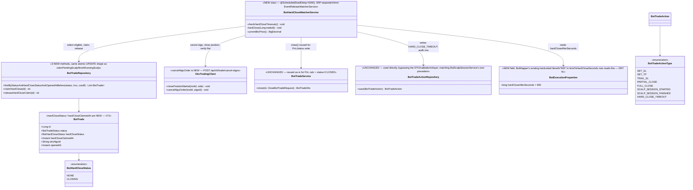

# 148 — Backend Hard-Close Timeout Enforcement for `bot_trade`

> **Audience:** Backend, before touching `BotTrade`, `BotTradeRepository`, `OkxTradingClient`,
> `BotExecutionProperties`, `BotMapper`, `BotTradeActionType`, or adding
> `BotHardCloseWatcherService`. Read this file's diagrams and legends first — this is the
> committed contract task 148 delegates against. Cross-reference:
> `docs/adr/ADR-095-backend-hard-close-timeout.md` (full rationale, alternatives considered,
> consequences), `docs/architecture/06-data-flow.md` §11 and new §13,
> `.claude/tasks/148-architect-output.md` (file-by-file Backend handoff).

## 0. Pattern evaluation

| Candidate / principle | Considered | Verdict |
|---|---|---|
| **State** (`stateDiagram-v2` for a new `hard_close_status` lifecycle) | Yes | **Adopted** — small, bounded, safety-relevant lifecycle (NONE → CLOSING, with a failure path back to NONE), same class of justification ADR-093 gave its own per-event poll state machine. |
| **Outbox/atomic-claim idiom** (ADR-092's `PENDING→RUNNING` single-UPDATE-with-WHERE-guard) | Yes | **Adopted, with a deliberate divergence.** Same mechanism (one atomic `UPDATE ... WHERE` guard, no SELECT-then-UPDATE race) reused for `NONE→CLOSING`. But ADR-092's `RUNNING` **fails closed** (a stuck row is never auto-reclaimed) because other backstops (the SL, and now this very job) remain even if a scalp session dies. Here the hard-close job **must fail open**: a failed OKX attempt reverts `CLOSING→NONE` so the next tick retries, because this job is itself one of the last automated backstops — permanently wedging it after one transient failure would defeat the ADR's purpose. See the `stateDiagram-v2` note below. |
| **New dedicated `BotHardCloseWatcherService`** vs. folding the check into `EventReleaseWatcherService`'s existing 1s tick | Yes | **Adopted (new class), rejected (fold-in).** SRP: entry-timing/calendar-release watching and already-open-position-timeout watching are different concerns. `EventReleaseWatcherService.doTick()` early-returns `if (clusters.isEmpty()) return;` — folding hard-close monitoring into that method would make position-timeout enforcement silently depend on same-day calendar scenario clusters existing, which is wrong: a stuck `OPEN` row from a prior day (e.g. `scalp-launcher.sh` never installed, exactly today's real incident) must always be watched, independent of whether today has any live event. A second `@Scheduled` bean is not "a new pool" in the sense ADR-090 rejected (dedicated executor threads); it rides the same shared Spring `TaskScheduler` five other `@Scheduled` beans already use (`PriceCacheService`, `BotCalendarService`, `MacroDataScheduler`, `HistoriaScheduler`, `GusInflationSyncService`). |
| **Reuse `BotTradeStatus`** (add a third `CLOSING` value) vs. a new, isolated `hard_close_status` column | Reuse: yes; new column: yes | **Rejected (reuse), adopted (new column).** `BotTradeStatus` is read by the frontend trade-history page, `existsByStatus(OPEN)` (the entry-gate in `BotTradeService.create`), and `findByStatus`/`findByStatusAndSide` list filters. Widening it to accommodate an internal concurrency guard would ripple into all of those for zero external benefit. An isolated new column (matching ADR-092's own `scalp_session_status` precedent exactly) has zero blast radius outside this feature. |
| **Template Method** shared between `BotScalpSessionService`'s claim/finish and the new hard-close claim/release | Yes | **Rejected — YAGNI.** Two claim/release pairs, each ~4 lines of JPQL, with *materially different* failure semantics (fail-closed vs. fail-open). Forcing a shared abstraction over two call sites that must not behave the same way under failure is premature abstraction, not reuse. |
| **Retry backoff / circuit breaker** for repeated OKX call failures | Yes | **Rejected — YAGNI, for now.** `maxConcurrentTrades=1` bounds worst-case volume to ~1 cancel+close pair per poll tick (5s) — trivial load. Unconditional retry every tick is simpler *and* safer than a backoff that would delay closing an already-overdue, real-money position even further. Documented as an accepted open risk (loud, frequent audit rows if OKX is down for an extended period), not solved speculatively. |
| **Reuse existing idempotent primitives** (`OkxTradingClient.closePositionMarket` — already a no-op when flat; `BotTradeService.close` — already computes PnL and guards `Already closed`) | Yes | **Adopted.** Both already exist, are already used on the `emergencyClose` path, and are already safe to call twice. Reimplementing position-close or PnL logic fresh here would duplicate and risk drifting from the tested existing logic. |

YAGNI/KISS were the tie-breakers throughout: no new endpoint, no new thread pool, no new generic abstraction — one new small service, one new column pair, one new client method, one new audit action type.

---

## 1. Type contract — class diagram



## 2. Happy-path + failure-path — sequence diagram

```mermaid
sequenceDiagram
    participant Sched as BotHardCloseWatcherService<br/>(@Scheduled fixedDelay=5000)
    participant DB as PostgreSQL (bot_trade)
    participant Okx as OkxTradingClient
    participant Svc as BotTradeService

    loop every 5s, unconditional (no calendar/cluster gate)
        Sched->>DB: SELECT WHERE status='OPEN' AND hard_close_status='NONE'<br/>AND opened_at <= now - hardCloseAfterSeconds
        alt no eligible rows
            DB-->>Sched: []
        else eligible trade found
            Sched->>DB: UPDATE bot_trade SET hard_close_status='CLOSING', hard_close_claimed_at=now<br/>WHERE id=:id AND status='OPEN' AND hard_close_status='NONE'
            alt claim lost (0 rows — already claimed by a prior tick still in flight,<br/>or already closed by a human PATCH /bot/trades/{id}/close)
                DB-->>Sched: 0
                Note over Sched: skip silently — not an error, someone else won or it's already flat
            else claimed (1 row)
                DB-->>Sched: 1
                opt okxAlgoId present
                    Sched->>Okx: cancelAlgoOrder(instId, okxAlgoId)
                    Note over Okx: standalone conditional order, NOT auto-cancelled by a<br/>separate market-close — must be explicitly cancelled to avoid<br/>a dangling order firing later on an unrelated future position
                end
                Sched->>Okx: closePositionMarket(instId, side)
                Note over Okx: reduce-only market order; already a no-op if flat (existing code)
                Sched->>Okx: getPositionContracts(instId)
                alt flat confirmed (0)
                    Okx-->>Sched: 0
                    Sched->>Svc: close(tradeId, CloseBotTradeRequest(currentMarkPrice, null, null))
                    Svc->>DB: status='CLOSED', exitPrice, pnlPln, pnlPct, closedAt=now
                    Sched->>DB: INSERT bot_trade_action (SYSTEM / HARD_CLOSE_TIMEOUT,<br/>reasoning="HARD_CLOSE_TIMEOUT openedAt=... heldSeconds=...")
                else any OKX call throws, OR still not flat
                    Okx-->>Sched: OkxClientException / nonzero contracts
                    Sched->>DB: INSERT bot_trade_action (SYSTEM / HARD_CLOSE_TIMEOUT,<br/>reasoning="HARD_CLOSE_TIMEOUT_RETRY error=...")
                    Sched->>DB: UPDATE bot_trade SET hard_close_status='NONE'<br/>WHERE id=:id AND hard_close_status='CLOSING'
                    Note over Sched,DB: status stays OPEN — retried next tick (5s later),<br/>unlimited retries (bounded call volume: maxConcurrentTrades=1)
                end
            end
        end
    end
```

**Why this does not race Claude's own `FULL_CLOSE` on the exchange today (verified, not assumed):**
`POST /bot/trades/{id}/actions` (`BotTradeActionService.create`) only persists a `bot_trade_action`
audit row — grepping every caller of `OkxTradingClient.closePositionMarket`/`placeStopLossAlgo`
shows exactly one call site, `LiveExecutionService`. Nothing calls OKX in response to a
`FULL_CLOSE`/`TRAIL_SL`/`PARTIAL_CLOSE` action today. So the claim guard above is not racing an
actual exchange-side close right now — it is racing (a) itself across overlapping ticks, and (b) a
possible future action-execution wiring (tracked separately, see the ADR's "Related, out-of-scope
finding"), for which this design is already correct without changes.

## 3. `hard_close_status` lifecycle — state diagram

```mermaid
stateDiagram-v2
    [*] --> NONE : bot_trade row created (any LiveExecutionService outcome)
    NONE --> CLOSING : claimHardClose() succeeds\n(status=OPEN AND hard_close_status=NONE)
    CLOSING --> NONE : any OKX step fails, or position still not flat\n(releaseHardCloseClaim — retried next tick)
    CLOSING --> [*] : close() succeeds → bot_trade.status='CLOSED'\n(hard_close_status left at CLOSING as a historical\nmarker; the authoritative record of *why* is the\nbot_trade_action HARD_CLOSE_TIMEOUT row, not this column)

    note right of CLOSING
        Deliberately fails OPEN (reverts to NONE), not
        closed-forever — diverges from ADR-092's scalp
        RUNNING (which fails closed/permanently, because
        the SL and this very job remain as backstops even
        if a Claude session dies). Here this job IS one of
        the last automated backstops, so a failed attempt
        must stay retryable every poll tick.
    end note
```



## 4. Legend / cross-cutting notes

- **Detection cadence (900s threshold, 5s poll):** the threshold (`hardCloseAfterSeconds`,
  default 900) is configurable via `BotExecutionProperties`; the poll cadence (`fixedDelay=5000`)
  is a code constant, matching `EventReleaseWatcherService`'s own hardcoded `fixedDelay=1000` —
  not property-driven, since cadence is a code-level implementation detail, not a trading
  parameter. 5s (not `EventReleaseWatcherService`'s 1s) is correct here because the position is
  continuously protected by the price-based exchange-side SL the entire time; this job only needs
  to bound the *worst-case overshoot* past the 900s deadline to something small (≤5s typical), not
  react within a fast-decaying news-driven price window the way the 1s tick must.
- **`cancelAlgoOrder` must run before `closePositionMarket`, not after** (see §2 note): if the
  algo-cancel step fails and market-close is skipped, the row stays `OPEN` and visibly
  overdue — a bounded, monitored, retried state. If market-close ran first and algo-cancel then
  failed, the position would show `CLOSED` (nobody looks again) while a dangling standalone
  conditional order remains live on OKX, able to fire at an unrelated future moment and
  open/modify a position nobody is watching for. The first failure mode is strictly safer.
- **DTO/API surface:** no new HTTP endpoint. `BotTradeDto` gains `hardCloseStatus` (mirroring the
  existing `scalpSessionStatus` field) for observability on the existing `/bot` trade-history page;
  the bot module's zero-OpenAPI-paths precedent (ADR-090 §7) is unchanged since nothing here is a
  controller.
