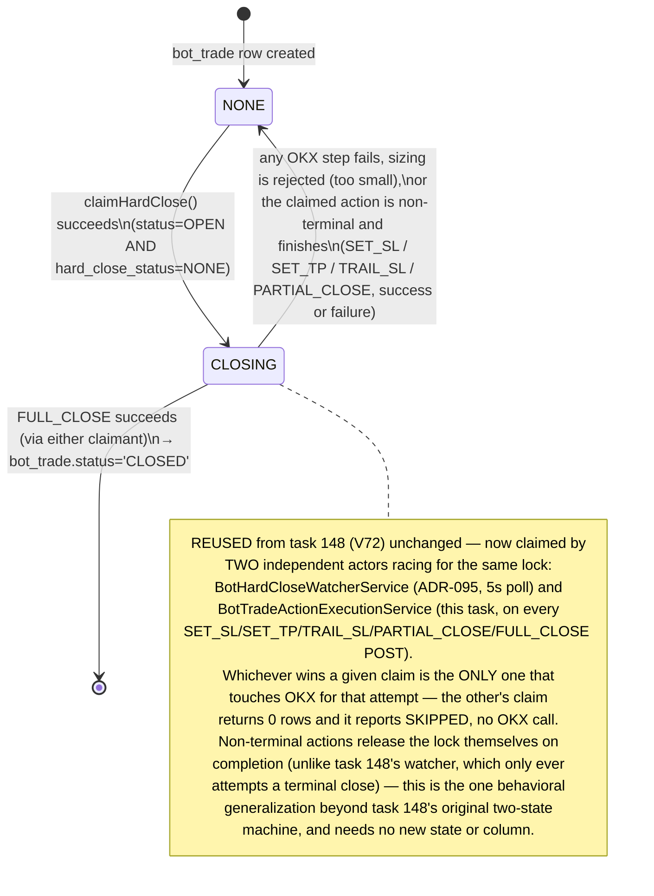

# 149 — Bot Trade Action Execution (Wiring Claude's Decisions to OKX)

> **Audience:** Backend, before touching `BotTradeActionService`, `OkxTradingClient`,
> `BotTrade`, `BotTradeAction`, `BotExecutionProperties`, or adding
> `BotTradeActionExecutionService` / `BotPositionCloseExecutor` / `BotPnlCalculator` /
> `OkxSizing`. Read this file's diagrams and legends first — this is the committed contract
> task 149 delegates against. Also read `docs/architecture/diagrams/148-hard-close-timeout.md`
> (ADR-095) first if you have not already — this task reuses its position-mutation lock and, if
> task 148 has not shipped yet, amends its build spec (see
> `.claude/tasks/148-architect-output.md` §9). Cross-reference: `docs/adr/ADR-096-bot-trade-action-execution.md`
> (full rationale, alternatives, open risks), `docs/architecture/06-data-flow.md` §14,
> `.claude/tasks/149-architect-output.md` (file-by-file Backend handoff).

## 0. Pattern evaluation

| Candidate / principle | Considered | Verdict |
|---|---|---|
| **Facade** (`BotPositionCloseExecutor` wrapping cancel-SL + cancel-TP + market-close + verify-flat behind one call) | Yes | **Adopted.** Both `BotHardCloseWatcherService` (ADR-095/task 148) and the new `BotTradeActionExecutionService`'s `FULL_CLOSE` handler need the *identical* 4-sub-call OKX sequence. A shared, DB-write-free facade is the third-reimplementation-avoidance the brief explicitly asked for — each caller keeps its own retry/response/audit wrapping (genuinely different: the watcher retries forever, this endpoint returns synchronously once), but the OKX orchestration itself is single-sourced. |
| **Strategy / Command** (one class per `BotTradeActionType`, e.g. `SetSlActionHandler`, `PartialCloseActionHandler`) | Yes | **Rejected — YAGNI.** Five cases, each 5-15 lines, dispatched from one `switch` inside `BotTradeActionExecutionService.execute()`. None of the five are pluggable/swappable at runtime, there's no third-party extension point, and a class-per-case hierarchy would scatter closely-related logic (all five share the same claim/release envelope) across five files for no behavioral benefit. Revisit only if a 6th action type with materially different lifecycle needs appears. |
| **Template Method** (claim → try → per-type OKX work → release-on-failure skeleton, shared across the 5 handlers) | Yes | **Adopted, informally.** `execute()` itself *is* the template: claim once, dispatch to a private per-type method that only does the OKX-specific part, uniform catch-and-release wraps all five. Not spelled out as a formal abstract-class Template Method (YAGNI — a private-method dispatch achieves the same shape with far less ceremony for five cases in one class). |
| **Reuse `hard_close_status` NONE↔CLOSING claim** (V72/task 148) as a general position-mutation lock vs. a second, new lock column | Reuse: yes; new column: yes | **Adopted (reuse), rejected (new column).** All five action types, and the hard-close watcher, ultimately do the same thing at the OKX level: mutate or flatten the position. A second, parallel lock column would need its own state machine, its own tests, and — worse — would not actually prevent the real race this design exists to close (a `TRAIL_SL` cancel+replace racing the watcher's `cancelAlgoOrder` on the *same* algo id). One lock, one set of already-designed-and-tested atomic queries (`claimHardClose`/`releaseHardCloseClaim`), reused for a now-slightly-broader purpose. The column name stays `hard_close_status` (renaming risks colliding with task 148's own in-flight implementation) — its Javadoc is widened, not its schema. See ADR-096 Alternatives for the rename option considered and rejected. |
| **Rule of Three — extract `BotPnlCalculator`** (PnL formula: `(exit−entry)×±1×qty×leverage`) | Yes | **Adopted.** The formula is already duplicated in `BotTradeService.close()` and `BotMapper.toDto()` (unrealized PnL). `PARTIAL_CLOSE`'s realized-PnL booking is a genuine third call site — the textbook Rule of Three trigger for extraction, not speculative. A drifted copy of this formula is a real-money correctness bug, which raises the cost of *not* extracting relative to typical DRY calls. |
| **Extract `OkxSizing.contractsFor`** from `LiveExecutionService`'s private method | Yes | **Adopted.** `PARTIAL_CLOSE`, `SET_SL`/`TRAIL_SL`, and `SET_TP` all need "BTC quantity → OKX contracts, DOWN-rounded to lotSz 0.1" — the exact conversion `LiveExecutionService.contractsFor` already implements privately. A second, textually-identical copy is a drift risk on the same order as the PnL formula (wrong contract sizing = wrong order size = real money); extracted to a small static utility instead. |
| **Extract a shared `currentBtcPrice()` helper** (now duplicated a 5th time in `BotTradeActionExecutionService`) | Yes | **Rejected — consistent with task 148's own explicit precedent.** Task 148 already found this 3-line lookup duplicated three times (`LiveExecutionService`, `BotTradeService`, `BotScalpSessionService`) and explicitly declined to extract it ("a fourth near-duplicate is consistent with the existing codebase's own choice not to unify them... a separate, optional cleanup, not part of this task's scope"). A 5th near-duplicate here follows the same, already-made call — trivial code, no drift risk (it's a single filter+map+findFirst, not an arithmetic formula), not worth relitigating mid-task. |
| **Two independent standalone conditional orders (SL + TP)** vs. one combined OKX bracket order (`slTriggerPx`+`tpTriggerPx` on a single `order-algo` call) | Yes | **Rejected (combined bracket).** OKX's `order-algo` endpoint does support both trigger legs on one order. But `placeStopLossAlgo` already treats the SL as an independent, freely cancel-and-replaceable standalone order — merging SL+TP into one bracket order would mean *cancelling and losing the other leg* every time either one is adjusted (a `TRAIL_SL` would silently drop the take-profit, and vice versa), which is a worse, surprising behavior compared to two independent orders with independent lifecycles. Simpler mental model, matches the existing SL precedent exactly, costs one extra cancel call on a full close (already inside the shared `BotPositionCloseExecutor.closeFully`). |
| **Server-computed `PARTIAL_CLOSE` fraction (config, default 50%)** vs. trusting the client-submitted `quantity` | Both considered | **Adopted (server-computed).** `manage-prompt.md`'s own contract hardcodes "PARTIAL_CLOSE (50%)" in prose — there is no dynamic per-decision sizing anywhere else in this system. Trusting a raw LLM-submitted `BigDecimal` to directly size a real-money reduce-only order is an unnecessary and unjustified trust boundary to open; a config-driven percentage (`BotExecutionProperties.partialClosePct`) is simpler, safer, and still an ADR-amendment-gated number like every other trading constant in this module. The client-submitted `quantity` is still persisted verbatim on the audit row (unchanged), just never used to size the order. |

YAGNI/KISS were the tie-breakers throughout: no per-action-type class hierarchy, no second lock column, no combined bracket order, no new endpoint — one new orchestration service, one new close-facade, two small static-utility extractions justified by an actual third call site each, four new `bot_trade` columns, three new `bot_trade_action` columns.

---

## 1. Type contract — class diagram

```mermaid
classDiagram
    class BotTrade {
        +Long id
        +BotAction side
        +BotTradeStatus status
        +BigDecimal quantity
        +BigDecimal entryPrice
        +Short leverage
        +String okxAlgoId
        +String okxTpAlgoId
        +BigDecimal slTriggerPrice
        +BigDecimal tpTriggerPrice
        +BigDecimal realizedPnlPln
        +BotHardCloseStatus hardCloseStatus
        +Instant hardCloseClaimedAt
        <<okxTpAlgoId / slTriggerPrice / tpTriggerPrice /\nrealizedPnlPln are NEW — V73.\nhardCloseStatus/hardCloseClaimedAt are V72 (task 148),\nREUSED here as a general position-mutation lock>>
    }

    class BotTradeAction {
        +Long id
        +BotTradeActionType actionType
        +BigDecimal price
        +BigDecimal quantity
        +String reasoning
        +BotActionSource source
        +BotActionExecutionStatus executionStatus
        +String executionError
        +BigDecimal executedQuantity
        <<executionStatus/executionError/executedQuantity\nare NEW — V73>>
    }

    class BotActionExecutionStatus {
        <<enumeration>>
        NOT_APPLICABLE
        EXECUTED
        FAILED
        SKIPPED
        <<NEW enum. NOT_APPLICABLE = default for\nSYSTEM rows written directly, bypassing this endpoint>>
    }

    class BotTradeActionService {
        +create(tradeId, CreateBotTradeActionRequest) BotTradeActionDto
        +list(tradeId) List~BotTradeActionDto~
        <<create() CHANGED: validates actionType is one of\nthe 5 executable types (400 otherwise), persists first\n(TX1, unchanged shape), then delegates execution,\nthen applies the outcome (TX2) — no longer one\nsingle @Transactional method wrapping an OKX call>>
    }

    class BotTradeActionExecutionService {
        +execute(tradeId, BotTradeActionType, CreateBotTradeActionRequest) ExecutionOutcome
        -fullClose(BotTrade) void
        -partialClose(BotTrade, req) BigDecimal
        -applyStopLoss(BotTrade, price) void
        -applyTakeProfit(BotTrade, price) void
        <<NEW class. Claims the SAME hard_close_status lock\n(V72) for all 5 action types before touching OKX;\nreleases on any failure, leaves CLOSING only on a\nsuccessful FULL_CLOSE (matches task 148's own state\ndiagram exactly, no new states needed)>>
    }

    class ExecutionOutcome {
        +BotActionExecutionStatus status
        +String error
        +BigDecimal executedQuantity
        <<NEW record — return type only, not persisted directly;\nBotTradeActionService writes it onto the BotTradeAction row>>
    }

    class BotPositionCloseExecutor {
        +closeFully(BotTrade) void
        <<NEW, SHARED with BotHardCloseWatcherService (task 148).\nCancels SL algo (if present), cancels TP algo (if present —\nNEW leg, didn't exist when task 148 was first speced),\nmarket-closes, verifies flat. No DB writes — pure OKX\norchestration; throws OkxClientException on any failure\nor non-flat result, caller owns retry/persist semantics.\nWhichever of task 148 / task 149 lands first builds this\nclass; the other reuses it unchanged.>>
    }

    class BotPnlCalculator {
        <<utility, static methods>>
        +pnl(side, entryPrice, exitPrice, quantity, leverage)$ BigDecimal
        <<NEW static utility — 3rd call site (PARTIAL_CLOSE's\nrealized-PnL booking) triggers Rule-of-Three extraction\nfrom BotTradeService.close() and BotMapper.toDto()>>
    }

    class OkxSizing {
        <<utility, static methods>>
        +contractsFor(quantityBtc, ctVal, price)$ String
        <<NEW static utility, extracted from\nLiveExecutionService's private contractsFor —\nsame DOWN-rounding/lotSz-0.1/null-on-too-small\nsemantics, now shared by 2 real call sites>>
    }

    class OkxTradingClient {
        +closePositionMarket(instId, side) void
        +closePositionPartialMarket(instId, side, szContracts) void
        +cancelAlgoOrder(instId, algoId) void
        +placeStopLossAlgo(instId, closeSide, sz, triggerPx) String
        +placeTakeProfitAlgo(instId, closeSide, sz, triggerPx) String
        +getContractValue(instId) BigDecimal
        +getPositionContracts(instId) BigDecimal
        <<closePositionPartialMarket + placeTakeProfitAlgo are NEW.\ncancelAlgoOrder is SHARED with task 148 — do not\nre-add if task 148 already shipped it; see ADR-096 §1.>>
    }

    class BotTradeRepository {
        +claimHardClose(id) int
        +releaseHardCloseClaim(id) int
        <<REUSED VERBATIM from task 148 (V72) — Javadoc widened\nto describe a general position-mutation lock, no query\nor column change. See ADR-096 Decision §1.>>
    }

    BotTradeActionService --> BotTradeActionExecutionService : execute() after persisting audit row
    BotTradeActionExecutionService --> BotTradeRepository : claim/release lock
    BotTradeActionExecutionService --> BotPositionCloseExecutor : FULL_CLOSE only
    BotTradeActionExecutionService --> OkxTradingClient : SET_SL/SET_TP/TRAIL_SL/PARTIAL_CLOSE
    BotTradeActionExecutionService --> BotPnlCalculator : PARTIAL_CLOSE realized-PnL booking
    BotTradeActionExecutionService --> OkxSizing : sizing for every non-FULL_CLOSE type
    BotTradeActionExecutionService --> ExecutionOutcome : returns
    BotPositionCloseExecutor --> OkxTradingClient
    BotTradeAction --> BotActionExecutionStatus
    BotTrade --> BotTradeAction : one-to-many
```



## 2. `FULL_CLOSE` / `PARTIAL_CLOSE` — sequence diagram (lock reuse, shared close facade)

```mermaid
sequenceDiagram
    participant Sh as scalp-session.sh<br/>(Claude, via curl)
    participant Svc as BotTradeActionService
    participant Exec as BotTradeActionExecutionService
    participant DB as PostgreSQL (bot_trade / bot_trade_action)
    participant Close as BotPositionCloseExecutor
    participant Okx as OkxTradingClient

    Sh->>Svc: POST /bot/trades/{id}/actions<br/>{actionType, price, quantity, reasoning}
    Svc->>Svc: validate actionType ∈ {SET_SL,SET_TP,TRAIL_SL,PARTIAL_CLOSE,FULL_CLOSE}<br/>(400 otherwise — NEW, previously unvalidated)
    Svc->>DB: TX1 — INSERT bot_trade_action<br/>(execution_status='NOT_APPLICABLE' — always written first)
    Svc->>Exec: execute(tradeId, actionType, req)
    Exec->>DB: UPDATE bot_trade SET hard_close_status='CLOSING'<br/>WHERE id=:id AND status='OPEN' AND hard_close_status='NONE'<br/>(SAME atomic claim as BotHardCloseWatcherService, task 148)
    alt claim lost (0 rows — watcher already closing it, or trade already CLOSED)
        DB-->>Exec: 0
        Exec-->>Svc: ExecutionOutcome(SKIPPED, "position-mutation lock held or trade not OPEN", null)
    else claimed (1 row)
        DB-->>Exec: 1
        alt actionType == FULL_CLOSE
            Exec->>Close: closeFully(trade)
            Close->>Okx: cancelAlgoOrder(instId, okxAlgoId) — if present
            Close->>Okx: cancelAlgoOrder(instId, okxTpAlgoId) — if present (NEW leg)
            Close->>Okx: closePositionMarket(instId, side) — idempotent, reused unchanged
            Close->>Okx: getPositionContracts(instId) == 0 ?
            alt flat
                Okx-->>Close: 0
                Close-->>Exec: (returns normally)
                Exec->>DB: BotTradeService.close(tradeId, CloseBotTradeRequest(markPrice, null, null))<br/>— pnlPln = pnl(remaining quantity) + realized_pnl_pln (from any prior PARTIAL_CLOSE)
                Note over Exec,DB: hard_close_status LEFT at CLOSING (terminal, matches<br/>task 148's own state diagram — success never releases)
                Exec-->>Svc: ExecutionOutcome(EXECUTED, null, trade.quantity)
            else any OKX step throws, or still not flat
                Close-->>Exec: throws OkxClientException
                Exec->>DB: UPDATE hard_close_status='NONE' WHERE id=:id AND hard_close_status='CLOSING'<br/>(released — retryable by next Claude beat OR the watcher's next 5s tick)
                Exec-->>Svc: ExecutionOutcome(FAILED, e.getMessage(), null)
            end
        else actionType == PARTIAL_CLOSE
            Exec->>Okx: getContractValue(instId)
            Exec->>Exec: closeQtyBtc = trade.quantity × partialClosePct (config, default 0.5)<br/>sz = OkxSizing.contractsFor(closeQtyBtc, ctVal, markPrice)
            alt sz too small (< 1 lot)
                Exec->>DB: UPDATE hard_close_status='NONE' (released)
                Exec-->>Svc: ExecutionOutcome(SKIPPED, "remaining quantity below min lot", null)
            else sz valid
                Exec->>Okx: closePositionPartialMarket(instId, side, sz)
                Exec->>Exec: realizedPnl = BotPnlCalculator.pnl(side, entry, markPrice, closeQtyBtc, leverage)
                Exec->>DB: trade.quantity -= closeQtyBtc; trade.realizedPnlPln += realizedPnl
                opt slTriggerPrice or tpTriggerPrice set
                    Exec->>Okx: cancel + re-place SL/TP algo at SAME price,<br/>NEW (smaller) size — see §3 for the cancel+replace shape
                end
                Exec->>DB: UPDATE hard_close_status='NONE' (released — non-terminal)
                Exec-->>Svc: ExecutionOutcome(EXECUTED, null, closeQtyBtc)
            end
        end
    end
    Svc->>DB: TX2 — UPDATE bot_trade_action SET execution_status=..., execution_error=..., executed_quantity=...
    Svc->>DB: re-fetch fresh BotTrade (status/quantity may have just changed)
    Svc-->>Sh: 200 { ...action fields..., executionStatus, executionError,<br/>tradeStatus, tradeRemainingQuantity }
```

## 3. `SET_SL` / `TRAIL_SL` / `SET_TP` — cancel-and-replace sequence

```mermaid
sequenceDiagram
    participant Exec as BotTradeActionExecutionService
    participant Okx as OkxTradingClient
    participant DB as PostgreSQL (bot_trade)

    Note over Exec: lock already claimed (see §2) before reaching here

    alt actionType == SET_SL or TRAIL_SL
        Note over Exec: SAME handler for both — confirmed against manage-prompt.md:<br/>both are "cancel existing SL algo, place a new one at req.price()."<br/>Kept as 2 distinct enum values for audit-trail readability only<br/>(a human wants to see "tightened" vs. "(re)set" in the log),<br/>not because OKX distinguishes them.
        opt trade.okxAlgoId present
            Exec->>Okx: cancelAlgoOrder(instId, trade.okxAlgoId)
        end
        Exec->>Okx: getContractValue(instId)
        Exec->>Exec: sz = OkxSizing.contractsFor(trade.quantity, ctVal, markPrice)
        Exec->>Okx: placeStopLossAlgo(instId, closeSide, sz, req.price())
        Okx-->>Exec: new algoId
        Exec->>DB: trade.okxAlgoId = new algoId; trade.slTriggerPrice = req.price()
    else actionType == SET_TP
        opt trade.okxTpAlgoId present
            Exec->>Okx: cancelAlgoOrder(instId, trade.okxTpAlgoId)
        end
        Exec->>Okx: getContractValue(instId)
        Exec->>Exec: sz = OkxSizing.contractsFor(trade.quantity, ctVal, markPrice)
        Exec->>Okx: placeTakeProfitAlgo(instId, closeSide, sz, req.price())
        Note over Okx: mirrors placeStopLossAlgo's shape (tpTriggerPx/tpOrdPx=-1)<br/>— UNVERIFIED against real OKX response key ("take-profit"?),<br/>see ADR-096 Open Risk #1
        Okx-->>Exec: new tpAlgoId
        Exec->>DB: trade.okxTpAlgoId = new tpAlgoId; trade.tpTriggerPrice = req.price()
    end
    Exec->>DB: UPDATE hard_close_status='NONE' (released — non-terminal, success or failure)
```

## 4. Position-mutation lock — generalized state diagram (extends task 148's, no new states)



## 5. Legend / cross-cutting notes

- **Why the lock is claimed for non-terminal actions too, not just `FULL_CLOSE`:** the concrete
  race this closes is `TRAIL_SL`'s cancel-then-replace of `okxAlgoId` overlapping
  `BotHardCloseWatcherService`'s own `cancelAlgoOrder` call on the *same* algo id — both are real,
  independent OKX mutations against the same trade, and only one may safely be in flight at a
  time. A lock scoped to `FULL_CLOSE` alone would not prevent this.
- **Why failures never leave the lock stuck:** every code path in §2/§3 either transitions to
  `[*]` (successful `FULL_CLOSE`, terminal — matches task 148's diagram exactly) or explicitly
  releases back to `NONE`. There is no code path that claims and never releases or terminates —
  verified by construction: `execute()`'s single `catch` block (see task 149's build spec)
  uniformly releases on any exception from any of the five handlers.
- **Why `BotTradeActionService.create()` is no longer one `@Transactional` method:** OKX HTTP
  calls (`RestClient`, 5-10s timeouts) must never run inside an open DB transaction/connection —
  none of the existing trading code (`LiveExecutionService`, and task 148's
  `BotHardCloseWatcherService`) does this either; they sandwich non-transactional OKX calls
  between small, separately-`@Transactional` persistence steps. `create()` now follows the same
  shape: TX1 (persist raw decision) → non-transactional `execute()` (claim is its own tiny TX,
  OKX calls have no open TX, outcome-apply is its own tiny TX) → TX2 (write the outcome onto the
  already-persisted row).
- **Why the response is always HTTP 200 for a validly-typed, existing-trade request, with
  success/failure encoded in the body (`executionStatus`), not the status line:** `scalp-session.sh`
  hands Claude direct `curl` access (`--allowedTools "Bash(curl:*)"`) — Claude reads the raw stdout
  of its own `curl` invocation, which by default does not surface the HTTP status line unless the
  command explicitly requests it (`-w`). Putting the signal in the JSON body Claude already parses
  per its own output contract is the reliable channel; a 4xx/5xx status alone could go unnoticed.
  Malformed requests (unknown `actionType`, trade not found) are the one exception and keep their
  existing 400/404 — those are client-request problems, not exchange-execution outcomes.
- **Why the response also carries `tradeStatus`/`tradeRemainingQuantity` (new, response-only,
  not persisted):** `scalp-session.sh` fetches `bot_trade` state exactly once, at session start,
  and never re-fetches it inside Claude's per-beat loop (verified by reading the script — only
  `watch-market.sh`, price/volume data, is re-polled per beat). The action-response body is
  therefore Claude's *only* feedback channel about whether the trade it thinks it's managing is
  still open, and at what size — most load-bearing exactly when `executionStatus=SKIPPED` because
  the hard-close watcher already claimed and closed it out from under a stale-viewed session. This
  is flagged as a related, NOT-fixed-here finding in ADR-096 (Consequences) — a fuller fix would
  have `watch-market.sh` return fresh trade state each beat too.
