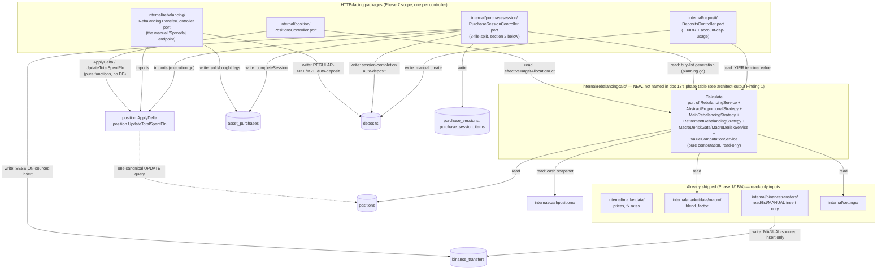
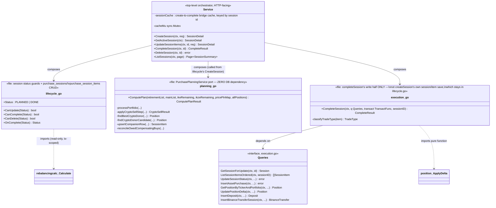
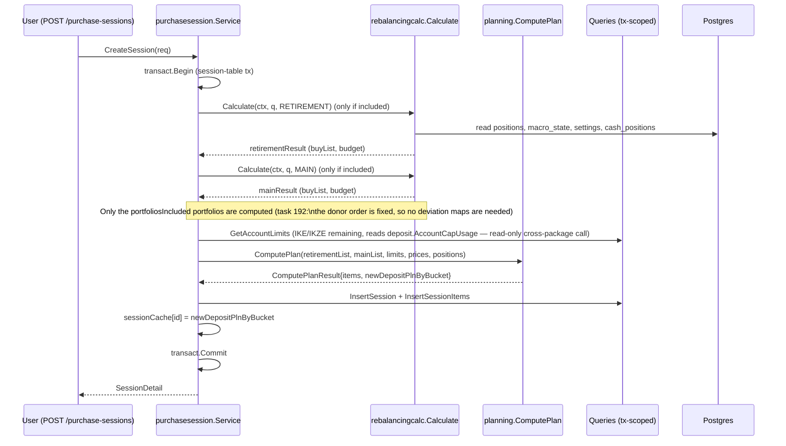
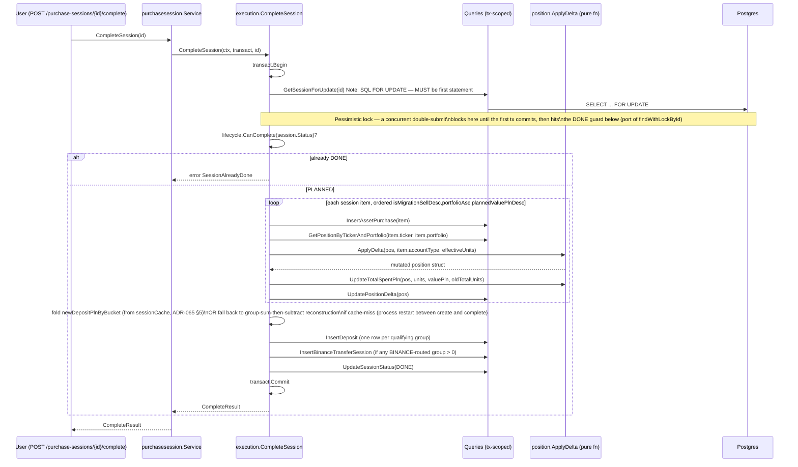
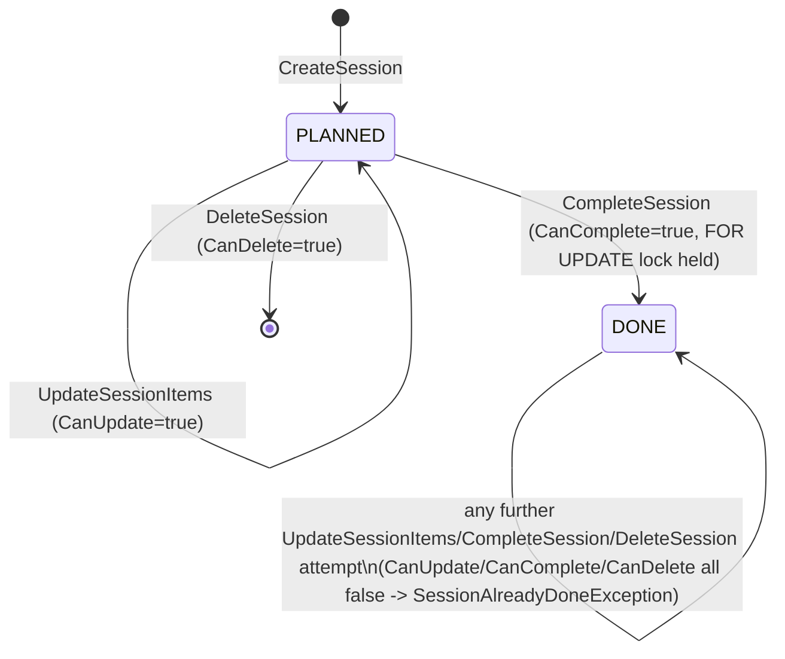

# 150 — Phase 7 Core Money Cluster: Go Package Design

> **Audience:** Backend-Go, before writing any code under `backend-go/internal/position/`,
> `internal/rebalancing/`, `internal/purchasesession/`, `internal/deposit/`, or the new
> `internal/rebalancingcalc/`. Read this file's diagrams and legends first, plus
> `.claude/tasks/150-architect-output.md` (the file-by-file design-review handoff this diagram doc
> supports). Cross-reference: `docs/architecture/13-go-backend-target-architecture.md` §5/§6.3/§7,
> `docs/architecture/05-rebalancing-algorithm.md` §7.5/§8, `.claude/tasks/go-rewrite-phase-7-core-money-cluster.task.md`.

## 0. Pattern evaluation

| Candidate / principle | Considered | Verdict |
|---|---|---|
| **State** (session `PLANNED`→`DONE`) | Yes | **Adopted, simplified.** Java's `SessionState` interface + `PlannedState`/`DoneState` genuinely varies behavior by current state (4 predicates + 1 transition) — a real State pattern, correctly used, not a smell. Go has no need for the interface-plus-two-structs shape for a 2-state/4-predicate machine: collapses to a `Status` string type + 4 pure functions (`CanUpdate`, `CanComplete`, `CanDelete`, `OnComplete`) doing a `switch`. Same intent (behavior keyed by state), no class ceremony. |
| **Template Method / Factory Method** (`AbstractProportionalStrategy` + `MainRebalancingStrategy`/`RetirementRebalancingStrategy` + `RebalancingStrategyFactory`) | Yes | **Rejected as class hierarchy — collapses to one function (doc 13 §5 point 2, already named there by ticker).** Five of six template steps are identical between MAIN and RETIREMENT; only `allocateToAccounts`-equivalent genuinely differs, and even that is now just "which budget/target source." Go port: one `Calculate` function taking a small `portfolioConfig` value (budget, whether the macro de-risk override applies), not two structs implementing a `RebalancingStrategy` interface selected by a factory. |
| **Visitor** (`XirrVisitor implements ValuationVisitor`, called from `XirrService`) | Yes | **Rejected (doc 13 §5 point 3 / §1).** Confirmed by direct read of `service/history/XirrVisitor.java`: `visitHistoria` is an empty no-op override — pure ceremony. Go port: a plain loop building `[]CashFlow` structs, no `Visitor` interface. |
| **Command** (`PurchaseCommand`/`CreateSessionCommand`/`CompleteSessionCommand`) | Yes | **Rejected — confirmed dead code, do not port.** `grep -rln "CreateSessionCommand\|CompleteSessionCommand\|PurchaseCommand" backend/src` outside `service/purchase/` returns nothing: `PurchaseSessionController` calls `purchaseSessionService.createSession(req)` directly. This is the same "proposed, never wired up" smell doc 13 §5 point 1 names for the repository-factory — except here the dead classes were actually written. Do not port. |
| **Abstract-Factory / repository-factory** (per doc 13 §5 point 1) | N/A here | **Not applicable to Phase 7.** That smell is about cross-app (portfolio-b/portfolio-c) entity production; Phase 7 is investing-app-only. No action needed. |
| **Bridge-via-composition** (`PositionDeltaApplicator`) | Yes | **Adopted, simplified further than doc 13 §5 anticipated.** `PositionDeltaApplicator` already has zero DB dependency in Java — it only mutates an in-memory `Position` entity's `BigDecimal` fields (see architect-output §2). Go port needs no interface at all: two plain functions, `position.ApplyDelta` and `position.UpdateTotalSpentPln`, over a domain struct. Simpler than even a Strategy/Bridge interface. |
| **Unit-of-Work via `TransactFunc` closure** (`func(ctx, func(Queries) error) error`, `pool.Begin`/`WithTx`/commit-rollback) | Yes | **Adopted — direct reuse of the established Phase 1B/2/3/5 idiom**, confirmed present in `backend-go/cmd/server/main.go` (`newMacroService`, `newInflationService`, `newCashPositionsService`, `newHistoriaService`, `newPlanService`, `newTradeService` all build this exact closure). Not a new pattern — Phase 7 needs no invention here, just more instances of the same shape, one per package that needs multi-statement atomicity. |
| **SQL-literal + static-grep guard test** (`TestNoCompletionSourcedWriteInPackage` in `internal/binancetransfers`) | Yes | **Adopted — direct reuse of the established Phase 4 idiom** for enforcing single-writer-per-source-value on a shared table. Phase 7 should add the mirror guard in `internal/purchasesession` (never write `source='MANUAL'`). |

YAGNI/KISS tie-breakers: no per-strategy class hierarchy, no Command objects, no Visitor, no new repository-factory abstraction, no sub-packages beyond what the phase task itself asked for (three files, one package).

---

## 1. Package map and write-ownership (confirms/refines doc 13 §6.3)



*Legend.* Solid arrows are compile-time Go imports or DB writes; dashed arrows call out the single
canonical SQL entry point for a table two-or-more packages touch. Two tables have more than one
writer, exactly as doc 13 §6.3 found in Java — `positions` (via the shared `position.ApplyDelta`
pure function, called from three packages but backed by **one** sqlc UPDATE query) and
`binance_transfers` (via **two separate** sqlc INSERT queries, one per package, each hardcoding its
own `source` literal — the same split Phase 4 already built and statically enforced, see
architect-output §2). `deposits` has **three** writers (`internal/deposit` manual create,
`internal/rebalancing` auto-deposit, `internal/purchasesession` auto-deposit) but only **one**
`InsertDeposit` sqlc query — no shared abstraction needed beyond the one generated method, since
there is no arithmetic to share (each caller just sets its own `capital_source`).

---

## 2. `internal/purchasesession/` — the 3-file split



*Legend.* This confirms the phase task's proposed 3-way split **is** the right decomposition, with
one refinement: `createSession`'s own persistence of the new `purchase_sessions`/
`purchase_session_items` rows belongs to **lifecycle.go**, not execution.go — it never touches
`positions`/`deposits`/`asset_purchases`/`binance_transfers`. Only `completeSession`'s body does,
so **execution.go's scope is exactly and only `completeSession`** — this is a narrower, more
precise boundary than "trade-execution persistence" might suggest at first read, and it matters
because it means lifecycle.go's own transaction is cheap (session-table-only) while execution.go's
transaction is the one that needs the full write-ownership cluster and the pessimistic lock. See
architect-output §1 for the line-by-line justification.

---

## 3. Sequence — `CreateSession` (planning phase, read-only + session-table writes only)



*Legend.* `rebalancingcalc.Calculate` and `planning.ComputePlan` never write; the only writes in this
flow are `InsertSession`/`InsertSessionItems`, both scoped to `purchase_sessions`/
`purchase_session_items`. The account-cap-usage read is a cross-package call into `internal/deposit`
— read-only, safe regardless of which package "owns" `deposits` writes (same shape as historia's
existing read-only dependency on `positions`, doc 13 §6.3).

---

## 4. Sequence — `CompleteSession` (the money-critical transaction — task item 4)



*Legend.* Everything inside the `alt PLANNED` branch is ONE transaction — a failure at any point
(e.g. a bad price, a constraint violation on the `positions` UPDATE) rolls back the `asset_purchases`
inserts, every `positions` delta already applied earlier in the loop, and the deposit/binance-transfer
inserts, matching Java's single `@Transactional completeSession` exactly. The `FOR UPDATE` lock is the
single most important line to get right in this whole phase — see architect-output §4 for why.

---

## 5. Sequence — `ExecuteTransfer` (manual "Sprzedaj" — the ONLY sanctioned sell path)

```mermaid
sequenceDiagram
    participant U as User (clicks "Sprzedaj", fills sold+buy legs)
    participant Ctl as POST /rebalancing-transfers
    participant Svc as rebalancing.ExecuteTransfer
    participant Q as Queries (tx-scoped)
    participant Pos as position.ApplyDelta (pure fn)

    U->>Ctl: RebalancingTransferRequest{portfolio, sold: {ticker,accountType,units,pricePln}, buys: [...]}
    Ctl->>Svc: ExecuteTransfer(req)
    Svc->>Svc: transact.Begin
    Svc->>Q: load positions for (ticker,portfolio) resolution
    Svc->>Svc: validate sold ticker exists, sufficient units
    Svc->>Svc: validate wrapper lock (IKE/IKZE sold -> same-wrapper buys only)
    Note over Svc: sold.ticker/units/accountType come ENTIRELY from the\nrequest body — never computed from a deviationPct\nor any rebalancing target. This is the manual-sell-only\nboundary; nothing upstream of this handler is reachable\nfrom rebalancingcalc.Calculate or planning.ComputePlan.
    Svc->>Pos: ApplyDelta(soldPosition, sold.accountType, sold.units.Neg())
    Svc->>Q: UpdatePositionDelta(soldPosition) + InsertAssetPurchase(REBALANCING_TRIM_SELL)
    loop each buy leg
        Svc->>Pos: ApplyDelta(buyPosition, buy.accountType, buy.units)
        Svc->>Q: UpdatePositionDelta(buyPosition) + InsertAssetPurchase(REBALANCING_REINVEST_BUY)
        alt sold.accountType == REGULAR AND buy.accountType in {IKE, IKZE}
            Svc->>Q: InsertDeposit(capitalSource=INTERNAL_TRANSFER)
        end
    end
    Svc->>Svc: transact.Commit
    Svc-->>U: RebalancingTransferResult
```

*Legend.* This whole endpoint IS the sanctioned manual sell path (§7.5's "Sprzedaj" button). There is
no computation anywhere in this sequence that decides *what* to sell — only validation of *whether*
what the user asked for is legal (sufficient units, wrapper lock). See architect-output §3 for the
exhaustive list of every other write path and why none of them can reach a sell without this exact
kind of explicit, request-body-supplied instruction.

---

## 6. State — `PurchaseSession` lifecycle (correction: 2 states, not 3)



*Legend.* The phase task file's own prose describes this as "draft → confirmed → done" (three
states). The actual `SessionStatus` enum (`backend/src/main/java/pl/investing/entity/enums/SessionStatus.java`)
has exactly two values, `PLANNED` and `DONE` — there is no separate "confirmed" state anywhere in
the code. The Go port must implement this 2-state machine, not a 3-state one; see
architect-output §1 for why this matters for scoping the `lifecycle.go` file's `Status` type.
