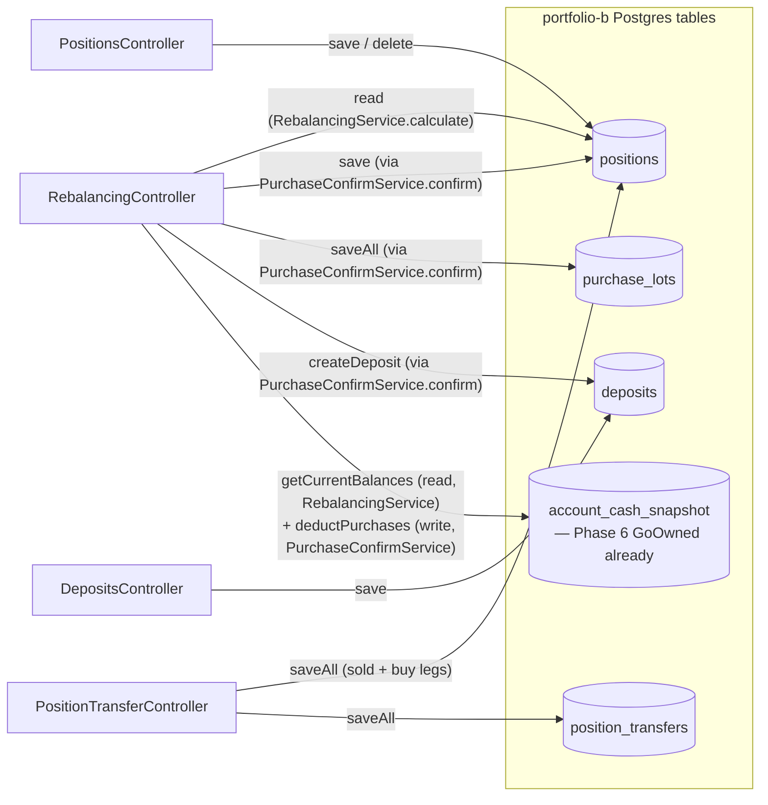
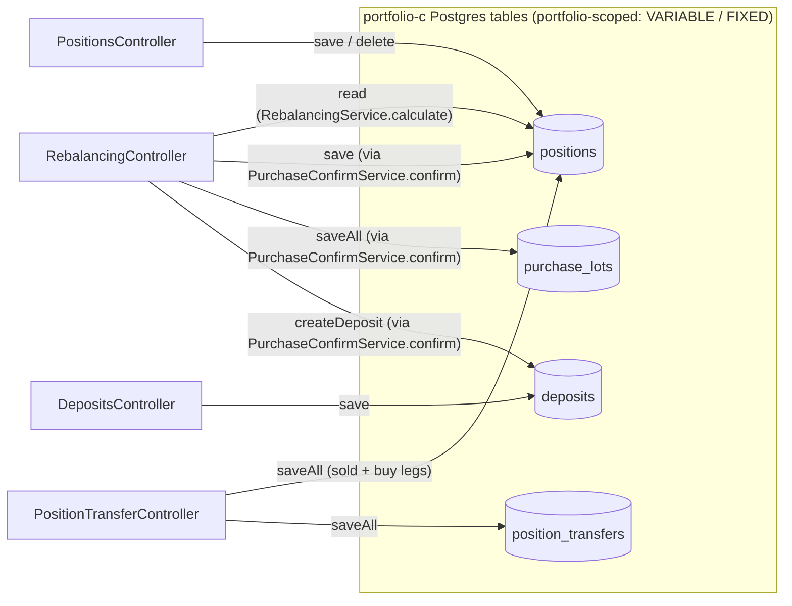
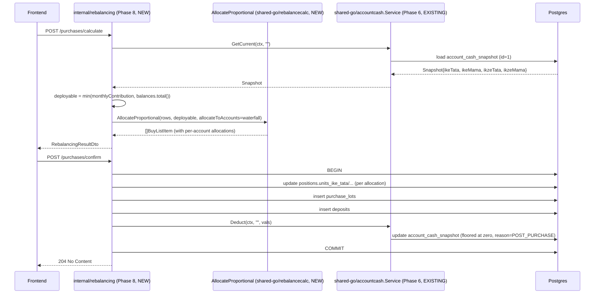
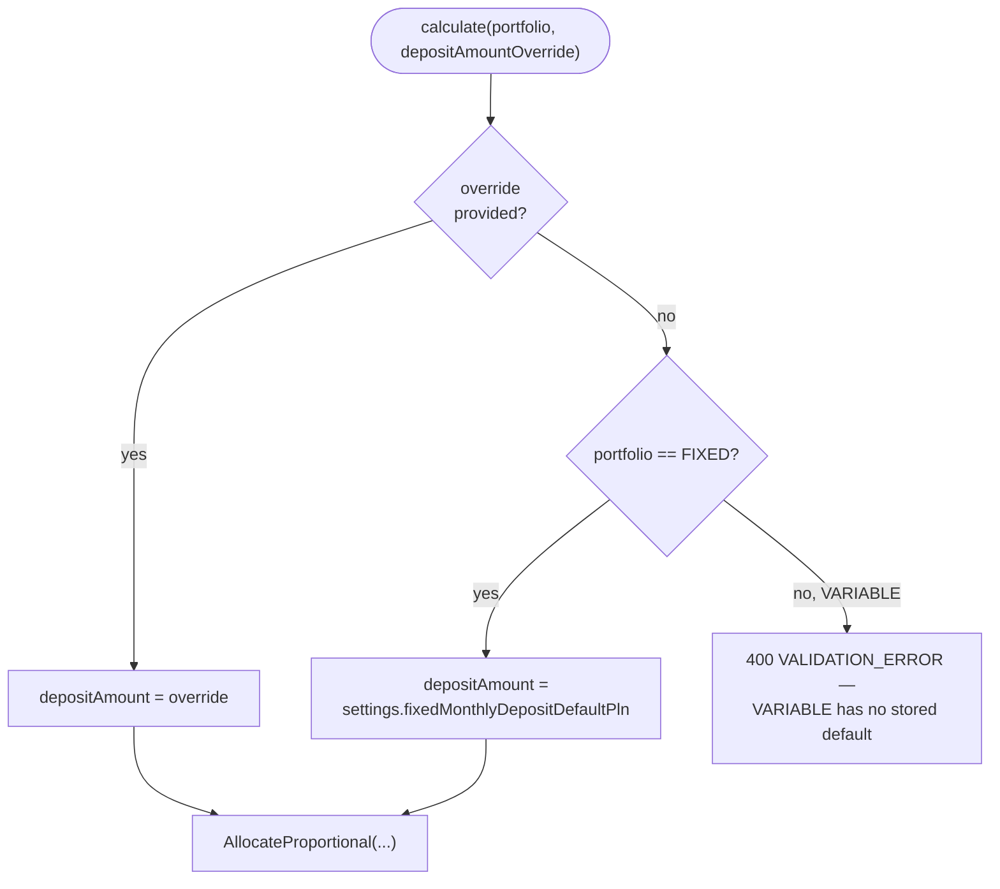
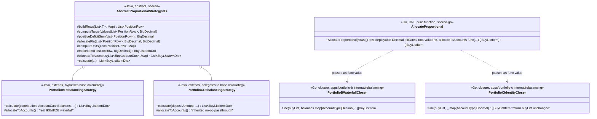

# 151 — Phase 8 diagrams: portfolio-b + portfolio-c core cluster (Positions, Rebalancing, Deposits)

Companion to `.claude/tasks/151-architect-output.md` — read that doc for the full
finding-by-finding justification. This doc holds the UML required by the UML-first workflow
before Backend-Go starts Phase 8. All diagrams below were built from direct inspection of the
actual Java source (file paths cited in the architect-output doc's "Files referenced" section),
not from the phase task file's prose.

---

## 1. Write-ownership — portfolio-b (corrected: 4 controllers, 5 tables, one Phase-6 cross-link)

**Legend.** `PositionTransferController` is a **fourth** controller in this cluster, not named in
the phase task file's scope list — it lives in `packages/shared/java/.../controller/
PositionTransferController.java`, a generic `@RestController` shared verbatim by both apps,
delegating to each app's own `PositionTransferService` (`PositionTransferExecutor`). It backs the
"Sprzedaj" manual-sell-assist button (the Manual-Sell-Only Rule's actual write path) and writes
`positions` + `position_transfers` in the same transaction. See architect-output §1 Finding 1 for
why this must be in Phase 8's atomic cutover, exactly the way root's Phase 7 pulled in
`RebalancingTransferController`/`PurchaseSessionController` for the same reason (doc 13 §6.3).

`account_cash_snapshot` is the one genuinely new wrinkle vs. root's Phase 7 shape: it is **already
GoOwned** (Phase 6, `internal/accountcash` + `shared-go/accountcash`), and this cluster both reads
it (`RebalancingService.calculate()`'s cash cap) and writes it (`PurchaseConfirmService.confirm()`'s
post-purchase deduction). `shared-go/accountcash/accountcash.go`'s own doc comment already flags
this exact gap: *"getCurrentBalances (portfolio-b's rebalancing-side read helper) STAYS Java-owned — it
is not part of this kernel and must not be re-introduced here."* Phase 8 is where that deferred
read (and the corresponding write) finally gets a Go home — see architect-output §1 Finding 2 and
diagram §3 below.

---

## 2. Write-ownership — portfolio-c (4 controllers, 4 tables, no cross-phase link)

**Legend.** Structurally identical to portfolio-b's cluster minus the `account_cash_snapshot` edge —
portfolio-c's `PurchaseConfirmService` has no `AccountCashService` dependency at all (confirmed: its
constructor takes only `PositionRepository`, `PriceCacheRepository`, `PurchaseLotRepository`,
`DepositService`, `PositionDeltaApplicator`). Portfolio C's `account_cash_snapshot` table exists (Phase 6
ported it) but is a fully independent, manually-updated figure — nothing in this cluster reads or
writes it. This is the one place the task file's "structurally simpler" claim is *more* true for
portfolio-c than for portfolio-b: portfolio-c's Phase 8 cluster is genuinely table-disjoint from every Phase 6
domain, matching root's "one side owns writes per table at a time" invariant cleanly; portfolio-b's does
not.

---

## 3. Sequence — portfolio-b's cash-aware rebalance-and-confirm flow (the cross-phase coupling)

**Legend.** `Cash` is not a new package — it is the exact `*accountcash.Service` Phase 6 already
built and already exports `GetCurrent`/`Deduct` as plain Go methods (no HTTP hop; both packages
compile into the same `backend-go` binary). Phase 8's `internal/rebalancing` package should take a
`*accountcash.Service` in its constructor (composition-root wiring in `main.go`, same instance
`internal/accountcash`'s own handler already holds) and call it directly — the identical shape
Java uses today (`PurchaseConfirmService`/`RebalancingService` both hold an injected
`AccountCashService` field). This is a same-process in-Go-binary dependency, not a new Nginx
routing concern: `internal/accountcash`'s own HTTP endpoints stay exactly where they are.

Portfolio C has no equivalent diagram — its `confirm()`/`calculate()` never touch `account_cash_snapshot`
(see diagram §2).

---

## 4. Deposit-amount resolution — portfolio-c's FIXED/VARIABLE branch (decision logic)

**Legend.** This branch lives one level above `AllocateProportional` in portfolio-c's
`RebalancingService.calculate()` (`resolveDepositAmount`), not inside the six-step algorithm
itself — the Go port keeps it there too: a small per-app function computing the deployable amount,
called before the shared `AllocateProportional`. Portfolio B has an analogous but simpler pre-step (no
branch, just `deployable = min(monthlyContribution, accountCashBalances.total())` — see diagram §3)
— confirming neither app's "compute the deployable amount" step belongs inside the shared function;
it is caller-side per-app logic in both cases, just of different shapes.

---

## 5. Template Method collapse — Java hierarchy vs. the single Go function

**Legend.** Confirms the phase task file's claim with one precision correction: it is not that
"five of six steps are identical" in the sense of both apps calling the same orchestrating
`calculate()` — **portfolio-b bypasses the shared base's own `calculate()` entirely** (documented in its
own class Javadoc: the base's `accountBalances()` hook takes no parameters, which would force a
genuinely per-request value onto singleton-bean instance state — a thread-safety risk portfolio-b's own
code explicitly rejects) and instead calls the five shared steps directly, in the same order, then
passes the real per-call `AccountCashBalances` straight into `allocateToAccounts` as an explicit
argument. Portfolio C calls the base's own `calculate()` unchanged. **The Go port makes this distinction
disappear**: a pure function has no instance-state thread-safety problem in the first place, so the
exact reason portfolio-b had to special-case the orchestration in Java never arises in Go. One
`AllocateProportional` function, called the same way by both apps, is not just possible — it is
strictly simpler than either app's current Java call site.

---

## 6. Notes for Backend-Go

- `AllocateProportional`'s five shared steps port from `AbstractProportionalStrategy.java` verbatim
  (byte-identical `BigDecimal` math → `decimal.Decimal`, `RoundingMode.HALF_UP` → `decimal.Round`
  with the same scales). No behavior change, only the mechanical collapse described above.
- The one Go function should live in a **new** `shared-go/rebalancecalc` package (not
  `shared-go/accountcash`, not app-local) — it has no DB dependency of its own (pure transform,
  matching `AbstractProportionalStrategy`'s own zero-repository shape) and is shared verbatim by
  both apps, going further than root's Phase 7 could (root's `rebalancingcalc` stayed
  investing-app-only because `MainRebalancingStrategy`/`RetirementRebalancingStrategy`/
  `MacroDeriskGate` are genuinely investing-app-specific — see architect-output §4 for the full
  comparison).
- Each app's own `internal/rebalancing` package holds: the deployable-amount pre-step (§3/§4
  above), the `allocateToAccounts` closure, the `PurchaseConfirmService`/`PositionTransferService`
  equivalents (writes), and — portfolio-b only — the `*accountcash.Service` dependency for the cash cap
  and post-purchase deduction.
- `RebalancingStrategyFactory`/`RebalancingMediator` (portfolio-b-only) and `PositionTransferCommand`
  (shared-java, `Execute`+`Undo` with `Undo` unimplemented) are all confirmed dead code — zero call
  sites outside their own definitions (see architect-output §1 Finding 3). **Do not port any of the
  three.** This is a stronger case than doc 13 §5's general Command/Mediator guidance: those were
  reasoned rejections of patterns that had *some* live purpose; these three have none at all in the
  current codebase.
