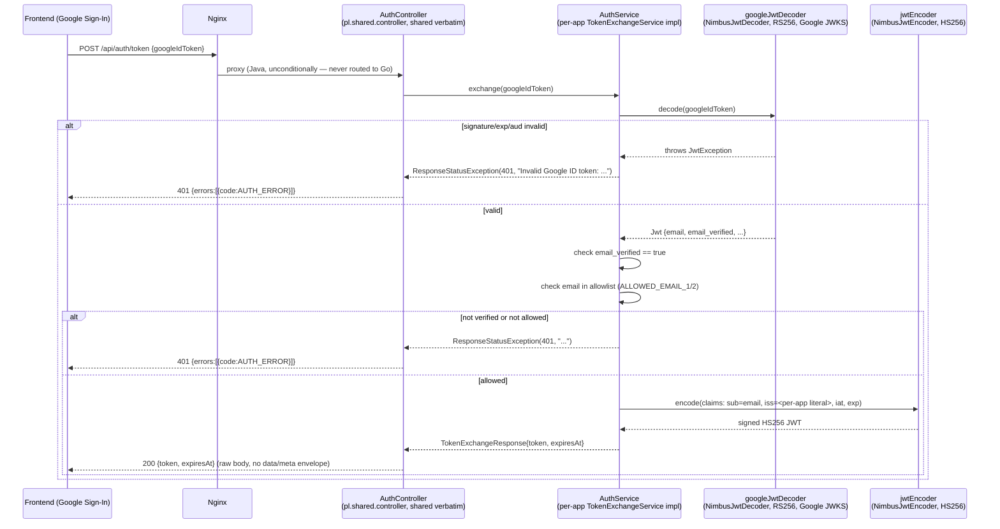
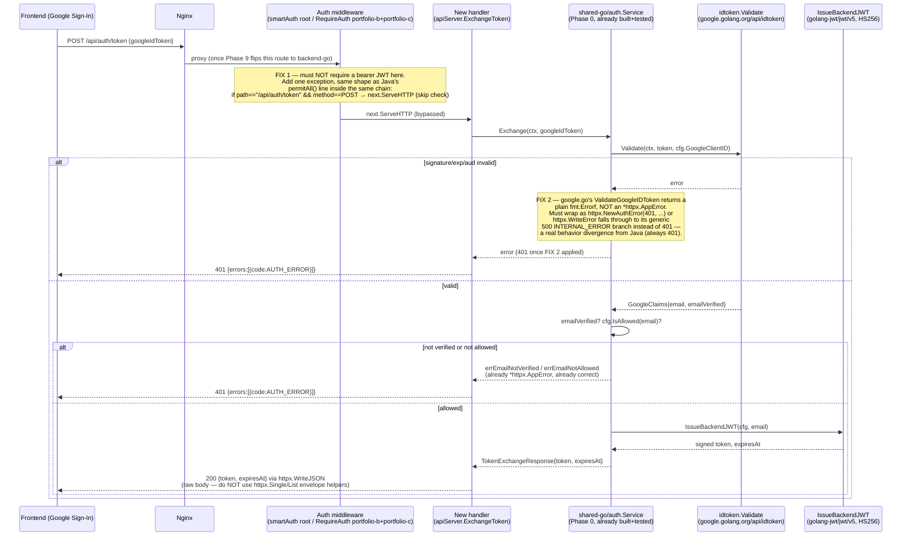
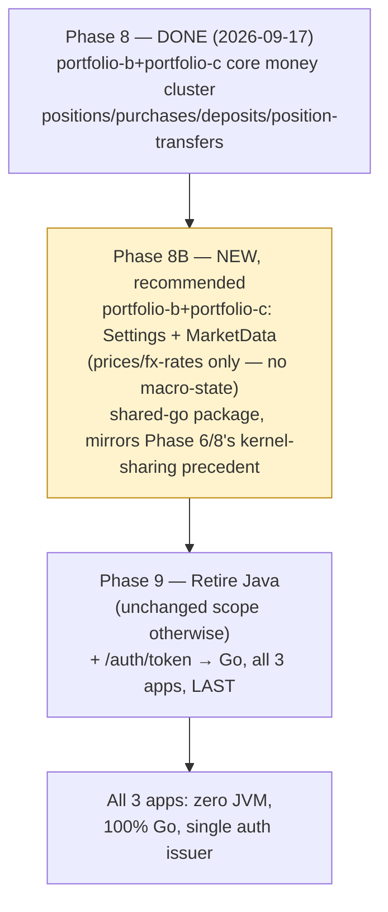

# 152: Auth-Token Migration Design + Phase 8B Scoping

**Context:** task 152 (see `.claude/tasks/152-architect-output.md`). Design/scoping review
triggered by the user asking whether the Java containers can be turned off — this surfaced two
real, previously-unscoped gaps blocking that: (1) `/auth/token` (Google ID-token exchange), already
assigned to Phase 9 by `docs/architecture/13-go-backend-target-architecture.md` §6.4 but never
given a concrete Go wiring design, and (2) portfolio-b/portfolio-c's `SettingsController`/`MarketDataController`
(shared Java classes, never assigned to *any* Go migration phase for those two apps). This doc is
the UML-first deliverable required before Backend-Go touches either.

## Pattern & principle evaluation

| Candidate | Verdict | Why |
|---|---|---|
| Facade (Java's root-only `AuthTokenFacade`) | rejected for Go | `shared-go/auth.Service` (Phase 0) already collapses Facade+Service into one type — Go has no interface-segregation reason to re-split it, matching doc 13 §5's "don't resurrect collapsed Java ceremony" rule |
| Strategy / interface for `TokenExchangeService` | rejected for Go | Java needs the interface so `AuthController` can be shared verbatim across 3 apps with 3 different concrete beans (Spring DI). Go has no shared HTTP-layer struct playing that role — each app's own `apiServer.ExchangeToken` calls its own app's `auth.Service` directly. Introducing a Go interface with one implementation per binary is speculative (YAGNI) |
| Chain of Responsibility (formal GoF, for path-based auth dispatch) | rejected | The existing `smartAuth` (root) is already a plain `switch`-based dispatcher, not a chained-object structure — adding one more `case` for the auth-token bypass fits the established idiom; formalizing it as GoF Chain of Responsibility would be ceremony with no behavioral gain |
| Adapter (`shared-go/auth/{google,jwt}.go` wrapping `idtoken`/`golang-jwt`) | adopted (already built, Phase 0) | Thin, justified — isolates the specific claims (`email`/`email_verified`) and algorithm choices behind small functions; not over-built |
| New abstraction to "skip" one operation in oapi-codegen's generated route batch | rejected | Extending the existing single-chokepoint middleware (`RequireAuth` / `smartAuth`) with one path/method exception is the direct structural equivalent of Java's own `.requestMatchers("/auth/token").permitAll()` line living inside the *same* filter chain as everything else — not a separate chain, not a new mount point. Splitting the route registration into two chi groups was considered and rejected: it risks a duplicate-pattern registration for `POST /api/auth/token` (once via the manual mount, once via `openapi.HandlerWithOptions`'s batch registration of the full `ServerInterface`) for zero benefit over the one-line middleware exception |

YAGNI/KISS verdict: no new pattern is introduced by this design. Every fix is a small, additive
change to code that already exists and is already tested (Phase 0's `shared-go/auth` package).

---

## 1. Current Java `/auth/token` flow (as-is, all 3 apps)

**Root divergence (not a bug, confirmed by source):** root's `AuthService` delegates through an
extra `AuthTokenFacade` collaborator and hardcodes `iss="investing-app"`; portfolio-b/portfolio-c's shared
`pl.shared.service.AuthService` calls `googleJwtDecoder`/`jwtEncoder` directly and reads
`app.security.jwt-issuer` (`portfolio-b` / `portfolio-c`) from `application.yml`. Both shapes reach
the identical wire contract — `AuthController` (`packages/shared/java/src/main/java/pl/shared/controller/AuthController.java:32-46`)
is shared verbatim across all 3 apps and only depends on the `TokenExchangeService` interface
(`packages/shared/java/src/main/java/pl/shared/service/TokenExchangeService.java`), so each app's
Spring context wires its own concrete bean.

---

## 2. Proposed Go `/auth/token` flow (Phase 9), with the two fixes this review found

**What Phase 9 actually has to build** (small, because Phase 0 already built the hard part):

1. A thin per-app handler (e.g. `internal/authexchange/handler.go`, mirrors every other domain's
   `Handler` shape) that: decodes `{googleIdToken}` from the request body, calls
   `auth.NewService(authCfg).Exchange(ctx, req.GoogleIdToken)`, and writes the result via
   `httpx.WriteJSON`/`httpx.WriteError` — **not** through `httpx.Single`/`httpx.List` (Java's
   `AuthController` returns the raw `TokenExchangeResponse`, no envelope; `docs/openapi/paths/auth.yaml:26-36`
   confirms the 200 example is unwrapped).
2. Wire that handler into `apiServer.ExchangeToken` (currently satisfied only by the embedded
   `openapi.Unimplemented.ExchangeToken` → 501, in **all three** apps' `server.gen.go`).
3. **FIX 1** — the public-path exception in the auth middleware (see diagram). Without this, the
   generated route (already mounted at `POST /api/auth/token` inside the authenticated
   `chi.Group`/`r.Use(auth.RequireAuth(...))` block in every app) is unreachable by a logged-out
   caller — the exact caller of this endpoint. This is a real lockout bug-in-waiting, not a
   hypothetical: it exists today as dead code (harmless only because Nginx never routes real
   traffic there yet) and would 401-loop every login attempt if cut over as-is.
4. **FIX 2** — wrap `ValidateGoogleIDToken`'s error return as `httpx.NewAuthError(http.StatusUnauthorized, ...)`
   (or catch it at the `Service.Exchange` call site) so an invalid/expired/wrong-`aud` Google token
   maps to 401, not `httpx.WriteError`'s generic 500 fallback for unrecognized error types.
5. New unit tests for `shared-go/auth.Service.Exchange` (currently zero coverage — no
   `service_test.go`/`google_test.go` exist) covering all 4 branches, plus a route-level test
   proving the FIX-1 bypass actually works unauthenticated. Java's own `AuthServiceTest.java`
   (root-only; the shared `pl.shared.service.AuthService` used by portfolio-b/portfolio-c has **no** Java
   test at all) doesn't cover the invalid-Google-token branch either — Go needs to do strictly
   better here, not just match Java, because FIX 2 is a new-to-Go failure mode Java's structural
   try/catch never had.
6. No `go.mod` changes needed — `google.golang.org/api` is already a **direct** dependency of
   `packages/shared/go/shared-go/go.mod` (v0.298.0) and each app keeps calling into
   `shared-go/auth.Service`, not `idtoken` directly, so the `// indirect` marker in each app's own
   `go.mod` is correct as-is.

---

## 3. Phase sequencing recommendation

**Why a new lettered sub-phase (8B), not option (b) folding into Phase 9, not option (a) as a
Phase-9 prerequisite left unnumbered:**

- This is structurally the *same situation* that produced Phase 1B (macro-state): a real domain,
  confirmed live and working in Java (`packages/shared/java/src/main/java/pl/shared/controller/{SettingsController,MarketDataController}.java`,
  component-scanned into portfolio-b/portfolio-c via `@ComponentScan(basePackages = {"pl.shared", "pl.portfolio-b"})`
  / `{"pl.shared", "pl.portfolio-c"}` — `apps/portfolio-b/backend/src/main/java/pl/portfolio-b/Portfolio BApp.java:12`,
  `apps/portfolio-c/backend/src/main/java/pl/portfolio-c/Portfolio CApp.java:12`), that doc 13's phase
  table simply never assigned to any phase for these two apps (Phase 2's App(s) column says
  "investing" only; Phase 6/8's portfolio-b/portfolio-c rows never mention it).
- Unlike 1B, this was found *after* Phases 6 and 8 already shipped and burned in — there's no
  in-flight phase to widen. Folding it into Phase 9 (option b) would make Phase 9's own "just
  decommission + migrate the one deferred endpoint" framing false: Phase 9's acceptance gate is
  "zero JVM processes anywhere," which is unreachable while portfolio-b/portfolio-c have zero Go equivalent
  for two live domains — so the real domain-migration engineering (Go implementation, coexistence
  smoke test, Nginx `GoOwned` flip, burn-in window) would still have to happen, just hidden inside
  a phase whose name promises none of that.
- The domains are small (2 endpoints for Settings, 4 for MarketData-prices/fx), low-risk (no
  write-ownership coupling — `settings`/`price_cache`/`fx_rate_cache` per doc 13's Phase 1/2 rows),
  and root already has a **proven, tested Go shape** for both (`backend-go/internal/settings`,
  `backend-go/internal/marketdata` — Phase 1/2). Because the Java controllers are
  byte-identical across portfolio-b/portfolio-c (confirmed by both classes' own doc comments — "Shared
  verbatim between portfolio-b and portfolio-c... byte-identical per ADR-078 / task 117"), this is a strong
  candidate for a single new `shared-go` package used by both apps' composition roots, the same
  kernel-sharing shape Phase 6 (`accountcash`) and Phase 8 (`rebalancecalc`) already established —
  going *further* than Java's per-app floor, consistent with doc 13 §7's Phase 6 note.
- Numbered **8B** (not a renumbered Phase 9, not Phase 10) for the same reason 1B was lettered
  rather than cascaded: it sits between Phase 8 and Phase 9 in execution order, and renumbering
  Phase 9 to 10 everywhere it's referenced (task files, doc 13, Nginx comments, this doc) is a
  large, error-prone, purely-cosmetic change for zero design benefit.
- `/auth/token` itself is **not** moved earlier. Doc 13 §6.4's reasoning for deferring it to
  strictly last remains correct and this review found nothing to change: it is the single point
  of failure for every login across all 3 apps simultaneously, a risk profile confirmed by a real
  production incident (`infra/nginx/nginx.conf:14-15`, "2026-09-02 incident: portfolio-b/portfolio-c 502s,
  main app login-bounce via a dead /api/auth/token route, for hours"). What 8B changes is only the
  *precondition* Phase 9 depends on: doc 13 §6.4's "every other domain proven on Go first" logic
  is not actually satisfied for portfolio-b/portfolio-c today (they'd still have 2 Java-only domains), so
  Phase 9's task file's "Depends on: Phases 0-8 complete" line needs updating to also require 8B
  (and 1B, which it currently omits too — a small pre-existing gap in that dependency line).
