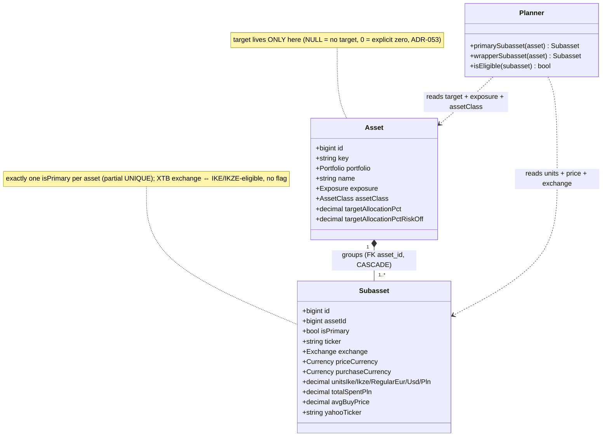
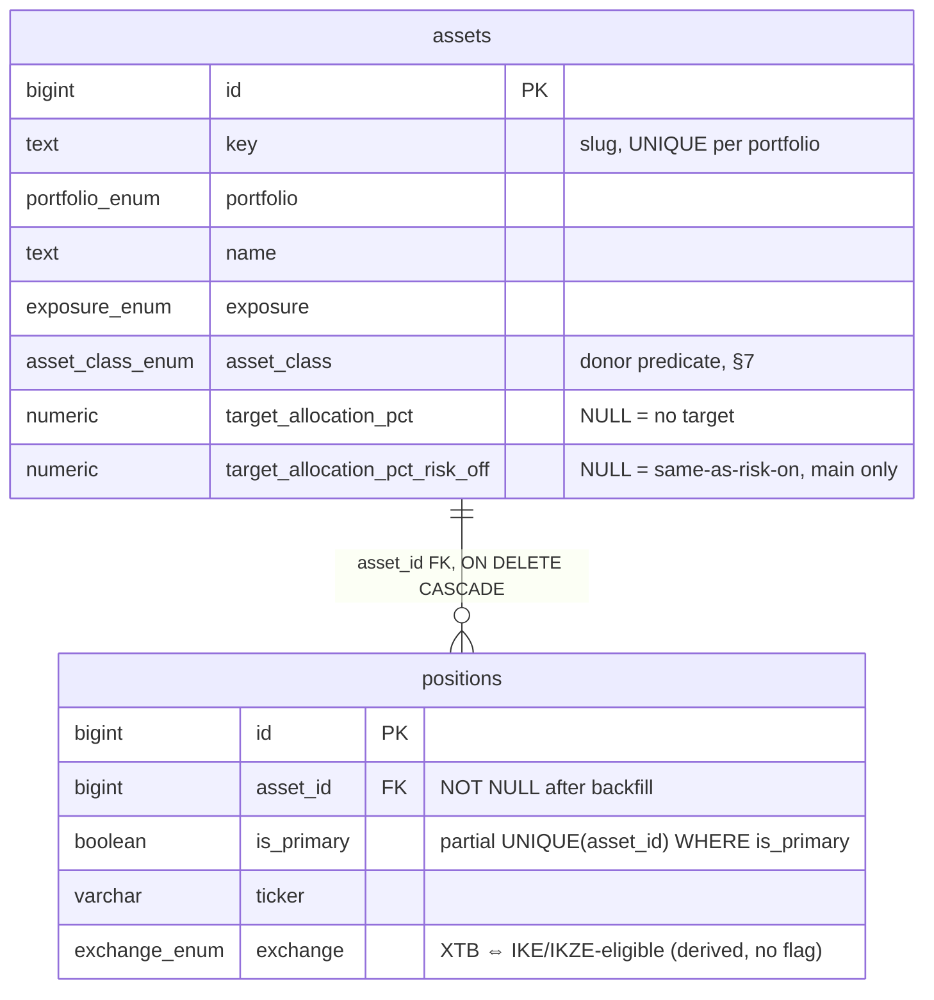
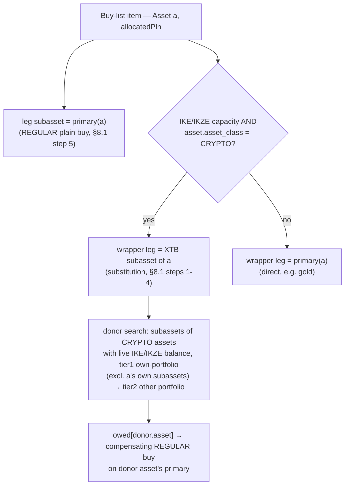
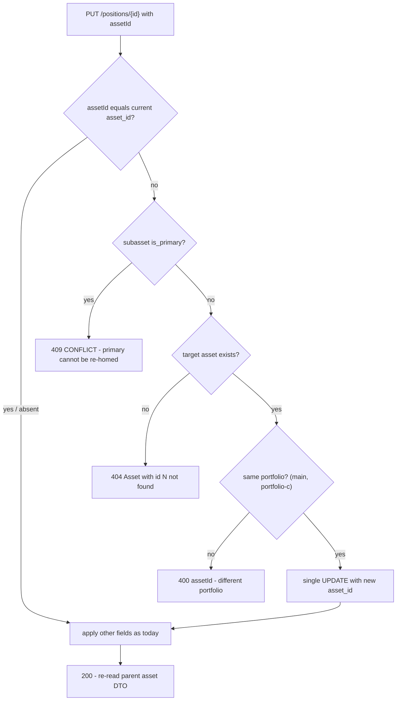

# 156 — Asset / Subasset model (IMPLEMENTED and DEPLOYED 2026-09-24)

> **Status:** IMPLEMENTED and DEPLOYED to production in all three apps on 2026-09-24
> (~12:05-12:10). Live Flyway heads after the deploy: main **V75**, portfolio-b **V19**, portfolio-c **V10**.
> This document began as the Architect Phase X design for
> `.claude/tasks/156-asset-subasset-cleanup.task.md`; §1-§5 and §7-§13 keep the design reasoning,
> §6 and the new "Implementation notes & verification" section (§14) record what actually shipped.
> Where the original design and the shipped system differ (data-driven migrations instead of
> literal per-group `INSERT`s; `Asset.key` as a logical slug; Nasdaq 100 primary = `SXRV.DE`;
> asset-level profit via `positioncalc.GroupProfit`; the planner judgment calls in §7.1) the shipped
> behavior is authoritative and is what the text below describes. The current-state description of
> the model lives in `02-domain-model.md` §2.1 (entities), `03-api-contract.md` (Positions/Assets
> endpoints), `04-db-schema.md` (tables) and `05-rebalancing-algorithm.md` (planner); this file is
> the design record and verification log behind them.
> Live-DB mapping was verified read-only against `shared-infra-db-shared-1` on 2026-09-23
> (`investing` 13 companions, `portfolio-b` 11, `portfolio-c` 0) and re-verified after the deploy on 2026-09-24.
>
> **Locked user decisions:** target lives ONLY on Asset (a subasset has no target field anywhere);
> exactly one subasset is always primary = default buy destination; IKE/IKZE eligibility is derived
> from `exchange` (XTB = eligible), no flag; main donor-waterfall logic UNCHANGED, only re-expressed
> + aligned across all 3 apps.

## 1. Pattern evaluation (§1 Evaluate)

| Candidate | Verdict | Why |
|---|---|---|
| Two tables: `assets` + `positions`-as-subassets | **adopted** | Target needs a home that survives leadership change; storing it on the primary row recreates exactly the mutable-leadership problem `promote` exists to patch |
| Single table + group-key column, target kept on primary row | rejected | Same flaw as today with a different name — every set-primary would have to move targets + cost basis again (cf. ADR-088's cost-basis carry-over patch) |
| `assets.primary_position_id` FK pointer | rejected | Cyclic FK (`positions.asset_id` ⇄ `assets.primary_position_id`) needs deferrable constraints and NULL-then-set inserts; the flag below enforces the same invariant with no cycle (KISS, Law of Demeter — reads stay one-directional, subasset → asset) |
| `positions.is_primary` flag + partial `UNIQUE(asset_id) WHERE is_primary` | **adopted** | At-most-one-primary enforced declaratively; exactly-one enforced by service + backfill verification (trigger rejected per YAGNI — hidden logic in a single-user app) |
| DB trigger to enforce exactly-one-primary | rejected | YAGNI — triggers hide domain rules where no reader looks; app-level invariant + migration-time check is enough |
| Rename `Position`/`SubPosition` → `Asset`/`Subasset` in contracts | **adopted** | Ubiquitous language — keeping `Position` for the group re-creates the main/companion naming confusion under a new name; touch surface is bounded (§9) |
| Unify the 3 value-folding implementations into one shared function | rejected | Deliberate divergence: MAIN's `computeValues` fails loudly on a missing price (`503`), shared `rebalancecalc` soft-skips — different failure contracts, not drift. Only the grouping key concept is unified |
| Backfill by hard-coded per-group literals vs. a data-driven sweep | **data-driven sweep adopted** (shipped) | The owner edits live data between design verification and deploy (portfolio-b's Nasdaq-100 head moved twice on 2026-09-23); a literal `VALUES ('ETFBNDXPL', ..., 10.0)` would have minted a target-bearing asset with no subassets. Reading targets/class/exposure from each group's LIVE head row is exact for whatever the book is at deploy time; RAISE EXCEPTION tripwires turn any shape the join cannot place into a loud deploy failure (§8, §14.1) |
| One migration per app (atomic) vs. expand/contract over releases | atomic two-step per app | Single-user Pi app, Flyway runner precedes backend boot in the same deploy — V_first (new model + backfill + CHECKs) and V_second (drop legacy columns) apply atomically before new code boots; no dual-read code needed |

## 2. Target model — class diagram

**Legend.** Composite aggregation (`*--`): deleting an `Asset` deletes its subassets (replaces today's
parent-cascade delete, `apps/main/backend-go/internal/position/service.go:214-240`). `Planner` is the
`purchasesession/planning.go` waterfall re-expressed on the new vocabulary (§7) — dependency only,
no ownership. Patterns: Aggregate Root (`Asset`, PoSA) adopted — all group operations (value fold,
target read, donor lookup) traverse via the root; Anemic-relabelling (`promote`'s flag shuffling)
retired with the columns that required it.

## 3. Target model — ER diagram

`purchase_sessions` / `purchase_session_items` / `asset_purchases` / `deposits` are untouched —
they key on `(ticker, portfolio)` natural keys, never on companion status. `historia.position_values`
(`ticker → value_pln`) is untouched — subasset tickers don't change.

## 4. Primary-designation mechanism — recommendation: flag, not FK

`positions.is_primary BOOLEAN NOT NULL DEFAULT false` + `CREATE UNIQUE INDEX … ON positions
(asset_id) WHERE is_primary`. Rejected alternative `assets.primary_position_id FK` (§1): it creates a
cyclic FK requiring deferrable constraints, and every "which row is primary" read would traverse
asset → pointer → row instead of filtering the rows already in hand. The flag keeps every current
read path shape-identical: `companionsByParent[parentTicker]` (`position/service.go:119-130`) becomes
`subassetsByAsset[assetId]` — an equality regroup, no string matching, no orphan mode possible
(the FK guarantees it; the bare-string `companion_parent_ticker` failure class — typos, renames,
`'NASDAQ 100'` free text — is deleted structurally, not by UI discipline).

Exactly-one (vs. at-most-one): the partial index enforces at-most-one in the DB; exactly-one is a
service invariant (`set-primary` flips exactly two rows in one transaction; asset creation marks its
first subasset primary atomically) plus a backfill-time verification query (§8). No trigger (YAGNI).

## 5. Column / table change list per app (identical shape, all 3 apps)

| Change | `assets` (new) | `positions` |
|---|---|---|
| Add | full table (§3) | `asset_id BIGINT`, `is_primary BOOLEAN NOT NULL DEFAULT false` |
| Backfill | one row per group (§6) | `asset_id` + `is_primary=true` on current main rows |
| Constrain | `UNIQUE(key, portfolio)` | FK `asset_id → assets(id) ON DELETE CASCADE`; `SET NOT NULL` (= the "no orphan" assertion — fails loudly on gaps); partial `UNIQUE(asset_id) WHERE is_primary`; `CHECK (target_allocation_pct IS NULL AND target_allocation_pct_risk_off IS NULL)` |
| Drop (V_second) | — | `is_companion_row`, `companion_parent_ticker`, `positions_companion_consistency` CHECK (main V1:82-86), both `target_*` columns |

`assets.key` is `UNIQUE(key, portfolio)` in main and portfolio-c; portfolio-b has no `portfolio` column (single
book), so its `assets.key` is globally `UNIQUE`. `assets.created_at`/`updated_at` (with the shared
`set_updated_at()` trigger) exist in all three.

Per-app notes: portfolio-b `positions` has no `purchase_currency` column and its own exposure labels
(`STOCKS`, live-verified) — the migration touches only the columns above, no alignment of unrelated
columns. portfolio-b/portfolio-c never populate `target_allocation_pct_risk_off` (no macro gate) — the column
exists on their `assets` rows as always-NULL for cross-app code uniformity, not as a feature.
`Asset.asset_class` is new vocabulary with one job: preserving the donor predicate
(`parent.asset_class = 'CRYPTO'`, `planning.go:103`) — backfilled from the current main row's
`asset_class`. This is load-bearing for XRP: `XRP-USD` is `asset_class=CRYPTO` / `exposure=EXPERIMENTS`
(live-verified) — an exposure-only donor rule would silently drop XRP from the donor pool, a behavior
change. Gold (`exposure=METALS`) and QUTM (`asset_class=ETF`) stay excluded exactly as today.

## 6. Migration mapping — every live companion row (verified 2026-09-23, shipped 2026-09-24)

Notation: ★ = primary. "Targets from" = row whose `target_*` values seed the Asset.

**How the mapping is applied (shipped).** The migrations do not encode the tables below as literals;
they are a data-driven sweep (§8, §14.1) whose *outcome* equals these tables on the live book, asserted
by `backend-go/db/asset_backfill_test.go` against a seed of the real pre-migration shape. Every old
main row becomes an asset and its own primary; each companion joins the asset of the row named by
exact `(portfolio, companion_parent_ticker)` equality (two passes, so a wrapper-of-wrapper chain such
as portfolio-b `XETH → ETH → ETNVIRETH` resolves); targets, `asset_class` and `exposure` are read from the
group's live head row. Groups with more than one subasset then get a logical slug `key` and `name` from
an explicit member-ticker map (`bitcoin`, `ethereum`, `solana`, `xrp`, `sui`, `gold`, `silver`,
`nasdaq-100` in portfolio-b; main adds `chainlink` and `quantum`, and applies the map per portfolio because
MAIN and RETIREMENT are separate assets under `UNIQUE(key, portfolio)`). Single-subasset assets keep
`key = ticker` and their own name. A group the map does not cover, or covers ambiguously, aborts the
deploy.

**Live outcome (production, 2026-09-24).**

| App | Rows before | Assets after | Multi-subasset groups | Σ targets |
|---|---|---|---|---|
| main (`investing`) | 58 | **45** (34 MAIN + 11 RETIREMENT) | 12 (8 MAIN + 4 RETIREMENT) | MAIN 100 risk-on; risk-off column sums to 97.5 over its 19 non-null rows, `COALESCE(risk_off, risk_on)` sums to 100; RETIREMENT 100 |
| portfolio-b | 36 | **25** (17 single + 8 multi) | 8 (§6.2) | 100 |
| portfolio-c | 8 | **8** (each its own primary) | 0 | VARIABLE 100, FIXED 100 (per portfolio) |

### 6.1 main / `investing` — 8 MAIN groups + 4 RETIREMENT groups

| # | Asset (portfolio) | Subassets | Targets from |
|---|---|---|---|
| 1 | Bitcoin (MAIN) | `BTC-USD`★ (20.0/12.0), `PL.ETNVIRBTCP` | `BTC-USD` |
| 2 | Ethereum (MAIN) | `ETH-USD`★ (10.0/1.0), `PL.ETNVIRETH` | `ETH-USD` |
| 3 | Solana (MAIN) | `SOL-USD`★ (5.0/0.5), `PL.ETNVIRSOL` | `SOL-USD` |
| 4 | Gold (MAIN) | `ETCGLDRMAU.PL`★ (20.0/30.0), `IGLN.L`, `4GLD.DE` | `ETCGLDRMAU.PL` |
| 5 | Chainlink (MAIN) | `LINK-USD`★ (1.5/0.15), `ETNVIRLINK.PL` | `LINK-USD` |
| 6 | Sui (MAIN) | `SUI-USDT`★ (3.0/0.3), `VRTU.DE` | `SUI-USDT` |
| 7 | XRP (MAIN) | `XRP-USD`★ (0.3/NULL), `PL.ETNVIRXRP` | `XRP-USD` |
| 8 | Quantum (MAIN) | `WQTM.DE`★ (0.6/NULL), `QUTM.DE` | `WQTM.DE` — verdict: keep promote history, single asset, no data move |
| 9 | Bitcoin (RET) | `BTC-USD`★ (20.0), `PL.ETNVIRBTCP` | `BTC-USD` |
| 10 | Ethereum (RET) | `ETH-USD`★ (7.0), `PL.ETNVIRETH` | `ETH-USD` |
| 11 | Solana (RET) | `SOL-USD`★ (7.0), `PL.ETNVIRSOL` | `SOL-USD` |
| 12 | Silver (RET) | `XAD6`★ (10.0), `ISLN.L` | `XAD6` |

Rule applied uniformly in main: **primary = current main row** (zero behavior change; the user flips
leadership later via set-primary if wanted). `ISLN.L→XAD6` resolves to RETIREMENT's `XAD6` (no MAIN
`XAD6` row exists — verified). All MAIN parents are `exchange=XTB` except `LINK-USD`/`SUI-USDT`/
`XRP-USD` (`BINANCE`, `purchase_currency=EUR`) — the substitution path (§7) covers exactly these.

### 6.2 portfolio-b — 36 rows → 25 assets; 8 multi-subasset groups (primary = ETF, locked)

| # | Asset | Subassets (★ = primary) | Verdict |
|---|---|---|---|
| 1 | Bitcoin | `ETNVIRBTCP`★ (20.0), `BTC`, `ETFBTCPL` | Un-invert: ETF primary; `ETFBTCPL` kept as 2nd non-primary (user may delete via UI) |
| 2 | Ethereum | `ETNVIRETH`★ (2.5), `ETH`, `XETH` | Collapse wrapper chain into one asset; ETF primary |
| 3 | Solana | `ETNVIRSOL`★ (1.25), `SOL` | Un-invert |
| 4 | XRP | `ETNVIRXRP`★ (1.25), `XRP` | Un-invert |
| 5 | Sui | `VRTU.DE`★ (1.25), `SUI` | Un-invert (`SUI` is `BINANCE`-exchange — stays a plain subasset) |
| 6 | Gold | `ETCGLDRMAU`★ (40.0), `ZLOTO_FIZ` | Un-invert (`ZLOTO_FIZ` is `OTHER`-exchange — stays a plain subasset) |
| 7 | Silver | `XAD6`★ (5.0), `SREBRO_FIZ` | Un-invert |
| 8 | Chainlink | `ETNVIRLINK.PL`★ (1.25) | Single-subasset asset (already main — trivially primary) |
| 9 | Nasdaq 100 | `SXRV.DE`★, `ETFBNDXPL`, `NQSE` | Merge (user-confirmed 2026-09-23: all three belong to Nasdaq 100 as subassets) — `ETFBNDXPL`'s full name is 'Beta ETF NASDAQ-100 PLN Hedged Portfelowy FIZ', itself a Nasdaq-100 ETF, so the old `NQSE→ETFBNDXPL` pointer was right-family/wrong-shape; `SXRV.DE`'s free-text parent (`'NASDAQ 100'`) resolved to this same asset. **Shipped: key `nasdaq-100`, primary = `SXRV.DE`**, non-primary subassets `ETFBNDXPL` and `NQSE`. This is the owner's decision of 2026-09-23 (the live head moved to `SXRV.DE` that day and the owner confirmed it should be primary; it is an XTB ETF, so the "primary = ETF" rule still holds), which supersedes this table's earlier `ETFBNDXPL`-primary verdict. The **Asset** carries the 10.0 target (V18 copies it from the group's live head row; no subasset keeps one). Units stay on their rows (live 2026-09-23: `SXRV.DE` 0.1694, `NQSE` 176 IKZE, `ETFBNDXPL` 4.931). V18 reads the head dynamically, so it followed whatever the live head was at deploy time — verified at rehearsal and on the live DB after deploy to be `SXRV.DE` |

Data quirks noted, out of scope: portfolio-b exposure enum uses `STOCKS` where main uses `EQUITY`
(not aligned by this task — no behavior depends on it). Nasdaq row resolved by the owner 2026-09-23
(see row 9 above). The other 17 portfolio-b assets are single-subasset (each keeps `key = ticker` and its
own name; Chainlink `ETNVIRLINK.PL` is one of them).

### 6.3 portfolio-c — greenfield (0 companions, 8 rows → 8 assets)

One Asset per existing position, each its own primary; targets carried over verbatim (VARIABLE and FIXED
each still sum to 100). Same two-migration shape as the other apps (§8) — uniformity over
special-casing (identical code reads all three DBs). portfolio-c's V9 carries no member-ticker naming map: it
RAISEs on any multi-subasset group at deploy time (none existed), so a companion attached through the
old UI after the read-only verification would have stopped the deploy rather than shipping an asset
named after one concrete fund.

## 7. Planner / donor-waterfall re-expression (math provably unchanged)

Re-expression table (`apps/main/backend-go/internal/purchasesession/planning.go`) — the design intent;
§7.1 records the seven places where the shipped code refines or fixes a detail of this table (the
math is unchanged in every case):

| Today | After | Why identical |
|---|---|---|
| `findCompanion(ticker, portfolio)` (`planning.go:371`) — first string-match | `primarySubasset` / wrapper lookup by `asset_id` | Same group membership (backfill §6 is a bijection old-group ↔ new-asset); FK replaces string match |
| `useCompanion = companion != nil && pos.AssetClass == "CRYPTO"` (`:148`) | `substitutable = asset.asset_class == "CRYPTO" && hasXtbWrapper` | `asset.asset_class` IS the old parent's `asset_class` (§5); same boolean per group |
| `ikeIkzeEligible = pos.Exchange == "XTB" \|\| useCompanion` (`:149`) | `eligible = subasset.exchange == "XTB"` evaluated on the leg's actual subasset (primary leg vs. wrapper leg) | Same outcomes: wrapper legs are XTB rows; `BTC/ETH/SOL-USD` MAIN legs are XTB rows; `LINK/SUI/XRP-USD` (BINANCE) legs route via wrapper exactly as today |
| `seedSellableCryptoPln` (`:97`) — companions whose parent is CRYPTO | subassets of assets with `asset_class='CRYPTO'`, same unit buckets × same prices | Same `(portfolio, account, ticker) → PLN` balances: same rows, same units, same tickers, same price map |
| `findBestCryptoDonor` + deviation via `companion_parent_ticker` (`:399-455`) | deviation via `subasset.asset.key` against the same per-portfolio deviation map | Buy-list/deviation map is keyed 1:1 old-parent-ticker ↔ new-asset (one entry per group before and after); tiebreak tickers (`PL.ETNVIRBTCP`/`PL.ETNVIRETH`) unchanged |
| `upsertCompanionRow` keyed `(portfolio, account, companionTicker)` (`:275`) | same key shape, `(portfolio, account, subassetTicker)` | Tickers unchanged → identical merge/netting behavior, identical `psi_session_portfolio_ticker_account_uq` collision profile, identical self-exclusion translation (tier-1 exclusion = recipient asset's own subassets) |
| `owed[(portfolio, parentTicker)]` reconciliation (`:331`) | `owed[(portfolio, assetKey)]`, merge into the primary subasset's REGULAR row | Bijection parent-ticker ↔ asset (each old parent is exactly one asset); primary = old main = same ticker → same target row |
| `value_pln(p) = own + Σ companions` (`rebalancingcalc/valuecomputation.go:63-129`) | `value_pln(a) = Σ subassets` | Same addends, regrouped: `ΣQ_i`, `ΣV_i`, `ΣDO_i` (§10) iterate one entry per group before and after — same cardinality, same values, same budget `A` |

What disappears with no replacement: `promote`'s sibling-repointing (no strings to repoint),
`getByTicker` post-promote re-read, the `UpdateCompanionParentTicker` query, and the ADR-088
cost-basis carry-over (cost basis never moves — it stays on the subasset row that incurred it;
set-primary flips one boolean per row, pure relabeling with no column migration at all).

### 7.1 Shipped judgment calls (implementation-time refinements of the table above)

The math of the waterfall (steps 1-5, tiering, tiebreak, netting) is exactly the pre-156 math; these are
the vocabulary decisions the backend agent had to make where §7's table left room. Each is covered by a
test in `purchasesession/planning_test.go` unless noted.

1. **The IKE/IKZE wrapper of an asset is the first XTB subasset (ticker order) whose row
   `asset_class != CRYPTO`** (`findWrapperSubasset`) — not "the non-primary XTB subasset". On all current
   data this returns the very row the old `findCompanion` returned (the wrappers are XTB ETF/ETN rows),
   and it keeps IKE/IKZE buys and donor sells landing on the ETN after the owner re-heads a crypto asset
   onto its ETN via set-primary (`TestComputePlan_WrapperFollowsRehead`). The substitution and donor
   predicate is the **asset's** `asset_class` (`isCryptoAsset`, stable across a primary change and
   load-bearing for XRP), never the leg's own row class.
2. **Donor set = every subasset of every CRYPTO-class asset with a live IKE/IKZE balance**
   (`seedSellableCryptoPln`, the design's literal reading) — including the primary. Numerically identical
   to the old companion-only set today because every crypto primary holds zero IKE/IKZE units.
3. **Buy-item position lookup is by `(ticker, portfolio)`** (`findPositionByTicker`), not first-by-ticker:
   `BTC-USD` exists in both MAIN and RETIREMENT, so a ticker-only lookup could resolve the wrong
   portfolio's row.
4. **The compensating-buy block is emitted in deterministic order — (portfolio, primary ticker)**
   (`reconcileOwedCompensatingBuys`). The pre-156 order came from Go map iteration (arbitrary), so any
   fixed order is behavior-compatible; it makes planned item order stable across runs.
5. **Rebalancing and deviation maps stay keyed by the primary subasset's ticker** (one entry per asset;
   the buy list is ticker-oriented by contract), while grouping, self-exclusion (tier-1 excludes the
   recipient asset's own subassets) and the owed-compensating-buy map use the **asset id**
   (`owedKey{portfolio, assetID}`) — never `assets.key`, which is an immutable label and must not be
   joined on. This refines the table's "`subasset.asset.key`" / "`owed[(portfolio, assetKey)]`" wording.
6. **The Σ targets == 100 set-primary tripwire stays a `400 VALIDATION_ERROR`** (as the old promote path
   did in the Go port) — no new error code; only the genuinely new outcome (re-homing or deleting a
   primary) got `CONFLICT` (409).
7. **Bug-for-bug retained (ported from Java): an unfiltered `GET /positions` applies no macro de-risk
   override to MAIN assets** — `LoadMainTargetOverrides` runs only when `?portfolio=MAIN` is passed, so
   the unfiltered list reports MAIN `effectiveTargetAllocationPct`/`deviationPct` at the raw risk-on
   target. Not introduced by 156 and not fixed by it.

The macro de-risk (ADR-044) interpolation was re-keyed from positions to assets — one interpolated
target per MAIN asset (`mainPrimaries`), overrides map keyed by the primary's ticker — with the blend
math unchanged.

## 8. Flyway versioning strategy (per app, versioned SQL only)

Shipped shape (all three apps): **V_first** = `assets` table + `positions.asset_id` / `is_primary` + the
data-driven backfill (§6) + tripwires + logical naming + FK + `SET NOT NULL` + partial unique index
`positions_one_primary_uq`; **V_second** = drop `is_companion_row`, `companion_parent_ticker`, both
`positions.target_*` columns and the temporary CHECKs. Both apply in the same deploy, before the new
backend boots. The design's original plan — explicit literal `INSERT`s per group encoding the §6 verdicts
— was replaced by the data-driven sweep described in §6 and §14.1.

- **main** (`apps/main/db/migration/`): **V74** / **V75**. (V72/V73 filenames are occupied by parked
  `apps/main/db/unapplied/V72__bot_hard_close_timeout.sql` / `V73__bot_trade_action_execution.sql` —
  do NOT reuse the numbers.) The tripwires run per portfolio and on both regime tables.
- **portfolio-b** (`apps/portfolio-b/db/migration/`, previous head V17): **V18** / **V19**. Carries the
  member-ticker naming map for its eight multi-subasset groups.
- **portfolio-c** (`apps/portfolio-c/db/migration/`, previous head V8): **V9** / **V10**. One asset per
  row; no naming map — a multi-subasset group RAISEs.
- **Tripwires** (V_first, `RAISE EXCEPTION`, each fails the whole deploy before any code boots): orphan
  companion (a `positions` row left with `asset_id IS NULL`); an asset without exactly one primary
  (counted per asset, so an asset with zero subassets is caught too); a companion row carrying a target
  (refuse to drop user data); Σ targets not preserved between old main rows and new assets (both regime
  tables, per portfolio); a multi-subasset group the naming map does not cover or covers ambiguously.
  The trailing `SET NOT NULL` on `asset_id` is the last line of defence, the RAISEs name the cause first.
  (portfolio-c's V9 carries the unmapped-row, exactly-one-primary, target-left-on-a-subasset and multi-subasset
  naming checks; it has no regime tables, so no risk-off sum.)
- sqlc: `SELECT *` queries (`db/queries/position.sql:21,24`) pick up the new columns automatically;
  decode + DTO layers change in code phase.

## 9. OpenAPI contract deltas

Source: `docs/openapi/components/schemas/positions.yaml:187-192` (`Position.isCompanionRow`/
`companionParentTicker`), `:258-263` (create request), `docs/openapi.yaml:345-403` + `docs/openapi/
paths/positions.yaml:225` (`POST /positions/{id}/promote`); portfolio-b/portfolio-c `docs/openapi.yaml`
`PositionDto`/`SubPositionDto` + `isCompanionRow`/`companionParentTicker` fields.

| Area | Delta |
|---|---|
| `Position` → **`Asset`** | remove `isCompanionRow`, `companionParentTicker`; add `assetId`→(self `id`), `key`; keep `name/portfolio/exchange?/exposure/assetClass/target*`; `computed` now group-level (`valuePln` = Σ subassets, `deviationPct` on the Asset — §7.5/7.6 thresholds read it unchanged); `subPositions` → **`subassets: Subasset[]`** |
| `SubPosition` → **`Subasset`** | add `assetId`, `isPrimary`; per-row units/price/value as today (main `frontend-web/src/api/schemas/positions.ts:19-36`; portfolio-b 5-bucket vs. portfolio-c single-units shapes unchanged) |
| `CreatePositionRequest` | `isCompanionRow/companionParentTicker` → `assetId` (nullable; null = create new Asset with inline `newAsset{name,exposure,assetClass,targets}`) + `isPrimary` (default: true for a new asset's first subasset, false when attaching) |
| `UpdatePositionRequest` | loses nothing (never touched companion fields); target edits move to `PUT /assets/{id}` (new, trivial); **gains optional `assetId`** — re-homes a non-primary subasset under another asset (§13, PROPOSED follow-up) |
| `POST /positions/{id}/promote` | **replaced by `POST /assets/{id}/primary {subassetId}`** — explicit set-primary; no implicit "id must be a companion" precondition, no sibling repointing, no target/cost-basis migration, same 100%-sum guard |
| `DELETE /positions/{id}` | subasset delete always allowed; primary-with-siblings → `409` ("set a new primary first" — no silent leadership change, cf. ADR-045's manual-judgment philosophy); last-subasset delete removes the Asset row in the same transaction; `DELETE /assets/{id}` cascades (replaces parent-cascade) |
| Transfer endpoints | **unchanged paths/shapes** — legs key on `(ticker, portfolio)` (`rebalancing/service.go:79-97`), never on companion status |

## 10. Transfer-dialog + sell-assist impacts (frontend)

`deviationPct` (incl. the ADR-053 `1.0` sentinel) is now computed on the Asset; the dialog already
treats a group as the unit — `computeSuggestedSellUnits` uses group target/value (`packages/shared/
ui/src/PositionTransferDialog.tsx:215-227`), `buildTickerTargetMap` shares one gap per group
(`:253-269`), `buildSellCandidates` flattens subassets (`:189-194`), `computeTotalPortfolioValuePln`
skips non-primaries exactly as it skipped companions (`:181-183`). Rename-only change in: the three
`toTransferPosition` adapters (main `RebalancingTransferDialog.tsx:77-97`, portfolio-b/portfolio-c
`PositionTransferDialog.tsx:60-62`/`32-34`), `PositionsTable` expand/collapse + `"Set as main"` →
`"Set as primary"` (shared `SubPositionRows.tsx`, `PositionsTable.tsx:169-179`,
`PortfolioPage.tsx:147-193`), `CreatePositionDialog` companion toggle → asset picker (shared
`CreatePositionDialog.tsx:200-239`, same dropdown shape, new vocabulary), and the zod schemas
(`positions.ts:19-110`, `shared-ts` mirrors). Sell-flag threshold (`deviationPct > 0.5`, §7.5) and
suggest-exact-target math are untouched — they read numbers that §7 proves identical.

## 11. Test-invariant preservation (§10 stays green by construction)

`05-rebalancing-algorithm.md` §10 rows are reworded, not redefined: "Companion values fold into
parent `value_pln`" → "Subasset values fold into asset `value_pln`"; `|ΣQ_i − A|`, `|ΣV_i − A|`,
`|ΣDO_i − A|`, buy-only, empty-list conditions are cardinality-and-value-preserving under the §7
bijection, so every numeric assertion in `planning_test.go`, `strategy_test.go`, `allocate_test.go`,
`valuecomputation_test.go` (`shared-go` + main), `positioncalc_test.go`, and `execution_test.go`
passes unmodified. Shape-changing tests only: promote tests → set-primary tests
(`position/service_test.go:303-359`, `integration_test.go:33-136`), `TestList_ExcludesCompanionRows…`
(`service_test.go:336`), `TestToOpenAPIPosition…` (`:363`), and handler/contract tests touching
`isCompanionRow`/`subPositions` field names.

## 12. Touchpoint index (exact file:line for implementers) — HISTORICAL

> Coordinates below are the PRE-implementation locations the design was drafted against; the code has
> since moved (files were rewritten or split, e.g. `promote.go` became `setprimary.go`). Use them as a
> map of which subsystems were touched, not as line numbers.

Backend-Go (main): `internal/purchasesession/planning.go:97` (`seedSellableCryptoPln`), `:147-149`
(eligibility/substitution), `:234-272` (sell step), `:275-307` (upsert), `:331-369` (reconciliation),
`:371-379` (`findCompanion`), `:399-455` (donor); `internal/position/service.go:78-89` (list filter),
`:119-130` (regroup), `:214-240` (cascade), `:245-297` (create); `internal/position/computed.go:35-105`
(fold + effective target), `:127-187` (sub-positions); `internal/position/promote.go:20-148`
(retire); `internal/position/position.go:59-154` (DTOs); `internal/position/handler.go:163-231`
(promote endpoint + mapping); `internal/rebalancingcalc/valuecomputation.go:68-129` (fold);
`internal/rebalancing/service.go:31-97` (composite key — unchanged); `db/queries/position.sql:20-98`.
Shared kernel: `shared-go/rebalancecalc/valuecomputation.go:36-77`,
`shared-go/positioncalc/positioncalc.go:53-107` (`ComputeFields`), `:119-135` (shared deviation core),
`:170-184` (fold); portfolio-b/portfolio-c `internal/position/computed.go` (thin wrappers — unchanged logic),
`internal/position/service.go` + `promote.go` (mirror of main), `internal/positiontransfer/service.go`.
Contracts: `docs/openapi/components/schemas/positions.yaml:187-192,258-263`,
`docs/openapi.yaml:345-403`, `docs/openapi/paths/positions.yaml:225-284`,
`apps/portfolio-b/docs/openapi.yaml:1400-1470` (`PositionDto`/`SubPositionDto`),
`apps/portfolio-c/docs/openapi.yaml:1460-1530`. Frontend: `apps/main/frontend-web/src/api/
schemas/positions.ts:17-110`, `components/RebalancingTransferDialog.tsx:77-135`,
`components/tables/PositionsTable.tsx:74-230,408-414`, `packages/shared/ui/src/
PositionTransferDialog.tsx:181-269`, `PositionsTable.tsx:66-77,161-179`, `SubPositionRows.tsx:27-110`,
`PortfolioPage.tsx:39-193`, `CreatePositionDialog.tsx:58-239`.
Schema: main `apps/main/db/migration/V1__*.sql:77-86` (CHECK to drop), `V4__companion_rows_and_
data_fixes.sql`, `V27__add_sol_eth_xrp_companion_rows.sql`; `db/unapplied/V72,V73` (numbers reserved).

## 13. Follow-up (IMPLEMENTED 2026-09-24) — re-homing a subasset via `assetId` on `PUT /positions/{id}`

> **Status:** IMPLEMENTED and DEPLOYED 2026-09-24 in all three apps (backend commits `3532a36` portfolio-b,
> `b2d3808` portfolio-c, `f2d6515` main; UI in shared `EditPositionDialog` / `AssetSelect`). The
> non-primary-only restriction (§13.2) was accepted as designed. The text below is the design as
> implemented, and the contract is in `docs/openapi.yaml` (`UpdatePositionRequest.assetId`).

**Why.** Incident 2026-09-23: a portfolio-b companion (`SXRV.DE`) was created through the old free-text
parent field with the value `'NASDAQ 100'`; nothing validated it, the row became an invisible orphan,
and because `PUT /positions/{id}` could not change the parent it had to be repaired with DELETE +
re-POST. The user asked for the parent to become a proper editable field with server-side validation.
That request was written against the companion model (`companion_parent_ticker`), which this task
deletes — so the old-model version (a `companionParentTicker` field on `UpdateInput`, with an
existence/non-companion/not-self check in `Update()` and `Create()`) is **deliberately not built**: it
would be dead code the moment V19/V10/V75 drop the column. What carries over is the intent, restated
on the new model:

- **Create-time validation is already structural.** `POST /positions` with an unknown `assetId` is
  a 404 (`GetAssetByID`), `positions.asset_id` is `NOT NULL` + FK, and "parent is itself a companion"
  / "parent is own ticker" cannot be expressed (an `assetId` names an Asset, never a Subasset). The
  orphan class is gone; nothing to add to `Create()`.
- **The residual gap is re-homing.** A subasset attached to the *wrong (real)* asset cannot be moved.

### 13.1 Pattern evaluation (§1 Evaluate)

| Candidate | Verdict | Why |
|---|---|---|
| Optional `assetId` on `UpdatePositionRequest` | **adopted** | Re-homing a non-primary subasset is a leaf-only, single-row, single-statement change; the reason Decision 13 gave for a dedicated `promote` endpoint (a multi-row atomic swap) does not apply |
| Dedicated `POST /positions/{id}/asset` endpoint | rejected | YAGNI — no second row to write, no invariant that needs its own verb |
| Allow moving a primary (auto-pick / auto-promote a successor) | rejected | Silent leadership change; contradicts the §9 delete rule (primary-with-siblings → 409) and the manual-judgment philosophy of ADR-045 |
| Delete the emptied source asset automatically | rejected | Could drop a non-zero target and trip the Σ targets == 100 guard; the primary-only case has a clean recovery (DELETE subasset — last-subasset delete removes the asset — then re-POST under the right asset) |
| Shared `shared-go` validator for the checks | rejected | Two conditions plus one `GetAssetByID` over per-app sqlc types; `Create()` in each app already inlines the equivalent (existence + portfolio match). A shared seam would need the plain-type lookup interface of the `settingscore` precedent for ~8 lines |
| Composite FK / trigger for portfolio match (main, portfolio-c) | rejected | Pre-existing service-level rule in `Create()`; YAGNI to move it to the DB for this task |

### 13.2 Semantics (all three apps)

| `assetId` in body | Result |
|---|---|
| absent, or equal to the subasset's current `asset_id` | field ignored (idempotent — a client may always send it) |
| differs, subasset `is_primary` | `409 CONFLICT` — a primary subasset cannot be re-homed (set another primary first, or delete and re-create it under the target asset) |
| differs, target asset not found | `404` `Asset with id N not found` (identical to `Create()`) |
| differs, **main/portfolio-c**: target asset's `portfolio` ≠ the subasset's | `400` validation error, field `assetId` — asset belongs to a different portfolio |
| differs, all checks pass | `UPDATE positions SET asset_id = $target …` — `is_primary` stays `false`; no units, cost basis, targets or tickers move |

Order of checks: same-as-current → primary guard → existence → portfolio. `isPrimary` stays
immutable here (leadership is `POST /assets/{id}/primary`); `isCompanionRow` no longer exists.

**Atomicity.** `Update()` is one `UPDATE … RETURNING *` full-row overwrite (read-modify-write in Go,
no COALESCE/dynamic SQL); every validation runs before it, so a rejected edit writes nothing. The
read→write gap is not transactional (single-user app, same as every other `Update()`); the FK and
`positions_one_primary_uq` backstop it. **Full-row-overwrite gotcha:** once `asset_id` is a column of
`UpdatePositionFields`, `Update()` must pass the *current* `AssetID` when the field is omitted —
forgetting it writes `0` and fails on the FK (safe, but a bug).

**Effects.** The moved subasset's value leaves one asset's `Σ subassets` and joins the other's
(both `deviationPct` values change on the next read — intended). Σ targets is untouched (targets live
on assets), so no `guardTargetSum` call. `purchase_*`, `asset_purchases`, `deposits`,
`historia.position_values` key on `(ticker, portfolio)` and are unaffected. The planner's donor
predicate follows the *target* asset's `asset_class`, as membership always defined it.

*Legend.* One decision path, no branching side effects: every rejection happens before the single
write (Guard Clause style); the write is the existing full-row overwrite, extended by one column.

### 13.3 Contract delta

`UpdatePositionRequest.assetId`: `type: integer, format: int64`, description "Re-home this subasset
under another asset (non-primary only; same portfolio; ignored when equal to the current asset)".
`PUT /positions/{id}` documents `404` and `409` in addition to its existing responses. Main:
edit `docs/openapi/components/schemas/positions.yaml`, then `npm run openapi:bundle && npm run
openapi:lint`; portfolio-b/portfolio-c: hand-edit the app's single-file `docs/openapi.yaml`. No migration (the
column exists since V18/V9/V74); sqlc regenerates because `UpdatePositionFields` gains `asset_id`.

### 13.4 Edit-dialog UX

The shared `EditPositionDialog` (already the implementation for all three apps — main's own file is a
67-line adapter) shows an asset `Select` **only for non-primary subassets**, prefilled with the current
asset, options = assets of the same portfolio (the picker's caller filters), sorted by key, rendered
`{key} — {name}`. Primary rows show nothing. There is no orphan / stale-value state to render: the FK
guarantees the current `assetId` is always among the options. The same `AssetSelect` component is the
one §10's "companion toggle → asset picker" change introduces for `CreatePositionDialog` — build it
once in `packages/shared/ui/src/AssetSelect.tsx` there, reuse it in the edit dialog (main's
`@/components/ui/select` is a re-export of the shared primitive, so main can use it directly).
`PortfolioPage`'s `EditDialog` prop type gains `allPositions` (the asset list), mirroring
`CreateDialog`/`TransferDialog`; main's two routes (`routes/portfolio/index.tsx`,
`routes/retirement/index.tsx`) pass their already-fetched list.

### 13.5 Test matrix (per app, mirroring each package's existing style)

Service (`service_test.go`, hand-rolled `fakeQueries`): valid re-home succeeds and only `asset_id`
changes; unknown target → 404; primary subasset → 409; same-as-current → no-op; omitted `assetId`
leaves the asset unchanged (regression for the full-row-overwrite gotcha); main/portfolio-c: cross-portfolio
target → 400 `assetId`. Handler: `assetId` decodes and maps into `UpdateInput`; a `404`/`409`
answers with the right status (style of `TestCreatePosition_DuplicateTickerIs409`). Integration
(testcontainers): re-home moves the subasset's value between two assets' `Σ`; set-primary tests pass
unmodified.

## 14. Implementation notes & verification (added 2026-09-24, after deploy)

### 14.1 Data-driven migrations (V74/V75, V18/V19, V9/V10)

The first V_first drafts hard-coded per-group literals (`INSERT ... VALUES ('ETFBNDXPL', ..., 10.0)`).
They were rewritten as a data-driven sweep after portfolio-b's Nasdaq-100 head moved twice in one day on the
live book: a literal insert keyed on a stale head would have minted a target-bearing asset with no
subassets and double-counted its target. The shipped sweep (full text in each migration's header
comment):

1. Every old non-companion row becomes an asset in its own portfolio and stays that asset's primary.
   `assets.key` starts as the row's ticker; targets (both regime tables in main), `asset_class` and
   `exposure` are copied from that row — the group's **live head** at deploy time.
2. Every companion joins the asset of the row named by exact `(portfolio, companion_parent_ticker)`
   equality, in two passes so a wrapper-of-wrapper chain resolves. No string parsing, no naming-convention
   inference.
3. Tripwires (§8) `RAISE EXCEPTION` on any shape the join cannot place.
4. Groups with more than one subasset get their logical slug `key` and `name` from a temporary
   member-ticker map (`asset_naming`), keyed by *any* member so the map never depends on who the head is;
   the map must cover each such group with exactly one logical asset or the deploy aborts. Single-subasset
   assets keep `key = ticker` and their own name (renamable afterwards via `PUT /assets/{id}`).
5. Targets are cleared off every subasset row, then `positions_asset_fk` (`ON DELETE CASCADE`),
   `asset_id SET NOT NULL`, `positions_one_primary_uq` and a temporary "no target on a subasset" CHECK are
   added; V_second drops the CHECK and the legacy columns.

Cost basis, units and tickers never move — they stay on the row that holds them. `Asset.key` is a
stable, immutable label; nothing may assume it equals any subasset's ticker, and it must never be joined
on (join on `asset_id`).

### 14.2 Asset-level computed fields and `positioncalc.GroupProfit`

For an asset, `valuePln` = Σ over its priced subassets; `currentPct`, `deviationPct` (ADR-053 zero-target
sentinel `1.0`) and `effectiveTargetAllocationPct` are computed on the asset through the shared
`positioncalc.CurrentAndDeviationPct`; `unitsTotal`, `pricePln` and `priceNative` are the **primary's**
(summing units across different instruments would be meaningless).

`profitPct = Σvalue / Σcost − 1` (`positioncalc.GroupProfit`, shared-go, task 161a-1; **rule corrected
2026-09-25**): Σcost sums `total_spent_pln > 0` over the subassets that have a recorded cost, Σvalue sums
the value of **every priced** subasset — including those with NULL/0 cost, because the go-live import
(main `V21`, from the owner's Google Sheet) stored the *whole group's* cost on the head row and left the
siblings' cost NULL (their baseline is inside it). A subasset with a recorded cost but no price
contributes neither cost nor value; the result is `null` when Σcost ≤ 0; it is order-independent, so a
set-primary flip (which only relabels rows) can never change it. main
RETIREMENT keeps no profit (ADR-056; → lifted 2026-10-18 by ADR-104, V148 baselines). `avgBuyPricePln` = primary PLN price / (1 + profit) is
**approximate** until task 161c replaces it with an entry price in the primary's own terms (see the
task 161 forward design in `docs/architecture/diagrams/161-asset-entry-price.md`).

**Correction (2026-09-25) — the first shipped version was wrong.** It counted only subassets with
*both* a recorded cost and a price, i.e. it dropped the *value* of cost-less siblings (live: Bitcoin's PLN
ETN, Gold's `4GLD.DE`/`IGLN.L`, Quantum's `QUTM.DE`) from the numerator while their baseline *cost* stayed
inside the head row's group-level cost in the denominator — a "cost-known part only" figure the owner
had accepted as interim, which turned out to be far off on real data for every group with cost-less wrappers (e.g. a
group showing a deep loss when it was in fact in profit), while groups without such wrappers were
identical under both rules (XRP-type groups whose companion has its own post-go-live cost still keep
that cost in the denominator — the original bug this helper fixed; the pre-156 code divided the whole
group's value by the primary's cost alone and overstated such a group's profit several times over). The corrected
rule is option (b) of `161-asset-entry-price.md` §1.4. **Known limitation:** a subasset held with **no**
recorded cost that no sibling's baseline covers adds value to the numerator only and inflates profit;
the task 161 baselines remove it.

### 14.3 Verification performed

| Layer | What was checked |
|---|---|
| Migration outcome | `backend-go/db/asset_backfill_test.go` (each app) runs the real Flyway migrations against a seed of the *real pre-migration shape* and asserts the §6 outcomes (asset counts, primaries, keys/names, Σ targets, chain-collapse, Nasdaq merge) |
| Rehearsal | Before deploy, V74/V75, V18/V19 and V9/V10 were rehearsed through the real one-shot Flyway runner on copies of the live databases (per the deploy record; the rehearsal ran outside the repo test suite) |
| Planner math | Golden test `TestComputePlan_AssetBijection_MatchesLegacyGroupOutcomes` (legacy group-model plan vs. asset-model plan, scenario table); `TestComputePlan_ManualSellOnly_NoSellWithoutPairedBuy` (manual-sell-only, ADR-045); `TestComputePlan_WrapperFollowsRehead` (§7.1 item 1) |
| Planner differential | A one-off differential run on the owner's real data: the old pre-156 planner vs. the new one, identical inputs, 4 budget scenarios, 166 plan items including 2-11 donor-waterfall legs per scenario — **identical**. This harness was not committed as a test |
| Integration | Real-Postgres tests for the grouped-asset value fold, one buy item per asset, and macro de-risk on assets (`44ba0dc`); set-primary and re-home service/handler tests per app |

### 14.4 Deploy record

Applied to production 2026-09-24 (~12:05-12:10). Live Flyway heads: main **V75**, portfolio-b **V19**, portfolio-c
**V10**. Live outcome: §6 table (main 58 → 45 assets, portfolio-b 36 → 25, portfolio-c 8 → 8). Fresh `pg_dump`s were
taken before the apply (`infra/shared/backups/pre156-apply-*.dump`) and the pre-156 images are tagged
`pre156-rollback/<container>:latest` (main's old SPA files are saved under
`infra/shared/backups/pre156-main-spa/`, gitignored locally). Rollback = restore the dump, retag the
`pre156-rollback` images and redeploy — the migrations are forward-only (V_second drops columns), so a
code-only rollback is not possible.

### 14.5 Shipped contract differences from §9 worth knowing

The authoritative contract is `docs/openapi.yaml` (main) and each sibling app's `docs/openapi.yaml`;
`03-api-contract.md` summarizes it. Differences from the design's §9 table: `PUT /assets/{id}` also
accepts `name` and treats an explicit JSON `null` target as "clear" (three-state
`httpx.Optional[T]`, NULL = no target ≠ 0 = explicit zero target, ADR-053), with range validation 0..100
only and no Σ = 100 guard; a top-level `targetAllocationPct` key on `POST`/`PUT /positions` is rejected
with 400; a new asset's `key` is its first subasset's ticker; and `CONFLICT` (409) is a new error code
alongside the unchanged `DUPLICATE_ENTRY`.

### 14.6 Known leftovers

- Deprecated shared-UI fallbacks — `TransferPositionLike`, `subPositions` and `isCompanionRow` handling in
  the shared `PositionTransferDialog` / `PortfolioValueLine` — are now dead code, kept only so a follow-up
  cleanup can remove them in one pass.
- `avgBuyPricePln` is approximate, and the asset profit over-states for a cost-less subasset that no
  sibling's group-level baseline covers, until task 161 (§14.2).

