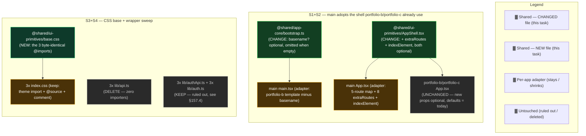

# 156 — Frontend shared extraction: component diagram + contracts (Architect, 2026-09-20)

> **Status:** design only. No app/shared source touched — this file, `12-portfolio-bpps-and-shared-packages.md`,
> and `.claude/tasks/156-frontend-shared-extraction.task.md` are the only writes.
> Frontend-web implements phase by phase from §2's contracts; gate per phase: `tsc` + production build
> of **all three** frontends green, query-key values byte-identical (grep), then `graphify update .`.

## 1. Component diagram

```mermaid
flowchart TB
    subgraph LEGEND["Legend"]
        direction LR
        L1["▓ Shared — NEW file (this task)"]
        L2["▓ Shared — already exists"]
        L3["▓ Per-app thin adapter (stays in app)"]
        L4["▓ Untouched (out of scope)"]
    end

    subgraph PHASE_A["Phase A — trivial, mechanical (portfolio-b/portfolio-c only)"]
        direction TB
        A1S["@shared/ui-primitives/PurchaseHistoryList<br/>(NEW — owns pending/error/empty UI + card list)"]
        A1L["portfolio-b components/PurchaseHistoryList.tsx<br/>(adapter: pass usePurchaseHistory)"]
        A1M["portfolio-c components/PurchaseHistoryList.tsx<br/>(adapter: portfolio-bound hook)"]

        A2S["@shared/ui-primitives/SingleSettingSection<br/>(NEW — owns findSetting + mutation + card chrome)"]
        A2L["portfolio-b routes/settings (page shell +<br/>MonthlyContribution config)"]
        A2M["portfolio-c routes/settings (page shell +<br/>FixedDepositDefault config)"]

        A3S["@shared/app-core/utils/query-keys.ts<br/>(NEW — createQueryKeys factory)"]
        A3L["portfolio-b lib/queryKeys.ts<br/>(adapter: createQueryKeys scoped:false)"]
        A3M["portfolio-c lib/queryKeys.ts<br/>(adapter: createQueryKeys scoped:true)"]
        A3U["main lib/queryKeys.ts (73 lines,<br/>different key shapes — untouched)"]

        A4S["@shared/ui-primitives/DepositsPage<br/>(NEW — owns DepositForm + shell + dialog)"]
        A4L["portfolio-b routes/deposits (adapter:<br/>hook + table + create + invalidate)"]
        A4M["portfolio-c routes/deposits (adapter:<br/>+ portfolio threading)"]
        A4U["main routes/deposits (455 lines:<br/>cap bars, dual sections — untouched)"]

        A1S --> A1L
        A1S --> A1M
        A2S --> A2L
        A2S --> A2M
        A3S --> A3L
        A3S --> A3M
        A4S --> A4L
        A4S --> A4M
    end

    subgraph PHASE_B["Phase B — biggest win (3-way incl. main)"]
        direction TB
        B1S["@shared/ui-primitives/EditPositionDialog<br/>(NEW — form + dirty-diff + chrome)"]
        B1SW["@shared/ui-primitives/switch.tsx<br/>(NEW primitive, copy of main's)"]
        B1A["main EditPositionDialog (adapter:<br/>IKE/IKZE/EUR/USD/PLN + companyBacked)"]
        B1L["portfolio-b EditPositionDialog (adapter:<br/>tata/mama/inne, no Switch)"]
        B1M["portfolio-c EditPositionDialog (adapter:<br/>single units, no Switch)"]

        B2S["@shared/ui-primitives/HistoryPage<br/>(NEW — shell + card chrome + empty state)"]
        B2A["main routes/history (adapter:<br/>local PageHeader + custom chart)"]
        B2L["portfolio-b routes/history (adapter:<br/>shared header + shared chart)"]
        B2M["portfolio-c routes/history (adapter:<br/>+ portfolio + title suffix)"]

        B1SW --> B1S
        B1S --> B1A
        B1S --> B1L
        B1S --> B1M
        B2S --> B2A
        B2S --> B2L
        B2S --> B2M
    end

    subgraph PHASE_C["Phase C — heaviest (portfolio-b/portfolio-c only)"]
        direction TB
        C1S["@shared/ui-primitives/PortfolioPage<br/>(NEW — state machine + all dialogs chrome)"]
        C1L["portfolio-b routes/portfolio (adapter:<br/>title + api + hook + 7 slots)"]
        C1M["portfolio-c routes/portfolio (adapter:<br/>+ portfolio scoping)"]
        C1U["main routes/portfolio (55% similar:<br/>bot/macro/cascade — untouched)"]

        C1S --> C1L
        C1S --> C1M
    end

    classDef newShared fill:#123f22,stroke:#39ff60,color:#fff
    classDef oldShared fill:#12304a,stroke:#00e5ff,color:#fff
    classDef adapter fill:#4a3208,stroke:#f7a800,color:#fff
    classDef untouched fill:#2a2a2a,stroke:#888,color:#ccc
    class A1S,A2S,A3S,A4S,B1S,B1SW,B2S,C1S newShared
    class A1L,A1M,A2L,A2M,A3L,A3M,A4L,A4M,B1A,B1L,B1M,B2A,B2L,B2M,C1L,C1M adapter
    class A3U,A4U,C1U untouched
```



*Legend (text fallback):* **green** = new shared file created by this task; **blue** = shared code that
already exists and is reused (not in legend boxes above, listed per contract); **amber** = per-app thin
adapter that remains in each app (config + API injection + type narrowing only); **gray** = deliberately
untouched (out-of-scope list in the task file).

**Import-direction rule (verified 2026-09-20):** `packages/shared/*` contains zero `from "@investing-app/*"`,
`from "@portfolio-b/*"`, `from "@portfolio-c/*"`, or `from "@/*"` **import statements** today (the only two
mentions of `@portfolio-b/shared`/`@portfolio-c/shared` are inside JSDoc comments in `PositionsTable.tsx`
and `CreatePositionDialog.tsx`). Every contract below preserves this: shared files import only
`@shared/app-core`, relative `./*.js` siblings, and npm packages. All per-app type narrowing
(`Portfolio`, `AssetClass`, request-body shapes) lives in adapters. Per-app enums are **mirrored, never
imported** (CreatePositionDialog precedent, `CreatePositionDialog.tsx:26-60`).

---

## 2. Contracts

Conventions used in every table: **Injected** = prop the adapter supplies (API fn, hook, config, or slot
component); **Owned** = markup/logic that moves verbatim into shared; **Hardcoded** = identical literal in
all consumed apps, kept as a literal in shared (not a prop — YAGNI).

### A1 — `PurchaseHistoryList` (portfolio-b/portfolio-c, 2-way; main has no counterpart)

**New file:** `packages/shared/ui/src/PurchaseHistoryList.tsx` (auto-exported via the existing
`"./*": "./src/*.tsx"` map — no barrel to update, same as every prior shared/ui extraction).

| Prop | Type | Kind |
|---|---|---|
| `useHistoryQuery` | `() => PurchaseHistoryQueryLike` | Injected hook (called by shared during render — HistoriaDialog `useHistoriaQuery` precedent) |

```ts
import { PurchaseHistoryCard, type PurchaseSessionLike } from "./PurchaseHistoryCard.js";

export interface PurchaseHistorySessionLike extends PurchaseSessionLike {
  sessionId: string | number;   // PurchaseSessionLike has no id; the list needs a React key
}
export interface PurchaseHistoryQueryLike {
  data: { data: { sessions: PurchaseHistorySessionLike[] } } | undefined;
  isPending: boolean;
  isError: boolean;
}
```

**Owned (byte-identical today):** the three UI states — `Ładowanie historii…`, `role="alert"`
`Nie udało się wczytać historii zakupów.`, `Brak zakupów. Historia pojawi się po pierwszym
zatwierdzonym zakupie.` — plus the `sessions.map((s) => <PurchaseHistoryCard key={s.sessionId}
session={s} />)` list. `PurchaseSessionLike` structural assignability (no casts) is already proven by
the card's current call sites (task 105).

**Adapters** (each file shrinks to ~5 lines):
- portfolio-b `components/PurchaseHistoryList.tsx`: `<SharedPurchaseHistoryList useHistoryQuery={usePurchaseHistory} />`
  (direct pass-through — zero-arg hook already matches).
- portfolio-c: module-scope named hook (cleaner than an inline closure):
  ```ts
  function useHistoryQuery() {
    const { portfolio } = usePortfolio();
    return usePurchaseHistory(portfolio);
  }
  ```
  then `<SharedPurchaseHistoryList useHistoryQuery={useHistoryQuery} />`.

**Justification (SOLID/DRY):** the only diff is the portfolio-dimension threading task 94 already ruled
load-bearing — which is exactly what hook injection absorbs. Not generalized further (no render prop for
rows; the card is already shared).

### A2 — `SingleSettingSection` (portfolio-b/portfolio-c, 2-way; main's settings page is cash+macro, untouched)

**New file:** `packages/shared/ui/src/SingleSettingSection.tsx`.

| Prop | Type | Kind |
|---|---|---|
| `settings` | `SettingLike[]` (`{ key: string; value: string }`) | Injected data (page already fetched it — no second query; KISS over hook injection) |
| `settingKey` | `string` | Injected config (`monthly_contribution_pln` / `fixed_monthly_deposit_default_pln`) |
| `title` / `label` / `inputId` | `string` | Injected copy (`Miesięczna składka` / `Domyślna kwota wpłaty — portfel Drugi`, etc.) |
| `description` | `ReactNode` (optional) | Injected copy (portfolio-c's two-sentence FIXED/VARIABLE note; portfolio-b omits) |
| `labelWidthClass` | `string` (optional) | Injected config (`w-40` portfolio-b / `w-56` portfolio-c — the only class diff) |
| `successMessage` / `errorMessage` | `string` | Injected copy (per-app toast strings, preserved byte-identical) |
| `updateSetting` | `(key: string, body: { value: string }) => Promise<unknown>` | Injected API (direct pass-through in both apps — signatures already match) |
| `onSaved` | `() => void` | Injected (adapter invalidates `queryKeys.settings.all` — keys stay per-app) |

**Owned:** `findSetting`, `useState(current?.value ?? "")` (preserve init-once semantics exactly — do not
"fix" to re-sync), `useMutation` + toasts, section/Card/row chrome, `PLN` suffix, `Zapisz`/`Zapisywanie...`.

**Adapters:** each `routes/settings/index.tsx` keeps its shell (PageHeader `Ustawienia`, Separator,
`Ładowanie ustawień...` / `role="alert"` `Błąd ładowania ustawień.`, the `listSettings` query) and renders
`<SingleSettingSection settings={settings} …config + updateSetting={updateSetting} onSaved={…} />`.

### A3 — `createQueryKeys` factory (portfolio-b/portfolio-c, 2-way; main's 73-line key set untouched)

**New file:** `packages/shared/ts/src/utils/query-keys.ts` + one `export *` line in
`packages/shared/ts/src/index.ts` (pure data, no React — no new peerDeps). Values must stay
**byte-identical** to today's literals (constraint: no cache invalidation except architect-approved —
none approved here).

```ts
export function createQueryKeys(options: { scoped: false }): UnscopedQueryKeys;
export function createQueryKeys(options: { scoped: true }): ScopedQueryKeys;
```

- **Unscoped** (portfolio-b): `positions.list()` → `["positions","list"]`, `history.list()` →
  `["history","list"]`, `deposits.list()` / `deposits.xirr()`, `purchaseHistory.list()`, plus
  `positions.all`, `history.all`, `deposits.all`, `purchaseHistory.all`, `xirr.all`, `settings.all`,
  `fxRates.all`, `rebalancing.all`.
- **Scoped** (portfolio-c): same shapes with `(scope: string)` param appended, e.g.
  `positions.list(scope)` → `["positions","list",scope]`, `deposits.xirr(scope)`,
  `purchaseHistory.list(scope)` → `["purchase-history",scope]`. **No `xirr.all`** (portfolio-c never had one —
  its XIRR key is `deposits.xirr(portfolio)`); the unscoped surface keeps `xirr.all` for portfolio-b.
- `scope` is typed `string`, **not** `Portfolio` — adapters pass their own narrow type through; shared
  imports no app enum. Single runtime implementation; overloads give each app precise arity checking
  (a missing/extra scope arg is a `tsc` error, as today).
- `deposits.xirr()` / `rebalancing.all` are currently unreferenced by call sites in one or both apps —
  kept so the factory is a **drop-in replacement** with zero call-site edits.

**Adapters:** portfolio-b `lib/queryKeys.ts` → `export const queryKeys = createQueryKeys({ scoped: false });`;
portfolio-c → `createQueryKeys({ scoped: true })` (each file becomes 2 lines + import). **Verification owed by
Frontend:** grep every `queryKeys.*` call site in both apps (full list: `positions.list/all`,
`history.list`, `deposits.list/xirr`, `purchaseHistory.list/all`, `xirr.all` (portfolio-b),
`deposits.xirr` (portfolio-c), `settings.all`, `fxRates.all`) and confirm `tsc` passes with no call-site edits;
spot-check emitted key **values** (not just types) against today's literals.

### A4 — `DepositsPage` (portfolio-b/portfolio-c, 2-way; main's 455-line page untouched)

**New file:** `packages/shared/ui/src/DepositsPage.tsx`. `depositFormSchema`/`DepositFormValues` are
**already** in `@shared/app-core` (both apps' `routes/deposits/schemas.ts` are 2-line re-export shims) —
the shared page imports them directly, no injection needed.

| Prop | Type | Kind |
|---|---|---|
| `title` | `string` | Injected (`Depozyty` / `Depozyty — ${PORTFOLIO_LABELS[p]}`) |
| `dialogTitle` | `string` | Injected (`Dodaj depozyt` / `Dodaj depozyt — ${…}`) |
| `useDepositsQuery` | `() => { data: TDeposit[] \| undefined; isPending: boolean; isError: boolean }` | Injected hook (adapter unwraps the `{data}` envelope) |
| `renderTable` | `(deposits: TDeposit[]) => ReactNode` | Injected renderer (`(d) => <DepositsTable data={d} />` — table already shared) |
| `createDeposit` | `(values: DepositFormValues) => Promise<unknown>` | Injected API (portfolio-b pass-through; portfolio-c adapter adds `portfolio` — CreatePositionDialog precedent) |
| `onDepositSaved` | `() => void` | Injected (adapter invalidates its own deposits key) |

**Owned:** `DepositForm` incl. the `YYYY-MM → YYYY-MM-01` normalization, `Data (rok-miesiąc)`/`Kwota`/
`Komentarz` fields, `Błąd zapisu. Spróbuj ponownie.`, `Zapisuję...`/`Zapisz`, DialogFooter+DialogClose
chrome; page shell (`p-6 space-y-6`, PageHeader+actions, `Dodaj depozyt` button, PageShell
`Ładowanie danych`, Dialog + `dialogTitle`). Generic over `TDeposit` (no app Zod type imported).

**Adapters (~20 lines each):** portfolio-b module-scope `useDepositsQuery` (`listDeposits({ size: 100 })`,
`staleTime` 5 min); portfolio-c same closed over `usePortfolio()` + `listDeposits({ portfolio, size: 100 })`.
No new `packages/shared/ui` deps (Dialog/Form/PageHeader/PageShell/RHF/zod all already used there).

### B1 — `EditPositionDialog` (3-way — biggest win: 274–368 lines × 3)

**New files:** `packages/shared/ui/src/EditPositionDialog.tsx` + `packages/shared/ui/src/switch.tsx`
(new primitive — **copy main's** `frontend-web/src/components/ui/switch.tsx` verbatim, `cn` from
`./lib/utils.js`; `radix-ui` is already a shared/ui dependency. portfolio-b/portfolio-c have no switch and need
none beyond this dialog).

```ts
export interface UnitFieldDef { key: string; label: string }
export interface AssetClassOption { value: string; label: string }
export interface EditPositionSnapshot {
  id: number; ticker: string; name: string;
  yahooTicker: string | null; assetClass: string; companyBacked: boolean;
  targetAllocationPct?: number | null;         // task 156: OMIT for subassets (portfolio-b/portfolio-c) → no "Cel %" input
  assetId?: number; isPrimary?: boolean;       // task 156: re-home select shown only when isPrimary === false
  unitValues: Record<string, number | null>;   // keys ⊆ unitFields[].key
}
export interface EditPositionUpdate {
  name?: string; yahooTicker?: string | null; assetClass?: string;
  companyBacked?: boolean; targetAllocationPct?: number | null;
  assetId?: number;                            // task 156 §13: only when the re-home selection changed
  units: Record<string, number>;               // changed unit fields only; adapter spreads flat
}
export interface EditPositionDialogProps {
  position: EditPositionSnapshot | null;
  onClose: () => void; onSuccess: () => void;
  updatePosition: (id: number, body: EditPositionUpdate) => Promise<unknown>;
  unitFields: UnitFieldDef[];                  // ← resolves (a): the per-app field sets below
  assetClassOptions: AssetClassOption[];       // injected: order + membership differ per app
  showCompanyBacked: boolean;                  // main-only Switch block + body inclusion gate
  assets?: AssetOption[];                      // task 156: re-home targets (caller-filtered); omit (main) → no picker
}
```

> **Task 156 update (Asset / Subasset model — portfolio-b/portfolio-c).** In these apps the dialog edits ONE
> SUBASSET, addressed through the app's `EditPositionDialog` wrapper with `{ target: { asset, subasset } |
> null, assets, onClose, onSuccess }` (the wrapper memoizes the snapshot on `target`). Targets live
> only on the Asset, so the wrapper omits `targetAllocationPct` from the snapshot and the shared dialog
> renders no "Cel %" input (owner directive 2026-09-23: no target field on subassets — the Asset row's
> inline editor, `PUT /assets/{id}`, is the only writer). For a NON-primary subasset (`isPrimary ===
> false`) an `AssetSelect` (§13.4; `packages/shared/ui/src/AssetSelect.tsx`, `{key} — {name}` sorted by
> key) is prefilled with the current asset and `assetId` is sent only if changed; 4xx messages (409
> primary/404/400 portfolio) render in the dialog. `assetClass` in the snapshot is the parent asset's
> (`SubassetDto` carries no class). main follows the same contract since its 156 frontend wave: its
> `EditPositionDialog` wrapper takes `{ target: { asset, subasset } | null, assets, onClose, onSuccess }`, passes
> `assetId`/`isPrimary` (and the subasset's own `assetClass`/`companyBacked` — `Subasset` carries them), omits
> `targetAllocationPct`, and filters `assets` to the subasset's portfolio (the backend answers 400 on a
> cross-portfolio re-home).

**Why snapshot, not `TPosition` + accessors:** one ~15-line mapper per app contains all type narrowing;
the alternative (7+ accessor props) is a wider, harder-to-read surface for the same power (KISS).

**Owned:** full form lifecycle (reset-on-position-change, dirty-diff submit — only changed fields sent;
empty `targetAllocationPct` → `null`), `Metadane`/`Alokacja i jednostki` sections + Separator, grid
`grid-cols-2 gap-3 sm:grid-cols-3`, unit input ids **`edit-${key}`** + `font-mono` DecimalInputs, the
companyBacked Switch block **with its exact helper copy** (rendered only when `showCompanyBacked`;
`companyBacked` enters the body only then too), `Edytuj pozycję — {ticker}` title,
`Wystąpił błąd podczas zapisu. Spróbuj ponownie.`, `Anuluj`/`Zapisz`/`Zapisywanie...`. Form-level
`assetClass` stays a plain string in shared — membership is enforced by each app's own backend/Zod,
exactly as today (main's schema has **no** `METALS`; portfolio-b/portfolio-c's has 5 values — hence injection,
not a mirrored union).

**(a) `unitFields` configs (keys are the real API field names — the adapter spreads `units` flat, so no
reverse mapping exists):**
- main: `[{unitsIke,IKE},{unitsIkze,IKZE},{unitsRegularEur,EUR},{unitsRegularUsd,USD},{unitsRegularPln,PLN}]`,
  options = main's 4 **in main's order** (STOCK/CRYPTO/ETF/CURRENCY), `showCompanyBacked: true`.
- portfolio-b: `[{unitsIkeTata,IKE tata},{unitsIkeMama,IKE mama},{unitsIkzeTata,IKZE tata},{unitsIkzeMama,IKZE mama},{unitsInne,Inne}]`,
  options = 5-value list, `showCompanyBacked: false` (snapshot `companyBacked: false`).
- portfolio-c: `[{units, Jednostki}]`, options = 5-value list, `showCompanyBacked: false`.

**Adapters (~25 lines):** snapshot mapper (`position: Position` → `EditPositionSnapshot`) + update wrapper
with **one contained cast**, e.g. portfolio-c:
```ts
function toSnapshot(p: Position): EditPositionSnapshot { … unitValues: { units: p.units } … }
function handleUpdate(id: number, body: EditPositionUpdate) {
  return updatePosition(id, { ...strip(body), ...body.units } as …); // adapter-owned cast
}
```
Public `Props` (`{ position: Position | null; onClose; onSuccess }`) unchanged — zero call-site edits in
any app's `routes/portfolio`.

### 156 addendum — Asset-vocabulary shared props (portfolio-b/portfolio-c tables, create dialog, transfer/history)

| Component | Task 156 shape |
|---|---|
| `PositionsTable` (`AssetLike<TSub>`, generic over `TSub extends SubassetLike`) | rows = ASSETS: `{ id, key, name, assetClass, exposure, targetAllocationPct, computed?, subassets }`; props `onSetPrimaryClick`/`settingPrimaryId` (was `onPromoteClick`/`promotingId`) and `updateAsset(id, {targetAllocationPct})` (was `updatePosition`) — the inline "Cel %" popover writes `PUT /assets/{id}` and shows the backend's 4xx message (e.g. Σ targets guard). Icon/price currency come from the primary subasset; search matches key/name and every subasset ticker/name |
| `SubassetRows` (renamed from `SubPositionRows`) | `{ subassets, colSpan, assetClass, onDeleteSubClick, onEditSubClick?, onSetPrimaryClick, settingPrimaryId, renderAccountCell }`; primary row = highlighted + `Główna` badge, set-primary (crown, `Ustaw jako główną`) only on non-primary rows, delete on every row (backend decides). `onEditSubClick` (per-row pencil) is optional and used by main only — portfolio-b/portfolio-c edit via the asset row's pencil + picker |
| `PositionsTableStatus` | `TargetAllocationSum` is a plain Σ over asset rows (no `isCompanionRow` skip); `deviationStatus`/`DeviationStatusBadge`/"cel 0%" unchanged. Also imported by main's own `PositionsTable` (its inline copy of the same thresholds was deleted) |
| `CreatePositionDialog` | props `{ open, onClose, onSuccess, createPosition, portfolio?, titleSuffix?, assets: (AssetOption & {exposure, assetClass})[] }` (was `allPositions`); companion toggle + "Pozycja nadrzędna" dropdown → "Dodaj jako instrument istniejącego aktywa" checkbox: on → `AssetSelect` (required via `superRefine`, sends `assetId`, prefills empty exposure/class), off → optional "Nazwa aktywa" + "Cel % aktywa" (sends `newAsset{name, exposure, assetClass, targetAllocationPct?}`); never both |
| `AssetSelect` (NEW) | `{ id, assets: {id,key,name}[], value: number \| null, onChange(id), disabled?, placeholder? }`, sorted by key, `{key} — {name}`; used by Create (attach) and Edit (re-home) |
| `PositionTransferDialog` | `TransferAssetLike` (was `TransferPositionLike`) carries `subassets`; the three apps' adapters `toTransferAsset` feed the primary subasset's ticker/price/units as the asset's own and `asset.computed` group numbers (main: `effectiveTargetAllocationPct ?? targetAllocationPct`, ADR-063); wrapper props `{ asset, assets, onClose, onSuccess }` (main keeps its route-compat `open`). **After main's migration no app reads the deprecated `TransferPositionLike` alias, `subPositions` or `isCompanionRow` any more — they are dead and removable from the shared type** |
| `PortfolioValueLine` | `WallPositionLike` = `{ ticker?, exposure, subassets?, subPositions? (deprecated) }` — tickers of `subassets` map to the asset's exposure colour. main renders its own local chart (`components/charts/PortfolioValueLine.tsx`, same ticker→asset-exposure map built from `Asset.subassets`), so the deprecated `subPositions` fallback is dead too |
| portfolio-b/portfolio-c `AllocationTreemap` wrapper | `{ assets, height }`; one leaf per asset (`key` as id, `computed.valuePln` = Σ subassets) mapped onto the shared `PositionLike` inside the wrapper |

### B2 — `HistoryPage` (3-way: main joins via two slots)

**New file:** `packages/shared/ui/src/HistoryPage.tsx` (HistoriaDialog's "shell + injected query hook +
render fn" precedent, plus a header slot for main's richer header).

| Prop | Type | Kind |
|---|---|---|
| `header` | `ReactNode` | Injected header — **resolves (d)**: main passes its local `<PageHeader eyebrow="Portfel · Main" …/>`; portfolio-b/portfolio-c pass the shared `<PageHeader>` (plain / with `PORTFOLIO_LABELS` suffix) |
| `useHistoryQuery` | `() => { data: TEntry[] \| undefined; isPending: boolean; isError: boolean }` | Injected hook (per-app key + fetcher + `staleTime` stay in adapter) |
| `positions` | `TPosition[] \| undefined` | Injected **data** (portfolio-b/portfolio-c adapters run their own positions query and pass data down; main passes `undefined`) |
| `renderChart` | `(entries: TEntry[], positions: TPosition[] \| undefined) => ReactNode` | Injected renderer — **resolves (d)**: main renders its local 503-line chart; portfolio-b/portfolio-c render the shared `PortfolioValueLine` shim (keeping their existing `as never` cast inside the adapter) |

**Hardcoded (identical in all three today):** `Ładowanie historii portfela`, `<Skeleton className="h-96
w-full" />`, Card chrome + `Wartość portfela w czasie`, `Brak danych historycznych.`, outer
`p-6 space-y-6`. Generic over `<TEntry, TPosition>` (HistoriaDialog task-104 precedent — load-bearing,
not style: main's entry type carries `portfolio: "MAIN" | "RETIREMENT"`).

**Adapters:** main keeps `queryKeys.history.portfolio("MAIN")` + `listHistoria({ portfolio: "MAIN", size:
1000 })`; portfolio-b `history.list()` + `listPositions({ size: 1000 })`; portfolio-c scoped variants + `usePortfolio()`.
No query keys move into shared — the "same keys" constraint holds trivially.

### 156 addendum — main's own components (Asset/Subasset, `apps/main/frontend-web`)

main keeps its own table/create dialog/page (bot + macro widgets, `companyBacked` news switch, IKE/IKZE/EUR/USD/PLN
buckets, risk-off targets) but speaks the same vocabulary and reuses the shared pieces that now fit:

| main component | Task 156 shape |
|---|---|
| `src/api/schemas/positions.ts` + `client/positions.ts` | `assetSchema` (`key`, `portfolio`, `targetAllocationPct`, `targetAllocationPctRiskOff`, `computed`, `subassets[]`), `subassetSchema` (`assetId`, `isPrimary`, per-account units, `assetClass`, `companyBacked`; no target), requests `newAsset` / `assetId` (create), `assetId?` (update-position), `updateAsset` (null clears a target, no Σ guard), `setPrimary(assetId, subassetId)`, `deleteAsset`; `promotePosition` removed |
| `components/tables/PositionsTable.tsx` | rows = assets; sub-rows = shared `SubassetRows` (+ `onEditSubClick`); inline "Cel %" writes `updateAsset` (shows effective + risk-on target, 0–100 only, backend 4xx message); icon/price/avg-buy from the primary subasset; search over asset key/name + subasset tickers/names; sell flag via shared `DeviationStatusBadge` |
| `components/CreatePositionDialog.tsx` | props `{ portfolio, open, onClose, onSuccess, assets }` (was `existingPositions`); "Instrument istniejącego aktywa" switch: on → shared `AssetSelect` over the SAME portfolio's assets (sends `assetId`, exposure omitted = inherited), off → optional asset name + target (+ risk-off target, MAIN only) sent inside `newAsset`; exactly one of `assetId`/`newAsset`; `companyBacked` switch kept |
| `components/EditPositionDialog.tsx` | see the Edit blockquote above |
| `components/RebalancingTransferDialog.tsx` | rename-only adapter `toTransferAsset(asset)`; props `{ open, asset, assets, onClose, onSuccess }`; legs still key on `(ticker, portfolio)` |
| `hooks/useAssetActions.ts` + `components/AssetActionDialogs.tsx` | the edit / instrument-picker / delete-confirm / set-primary (undo toast) flows both routes (`routes/portfolio`, `routes/retirement`) used to duplicate — mirrors what shared `PortfolioPage` does for portfolio-b/portfolio-c (main is still excluded from `PortfolioPage`); delete confirm spells out the cascade and shows the backend's 409 |
| `MacroRegimePanel` (`{ assets }`), `AllocationTreemap` (`{ assets }`, leaf id = asset `key`) | targets/risk-off/effective read from the Asset |

### C1 — `PortfolioPage` (portfolio-b/portfolio-c only, 2-way; main excluded at 55%)

**New file:** `packages/shared/ui/src/PortfolioPage.tsx`. All seven injected collaborators are the apps'
**existing wrappers** (zero wrapper changes — the slots pattern composes prior extractions):

| Slot | Type |
|---|---|
| `title` | `string` (`Portfel Leszka` / `Portfel — ${PORTFOLIO_LABELS[p]}`) |
| `api` | `{ deletePosition: (id) => Promise<unknown>; deleteAsset: (id) => Promise<unknown>; setPrimary: (assetId, subassetId) => Promise<unknown> }` (direct pass-throughs; task 156 — was `{ getPosition, deletePosition, promotePosition }`) |
| `usePositionsQuery` | `() => { data: TAsset[] \| undefined; isPending: boolean; isError: boolean }` (portfolio-b: `positions.list()` + `listPositions({size:100})`; portfolio-c: scoped; `staleTime`/`refetchInterval` 60 s stay in adapter) |
| `invalidatePositions` | `() => void` (portfolio-b: `positions.list()`; portfolio-c: `positions.all` — the **only** key difference on this page, absorbed in one callback) |
| `SummaryBar` / `Table` / `EditDialog` / `CreateDialog` / `TransferDialog` / `Treemap` / `HistoryDialog` | `ComponentType<…>` matching the wrappers' public props — **task 156 (Asset / Subasset)** shapes: Edit `{target: {asset,subasset}\|null, assets, onClose, onSuccess}`; Create `{open,onClose,onSuccess,assets}`; Transfer `{asset, assets, onClose, onSuccess}`; Treemap `{assets, height}`; HistoriaDialog `{open,onOpenChange}` (unchanged); Table `{data,onSellClick,onEditClick,onDeleteClick,onDeleteSubClick,onSetPrimaryClick,settingPrimaryId}` (`onDeleteClick` = whole asset, `onDeleteSubClick` = one subasset) |

```ts
export interface SubassetLike { id: number; isPrimary: boolean; ticker: string; name: string }
export interface AssetLike<TSub extends SubassetLike = SubassetLike> {
  id: number; key: string; name: string; subassets: TSub[];   // primary first
}
```

**(c) slots list (Phase C) = the 4 injected non-component props above + the 7 slot components.**
**Owned:** the entire state machine (`treemapOpen/historiaOpen/editMode/editTarget/sellAsset/
subPickerAsset/addOpen/deleteTarget`), delete/set-primary mutations incl. the undo-toast (task 156
replaces task-142/ADR-088 promote: `{t} jest teraz główną pozycją aktywa.` + `Cofnij` → `setPrimary(assetId,
previousPrimaryId)`, error `Nie udało się zmienić głównej pozycji.` — `ApiError` from `@shared/app-core`),
`toggleEditMode`/`handleEditClick`/`handleSubPick`/`handleSetPrimaryClick`/`fireSetPrimary` (generic over
the `Like` bounds above; the edit target needs no `getPosition` fetch — the subasset is already in the
listed asset), the 4-button PageHeader
(`Historia portfela`/`Wykres alokacji`/`Dodaj pozycję`/`Edytuj portfel`↔`Wyjdź z edycji`), PageShell+Table,
sub-picker Dialog (`Wybierz instrument — {key}`, primary marked `Główna`), treemap Dialog chrome
(`max-w-[95vw] h-[92vh]`), HistoriaDialog wiring, delete AlertDialog (`Usuń aktywo` / `Usuń instrument` +
`Czy na pewno chcesz usunąć <strong>{ticker}</strong> ({name})? [note] Operacja jest nieodwracalna.` /
`Anuluj`/`Usuń`/`Usuwanie...`; the dialog stays open until the request settles so the backend's message —
e.g. 409 "asset still has other subassets — set a new primary first" for a primary-with-siblings delete —
renders in a `role="alert"` line; `DELETE /assets/{id}` for the asset row, `DELETE /positions/{id}` for a
subasset row; a last-subasset delete removes the asset server-side and the dialog says so).
Sell-success only closes (both apps skip invalidation there today — preserved; the TransferDialog
wrappers invalidate internally with their own keys).

**Adapters (~30 lines each):** title + `api` + `usePositionsQuery` + `invalidatePositions` + the 7 existing
wrappers passed as slots. **Main excluded** (deliberate, not deferred): BotPortfolioWidget,
MacroRegimePanel, companion-cascade delete warning, `onEditSubClick`, sub-picker asset icons, fullscreen
treemap, task-96 early-return pending shape, `PortfolioSummaryBar portfolio=` prop, and
`RebalancingTransferDialog open=` prop shape.

**Packaging note (all phases):** new shared/ui files need no manifest change (file-path `exports` map).
`@tanstack/react-query` is already imported by shared/ui (`PositionsTable.tsx`) but not declared in its
`peerDependencies` (works via workspace hoisting) — C1 leans on it harder (`useMutation`,
`useQueryClient`); Frontend **should** add `"@tanstack/react-query": "<shared pin>"` (+ `zod`,
`@hookform/resolvers` if missing) to `packages/shared/ui/package.json` `peerDependencies` using the
exact version all three apps already pin. No new packages installed — declaration only, constraint-safe.

---

## 3. Verification performed by Architect (2026-09-20)

- Re-read all 3 variants of all 7 targets (21 files) + `packages/shared/{ts,ui}` layouts.
- Import direction: `packages/shared/**` has **zero** `from "@investing-app/*"`, `from "@portfolio-b/*"`,
  `from "@portfolio-c/*"`, `from "@/*"` import statements (two JSDoc comment mentions only). Contracts add none.
- UI-string parity: every Polish copy string in §2 was taken from the current files (including the
  `…` ellipsis chars and `—` dashes) — adapters must not reword.
- Key parity: A3 factory reproduces today's exact key arrays; all other phases keep keys in adapters.
- Pre-existing facts relied upon: `depositFormSchema` already in app-core; `PurchaseSessionLike` in
  `PurchaseHistoryCard.tsx`; `switch.tsx` exists **only** in main (hence B1's primitive copy);
  `PortfolioSummaryBar`/`PositionsTable`/transfer-dialog wrappers already slot-compatible.

---

# 157 — Shell-convergence extractions: contracts (Architect, 2026-09-21)

> **Status:** design only. No app/shared source touched — this file, the §5 task-157 bullet in
> `12-portfolio-bpps-and-shared-packages.md`, and `.claude/tasks/157-shell-convergence-extraction.task.md`
> (per-item reading lists) are the only writes.
> Frontend-web implements S1–S4 from the contracts below (S5 is ruled out in §157.5 — do not
> implement it); gate per item: `tsc` + production build of **all three** frontends green, then
> `graphify update .`. Follows the §2 conventions: **Injected** = prop the adapter supplies;
> **Owned** = markup/logic living in shared; **Hardcoded** = identical literal kept in shared (YAGNI).

## 157.0 Scope map



*Legend (text fallback):* **green** = shared file changed/added by this task; **amber** = per-app file
that stays (shrunk where noted); **gray** = deliberately untouched — `S2L` (no edits needed),
`S4D` (deleted, not adapted), `S4K` (kept after verification).

**Import-direction rule (re-verified 2026-09-21):** `packages/shared/*` still contains zero
`from "@investing-app/*"` / `from "@portfolio-b/*"` / `from "@portfolio-c/*"` / `from "@/*"` **import
statements**. Nothing below adds any: S1 adds only an optional prop (no new imports); S2 adds
`ReactNode` from `react`; S3 adds one `exports`-map line + plain-CSS `@import`s; S4 deletes files.

## 157.1 S1 — `bootstrapApp` no-basename case + main `main.tsx` adapter

**Change (shared):** `packages/shared/ts/src/bootstrap.ts` — `basename: string` → `basename?: string`
(optional). Backward compatible: portfolio-b/portfolio-c keep passing `"/portfolio-b"` / `"/portfolio-c"`; `tsc` stays
green with no edits on their side.

```ts
export interface BootstrapAppOptions {
  googleClientId: string;
  /** Router basename, e.g. "/portfolio-b". Omit when the app is served at `/`. */
  basename?: string;
  children: ReactNode;
  queryClient?: QueryClient;
  rootElementId?: string;
}
```

and inside `bootstrapApp`, omit the prop when empty rather than passing `""`:

```ts
const routerElement = createElement(BrowserRouter, {
  ...(basename ? { basename } : null),
  children: queryProviderElement,
});
```

**Equivalence proof (verified against the installed `react-router@7.18.3`, not guessed):**
`BrowserRouterProps.basename?: string` is optional
(`node_modules/react-router/dist/production/index-react-server-client-BjY-eKuf.d.ts:2058`).
`BrowserRouter` forwards `basename` (possibly `undefined`) to `Router`, which destructures
`basename: basenameProp = "/"` and then normalizes `basenameProp.replace(/^\/*/, "/")`
(`chunk-EFMJ2SG4.mjs`, `Router` impl). So omitted (`undefined`) → `"/"`, and `""` → `"/"` too —
both converge to the identical basename. Omit-when-empty is specified anyway so the contract does
not rely on that regex edge. Main today renders a bare `<BrowserRouter>` (no basename prop), i.e.
the `undefined` path — the adapter below reproduces exactly that path.

**Adapter (main):** `frontend-web/src/main.tsx` becomes the portfolio-b template minus `basename`
(37 → ~20 lines). Provider order, 401-handler, preload-recovery, and `index.css` import are
unchanged:

```tsx
import { setUnauthenticatedHandler, setupPreloadErrorRecovery, bootstrapApp } from "@shared/app-core";
import App from "./App";
import { Toaster } from "@/components/ui/sonner";
import { useAuthStore } from "@/lib/auth";
import "./index.css";

// (keep the existing 401 comment + handler verbatim)
setUnauthenticatedHandler(() => {
  useAuthStore.getState().logout();
});

setupPreloadErrorRecovery();

bootstrapApp({
  googleClientId: import.meta.env.VITE_GOOGLE_CLIENT_ID as string,
  children: (
    <>
      <App />
      <Toaster />
    </>
  ),
});
```

Why each omission is safe: main's `new QueryClient()` is default-constructed with no options —
identical to `bootstrapApp`'s `queryClient ?? new QueryClient()` default, so omitting it changes
nothing (portfolio-b/portfolio-c already omit it). `setUnauthenticatedHandler` / `setupPreloadErrorRecovery`
are already re-exported from `@shared/app-core` (`index.ts` → `token-store.js`,
`preload-error-recovery.js`, `bootstrap.js`); importing all three from one package matches the
portfolio-b/portfolio-c template instead of main's current split (`@investing-app/shared` + `@shared/app-core`).
`rootElementId` defaults to `"root"` — main's `index.html` uses `id="root"` as today.

## 157.2 S2 — `AppShell` `extraRoutes` + `indexElement`, main `App.tsx` adopts it

**Change (shared):** `packages/shared/ui/src/AppShell.tsx` — two additive, optional props
(existing `LoginPage` / `ProtectedRoute` / `AppLayout` / `routes` props untouched):

```ts
import { Suspense, type ComponentType, type ReactNode } from "react";

export interface AppShellExtraRoute {
  /** Route path, e.g. main's `ROUTES.retirement` (`"/retirement"`). */
  path: string;
  /** Pre-built element, e.g. `<RetirementPage />` — mirrors react-router's own
      `<Route path element>` shape, so no new concept to learn. The app owns the
      `lazy(() => import(...))` call (relative paths can't resolve from shared),
      exactly like the five `routes` components today. */
  element: ReactNode;
}

export interface AppShellProps {
  LoginPage: ComponentType;
  ProtectedRoute: ComponentType;
  AppLayout: ComponentType;
  routes: AppShellRoutes;
  /** Defaults to `<PortfolioPage />` (portfolio-b/portfolio-c behavior, unchanged). */
  indexElement?: ReactNode;
  /** Defaults to `[]` (portfolio-b/portfolio-c behavior, unchanged). Rendered after the five. */
  extraRoutes?: AppShellExtraRoute[];
}
```

Render delta (only the index line changes + one block added; the five route lines are untouched):

```tsx
<Route index element={indexElement ?? <PortfolioPage />} />
<Route path={ROUTES.purchases} element={<PurchasesPage />} />
<Route path={ROUTES.deposits} element={<DepositsPage />} />
<Route path={ROUTES.history} element={<HistoryPage />} />
<Route path={ROUTES.settings} element={<SettingsPage />} />
{extraRoutes?.map((r) => (
  <Route key={r.path} path={r.path} element={r.element} />
))}
```

**portfolio-b/portfolio-c rendered trees unchanged (proof):** neither adapter passes the new props, so
`indexElement ?? <PortfolioPage />` → `<PortfolioPage />` and `extraRoutes?.map` → nothing —
the exact tree `AppShell.tsx:45-60` renders today. Their `App.tsx` files need zero edits.
`element: ReactNode` (not `ComponentType`) is deliberate: it mirrors `<Route element>`, needs no
`const C = r.element` rename dance, and also accepts any future non-lazy element.

**Main's route-set preservation (proof):** AppShell's four pathed routes use shared `ROUTES`
literals `/purchases`, `/deposits`, `/history`, `/settings` — byte-identical to main's own
`@/lib/routes` values for those four keys (`frontend-web/src/lib/routes.ts:2-13`). Only
`portfolio` differs (`"/portfolio"` vs shared `"/"`), and AppShell never uses `ROUTES.portfolio`
as a path (portfolio is the index route) — so main's `routes` prop contributes four identical
paths plus an overridden index. Main's `/portfolio` path arrives via `extraRoutes`. Full new set:
`/login` + index→`Navigate /portfolio` + `/purchases` + `/deposits` + `/history` + `/settings` +
`/portfolio` + `/retirement` + `/crypto` + `/crypto/tax` + `/regression` + `/trade-history` +
`/news` + `/bot` = today's 1 + 1 + 12 exactly. Route order inside `<Routes>` is irrelevant to
matching in RR7 (specificity ranking), but keep index first and extras after the five.

**Suspense neutrality (verified, not assumed):** main's `App.tsx` today has **no** `Suspense`
(repo-wide grep: zero `Suspense` imports in `frontend-web/src/`). Its lazy pages suspend to the
inner `<Suspense fallback={<PageFallback />}>` around `<Outlet />` inside shared `AppLayout`
(`packages/shared/ui/src/AppLayout.tsx:287-289`), reached via main's `AppLayout` wrapper.
AppShell adds an *outer* `fallback={null}` boundary; the inner (closer) boundary still catches
page suspends first, and nothing between AppShell and that boundary suspends (`AppLayout`,
`ProtectedRoute`, `LoginPage` are all statically imported). No visible loading-state change.

**Adapter (main):** `frontend-web/src/App.tsx` (44 → ~35 lines, not ~25 — the 12 `lazy()` lines
plus 8 single-line extraRoutes entries dominate; the task file's "~25" is corrected here):

```tsx
import { lazy } from "react";
import { Navigate } from "react-router";
import AppShell from "@shared/ui-primitives/AppShell";
import AppLayout from "./components/AppLayout";
import ProtectedRoute from "./components/ProtectedRoute";
import LoginPage from "./pages/LoginPage";
import { ROUTES } from "@/lib/routes";

const PortfolioPage = lazy(() => import("./routes/portfolio/index"));
const DepositsPage = lazy(() => import("./routes/deposits/index"));
const RetirementPage = lazy(() => import("./routes/retirement/index"));
const HistoryPage = lazy(() => import("./routes/history/index"));
const CryptoPage = lazy(() => import("./routes/crypto/index"));
const CryptoTaxPage = lazy(() => import("./routes/crypto/tax"));
const SettingsPage = lazy(() => import("./routes/settings/index"));
const PurchasesPage = lazy(() => import("./routes/purchases/index"));
const RegressionPage = lazy(() => import("./routes/regression/index"));
const TradeHistoryPage = lazy(() => import("./routes/trade-history/index"));
const NewsPage = lazy(() => import("./routes/news/index"));
const BotPage = lazy(() => import("./routes/bot/index"));

export default function App() {
  return (
    <AppShell
      LoginPage={LoginPage}
      ProtectedRoute={ProtectedRoute}
      AppLayout={AppLayout}
      routes={{
        portfolio: PortfolioPage,
        purchases: PurchasesPage,
        deposits: DepositsPage,
        history: HistoryPage,
        settings: SettingsPage,
      }}
      indexElement={<Navigate to={ROUTES.portfolio} replace />}
      extraRoutes={[
        { path: ROUTES.portfolio, element: <PortfolioPage /> },
        { path: ROUTES.retirement, element: <RetirementPage /> },
        { path: ROUTES.crypto, element: <CryptoPage /> },
        { path: ROUTES.cryptoTax, element: <CryptoTaxPage /> },
        { path: ROUTES.regression, element: <RegressionPage /> },
        { path: ROUTES.tradeHistory, element: <TradeHistoryPage /> },
        { path: ROUTES.news, element: <NewsPage /> },
        { path: ROUTES.bot, element: <BotPage /> },
      ]}
    />
  );
}
```

Prop-fit check: main's `LoginPage` / `ProtectedRoute` / `AppLayout` wrappers are all prop-less
default-export components (`pages/LoginPage.tsx`, `components/ProtectedRoute.tsx`,
`components/AppLayout.tsx`) — assignable to `ComponentType`, same as portfolio-b/portfolio-c's. Main keeps
its own `@/lib/routes` (12 routes vs shared 5 — the task-100 divergence, out of scope, untouched).

## 157.3 S3 — `index.css` common base → shared CSS

**Line-by-line diff (all three files are 12 lines, not 13 — task file's "13-line" corrected):**

| Line(s) | main | portfolio-b | portfolio-c | Verdict |
|---|---|---|---|---|
| 1 `@import "tailwindcss";` | identical | identical | identical | → shared |
| 2 mono-font import | identical | identical | identical | → shared |
| 3 design-tokens import | identical | identical | identical | → shared |
| 4 theme import | `./theme-main.css` | `./theme-portfolio-b.css` | `./theme-portfolio-c.css` | stays per-app |
| 5 blank | identical | identical | identical | stays (separator) |
| 6–10 `@source` comment block | identical | identical | identical | stays per-app (documents the lines below it) |
| 11–12 `@source` x2 | `../../packages/…` | `../../../../packages/…` | `../../../../packages/…` | stays per-app (depth is structural: 2 levels from repo root vs 4 from `apps/<app>/`) |

**New shared file:** `packages/shared/ui/src/base.css` — exactly the three byte-identical imports,
in order:

```css
@import "tailwindcss";
@import "@shared/ui-primitives/mono-font.css";
@import "@shared/ui-primitives/design-tokens.css";
```

**Packaging:** add one line to `packages/shared/ui/package.json` `exports`
(`"./base.css": "./src/base.css"` — the `"./*": "./src/*.tsx"` map covers only `.tsx`, hence the
explicit entry like the existing `mono-font.css`/`design-tokens.css` lines). No Dockerfile change:
`infra/nginx/Dockerfile` copies whole `packages/shared/ui` (12-doc §2.3), so the file rides along —
if the build can't resolve it, Frontend re-checks the COPY lines rather than redesigning.

**Per-app result** (main shown; portfolio-b/portfolio-c differ only in the theme line + `@source` depth —
12 → ~10 lines, import order guaranteeing identical cascade):

```css
@import "@shared/ui-primitives/base.css";
@import "./theme-main.css";

/* (existing @source comment block, verbatim) */
@source "../../packages/shared/ui/src";
@source "../../packages/shared/ts/src";
```

**Cascade proof:** today's inlined order is tailwind → mono-font → design-tokens → theme-app; the
new file inlines to exactly that prefix, so no winning declaration can reorder. The entry file keeps
the `@source` registrations (relative resolution unchanged — same file, same paths). The only
processing-context delta is `tailwindcss` itself moving one import-level deeper — but
mono-font/design-tokens were *already* nested imports today, so their `@theme`/`@layer` handling is
unchanged.
**Verification owed by Frontend:** `tsc` + prod build x3, plus dist-CSS grep for a shared-sourced
arbitrary-value utility (e.g. `max-h-[90vh]`, per the kept comment block) in all three bundles,
plus spot-check of one computed theme token (e.g. `--chart-1` under each `data-app-theme`).

## 157.4 S4 — wrapper sweep: per-file verdicts

Repo-wide grep (2026-09-21): **zero** `from "@/lib/api"` / `lib/api"` importers anywhere — every API
call site in all three apps already imports `@investing-app/shared` / `@portfolio-b/shared` /
`@portfolio-c/shared` directly. Importer census for the other two:

| File (x3 apps) | Content | Importers | Verdict |
|---|---|---|---|
| `lib/api.ts` (2 lines: `export { apiClient }` + `export type *` from per-app `@<app>/shared`) | pure re-scope | **0** in every app | **DELETE all three, zero call-site edits** — the only true deletion in S4 |
| `lib/authApi.ts` (7 lines: `exchangeGoogleToken` bound to per-app `apiClient`) | real function, **not** a re-scope — the binding is load-bearing (`baseURL` `/api` vs `/portfolio-b/api` vs `/portfolio-c/api` is the §2.1 exclusion; interceptor wiring differs per app) | 1 each: `pages/LoginPage.tsx` | **KEEP all three.** Inlining the 4-line POST into each LoginPage saves 1 line/app while moving axios-envelope knowledge into pages; relocating to per-app `shared-ts` is a move, not a deletion, into the generated-client package. Precedent: tasks 86/100 *kept* per-app 2-line binding wrappers (`useRefreshPrices`, `queryKeys`) for exactly this reason |
| `lib/auth.ts` (3–4 lines: `export const useAuthStore = createAuthStore("…")`; main + `export { extractUserFromBackendJwt }`) | singleton-instance owner, **not** a re-scope — `createAuthStore` is a factory with **no memoization** (`create-auth-store.ts:44-49` returns a fresh `create<AuthState>()(...)` per call) | 3 each: `components/ProtectedRoute.tsx`, `pages/LoginPage.tsx`, `main.tsx` | **KEEP all three.** Deleting forces each call site to call the factory → N store instances → `isAuthenticated` flips stop propagating (same-key `persist` only shares localStorage, not in-memory state). Moving the singleton to per-app `shared-ts` is churn with no line-count win. Main's `extractUserFromBackendJwt` re-export has **zero** importers (only definition + internal use in `create-auth-store.ts:60`) — keep the line to preserve the export path per the task's stated alternative (no importers to update); dropping it is permitted only as a trivial no-behavior-change trim, not required |

Net S4: 3 dead files deleted, 6 kept with justification — the task's own "only where the file is a
pure re-scope (verify each)" gate produces this split. No shared→per-app imports involved either way.

## 157.5 S5 — main `chartColors.ts`: considered, ruled out (do not implement)

Additive generalization *is* technically possible (new shared helper parameterized by map+palette,
e.g. `colorForValue(map, palette, key, index)`; main's 8-line `colorForExposure` body delegates to
it), but the win caps at ~8 lines while the costs are real — so YAGNI rules it out:

1. `EXPOSURE_COLORS: Record<Exposure, string>` **must** stay local: typing it needs main's `Exposure`
   enum, and importing any `@investing-app/*` type into `packages/shared/*` violates the
   import-direction rule (mirrored-never-imported precedent, §2 `CreatePositionDialog`).
2. The 7-line re-export block (`FALLBACK_PALETTE`, `ASSET_PALETTE`, …) is main's single import point;
   pointing its dozens of call sites at `@shared/app-core` instead is exactly the call-site churn the
   task forbids ("do not refactor shared chart-colors call sites to chase this").
3. Shared `colorForExposure` (`chart-colors.ts:138`) serves portfolio-b/portfolio-c's `ExposureLike`
   (`STOCKS`, no `EQUITY`/`CASH`/`QUANTUM`/…) + psychedelic fallback palette — touching its signature
   for main's sake is prohibited ("no signature changes for existing portfolio-b/portfolio-c callers").

**Specify: leave `frontend-web/src/lib/chartColors.ts` as-is.** Revisit only if a second main-typed
color map appears (two local callers = the YAGNI threshold for the helper).

## 157.6 Verification performed by Architect (2026-09-21)

- Re-read: all three `main.tsx`, all three `index.css` + all three `theme-*.css`, shared
  `design-tokens.css`/`mono-font.css`, main `App.tsx`, both sibling `App.tsx`, shared
  `AppShell.tsx`, `bootstrap.ts`, all nine `lib/api.ts`/`authApi.ts`/`auth.ts`, both chart-colors
  files, main `AppLayout`/`ProtectedRoute`/`LoginPage` wrappers + both siblings'
  `LoginPage`/`ProtectedRoute`, shared `AppLayout` Suspense site, `create-auth-store.ts`,
  `token-exchange.ts`, per-app `shared-ts` auth/client layouts.
- Import direction: design adds zero `packages/shared/* → @*-app/*` imports (§157.0; S5's rejected
  shape is the one that would have violated it).
- Router proof: installed `react-router@7.18.3` type + runtime sources cited in §157.1 (no guessing).
- Zero-behavior checklist for Frontend: identical URLs (S2 set-proof incl. `/` → `/portfolio`
  redirect), identical provider order (S1), identical query keys (untouched), identical CSS cascade
  order (S3 proof + dist-grep gate).
- Known task-file corrections folded into the contracts: index.css files are 12 lines (not 13);
  main `App.tsx` lands at ~35 lines (not ~25); S4 deletes 3 files not 9; S5 is ruled out.
