# 158 — Backend shared-go moves: component diagram + contracts (Architect, 2026-09-22)

> **Status:** design only. No backend or shared-go source touched — this file, the §2.2 table
> rows in `12-portfolio-bpps-and-shared-packages.md`, and
> `.claude/tasks/158-backend-shared-moves.task.md` (per-move reading lists) are the only writes.
> Backend-Go implements G1–G5 from §2's contracts (micro files are ruled out in §2.6 — do not
> implement them); gate per move: `go build ./...` + `go vet ./...` in all four Go modules,
> affected unit + integration (testcontainers, real PostgreSQL, no DB mocks) tests green,
> import-direction grep clean (§4), then `graphify update .` (orchestrator).
>
> Follows the §156 conventions: **Owned** = logic moving verbatim into shared; **Injected** = seam
> the adapter supplies; **Hardcoded** = identical literal kept in shared (YAGNI — not a parameter).

## 158.0 Scope map

```mermaid
flowchart TB
    subgraph LEGEND["Legend"]
        direction LR
        L1["▓ Shared — NEW package (this task)"]
        L2["▓ Shared — already exists, reused"]
        L3["▓ Per-app thin adapter (stays / shrinks)"]
        L4["▓ Untouched (ruled out / deleted)"]
    end

    subgraph G1["G1 — authexchange (3-way, byte-identical ×3)"]
        direction TB
        G1S["shared-go/authexchange (NEW — Handler + Exchanger +<br/>NewHandler + tokenRequest + unprocessable, verbatim)"]
        G1A["3× internal/authexchange (DELETE) + 3× main.go<br/>(adapter: 1 import-line swap each)"]
        G1T["3× handler_test.go → 1× shared test (verbatim)"]
        G1S --> G1A
    end

    subgraph G23["G2+G3 — sibling-pair pure math → shared"]
        direction TB
        G2S["shared-go/bisectxirr (NEW — CashFlow + XirrResult +<br/>ComputeXirrResult; NOT historiaquery, see §2.2)"]
        G2A["2× deposit.go (adapter: 2 type aliases) + 2× service.go<br/>(adapter: 1 qualified call site each)"]
        G3S["shared-go/positioncalc (NEW — UnitsTotaler + Companion +<br/>Computed + ComputeFields + SubPositionValues)"]
        G3A["2× computed.go (adapter: same signatures, ~45 lines each)<br/>+ portfolio-c delta.go (+UnitsTotal method, 3 lines)"]
        G2S --> G2A
        G3S --> G3A
    end

    subgraph G45["G4+G5 — one new home: historiascheduler (folded)"]
        direction TB
        G45S["shared-go/historiascheduler (NEW — SchedulerEnabled +<br/>RunDaily + Backfiller/BackfillResult + RunBackfillOnce)"]
        G4A["2× historia/scheduler.go (adapter: same signatures;<br/>portfolio-b method value, portfolio-c portfolio-loop closure)"]
        G5A["2× admin/runner.go (adapter: same signature +<br/>6-line Backfiller adapter struct each)"]
        G45S --> G4A
        G45S --> G5A
    end

    subgraph OUT["Untouched"]
        direction TB
        O1["root deposit/xirr.go + historiaquery/xirr.go (Brent —<br/>faithful-port constraint, see §2.2)"]
        O2["historia.go + accountcash.go doc files (ruled out §2.6)"]
        O3["facades / divergent / generated code (task-file out-of-scope list)"]
        O4["3× main.go for G4/G5 (zero churn — adapter signatures kept)"]
    end

    classDef newShared fill:#123f22,stroke:#39ff60,color:#fff
    classDef oldShared fill:#12304a,stroke:#00e5ff,color:#fff
    classDef adapter fill:#4a3208,stroke:#f7a800,color:#fff
    classDef untouched fill:#2a2a2a,stroke:#888,color:#ccc
    class G1S,G2S,G3S,G45S newShared
    class G1A,G1T,G2A,G3A,G4A,G5A adapter
    class O1,O2,O3,O4 untouched
```



*Legend (text fallback):* **green** = new shared-go package created by this task (4 packages);
**amber** = per-app file that stays (shrunk to an adapter where noted) or moves (tests);
**gray** = deliberately untouched.

**Import-direction rule (verified 2026-09-22, re-check owed by Backend-Go per move, §4):**
`packages/shared/go/shared-go` contains zero imports of any per-app module today, and every
contract below preserves this: new packages import only stdlib + `shopspring/decimal` (already a
shared-go dependency) + fellow shared-go packages (`auth`, `httpx`, `historiaquery`). All seams
point inward — shared defines interfaces, apps adapt — the `settingscore.Store` precedent
(`settingscore.go:15-19`, same justification quoted verbatim: separate Go modules, own sqlcgen
types, so seams use plain Go types). No `go.mod` edits anywhere: all three backends already
require `investing-app/shared-go v0.0.0` with a working replace, and `go.work` already lists all
four modules — new packages live inside the existing shared-go module.

---

## 2. Contracts

### G1 — `shared-go/authexchange` (3-way; root + portfolio-b + portfolio-c)

**New package:** `packages/shared/go/shared-go/authexchange/` — `handler.go` moved verbatim from
any copy (all three are byte-identical, `diff` exit 0, §3), keeping `package authexchange`:

```go
type Exchanger interface {
    Exchange(ctx context.Context, googleIDToken string) (auth.TokenExchangeResponse, error)
}
type Handler struct{ svc Exchanger }
func NewHandler(svc Exchanger) *Handler
func (h *Handler) ExchangeToken(w http.ResponseWriter, r *http.Request)
```

**Owned (verbatim):** `Exchanger`, `Handler`, `NewHandler`, `ExchangeToken` body, unexported
`tokenRequest{GoogleIdToken}` + `unprocessable(field, message)` (both move along — same file,
no export needed). Imports stay `context`, `encoding/json`, `net/http`,
`investing-app/shared-go/auth`, `investing-app/shared-go/httpx` — zero per-app imports already
today, hence the move is a pure file relocation.

**One comment neutralization (the only non-verbatim delta):** the `ExchangeToken` doc comment
(`handler.go:45-50`) cites the auth-middleware bypass as root's `backend-go/cmd/server/botauth.go`
— accurate only for root (portfolio-b/portfolio-c carry the same comment stale; their bypass is
`shared-go/auth/middleware.go`'s `isPublicAuthTokenRoute`, cited in their own main.go comments).
Reword to cite the shared middleware exception as primary, root's `smartAuth`/`botauth.go` as
root's instance. Docs-only; no behavior.

**Adapters — one import line per app, nothing else changes textually:**
- root `backend-go/cmd/server/main.go:24`: `"investing-app/backend-go/internal/authexchange"` →
  `"investing-app/shared-go/authexchange"`. Lines 132 (construction), 634
  (`mountAuthenticatedRoutes` param), 719 (`apiServer.authExchange` field), 1020-1021
  (`ExchangeToken` delegation) keep identical text — the `authexchange.` selector now resolves to
  shared. The generated `ServerInterface` is satisfied structurally; no openapi regeneration.
- portfolio-b `apps/portfolio-b/backend-go/cmd/server/main.go:35`:
  `"portfolio-b/backend-go/internal/authexchange"` →
  `"investing-app/shared-go/authexchange"` (the `investing-app/shared-go` module path is already
  used by every backend — e.g. portfolio-b's own handler.go imports). Lines 156, 322, 457-459 as above.
- portfolio-c: same, line 35 → shared path; lines 158, 324, equivalent delegation untouched.

**Test relocation:** the three `handler_test.go` are byte-identical (`diff` exit 0 both pairs, §3)
and import only stdlib + `shared-go/auth` + `shared-go/httpx` — move one copy verbatim to the new
package (`package authexchange` unchanged), delete all three per-app copies. The fake-exchanger
seam (`Exchanger` interface) is what makes these DB-free unit tests; no testcontainers coverage
is lost or owed beyond the existing per-app suites still passing.

**Justification (DRY):** 80-line handler + 111-line test, 100% identical ×3, zero per-app surface
(the `Exchanger` seam already abstracts the only dependency). Thinnest possible move.

### G2 — `shared-go/bisectxirr` (portfolio-b↔portfolio-c; root excluded by algorithm)

**Location decision: NEW package `shared-go/bisectxirr` — not alongside the existing xirr code.**
"Alongside" fails on two independent grounds: (1) the hard faithful-port constraint — both apps'
file headers document that this bisection solver (geometrically-expanding bracket,
`lower = -1+(1+lower)/10`, 12 attempts) is a DIFFERENT numerical method from root's Brent solver
ported at `shared-go/historiaquery/xirr.go` (portfolio-b `xirr.go:10-17`, portfolio-c `xirr.go:10-16`,
`historiaquery/doc.go:6-10`); porting to Brent would be a different method, not a faithful port.
(2) Same-package placement does not compile cleanly: `historiaquery` already exports `CashFlow`
(`types.go:37`) — the bisection `CashFlow` would collide, and adjacency invites exactly the merge
the constraint forbids. Precedent for divergent-math separation: siblings share
`shared-go/rebalancecalc` while root keeps its own divergent `internal/rebalancingcalc` (doc 12
§2.2). No new dependencies (`math`, `time`, `decimal` all already in shared-go).

**Diff audit (the task's "~22 comment lines" claim — verified, §3):** `diff` of the two `xirr.go`
shows changed lines are comments only (dual-Java-base header 8↔7 lines, `findBracket` comment
3↔1 lines + 2-line inline note, `solveBisection` comment 2↔1 lines — ~24 comment lines total,
zero body lines). Bodies of `computeXirrResult`, `npv`, `findBracket`, `solveBisection`,
`dateOnly` are byte-identical; constants identical.

**New package API** (`packages/shared/go/shared-go/bisectxirr/bisectxirr.go`):

```go
package bisectxirr

// CashFlow — identical shape to both apps' deposit.CashFlow.
type CashFlow struct {
    Date   time.Time
    Amount decimal.Decimal
}

// XirrResult — identical shape to both apps' deposit.XirrResult (name kept on purpose,
// so per-app aliases preserve every call site).
type XirrResult struct {
    XirrPct          *decimal.Decimal
    TotalInvestedPln decimal.Decimal
    CurrentValuePln  decimal.Decimal
    SimpleReturnPct  *decimal.Decimal
    YearsElapsed     *decimal.Decimal
}

// ComputeXirrResult — either app's computeXirrResult body verbatim, exported.
func ComputeXirrResult(flows []CashFlow, currentVal decimal.Decimal) XirrResult
```

Unexported, moved along: `npv`, `findBracket`, `solveBisection`, `dateOnly`,
`solverTolerance`, `solverMaxIterations`. Header comment = merged provenance (portfolio-c's
dual-Java-base citation `AbstractXirrService`/`AbstractPortfolioXirrService` + portfolio-b's
bracket-expansion detail) — the union of both headers, no new claims.

**Adapters (NOT literally import-path-only — correction to the task's expectation, with exact
scope):** the unexported→exported rename forces slightly more than an import swap, but the total
per-app diff is ~5 lines:
- delete `internal/deposit/xirr.go` (`dateOnly` is used only inside it — grep-proven, §3 — so no
  orphan references remain; no other file in either deposit package defines or needs it).
- `deposit.go`: replace the `XirrResult` struct definition with aliases (field-for-field identical,
  so `handler.go`'s DTO mapping, `service_test.go`, `integration_test.go` compile untouched):
  ```go
  type XirrResult = bisectxirr.XirrResult
  type CashFlow = bisectxirr.CashFlow
  ```
- `service.go`: one qualified call site each (portfolio-b `:101`, portfolio-c `:97`)
  `computeXirrResult(flows, currentVal)` → `bisectxirr.ComputeXirrResult(flows, currentVal)` +
  import add. `ComputeXirr` signatures stay per-app (portfolio-b zero-arg, portfolio-c portfolio-scoped —
  correctly divergent query layer, out of scope).

**Test relocation:** the two `xirr_test.go` are NOT identical (diff, §3) — portfolio-b's has 5 tests
(incl. `TestFindBracket_*`, `TestSolveBisection_*` covering the unexported internals), portfolio-c's has
3 (a strict subset: weaker names, no internals coverage; its doubling test is subsumed by portfolio-b's
stronger version). New `bisectxirr/bisectxirr_test.go` = portfolio-b's file with package rename +
  `ComputeXirrResult` qualification; portfolio-c's subset is dropped (recorded here, not silently).
Delete both per-app `xirr_test.go`. Per-app `service_test.go`/`integration_test.go` stay and keep
covering the service layer via the aliases.

### G3 — `shared-go/positioncalc` (portfolio-b↔portfolio-c; root excluded — different service shape)

**Diff audit:** the two `computed.go` bodies are identical except units access
(`d.Units.UnitsTotal()` ×3 sites in portfolio-b — `:19`, `:90`, `:97` — vs `d.Units.Units` in portfolio-c)
plus header comments and the `toSubPositionDTO` output assembly (5 account fields vs 1 — the DTO
shapes themselves, correctly divergent, stay per-app). `ComputedFields` is field-for-field
identical in both apps (8× `*decimal.Decimal`, no struct tags — `position.go:74-83` portfolio-b,
`:70-79` portfolio-c), so direct struct conversion is legal. Neither body touches `decoded.Portfolio`
or any other divergent field — the shared core needs only six scalars (§contract below).

**New package API** (`packages/shared/go/shared-go/positioncalc/positioncalc.go`):

```go
package positioncalc

// UnitsTotaler is the ONE varying step (doc 13 §5: one small interface per genuinely-varying
// step, never a base class). Portfolio B's PositionUnits already satisfies it (delta.go:49);
// portfolio-c gains a 3-line method (see adapter).
type UnitsTotaler interface{ UnitsTotal() decimal.Decimal }

// Companion carries the two scalars ComputeFields needs per companion row.
type Companion struct {
    YahooTicker *string
    UnitsTotal  decimal.Decimal
}

// Computed mirrors both apps' ComputedFields field-for-field (same order, no tags) so
// adapters convert with ComputedFields(sharedResult) in one line.
type Computed struct {
    UnitsTotal, PricePln, PriceNative, ValuePln,
    CurrentPct, DeviationPct, ProfitPct, AvgBuyPricePln *decimal.Decimal
}

func ComputeFields(yahooTicker *string, assetClass, priceCurrency string,
    targetPct *decimal.Decimal, units UnitsTotaler, totalSpentPln *decimal.Decimal,
    totalPortfolioValuePln decimal.Decimal, companions []Companion,
    pricePlnByTicker, ratesToPln map[string]decimal.Decimal) Computed

func SubPositionValues(yahooTicker *string, assetClass, priceCurrency string,
    units UnitsTotaler, pricePlnByTicker, ratesToPln map[string]decimal.Decimal,
) (unitsTotal decimal.Decimal, pricePln, priceNative, valuePln *decimal.Decimal)

func companionValuePln(companions []Companion,
    pricePlnByTicker map[string]decimal.Decimal) decimal.Decimal // unexported; sole caller is ComputeFields
```

Bodies = either app's logic with units reads through the interface (the merged diff is exactly the
3 units-access lines). Package owns its own `hundred` (`decimal.NewFromInt(100)`); decimal is
already a shared-go dependency. No sqlc/openapi imports — plain Go types only
(`settingscore.Store` precedent).

**Adapters — `computed.go` rewritten, signatures kept so `service.go:buildDTO` is untouched:**
- `computeFields(d, total, companions, priceMap, ratesMap)`: extract the six scalars
  (`d.YahooTicker`, `d.AssetClass`, `d.PriceCurrency`, `d.TargetAllocationPct`,
  `d.Units` as `UnitsTotaler`, `d.Units.TotalSpentPln` — field access, identical in both apps),
  map companions to `[]positioncalc.Companion`, return
  `ComputedFields(positioncalc.ComputeFields(...))`.
- `toSubPositionDTO(d, priceMap, ratesMap)`: call `SubPositionValues`, assemble the per-app
  `SubPositionDTO` (5-bucket portfolio-b `:120-125` vs single-`units` portfolio-c `:116-119` — preserved).
- Per-app `companionValuePln` becomes dead (sole caller was `computeFields`, now shared) → delete.
- portfolio-c `delta.go` += `func (p PositionUnits) UnitsTotal() decimal.Decimal { return p.Units }`
  (portfolio-b needs nothing — `delta.go:49` already exists).
- `service.go`, `service_test.go` (incl. `TestService_ComputedFields_DegradeToUnitsOnlyWhenPriceMissing`),
  `integration_test.go`, `delta.go` (otherwise), `decode.go`, `position.go`: untouched.
- Net per-app: `computed.go` ~126/120 lines → ~45-line adapter; +3 lines in portfolio-c `delta.go`.

### G4 — `shared-go/historiascheduler`: `SchedulerEnabled` + `RunDaily` (portfolio-b↔portfolio-c)

**Seam choice: snapshot closure `func(context.Context) error` — NOT a scope list.** A scope list
(`[]string` portfolios) cannot represent portfolio-b: its `Snapshotter.SnapshotPortfolio(ctx)` takes
no portfolio argument (single-portfolio app — `snapshot.go:40`), so portfolio-b would have to fake a
scope (`[]string{""}`) and branch on it — a sentinel value invented for sharing's sake (YAGNI).
The closure seam lets each app keep its exact loop shape while shared owns only the
fire-timing skeleton both copied from the same Java cron (`0 0 23 * * *`, Europe/Warsaw).

**Home decision: NEW package `shared-go/historiascheduler`, not `historiaquery`.**
`historiaquery/doc.go:1-10` scopes that package as the read kernel ("paginated list query plus
inflation enrichment"); process-lifetime job launching is a different concern, and G5's admin
runner folds into this same package (§2.5) — parking admin ops tooling in the query kernel would
be worse. The new package reuses `historiaquery.NextDailyFire`/`NowInWarsaw` (shared→shared
import, allowed) instead of re-owning Warsaw math (both schedulers already delegate to them;
root's own scheduler keeps its local copies — root is out of scope).

```go
package historiascheduler

// SchedulerEnabled — either app's scheduler.go:26-29 verbatim (HISTORIA_SCHEDULER_ENABLED).
func SchedulerEnabled() bool

// RunDaily runs job every night at 23:00 Warsaw until ctx is cancelled — the timer skeleton
// both schedulers share. Fail-soft exactly like Java's per-portfolio catch: a job error logs
// a warn and the loop continues; "completed" is logged iff job returns nil.
func RunDaily(ctx context.Context, job func(context.Context) error)
```

**Adapters — same signatures, so both `main.go` (`if historia.SchedulerEnabled() { go
historia.StartScheduler(...) }`) are untouched:**
- portfolio-b `scheduler.go` (~15 lines): `SchedulerEnabled` forward + `StartScheduler(ctx, svc
  *Snapshotter)` body = `historiascheduler.RunDaily(ctx, svc.SnapshotPortfolio)` — the method
  value matches `func(ctx) error` exactly, zero wrapper code.
- portfolio-c `scheduler.go` (~30 lines): `SchedulerEnabled` forward + `StartScheduler(ctx, svc
  *Snapshotter)` building the portfolio-loop closure over `Portfolios` (stays in
  `historia/adapter.go:22`):
  ```go
  historiascheduler.RunDaily(ctx, func(ctx context.Context) error {
      for _, portfolio := range Portfolios {
          if err := svc.SnapshotPortfolio(ctx, portfolio); err != nil {
              slog.Warn("historia: scheduled snapshot failed", "portfolio", portfolio, "error", err)
          }
      }
      return nil
  })
  ```

**Semantics-preservation proof (log-line exact):**

| Behavior | Portfolio B today (`scheduler.go:44-49`) | Shared+adapter | Portfolio C today (`:44-51`) | Shared+adapter |
|---|---|---|---|---|
| Fire timing | `NextDailyFire(NowInWarsaw)` | same (shared) | same | same (shared) |
| Snapshot call | single `SnapshotPortfolio(ctx)` | method value, identical | loop over `Portfolios` | closure loop, identical |
| Failure | warn (`error` only), **no** completed log | job returns err → warn, no completed | per-portfolio warn (`portfolio`+`error`) | closure warns identically, returns nil |
| Success | warn-free + completed log | job returns nil → completed | completed log (unconditional) | closure returns nil → completed |

Both apps' observable scheduler behavior (call shape, log lines, fail-soft) is reproduced exactly
with one shared branch (`completed iff job() == nil`).

### G5 — fold into `historiascheduler`: `Backfiller` + `RunBackfillOnce` (portfolio-b↔portfolio-c)

**Fold-in confirmed (not standalone).** The two `runner.go` are byte-identical (`diff` exit 0, §3);
both call one method with an identical signature (`Backfill(ctx) (BackfillResult, error)` —
portfolio-b `backfill.go:52`, portfolio-c `:50`) on per-app `*Service` types whose `BackfillResult` structs
are field-identical (`Updated/Skipped/Warnings`). A standalone single-function package would be
the YAGNI violation; the runner is the startup half of the historia background-job lifecycle
(Java's `HistoriaBackfillRunner` ApplicationRunner vs `HistoriaScheduler` — sibling classes,
one shared home). Package doc scopes it: "background-job launch plumbing for the historia
lifecycle: nightly snapshot loop + startup position_values backfill."

```go
// In shared-go/historiascheduler/runner.go:
type BackfillResult struct {
    Updated  int
    Skipped  int
    Warnings []string
}
type Backfiller interface {
    Backfill(context.Context) (BackfillResult, error)
}
// RunBackfillOnce — either runner.go body verbatim (identical), svc widened to the interface.
func RunBackfillOnce(ctx context.Context, svc Backfiller)
```

**Adapters — same signature, both `main.go` (`go admin.StartBackfillRunner(ctx, backfillService)`)
untouched:** per-app `runner.go` (~15 lines) keeps `func StartBackfillRunner(ctx, svc *Service)`
plus a 6-line adapter (explicit field mapping, not a cast — keeps the per-app/service boundary
greppable):
```go
type backfillAdapter struct{ svc *Service }
func (a backfillAdapter) Backfill(ctx context.Context) (historiascheduler.BackfillResult, error) {
    r, err := a.svc.Backfill(ctx)
    if err != nil {
        return historiascheduler.BackfillResult{}, err
    }
    return historiascheduler.BackfillResult{Updated: r.Updated, Skipped: r.Skipped, Warnings: r.Warnings}, nil
}
func StartBackfillRunner(ctx context.Context, svc *Service) {
    historiascheduler.RunBackfillOnce(ctx, backfillAdapter{svc})
}
```
`backfill.go` (per-app math: portfolio-b cutoff/companions/transfers/CHF vs portfolio-c flat-per-portfolio —
the binding SPLIT-by-design documented in both `admin.go` headers), `admin.go`, `handler.go`:
untouched. Deliberately NOT abstracted further — the task's out-of-scope list pins the backfill
math as correctly per-app.

### 2.6 Micro files — both ruled OUT (do not implement)

- `internal/historia/historia.go` — **OUT.** The ~12 diff lines are load-bearing per-app facts,
  not stale prose: portfolio dimension REQUIRED (`?portfolio`, 400 on absent — portfolio-c `:12-13`)
  vs none (portfolio-b `:12`); `INFLATION_BASE` 2017-01 vs 2026-07, each pinned by its app's
  `TestInflationBase_Pin` ("never unified"); single vs per-portfolio snapshot path. G4 does not
  touch this file (the package-doc contract is independent of the scheduler seam). Unifying would
  erase a pinned divergence.
- `internal/accountcash/accountcash.go` — **OUT.** Diffs are binding wire/validation facts over
  already-diverged Stores: singleton id=1 row × 4 IKE/IKZE columns vs PK=portfolio × single
  `balancePln`; null-amount-as-zero vs `@NotNull` 400; deduct-floors-at-zero (portfolio-c-only line).
  The behavior kernel is already shared (`shared-go/accountcash`); these docs correctly describe
  the per-app seams. Nothing in G1–G5 touches this file ("unify only if touched" gate fails).

---

## 3. Verification performed by Architect (2026-09-22)

- Re-read all three variants of `authexchange/handler.go` + `handler_test.go` (6 files): all
  byte-identical — `diff` exit 0 on handler portfolio-b↔portfolio-c, test portfolio-b↔portfolio-c, test root↔portfolio-b
  (root↔portfolio-c handler transitively identical).
- `diff` portfolio-b↔portfolio-c `deposit/xirr.go`: every changed line is a comment (header 8↔7, bracket
  comment, 2-line inline note, bisection comment — ~24 lines); zero body lines differ.
- `diff` portfolio-b↔portfolio-c `deposit/xirr_test.go`: NOT identical — portfolio-b 5 tests (incl. internals),
  portfolio-c 3-test subset (§2.2 relocation plan follows from this).
- `diff` portfolio-b↔portfolio-c `admin/runner.go`: byte-identical (exit 0).
- `grep dateOnly` in both deposit packages: defined and used only inside `xirr.go` (3 hits each,
  all that file) — deleting it orphans nothing.
- `grep internal/authexchange` repo-wide: sole importer per app is its own `cmd/server/main.go`
  (root `:24`, portfolio-b/portfolio-c `:35`) — rewiring surface is exactly 1 import line per app.
- `grep computeXirrResult` call sites: exactly 1 per app outside tests (`service.go:101` portfolio-b,
  `:97` portfolio-c); `XirrResult` consumers (`handler.go` mapping, `service_test.go`,
  `integration_test.go`) all field-access — alias-safe.
- `grep companionValuePln|toSubPositionDTO|computeFields`: no callers outside `computed.go` +
  `service.go:buildDTO` (portfolio-b `:170-180`, portfolio-c `:173-177` shape) — adapter keeps those call
  sites compiling untouched.
- `historiaquery/types.go:37` already exports `CashFlow` — same-package G2 placement would
  collide (§2.2 ground 2).
- Module wiring: all three `backend-go/go.mod` already require `investing-app/shared-go v0.0.0`;
  `go.work` lists all four modules — new packages resolve with zero `go.mod` edits.
- Shared-go dep check: `decimal`, `chi`, `pgx`, `auth`, `httpx`, `historiaquery`, `priceprovider`
  all already required by `packages/shared/go/shared-go/go.mod` — zero new dependencies.
- `git status` checked before writing: unrelated staged frontend renames exist — commit MUST be
  path-limited (`git commit -- <paths>`) so they are never swept in.

---

## 4. Backend-Go handoff checklist (normative edit list + gates)

**Edits (in order):** G1 move + 3 import swaps + test move → G2 new package + 2 alias pairs + 2
call-site qualifications + test merge → G3 new package + 2 adapter rewrites + portfolio-c `UnitsTotal`
→ G4 new-package file + 2 scheduler adapters → G5 same-package file + 2 runner adapters.
Delete moves with `git mv` semantics where the file persists (history); explicit `git rm` where
it splits (xirr_test merge).

**Per-move test commands** (from repo root unless noted; `go.work` resolves `investing-app/shared-go`
in every backend build):

```bash
# G1: shared unit tests (moved verbatim) + all three servers still satisfy their generated interfaces
cd packages/shared/go/shared-go && go test ./authexchange/... && cd -
go build ./...   # ×4 modules: packages/shared/go/shared-go, backend-go, apps/*/backend-go (use go.work or per-dir)

# G2: merged solver tests + both apps' deposit suites (service + testcontainers integration)
cd packages/shared/go/shared-go && go test ./bisectxirr/... && cd -
go test ./internal/deposit/...   # ×2 sibling backends (integration_test.go needs Docker/testcontainers)

# G3: both apps' position suites (service_test.go ComputedFields cases + testcontainers integration)
go test ./internal/position/...  # ×2 sibling backends

# G4+G5: both apps' historia + admin suites (testcontainers integration covers snapshot/backfill paths)
go test ./internal/historia/... ./internal/admin/...  # ×2 sibling backends
go test ./historiascheduler/...  # shared (constructor-level tests if added; at minimum builds + vet)

# Every move:
go vet ./...  # ×4 modules
```

**Gates (no skips):**
1. Import direction — must print zero hits after all moves:
   ```bash
   grep -rn --include='*.go' -e 'portfolio-b/backend-go' -e 'portfolio-c/backend-go' -e 'investing-app/backend-go/internal' packages/shared/go/shared-go
   ```
   (Note: `investing-app/shared-go` hits are the module's own path — expected, not violations.)
2. Zero-regen — `git status` shows no changes under `db/`, `backend-go/db/`, `apps/*/backend-go/db/`,
   `**/openapi/`, `docs/openapi*`: no `.sql`, no sqlcgen, no generated ServerInterface touched.
3. Zero-behavior — identical wire shapes (raw `{token,expiresAt}`, unchanged DTOs via aliases and
   struct conversions), identical scheduler log/call semantics (§2.4 proof table), identical solver
   math (verbatim bodies).
4. Orchestrator (not Backend-Go): Flyway `info` sanity on all three apps (no migrations expected),
   rebuild + restart `backend-go`, `backend-go-portfolio-b`, `backend-go-portfolio-c`, health/log verification,
   `graphify update .`, task file → `done/`.
