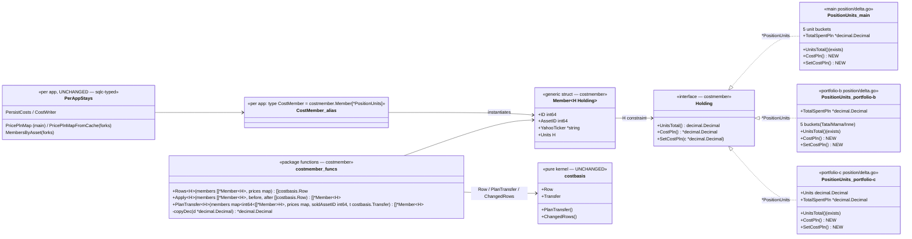

# 163 — Shared micro-helpers, costbasis glue & dead-alias cleanup (Architect, 2026-09-27)

> **Status:** design only (Phase 5: Skill 13 core interface design + Skill 16 clean-architecture
> audit). No OpenAPI, no DB schema, no migration. **Rule: zero behavior change** — identical wire
> shapes, error messages, status codes, log lines and SQL. Backend-Go implements §1–§2, Frontend-web
> implements §4. Precedent: task 160's design (`158-backend-shared-moves.md`, file misnumbered 158)
> — same conventions: seams point inward, shared-go never imports a per-app module, no `go.mod`
> edits (every dependency named below is already required by `shared-go/go.mod`).

## 0. Scope map

```mermaid
flowchart TB
    subgraph LEGEND["Legend"]
        direction LR
        L1["NEW shared-go package"]
        L2["EXISTING shared-go package, gains API"]
        L3["Per-app code: shrinks / rewired"]
        L4["KEEP / DECLINE (untouched)"]
    end

    subgraph G1["G1 — micro-helpers"]
        direction TB
        DECX["shared-go/decx (NEW)<br/>ToFloat · ToFloatPtr · FromFloatPtr · ValidatePercentRange"]
        HTTPX["shared-go/httpx<br/>+ DecodeJSON · SplitCommaList"]
        PGERR["shared-go/pgerr<br/>+ NotFoundOr"]
        PGNUM["shared-go/pgnum<br/>+ Date"]
        CONFIG["shared-go/config<br/>+ MustConnectDB"]
        HQ["shared-go/historiaquery<br/>NowInWarsaw (exists, reused)"]
        APPS1["3× handlers/services/main.go:<br/>copies deleted, call sites rewired;<br/>notFoundOrErr wrappers → 1-line delegations"]
        DECX --> APPS1
        HTTPX --> APPS1
        PGERR --> APPS1
        PGNUM --> APPS1
        CONFIG --> APPS1
        HQ --> APPS1
    end

    subgraph G2["G2 — costbasis glue"]
        direction TB
        CM["shared-go/costmember (NEW)<br/>Holding · Member[H] · Rows · Apply · PlanTransfer"]
        CB["shared-go/costbasis (pure kernel, UNCHANGED)"]
        APPS2["3× position/assetcost.go: CostMember = alias,<br/>+2 accessor methods in delta.go;<br/>PersistCosts / CostWriter / PricePlnMap* / MembersByAsset stay"]
        CALL["callers: main purchasesession, rebalancing;<br/>forks positiontransfer/cost.go, rebalancing/confirmplan.go"]
        CM -->|imports| CB
        CM --> APPS2
        CM --> CALL
    end

    subgraph NO["KEEP / DECLINE"]
        direction TB
        K1["openapiDateToTime ×5 · int32ToInt ×2"]
        K2["warsawToday: news + macro variants"]
        K3["G3 assetjoin.go · G4 target-sum tail"]
    end

    classDef newShared fill:#123f22,stroke:#39ff60,color:#fff
    classDef oldShared fill:#12304a,stroke:#00e5ff,color:#fff
    classDef adapter fill:#4a3208,stroke:#f7a800,color:#fff
    classDef untouched fill:#2a2a2a,stroke:#888,color:#ccc
    class L1,DECX,CM newShared
    class L2,HTTPX,PGERR,PGNUM,CONFIG,HQ,CB oldShared
    class L3,APPS1,APPS2,CALL adapter
    class L4,K1,K2,K3 untouched
```



*Legend (text fallback):* **green** = new shared-go package (2: `decx`, `costmember`);
**blue** = existing shared-go package that gains one or two exported functions (or is reused);
**amber** = per-app code that is deleted, shrunk or rewired; **gray** = verdict KEEP/DECLINE.

**Import direction (the new edges, all shared→shared or shared→third-party):** `decx` → `httpx`,
`shopspring/decimal`; `pgerr` → `httpx`, `jackc/pgx/v5`; `pgnum` → `pgtype` (already);
`config` → `jackc/pgx/v5/pgxpool`, `log/slog`; `costmember` → `costbasis`, `shopspring/decimal`.
There is no cycle (`httpx` imports none of them), and none of them imports a per-app module.

### Pattern evaluation (§1 Evaluate)

| Candidate | Verdict | Why |
|---|---|---|
| Generic type + small accessor interface (Go's Strategy/Adapter over a type parameter) | **adopted** (G2) | The in-memory write-back needs the per-app concrete `*PositionUnits` to survive: callers read `m.Units.TotalSpentPln` after the kernel runs, and `PersistCosts` does too. A generic `Member[H]` keeps that concrete type, so no type assertions are needed. The interface has exactly the 3 operations the glue performs (ISP). |
| Non-generic interface field (`Units Holding`) | rejected | Callers would have to type-assert back to `*PositionUnits` to read cost or apply deltas. That is a Liskov/ergonomics regression. |
| Adapter struct mapping per app (copy in, copy out) | rejected | It would re-create per app the very loops being deduplicated. |
| Extend `costbasis` with the glue | rejected | The `costbasis` package doc contracts "pure function over plain values … rows out are always copies". The glue **mutates caller memory** (`SetCostPln`), so it goes in a sibling package (`costreconcile` sets the `cost*` sibling precedent). |
| Facade / Template Method for `guardTargetSum` (G4) | rejected | The shareable tail is one comparison, and the messages are per-app wire text (YAGNI). |
| Generic join over sqlc structs (G3) | rejected | Go cannot add methods to sqlc types from another package, so the seam needs per-app mapping loops about as long as the 45 lines it would save. |
| Package-per-helper (`dbpool`, `ptrconv`, `warsaw`) | rejected | These would be single-function packages (YAGNI). Each helper joins the existing package whose charter already covers it. `decx` is the only new G1 package: 4 functions, 24 copies, one charter ("decimal at the HTTP edge"). |
| DRY | applied | Only for byte-identical or cosmetically-different bodies. Where the text differs on purpose (per-app wire messages), the **mechanism** is shared and the **message** stays local (`pgerr.NotFoundOr`). |

---

## 1. G1 — micro-helpers: final homes

Name check done against `pgnum` (`ToDecimal`, `ToDecimalOrZero`, `FromDecimal`, `ToDecimalPtr`,
`FromDecimalPtr`), `httpx` (envelope, errors, `Optional`, router), `pgerr` (`IsUniqueViolation`) and
`config` (`LoadDotEnv`, `Parse`, `Profile`, `IsDev`, `PostgresDSN`). None of the names below exists
anywhere in shared-go, so nothing is duplicated.

### 1.1 Identical ×N → move (bodies verbatim; only the name is exported)

| Helper (copies) | New home + exact signature | Body |
|---|---|---|
| `decToFloat` (11) | `decx.ToFloat(d decimal.Decimal) float64` | `f, _ := d.Float64(); return f` |
| `decToFloatPtr` (7) | `decx.ToFloatPtr(d *decimal.Decimal) *float64` | nil→nil, else `ToFloat(*d)` |
| `decFromFloatPtr` (3) | `decx.FromFloatPtr(f *float64) *decimal.Decimal` | nil→nil, else `decimal.NewFromFloat(*f)` |
| `validateTargetAllocationPct` (3; 2 bodies) | `decx.ValidatePercentRange(field string, v *decimal.Decimal) error` | main's body (nil ok; `<0 \|\| >100` → `httpx.NewValidationError(field, "must be between 0 and 100")`); package-local `hundred` |
| `decodeJSON` (9) | `httpx.DecodeJSON(r *http.Request, v any) error` | verbatim (422 `CodeValidationError` "Invalid request body") |
| `splitTickers` (3) | `httpx.SplitCommaList(raw string) []string` | verbatim (nil slice for empty input is preserved) |
| `mustConnectDB` (3) | `config.MustConnectDB(ctx context.Context) *pgxpool.Pool` | verbatim, including the three `slog.Error("backend-go: …")` lines + `os.Exit(1)` and the 5 s ping. The stale Phase-1 DevOps NOTE comment is dropped (doc-only). |
| `copyDec` (3) | **not exported.** It moves with G2 as unexported `copyDec` in `costmember` | Its only callers are `CostRows`/`ApplyCosts` (2 per app) |
| `assetNotFoundOrErr` (3) | stays per app as a 1-line delegation to `pgerr.NotFoundOr` (§1.3) | — |

**Why `decx` rather than `pgnum`:** `pgnum`'s charter is pgtype conversion (the DB edge). The float
functions never touch pgtype; they are the OpenAPI-DTO edge (float64 JSON numbers).
`ValidatePercentRange` is the matching request-side check (Java's `@DecimalMin(0)/@DecimalMax(100)`).
Putting it in `decx` also keeps `httpx` free of `shopspring/decimal`. Package doc: *"decx — decimal
values at the HTTP edge: float64 DTO mapping (display only, never persisted or re-used in math) and
bean-style range validation."*

**Behavior identity, validateTargetAllocationPct:** the forks hard-coded the field
`"targetAllocationPct"`, and **even their `TargetAllocationPctRiskOff` call site sends that literal**
(portfolio-b `service.go:520`, portfolio-c `:504`). To keep behavior at zero change, the fork call sites pass
exactly the literal they emit today: `"targetAllocationPct"` at all 3 fork call sites, including the
risk-off one. Main passes its existing per-field strings. The forks' risk-off field name is a latent
naming quirk. It is recorded here and deliberately **not** fixed (it would change the wire).

### 1.2 Near-duplicates — verdicts

| Helper | Bodies | Verdict | Home / reason (one line) |
|---|---|---|---|
| `pgDate` (5 defs / 3 bodies) | fork inline `t.Date()`→UTC midnight; main historia `dateOnly(t)`; main macro `startOfDayUTC(t)`. Both helpers are the same `y,m,d := t.Date(); time.Date(y,m,d,0,0,0,0,UTC)` | **UNIFY** | `pgnum.Date(t time.Time) pgtype.Date` = `{Time: y-m-d 00:00 UTC of t's own calendar date, Valid: true}`. The diff was cosmetic (inline vs a named helper). `pgnum`'s doc widens from "Numeric" to "pgtype ⇄ domain values (Numeric, Date)". `dateOnly`/`startOfDayUTC` stay, because they have other callers. |
| `warsawToday` (7 / 3) | (a) ×5 main deposit, purchasesession, rebalancing + portfolio-b/portfolio-c rebalancing: `LoadLocation` → fallback `time.Now().UTC()`; (b) main news: `…In(loc).Truncate(24h)`; (c) main macro: fallback `time.Now().UTC().Truncate(24h)` | **(a) UNIFY; (b), (c) KEEP** | (a) is byte-for-byte `historiaquery.NowInWarsaw()` (already exported: `time.Now().In(WarsawLocation())`, with fallback UTC). Delete the 5 copies and call it. (b) KEEP: it returns a 24h-truncated instant, a different value, pinned by the news tests. (c) KEEP: on the no-tzdata path it yields a day start instead of "now", and macro's business-date comment makes that intentional. |
| `openapiDateToTime` (5 / 2) | historia ×3 (all apps): passthrough `d.Time`; main linearregression + tradechart: re-normalized to UTC midnight | **KEEP** | shared-go does not depend on `oapi-codegen/runtime` (`types.Date`). Adding a generated-code runtime to the kernel module to save 5-line copies is a bad trade. The two bodies are equivalent for runtime-bound dates (already UTC midnight) but not textually equal. |
| `notFoundOrErr` (6 / 3) | position ×3 (identical, "Position with id %d not found" / "position: read %d"); purchasesession (entity-parametrised); positiontransfer ×2 ("Position not found: " + ticker) | **UNIFY the mechanism, KEEP the messages** | New `pgerr.NotFoundOr(err error, notFound, op string) error`: `errors.Is(err, pgx.ErrNoRows)` → `httpx.NewNotFoundError(notFound)`, else `fmt.Errorf("%s: %w", op, err)`. Every copy keeps its name and becomes a 1-line delegation, so the wire message text stays in its domain package and the output strings are identical. `assetNotFoundOrErr` ×3 follows the same pattern. |
| `int32ToInt` (2, portfolio-b/portfolio-c) | identical | **KEEP** | 2-way, 6 lines of generated-type glue inside the historia handler facade (task-160 out of scope). There is no shared home short of inventing a generic pointer-conversion package (YAGNI). |

### 1.3 New/changed shared signatures (complete list)

```go
// package decx (NEW) — packages/shared/go/shared-go/decx/decx.go
func ToFloat(d decimal.Decimal) float64
func ToFloatPtr(d *decimal.Decimal) *float64
func FromFloatPtr(f *float64) *decimal.Decimal
func ValidatePercentRange(field string, v *decimal.Decimal) error

// package httpx — new file packages/shared/go/shared-go/httpx/request.go
func DecodeJSON(r *http.Request, v any) error
func SplitCommaList(raw string) []string

// package pgerr — pgerr.go
func NotFoundOr(err error, notFound, op string) error

// package pgnum — pgnum.go
func Date(t time.Time) pgtype.Date

// package config — new file packages/shared/go/shared-go/config/db.go
func MustConnectDB(ctx context.Context) *pgxpool.Pool
```

Per-app wrappers after the change (text is exact, which proves the messages are identical):

```go
// position/service.go ×3
func notFoundOrErr(id int64, err error) error {
    return pgerr.NotFoundOr(err, fmt.Sprintf("Position with id %d not found", id), fmt.Sprintf("position: read %d", id))
}
func assetNotFoundOrErr(id int64, err error) error {
    return pgerr.NotFoundOr(err, fmt.Sprintf("Asset with id %d not found", id), fmt.Sprintf("position: read asset %d", id))
}
// main purchasesession/lifecycle.go
func notFoundOrErr(entity string, id int64, err error) error {
    return pgerr.NotFoundOr(err, fmt.Sprintf("%s %d not found", entity, id), fmt.Sprintf("purchasesession: read %s %d", entity, id))
}
// portfolio-b/portfolio-c positiontransfer/service.go
func notFoundOrErr(ticker string, err error) error {
    return pgerr.NotFoundOr(err, "Position not found: "+ticker, "positiontransfer: read position "+ticker)
}
```

`fmt.Errorf("%s: %w", "position: read 5", err)` renders the same string and wraps the same error as
`fmt.Errorf("position: read %d: %w", 5, err)`, so `errors.Is`/`As` behave identically.

### 1.4 Call-site files to rewire (every file; definitions are deleted in the same files unless noted)

| Change | Files |
|---|---|
| `decToFloat`→`decx.ToFloat`, `decToFloatPtr`→`decx.ToFloatPtr`, `decFromFloatPtr`→`decx.FromFloatPtr` | main `internal/{deposit,position,purchasesession}/handler.go`; portfolio-b + portfolio-c `internal/{deposit,position,positiontransfer,rebalancing}/handler.go` (11 files) |
| `decodeJSON`→`httpx.DecodeJSON` | main `internal/position/handler.go`; portfolio-b + portfolio-c `internal/{deposit,position,positiontransfer,rebalancing}/handler.go` (9 files) |
| `splitTickers`→`httpx.SplitCommaList` | `*/internal/marketdata/handler.go` ×3 |
| `mustConnectDB`→`config.MustConnectDB` | `*/cmd/server/main.go` ×3 (main `:95`, portfolio-b/portfolio-c `:78`); remove now-unused imports (`pgxpool` stays if still referenced) |
| `validateTargetAllocationPct`→`decx.ValidatePercentRange` | main `position/service.go` :290 :293 :523 :526 (existing field strings); portfolio-b `position/service.go` :299 :517 :520 and portfolio-c :297 :501 :504 (all `"targetAllocationPct"`, see §1.1). `hundred` stays (guardTargetSum uses it). |
| `pgDate`→`pgnum.Date` | main `internal/historia/{service.go (def), service_test.go, integration_test.go}`, main `internal/marketdata/macro/{service.go (def), service_test.go, integration_test.go}`; portfolio-b `internal/historia/{adapter.go (def), snapshot.go}`, portfolio-b `internal/admin/backfill.go (def)`; portfolio-c `internal/historia/{adapter.go (def), snapshot.go}` |
| `warsawToday` (a) →`historiaquery.NowInWarsaw` | main `internal/deposit/service.go` (def + :173), main `internal/purchasesession/{purchasesession.go (def), execution.go :205, lifecycle.go :86 :344}`, main `internal/rebalancing/{rebalancing.go (def), service.go :159}`; portfolio-b `internal/rebalancing/service.go` (def + :211); portfolio-c `internal/rebalancing/service.go` (def + :201). **Not** news/ or marketdata/macro/. |
| `notFoundOrErr` / `assetNotFoundOrErr` bodies → delegation (names and call sites unchanged) | `*/internal/position/service.go` ×3; main `internal/purchasesession/lifecycle.go`; portfolio-b + portfolio-c `internal/positiontransfer/service.go` |

**Tests move with the code:** new `decx/decx_test.go` (nil/non-nil round-trips; range bounds 0,
100, -0.0001, 100.0001, nil), `httpx/request_test.go` (malformed body → 422 AppError; `" a, ,b "`
→ `[a b]`; `""` → nil), `pgerr` test for `NotFoundOr` (ErrNoRows → 404 with the message; other
error → wrapped text + `errors.Is`), `pgnum.Date` test (a Warsaw 00:30 instant → that Warsaw
calendar date at UTC midnight). `config.MustConnectDB` is covered by every backend's startup and
the integration suites; it gets no new unit test (it calls os.Exit).

---

## 2. G2 — costbasis glue → `shared-go/costmember`

### 2.1 Seam (Skill 13) and class map (Skill 15)



*Legend:* `<<interface>>` = the ISP seam (exactly the three operations the glue performs, nothing
else). Generic `Member[H]` = Strategy-over-type-parameter, which keeps each app's concrete
`*PositionUnits` so callers keep reading `m.Units.TotalSpentPln` and applying unit deltas with no
type assertion. The per-app alias lets every existing composite literal
`&position.CostMember{ID:…, AssetID:…, YahooTicker:…, Units:&u}` compile unchanged. **Why a sibling
package rather than `costbasis`:** `costbasis`'s doc is a contract ("pure function over plain
values; rows out are always copies"), and `Apply` writes into caller memory. `costmember` is the one
explicit write-back edge, and the kernel stays pure.

```go
// Package costmember adapts the pure costbasis kernel to the trade services' in-memory position
// rows: build kernel rows from members, and write the kernel's result back onto them.
// It is the ONLY place that mutates caller state; costbasis itself stays value-in/value-out.
package costmember

type Holding interface {
    UnitsTotal() decimal.Decimal
    CostPln() *decimal.Decimal
    SetCostPln(*decimal.Decimal)
}

type Member[H Holding] struct {
    ID          int64
    AssetID     int64
    YahooTicker *string
    Units       H
}

// Rows = today's CostRows body; m.Units.TotalSpentPln → m.Units.CostPln().
func Rows[H Holding](members []*Member[H], prices map[string]decimal.Decimal) []costbasis.Row

// Apply = today's ApplyCosts body; `m.Units.TotalSpentPln = copyDec(r.CostPln)` →
// `m.Units.SetCostPln(copyDec(r.CostPln))`.
func Apply[H Holding](members []*Member[H], before, after []costbasis.Row) []*Member[H]

// PlanTransfer = the sqlc-free tail of portfolio-b/portfolio-c positiontransfer/cost.go planCosts and of
// main rebalancing.planTransferCosts: before-rows for the sold asset, then each leg's asset in
// leg order (deduped); costbasis.PlanTransfer; Apply in that same order (sold asset first).
func PlanTransfer[H Holding](members map[int64][]*Member[H], prices map[string]decimal.Decimal,
    soldAssetID int64, t costbasis.Transfer) []*Member[H]
```

`PlanTransfer` body (the forks' current code, verbatim apart from the renames):

```go
before := map[int64][]costbasis.Row{}
order := []int64{soldAssetID}
before[soldAssetID] = Rows(members[soldAssetID], prices)
for _, leg := range t.Buys {
    if _, ok := before[leg.AssetID]; !ok {
        before[leg.AssetID] = Rows(members[leg.AssetID], prices)
        order = append(order, leg.AssetID)
    }
}
after := costbasis.PlanTransfer(before, soldAssetID, t)
var changed []*Member[H]
for _, assetID := range order {
    changed = append(changed, Apply(members[assetID], before[assetID], after[assetID])...)
}
return changed
```

### 2.2 Per-app adapter (identical in all three apps, except the `delta.go` line numbers)

- `position/delta.go` (next to `UnitsTotal`: main `:64`, portfolio-b `:50`, portfolio-c `:40`):
  ```go
  // CostPln / SetCostPln let costmember write the kernel's result back (task 163).
  func (p *PositionUnits) CostPln() *decimal.Decimal     { return p.TotalSpentPln }
  func (p *PositionUnits) SetCostPln(c *decimal.Decimal) { p.TotalSpentPln = c }
  ```
- `position/assetcost.go`: replace the `CostMember` struct with
  `type CostMember = costmember.Member[*PositionUnits]` plus the compile-time assertion
  `var _ costmember.Holding = (*PositionUnits)(nil)`. Delete `CostRows`, `ApplyCosts` and
  `copyDec`. **Keep** `PersistCosts`, `CostWriter`, `PricePlnMap` (main) / `PricePlnMapFromCache`
  (forks) and `MembersByAsset` (forks). They read or write per-app `sqlcgen` types, and moving them
  would need a second seam around a sqlc param struct (task-file rule honoured).
- Callers, which already import `costbasis`: add the `costmember` import, then
  `position.CostRows(`→`costmember.Rows(` and `position.ApplyCosts(`→`costmember.Apply(`:
  - main `purchasesession/execution.go` :336, :341 (`planSessionCosts` keeps its own ordered
    `PlanTrades` flow, which is main-only)
  - main `rebalancing/service.go` `planTransferCosts` :235-265 → build `legs` and the `Sale` exactly
    as today, then `return costmember.PlanTransfer(members, prices, soldPos.assetID,
    costbasis.Transfer{Sold: …, Buys: legs})`. The ordering is equivalent: today's `touch(sold)`
    followed by `touch(buyPos.assetID)` per buy in request order is exactly `PlanTransfer`'s
    sold-first, then legs in order, deduped.
  - portfolio-b/portfolio-c `rebalancing/confirmplan.go` (portfolio-b :140, :145; portfolio-c :118, :123): rename only.
    Their `PlanTrades(before, nil, legs)` + per-map `newCost` flow is fork-specific and stays.
- Tests: the per-app `position/assetcost_test.go` (6 refs each) and main `position/service_test.go`
  (2 refs) get the same mechanical rename. They keep covering the per-app bucket sums through the
  real `PositionUnits`. The new `costmember/costmember_test.go` uses a test-local fake `Holding` for:
  price-by-ticker, nil or empty ticker → nil price, missing cache entry → nil price, cost copied and
  not aliased (both directions), `Apply` returns only changed members, and `PlanTransfer` ordering
  (sold first; a duplicate leg asset is not repeated).

### 2.3 `positiontransfer/cost.go` (portfolio-b↔portfolio-c, 94%) — verdict: EXTRACT THE TAIL, KEEP THE HEAD

The 6% diff is the **intentional** read scope: portfolio-b `q.ListAllPositions` vs portfolio-c
`q.ListPositionsByPortfolio(ctx, sqlcgen.PortfolioEnum(portfolio))`. Portfolio C must never hand the
other portfolio's rows to the kernel. Everything after the reads (`before`/`order`/`PlanTransfer`/
apply loop, ~15 lines) becomes `return costmember.PlanTransfer(members, prices, soldAssetID,
costbasis.Transfer{Sold: sale, Buys: legs}), nil`. The `planCosts` signatures, the three reads,
`MembersByAsset` and `PricePlnMapFromCache` stay per app. Callers in `positiontransfer/service.go`
are untouched.

---

## 3. G3 / G4 verdicts

- **G3 `position/assetjoin.go` — DECLINE.** It reads `sqlcgen.Asset{ID, Key, TargetAllocationPct}`
  and `sqlcgen.Position{IsPrimary, AssetID, Ticker}`. Go cannot attach accessor methods to those
  generated types from another package, so a generic seam needs a per-app mapping loop into plain
  structs on every call. That is about as much code as the 45 byte-identical lines it saves, and it
  is 2-way only (same verdict shape as task 160's `rebalancing/history.go`).
- **G4 target-sum pure tail — DECLINE.** The shareable part is one expression
  (`sum.Sub(hundred).Abs().Cmp(tol) > 0`). The error messages are per-app wire text (main and portfolio-c
  name the portfolio, portfolio-b does not; main adds the risk-off COALESCE check), and `hundred` stays
  needed locally. A shared `OffBy100(sum)` would add an import and an indirection without removing
  a real branch.

---

## 4. F1 — shared UI dead aliases & `@ts-nocheck` (confirmed)

Verified 2026-09-27: `grep -rn subPositions apps/*/frontend-web/src` → **0 hits**. The only hits
are the shared definitions themselves. Main renders its own `PortfolioValueLine` and passes no
`subPositions` to the shared dialog (`RebalancingTransferDialog.tsx`).

1. `packages/shared/ui/src/PortfolioValueLine.tsx`: delete `WallPositionLike.subPositions`
   (L42-43) and rewrite the L33-37 doc so it no longer says "main still passes old-shape positions".
   Keep `ticker?` (fork assets still carry their primary's `ticker`). L311: `p.subassets ?? []`.
   Remove the L1 `// @ts-nocheck`. **Architect probe:** with the pragma removed, `tsc --noEmit`
   reported **0 errors** in `packages/shared/ui` and in all 3 frontends (the temporary edit was
   reverted), so no type fixes are expected.
2. `packages/shared/ui/src/PositionTransferDialog.tsx`: delete `subPositions` (L78-79). In
   `subassetsOf` (L209), use `const subs = position.subassets;`.
3. **Same dead-alias class, included (grep-proven zero producers):** `isCompanionRow?` (L72-77)
   and `computeTotalPortfolioValuePln` becomes `sum + p.valuePln` (L200-204; no app sets the field,
   and main's backend rejects it on requests and never emits it). `TransferPositionLike` (L82-83)
   has zero importers. Behavior-neutral: an absent flag always took the `p.valuePln` branch. If the
   Frontend-web agent finds a single producer, it leaves that item and reports it.
4. `apps/main/frontend-web/src/routes/settings/_components/MacroBlendHistoryChart.tsx` `@ts-nocheck`:
   the probe shows **7 errors, all local to the file**. They are implicit-any at L272/L293 ×2, a
   recharts `height` type at L522, two overload mismatches at L601/L612, and the `Brush` props /
   `onChange` signature at L704. **Remove it and fix locally** with annotations and recharts-typed
   callbacks, without touching shared types. If a fix would need a shared or recharts-wrapper change
   or an `any` cast chain, stop, restore the pragma and note it in the task file.

---

## 5. Skill 16 — clean-architecture audit

| Check | Result |
|---|---|
| Dependency rule (shared never imports per-app) | Holds. All new edges are listed in §0 and point shared→shared or shared→third-party. `costmember`'s seam is defined in shared, and apps implement it (the `settingscore.Store` precedent). |
| SRP / cohesion | `decx` = decimal at the HTTP edge; `httpx` = request plumbing; `pgerr` = pgx error → HTTP mapping; `pgnum` = pgtype conversion; `config` = env + bootstrap; `costmember` = kernel write-back. No package gains a second reason to change. |
| ISP | `Holding` has 3 methods, and `Rows`/`Apply` use all of them. No broader "Position" interface was invented. |
| LSP | Every `*PositionUnits` satisfies `Holding` identically; the portfolio-c single-`units` shape works through `UnitsTotal()`. |
| DRY | 24 float copies, 9 decode copies, 3 split copies, 3 bootstrap copies, 5 pgDate copies and 5 clock copies drop to one each. The 12 not-found helpers share one mechanism. The costbasis glue goes from 3× to 1×, and transfer planning from 3× to 1×. |
| YAGNI | G3, G4, `openapiDateToTime`, `int32ToInt` and the news/macro `warsawToday` are declined with reasons, and no single-function packages were created. |
| Known wart (accepted) | `historiaquery.NowInWarsaw` is now called from non-historia packages in main and the forks. The function is generic, but it lives in the historia kernel's `warsaw.go`. Renaming or moving it would churn the historia callers for no behavior gain. Revisit only if a new Warsaw helper is needed outside historia. |
| Latent quirk (recorded, not fixed) | The forks report a risk-off target range error under field `targetAllocationPct` (§1.1). Fixing it changes the wire, which is outside the zero-behavior-change rule. |

## 6. Verification (Backend-Go runs; orchestrator spot-checks)

```bash
grep -rn 'func decToFloat\|func decToFloatPtr\|func decFromFloatPtr\|func decodeJSON\|func copyDec\|func splitTickers\|func mustConnectDB\|func validateTargetAllocationPct\|func pgDate\|func CostRows\|func ApplyCosts' apps/ --include=*.go   # → 0
grep -rn 'func warsawToday' apps/ --include=*.go   # → exactly 2: main news/service.go, main marketdata/macro/macro.go
grep -rn '"\(main\|portfolio-b\|portfolio-c\|investing-app/backend-go\)' packages/shared/go/shared-go --include=*.go   # → 0 per-app imports
# then in shared-go + all 3 backends:
go build ./... && go vet ./... && go test ./...
```
