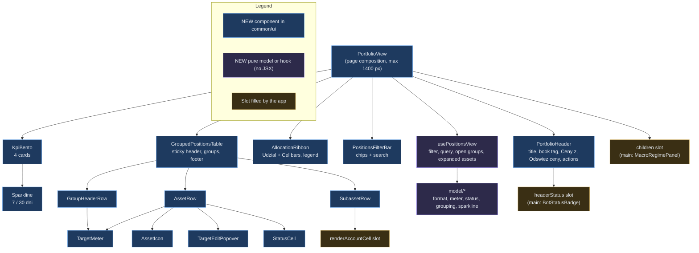
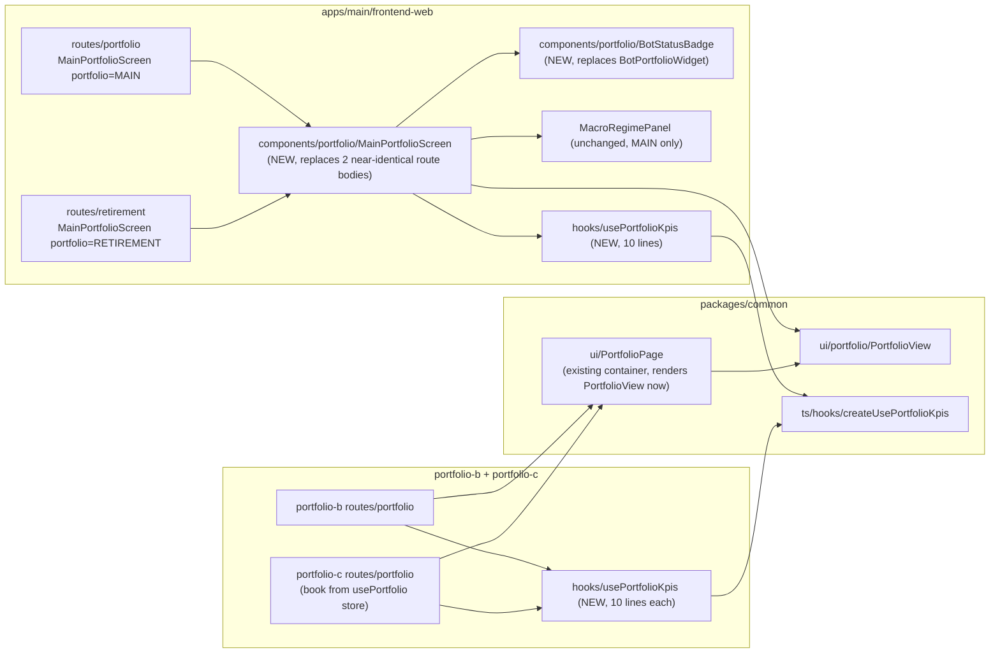
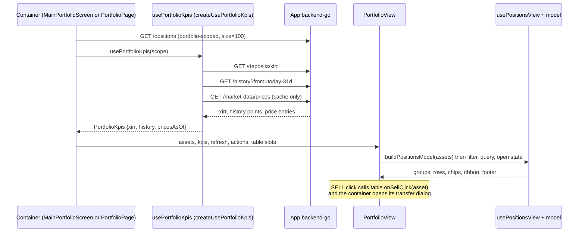
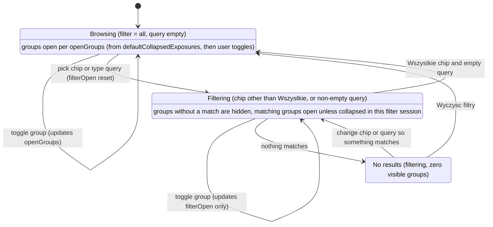

# 170: Portfolio view redesign for all 3 apps (Architect, 2026-10-24)

> **Status:** implemented (task 170, commits `0086f8a`..`9678e8c`, 2026-10-24). §15 lists where
> the build differs from this design. The current-state references are
> `docs/architecture/12-portfolio-bpps-and-shared-packages.md` §5.1 (components, grouping, icons,
> tokens, font, shell) and `docs/architecture/05-rebalancing-algorithm.md` §7.5 (the trim formula).
> This document stays as the design record and the source of the formula details and test fixtures
> (§5–§7).
> **Paths assume task 169 has landed:** `packages/common/{ts,ui}`, npm `@common/app-core` and
> `@common/ui-primitives` (ADR-105). Decision record: `docs/adr/ADR-106-portfolio-view-redesign.md`.
> **Visual spec:** the owner-approved mockup. `Main.dc.html` is the full page; its `<script>` block
> holds the meter, status and format logic the owner reviewed. `Komponenty.dc.html` shows the
> component states and the palette. Both are in the session scratchpad named in the task file.
> When the mockup and this document disagree, **this document wins**. Every deliberate deviation is
> listed in §14.

## Contents

1. [Pattern evaluation](#1-pattern-evaluation)
2. [Component tree](#2-component-tree)
3. [Data mapping per app](#3-data-mapping-per-app)
4. [Grouping by exposure](#4-grouping-by-exposure)
5. [TargetMeter and status contract](#5-targetmeter-and-status-contract)
6. [Filters, search and collapse state](#6-filters-search-and-collapse-state)
7. [Formatting rules](#7-formatting-rules)
8. [Token plan](#8-token-plan)
9. [Icon plan](#9-icon-plan)
10. [Layout and the sticky-header constraint](#10-layout-and-the-sticky-header-constraint)
11. [Accessibility](#11-accessibility)
12. [Regression checklist](#12-regression-checklist)
13. [Implementation plan](#13-implementation-plan)
14. [Decisions and deviations from the mockup](#14-decisions-and-deviations-from-the-mockup)
15. [As built](#15-as-built)

---

## 1. Pattern evaluation

| Candidate | Verdict | Why |
| --- | --- | --- |
| **Template Method / container + presentational split** | adopted | One presentational `PortfolioView` in common. Each app keeps a thin container that owns data, dialogs and edit flows: main's new `MainPortfolioScreen`, and the existing common `PortfolioPage` for portfolio-b and portfolio-c. This is the same shape the apps already use (`PortfolioPage` with injected slots). |
| **Strategy via injected callbacks and slots** | adopted (existing) | App-specific behaviour is passed in as props, not branched on an app id: `updateAsset`, `renderAccountCell`, the sell/edit callbacks, `headerStatus` (main's bot badge), `children` (main's `MacroRegimePanel`) and `defaultCollapsedExposures`. |
| **Factory function for hooks** | adopted | `createUsePortfolioKpis(sources)` follows the precedent of `createUseRefreshPrices(refreshPrices)`. All three apps would otherwise write the same three `useQuery` calls, differing only in API client and query key. |
| **Parameter Object** | adopted | `PortfolioView` takes `positions`, `actions` and `table` objects rather than about 20 flat props. |
| **Pure view-model functions** | adopted | Meter geometry, status figure, grouping, filtering, sparkline and formatters are pure TypeScript in `portfolio/model/`, so they can be unit-tested without React. The precedent is `history/historyChartModel.ts`. |
| Observer / state machine library | rejected | Filter and collapse state is 4 `useState` values in one hook (§6). A library is YAGNI. |
| TanStack Table v9 grouping feature | rejected | There is no column sorting, column visibility or resizing in the design. The grouping is a 10-line reduce. Using TanStack would add a feature registry for nothing. The old tables' v9 setup is deleted with them. |
| Decorator for "app-specific columns" | rejected | No app adds a column. The one app-specific cell (the subasset account split) is already a render slot. |
| Merging main's container into common `PortfolioPage` | rejected for this task | Main's edit flows (`useAssetActions`: richer delete notes, a per-row subasset pencil, the `open` prop on the transfer dialog) are not edited by the redesign. The AGENTS.md rule is about code edited the same way in several apps, and these flows are not. Recorded as a follow-up candidate in ADR-106. |

**Principles.**

- **DRY** (AGENTS.md): every visual and logical piece the three apps would edit the same way lives
  in `packages/common`.
- **SRP**: the model computes and the components render. Containers fetch and own dialogs.
- **OCP**: a new exposure value is a table entry in `EXPOSURE_GROUPS` (§4), not a code change.
- **YAGNI**: no density switch (the mockup's `density` prop was only for exploring designs), no
  persisted collapse state, no column sorting.
- **Law of Demeter**: rows receive a prepared `PositionRowModel` and do not reach into
  `asset.computed`.

---

## 2. Component tree

### 2.1 Common view (`packages/common/ui/src/portfolio/`)



**Legend and patterns.**

- Blue nodes are presentational components in common. They hold no data fetching and no API
  clients. This is SRP: the containers own I/O.
- Violet nodes are pure functions and one state hook. They are tested without the DOM (§5, §6, §7).
- Gold nodes are **slots** (Strategy by injection). They are the only places an app's own code
  appears inside the view.
- `PortfolioView` is the single composition, so the order and spacing of header, KPIs, ribbon,
  filters and table cannot drift between apps.

### 2.2 Containers per app (thin wiring)



**Legend and patterns.** Each app box contains only containers, which own data, dialogs and edit
flows, plus small bindings. Everything that renders is in common, through the arrows into
`PortfolioView` (Template Method composition). The two `usePortfolioKpis` bindings are 10-line
calls into the common factory (DRY). Main's two routes collapse into one screen, the same SRP fix
inside one app.

### 2.3 Component inventory: home, props or slots, and what it replaces

| Component / module | Home | Props / slots (summary, full signatures in §2.4) | Replaces or absorbs |
| --- | --- | --- | --- |
| `PortfolioView` | common/ui `portfolio/PortfolioView.tsx` | `title`, `bookTag?`, `headerStatus?`, `positions`, `kpis`, `refresh`, `actions`, `table`, `children?` | The page bodies of main `routes/portfolio`, main `routes/retirement` and common `PortfolioPage` (PageHeader + SummaryBar + Table) |
| `PortfolioHeader` | common/ui | `title`, `bookTag?`, `pricesAsOf`, `refresh`, `status?`, `actions` | `PageHeader` usage on these pages, main's eyebrow "Portfel · Main" |
| `KpiBento` + `Sparkline` | common/ui | `kpis: PortfolioKpis` | common `PortfolioSummaryBar.tsx`, main `components/PortfolioSummaryBar.tsx`, portfolio-b and portfolio-c `components/PortfolioSummaryBar.tsx`, main `PrismValue.tsx` (left with no consumer, so deleted) |
| `AllocationRibbon` | common/ui | `groups`, `hasEffectiveOverride` | new |
| `PositionsFilterBar` | common/ui | `chips`, `filter`, `onFilter`, `query`, `onQuery` | the search `Input` and "Rozwiń/Zwiń wszystkie" in both old tables |
| `GroupedPositionsTable` | common/ui | `view` (from `usePositionsView`), `table: PositionsTableSlots` | common `PositionsTable.tsx` (portfolio-b, portfolio-c), main `components/tables/PositionsTable.tsx` |
| `GroupHeaderRow`, `AssetRow`, `SubassetRow` | common/ui (internal to the table) | row models plus slots | common `SubassetRows.tsx` |
| `TargetMeter` | common/ui, exported | `geometry`, `curLabel`, `effLabel`, `title`, `size: "row" \| "group"` | the "Cel %" and "Aktual. %" columns |
| `StatusCell` | common/ui | `status`, `figure`, `onSell?`, `assetName` | `DeviationStatusBadge` and the sell `<button>` wrappers |
| `TargetEditPopover` | common/ui | `asset`, `update`, `onSaved`, `title?` | common `TargetPctCell` (siblings) **and** main's `TargetPctCell`: one component with the 4xx message surfacing kept |
| `TargetAllocationSum` (rewritten, table footer) | common/ui | `assets` (not TanStack rows), `hasEffectiveOverride` | `PositionsTableStatus.TargetAllocationSum` |
| `AccountChips` | common/ui | `accounts: {label, value}[]`, `assetClass` | main's `AccountChipList` and portfolio-b's `AccountBreakdown` markup. Both now call it; portfolio-c keeps its plain units span. |
| `AssetIcon` | common/ui | `ticker`, `assetClass`, `size?` | the inline `` plus `onError → display:none` in both old tables |
| `usePositionsView` | common/ui `portfolio/usePositionsView.ts` | `(assets, { defaultCollapsedExposures })` | `useState` for sorting, filter and expanded rows in both old tables |
| `model/portfolioFormat.ts`, `model/targetMeter.ts`, `model/rebalanceStatus.ts`, `model/positionsModel.ts`, `model/sparklineModel.ts` | common/ui `portfolio/model/` | pure functions (§5, §7) | `deviationStatus` (moved from `PositionsTableStatus.tsx`), both copies of `matchesQuery` and `primaryOf` |
| `computeTrimExcessPln` | common/ui `portfolio/model/rebalanceStatus.ts` | `(valuePln, effectiveTargetPct, totalPln)` | the excess arithmetic inside `PositionTransferDialog.computeSuggestedSellUnits` (the dialog then calls it, §3.3) |
| `EXPOSURE_GROUPS`, `exposureGroupOf()` | common/ts `utils/exposure-groups.ts` | colour, label and order key per exposure | the colour half of `EXPOSURE_COLORS` / `EXPOSURE_BASE` for the treemap (§4, step 12). Labels reuse `EXPOSURE_LABELS_PL`. |
| `ASSET_ICONS`, `resolveAssetIcon()`, `getAssetIconUrl()` | common/ts `utils/asset-icons.ts` (+ `utils/asset-icons/*.svg`) | `(ticker, assetClass) → {src, kind} \| null` | main `lib/assetIcons.ts` maps, `portfolio-b-portfolio-c-asset-icons.ts`, `createAssetIconResolver` config (§9) |
| `createUsePortfolioKpis` | common/ts `hooks/usePortfolioKpis.ts` | `sources` → `(scope) => PortfolioKpis` | the three per-app summary-bar `useQuery` blocks |
| `PortfolioPage` (existing container) | common/ui | **removed:** `SummaryBar`, `Table`. **added:** `bookTag?`, `useKpis`, `useRefreshPrices`, `updateAsset`, `renderAccountCell`, `defaultCollapsedExposures?` | itself (kept as the siblings' container) |
| `MainPortfolioScreen` | **main app** `components/portfolio/` | `portfolio: "MAIN" \| "RETIREMENT"` | the bodies of main `routes/portfolio/index.tsx` and `routes/retirement/index.tsx`, which were 163 lines each and near-identical |
| `BotStatusBadge` | **main app** `components/portfolio/` | none (it queries the bot itself) | `BotPortfolioWidget.tsx` |
| `MacroRegimePanel` | **main app** (unchanged) | passed as `children`, MAIN only | stays below the table |
| `renderAccountCell` per app | **each app** | main: IKE/IKZE/REG PLN/EUR/USD (crypto folds regular into "BINANCE") via `AccountChips`. portfolio-b: IKE tata/mama, IKZE tata/mama, Inne via `AccountChips`. portfolio-c: `"{units} szt."` span. | the per-app `components/tables/PositionsTable.tsx` wrappers, which are deleted (the cell moves into the route or a small `lib/accountCell.tsx`) |

### 2.4 Prop contracts (TypeScript, normative)

```ts
// packages/common/ui/src/portfolio/types.ts
export interface PortfolioSubassetLike {
  id: number; isPrimary: boolean; ticker: string; name: string;
  valuePln?: number | null; pricePln?: number | null; priceNative?: number | null; priceCurrency: string;
}
export interface PortfolioComputedLike {
  valuePln?: number | null; currentPct?: number | null; deviationPct?: number | null;
  /** main only. Absent in portfolio-b/portfolio-c, see §3.2. */
  effectiveTargetAllocationPct?: number | null;
  pricePln?: number | null; priceNative?: number | null;
  profitPct?: number | null; avgBuyPricePln?: number | null; avgBuyPriceNative?: number | null;
}
export interface PortfolioAssetLike<TSub extends PortfolioSubassetLike = PortfolioSubassetLike> {
  id: number; key: string; name: string; assetClass: string; exposure: string;
  targetAllocationPct: number | null;
  computed?: PortfolioComputedLike;
  subassets: TSub[];
}

export interface PortfolioHeaderActions {
  editMode: boolean;
  onToggleEdit: () => void;
  onOpenHistory: () => void;
  onOpenTreemap: () => void;
  onAdd: () => void;
}

export interface PositionsTableSlots<TAsset, TSub> {
  /** Undefined = SELL is not clickable. main passes it only in edit mode; portfolio-b/portfolio-c always do (unchanged). */
  onSellClick?: (asset: TAsset) => void;
  onEditClick?: (asset: TAsset) => void;        // undefined outside edit mode
  onDeleteClick?: (asset: TAsset) => void;      // undefined outside edit mode
  onEditSubClick?: (sub: TSub) => void;         // main only (per-row pencil)
  onDeleteSubClick?: (sub: TSub) => void;       // undefined outside edit mode
  onSetPrimaryClick?: (sub: TSub) => void;      // undefined outside edit mode
  settingPrimaryId?: number | null;
  targetEdit: {
    update: (id: number, body: { targetAllocationPct: number | null }) => Promise<unknown>;
    onSaved: () => void;                         // the container's invalidatePositions
    title?: string;                              // popover title, default "Cel %"; main MAIN: "Cel % (risk-on)"
  };
  renderAccountCell: (sub: TSub, assetClass: string) => ReactNode;
  defaultCollapsedExposures?: readonly string[]; // main MAIN: ["EXPERIMENTS"]; all others: []
}

export interface PortfolioViewProps<TAsset extends PortfolioAssetLike<TSub>, TSub extends PortfolioSubassetLike> {
  title: string;                 // "Portfolio" in every app
  bookTag?: string;              // main: "Main" / "Emerytura"; portfolio-c: PORTFOLIO_LABELS[portfolio]; portfolio-b: none
  headerStatus?: ReactNode;      // main MAIN: <BotStatusBadge/>
  positions: { data: TAsset[]; isPending: boolean; isError: boolean };
  kpis: PortfolioKpis;
  refresh: UseRefreshPricesResult; // the app's own useRefreshPrices()
  actions: PortfolioHeaderActions;
  table: PositionsTableSlots<TAsset, TSub>;
  children?: ReactNode;          // rendered after the table, inside the 1400 px column
}

// packages/common/ts/src/hooks/usePortfolioKpis.ts
export interface XirrDataLike {
  totalInvestedPln?: number | null; currentValuePln?: number | null;
  simpleReturnPct?: number | null; xirrPct?: number | null; yearsElapsed?: number | null;
}
export interface HistoryPointLike { snapshotDate: string; portfolioValue: number }
export interface PriceEntryLike { fetchedAt: string }
export interface PortfolioKpis {
  xirr: XirrDataLike | null;
  history: HistoryPointLike[];   // window from today − 31 days, ascending by date
  pricesAsOf: string | null;     // ISO, max(fetchedAt)
  isPending: boolean;            // XIRR query pending (the cards skeleton on this)
}
export interface PortfolioKpiSources<S> {
  xirrKey: (scope: S) => QueryKey;
  fetchXirr: (scope: S) => Promise<{ data: XirrDataLike }>;
  historyKey: (scope: S, from: string) => QueryKey;
  fetchHistory: (scope: S, from: string) => Promise<{ data: HistoryPointLike[] }>;
  pricesKey: QueryKey;
  fetchPrices: () => Promise<{ data: PriceEntryLike[] }>;
}
export function createUsePortfolioKpis<S>(sources: PortfolioKpiSources<S>): (scope: S) => PortfolioKpis;
```

All three queries use `staleTime: 60_000, refetchInterval: 60_000`, the same as today's summary
bars. `from` is computed once per mount (`useMemo`) so the query key stays stable.
`useRefreshPrices` already calls `invalidateQueries()` with no filter, so "Ceny z" and the KPIs update
after a refresh.

---

## 3. Data mapping per app

### 3.1 Endpoints (all already in the contracts; verified 2026-10-24)

| Need | main (`docs/openapi/`) | portfolio-b (`apps/portfolio-b/docs/openapi.yaml`) | portfolio-c (`apps/portfolio-c/docs/openapi.yaml`) |
| --- | --- | --- | --- |
| Positions (assets + subassets + `computed`) | `GET /positions?portfolio=MAIN\|RETIREMENT&size=100` | `GET /positions?size=100` | `GET /positions?portfolio=VARIABLE\|FIXED&size=100` |
| KPI numbers | `GET /deposits/xirr?portfolio=` (`getXirr`, client `computeXirr`) → `XirrResponse.data` | `GET /deposits/xirr` → `XirrData` | `GET /deposits/xirr?portfolio=` → `XirrData` |
| Sparkline | `GET /history?portfolio=MAIN\|RETIREMENT&from=<today−31d>&size=100` | `GET /history?from=…&size=100` | `GET /history?portfolio=…&from=…&size=100` |
| "Ceny z …" | `GET /market-data/prices`. **Cache-only, never triggers a fetch** (Go handler). | same | same |
| "Odśwież ceny" | Top bar only (`AppLayout`, `POST /market-data/prices/refresh`). Removed from the portfolio header 2026-11-03 (it duplicated the top-bar button). | same | same |
| Inline target edit | `PUT /assets/{id}` `{targetAllocationPct}` | same | same |
| Sell (manual trim) | `POST /rebalancing-transfers` via `RebalancingTransferDialog` | `POST /position-transfers` via `PositionTransferDialog` | same as portfolio-b |
| Bot badge | `GET /bot/positions/open`, `GET /bot/calendar`, `GET /bot/plans/latest` (client `getBotOpenPositions`, `listBotCalendar`, `getBotPlanLatest`, the same calls `BotPortfolioWidget` makes) | none | none |

`XirrData` has `currentValuePln`, `totalInvestedPln`, `simpleReturnPct`, `xirrPct` and
`yearsElapsed` in all three contracts. `HistoriaEntry` has `snapshotDate` and `portfolioValue` in all
three. `PriceEntry.fetchedAt` is in all three. `Asset.computed` has `valuePln`, `currentPct`,
`deviationPct`, `pricePln`, `priceNative`, `profitPct`, `avgBuyPricePln` and `avgBuyPriceNative` in all
three. `effectiveTargetAllocationPct` exists **only in main**.

### 3.2 The effective-target rule (one function, all apps)

```ts
export function effectiveTargetPct(a: PortfolioAssetLike): number | null {
  return a.computed?.effectiveTargetAllocationPct ?? a.targetAllocationPct;
}
```

- **main MAIN**: the server's macro-blended target (ADR-044/071), which `deviationPct` divides by.
- **main RETIREMENT**: the server returns it equal to `targetAllocationPct` (no macro gate).
- **portfolio-b and portfolio-c**: the field is absent, so the function returns `targetAllocationPct`. Their
  backends compute `deviationPct` against the raw target (shared Go
  `positioncalc.CurrentAndDeviationPct`, no override), so the marker, the status and the p.p.
  figure always agree.
- `basePct = asset.targetAllocationPct`. `hasEffectiveOverride` = some asset has
  `|base − eff| > 0.05`. This is true only for main MAIN while the macro gate is moving targets. It
  turns on, without any app flag: the ribbon caption, "Suma celów **bazowych**", and the "cel
  bazowy" legend item.

### 3.3 What feeds each element

`totalPln` = Σ `asset.computed.valuePln ?? 0` over the listed (portfolio-scoped) assets. This is
exactly `computeTotalPortfolioValuePln` in `PositionTransferDialog`.

| Element | Source | Rule |
| --- | --- | --- |
| **Wycena całkowita** (big number) | `xirr.currentValuePln` | `formatZl`; null → "—" |
| Sparkline + change line | `history[].portfolioValue` plus the live `xirr.currentValuePln` | `buildSparkline` (§7): points with `snapshotDate ≥ today − N days` (N = 7 or 30). The live value replaces today's point or is appended. `delta = last − first`, `deltaPct = delta / first`. Fewer than 2 points means no sparkline and no change line. |
| **Zysk / strata** | `xirr.currentValuePln − xirr.totalInvestedPln`; pill = `xirr.simpleReturnPct` | amount `formatSignedZl`; pill `formatSignedPct(x, 2)`, coloured gain or loss; subtext "Wycena minus wpłaty" |
| **Wpłacony kapitał** | `xirr.totalInvestedPln`; subtext from `xirr.yearsElapsed` | "Wpłaty z " + `formatYearsMonths(yearsElapsed)` |
| **XIRR** | `xirr.xirrPct` (a fraction) | `formatSignedPct(x, 2)` + "rocznie"; null → "—"; subtext "Zwrot liczony z datami wpłat" |
| "Ceny z …" | max(`prices[].fetchedAt`) | `formatPricesAsOf`; null → the text is hidden |
| Ribbon "Udział" | per group Σ `computed.currentPct` | segment width = group share % |
| Ribbon "Cel" | per group Σ `effectiveTargetPct` (null counts as 0) | width = `effG / ΣeffAll × 100` (normalised, so the bar always fills) |
| Ribbon legend delta | `curG − effG` | `formatPp1` (1 decimal, signed). Colour: > +0.5 → `--status-over-text`; < −0.5 → `--status-under-text`; else `--text-2` |
| Column **Aktywo** | `name`; primary subasset `ticker`; `assetClass` | icon (§9); subtext `displayTicker(primary.ticker) + " • " + ASSET_CLASS_LABEL_PL[assetClass]` |
| Column **Cena / śr. wejście** | `computed.pricePln`; `computed.avgBuyPricePln` | `formatPricePln`; subtext "wejście " + `formatPricePln(avg)`, or "brak wejścia". When the primary's `priceCurrency ≠ PLN`, the cell `title` = "Cena {formatCurrency(priceNative, cur)} · wejście ≈ {formatCurrency(avgBuyPriceNative, cur)} (po dzisiejszym kursie)". This carries over `EntryPriceCell`'s native line. |
| Column **Wartość / udział** | `computed.valuePln`, `computed.currentPct` | `formatZl`; subtext `formatShare(cur) + " portfela"` |
| Column **Udział wobec celu** | `currentPct`, `effectiveTargetPct`, `targetAllocationPct`, `status` | `computeTargetMeter` (§5) |
| Column **Zysk / strata** | `computed.profitPct` (fraction) | `formatSignedPct(pr, 1)` in `--gain-text` / `--loss-text` / `--text-2`. Subtext = `formatSignedZl(plPln)`, where `costPln = valuePln / (1 + pr)` and `plPln = valuePln − costPln`, defined only when `pr != null && pr > −1`. `pr == null` → "—", with subtext "brak jednostek" when `valuePln == 0`, else "brak kosztu". |
| Column **Rebalansowanie** | `computed.deviationPct` → `deviationStatus` | dot + label + figure (§5.2) |
| **SELL amount** | `computeTrimExcessPln(valuePln, eff, totalPln) = max(0, valuePln − eff/100 × totalPln)` | **The same function** is called by `PositionTransferDialog.computeSuggestedSellUnits`, which keeps its ÷ price, 4-decimal rounding and the cap at units held in the default account. With the same `totalPln` and target mapping (main maps `effectiveTargetAllocationPct ?? targetAllocationPct`, siblings map `targetAllocationPct`, §3.2), the table figure equals the dialog's pre-filled PLN amount (ADR-048 §7.5: back to 1.0× effective target), up to the dialog's 4-decimal unit rounding (at most half a 0.0001-unit step × price). The one designed difference: if the default sell account holds fewer units than the excess (several accounts), the dialog pre-fills what that account holds, while the table shows the asset-level total. |
| **p.p. deviation** | `currentPct − eff` | `formatPp` (§7) |
| Group header value / share | Σ row `valuePln`; Σ row `currentPct` | as rows |
| Group meter | `cur = Σ currentPct`, `eff = Σ eff`, `base = Σ base` | `computeTargetMeter` with `groupMeterStatus(cur, eff)` (§5.1) |
| Group P/L | Σ `plPln` and Σ `costPln` over rows where both are defined | `% = ΣplPln / ΣcostPln`. No defined row → "—" / "brak kosztu". (The mockup's `pp / (v − pp)` is wrong when some rows have no cost.) |
| Group summary | the most severe row status: SELL > OVER > UNDER > OK | label + "×count"; OK has no count |
| Footer sum | Σ `targetAllocationPct` over **all** assets of the book | §5.3 |

### 3.4 Data flow



### 3.5 Backend gaps

**None.** Every number comes from fields that already exist in all three contracts and
implementations. Two small **frontend-only** gaps are part of step 5:

- main has no `getPrices()` client function and no price-list Zod schema. portfolio-b and portfolio-c have both.
  Copy their shape into `apps/main/frontend-web/src/api/{client,schemas}/market-data.ts`.
- No app has a prices query key. Add `prices: { all: ["prices"] }` to main's `lib/queryKeys.ts` and
  to the common `createQueryKeys` factory.

---

## 4. Grouping by exposure

### 4.1 Exposure values per app (live DB enums, read 2026-10-24)

| App | `exposure_enum` | In use today |
| --- | --- | --- |
| main | CRYPTO, METALS, CASH, QUANTUM, BONDS, EXPERIMENTS, EQUITY | MAIN: CRYPTO 13, METALS 1, EQUITY 3, BONDS 2, EXPERIMENTS 15. RETIREMENT: CRYPTO 8, METALS 2. CASH and QUANTUM are unused. |
| portfolio-b | CRYPTO, METALS, STOCKS, COMMODITIES, CURRENCY | all 5 |
| portfolio-c | CRYPTO, METALS, STOCKS, COMMODITIES, CURRENCY | VARIABLE: METALS, STOCKS. FIXED: CRYPTO, STOCKS. |

### 4.2 `EXPOSURE_GROUPS` (common/ts `utils/exposure-groups.ts`, the single source)

| Exposure | Label (`EXPOSURE_LABELS_PL`, unchanged) | Colour | Origin |
| --- | --- | --- | --- |
| CRYPTO | Krypto | `#9D8CF8` | owner |
| METALS | Metale | `#D8B45C` | owner |
| EQUITY, STOCKS | Akcje | `#4DB6C3` | owner ("STOCKS = Akcje") |
| BONDS | Obligacje | `#8297BE` | owner |
| EXPERIMENTS | Eksperymenty | `#6B7588` | owner |
| **COMMODITIES** | Surowce | **`#956725`** (bronze) | Architect |
| **CURRENCY** | Waluta | **`#9B46B4`** (magenta) | Architect |
| CASH (main, unused) | Gotówka | `#9B46B4` (same as CURRENCY: same concept, never in the same app) | Architect |
| QUANTUM (main, unused) | Quantum | `#956725` (shares bronze, never co-occurs with COMMODITIES) | Architect |
| any unknown value | the raw value | `#6B7588` | fallback |

**Validation.** The colours were run through the dataviz palette validator (`--mode dark --surface
#0B0F17 --pairs all`).

- **Sibling set** {Krypto, Metale, Akcje, Surowce, Waluta}: CVD ΔE 10.1 and normal-vision ΔE 17.3
  both pass. Copper, orchid, lime and green candidates were rejected because they failed against the
  gold or teal next to them.
- **Owner's main set**: Akcje↔Obligacje is ΔE 9.3 under normal vision and 4.8 deutan, below the
  validator's floors. It is kept because rule 9 fixes those hexes. Mitigation: a group colour never
  carries identity alone. Every swatch sits next to its text label (ribbon legend, chips, group
  header). Ribbon segments have 2 px gaps and a `title`.
- The lightness-band and chroma failures for the owner hexes come from the deliberately muted style,
  and are accepted.

Colours live in TypeScript only, not in CSS tokens. The ribbon, chips, group swatches and the
treemap (nivo writes SVG attributes, where `var()` does not work) all need literal values.

### 4.3 Order and collapse

- **Group order:** Σ `valuePln` descending; ties broken by label (`localeCompare("pl")`). Chips and
  ribbon segments use the same order. Colour follows the exposure, never the rank.
- **Row order inside a group:** `valuePln` descending, ties by `name`. There is no column sorting
  (§14).
- **Collapsed by default:** the `defaultCollapsedExposures` prop. main MAIN passes `["EXPERIMENTS"]`.
  main RETIREMENT, portfolio-b and portfolio-c pass `[]`. Nothing in common names an exposure. A key with no
  assets is ignored.

---

## 5. TargetMeter and status contract

### 5.1 Contract (copied verbatim from task 170, rules 6 and 7; binding)

> 6. **TargetMeter** (exact rules, the owner reviewed them):
>    - per-row scale `s = max(current%, effectiveTarget%, 0.01) × 1.18` (base target does NOT stretch the scale)
>    - neutral fill up to `min(current, effective)`; past the marker, excess in amber (OVER) or coral (SELL);
>      short of the marker, a blue "brakuje do celu" segment (UNDER) or faint neutral (OK)
>    - solid marker = **effective** target (what the status is computed against); dashed tick = base target, only
>      if base > 0, base ≤ s and |base − effective| > 0.05
>    - text above the bar: "23,7%" … "cel 13,9%"; the base target only in the tooltip
> 7. **Status / Rebalansowanie** — thresholds UNCHANGED (`deviationStatus`: SELL > +50%, OVER > +5%, UNDER < −5%).
>    The column never shows a percentage (it was confused with the return %):
>    - SELL: amount to trim back to 1.0× effective target, `valuePln − effTarget% × portfolioTotal`, shown as
>      "~14,4 tys. zł" (must equal what `RebalancingTransferDialog` pre-fills, ADR-048 §7.5); zero target:
>      "całość, 402 zł"
>    - OVER / UNDER / OK: deviation in p.p., `current% − effective%`, e.g. "−20,5 p.p."
>    - dot + label only, no filled pills; coloured text only for "Sprzedaj"

**Completions of the contract** (cases the rules do not cover):

- **Excess segment colour when the status is OK or UNDER** but `cur > eff` (inside +5 %): neutral,
  the same as the fill. This is what the mockup's `ST.OK.ex` / `ST.UNDER.ex` do.
- **Null effective target** (no target set): `s = max(cur, 0.01) × 1.18`, a neutral fill to `cur`, no
  excess, no gap, no marker, no base tick. The label is "cel —". The status comes from
  `deviationStatus(null)`, which is OK, and the figure is "brak celu".
- **Group header meter:** the same geometry, with `groupMeterStatus(cur, eff)` =
  `gdev = eff > 0 ? cur / eff − 1 : 1`; `gdev > 0.05` → OVER; `gdev < −0.05` → UNDER; else OK. A
  group bar is never coral, because SELL is a per-asset decision.
- **Base target in the group header:** tooltip only, the same as rows (rule 6). The mockup's inline
  "(bazowy 60,0%)" is dropped (§14).
- **Tooltip text** (`title` on the meter cell): "Udział {cur}, cel efektywny {eff}, cel bazowy {base}"
  when `|base − eff| > 0.05`, otherwise "Udział {cur}, cel {eff}" (all `formatShare`).

### 5.2 Pure functions (common/ui `portfolio/model/`)

```ts
// rebalanceStatus.ts
export type RebalanceStatus = "SELL" | "OVER" | "UNDER" | "OK";
/** Thresholds unchanged (ADR-048 §7.5): > 0.5 SELL, > 0.05 OVER, < −0.05 UNDER, null → OK. */
export function deviationStatus(deviationPct: number | null | undefined): RebalanceStatus;
export const STATUS_LABEL: Record<RebalanceStatus, string> =
  { SELL: "Sprzedaj", OVER: "Za dużo", UNDER: "Za mało", OK: "OK" };
export function effectiveTargetPct(a: PortfolioAssetLike): number | null;            // §3.2
export function computeTrimExcessPln(valuePln: number, effectivePct: number, totalPln: number): number;
  // max(0, valuePln − effectivePct / 100 × totalPln)
export function formatRebalanceFigure(i: {
  status: RebalanceStatus; valuePln: number; currentPct: number;
  effectivePct: number | null; totalPln: number;
}): string;
  // SELL && eff === 0 → "całość, " + formatZl(valuePln)
  // SELL             → "~" + formatKiloZl(computeTrimExcessPln(valuePln, eff, totalPln))
  // eff == null      → "brak celu"
  // otherwise        → formatPp(currentPct − eff)
export function groupMeterStatus(cur: number, eff: number): Exclude<RebalanceStatus, "SELL">;

// targetMeter.ts
export interface TargetMeterGeometry {
  scale: number;                                   // s
  fillPct: number;                                 // min(cur, eff) / s
  excess: { leftPct: number; widthPct: number; tone: "sell" | "over" | "neutral" } | null;
  gap:    { leftPct: number; widthPct: number; tone: "under" | "faint" } | null;
  markerPct: number | null;                        // eff / s
  baseTickPct: number | null;                      // shown only per rule 6
}
export function computeTargetMeter(i: {
  currentPct: number; effectivePct: number | null; basePct: number | null; status: RebalanceStatus;
}): TargetMeterGeometry;
  // p(x) = clamp(x / s, 0, 1) × 100. Percentages are unrounded numbers; the component writes
  // `${v.toFixed(2)}%`.
```

`deviationStatus` moves here from `PositionsTableStatus.tsx`. The value `"ON_TARGET"` becomes
`"OK"`. Its only consumers are the two tables being replaced (grep before deleting).

### 5.3 Footer sum (replaces `TargetAllocationSum`)

Σ `targetAllocationPct ?? 0` over **all** assets of the book (not the filtered rows, §14), rounded to
1 decimal. The text is "Suma celów bazowych {x}%" when `hasEffectiveOverride`, else "Suma celów
{x}%". Tone: `|x − 100| < 0.1` → `--text-caption` plus " ✓"; `< 2` → `--status-over-text`; else
`--loss-text`.

### 5.4 Unit-test cases (synthetic rows shaped like the mockup; `totalPln = 121 340`, the Σ of the fixture's 34 values)

Expected geometry values are rounded to 2 decimals (`toBeCloseTo(x, 2)`). Formatted strings use
pl-PL's **U+00A0** group separator and **U+2212** minus. Write them with ` ` / `−` in the test,
or normalise.

| Asset | cur / eff / base / dev / value | status | fill | excess (left / width / tone) | gap (left / width / tone) | marker | base tick | labels | figure |
| --- | --- | --- | --- | --- | --- | --- | --- | --- | --- |
| Bitcoin | 25.43 / 13.88 / 24 / 0.832 / 30 851 | SELL | 46.26 | 46.26 / 38.49 / sell | none | 46.26 | 79.98 | "25,4%", "cel 13,9%" | "~14,0 tys. zł" |
| Gold | 33.02 / 28.43 / 20 / 0.161 / 40 065 | OVER | 72.97 | 72.97 / 11.78 / over | none | 72.97 | 51.33 | "33,0%", "cel 28,4%" | "+4,6 p.p." |
| NASDAQ | 10.59 / 25.43 / 14.3 / −0.584 / 12 845 | UNDER | 35.29 | none | 35.29 / 49.45 / under | 84.75 | 47.65 | "10,6%", "cel 25,4%" | "−14,8 p.p." |
| Hedera | 0.19 / 0.20 / 0.20 / −0.04 / 233 | OK | 80.51 | none | 80.51 / 4.24 / faint | 84.75 | null (|base−eff| ≤ 0.05) | "0,19%", "cel 0,20%" | "−0,01 p.p." |
| Algorand | 0.06 / 0 / 0 / 1.0 (ADR-053 sentinel) / 73 | SELL | 0 | 0 / 84.75 / sell | none | 0 | null (base = 0) | "0,06%", "cel 0,0%" | "całość, 73 zł" |
| Sui | 3.49 / 0.82 / 3.6 / 3.256 / 4 234 | SELL | 19.91 | 19.91 / 64.83 / sell | none | 19.91 | 87.42 | "3,5%", "cel 0,82%" | "~3,2 tys. zł" |
| Ethereum | 5.60 / 2.72 / 12 / 1.059 / 6 797 | SELL | 41.16 | 41.16 / 43.58 / sell | none | 41.16 | **null (base 12 > s 6.61)** | "5,6%", "cel 2,7%" | "~3,5 tys. zł" |
| Circle | 0.91 / 0.20 / 0.20 / 3.55 / 1 099 | SELL | (n/a) | (n/a) | (n/a) | (n/a) | null | | "~860 zł" (sub-1000 branch: round(856.3/10)×10) |
| (synthetic) | 5 / null / null / null / 1 000 | OK | 84.75 | none | none | null | null | "5,0%", "cel —" | "brak celu" |

**Equality test.** Export `computeSuggestedSellUnits` from `PositionTransferDialog.tsx` as a named
export for this test; it is module-private today. Feed it the Bitcoin row
(`computeSuggestedSellUnits(position, 121 340, 312 148)`) with plenty of held units. Then
`units × price` must equal `computeTrimExcessPln(30 851, 13.88, 121 340)` = 14 009.0 to within
`0.00005 × price`. That tolerance is half of the dialog's 0.0001-unit rounding step, about 15.6 zł
here. Both values display as "~14,0 tys. zł".

**Group and filter fixture.** `portfolio/__fixtures__/mainSnapshot.ts` holds a synthetic 34-row
snapshot shaped like the mockup's `source().rows` (invented amounts; names, classes and targets follow
the mockup). Write a 10-line adapter to `PortfolioAssetLike`:
`v → valuePln`, `cur → currentPct`, `eff → effectiveTargetAllocationPct`, `base → targetAllocationPct`,
`dev → deviationPct`, `pr → profitPct`, `px → pricePln`, `avg → avgBuyPricePln`, `g → exposure`, and
`c` back to `assetClass` (Krypto → CRYPTO, Akcja → STOCK, ETF → ETF). Use one subasset with
`ticker = t`. Expected:

- **Chips:** "Wszystkie 34", "Krypto 13", "Metale 1", "Akcje 3", "Obligacje 2", "Eksperymenty 15",
  "Sprzedaj 14".
- **Group order:** Krypto (56 226 zł), Metale (40 065 zł), Akcje (19 151 zł), Obligacje (3 041 zł),
  Eksperymenty (2 857 zł).
- **Group summaries:** "Sprzedaj ×9", "Za dużo ×1", "Za mało ×3", "Za mało ×2", "Sprzedaj ×5".
- **Counts:** "13 pozycji", "1 pozycja", "3 pozycje", "2 pozycje", "15 pozycji".
- **Ribbon legend:** Krypto "46,3%" "cel 22,0%" "+24,3 p.p."; Metale "33,0%" "cel 28,4%" "+4,6 p.p.";
  Akcje "15,8%" "cel 38,6%" "−22,8 p.p."; Obligacje "2,5%" "cel 8,4%" "−5,9 p.p."; Eksperymenty
  "2,4%" "cel 2,5%" "−0,1 p.p.".

**Sparkline fixture.** A synthetic `spark` array of 31 values, dated today−30 … today, with the
live value 121 344. Expected: 30 days "−15 640 zł (−11,4%) w 30 dni"; 7 days "−7 599 zł (−5,9%)".

---

## 6. Filters, search and collapse state

`usePositionsView(assets, { defaultCollapsedExposures })` holds this state:

- `filter`: `"all" | <exposure> | "sell"`
- `query`: string
- `openGroups`: `Record<exposure, boolean>`, initialised from the config
- `filterOpen`: per-group overrides that apply only while filtering
- `expandedAssetIds`: `Set<number>`



**Notes.**

- The two maps are independent. Leaving Filtering restores exactly the open/closed state the user
  had while browsing, which is how the mockup's `open` and `fopen` behave.
- **Matching:**
  - Chip `<exposure>` keeps that group's rows.
  - Chip "sell" keeps rows whose status is SELL.
  - The query keeps rows where `matchesAssetQuery(asset, q)` is true: case-insensitive `includes`
    on `key`, `name`, and every subasset's `ticker` and `name`. This is the existing `matchesQuery`
    semantics, so "IGLN" finds Gold.
  - The chip and the query combine with AND.
- **Counts while filtering:** "2 z 13 pozycji". Group value, share, meter and P/L always describe
  the **whole** group, not just the visible rows (as in the mockup).
- **No results:** "Żadna pozycja nie pasuje do „{query}” w wybranym filtrze." plus a "Wyczyść filtry"
  button. With an empty query: "Żadna pozycja nie pasuje do wybranego filtra."
- Typing uses `startTransition` (as today).
- `expandedAssetIds` survives filtering.

---

## 7. Formatting rules

These are all in `portfolio/model/portfolioFormat.ts`. Base: `formatNum(x, d)` =
`Intl.NumberFormat("pl-PL", {minimumFractionDigits: d, maximumFractionDigits: d, useGrouping:
"always"})`, then "-" is replaced by "−" (U+2212), and negative zero is normalised ("−0,00" becomes
"0,00"). `useGrouping: "always"` matters because pl-PL does not group 4-digit numbers by default
("9021" instead of "9 021").

| Function | Rule | Examples |
| --- | --- | --- |
| `formatZl(x)` | `formatNum(round(x), 0) + " zł"` | 30851 → "30 851 zł" |
| `formatSignedZl(x)` | "+" if x > 0 | −1851 → "−1 851 zł"; 12563 → "+12 563 zł" |
| `formatShare(x)` | `formatNum(x, x ≥ 1 \|\| x === 0 ? 1 : 2) + "%"` | 25.43 → "25,4%"; 0.19 → "0,19%"; 0 → "0,0%" |
| `formatPricePln(p)` | decimals: p ≥ 1000 → 0; p ≥ 1 → 2; else 4 | 312148 → "312 148 zł"; 155.02 → "155,02 zł"; 0.29807 → "0,2981 zł" |
| `formatSignedPct(fraction, d)` | `(x > 0 ? "+" : "") + formatNum(x × 100, d) + "%"` | −0.0566, 1 → "−5,7%"; 0.0291, 2 → "+2,91%" |
| `formatPp(x)` | `(x > 0 ? "+" : "") + formatNum(x, \|x\| ≥ 1 ? 1 : 2) + " p.p."` | −14.84 → "−14,8 p.p."; 4.59 → "+4,6 p.p."; −0.01 → "−0,01 p.p." |
| `formatPp1(x)` (ribbon) | always 1 decimal, signed | 24.29 → "+24,3 p.p." |
| `formatKiloZl(x)` | x ≥ 1000 → `formatNum(x/1000, 1) + " tys. zł"`; else `formatNum(round(x/10)×10, 0) + " zł"` | 14009.0 → "14,0 tys. zł"; 306.0 → "310 zł" |
| `pluralPozycje(n)` | 1 → "pozycja"; n%10 ∈ 2..4 and n%100 ∉ 12..14 → "pozycje"; else "pozycji" | 1, 2, 5, 12, 22 → pozycja, pozycje, pozycji, pozycji, pozycje |
| `formatYearsMonths(y)` | N = ⌊y⌋, M = round((y − N) × 12), with M = 12 carried into N+1. Years: 1 → "1 roku", else "N lat". Months: 1 → "1 miesiąca", else "M miesięcy". Joined with " i ". A zero part is dropped. Both zero → "mniej niż miesiąca". | 5.17 → "5 lat i 2 miesięcy"; 1.0 → "1 roku"; 0.6 → "7 miesięcy" |
| `formatPricesAsOf(iso)` | "Ceny z dd.MM.yyyy, HH:mm" (local time) | "Ceny z 24.10.2026, 17:54" |
| `displayTicker(t)` | strip `^PL\.`, then `-USDT?$`, then a trailing `\.[A-Z]{1,3}$` | "BTC-USD" → "BTC"; "SXRV.DE" → "SXRV"; "PL.ETNVIRBTCP" → "ETNVIRBTCP"; "ETCGLDRMAU.PL" → "ETCGLDRMAU"; "ZLOTO_FIZ" unchanged |
| `ASSET_CLASS_LABEL_PL` | CRYPTO "Krypto", STOCK "Akcja", ETF "ETF", METALS "Metal", CURRENCY "Waluta"; unknown → raw | |

---

## 8. Token plan

### 8.1 `design-tokens.css`

The palette applies app-wide. The `.dark` block (all three apps render `class="dark"`) switches from
the hue-tinted psychedelic ground to slate. **Per-app hue survives only in the accent.** The
semantic tokens are hex constants, identical in every app.

```css
/* :root (app-independent semantic tokens, used in .dark) */
--surface-ground:#0B0F17; --surface-card:#121926; --surface-table:#0E141F;
--surface-group:#131A27; --surface-group-hover:#182130; --surface-input:#0F1520;
--hairline:rgba(255,255,255,.08); --hairline-soft:rgba(255,255,255,.05); --hairline-strong:rgba(255,255,255,.10);
--text-1:#E7ECF3; --text-soft:#C9D1DD; --text-2:#A3AFC2; --text-caption:#8592A6;
--gain:#10B981; --gain-text:#34D399; --loss:#F43F5E; --loss-text:#FB7185;
--status-over:#E8B04B; --status-over-text:#EBC06A;
--status-under:#6AA8F0; --status-under-text:#8CBCF5; --status-under-fill:rgba(106,168,240,.45);
--status-ok:#7D8BA1;
--meter-track:rgba(255,255,255,.06); --meter-fill:#7D8BA1; --meter-faint:rgba(255,255,255,.10);
--meter-marker:#E7ECF3; --meter-base:#A3AFC2;

/* .dark (existing shadcn tokens, new values) */
--background:var(--surface-ground); --foreground:var(--text-1);
--card:var(--surface-card); --card-foreground:var(--text-1);
--popover:var(--surface-card); --popover-foreground:var(--text-1);
--primary:oklch(0.80 0.10 var(--theme-hue-accent)); --primary-foreground:#0B0F17;
--secondary:var(--surface-group-hover); --secondary-foreground:var(--text-1);
--muted:rgba(255,255,255,.06); --muted-foreground:var(--text-2);
--accent:oklch(0.80 0.10 var(--theme-hue-accent) / 14%); --accent-foreground:var(--text-1);
--destructive:var(--loss);
--border:var(--hairline); --input:var(--hairline-strong);
--ring:oklch(0.80 0.10 var(--theme-hue-accent));
--sidebar:#0E131D; --sidebar-primary:var(--primary); --sidebar-ring:var(--ring);
--sidebar-accent:var(--accent); --sidebar-border:var(--hairline);
--neon-gain:var(--gain-text); --neon-loss:var(--loss-text);   /* existing text-neon-* users follow */
```

- **Tailwind mapping.** Add each new token to `@theme inline` as `--color-<name>: var(--<name>)`,
  so components write `bg-surface-card`, `text-text-caption`, `text-gain-text`, `bg-status-over`
  and so on. No hex values in TSX except the group colours (§4).
- **Accent per app.** `--theme-hue-accent` is unchanged: main 245, portfolio-b 300, portfolio-c 150. It drives
  `--primary`, `--ring` and `--accent`, so it drives the selected chip, the primary "Dodaj pozycję"
  button, the focus ring and the sidebar's active item. `--theme-hue-*` stays in each app's
  `theme-<app>.css`. The ground, cards and text no longer read it.
- **Ground.** `.dark body` gets a flat `background-color: var(--surface-ground)`. `AppLayout` stops
  rendering `<NebulaCanvas/>`. The `LoginPage` keeps it, because it is a splash page. The sidebar
  `<aside>` and the mobile `SheetContent` inline `style={{background: "oklch(0.09 0.04 272 / …)"}}`
  become `bg-sidebar`. `.topbar-iridescent` becomes `bg-background/80 backdrop-blur border-b
  border-border`, with the iridescent ::before/::after removed. `.btn-primary-glow` loses its glow.
  The nebula, glass and `card-psychedelic` utilities are left in the file but no longer used by the
  shell. Delete any whose consumer count is zero after step 11 (`rg` proves it).
- **Numbers.** `body { font-variant-numeric: tabular-nums; }` goes in the base layer, which makes
  `tabular-nums` apply to every figure, app-wide.

### 8.2 Font: IBM Plex Sans, self-hosted

- Add `@fontsource/ibm-plex-sans@^5.3.0` (OFL-1.1, free; files ship in the bundle, no Google
  request) to `packages/common/ui/package.json`. This mirrors the existing `@fontsource/ibm-plex-mono`.
- New `packages/common/ui/src/sans-font.css`, imported by `base.css` next to `mono-font.css`:

```css
@import "@fontsource/ibm-plex-sans/400.css";
@import "@fontsource/ibm-plex-sans/500.css";
@import "@fontsource/ibm-plex-sans/600.css";
@theme { --font-sans: "IBM Plex Sans", ui-sans-serif, system-ui, sans-serif; }
```

- The `@fontsource` CSS files declare a `unicode-range` per subset, so Polish glyphs (latin-ext) load
  on demand. Weight 300 from the mockup is not used, so it is not shipped.
- Type scale (Komponenty): hero 38/500; group 15/600; asset 14/600; caption 12/400; KPI secondary
  28/500.

### 8.3 Contrast (WCAG ratio, computed 2026-10-24; text needs ≥ 4.5:1)

| Text token | ground #0B0F17 | card #121926 | group #131A27 | table #0E141F | group hover #182130 |
| --- | --- | --- | --- | --- | --- |
| text-1 #E7ECF3 | 16.16 | 14.83 | 14.68 | 15.54 | 13.62 |
| text-soft #C9D1DD | 12.46 | 11.44 | 11.33 | 11.99 | 10.51 |
| text-2 #A3AFC2 | 8.65 | 7.94 | 7.86 | 8.32 | 7.29 |
| caption #8592A6 | 6.08 | 5.58 | 5.53 | 5.85 | 5.13 |
| gain-text #34D399 | 9.98 | 9.16 | 9.07 | 9.59 | 8.41 |
| loss-text #FB7185 | 7.13 | 6.54 | 6.48 | 6.85 | 6.01 |
| over-text #EBC06A | 11.22 | 10.30 | 10.19 | 10.79 | 9.45 |
| under-text #8CBCF5 | 9.71 | 8.91 | 8.82 | 9.33 | 8.18 |

- **Accent fill** `oklch(0.80 0.10 h)` with `#0B0F17` text: main #86C5FA 10.39, portfolio-b #C7AFF5 9.94,
  portfolio-c #8ED09C 10.64. Focus ring against the ground is ≥ 9:1, well above the 3:1 needed for
  non-text.
- `--status-ok` #7D8BA1 is used only for dots and bars (4.68 at worst, ≥ 3:1). The "OK" **label**
  uses text-2.

---

## 9. Icon plan

### 9.1 Resolver (common/ts `utils/asset-icons.ts`; replaces `asset-icon-resolver.ts` + `portfolio-b-portfolio-c-asset-icons.ts` + main's `lib/assetIcons.ts` maps)

```ts
export type AssetIconKind = "logo" | "favicon";   // favicon: rendered padded (5 px) on a white circle
export interface AssetIconSpec { src: string; kind: AssetIconKind }
export const ASSET_ICONS: Readonly<Record<string, AssetIconSpec>>;   // ONE map for all 3 apps, keyed by subasset ticker
export function resolveAssetIcon(ticker: string, assetClass: string): AssetIconSpec | null;
export function getAssetIconUrl(ticker: string, assetClass: string): string | null; // compat wrapper: resolveAssetIcon()?.src ?? null
```

**Resolution order:**

1. `ASSET_ICONS[ticker]`, whatever the class. This fixes portfolio-b's ETF-class Bitcoin whose primary is
   `ETNVIRBTCP`.
2. If `assetClass === "CRYPTO"`: the CoinCap URL derived from the exchange symbol (the existing
   rule: strip `-USDT?`, strip trailing digits, lower-case).
3. Otherwise `null`.

The caller is always `resolveAssetIcon(primary.ticker ?? asset.key, asset.assetClass)`.

**Owner rule "only reliable icons, no name-guessing".** Nothing is ever derived from an asset
**name** or guessed from a domain. Every non-crypto icon is an explicit map entry. The crypto
CoinCap derivation stays: it is keyed on the exchange symbol, was already live in all three apps,
and every live coin was checked (§9.2). Anything unresolved, and any image that fails to load
(`onError`), renders the **monogram fallback** instead of disappearing: a 30 px circle,
`bg rgba(255,255,255,.06)`, 1–2 letters of `displayTicker`, 11 px/600, `--text-2`. The image is
`alt=""` and decorative, because the name is in the text next to it.

`AssetIcon` (common/ui) renders the spec:

- `logo`: `object-contain`, transparent background.
- `favicon`: `bg-white p-[5px]`, rounded-full.
- The size is always 30 px in the table. The 20 px uses in main's `MacroRegimePanel` and
  `AssetActionDialogs` keep calling `getAssetIconUrl` (compat), so they need no change.

### 9.2 Map contents (every live primary ticker in all 3 DBs is covered; read 2026-10-24)

| Source | Tickers | URL / file |
| --- | --- | --- |
| CoinCap (derived, `logo`, all HTTP 200 on 2026-10-24) | BTC-USD, ETH-USD, SOL-USD, SUI-USDT, DOGE-USD, LINK-USD, ONDO-USD, ALGO-USD, FET-USD, HBAR-USD, TAO-USDT, TRAC-USD, TRX-USD, ZANO-USD, ZEC-USD, XRP-USD | `https://assets.coincap.io/assets/icons/{sym}@2x.png` |
| **CoinGecko overrides** (`logo`; CoinCap returns 404 for flip, lofi and plasma) | FLIP-USD | `https://coin-images.coingecko.com/coins/images/25576/small/kdt_AgmT_400x400.png?1696524709` |
| | LOFI-USDT | `https://coin-images.coingecko.com/coins/images/52058/small/LOFI.png?1732454544` |
| | XPL-USD (replaces the broken `plasma@2x.png` override) | `https://coin-images.coingecko.com/coins/images/66489/small/Plasma-symbol-green-1.png?1755142558` |
| Coin logo for crypto ETN/ETF wrappers and bare coin subassets (`logo`, CoinCap) | btc: ETNVIRBTCP, PL.ETNVIRBTCP, ETNVIRBTCP.WA, ETFBTCPL, IB1T, BTC · eth: ETNVIRETH, PL.ETNVIRETH, ETNVIRETH.WA, XETH, ETH · sol: ETNVIRSOL, PL.ETNVIRSOL, SOL · xrp: ETNVIRXRP, PL.ETNVIRXRP, XRP · link: ETNVIRLINK.PL · sui: VRTU.DE, SUI | `…/icons/{btc,eth,sol,xrp,link,sui}@2x.png` |
| **Bundled `gold.svg`** (bars, not the PAXG token) | ETCGLDRMAU, ETCGLDRMAU.PL, ETCGLDRMAU.WA, 4GLD.DE, IGLN.L, ZLOTO_FIZ | `utils/asset-icons/gold.svg` |
| **Bundled `silver.svg`** (NEW, see §9.3; replaces the "Ag" coin data-URI) | XAD6, XAD6.DE, ISLN.L, SREBRO_FIZ | `utils/asset-icons/silver.svg` |
| **Bundled flags** | flag-cn: ICGA.DE, ICHN.AS · flag-in: QDV5.DE · flag-us: ZPR1.DE · flag-pl: ETFPZUCASH.PL · **flag-ch (NEW)**: CHF | `utils/asset-icons/flag-*.svg` |
| **Bundled `quantum.svg`** (atom) | WQTM.DE, QUTM.DE, QUTM | `utils/asset-icons/quantum.svg` |
| Index favicon (`favicon`) | SXRV.DE, CNDX.L, ETFBNDXPL, NQSE (all Nasdaq-100 trackers) | `gfav("nasdaq.com")` (48 px) |
| Company favicons (`favicon`, existing) | COIN coinbase.com · MSTR strategy.com · MARA mara.com · CIFR ciphermining.com · HUT hut8.com · CRCL circle.com · IREN iren.com · WULF terawulf.com · FISV fiserv.com · GME gamestop.com | `gfav(domain)`, all resolve (not the globe fallback) |
| Issuer favicons (`favicon`, portfolio-b thematic ETFs) | CBUV, DPYE, EUNL, IS3N, IOGP → ishares.com (32 px) · XDWT → xtrackers.com · XMLD, HTWO → landg.com (32 px; lgim.com returns the globe) · URNU → globalxetfs.com (64 px) · VVMX → vaneck.com | `gfav(domain)` |

**SVG files.** Copy the six SVGs the owner approved from the session scratchpad `icons-src/`
(`gold.svg`, `flag-cn.svg`, `flag-in.svg`, `flag-us.svg`, `flag-pl.svg`, `quantum.svg`) into
`packages/common/ts/src/utils/asset-icons/`. Import them as modules
(`import goldIcon from "./asset-icons/gold.svg"`; `vite/client` types are already referenced by
`env.d.ts`). Each is under 1 KB, so Vite inlines them as data URIs: no extra requests, and they are
part of every app's bundle. They **must be used as ``**, never inlined into the DOM: several
reuse `clipPath id="c"`, which would collide.

### 9.3 The two new SVGs (exact markup, so nothing is improvised)

```svg
<!-- silver.svg: gold.svg geometry, silver palette -->
<svg xmlns="http://www.w3.org/2000/svg" viewBox="0 0 64 64"><circle cx="32" cy="32" r="32" fill="#2A2F38"/><path d="M13 46 L17.5 37 H29.5 L34 46 Z" fill="#9AA3AE"/><path d="M30 46 L34.5 37 H46.5 L51 46 Z" fill="#B4BCC6"/><path d="M21.5 35.5 L26 26.5 H38 L42.5 35.5 Z" fill="#C9D0D8"/><path d="M17.5 37 H29.5 L30.4 38.8 H16.6 Z" fill="#DDE2E8"/><path d="M34.5 37 H46.5 L47.4 38.8 H33.6 Z" fill="#DDE2E8"/><path d="M26 26.5 H38 L38.9 28.3 H25.1 Z" fill="#EEF1F4"/></svg>
```

```svg
<!-- flag-ch.svg -->
<svg xmlns="http://www.w3.org/2000/svg" viewBox="0 0 64 64"><circle cx="32" cy="32" r="32" fill="#DA291C"/><path d="M26 14h12v12h12v12H38v12H26V38H14V26h12z" fill="#FFFFFF"/></svg>
```

---

## 10. Layout and the sticky-header constraint

**Page column.** `PortfolioView` root: `max-width: 1400px; margin: 0 auto; padding: 28px
clamp(16px, 3vw, 32px) 72px; display: flex; flex-direction: column; gap: 22px`.

**KPI grid.**

- Default: `minmax(0,1.6fr) repeat(3,minmax(0,1fr))`, gap 12.
- ≤ 1100 px: 2 columns.
- ≤ 620 px: 1 column.
- Cards: `bg-surface-card`, 1 px hairline border, radius 14, min-height 140.

**Table grid.**

- Columns: `minmax(230px,2.2fr) minmax(130px,1fr) minmax(130px,1fr) minmax(230px,1.7fr)
  minmax(120px,0.9fr) minmax(170px,1fr)`, `column-gap: 24px`, padding 0 20 px.
- **Edit mode** appends a 7th column `minmax(112px,auto)` for the actions: asset row pencil and
  trash; sub-row crown, pencil and trash.
- `min-width`: 1080 px, or 1200 px in edit mode.
- Row heights: column header 40, group header 62, asset row 58 (comfortable only), sub-row 48.
- Indents: group header 20 px; asset row 46 px (the 26 px gutter holds the expand chevron); sub-row
  78 px.

**Sticky header (the binding constraint).** `position: sticky` sticks to the nearest ancestor that
has a scroll mechanism. Today, two ancestors in common `AppLayout.tsx` block viewport stickiness:

- the content column `div.flex.flex-1.flex-col.overflow-hidden`
- `<main class="flex-1 overflow-y-auto">`

Neither actually scrolls; the document does. That is also why the top bar's own `sticky top-0` has
never stuck. Required changes:

1. Content column: `overflow-hidden` → `min-w-0 overflow-x-clip`. `clip` is not a scroll container.
   It still clips horizontal overflow. Unlike `hidden`, it does not force the other axis to `auto`.
   Also set `--app-sticky-top: 3.5rem` here (the `h-14` top bar).
2. `<main>`: `overflow-y-auto` → `min-w-0`.
3. The positions `<section>`: `overflow: clip` for its rounded corners, never `hidden` or `auto`.
4. Column header: `position: sticky; top: var(--app-sticky-top, 0px); z-index: 3`. Group header:
   `top: calc(var(--app-sticky-top, 0px) + 41px); z-index: 2`. The top bar keeps `z-30`.
5. The horizontal scroll container `.tbl-scroll` gets `overflow-x: auto` **only** at
   `max-[1160px]`. Below that width the headers stick inside the scroller and so do not stick
   vertically. This is accepted: on phones the table scrolls sideways.

A visible consequence: the app top bar now actually stays at the top on every page, as its
`sticky top-0` class always intended (§14).

---

## 11. Accessibility

| Element | Requirement |
| --- | --- |
| Header actions | Real `<button>`s. "Edytuj portfel" has `aria-pressed={editMode}` and reads "Wyjdź z edycji" while on (as today). "Dodaj pozycję" uses the accent primary. |
| Bot badge (main) | `<Link to={ROUTES.bot}>` with a Radix `Tooltip` (opens on focus as well as hover) |
| 7 / 30 dni toggle | `role="group" aria-label="Okres zmiany wyceny"`, buttons with `aria-pressed` |
| Sparkline | `role="img"` with `aria-label` "Wycena w ostatnich 30 dniach: od {first} do {last}" |
| Ribbon | Each segment has a `title`. The legend below is the text equivalent, so colour is never the only cue. |
| Filter chips | `role="group" aria-label="Filtruj pozycje"`, `<button aria-pressed>` |
| Search | `<label class="sr-only" for="pos-search">Szukaj aktywa po nazwie lub tickerze</label>`, `type="search"` |
| Table | `role="table"` with an `aria-label` naming the book; `rowgroup`, `row`, `columnheader`, `rowheader`, `cell` as in the mockup |
| Group header | A whole-row `<button aria-expanded aria-controls={rowgroupId}>`. Its `::after` (inset 0) makes the row clickable and carries the focus outline (`outline-offset:-2px`). |
| Asset expand | Chevron `<button aria-expanded aria-label="Pokaż instrumenty: {name}">` in the row's left gutter |
| SELL (clickable) | `<button aria-label="Sprzedaj {name}: {figure}">` wraps dot, label and figure. When not clickable, it is plain text. |
| Target edit | Pencil `<button aria-label="Edytuj cel % dla {name}">`. Visible on hover or focus with a fine pointer, **always** visible with a coarse pointer (no hover there). |
| Focus | `focus-visible`: 2 px outline in `--ring` with offset 2 |
| Touch targets | Every interactive control gets `pointer-coarse:min-h-11` (44 px), and the chevron and pencil a 44 × 44 hit area via an absolutely positioned `::before` |
| Motion | `motion-reduce:transition-none` on the chevrons and hover backgrounds |
| Phone width | The table scrolls horizontally inside `.tbl-scroll`; the page itself never scrolls sideways |

---

## 12. Regression checklist ("Must keep working", mapped to the new components)

| Must keep working | Where it lives after the redesign | How it is verified |
| --- | --- | --- |
| Edit mode toggle | `PortfolioHeader` `actions.onToggleEdit`; state in the containers (unchanged) | RTL: toggling shows the actions column |
| Sprzedaj → `RebalancingTransferDialog` (main), `PositionTransferDialog` (siblings) | `StatusCell` `onSell` → `table.onSellClick` → the container's existing dialog | RTL: clicking SELL calls `onSellClick(asset)`. Unit: equality of figure and pre-fill (§5.4) |
| SELL clickable only in edit mode in main, always in siblings | The containers pass `onSellClick` exactly as today | code review of the containers |
| Edit and delete asset; edit and delete subasset; "Ustaw jako główną" (+ toast undo) | Edit-mode column on `AssetRow` and `SubassetRow`; callbacks unchanged; `settingPrimaryId` disables the crown | RTL: each button calls its callback and is absent outside edit mode |
| Main's inline target edit (`TargetPctCell`) | `TargetEditPopover` in the meter cell's label row; `update` = app `updateAsset`; 4xx message shown; Enter saves, Esc cancels, empty input clears (null) | RTL on the popover |
| Siblings' inline target edit (common `TargetPctCell`) | The same `TargetEditPopover` | as above |
| Subasset expansion rows with account chips | `AssetRow` chevron → `SubassetRow`s showing ticker, "Główna" badge, name, price and native price, value and "X% aktywa", `renderAccountCell` | RTL: expanding shows the subasset tickers and account labels |
| `TargetAllocationSum` | Table footer (§5.3) | unit |
| Create-position dialog | `actions.onAdd` → the container's existing `CreatePositionDialog` | manual |
| Treemap ("Mapa alokacji") | `actions.onOpenTreemap` → the container's existing dialog (main RETIREMENT adopts MAIN's full-screen variant and Polish title) | manual |
| History dialog | `actions.onOpenHistory` → the existing `HistoriaDialog` | manual |
| `MacroRegimePanel` below the table (main MAIN) | `PortfolioView` `children` | build plus a bundle grep for its heading |
| The siblings' page wrappers (`packages/common/ui/src/PortfolioPage.tsx`) | Kept as the container. Only the render body and props change (§2.3). | portfolio-b and portfolio-c build and vitest |
| Loading and error states | Header always rendered. KPI cards show skeletons while `kpis.isPending`. Ribbon and table: `PageShell` semantics (`role="status"` "Ładowanie danych"; `role="alert"` "Błąd ładowania pozycji. Spróbuj ponownie."). Empty book: "Brak pozycji. Dodaj pierwszą pozycję." | RTL |
| portfolio-c's two books | `usePortfolio()` store and `PortfolioSwitcher` unchanged; `bookTag` = `PORTFOLIO_LABELS[portfolio]`; queries keyed per book | manual |
| Polling (60 s) and refresh | Unchanged query options; refresh is the top-bar "Odśwież ceny" (invalidates all queries, so "Ceny z …" updates) | manual |
| Icons in `MacroRegimePanel` and `AssetActionDialogs` | `getAssetIconUrl` compat wrapper | build |
| Other pages after the token and shell change | Every route of the 3 apps still renders, with no horizontal page scroll at 360 px and 1440 px | owner spot-check (headless Chromium is broken on this Pi) |

---

## 13. Implementation plan (Frontend-web; one commit per step, by explicit pathspec)

Each step ends with `npx vitest run` and `npm run build` for every app it touches, then
`graphify update .`. Headless Chromium is broken on this Pi, so verify through build output and a
grep of the built bundle.

0. **Precondition.** Task 169 is merged (`packages/common`, `@common/*`). Re-run `graphify update .`.
1. **Pure model and formatters (no UI).** In `packages/common/ui/src/portfolio/model/`, add
   `portfolioFormat.ts` (§7), `rebalanceStatus.ts` (§5.2; moves `deviationStatus`, and
   `PositionsTableStatus.tsx` re-exports it until step 11), `targetMeter.ts`, `positionsModel.ts`
   (`buildPositionsModel`, `applyPositionsFilter`, `matchesAssetQuery`, group aggregates, ribbon
   segments, `hasEffectiveOverride`, footer sum) and `sparklineModel.ts`. Add
   `packages/common/ts/src/utils/exposure-groups.ts` (§4.2). Tests: every row of §5.4, every example
   in §7, and the fixture assertions.
2. **One trim formula.** `PositionTransferDialog.computeSuggestedSellUnits` calls
   `computeTrimExcessPln`. Add the equality test (§5.4). The dialog's behaviour does not change.
3. **Tokens, font and shell.** In `design-tokens.css`: the `.dark` values and new semantic tokens
   plus `@theme inline` mappings (§8.1). Add `sans-font.css` and its import in `base.css`, and the
   `@fontsource/ibm-plex-sans` dependency (`npm install`, which updates `package-lock.json`). In
   `AppLayout.tsx`: the overflow changes and `--app-sticky-top` (§10), remove `<NebulaCanvas/>`,
   sidebar backgrounds → `bg-sidebar`. Verify in all three built CSS files: `IBM Plex Sans`,
   `overflow-x:clip`, `--surface-card`, and a class used only by `packages/common/ui` (the
   `@source` check from ADR-105).
4. **Icons.**
   - Add the SVGs (§9.2, §9.3) to `packages/common/ts/src/utils/asset-icons/`.
   - Create `asset-icons.ts` (`ASSET_ICONS`, `resolveAssetIcon`, `getAssetIconUrl`). Delete
     `portfolio-b-portfolio-c-asset-icons.ts` and `createAssetIconResolver` once nothing imports them.
   - main's `lib/assetIcons.ts` becomes a one-line re-export, the same as the siblings'.
   - Add the `AssetIcon` component with the monogram fallback.
   - Tests: every live ticker in §9.2 resolves (none falls through to null); FLIP, LOFI and XPL
     return CoinGecko URLs; an unknown STOCK returns null; `AssetIcon` shows the monogram on null and
     on `error`.
5. **KPIs.**
   - Add `createUsePortfolioKpis` (common/ts) with a test using a stub QueryClient.
   - Add `KpiBento` and `Sparkline` (common/ui) with RTL tests: 7/30 toggle and `aria-pressed`,
     the change line, null XIRR → "—", "Wpłaty z 5 lat i 2 miesięcy".
   - Add main's `getPrices` client and schema, and the `prices` query keys (§3.5).
   - Add each app's `hooks/usePortfolioKpis.ts` (bindings only).
6. **Leaf table components.** `TargetMeter`, `StatusCell`, `TargetEditPopover`, `AccountChips`,
   `AssetRow`, `SubassetRow`, `GroupHeaderRow`, with RTL tests (§12 rows that name RTL).
7. **View state and table.** `usePositionsView` (§6), `PositionsFilterBar`, `AllocationRibbon`,
   `GroupedPositionsTable` with footer and legend. RTL tests:
   - grouping and order
   - a chip filter hides the other groups and opens the matching one
   - "Sprzedaj" chip
   - searching "IGLN" finds Gold through its subasset
   - `defaultCollapsedExposures` starts EXPERIMENTS collapsed and has no effect for an absent key
   - toggling while filtering does not change the browse state
   - "Wyczyść filtry"
8. **Composition.** `PortfolioHeader` and `PortfolioView`, plus loading, error and empty states.
9. **Siblings.**
   - Common `PortfolioPage` renders `PortfolioView` (prop changes in §2.3).
   - portfolio-b and portfolio-c `routes/portfolio/index.tsx` pass `title="Portfolio"`, `bookTag`, `useKpis`,
     `useRefreshPrices`, `updateAsset` and `renderAccountCell` (portfolio-b via `AccountChips`).
   - Delete their `components/tables/PositionsTable.tsx` and `components/PortfolioSummaryBar.tsx`.
   - Build both.
10. **Main.**
    - Add `components/portfolio/MainPortfolioScreen.tsx` and `BotStatusBadge.tsx`.
    - `routes/portfolio` and `routes/retirement` become one-liners.
    - Delete `components/tables/PositionsTable.tsx`, `components/PortfolioSummaryBar.tsx`,
      `components/portfolio/BotPortfolioWidget.tsx`, and `PrismValue.tsx` together with its
      `prism-*` CSS in `theme-main.css`, once `rg` shows no consumer.
    - Build.
11. **Delete the superseded common files** once `rg` shows no importer: `PositionsTable.tsx` (and
    test), `PortfolioSummaryBar.tsx`, `SubassetRows.tsx`, `EntryPriceCell.tsx` (and test),
    `ProfitPctCell.tsx` (and test), and `PositionsTableStatus.tsx`.
12. **Treemap colours follow the groups.** Each app's `AllocationTreemap` wrapper passes
    `(e) => exposureGroupOf(e).color` from common instead of its own `lib/chartColors`
    `colorForExposure`. Leave main's `tradeTypeColors` alone.
13. **Final verification.**
    - All three frontends: `npx vitest run` and `npm run build`.
    - grep the built JS for "Udział wobec celu", "brakuje do celu", "Wpłaty z",
      "coin-images.coingecko.com", "Bot OKX" (main only) and "Suma celów".
    - grep the built CSS for "IBM Plex Sans" and "overflow-x:clip".
    - `graphify update .`
    - Hand over to the orchestrator for the deploy and the owner's visual check.

---

## 14. Decisions and deviations from the mockup

| # | Decision | Why |
| --- | --- | --- |
| D1 | The bot badge is a link to `/bot`, with the next 2 calendar events and the plan summary in a Radix tooltip. The dot is `--gain` when `GET /bot/positions/open` succeeds and `--status-ok` with "brak danych" on error. The text is "brak otwartych pozycji", or for one position "LONG ×3 · +12,40 zł", or "{N} otwarte pozycje / otwartych pozycji · {Σ PnL}" (plural via `pluralPozycje`). | The task left this open. A tooltip keeps the header to one line. The full detail is one click away on `/bot`. |
| D2 | The base target appears only in the tooltip, for rows **and** group headers. The mockup's "(bazowy 60,0%)" in the group header is dropped. | Rule 6 is binding and more specific than the mockup. |
| D3 | No column sorting, and the "Rozwiń/Zwiń wszystkie" button is dropped. | The mockup has neither, and grouping plus value order replaces sorting. They are not in the must-keep list. |
| D4 | The footer sum covers the whole book, not the filtered rows. | With group chips, a per-filter sum would always look wrong (red). The sum checks that Σ targets = 100 for the book. |
| D5 | Group P/L % = ΣplPln / ΣcostPln over rows with a known cost. | The mockup's `pp / (v − pp)` is wrong for portfolio-b, where no asset has a cost. |
| D6 | `profitPct` null → "brak kosztu" (or "brak jednostek" when the value is 0); entry null → "brak wejścia". | portfolio-b has no cost baselines yet, so this is honest. |
| D7 | The "do sprzedaży" (coral) swatch is added to the footer legend. | Every meter colour gets a legend entry. |
| D8 | The ribbon caption, "Suma celów **bazowych**" and the "cel bazowy" legend item appear only when `hasEffectiveOverride`. | They are data-driven, so there is no app flag and the siblings never mention a macro regime they do not have. |
| D9 | Title "Portfolio" in all apps, plus a book tag: main "Main" / "Emerytura"; portfolio-c "Wspólny" / "Drugi"; portfolio-b none. | The owner asked for the same UI everywhere. |
| D10 | Sparkline without a hover layer, as an `aria-label` summary. | A micro-chart in a KPI card, as in the owner-approved mockup. The full chart is in "Historia". |
| D11 | Native-currency price and entry move into the price cell's `title`. | It keeps `EntryPriceCell`'s information without a third line in the cell. |
| D12 | The top bar becomes truly sticky app-wide (§10). | A side effect of fixing the sticky-header ancestors. It was always the intent of its `sticky top-0`. |
| D13 | Main RETIREMENT's treemap dialog uses MAIN's full-screen variant, titled "Alokacja portfela — Emerytura". | One component now serves both main routes, and the old English title goes. |
| D14 | The nebula background is off in the app shell and kept on the login page. | "Very dark slate ground" applies app-wide (rule 9). |

---

## 15. As built

Frontend-web implemented the design in 13 commits, one per step of §13 (`0086f8a`..`9678e8c`). The
build follows §2–§12 except for the points below. Each is a refinement that keeps the design's
intent; none changes a rule in §5 or a number in §5.4.

### 15.1 Deviations

| # | Design said | As built | Why | Commit |
| --- | --- | --- | --- | --- |
| B1 | Step 12: each app's `AllocationTreemap` wrapper passes `(e) => exposureGroupOf(e).color` to the common treemap, instead of its own `lib/chartColors` `colorForExposure`. | **The treemap moved wholly into common.** `packages/common/ui/src/AllocationTreemap.tsx` exports `AssetAllocationTreemap({ assets, height })`: it maps each asset to one leaf (`key`, `name`, `exposure`, `computed.valuePln`) and colours it with `exposureGroupOf`. Each app's `components/charts/AllocationTreemap.tsx` is a one-line re-export (`export { AssetAllocationTreemap as AllocationTreemap }`). The generic `AllocationTreemap` with an injected `colorForExposure` stays exported underneath. | The three wrappers would have been identical: the same asset-to-leaf mapping and the same colour function. AGENTS.md says such code goes to common. | `9678e8c` |
| B2 | (follows from B1) | Leaf shading works on hex group colours (`shadeHex`), labels pick dark or light text by luminance (gold tiles get dark text), the parent label is `#E7ECF3`, and the crypto-only oklch gradient is gone. portfolio-b's and portfolio-c's `lib/chartColors.ts`, the portfolio-b/portfolio-c neon palette in `packages/common/ts/src/utils/chart-colors.ts` (`ASSET_CLASS_COLORS`, `EXPOSURE_COLORS`, `PORTFOLIO_B_PORTFOLIO_C_FALLBACK_PALETTE`, `colorForAssetClass`, `colorForExposure`) and main's `colorForExposure` are deleted, because nothing used them any more. main's `lib/chartColors.ts` otherwise stays (`EXPOSURE_COLORS` still feeds `tradeTypeColors`). | A group has one colour everywhere (§4.2), so the per-app palettes lost their last consumer. | `9678e8c` |
| B3 | §6: typing in the search box uses `startTransition`, as the old tables did. | `usePositionsView` keeps `query` as plain state (the input stays immediate) and filters on `useDeferredValue(query)`. `isFilteringActive` and `applyPositionsFilter` both read the deferred value. | Same goal (typing stays responsive while the table re-filters) without wrapping the setter; the hook owns the deferral, so callers stay simple. | `357a861` |
| B4 | §2.3 / §9: the model functions are imported inside common; §8.2: `base.css` imports `sans-font.css`. | `packages/common/ui/package.json` adds two subpath exports: `"./portfolio/model/*": "./src/portfolio/model/*.ts"` and `"./sans-font.css": "./src/sans-font.css"`. | The existing `"./*"` pattern maps to `.tsx` only, so the `.ts` model files needed their own pattern. main's `botOpenPositionsSummary.ts` imports `formatNum` and `pluralPozycje` from `@common/ui-primitives/portfolio/model/portfolioFormat` for the bot badge text (D1). `base.css` imports the font through the package name, the same way it imports `mono-font.css` (ADR-105's subpath precedent). | `28b9c80`, `8f955a6` |
| B5 | §5.4: export `computeSuggestedSellUnits` for one Bitcoin equality check. | `PositionTransferDialog.tsx` also exports `computeTotalPortfolioValuePln`. `portfolio/model/sellAmountEquality.test.ts` checks that both sides use the same total, the Bitcoin row, **every** SELL row of the 34-row snapshot, and the zero-target ("całość") case. | Pins the whole contract of ADR-048 §7.5, not one sample. | `5cc6dfb` |
| B6 | §2.3 inventory | Extra internal modules: `portfolio/tableLayout.ts` (grid templates, focus ring, coarse-pointer hit area, icon-button classes shared by the rows) and main's `components/portfolio/botOpenPositionsSummary.ts` (pure label text for `BotStatusBadge`, with a unit test). `TargetAllocationSum` is a private component inside `GroupedPositionsTable`, not exported. `gfav` moved into `asset-icons.ts` with the deleted resolver. | Shared row styling in one place (DRY); pure text logic tested without the DOM. | `a2cbd06`, `28b9c80`, `ba7a21a` |
| B7 | §10 changes only the content column and `<main>`. | The desktop sidebar is also `lg:sticky lg:top-0 lg:h-screen`. | With the document as the only scroll container, the sidebar would otherwise scroll away with the page. | `8f955a6` |
| B8 | §9.2: `vite/client` types come from `env.d.ts`. | `asset-icons.ts` starts with `/// <reference types="vite/client" />`. | The `*.svg` imports must type-check in every program that compiles the file (each app and `packages/common/ui`), not only where an `env.d.ts` is in scope. | `ba7a21a` |
| B9 | §8.1: delete the nebula, glass and `card-psychedelic` utilities whose consumer count is zero. | Deleted: `psychedelic-bg*`, `sidebar-aurora-blob`, `iridescent-border`, `topbar-iridescent`, `btn-primary-glow` (also dropped from `button.tsx`'s default variant), `glow-*`, `gradient-text-psychedelic`, `gradient-text-violet-cyan`, `neon-border-violet`, `text-neon-magenta`, plus main's `.prism-number` CSS with `PrismValue`. Kept because they still have consumers: the nebula and `conic-halo` (main's login page through `NebulaCanvas`), `card-psychedelic` (main's login page), `glass` (`card.tsx`), `nav-active-glow` and `gradient-text-tri` (the sidebar). | As designed: `rg` decided. | `8f955a6`, `a34e9c7`, `28b9c80` |

### 15.2 Where the current state is documented

| Topic | Living doc |
| --- | --- |
| Components, slots per app, removed files | `12-portfolio-bpps-and-shared-packages.md` §5.1, §5.1.1 |
| Exposure groups, order, collapse | `12-portfolio-bpps-and-shared-packages.md` §5.1.2 |
| Icons | `12-portfolio-bpps-and-shared-packages.md` §5.1.3 |
| Tokens, font, shell, sticky headers | `12-portfolio-bpps-and-shared-packages.md` §5.1.4 |
| Sell thresholds and the one trim formula | `05-rebalancing-algorithm.md` §7.5 |
| `MacroRegimePanel` placement | `06-data-flow.md` §8 |
| main's frontend tree | `08-monorepo-layout.md` |
