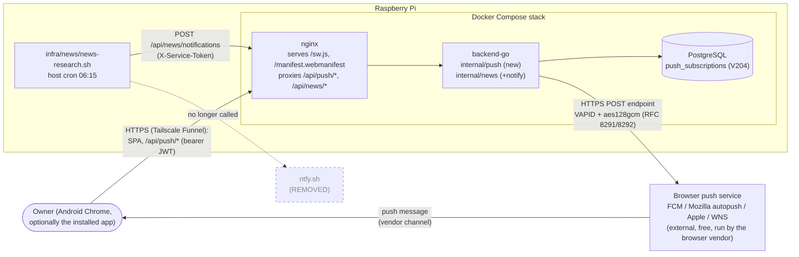
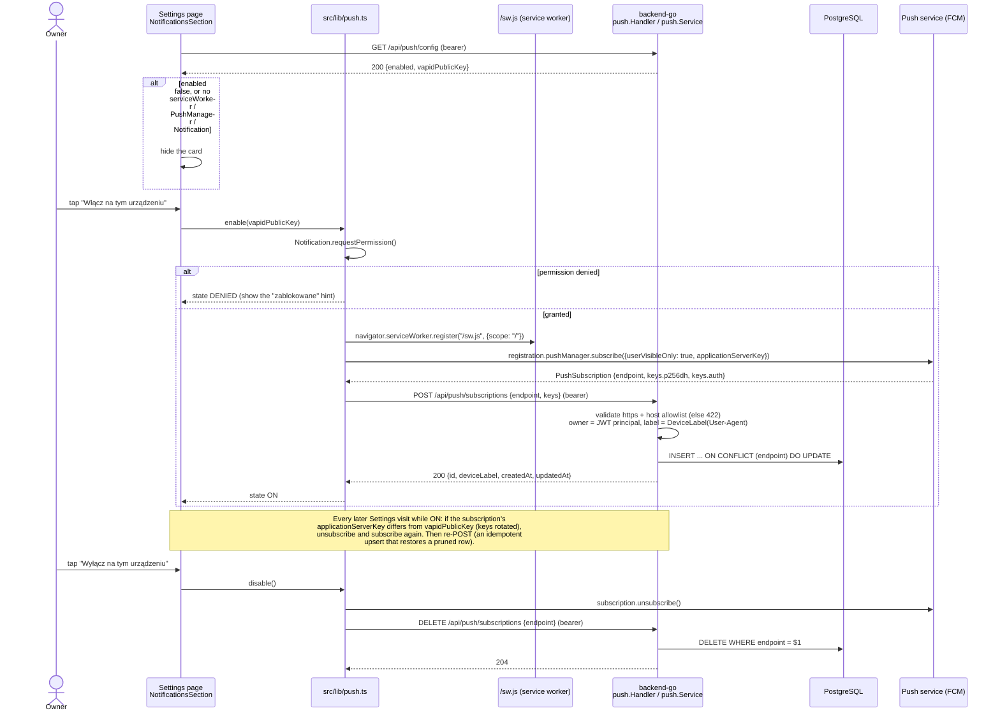
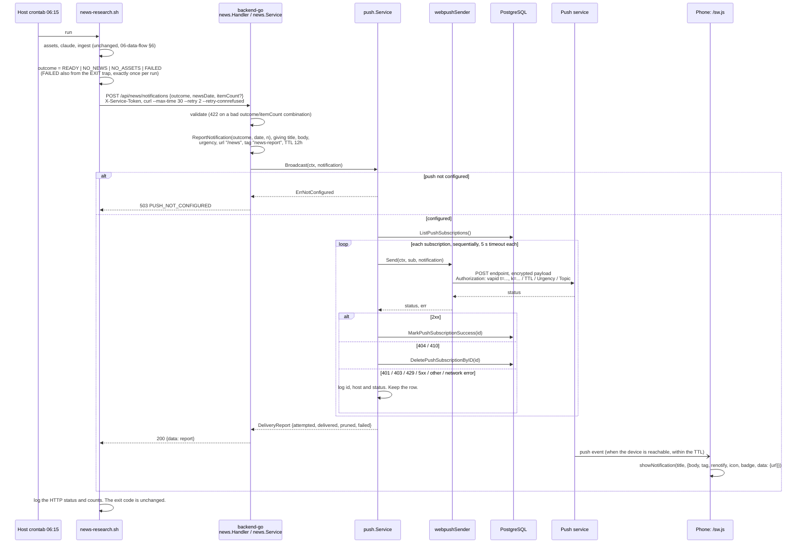
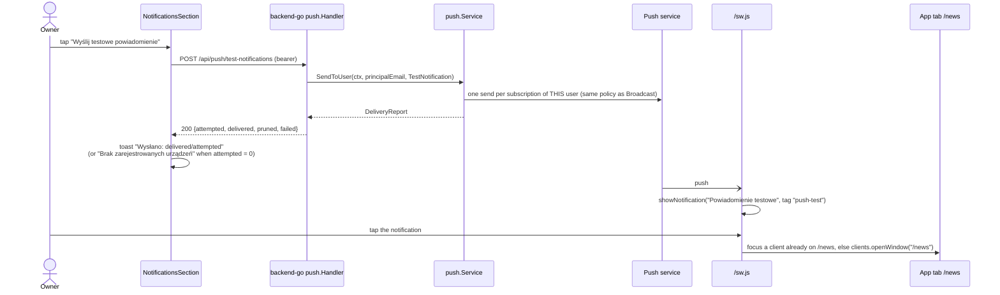
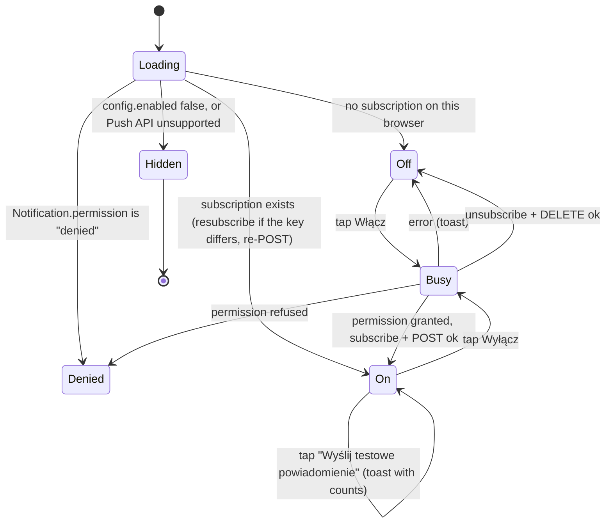
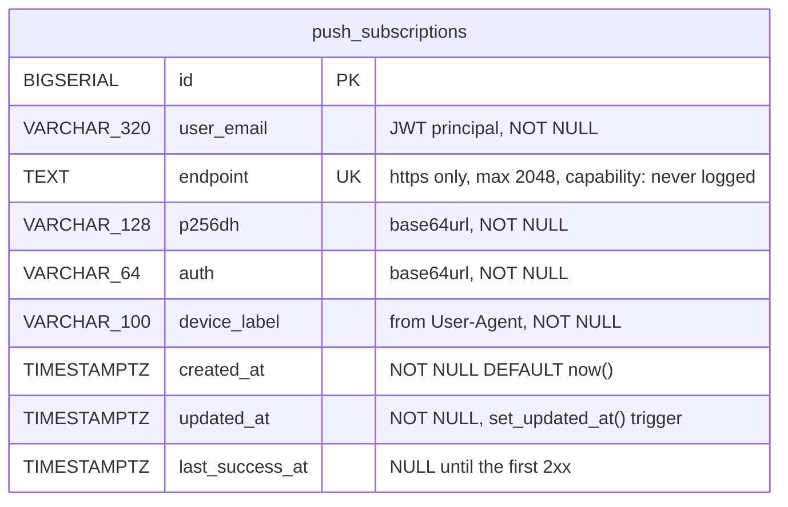
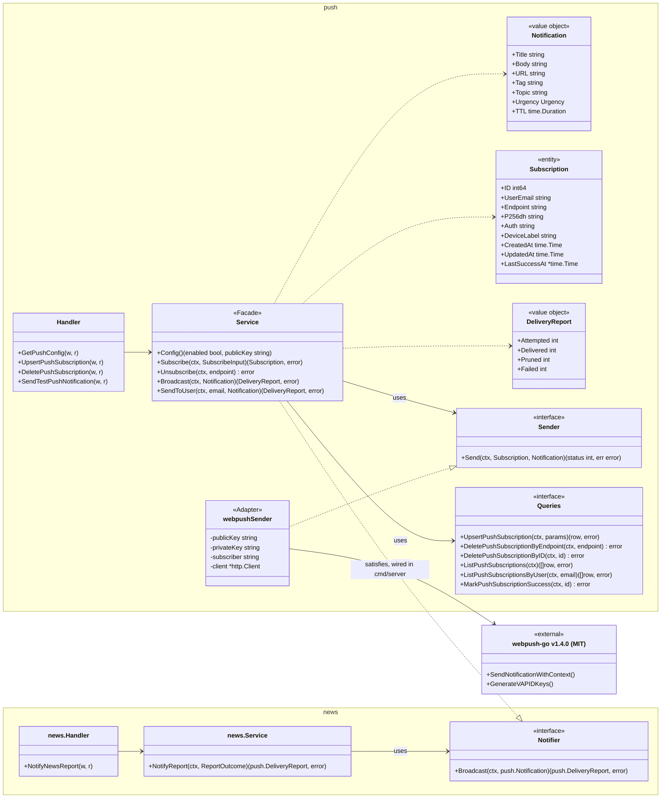

# Task 172: Web Push Notifications (design and diagrams)

> **Decision record:** `docs/adr/ADR-108-web-push-notifications.md`. **Contract:**
> `docs/openapi.yaml` (operations `getPushConfig`, `upsertPushSubscription`, `deletePushSubscription`,
> `sendTestPushNotification`, `notifyNewsReport`). **Schema:** `docs/architecture/04-db-schema.md`
> § Table `push_subscriptions` (Flyway `V204`). This file shows the system as it will be built.
> Each diagram has its own legend.

## 1. Pattern evaluation (summary)

| Candidate | Verdict | Where |
| --- | --- | --- |
| Adapter | adopted | `push.webpushSender` adapts `webpush-go` to `push.Sender` |
| Facade | adopted | `push.Service`: the one entry point for every consumer; owns the send-result policy |
| Dependency Inversion (consumer-side interface) | adopted | `news.Notifier` (one method) is satisfied by `*push.Service`, wired in `cmd/server` |
| Narrow `Queries` interface over sqlc | adopted | same convention as `news.Queries`; no hand-written repository |
| Observer/event bus, Strategy over channels, retry queue/outbox, Template Method for the copy | rejected | YAGNI: one producer, one channel, one message a day, best-effort (ADR-108, Pattern evaluation) |

Principles: SRP (the sender knows HTTP and crypto, the service knows the policy, news knows the
copy). OCP (the next consumer calls `Broadcast` and nothing is modified). KISS (sequential
fan-out, no goroutines, no queue).

## 2. C4: system context (what changes)



**Legend.** Solid edges are new or unchanged runtime calls. The dashed node and edge are removed
by this task. Boundary (policy vs detail): the copy and the send-result policy live in
`backend-go` (policy). The push service, the browser and nginx are details. The payload is
end-to-end encrypted to the browser, so the push service sees only ciphertext and the endpoint.

## 3. Subscribe flow (Settings, "Włącz na tym urządzeniu")



**Legend.** The browser half is a thin Facade (`src/lib/push.ts`) under a React hook, so the card
holds no Push API calls. The endpoint goes only in request bodies, never in a URL (ADR-108 §7).
The upsert makes subscribe idempotent, so no "already subscribed" error path is needed (KISS).

## 4. Morning notify flow (06:15 cron, all four outcomes)



**Legend.** The Facade (`push.Service`) owns the send-result policy table (ADR-108 §4). The
Adapter (`webpushSender`) only encrypts, signs and posts. The news package maps outcome to copy
and depends on the push service only through `news.Notifier` (DIP). If the backend is down, the
script's call fails after its retries and the night stays silent. That gap is accepted
(ADR-108 §3).

## 5. Test-button flow and the card's states





**Legend.** These are UI states of one browser (State, modelled as a discriminated union in the
hook, not as GoF State classes: there are five states and no per-state behaviour objects).
`Denied` shows the text "Powiadomienia są zablokowane w ustawieniach przeglądarki dla tej
strony." The `On` and `Off` states show the iOS hint "Na iPhonie działa tylko po dodaniu aplikacji
do ekranu głównego."

## 6. ERD



**Legend.** The table stands alone, with no foreign key: there is no users table (the allowlisted
e-mail is the identity, as everywhere in the app). `idx_push_subscriptions_user_email` serves
`SendToUser`. A row's lifecycle: upsert on subscribe, delete on unsubscribe or on a `404`/`410`.
There is no time-based retention. DTO boundary: `p256dh`, `auth`, `endpoint` and `user_email`
never appear in a response DTO (`PushSubscriptionInfo` carries only id, label and timestamps).

## 7. Class diagram (Go backend)



**Legend.** `<<Facade>>`: `push.Service` is the single entry point and owns the policy (allowlist,
the `2xx`/`404`/`410`/other mapping, `ErrNotConfigured` when disabled). `<<Adapter>>`:
`webpushSender` is the only file that imports `webpush-go`. It strips `mailto:` from the subject
and closes the response body. DIP: `news` declares the one-method `Notifier`. It imports only
push's value types (`Notification`, `DeliveryReport`), and `cmd/server` passes `*push.Service`.
`Queries` is satisfied by `*sqlcgen.Queries`, and the tests use the real DB. `Sender` is the only
interface faked in tests.

### Clean-architecture audit (skill 16)

- **SRP:** the copy lives in `news` (`ReportNotification`, a pure function), the policy in
  `push.Service`, and the wire protocol in `webpushSender`. Nothing does two of these.
- **No speculative abstraction:** the only interfaces are `Sender` (a test seam, and a real
  third-party boundary), `Queries` (the house convention) and `Notifier` (it prevents a
  news-to-push concrete dependency). There is no channel registry, no queue and no generic
  "notification type" enum.
- **Law of Demeter:** handlers talk only to their own service. The service never hands the
  sqlc row out. Mapping goes row to `Subscription` to `PushSubscriptionInfo` DTO.
- **DRY:** `Broadcast` and `SendToUser` share one private `sendAll(ctx, []Subscription,
  Notification)`.

## 8. Go signatures (contract for Backend-Go)

```go
package push // apps/main/backend-go/internal/push

type Urgency string
const (UrgencyLow Urgency = "low"; UrgencyNormal Urgency = "normal"; UrgencyHigh Urgency = "high")

type Notification struct {
    Title, Body, URL, Tag, Topic string // URL is a relative path ("/news"). Topic is optional.
    Urgency Urgency
    TTL     time.Duration
}

// TestNotification is what POST /push/test-notifications sends (ADR-108 §5).
var TestNotification = Notification{Title: "Powiadomienie testowe",
    Body: "Powiadomienia działają na tym urządzeniu.", URL: "/news", Tag: "push-test",
    Urgency: UrgencyNormal, TTL: 5 * time.Minute}

type SubscribeInput struct{ UserEmail, Endpoint, P256dh, Auth, UserAgent string }
type DeliveryReport struct{ Attempted, Delivered, Pruned, Failed int }

type Sender interface {
    // Send encrypts and posts one message. status is the push service's HTTP status
    // (0 with a non-nil err on a network error or timeout). It never logs the endpoint.
    Send(ctx context.Context, sub Subscription, n Notification) (status int, err error)
}

type Config struct{ PublicKey, PrivateKey, Subject string }
func LoadConfig() Config            // VAPID_PUBLIC_KEY / VAPID_PRIVATE_KEY / VAPID_SUBJECT
func (c Config) Enabled() bool      // all three set and Subject has the prefix mailto: or https:

var ErrNotConfigured = errors.New("push: not configured")
var DefaultAllowedHosts = []string{"fcm.googleapis.com", "push.services.mozilla.com",
    "push.apple.com", "notify.windows.com"} // the host equals one of these or ends in "."+entry

func NewService(q Queries, s Sender, cfg Config, allowedHosts []string) *Service
func NewWebPushSender(cfg Config, client *http.Client) Sender // client.Timeout = 5 * time.Second
func DeviceLabel(userAgent string) string                    // "Android · Chrome", "iOS · Safari", …; at most 100 chars; "Nieznane urządzenie" when empty
```

```go
package news // additions

type Notifier interface {
    Broadcast(ctx context.Context, n push.Notification) (push.DeliveryReport, error)
}
type Outcome string // READY | NO_NEWS | NO_ASSETS | FAILED
type ReportOutcome struct { Outcome Outcome; NewsDate time.Time; ItemCount *int }

// ReportNotification is pure: it validates the outcome/itemCount pair and returns the ADR-108 §5
// copy (title, body, urgency, URL "/news", Tag and Topic "news-report", TTL 12h).
func ReportNotification(o ReportOutcome) (push.Notification, error)
func (s *Service) NotifyReport(ctx context.Context, o ReportOutcome) (push.DeliveryReport, error)
// NewService gains a third parameter: NewService(queries Queries, historyLookbackDays int, notifier Notifier)
```

Error mapping in the handlers: a validation error gives `422 VALIDATION_ERROR` (with `field`),
`push.ErrNotConfigured` gives `503 PUSH_NOT_CONFIGURED`, and anything else gives `500`, through
`common-go/httpx`.

## 9. Service-worker contract (`apps/main/frontend-web/public/sw.js`)

| Listener | Behaviour |
| --- | --- |
| `install` | `self.skipWaiting()` |
| `push` | `event.waitUntil(self.registration.showNotification(p.title, {body: p.body, tag: p.tag, renotify: true, icon: "/icons/icon-192.png", badge: "/icons/badge-96.png", data: {url: p.url}}))`, where `p = event.data.json()`. If the JSON is missing or invalid, show `Inwestycje` / `Nowe powiadomienie` with `url` `/news` (Chrome requires a visible notification for every push). |
| `notificationclick` | `close()`. If `data.url` is not a string starting with `/` (or starts with `//`), use `/news`. Focus a window client whose pathname equals it, else `clients.openWindow(url)`. |
| `fetch` | **must not exist.** The root scope also covers `/portfolio-b/` and `/portfolio-c/`. |

The payload is JSON: `{title, body, url, tag}`, all strings, produced only by the backend.
