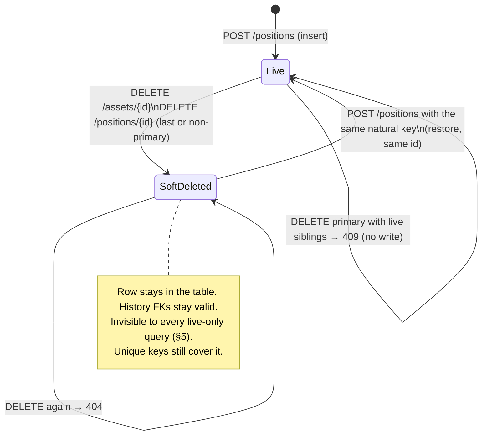
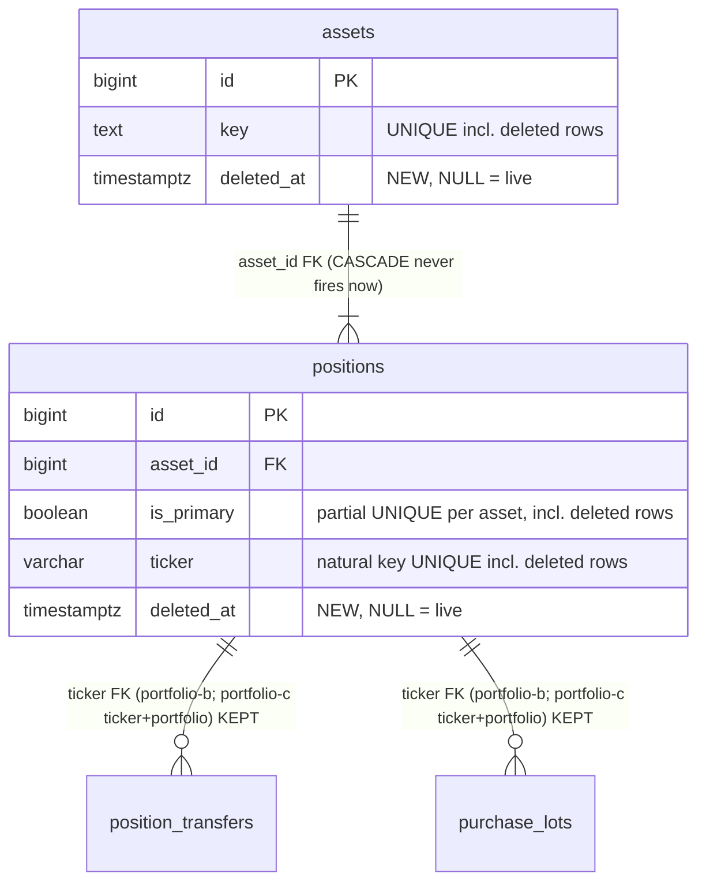
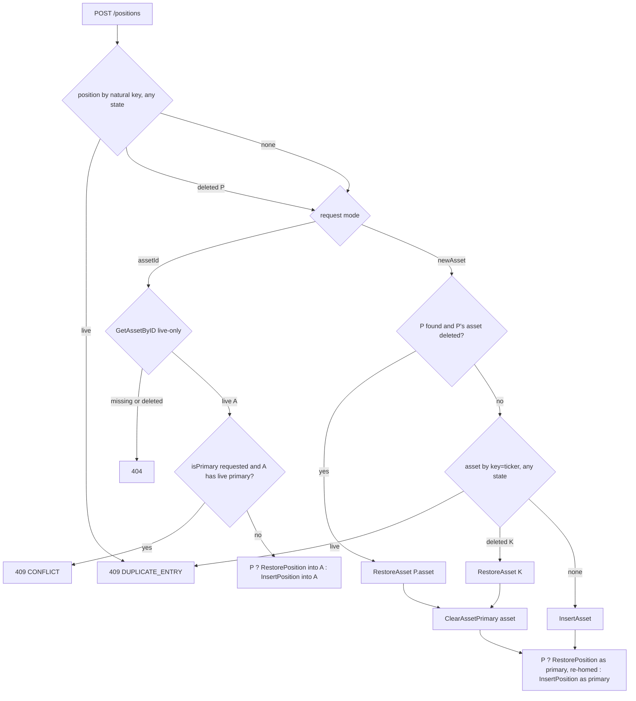
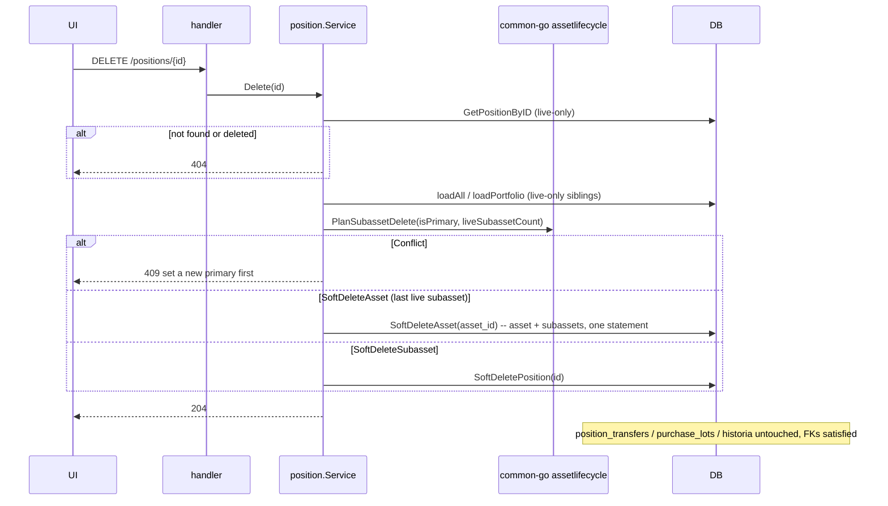
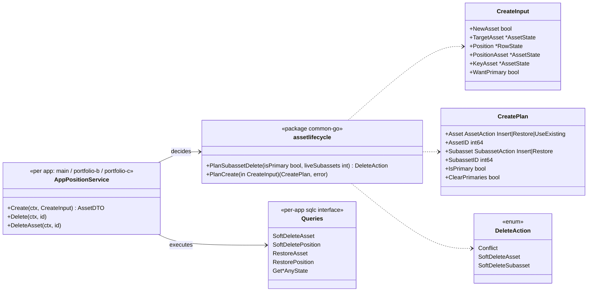

# Task 173: asset soft delete (main, portfolio-b, portfolio-c)

**Status:** design accepted 2026-11-04 (ADR-109). Owner decisions: `.claude/tasks/173-asset-soft-delete.task.md`.
**Applies to:** all three apps. Migrations: main **V209**, portfolio-b **V20**, portfolio-c **V14** (`V<n>__asset_soft_delete.sql`).
**Contract:** OpenAPI shapes and status codes do not change (DELETE stays `204`, POST stays `201`). Only the
`description` text of `createPosition`, `deletePosition` and `deleteAsset` changes in the three specs.

## 1. Requirements in one screen

- **Goal.** DELETE of an asset or a subasset hides it from everything about *current* holdings and
  never touches or is blocked by history. Trigger: portfolio-b `DELETE /api/assets/22` (VVMX) → 500 on
  `position_transfers_ticker_fk`; `purchase_lots_ticker_fk` and portfolio-c's `*_ticker_portfolio_fk` block the same way.
- **Actor.** The owner (single user per app), through the portfolio UI delete buttons and the "add asset" form.
- **Constraints.** History rows are never deleted. Unique keys stay as they are and cover deleted rows.
  The delete has no new guard (no app has a units > 0 guard today, so none is added).

### Use cases

| # | Actor action | Endpoint | Result |
|---|---|---|---|
| UC1 | Delete a whole asset | `DELETE /assets/{id}` | asset + every live subasset get `deleted_at = now()`; `204`; `404` if unknown or already deleted |
| UC2 | Delete a non-primary subasset | `DELETE /positions/{id}` | that row gets `deleted_at`; `204` |
| UC3 | Delete the primary while live siblings exist | `DELETE /positions/{id}` | `409 CONFLICT`, nothing written (unchanged) |
| UC4 | Delete the last live subasset | `DELETE /positions/{id}` | same as UC1 for its asset |
| UC5 | Re-add a deleted ticker | `POST /positions` | the old row comes back (`deleted_at = NULL`); `201` with the asset |
| UC6 | Look at history (transfers, purchase lots/history, sessions, historia, trade chart) | existing GETs | deleted assets still appear with their name |

## 2. Pattern evaluation (§1 Evaluate)

| Candidate | Verdict | Why |
|---|---|---|
| Soft delete column (`deleted_at`) | **adopted** | Owner rule. Keeps FKs valid, makes restore an `UPDATE`, one nullable column per table |
| Archive tables (`assets_deleted`) | rejected | The FKs from history point at `positions`; moving rows breaks them, and restore becomes a copy-back |
| `ON DELETE SET NULL` / dropping the history FKs | rejected | Breaks owner rule 1 (history would lose its ticker link) |
| DB view `live_positions` | rejected | sqlc gives a view its own row struct. That breaks the shared decoders that take `sqlcgen.Position` |
| **Safe-by-default queries** (existing query names become live-only; history readers opt in to `…IncludingDeleted`) | **adopted** | Every current caller is a current-holdings reader except a few listed in §5. New code cannot see deleted rows by accident (secure-by-default, Open/Closed: callers do not change) |
| State pattern (GoF) for the lifecycle | rejected | Two states, one transition each way; a nullable timestamp plus guards is enough (KISS) |
| Pure decision kernel in `common-go` (functional core, imperative shell) | **adopted** | The delete decision is byte-identical in the 3 apps today and the restore decision has 6 branches. Writing it once and table-testing it once follows the AGENTS.md "same code in 3 apps → common" rule, as `costbasis` did |
| Repository interface over the kernel | rejected | The kernel takes plain structs, as `costbasis` does. Each app's narrow `Queries` interface already is the repository seam |
| Command pattern / undo endpoint | rejected | Restore is driven by re-create (owner rule 4). A separate undo is YAGNI |
| Partial index on `deleted_at IS NULL` | rejected | Tens of rows per app; sequential scans (YAGNI) |
| DB trigger enforcing "live subasset ⇒ live asset" | rejected | One write path enforces it (the kernel + a single-statement cascade), and a migration/integration test asserts it. A trigger would be a second authority |

## 3. Lifecycle (§2 state diagram)



Legend: an asset and its subassets each carry this lifecycle. **Invariants** (asserted in tests,
not by the DB):

- **I1.** A live subasset always belongs to a live asset.
- **I2.** A live asset has exactly one live primary subasset.
- **I3.** A soft-deleted row inside a *live* asset never has `is_primary = true`. Restoring an
  asset always runs `ClearAssetPrimary` before the restored subasset is made primary, so the full
  partial `UNIQUE (asset_id) WHERE is_primary` index is never hit.

## 4. Schema (per app)



Migration body (identical in the 3 apps; no backfill, every existing row is live):

```sql
ALTER TABLE assets    ADD COLUMN deleted_at TIMESTAMPTZ NULL;
ALTER TABLE positions ADD COLUMN deleted_at TIMESTAMPTZ NULL;
```

Natural keys (lookup keys for restore, all unchanged): main `positions (ticker, exchange, portfolio)`,
`assets (key, portfolio)`; portfolio-b `positions (ticker)`, `assets (key)`; portfolio-c `positions (ticker, portfolio)`,
`assets (key, portfolio)`.

**Main gets no new history FKs.** Main's history tables (`asset_purchases`, `purchase_session_items`,
`crypto_trades`, `binance_transfers`, `historia.position_values`) carry `ticker` (and at most `portfolio`) but
never `exchange`. Main's only positions unique key is `(ticker, exchange, portfolio)`, so no FK target exists
without a new unique key. They also hold rows for tickers hard-deleted before this task (V50 `PLN`, ADR-050
`CHFPLN=X`, the MEXC rows), so adding an FK would mean rewriting history first. With soft delete nothing can be
orphaned from now on, so the FK would buy nothing.

## 5. Read/write paths: what filters and what does not

Rule: **the existing query name becomes live-only** (`WHERE deleted_at IS NULL`, or `AND …` after an existing
predicate). History readers switch to a new `…IncludingDeleted` query. File paths below are relative to
`apps/<app>/backend-go/`.

### 5.1 main (`apps/main`)

| sqlc query (file) | Change | Callers (file → func) | Why |
|---|---|---|---|
| `ListAllAssets` (`db/queries/asset.sql`) | live-only | `internal/position/service.go` → `loadAll`, `guardTargetSum`; `internal/rebalancingcalc/valuecomputation.go` → `computeValues`; `internal/rebalancingcalc/macroderisk.go` → `LoadMainTargetOverrides`; `internal/purchasesession/lifecycle.go` → `CreateSession` | overview, Σ-targets invariant, planner, macro target overrides |
| `GetAssetByID` (asset.sql) | live-only | `internal/position/service.go` → `Create` (assetId), `Update` (re-home), `UpdateAsset`, `DeleteAsset`; `internal/position/setprimary.go` → `SetPrimary` | a deleted asset answers `404` |
| `SetSubassetPrimary` (asset.sql) | add `AND deleted_at IS NULL` | `SetPrimary` | a deleted subasset id matches 0 rows → existing `400` |
| `ClearAssetPrimary` (asset.sql) | **unchanged (no filter)** | `SetPrimary`, restore flow | restore must clear stale flags on deleted rows (I3) |
| `ListAllPositions` (`db/queries/position.sql`) | live-only | `internal/position/service.go` → `loadAll`; `internal/rebalancingcalc/valuecomputation.go` → `computeValues`; `internal/rebalancingcalc/macroderisk.go` → `LoadMainTargetOverrides`; `internal/rebalancing/service.go` → `ExecuteTransfer` (sell/transfer); `internal/purchasesession/lifecycle.go` → `CreateSession`; `internal/purchasesession/execution.go` → `completeSessionTx` | overview, planner, transfer, session completion. An item whose asset was deleted after planning keeps today's loud "position deleted" failure |
| `GetPositionByID` (position.sql) | live-only | `internal/position/service.go` → `Get`, `Delete`, `Update` | a deleted subasset answers `404` |
| `GetTrackedTickers` (`db/queries/marketdata.sql`) | live-only | `internal/marketdata/service.go` → `ForceRefreshAllPrices` | price refresh. A deleted ticker's `price_cache` row simply goes stale |
| `PositionsForNewsResearch` (`db/queries/news.sql`) | live-only | `internal/news/service.go` → `Assets` | news scope = current holdings |
| `ListHistoriaPositions` (`db/queries/historia.sql`) | live-only | `internal/historia/service.go` → `computeValues` (daily snapshot + current XIRR value) | summary/XIRR of current holdings. Past snapshots are untouched |
| `DeleteAsset`, `DeletePosition` (asset.sql / position.sql) | **removed**, replaced by `SoftDeleteAsset`, `SoftDeletePosition` | `internal/position/service.go` → `Delete`, `DeleteAsset` | no hard delete remains anywhere |
| **new** `ListAllPositionsIncludingDeleted`, `ListAllAssetsIncludingDeleted` | history read | `internal/purchasesession/lifecycle.go` → `buildDetail` (session detail of past sessions: names, currencies, breakdown) | history keeps showing deleted assets |
| **new** `GetPositionByNaturalKeyAnyState(ticker, exchange, portfolio)`, `GetAssetByKeyAnyState(key, portfolio)`, `RestoreAsset`, `RestorePosition` | restore | `internal/position/service.go` → `Create` | §6 |
| `ListPositionsForChart` (`db/queries/tradechart.sql`) | **unchanged** | `internal/tradechart/service.go` → `ListTickers`, `GetChart` | history view built from `asset_purchases`. A deleted asset keeps its chart (before this task it fell into `NO_POSITION_MATCH`) |
| `InsertAsset`, `InsertPosition`, `UpdateAssetFields`, `UpdatePositionFields`, `UpdatePositionDelta`, `UpdatePositionCost` | unchanged | callers resolve live rows first | no filter needed in the write itself |
| raw SQL in `cmd/historiareplay/*`, `cmd/xtbclassify/db.go` | **unchanged** | offline tools | they rebuild or classify history, so deleted rows must stay visible |

### 5.2 portfolio-b (`apps/portfolio-b`)

| sqlc query (file) | Change | Callers (file → func) | Why |
|---|---|---|---|
| `ListAllAssets` (`db/queries/asset.sql`) | live-only | `internal/position/service.go` → `loadAll`, `guardTargetSum`; `internal/rebalancing/service.go` → `Calculate`; `internal/deposit/service.go` → `currentPortfolioValue` | overview, Σ, DCA calculator, XIRR |
| `GetAssetByID` (asset.sql) | live-only | `internal/position/service.go` → `Create`, `Update`, `UpdateAsset`, `DeleteAsset`; `internal/position/setprimary.go` → `SetPrimary` | `404` on deleted |
| `SetSubassetPrimary` | add `AND deleted_at IS NULL` | `SetPrimary` | as main |
| `ClearAssetPrimary` | unchanged | `SetPrimary`, restore | I3 |
| `ListAllPositions` (`db/queries/position.sql`) | live-only | `internal/position/service.go` → `loadAll`; `internal/rebalancing/service.go` → `Calculate`, `Confirm`; `internal/positiontransfer/cost.go` → `planCosts`; `internal/deposit/service.go` → `currentPortfolioValue` | current holdings, cost kernel members |
| `GetPositionByID` | live-only | `internal/position/service.go` → `Get`, `Delete`, `Update` | `404` |
| `GetPositionByTicker` | live-only | `internal/positiontransfer/service.go` → `ExecuteTransfer` (sold + buy legs); rebalancing confirm path | sell/transfer pickers and writes reach live rows only |
| `GetTrackedTickers` (`db/queries/marketdata.sql`) | live-only | `internal/marketdata/store.go` → `ListTrackedTickers` | price refresh |
| `ListHistoriaPositions` (`db/queries/historia.sql`) | live-only | `internal/historia/snapshot.go` → `computeValuesOrZero` | today's snapshot = current holdings |
| `ListBackfillPositions` (`db/queries/backfill.sql`) | **unchanged** | `internal/admin/backfill.go` → `Backfill`, `buildMaps` | rebuilds past `position_values` by walking units back through lots/transfers, so it needs every ticker that ever held units |
| `ListAllPurchaseLots`, `ListBackfillLots`, `ListBackfillTransfers`, `InsertPositionTransfer`, `InsertPurchaseLot` | unchanged | history | never filtered |
| **new** `ListAllPositionsIncludingDeleted` | history read | `internal/rebalancing/history.go` → `History` (name/yahoo lookup for `GET /purchases/history`) | the purchase history keeps names of deleted assets |
| `DeleteAsset`, `DeletePosition` | removed → `SoftDeleteAsset`, `SoftDeletePosition` | `internal/position/service.go` → `Delete`, `DeleteAsset` | the VVMX fix |
| **new** `GetPositionByTickerAnyState(ticker)`, `GetAssetByKeyAnyState(key)`, `RestoreAsset`, `RestorePosition` | restore | `internal/position/service.go` → `Create` | §6 |

### 5.3 portfolio-c (`apps/portfolio-c`)

| sqlc query (file) | Change | Callers (file → func) | Why |
|---|---|---|---|
| `ListAllAssets`, `ListAssetsByPortfolio` (`db/queries/asset.sql`) | live-only (both, so no stray reader can bypass) | `internal/position/service.go` → `loadPortfolio`, `guardTargetSum`; `internal/rebalancing/service.go` → `Calculate`; `internal/deposit/service.go` → `currentPortfolioValue` | overview, Σ per portfolio, calculator, XIRR |
| `GetAssetByID` | live-only | `internal/position/service.go` → `Create`, `Update`, `UpdateAsset`, `DeleteAsset`; `internal/position/setprimary.go` → `SetPrimary` | `404` |
| `SetSubassetPrimary` | add `AND deleted_at IS NULL` | `SetPrimary` | as main |
| `ClearAssetPrimary` | unchanged | `SetPrimary`, restore | I3 |
| `ListAllPositions`, `ListPositionsByPortfolio` (`db/queries/position.sql`) | live-only | `internal/position/service.go` → `loadPortfolio`; `internal/rebalancing/service.go` → `Calculate`, `Confirm`; `internal/positiontransfer/cost.go` → `planCosts`; `internal/deposit/service.go` → `currentPortfolioValue` | current holdings |
| `GetPositionByID` | live-only | `internal/position/service.go` → `Get`, `Delete`, `Update` | `404` |
| `GetPositionByTickerAndPortfolio` | live-only | `internal/positiontransfer/service.go` → `ExecuteTransfer`; rebalancing confirm path | live rows only |
| `GetTrackedTickers` (`db/queries/marketdata.sql`) | live-only | `internal/marketdata/store.go` → `ListTrackedTickers` | price refresh |
| `ListHistoriaPositions` (`db/queries/historia.sql`) | live-only | `internal/historia/snapshot.go` → `computeValuesOrZero` | current snapshot |
| `ListBackfillPositions` (`db/queries/backfill.sql`) | **unchanged** | `internal/admin/backfill.go` → `backfillPortfolio` | history rebuild |
| `ListPurchaseLotsByPortfolio`, `ListBackfillLots`, transfer/lot inserts | unchanged | history | never filtered |
| **new** `ListPositionsByPortfolioIncludingDeleted` | history read | `internal/rebalancing/history.go` → `History` | names of deleted assets |
| `DeleteAsset`, `DeletePosition` | removed → `SoftDeleteAsset`, `SoftDeletePosition` | `internal/position/service.go` → `Delete`, `DeleteAsset` | |
| **new** `GetPositionByTickerAndPortfolioAnyState`, `GetAssetByKeyAnyState(key, portfolio)`, `RestoreAsset`, `RestorePosition` | restore | `internal/position/service.go` → `Create` | §6 |

`*Test` fakes (`service_test.go` `fakeQueries` in each package) must apply the same live/any-state split, or the
unit tests will hide filtering bugs. The Testcontainers suites are the authority.

### 5.4 New/changed SQL (shape; per-app column lists differ)

```sql
-- name: SoftDeleteAsset :exec
-- One statement = atomic cascade; now() is transaction-constant, so asset and subassets share the timestamp.
-- Subassets already soft-deleted keep their own earlier deleted_at.
WITH subs AS (
    UPDATE positions SET deleted_at = now() WHERE asset_id = $1 AND deleted_at IS NULL
)
UPDATE assets SET deleted_at = now() WHERE id = $1 AND deleted_at IS NULL;

-- name: SoftDeletePosition :exec
UPDATE positions SET deleted_at = now() WHERE id = $1 AND deleted_at IS NULL;

-- name: RestoreAsset :one
-- Required newAsset fields overwrite; targets: request value when given, else the old one (COALESCE, sqlc.narg).
UPDATE assets SET deleted_at = NULL,
    name = $2, exposure = $3, asset_class = $4,
    target_allocation_pct          = COALESCE(sqlc.narg(target_allocation_pct), target_allocation_pct),
    target_allocation_pct_risk_off = COALESCE(sqlc.narg(target_allocation_pct_risk_off), target_allocation_pct_risk_off)
WHERE id = $1 AND deleted_at IS NOT NULL
RETURNING *;

-- name: RestorePosition :one
-- Keeps id, ticker, natural key, units, total_spent_pln, avg_buy_price, created_at.
UPDATE positions SET deleted_at = NULL,
    asset_id = $2, is_primary = $3,
    name = $4, asset_class = $5, price_currency = $6,          -- required in CreatePositionRequest
    exposure     = COALESCE(sqlc.narg(exposure), exposure),     -- optional request fields:
    yahoo_ticker = COALESCE(sqlc.narg(yahoo_ticker), yahoo_ticker)  -- keep old when omitted
    -- main adds purchase_currency, company_backed; portfolio-b/portfolio-c add sort_order (all COALESCE)
WHERE id = $1 AND deleted_at IS NOT NULL
RETURNING *;
```

## 6. Restore-on-create and delete flows

### 6.1 Restore rules

| Field group | On restore |
|---|---|
| Row identity: `id`, `ticker`, natural key, `key`, `portfolio`, `created_at` | kept |
| Holdings and cost: `units_*` / `units`, `total_spent_pln`, `avg_buy_price` | kept (the row is consistent with its transfers/lots; normally 0 units) |
| Required form fields: asset `name`, `exposure`, `asset_class`; subasset `name`, `asset_class`, `price_currency` | overwritten with the request (what the owner typed now) |
| Optional form fields: asset targets; subasset `exposure`, `yahoo_ticker`, `company_backed`, `purchase_currency`, `sort_order` | request value when the request sends it, otherwise **the old setting is kept**. The service passes the raw request pointer, *not* the defaulted value a fresh insert would use |
| `asset_id`, `is_primary` | set by the flow below |
| Other soft-deleted subassets of a restored asset | **stay deleted**. Each is restored only when the owner re-adds that ticker (via `assetId`), so no holding comes back unasked |

### 6.2 Create decision (shared kernel `PlanCreate`)



Legend: pure decision in `common-go/assetlifecycle.PlanCreate` (functional core). The per-app `Create` runs
the lookups and writes inside its existing `s.transact` (imperative shell). The 409/404 mapping is today's. A
`ClearAssetPrimary` only ever touches deleted rows here, because the restored asset has no live subasset (I1/I3).

### 6.3 Delete (shared kernel `PlanSubassetDelete`)



`DELETE /assets/{id}`: `GetAssetByID` (live-only, `404`), then `SoftDeleteAsset`, then `204`. No kernel call is needed.

## 7. Code placement and class map



Legend:

- **Functional core / imperative shell.** The kernel has no DB types, no context and no I/O (Dependency
  Inversion by plain data). It is the same seam as `costbasis`.
- **SRP.** The kernel decides. The service fetches state, executes the plan and maps errors.
- **DRY.** The delete decision and the restore branching exist once.
- **YAGNI.** No interface around the kernel and no generic repository. `AssetState`/`RowState` are
  `{ID, Deleted, IsPrimary}` structs filled by each app.

| Lives in `packages/common/go/common-go/assetlifecycle` | Stays per app |
|---|---|
| `PlanSubassetDelete`, `PlanCreate`, the plan/action types, the sentinel errors `ErrDuplicate`, `ErrAssetNotFound`, `ErrPrimaryTaken` (the service maps them to the existing `httpx` errors) and table tests for every branch of §6.2/§6.3 | Flyway migration, sqlc queries (columns and natural keys differ), field mapping into `RestorePosition`/`RestoreAsset` (main five buckets + `company_backed`/`purchase_currency`; portfolio-b five tata/mama buckets; portfolio-c `units` + `portfolio`), transactions, Testcontainers tests |

## 8. Clean-architecture audit (§4)

- **SOLID.** Callers of live-only queries do not change (OCP). History readers depend on an explicitly named
  `…IncludingDeleted` query, so intent is visible at the call site.
- **No speculative parts.** No index, trigger, view, undo endpoint or new API field.
- **Law of Demeter.** The kernel reads only the flags it is given.
- **Risk: an unlisted `SELECT … FROM positions`.** Mitigation: Backend-Go greps every `FROM positions` /
  `FROM assets` / `JOIN` in `db/queries/*.sql` and `cmd/**` against §5, and each app gets an integration test
  that a soft-deleted asset is absent from `GET /positions`, the calculator, the tracked tickers and the
  snapshot input.
- **Known consequence.** The `price_cache` row of a deleted ticker stops refreshing. History views that value
  past lots at the current price (portfolio-b/portfolio-c purchase history) show its last cached price. That is accepted:
  the asset is no longer held.

## 9. Diagram ↔ contract consistency

- OpenAPI: response codes unchanged. The `description` texts of `createPosition`, `deletePosition` and
  `deleteAsset` are updated in `docs/openapi/paths/positions.yaml` (bundled to `docs/openapi.yaml`),
  `apps/portfolio-b/docs/openapi.yaml` and `apps/portfolio-c/docs/openapi.yaml`.
  The specs are embedded (`embedded-spec: true`), so every app's `openapi/server.gen.go` must be regenerated.
- Schema: `docs/architecture/04-db-schema.md` (`assets`, `positions`, "Soft delete" section), portfolio-b/portfolio-c
  `docs/architecture.md` "Asset / Subasset model".
