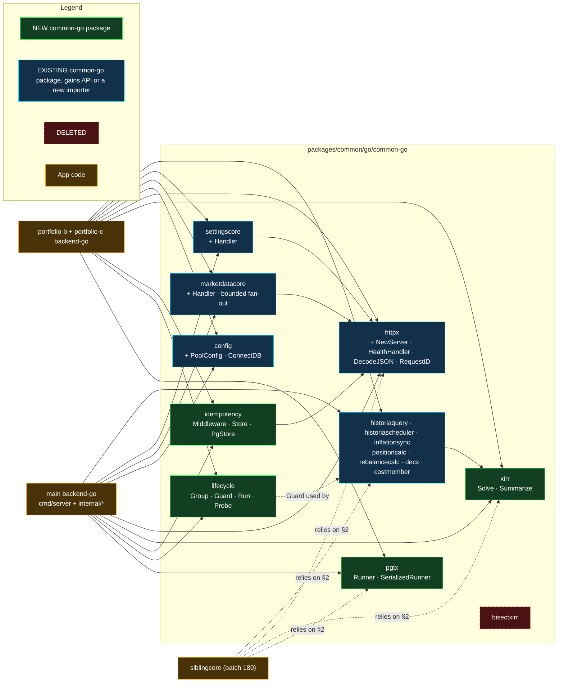
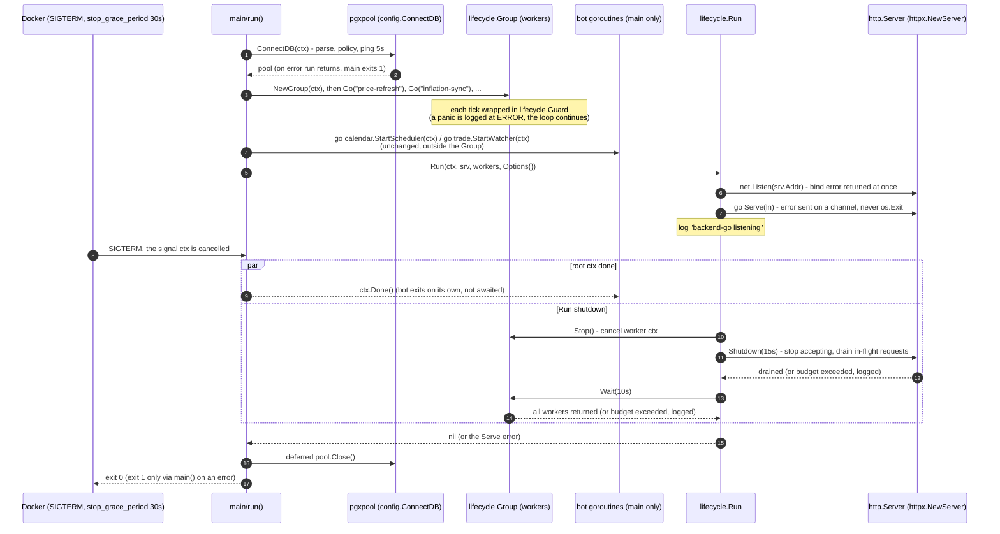
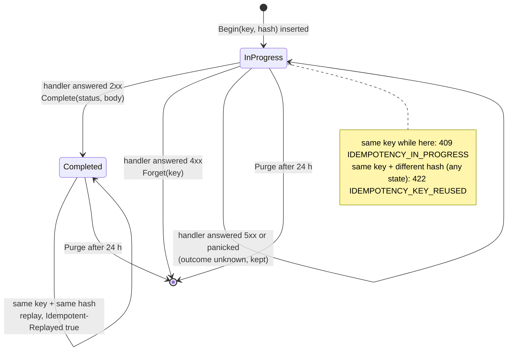
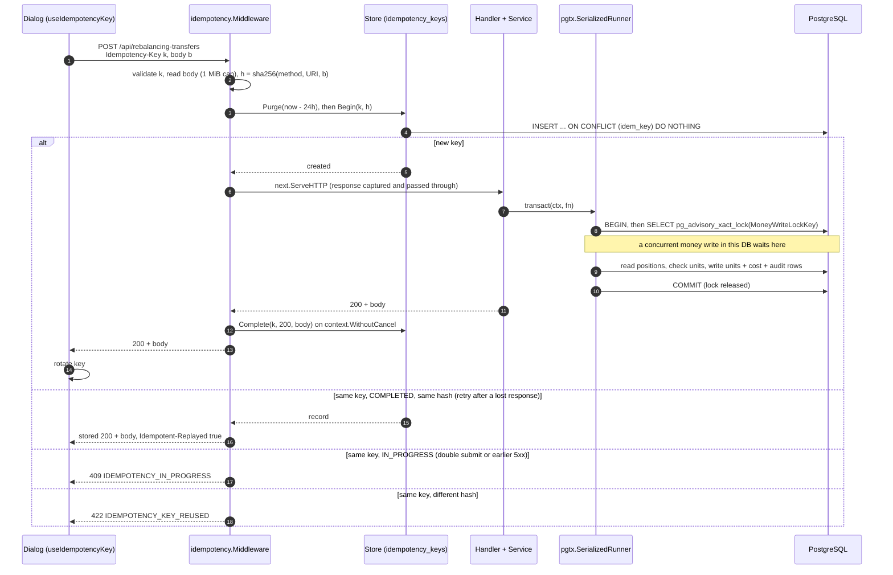
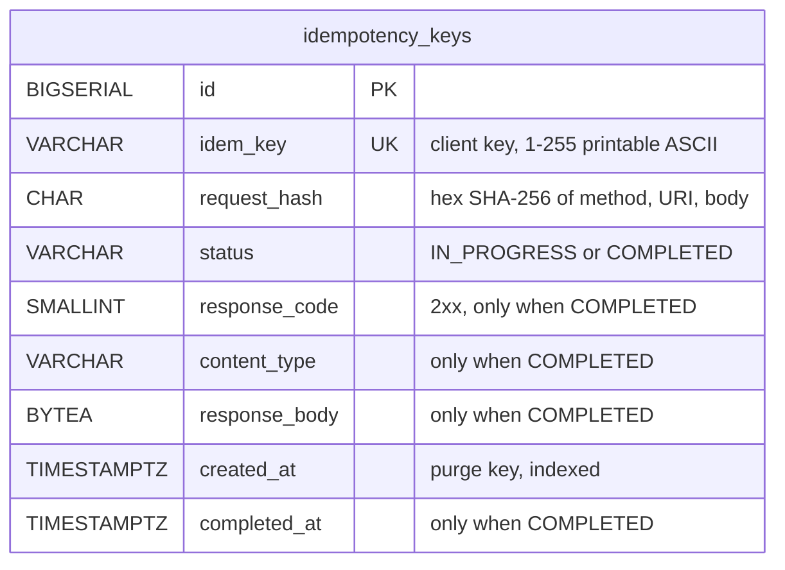
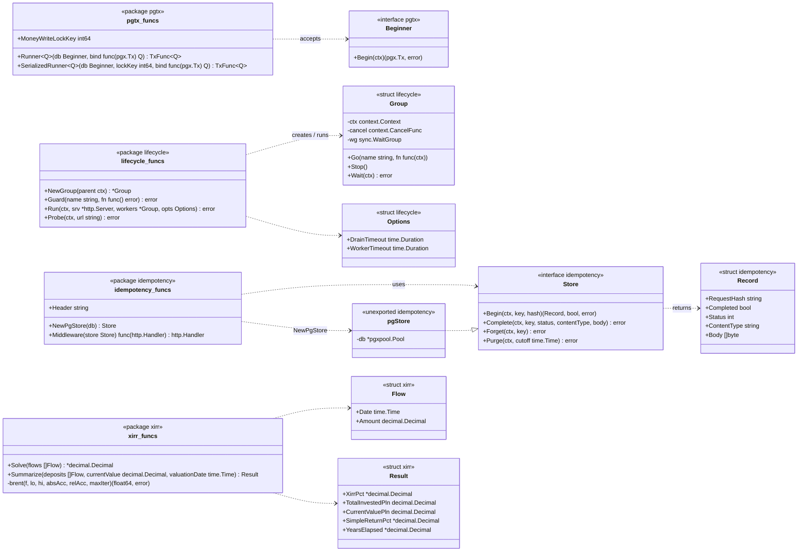

# 174 remediation: design for batches 176–179 and 181–185 (Architect, 2026-11-04)

> **Status:** complete (Phase 5 design + Phase 6 handoff). §2 "Contract for 180" was committed first
> (95576c5) for the parallel batch-180 (siblingcore) architect; it is unchanged in substance here
> except §2.4/§2.7 (`SplitCommaList` folded into `marketdatacore.Handler`) and the new §2.9.
> **ADRs:** ADR-110 (lifecycle kit), ADR-111 (money-write serialisation + Idempotency-Key),
> ADR-112 (one Brent XIRR). **Contracts:** OpenAPI commit 0278b48. **Task files:**
> `.claude/tasks/176-*` … `185-*` (no 175: dropped; no 180: other architect).
>
> **Inputs:** `.claude/tasks/174-go-backend-review-REPORT.md` (§3 register, §4 details, §5 waves,
> §6 sequence, **§7a owner decisions — binding**), `174-p0-p1-findings.md`,
> `174-p2-duplication-catalog.md`, task 163 + `163-shared-helpers-and-costbasis-glue.md` (D163).
>
> **Out of scope (owner, REPORT §7a):** batch 175 (bot) is dropped. Nothing here changes
> `apps/main/backend-go/internal/bot/**` or `apps/main/backend-go/cmd/server/botauth.go`. The two
> bot goroutine launches in main's `main.go` (`go calendar.StartScheduler(ctx, …)`,
> `go trade.StartWatcher(ctx, …)`) stay plain `go` statements on the root signal context, outside
> the new lifecycle supervisor. Batch 180 (siblingcore, ADR-113) is designed by another architect.

## 0. Batches, findings, order

| Batch | Title | Findings | Agents (order) | Depends on |
|---|---|---|---|---|
| 176 | Lifecycle & resilience kit | F1.2 F1.3 F1.9 F1.10 F2.5 F3.6 F4.3 | Backend-Go → DevOps | — |
| 177 | Money-write serialisation & idempotency | F3.1 F3.2 | Backend-Go → Frontend-web | 176 (`pgtx`) |
| 178 | Common wave A + one XIRR + bounded fan-out | F2.1 F2.2 F4.1 F5.3 | Backend-Go | 176 (`lifecycle.Guard` in schedulers) |
| 179 | Task 163 resumed (+ G5) + wave B2 | F2.3 | Backend-Go ∥ Frontend-web (163 F1 only) | 178 |
| 180 | siblingcore (other architect, ADR-113) | F2.4 | — | 176 177 178 179 |
| 181 | Security & contract hygiene | F1.4 F1.11 F3.3 F3.7 | Backend-Go (+ orchestrator secret-length check) | 176 |
| 182 | Errors, logging, money-in-decimals | F4.2 F4.4 (non-bot) F1.5 (option A) F3.4 F3.8 (new) | Backend-Go | 179 |
| 183 | Mechanical cleanup | F5.5 F1.7 F1.13 F1.6 | Backend-Go | 178 179 180 |
| 184 | CI quality gates | F0.1 F1.12 F4.6 | DevOps → Backend-Go | — |
| 185 | Complexity refactors | F5.2 (non-bot) F3.5 | Backend-Go | 183 |

**Execution order:** 176 → 177 → 178 → 179 → (180) → 181 → 182 → 183 → 184 → 185.
**May move earlier (file-disjoint):** 184's CI part (workflow YAML + `.golangci.yml`) can run at any
time and its `-race` job is most useful before 176/177 land; its benchmark part needs 178
(`xirr.Solve` is a benchmark target). 181 touches only
`common-go/{httpx/router.go,auth/*}`, main `cmd/server/main.go` route block, main `deposit`
handler and OpenAPI, so it can run right after 176 (it must not overlap 176's edits to
`httpx/router.go` and `main.go`). 182 must follow 179 (it deletes `decFromFloatPtr`, which 179
deliberately leaves in place, §6.3).

## 1. Pattern & principle evaluation (§1 Evaluate)

| Candidate | Verdict | Why (YAGNI/KISS is the tie-breaker) |
|---|---|---|
| **Template Method as a Go higher-order func** (`pgtx.Runner`, `pgtx.SerializedRunner`) | **adopted** (176/177) | The 19 production + ~20 integration-test transaction closures are the same algorithm (begin → fn → commit/rollback) with one varying step (binding sqlc `Queries` to the tx). One generic function built on `pgx.BeginFunc` (which defers Rollback) is the Go form of the pattern; no class hierarchy. |
| **Supervisor / owner of goroutines** (`lifecycle.Group`) | **adopted** (176) | F1.2: every background goroutine needs an owner that cancels and awaits it. `sync.WaitGroup.Go` (Go 1.25) + a derived context is the whole implementation. Rejected `errgroup.Group` here: errgroup cancels siblings on the first error, but a failing scheduler must not stop the others (fail-soft is the existing contract). |
| **Guarded Suspension / per-iteration recover** (`lifecycle.Guard`) | **adopted** (176) | F1.3: a panic must cost one tick, not the process. Recovering per iteration keeps the loop alive; the `Group.Go` recover is only the backstop. |
| **Facade** over server start/stop (`lifecycle.Run`) | **adopted** (176) | All three `main.go` files hand-roll the same listen → wait → shutdown sequence, with `os.Exit` inside a goroutine. One function fixes the ordering in one place (AGENTS.md "same code in 2–3 apps → common"). |
| **Decorator (HTTP middleware)** for idempotency (`idempotency.Middleware`) | **adopted** (177) | Idempotency is a cross-cutting transport concern; a chi middleware applies it to any write without touching services. It is a no-op unless the request carries `Idempotency-Key`, so routes that never receive the header (bot, Python clients) behave exactly as today. |
| **Repository / Store port** for idempotency records | **adopted, minimal** (177) | `idempotency.Store` (4 methods) with one pgx implementation keeps the middleware unit-testable with a fake; the integration test runs the pgx store on Testcontainers. |
| **Row locks `SELECT … FOR UPDATE ORDER BY id`** (F3.1 option 1) | rejected | Needs a new locking query per read path per app, an ordering discipline to avoid deadlocks, and still misses insert/phantom races (two transfers inserting the same buy row). |
| **Relative SQL `SET units = units + $x`** (F3.1 option 2) | rejected | The costbasis kernel computes absolute `total_spent_pln` values across all subassets of an asset; cost cannot be expressed as a relative delta, so half the write would stay absolute. |
| **Transaction-scoped advisory lock** (`pg_advisory_xact_lock(MoneyWriteLockKey)`) | **adopted** (177) | Single-user app: money writes are rare and never need to run in parallel. One lock per database, taken as the first statement of every money-writing transaction, serialises all of them (units, cost, deposits, transfer records, session completion) with zero deadlock risk and no new per-path SQL. Released automatically at commit/rollback. |
| **Strategy for XIRR solver** (Brent vs bisection) | rejected | Owner decision 5: one solver (Brent). A strategy seam for a single implementation is speculative. |
| **errgroup with `SetLimit`** for the price/FX fan-out | rejected (178) | common-go does not require `golang.org/x/sync` (the apps only have it as `// indirect`), and the fan-out never cancels siblings on error (per-ticker failures are collected, not fatal). |
| **Counting semaphore** (buffered channel + `sync.WaitGroup.Go`) | **adopted** (178) | F4.1: stdlib only, ~6 lines, bounds the per-ticker Yahoo fan-out to `refreshConcurrency = 4`. |
| **Observer / event bus** for shutdown hooks | rejected | Three ordered steps (drain HTTP, stop workers, close pool) are clearer as straight-line code. |
| **Domain sentinel errors (F1.5 option B)** | rejected | Owner decision 3: option A. `httpx.AppError` stays the app-wide error model; only `rebalancingcalc` (pure calculation) stops constructing HTTP errors. |
| **Facade handlers in common-go** (`marketdatacore.Handler`, `settingscore.Handler`) | **adopted** (179) | The four market-data and two settings handlers are byte-identical in the three apps except for the generated DTO type they fill; a common handler writing its own JSON wire structs removes them, and each app's `ServerInterface` method becomes a one-line forward. |
| **Generic accessor seam** (`positioncalc.OrderSubassets[T SubassetRow]`) | **adopted, small** (179) | `subassetsOf`/`primaryOf` encode one display rule (primary first, rest by ticker) copied in three apps; three one-line accessor methods per app are cheaper than the copies, and the rule can no longer drift. |
| **Behaviour-based error check** (`httpx` maps any error with `Unavailable() bool` to 503) | **adopted** (182) | Option A's only fix: `rebalancingcalc` returns its own `*UnavailableError` (no `httpx` import); `httpx.WriteError` keeps the wire answer identical (503, same text) without per-call-site mapping. Go idiom: assert errors for behaviour, not type. |
| **slog `Handler` wrapper adding request id from context** | rejected (182) | No call site uses `slog.*Context` today; the two log lines that must carry the id (access log, "unhandled error") get it explicitly. Revisit when a service needs request-scoped logging. |
| **SOLID / DIP** | applied | Every new common-go package depends only on stdlib, pgx, chi and shopspring/decimal; apps depend on common-go, never the reverse. Services keep depending on their own `TransactFunc` type, not on `pgtx`. |
| **DRY (owner rule)** | applied | Every helper in §2 replaces ≥2 copies across apps. Single-app helpers stay in their app. |

## 2. Contract for 180 (common-go APIs siblingcore can rely on)

This is the stable surface the siblingcore architect (batch 180) may build on. Batches 176–179
create it **before** 180 is implemented. Signatures are exact Go; doc comments are the contract.
All packages live under `packages/common/go/common-go/` (module `investing-app/common-go`) and
import no per-app module.

### 2.1 `pgtx` — transaction runners (batch 176; `SerializedRunner` batch 177)

```go
package pgtx

import (
	"context"

	"github.com/jackc/pgx/v5"
)

// Beginner is anything that can open a transaction: *pgxpool.Pool, *pgx.Conn, or a pgx.Tx
// (which opens a savepoint). pgx.BeginFunc accepts the same shape.
type Beginner interface {
	Begin(ctx context.Context) (pgx.Tx, error)
}

// Runner returns a transaction runner with the exact shape of every per-package
// `TransactFunc func(ctx context.Context, fn func(Queries) error) error`, so the result is
// assignable to those named types without conversion.
//
// Each call opens one transaction on db, binds it with bind (typically
// `func(tx pgx.Tx) pkg.Queries { return queries.WithTx(tx) }`, or the method value
// `queries.WithTx` when Q is the concrete *sqlcgen.Queries), runs fn, and commits iff fn
// returned nil. Built on pgx.BeginFunc: the rollback is deferred, so a panic inside fn rolls
// back and releases the connection before the panic propagates (F2.5).
func Runner[Q any](db Beginner, bind func(pgx.Tx) Q) func(ctx context.Context, fn func(Q) error) error

// MoneyWriteLockKey is the advisory-lock key every money-writing transaction takes first
// (ADR-111). Advisory locks are scoped to the current database, so the same constant is
// correct in all three apps' databases.
const MoneyWriteLockKey int64 = 0x494e56_4d4f4e // "INV" "MON"

// SerializedRunner is Runner plus, as the first statement of every transaction,
// `SELECT pg_advisory_xact_lock($1)` with lockKey. Two transactions built from runners with
// the same key never overlap: the second waits (bounded by ctx and the pool's
// statement_timeout) until the first commits or rolls back, then reads the committed state
// (READ COMMITTED takes a fresh snapshot per statement). The lock is released automatically
// at commit/rollback. Use it for every transaction that reads and then writes positions,
// deposits, transfer records or purchase lots (ADR-111 Decision 1).
func SerializedRunner[Q any](db Beginner, lockKey int64, bind func(pgx.Tx) Q) func(ctx context.Context, fn func(Q) error) error
```

Rules for siblingcore: services keep accepting their own `TransactFunc`-shaped dependency (never a
pool); each app's `main.go` wires position, positiontransfer and rebalancing-confirm services with
`pgtx.SerializedRunner(pool, pgtx.MoneyWriteLockKey, …)`; every read that feeds a money write
happens **inside** that transaction (batch 177 moves the forks' `Confirm` pre-fetch inside).

### 2.2 `lifecycle` — process lifecycle (batch 176)

```go
package lifecycle

import (
	"context"
	"net/http"
	"time"
)

// Group owns background workers: it gives them a context derived from its parent, cancels it
// on Stop, and Wait blocks until every worker has returned.
type Group struct{ /* ctx, cancel, sync.WaitGroup — unexported */ }

// NewGroup returns a Group whose worker context is derived from parent (the signal context).
func NewGroup(parent context.Context) *Group

// Go starts fn(ctx) in a goroutine owned by g (sync.WaitGroup.Go). fn must return soon after
// ctx is done. A panic that escapes fn is recovered and logged at ERROR with the stack
// ("worker panicked; worker stopped", worker=name); the process keeps running. Loops should
// still call Guard per iteration so a panic costs one tick, not the whole worker.
func (g *Group) Go(name string, fn func(ctx context.Context))

// Stop cancels the workers' context. Idempotent.
func (g *Group) Stop()

// Wait blocks until all workers have returned or ctx is done; it returns ctx.Err() in the
// latter case (the caller logs which budget was exceeded and proceeds with shutdown).
func (g *Group) Wait(ctx context.Context) error

// Guard runs one unit of work. A panic inside fn is recovered, logged at ERROR with the stack
// (name, panic value), and returned as an error ("<name>: panic: <value>"); otherwise fn's
// own error is returned unchanged. It is what every scheduler loop wraps around one tick.
func Guard(name string, fn func() error) error

// Options bounds the shutdown phases. Zero values mean the defaults below.
type Options struct {
	DrainTimeout  time.Duration // http.Server.Shutdown budget; default 15s
	WorkerTimeout time.Duration // Group.Wait budget after Stop; default 10s
}

// Run listens on srv.Addr synchronously (a bind error is returned at once, before anything
// is served), logs "backend-go listening" (addr), serves until ctx is done or Serve fails,
// then shuts down in this order: (1) workers.Stop(); (2) srv.Shutdown with DrainTimeout
// (in-flight requests finish; their contexts are NOT cancelled by the signal);
// (3) workers.Wait with WorkerTimeout. It returns the Serve error (nil after a clean signal
// shutdown). It never calls os.Exit; main's deferred pool.Close runs after it returns.
func Run(ctx context.Context, srv *http.Server, workers *Group, opts Options) error

// Probe performs GET url with ctx and returns nil iff the status is 2xx. Used by the
// `backend-go healthcheck` subcommand that the compose healthcheck executes inside the
// distroless image (no shell, no wget).
func Probe(ctx context.Context, url string) error
```

### 2.3 `config` — database pool (batch 176; supersedes D163's `MustConnectDB`)

```go
package config

// PoolConfig parses dsn and applies the backend pool policy (F3.6): MaxConns 10,
// HealthCheckPeriod 30s, MaxConnIdleTime 5m, and the server-side runtime parameters
// statement_timeout=60s and idle_in_transaction_session_timeout=5min. Pure; unit-tested.
func PoolConfig(dsn string) (*pgxpool.Config, error)

// ConnectDB builds the pool from PostgresDSN() + PoolConfig and pings it (5s). Errors are
// wrapped as "config: database configuration: …", "config: connect to database: …",
// "config: ping database: …". It never exits; main returns the error from run().
func ConnectDB(ctx context.Context) (*pgxpool.Pool, error)
```

### 2.4 `httpx` additions

```go
package httpx

// NewServer returns an *http.Server with every timeout set (F1.9): ReadHeaderTimeout 5s,
// ReadTimeout 30s, WriteTimeout LongRequestTimeout+10s (190s), IdleTimeout 120s,
// MaxHeaderBytes 64 KiB. (batch 176)
func NewServer(addr string, h http.Handler) *http.Server

// HealthHandler answers GET /api/health-go: 200 {"data":{"service":service,"status":"UP"},
// "meta":…} when ping(ctx with 1s timeout) succeeds, otherwise the standard error envelope
// with 503 SERVICE_UNAVAILABLE "database unavailable". (batch 176)
func HealthHandler(service string, ping func(context.Context) error) http.HandlerFunc

// DecodeJSON: exactly as D163 §1.1/§1.3 (batch 179). D163's SplitCommaList is NOT created:
// its only callers (the three marketdata handlers) collapse into marketdatacore.Handler (§7.3).
func DecodeJSON(r *http.Request, v any) error

// RequestID replaces chi's middleware.RequestID (batch 182): it accepts an inbound
// X-Request-Id only if it parses as a UUID, otherwise generates uuid.New(); stores it in the
// request context; sets the X-Request-Id response header before calling next.
func RequestID(next http.Handler) http.Handler

// RequestIDFrom returns the id RequestID stored, or uuid.Nil. (batch 182)
func RequestIDFrom(ctx context.Context) uuid.UUID
```

Batch 182 also makes `WriteJSON`/`WriteError` fill every envelope's `meta.requestId` from the
`X-Request-Id` response header (so the id the UI shows is the id in the logs), with no call-site
change. siblingcore handlers keep calling `httpx.WriteJSON(w, status, httpx.Single(…))`.

### 2.5 `idempotency` — Idempotency-Key middleware (batch 177)

```go
package idempotency

// Header is the request header name (IETF draft-ietf-httpapi-idempotency-key-header).
const Header = "Idempotency-Key"

// Store persists one record per key. Implementations must make Begin atomic with respect to
// concurrent callers using the same key.
type Store interface {
	// Begin inserts an IN_PROGRESS record. If the key already exists it returns the existing
	// record and created=false.
	Begin(ctx context.Context, key, requestHash string) (rec Record, created bool, err error)
	// Complete marks the record COMPLETED with the response to replay.
	Complete(ctx context.Context, key string, status int, contentType string, body []byte) error
	// Forget deletes the record (the request was rejected without effect, so a retry may run).
	Forget(ctx context.Context, key string) error
	// Purge deletes records created before cutoff.
	Purge(ctx context.Context, cutoff time.Time) error
}

type Record struct {
	RequestHash string
	Completed   bool
	Status      int
	ContentType string
	Body        []byte
}

// NewPgStore returns the Store over the per-app `idempotency_keys` table (ADR-111 DDL).
func NewPgStore(db *pgxpool.Pool) Store

// Middleware enforces Idempotency-Key on any request that carries the header (methods other
// than GET/HEAD/OPTIONS); requests without it pass through untouched. Semantics: ADR-111 §3.
func Middleware(store Store) func(http.Handler) http.Handler
```

siblingcore needs nothing from this package: each app mounts `idempotency.Middleware` once in its
authenticated route group, and siblingcore's position-transfer, confirm and deposit handlers are
covered automatically.

### 2.6 `xirr` — the one XIRR (batch 178)

```go
package xirr

// Flow is one dated PLN cash flow: deposits NEGATIVE, the terminal portfolio value POSITIVE.
type Flow struct {
	Date   time.Time
	Amount decimal.Decimal
}

// Solve returns the annualised internal rate of return of flows as a fraction at scale 6
// (HALF_UP), or nil when there is no meaningful solution: fewer than 2 flows, no sign change
// on [-0.999, 10], solver not converged within 1000 iterations, or root outside (-1, 10).
// Brent's method, absolute/relative accuracy 1e-7. Discounting is anchored on the calendar
// date of flows[0].Date; each flow's exponent is whole days / 365 between calendar dates
// (time.Date(y, m, d) of each instant in its own location). Pure and deterministic.
func Solve(flows []Flow) *decimal.Decimal

// Result is the deposits-page summary shared by portfolio-b and portfolio-c (formerly
// bisectxirr.XirrResult; field names unchanged).
type Result struct {
	XirrPct          *decimal.Decimal
	TotalInvestedPln decimal.Decimal
	CurrentValuePln  decimal.Decimal
	SimpleReturnPct  *decimal.Decimal
	YearsElapsed     *decimal.Decimal
}

// Summarize computes Result for deposit flows (negative amounts, ascending dates) valued at
// currentValue on valuationDate (callers pass historiaquery.NowInWarsaw()). Semantics are
// bisectxirr.ComputeXirrResult's, except: the solver is Solve (Brent) and the valuation date
// is injected instead of time.Now().UTC() (ADR-112).
func Summarize(deposits []Flow, currentValue decimal.Decimal, valuationDate time.Time) Result
```

### 2.7 Task-163 helpers (batch 179, unchanged from D163 except where noted)

`decx.ToFloat`, `decx.ToFloatPtr`, `decx.ValidatePercentRange`; `httpx.DecodeJSON`;
`pgerr.NotFoundOr`; `pgnum.Date`; `costmember.{Holding, Member[H], Rows, Apply, PlanTransfer}`;
**new (G5):** `rebalancecalc.PricesRefreshedAt`; **new (B2):** `marketdatacore.Handler`,
`settingscore.Handler`, `positioncalc.{SubassetRow, OrderSubassets, PrimaryOf}`. Changes against
D163: `config.MustConnectDB` is replaced by `config.ConnectDB` (§2.3, batch 176); `decx.FromFloatPtr`
is **not** created (batch 182 switches the request structs to decimal, so the helper would be deleted
one batch later); `httpx.SplitCommaList` is **not** created (§7.3). Exact signatures: §7.

### 2.8 What 180 must not assume

- No common `main()` skeleton exists outside `lifecycle.Run` + `lifecycle.Group`; if siblingcore
  wants a shared bootstrap, it composes these.
- `pgtx` is the only sanctioned way to open a transaction in server code; siblingcore code that
  needs a transaction takes a runner, never `*pgxpool.Pool.Begin`.
- Batch 177 puts the advisory lock into the forks' `positiontransfer`, `position` and
  `rebalancing.Confirm` paths **before** 180 moves them; 180 must preserve (a) serialized-runner
  wiring and (b) reads-inside-the-transaction.

### 2.9 Doc-12 rows for the 180 architect (doc 12 is theirs; these are the facts to fold in)

`12-portfolio-bpps-and-shared-packages.md`'s common-go inventory table must end up with:
**new rows** `pgtx` (transaction runners + money-write lock, all 3 apps), `lifecycle` (worker group,
Guard, Run, Probe, all 3), `idempotency` (Idempotency-Key middleware + pgx store, all 3), `xirr` (the
one XIRR: Solve + Summarize, all 3); **removed row** `bisectxirr` (deleted by 178, ADR-112);
**changed rows** `httpx` (+ NewServer, HealthHandler, DecodeJSON, RequestID/RequestIDFrom, the
`Unavailable()` 503 mapping), `config` (+ PoolConfig, ConnectDB), `marketdatacore` (+ Handler,
bounded refresh fan-out; now also used by main), `settingscore` (+ Handler and the `Settings` interface; main uses the Handler with its own service),
`positioncalc` (+ OrderSubassets/PrimaryOf), `rebalancecalc` (+ PricesRefreshedAt),
`historiaquery` (SolveXirr removed, CashFlow = xirr.Flow), `inflationsync` and `historiascheduler`
(now also used by main). If the 180 architect has finished when 176–179 land, the orchestrator
applies these rows instead.

## 3. Package map after 176–179 (who imports what)



*Legend (text fallback):* green = new package (4); blue = existing package that gains API or a new
importer; red dashed = deleted (`bisectxirr`, ADR-112); amber = app code. **Dependency rule
(DIP):** arrows point from apps into common-go only; inside common-go, `idempotency`,
`marketdatacore` and `settingscore` import `httpx`; `historiascheduler`, `inflationsync` and
`marketdatacore` call `lifecycle.Guard`; `historiaquery` aliases `xirr.Flow`. `pgtx`, `lifecycle`
and `xirr` import only stdlib, pgx and shopspring/decimal. No common-go package imports a per-app
module (verification grep in every task file).

## 4. Batch 176 — lifecycle & resilience kit (ADR-110)

### 4.1 Composition-root shape (all three `cmd/server/main.go`)

1. `func main() { if err := run(); err != nil { slog.Error("backend-go: exiting", "error", err); os.Exit(1) } }`
   — the only `os.Exit` in the binary (besides the `healthcheck` subcommand). `run()` owns every
   `defer`.
2. `run()` first handles the subcommand: `len(os.Args) == 2 && os.Args[1] == "healthcheck"` →
   `lifecycle.Probe(ctx3s, "http://127.0.0.1:"+port+"/api/health-go")`, return its error.
3. `ctx, stop := signal.NotifyContext(context.Background(), os.Interrupt, syscall.SIGTERM)`;
   `defer stop()`.
4. `pool, err := config.ConnectDB(ctx)`; return err on failure; `defer pool.Close()`.
5. Build services and handlers exactly as today, every transaction runner via `pgtx.Runner`
   (§4.4); router via `httpx.NewRouter()`; `router.Get("/api/health-go",
   httpx.HealthHandler(<service name>, pool.Ping))`.
6. `workers := lifecycle.NewGroup(ctx)`; one `workers.Go(name, …)` per background job (§4.3).
7. **main only, unchanged lines:** inside the existing `if calendar.SchedulerEnabled() { … }` block,
   `go calendar.StartScheduler(ctx, calendarService)` and `go trade.StartWatcher(ctx, botWatcher)`
   stay byte-identical (root `ctx`, plain `go`, not awaited).
8. `srv := httpx.NewServer(":"+port, router)`; `slog.Info("backend-go starting", "profile",
   config.Profile())`; `return lifecycle.Run(ctx, srv, workers, lifecycle.Options{})`.

### 4.2 Startup and shutdown ordering



*Legend:* Facade (`Run` hides listen/serve/drain/wait ordering); Supervisor (`Group` owns, cancels
and awaits workers); Guarded Suspension per tick (`Guard`). Budgets: 15 s drain + 10 s workers =
25 s < `stop_grace_period: 30s`. In-flight HTTP requests keep their own contexts (not cancelled by
SIGTERM) so a money POST finishes or rolls back on its own. The bot goroutines are the owner-mandated
exception (REPORT §7a.2): same launch lines, same root context, not awaited; the process merely lives
up to 25 s longer after SIGTERM than today.

### 4.3 Background jobs per app

| App | Job (`Group.Go` name) | Today | After 176 | Per-tick `Guard` placed in |
|---|---|---|---|---|
| main | `price-refresh` | `go runScheduledPriceRefresh(ctx, md)` | `workers.Go` | `cmd/server` `refreshPricesOnce` call sites (178 replaces with `marketdatacore.StartPriceRefreshScheduler`) |
| main | `macro-refresh` | `go macro.StartScheduler(ctx, svc)` | `workers.Go` | `internal/marketdata/macro/scheduler.go` around each fire |
| main | `inflation-sync` | `go inflation.StartScheduler(ctx, svc)` | `workers.Go` | `internal/inflation/scheduler.go` (178 replaces with `inflationsync`) |
| main | `historia-snapshot` | `go historia.StartScheduler(ctx, svc)` (if enabled) | `workers.Go` (same `if`) | `internal/historia/scheduler.go` per portfolio (178 → `historiascheduler.RunDaily`) |
| main | `bot-calendar`, `bot-watcher` | `go …` | **unchanged** | **none** (bot excluded) |
| portfolio-b, portfolio-c | `inflation-sync` | `go inflationsync.StartScheduler` | `workers.Go` | `common-go/inflationsync/scheduler.go` |
| portfolio-b, portfolio-c | `price-refresh` | `go marketdatacore.StartPriceRefreshScheduler` | `workers.Go` | `common-go/marketdatacore/scheduler.go` `refreshPricesOnce` |
| portfolio-b, portfolio-c | `historia-backfill` (one-shot) | `go admin.StartBackfillRunner` | `workers.Go` | `internal/admin/runner.go` around the run |
| portfolio-b, portfolio-c | `historia-snapshot` | `go historia.StartScheduler` (if enabled) | `workers.Go` | `common-go/historiascheduler.RunDaily` around `job(ctx)` |

The siblings' backfill runner today starts after the listen goroutine; it is asynchronous either
way, so starting it from `workers.Go` before `Run` changes nothing observable (readiness never
waited on it).

### 4.4 `pgtx.Runner` conversion list (F2.5)

| Where | Copies | Conversion |
|---|---|---|
| main `cmd/server/main.go` `newMacroService`, `newInflationService`, `newCashPositionsService`, `newHistoriaService`, `newPositionService`, `newRebalancingService`, `newPurchaseSessionService` (`txFactory`) | 7 | `pgtx.Runner(pool, func(tx pgx.Tx) <pkg>.Queries { return queries.WithTx(tx) })` |
| main `cmd/server/main.go` `newPlanService`, `newTradeService` (bot wiring, **separate commit**) | 2 | same; behaviour identical on every non-panic path; the owner may revert this one commit |
| portfolio-b, portfolio-c `cmd/server/main.go` | 4 + 4 | same (`queries.WithTx` method value where `Q` is `*sqlcgen.Queries`) |
| portfolio-b, portfolio-c `internal/admin/backfill.go` `Backfill` | 1 + 1 | body wrapped in `pgx.BeginFunc(ctx, s.pool, func(tx pgx.Tx) error { … })`; the early "nothing to do" commit becomes `return nil` (BeginFunc commits) |
| `internal/*/integration_test.go` transact helpers (main 10 files / 12 sites, portfolio-b 7, portfolio-c 7 — the `Begin(ctx)` hits of `grep -rn '\.Begin(ctx)' apps/*/backend-go/internal --include=*_test.go`, minus `internal/bot/`) | 26 | switch to `pgtx.Runner` so the integration suites exercise the production runner; **not** `internal/bot/**` |
| `apps/*/backend-go/db/*_test.go` migration tests, `cmd/xtbclassify` test, `costreconcile/dbread` (read-only `BeginTx`) | — | **unchanged**: they test SQL/migrations or need `TxOptions`, not the service runner |

Production copies: 19 (9 main incl. 2 bot, 4 + 1 portfolio-b, 4 + 1 portfolio-c). The review's "44" counted
test helpers too.

### 4.5 Pool policy (`config.PoolConfig`, F3.6)

| Setting | Value | Why |
|---|---|---|
| `MaxConns` | 10 | HTTP + 4–5 workers + 180 s long requests; 3 apps × 10 = 30 of the shared Postgres's default 100 |
| `MinConns` | default 0 | idle apps cost nothing |
| `HealthCheckPeriod` | 30 s | dead connections after a `db-shared` restart are dropped before use |
| `MaxConnIdleTime` | 5 min | |
| `statement_timeout` (runtime param) | `60s` | bounds any single statement, including the ADR-111 advisory-lock wait |
| `idle_in_transaction_session_timeout` (runtime param) | `5min` | kills a leaked open transaction; 5 min, not less, because the siblings' admin backfill fetches Yahoo OHLC **inside** its transaction (§11 item 6) |

### 4.6 Server and readiness (F1.9, F1.10)

`httpx.NewServer`: ReadHeaderTimeout 5 s, ReadTimeout 30 s, WriteTimeout 190 s, IdleTimeout 120 s,
MaxHeaderBytes 64 KiB (nginx in front already limits bodies to 1 MiB). `httpx.HealthHandler`
service names: `investing-backend-go`, `portfolio-b-backend-go`, `portfolio-c-backend-go` (keep whatever each
app's `healthHandler` returns today for `service`). `/api/health-go` stays unauthenticated and keeps
its nginx exact-match locations.

### 4.7 Compose (DevOps)

For `backend-go` (`infra/compose.yml`), `backend-go-portfolio-b` and `backend-go-portfolio-c`
(`apps/*/infra/compose.yml`):

```yaml
    environment:
      GOMEMLIMIT: "48MiB"        # soft GC target under mem_limit: 64m (F4.3)
    stop_grace_period: 30s       # > 15s drain + 10s worker budget (ADR-110)
    healthcheck:
      test: ["CMD", "/app/backend-go", "healthcheck"]   # exec form: distroless has no shell
      interval: 30s
      timeout: 5s
      retries: 3
      start_period: 30s
```

Binary path per image: check each Dockerfile's `ENTRYPOINT` (main `/app/backend-go`). `nginx`
keeps `depends_on: { backend-go: { condition: service_started } }`. Delete the now-false Dockerfile
and compose comments that say a healthcheck is impossible.

## 5. Batch 177 — money-write serialisation & idempotency (ADR-111)

### 5.1 Serialised transactions per app (F3.1)

| App | Service (wiring in `main.go`) | Runner | Reads to move inside the transaction |
|---|---|---|---|
| main | `position` (`newPositionService`) | `SerializedRunner` | `Update`: `GetPositionByID`, `GetAssetByID` and `UpdatePositionFields` run inside `s.transact` (today all three run on the pool, no transaction); same for every other write method (`UpdateAsset`, `Delete`, `DeleteAsset`, `SetPrimary`, `Create`) — each write method's reads and writes in one `s.transact` |
| main | `rebalancing` (`newRebalancingService`) | `SerializedRunner` | none (`ExecuteTransfer` already reads inside) |
| main | `purchasesession` completion runner (`txFactory` used for `CompleteSession`) | `SerializedRunner` | none (already `GetSessionForUpdate … FOR UPDATE` inside); the lifecycle CRUD runner stays `Runner` |
| portfolio-b, portfolio-c | `position` | `SerializedRunner` | as main |
| portfolio-b, portfolio-c | `positiontransfer` | `SerializedRunner` | none |
| portfolio-b, portfolio-c | `rebalancing` (`Confirm`) | `SerializedRunner` | `ListAllPositions` (portfolio-b) / `ListPositionsByPortfolio` (portfolio-c) move inside `s.transact`; the price-cache reads may stay outside |
| all | deposit create, crypto-trade create, binance-transfer create, cap adjustment, cash positions | `Runner` / none | none: single statements without a read-modify-write; duplicates are handled by §5.2 |

Read-only services (historia list, market data, rebalancing calculate) never take the lock.

### 5.2 Idempotency record lifecycle



*Legend:* the states are the `status` column of `idempotency_keys`. The asymmetry is deliberate
(ADR-111): a 4xx proves nothing was written (validation and business errors roll back), so the key
is freed for a corrected retry; a 5xx or panic may have happened after the commit, so the key stays
blocked and the client must check the history.

### 5.3 A locked, idempotent money POST



*Legend:* Decorator (the middleware wraps any write handler, no service change); Store port (fake in
unit tests, pgx implementation on Testcontainers); serialisation by one transaction-scoped advisory
lock (released at COMMIT/ROLLBACK, no deadlock possible with a single lock). Middleware mount point:
inside each app's authenticated `router.Group`, after the auth middleware (main: after
`r.Use(smartAuth(...))` in `mountAuthenticatedRoutes` — `botauth.go` itself is untouched; siblings:
after `r.Use(auth.RequireAuth(authCfg))`). Requests without the header (bot, scripts, every GET)
pass through untouched.

### 5.4 Middleware algorithm (exact)

1. Pass through when the method is GET, HEAD or OPTIONS, or `Idempotency-Key` is absent.
2. Key must be 1–255 bytes, each byte 0x21–0x7E; else `400 VALIDATION_ERROR`, field
   `Idempotency-Key`, message `must be 1-255 printable ASCII characters`.
3. Read the body through `http.MaxBytesReader(w, r.Body, 1<<20)` (too large → `413` via
   `httpx.AppError{Status: 413, Code: "PAYLOAD_TOO_LARGE"}`); replace `r.Body` with the bytes.
4. `hash = hex(sha256(r.Method + " " + r.URL.RequestURI() + "\n" + body))`.
5. `store.Purge(ctx, now-24h)`; a purge error is logged at WARN and ignored.
6. `rec, created, err := store.Begin(ctx, key, hash)`; `err` → `httpx.WriteError` (500).
7. Not created: hash differs → `422 IDEMPOTENCY_KEY_REUSED`; `rec.Completed` → set
   `Content-Type: rec.ContentType`, `Idempotent-Replayed: true`, write `rec.Status` + `rec.Body`;
   otherwise → `409 IDEMPOTENCY_IN_PROGRESS`. Messages: OpenAPI `components/responses.yaml`.
8. Created: call `next` with a recorder that forwards everything to the real writer and keeps a
   copy of status (0 → 200), `Content-Type` and body. After `next` returns (no `recover` here — a
   panic propagates to chi's `Recoverer` and the record stays IN_PROGRESS):
   2xx → `Complete`; 4xx → `Forget`; 5xx → nothing. Both calls use
   `context.WithTimeout(context.WithoutCancel(r.Context()), 5s)`; a failure is logged at ERROR
   (the record stays IN_PROGRESS: safe).
9. Error codes are new `httpx` constants: `CodeIdempotencyInProgress = "IDEMPOTENCY_IN_PROGRESS"`,
   `CodeIdempotencyKeyReused = "IDEMPOTENCY_KEY_REUSED"`.

### 5.5 Table `idempotency_keys` (identical DDL in all three databases)



*Legend:* a technical table with no foreign keys (it records HTTP exchanges, not domain facts).
`status` is `VARCHAR` + `CHECK`, not a PostgreSQL ENUM: the value set is fixed by the middleware
code, is never shown in the UI, and an ENUM per database would add a type for two values (ADR-005's
ENUM preference covers domain values). Flyway file content: §5.5 of task 177 (exact SQL).

### 5.6 Frontend (Frontend-web)

- `packages/common/ts/src/client/idempotency.ts` (new): `IDEMPOTENCY_HEADER = "Idempotency-Key"`;
  `newIdempotencyKey(): string` (`crypto.randomUUID()` when available, otherwise an RFC 4122 v4
  UUID from `crypto.getRandomValues` — plain-HTTP LAN access has no `randomUUID`);
  `idempotencyHeaders(key?: string): Record<string, string>` (`{}` for `undefined`).
- `packages/common/ts/src/hooks/useIdempotencyKey.ts` (new):
  `useIdempotencyKey(): { key: string; rotate: () => void }` — lazy `useState(newIdempotencyKey)`,
  `rotate` sets a fresh key.
- `packages/common/ts/src/client/errors.ts`: `isIdempotencyInProgress(err: unknown): boolean`
  (`ApiError` with status 409 and code `IDEMPOTENCY_IN_PROGRESS`).
- Export all three from `packages/common/ts/src/index.ts`.
- Client functions gain `options?: { idempotencyKey?: string }` and send
  `{ headers: idempotencyHeaders(options?.idempotencyKey) }`:
  main `api/client/rebalancing-transfer.ts`, `deposits.ts` (create), `crypto-trades.ts` (create),
  `binance-transfers.ts` (create); portfolio-b and portfolio-c `api/client/transfers.ts`,
  `rebalancing.ts` (confirm), `deposits.ts` (create).
- The component that owns each dialog's open state holds `useIdempotencyKey()`, passes `key` to the
  mutation, calls `rotate()` after success and when the dialog closes. On
  `isIdempotencyInProgress(err)` it shows "Poprzednia próba jeszcze trwa albo jej wynik jest
  nieznany. Sprawdź historię przed ponowieniem." and calls `rotate()`. The shared
  `packages/common/ui/src/PositionTransferDialog.tsx` takes the key through its submit callback
  if the app owns the mutation; Frontend-web picks the owner after reading the dialog's props.

## 6. Batch 178 — common wave A, one XIRR, bounded fan-out

### 6.1 main switches to the common packages (F2.2)

| main copy (deleted) | Replaced by | Adapter main must add |
|---|---|---|
| `internal/inflation/client.go`, `scheduler.go`, `Service.Sync`, `Service.IsStale` | `inflationsync.Client`, `StartScheduler`, `Service` | `internal/inflation/adapter.go` implementing `inflationsync.Queries` over main's `sqlcgen` (`GetCpi`, `CreateEntry`, `UpdateCpi`, `ListAsc`; model: portfolio-b `internal/inflation/adapter.go`); main's `inflation.Service` keeps `List`/`Create` and delegates `Sync` to the core service; the handler's `SyncInflationFromGus` calls the core service |
| `internal/historia/xirr.go` (`SolveXirr`, `brentSolve`), `internal/deposit/xirr.go` (`solveXirr`) | `xirr.Solve` | `historia.CashFlow` / `deposit.CashFlow` become `= xirr.Flow` |
| `internal/historia/scheduler.go` (`SchedulerEnabled`, loop, `nextHistoriaFire`, `warsawNow`) | `historiascheduler.SchedulerEnabled`, `RunDaily` | `StartScheduler(ctx, svc)` becomes `historiascheduler.RunDaily(ctx, func(ctx) error { for each tracked portfolio: warn on error; return nil })` (portfolio-c's pattern); `warsawDate`/`warsawLocation` stay if other files use them, else `historiaquery.WarsawDate` |
| `internal/marketdata/service.go` (whole service) | `marketdatacore.Service` | `internal/marketdata/store.go` implementing `marketdatacore.Store` over main's `sqlcgen` (model: portfolio-b `internal/marketdata/store.go`; main's `GetTrackedTickers` row has `*string YahooTicker` → skip nil/empty as today); `cmd/server` adapters (`moneyClusterPriceAdapter`, `botPriceAdapter`, `historiaFxAdapter`) change their field type to `*marketdatacore.Service` — method names are identical |
| `cmd/server/main.go` `runScheduledPriceRefresh`, `refreshPricesOnce` | `marketdatacore.StartPriceRefreshScheduler` | — |
| `internal/linearregression/history.go` `VirtuneClient`, `RatioSnapshot`, `cachedRatio`, `NewVirtuneClient`, `FetchCurrentRatio`, `fetchAndParse`, `parseVirtuneHTML` and their regexes | `priceprovider.VirtuneClient`, `VirtuneRatioSnapshot` (alias `RatioSnapshot = priceprovider.VirtuneRatioSnapshot`) | — (if main's `VirtuneProduct` table is byte-identical to `priceprovider`'s, alias it too; if not, keep it and record why) |
| `internal/linearregression/history.go` `BinanceKlinesClient` | **KEEP** | different API: main fetches OHLC (`FetchHistoricalKlines`), `priceprovider` fetches closes (`FetchCloses`); only the 6-line constructor is identical |

**Recorded behaviour deltas (accepted):** (1) log/error prefixes change from `marketdata:` /
`inflation:` to `marketdatacore:` / `inflationsync:`; (2) `GetRateToPln`: a database error reading
`fx_rate_cache` now fails the call (core semantics) instead of being treated as "not cached" and
refetched; (3) portfolio-b/portfolio-c `GET /market-data/prices` unaffected. Nothing on the wire changes for
main.

### 6.2 `common-go/xirr` (F2.1, F5.3, ADR-112)

- `Solve`: the current `historiaquery.SolveXirr` math (date0 = calendar date of `flows[0]`, years =
  whole days / 365, NPV in float64, Brent on [−0.999, 10], abs/rel 1e-7, 1000 iterations, result
  `decimal.NewFromFloat(r).Round(6)`, nil for <2 flows, no bracket, NaN, out of (−1, 10)) with two
  fixes: (a) the interpolation-acceptance test becomes "reject `s` unless it lies strictly between
  `(3a+b)/4` and `b`" (`lo, hi := min(q, b), max(q, b); s <= lo || s >= hi` → bisect); (b) leaving the
  loop without meeting the tolerance returns `errNotConverged` → `Solve` answers nil.
- `Summarize(deposits, currentValue, valuationDate)`: `bisectxirr.ComputeXirrResult` verbatim
  (empty → zero result; totalInvested = Σ −amount of negative flows; zero invested → zero result;
  simpleReturn = (V − I)/I DivRound 8; yearsElapsed = calendar days(valuationDate) − days(first) /
  365 DivRound 8, nil when ≤ 0) except: the terminal flow is dated `valuationDate`, the solver is
  `Solve`.
- Call sites: main `historia/service.go` (`xirrOrNull`), main `deposit/service.go` (`ComputeXirr`),
  portfolio-b/portfolio-c `historia/snapshot.go` (`xirrOrNull`), portfolio-b/portfolio-c `deposit/service.go`
  (`ComputeXirr` → `xirr.Summarize(flows, currentVal, historiaquery.NowInWarsaw())`), portfolio-b/portfolio-c
  `deposit/deposit.go` (type aliases `XirrResult = xirr.Result`, `CashFlow = xirr.Flow`),
  common `historiaquery` (`CashFlow = xirr.Flow`; `SolveXirr` deleted; `InflationAdjustedDeposits`
  keeps taking `[]CashFlow`), main `cmd/historiareplay/shift_test.go`.
- Tests move: `historiaquery/service_test.go` XIRR cases, main `historia/xirr_inflation_test.go`,
  main `deposit/xirr_test.go`, `bisectxirr/bisectxirr_test.go` → `xirr/xirr_test.go` (golden values
  unchanged except bisection's ≈ −100 % cases, which now expect nil) + `xirr/oracle_test.go`
  (seeded property test against an in-test bisection, ≥ 2,000 cases, tolerance 3·10⁻⁵) +
  a regression test for the `a > b` branch (a series that forced the old condition into bisection
  converges in < 100 iterations).

### 6.3 Bounded refresh fan-out (F4.1)

In `marketdatacore.Service.ForceRefreshAllPrices` and `ForceRefreshAllFxRates` (the only copy left
after §6.1): `const refreshConcurrency = 4`; a `chan struct{}` semaphore of that size; one
`wg.Go` per ticker that first acquires the semaphore with
`select { case sem <- struct{}{}: case <-ctx.Done(): record a ctx failure; return }` and releases it
with `defer`. Results still go to the existing buffered channel (`len(tickers)`), so no goroutine
can block on send. Test: a fake provider counting concurrent calls never sees more than 4.

## 7. Batch 179 — task 163 resumed (+ G5) and wave B2

### 7.1 Deltas against D163 (D163 itself stays the authority for everything not listed)

| D163 item | Change |
|---|---|
| paths `packages/shared/go/shared-go/...` | read as `packages/common/go/common-go/...` (ADR-105 rename) |
| G1 `config.MustConnectDB` | **dropped**: batch 176 already replaced `mustConnectDB` with `config.ConnectDB` |
| G1 `decx.FromFloatPtr` | **dropped**: leave the three `decFromFloatPtr` copies; batch 182 deletes them when the request structs decode decimals |
| G1 `httpx.SplitCommaList` | **dropped**: `splitTickers` moves unexported into `marketdatacore.Handler` (§7.3) |
| G1 `warsawToday` rewires | unchanged, but skip any file 178 already rewired |
| G2 `costmember`, G3/G4 declines, F1 frontend items | unchanged |

### 7.2 G5 addendum: `rebalancecalc.PricesRefreshedAt`

```go
// PricesRefreshedAt is the earliest price fetch time (UTC) over the non-companion inputs that
// have a Yahoo ticker and an entry in fetchedAt, capped at now (UTC). It answers now.UTC() when
// no input qualifies. Pure: the caller passes now (time.Now()).
func PricesRefreshedAt(inputs []PositionInput, fetchedAt map[string]time.Time, now time.Time) time.Time
```

Body: today's portfolio-b/portfolio-c `pricesRefreshedAt` (they are identical again since `268a4e8`) with
`time.Now().UTC()` replaced by `now.UTC()`. Callers: portfolio-b `rebalancing/service.go:103`, portfolio-c
`rebalancing/service.go:98` pass `time.Now()`. Tests: portfolio-b `service_test.go`
`TestPricesRefreshedAt_ReturnsUTC` and portfolio-c `prices_refreshed_at_test.go` merge into
`rebalancecalc/prices_refreshed_at_test.go` (UTC normalisation, companion skipped, nil/empty ticker
skipped, empty → now). Main has no equivalent field (grep-verified), so G5 is 2-app; it lives in the
existing `rebalancecalc` kernel, which 180's siblingcore will call. **Optional "UTC at the source"
part: DECLINED** — every `fetchedAt` already carries an explicit offset and the frontends parse
offsets since `268a4e8`; rewriting every timestamp on two apps' wire is consistency work with no
functional gain (YAGNI). `PricesRefreshedAt` normalises at the only place that compares times.

### 7.3 Wave B2 verdicts (3-app code, catalog §B + near-duplicates)

| Candidate | Verdict | New home / reason |
|---|---|---|
| marketdata `Handler.GetPrices`, `RefreshPrices`, `GetFxRates`, `RefreshFxRates`, `splitTickers`, `toOpenAPIPriceEntries`, `toOpenAPIFxRateEntries`, `validTickerPattern`, `maxTickersParamLen` (3 apps, 0.91–1.00) | **MOVE** | `marketdatacore.Handler` (§7.4) writes its own JSON wire structs (field names and order of today's DTOs, `float64` numbers); each app's `ServerInterface` method forwards in one line. Also fixes F3.8 for prices/FX on the siblings (no more `float32`) |
| settings `Handler.ListSettings`, `UpdateSetting`, `toOpenAPISetting(s)` (3 apps) | **MOVE** | `settingscore.Handler` (§7.4) over a two-method `settingscore.Settings` interface, with an injected `invalid` error constructor (main 422, forks 400: documented contract difference) |
| main `settings.Service` vs `settingscore.Service` (0.99) | **KEEP main's service**, share the DTO | real contract difference: both services cap values at 1000 runes, but `settingscore.Service.Update` answers it (and every other validation failure) with a **400**, while main's `validateValue` answers with **422** and carries its own per-key validators and registry; unifying would change main's contract. (Corrected in task 187 B6: this row used to say main has no cap, which is wrong.) Main's `SettingDTO` becomes `= settingscore.SettingDTO` (identical fields) so its service satisfies `settingscore.Settings`; main's `registry.go` (`Def`, `Get[T]`) stays main-only |
| position `subassetsOf`, `primaryOf` (3 apps, identical) | **MOVE** | `positioncalc.OrderSubassets` / `PrimaryOf` over the `SubassetRow` accessor seam (§7.4); each app's `decoded` gets three one-line methods |
| `decodeAssets` (11 lines ×3) | DECLINE | a generic `slices.MapErr` utility would be a single-function package; the loop is idiomatic |
| `Service.DeleteAsset`, `Service.Delete`, `Service.Get`, `Service.SetPrimary`, `Service.UpdateAsset`, `Service.Create`, `decodeAsset`, `restorePositionParams`, `NewService`, `Handler.Delete*`, `Handler.ListPositions`, `Handler.SetAssetPrimary`, `Handler.UpdateAsset` | DECLINE for 3-way | typed on each app's `sqlcgen` rows, `assetInfo`, `decoded`, `AssetDTO` and bucket model (main 5 accounts, portfolio-b 5 family buckets, portfolio-c 1); a 3-app seam is doc 13 §5's never-built `PositionService` and costs more than it saves. The portfolio-b+portfolio-c halves belong to **batch 180** |
| `historia` `Handler.ListHistoria`, `decodeRow`, `openapiDateToTime`, `toWireEntry` | DECLINE | main's historia read path is its own service (inflation baselines per portfolio, ADR-103 data); D163 already keeps `openapiDateToTime` |
| main `rebalancingcalc.buildItem` vs `rebalancecalc.buildItem` (0.94) | DECLINE | different working-row types and a different `PurchaseCurrency` rule (main: the position's purchase currency; forks: always PLN) inside two different allocation algorithms |
| `healthHandler` (3 apps) | done in 176 | `httpx.HealthHandler` |
| `mustConnectDB`, tx runner | done in 176 | `config.ConnectDB`, `pgtx.Runner` |
| `newMarketDataService`, `newInflationService` (`main.go` wiring) | KEEP | composition root; per-app sqlc wiring |
| deposit helpers (portfolio-b+portfolio-c only) | → batch 180 | 2-app |

### 7.4 New B2 signatures

```go
// package marketdatacore — handler.go
// Handler serves GET /market-data/prices, POST /market-data/prices/refresh,
// GET /market-data/fx-rates and POST /market-data/fx-rates/refresh for every app, with the
// exact validation, filtering and status codes of today's three copies.
type Handler struct{ /* service *Service */ }

func NewHandler(service *Service) *Handler
func (h *Handler) GetPrices(w http.ResponseWriter, r *http.Request, tickers *string)
func (h *Handler) RefreshPrices(w http.ResponseWriter, r *http.Request)
func (h *Handler) GetFxRates(w http.ResponseWriter, r *http.Request)
func (h *Handler) RefreshFxRates(w http.ResponseWriter, r *http.Request)

// package settingscore — handler.go
// Settings is what Handler needs. *Service implements it; so does main's own settings.Service
// (main keeps its service: its own 422 status, `validateValue` validators and registry; it caps values at 1000 runes too).
type Settings interface {
	List(ctx context.Context) ([]SettingDTO, error)
	Update(ctx context.Context, key, value string) (SettingDTO, error)
}

// Handler serves GET /settings and PUT /settings/{key}. invalid builds the request-body
// errors ("Invalid request body", "value must not be null"); main passes a 422 constructor,
// portfolio-b/portfolio-c httpx.NewValidationError (400) — the documented per-app contract difference.
type Handler struct{ /* svc Settings; invalid func(field, message string) *httpx.AppError */ }

func NewHandler(svc Settings, invalid func(field, message string) *httpx.AppError) *Handler
func (h *Handler) ListSettings(w http.ResponseWriter, r *http.Request)
func (h *Handler) UpdateSetting(w http.ResponseWriter, r *http.Request, key string)

// package positioncalc — subassets.go
// SubassetRow is the accessor seam over each app's decoded positions row.
type SubassetRow interface {
	SubassetAssetID() int64
	SubassetIsPrimary() bool
	SubassetTicker() string
}

// OrderSubassets returns the rows of assetID: primary first, the rest sorted by ticker
// (stable). Today's subassetsOf.
func OrderSubassets[T SubassetRow](rows []T, assetID int64) []T

// PrimaryOf returns a pointer into rows to the primary row of assetID, or nil. Today's primaryOf.
func PrimaryOf[T SubassetRow](rows []T, assetID int64) *T
```

Wire structs inside `marketdatacore` (unexported): `priceEntryJSON{Currency, FetchedAt, Price,
PricePln, Ticker}` and `fxRateEntryJSON{FetchedAt, FromCurrency, RateToPln, Source}` with the JSON
names of today's generated types (`currency`, `fetchedAt`, `price`, `pricePln`, `ticker`;
`fetchedAt`, `fromCurrency`, `rateToPln`, `source`) and `float64` numbers; settings wire struct
`settingJSON{Key, UpdatedAt, Value}` (`key`, `updatedAt`, `value`). Field order follows the
generated structs (alphabetical) so the bytes stay comparable in golden tests.

## 8. Batches 181–185

### 8.1 Batch 181 — security & contract hygiene

| Finding | Change |
|---|---|
| F1.4 RealIP | delete `r.Use(middleware.RealIP)` from `httpx.NewRouter`. Nothing reads `RemoteAddr` (grep in task). Document in `httpx/router.go`: if an IP is ever needed, trust `X-Forwarded-For` only when `RemoteAddr` is the nginx container |
| F1.11 JWT | `jwt.WithExpirationRequired()` in `auth.ValidateBackendJWT`; `auth.LoadConfig` fails when `len(JWT_SECRET) < 32` (`"auth: JWT_SECRET must be at least 32 bytes"`). **Pre-deploy gate (orchestrator, not an agent):** print only the length of each live `JWT_SECRET` (3 containers) via `docker inspect … | awk -F= '/^JWT_SECRET=/{print length($2)}'`; if any is < 32, rotate it (owner) before pushing |
| F3.3 drift | add `RefreshFxRates` forwarding on main's `apiServer`; delete the hand-mounted `r.Post("/api/market-data/fx-rates/refresh", …)` and `r.Put("/api/deposits/account-cap-usage/adjustment", …)` plus their stale comments; regenerate main `openapi/server.gen.go` (the spec gained `upsertAccountCapAdjustment` in 0278b48) and forward it to `depositHandler.UpsertAccountCapAdjustment`. `POST /api/admin/historia/backfill-snapshot` stays hand-mounted and is listed in `03-api-contract.md` §Internal routes (ADR-097) |
| F3.7 401 body | every `httpx.NewUnauthorizedError(err.Error())` in `common-go/auth` becomes the fixed message `"Invalid or expired token"`; the detail goes to `slog.Info("auth: token rejected", "error", err)`. Covers main too: `smartAuth` delegates to `auth.RequireAuthWithPrincipal` / `RequireAuthOrServiceToken` (`botauth.go` unchanged) |

### 8.2 Batch 182 — errors, logging, money in decimals

- **F4.2 request id.** `httpx.RequestID` replaces chi's `middleware.RequestID` in `NewRouter`
  (first middleware). `logRequest` logs `request_id`. Two ways the id reaches the envelope:
  (1) httpx's own envelopes: `WriteJSON` / `WriteError` read the `X-Request-Id` response header and
  set `meta.requestId` through an unexported interface `withRequestID(uuid.UUID) any` that
  `SingleResponse[T]`, `ListResponse[T]`, `PagedResponse[T]` and the error envelope implement with
  value receivers (no call-site change); (2) generated `openapi.Meta` values: the per-package
  `newOpenAPIMeta()` helpers (main `binancetransfers`, `cryptotrades`, `deposit`,
  `linearregression`, `news`, `purchasesession`, `push`, `rebalancing`, `tradechart`; ~25 call
  sites) become `newOpenAPIMeta(ctx context.Context)` and use `httpx.RequestIDFrom(ctx)`
  (`bot/botutil`'s copy stays random: bot excluded). `WriteError` logs `request_id` with
  "unhandled error". Test: one request's access-log line, error log line, `X-Request-Id` header and
  envelope `meta.requestId` are equal.
- **F4.4 non-bot.** main `macro.Service.deriskEnabled` reads without a transaction and fails safe:
  `return s.deriskEnabledInTx(ctx, s.queries)` (any read error → `true`, like the read path).
  Test with a fake whose read fails → `true`.
- **F1.5 option A.** `rebalancingcalc/errors.go`: `type UnavailableError struct{ msg string }` with
  `Error() string` and `Unavailable() bool { return true }`; `divByRate` and `priceUnavailable`
  return it (same message text). `httpx.WriteError`: after the `*AppError` branch,
  `var u interface{ error; Unavailable() bool }; errors.As(err, &u) && u.Unavailable()` → 503
  `SERVICE_UNAVAILABLE` with `u.Error()`. Any caller that type-asserts `*httpx.AppError` on a
  `rebalancingcalc` error (check `TryTotalPortfolioValuePln` and the purchase-session planner)
  switches to `errors.As(err, new(*rebalancingcalc.UnavailableError))`. `rebalancingcalc` no longer
  imports `httpx` (verification grep). The other 160 `httpx.New*Error` calls in services stay
  (option A; documented in `08-monorepo-layout.md` §Layering).
- **F3.4 decimals in.** (a) Hand-written request structs: every numeric field of `wire*Request` /
  `wireLeg` / `accountCash*Request` structs that a handler decodes becomes `decimal.Decimal`
  (required) or `decimal.NullDecimal` (optional); the `decFromFloatPtr` copies and
  `decimal.NewFromFloat(w.X)` request conversions disappear. (b) Generated request types: add
  `x-go-type: decimal.Decimal` + `x-go-type-import: {path: github.com/shopspring/decimal}` to the
  numeric properties of these **request-only** schemas, then regenerate: main
  `CreateBinanceTransferRequest`, `CreateCryptoTradeRequest`, `CreateDepositRequest`,
  `CreateInflationRequest`, `CreatePurchaseSessionRequest`, `CreateTaxReturnRequest`,
  `ManualM2ObservationRequest`, `NewAssetRequest`, `RebalancingTransferLeg`, `UpdateAssetRequest`,
  `UpdatePositionRequest`; portfolio-b `AccountCashUpdateRequest`, `AccountUnitAllocDto`,
  `CreateDepositRequest`, `NewAssetRequest`, `UpdateAssetRequest`, `UpdatePositionRequest`; portfolio-c
  `AccountCashUpdateRequest`, `CalculateRequest`, `ConfirmPurchaseItemDto`,
  `ConfirmPurchasesRequest`, `CreateDepositRequest`, `NewAssetRequest`, `UpdateAssetRequest`,
  `UpdatePositionRequest`. **Never** the bot schemas (`CloseBotTradeRequest`,
  `CreateBotTradeRequest`, `CreateBotTradeActionRequest`, `IngestBotPlanScenario`) and never a
  schema that is also a response (`BuyLegDto`, `SoldLegDto`). Only annotate a schema whose
  generated type a handler actually decodes; for one decoded via a hand-written struct, change the
  struct (a) instead. Output stays JSON numbers (`decx.ToFloat`). Test per app: a request with
  `0.123456789012345678` units stores exactly that value (`NUMERIC(18,8)` rounding aside).
- **F3.8 (new) siblings' float32 wire numbers.** portfolio-b/portfolio-c specs have `type: number` without
  `format`, so oapi-codegen generates `float32`; `GET /market-data/prices` and `/fx-rates` send 7
  significant digits (a BTC price in PLN loses its grosze). 179 removes the only `float32` users;
  182 adds `format: double` to every `type: number` in both sibling specs (mechanical,
  architect-approved), regenerates, and confirms `grep -c float32 openapi/server.gen.go` = 0.

### 8.3 Batch 183 — mechanical cleanup (after 178, 179, 180)

- F5.5: `go fix ./...` per module (common-go, main, portfolio-b, portfolio-c), one commit per module;
  revert any hunk under `apps/main/backend-go/internal/bot/` (`git checkout -- <file>` of the bot
  paths before committing) and review the rest.
- F1.7: comment-rot sweep, non-test Go files outside `internal/bot/**`: delete the strangler-era
  false statements (task greps), rewrite "port of JavaClass.method" into what/why; keep ADR refs.
- F1.13: `purchasesession/planning.go` dead stores (:101 `ikeLeft`/`ikzeLeft`, :222 `ikeRowRef`),
  unused `defaultPageSize` (portfolio-b/portfolio-c `position/service.go:56`), `xtbimport/reconcile.go:495`
  `fmtD`, **`costreconcile/render_test.go:100` tautological `!=` (rewrite the assertion so it can
  fail, and prove it by mutating the expectation once)**, `historia/no_patterns_test.go:20`
  `parser.ParseDir` → `parser.ParseFile` over a `filepath.Glob`, deadcode
  `purchasesession.OnComplete`, `settings.DefByKey` (main — check 179 did not start using it),
  `position.IsPrimaryRow` (portfolio-b/portfolio-c; may be gone after 180). `trade.SchedulerEnabled` is bot:
  leave it.
- F1.6: composition roots: `apiServer` embeds the handler pointers (`*marketdata.Handler`, …) so
  the forwarding methods disappear (name collisions are compile errors; resolve with an explicit
  method); `mountAuthenticatedRoutes` takes one `handlers` struct; the price adapters move to
  `cmd/server/adapters.go`. The bot handler fields are embedded like the others (pointer
  embedding in `main.go`, no change under `internal/bot/**`); `botauth.go` untouched.

### 8.4 Batch 184 — CI quality gates

- `.github/workflows/go-tests.yml`, new job `race` (`ubuntu-latest`, same 4-module matrix,
  `CGO_ENABLED=1 go test -race -short ./...`, 20 min timeout). `-short` is right here: the
  Testcontainers suites stay in the existing `test` job.
- New job `lint`: `golangci/golangci-lint-action` (pin the action's major and `version: v2.x`
  exact) with a root `.golangci.yml` (`version: "2"`): linters `standard` (errcheck, govet,
  ineffassign, staticcheck, unused) + `bodyclose`, `errorlint`, `misspell`, `nolintlint`,
  `gocognit` (`min-complexity: 75` until 185 lowers it); `exclusions.paths`:
  `apps/main/backend-go/internal/bot/`, `.*/sqlcgen/`, `.*/openapi/server\.gen\.go`. The job must
  be green on the first commit (fix or `//nolint:<linter> // reason` each finding).
- New job `vuln`: `go run golang.org/x/vuln/cmd/govulncheck@<pinned> ./...` per module. Known
  finding: excelize GO-2026-6689 (main, `cmd/xtbclassify` only) — F1.12: bump to the first tagged
  release that fixes it if one exists on the day; otherwise exclude that single ID with a dated
  comment and a follow-up line in the task file.
- F4.6 benchmarks (`b.Loop()`): `xirr.BenchmarkSolve` (40 flows), `costbasis.BenchmarkPlanTransfer`
  (10 rows, 3 legs), `rebalancecalc.BenchmarkAllocateProportional` (30 positions); they run in the
  `race` job as `go test -run '^$' -bench . -benchtime 1x ./...` (compile-and-run smoke, no
  thresholds).
- `t.Parallel`/`synctest` adoption is opportunistic (185), not a gate.

### 8.5 Batch 185 — complexity refactors (non-bot)

- F3.5: new sqlc query in main `db/queries/purchasesession.sql`
  `ListSessionItemTotals :many` — `SELECT session_id, COUNT(*)::int AS item_count,
  COALESCE(SUM(actual_value_pln), 0)::numeric AS total_actual_pln,
  BOOL_OR(actual_value_pln IS NOT NULL) AS has_actual FROM <items table> WHERE session_id =
  ANY(@session_ids::bigint[]) GROUP BY session_id`; `ListSessions` calls it once and keeps the
  exact summary semantics (`TotalActualPln` set only when `has_actual` and the sum ≠ 0).
- F5.2: `rebalancing.Service.ExecuteTransfer` (main) → `validate` / `load` / `plan` / `apply`
  steps inside the same `transact` callback; `purchasesession.processPortfolio` (14 params) and
  `applyCryptoSellStep` (17) take one `planState` struct holding the shared maps;
  `completeSessionTx`, `CreateSession`, `macro.refreshInTx`, `admin.Service.Backfill` (if 180 has
  not already moved it) get the same extract-step treatment. Each refactor is behaviour-neutral and
  lands only with its package's integration suite green. After the refactors, lower `gocognit`
  `min-complexity` in `.golangci.yml` to the new maximum. Not touched: `trade.Watcher.evaluateCluster`,
  `plan.Ingest` (bot), the offline CLIs.

## 9. Class diagram — new common-go APIs (exact Go signatures in §2)



*Legend:* `TxFunc~Q~` stands for the unnamed type `func(ctx context.Context, fn func(Q) error)
error` (deliberately unnamed so it is assignable to every package's own `TransactFunc`). Patterns:
Template Method as a higher-order function (`pgtx`), Supervisor + Facade (`lifecycle`), Decorator +
Store port (`idempotency`), pure functional core (`xirr`, no clock, no I/O). ISP: `Store` has the
four operations the middleware performs and nothing else; `Beginner` is pgx's own one-method shape.

## 10. Clean-architecture audit (Skill 16)

| Check | Result |
|---|---|
| Dependency rule | Apps → common-go only; inside common-go no cycle (`httpx` imports none of the new packages; `xirr`, `pgtx`, `lifecycle` import no common-go package). Verification grep in every task. |
| SRP | `pgtx` = transactions; `lifecycle` = process lifetime; `idempotency` = request dedup; `xirr` = one numeric kernel; `httpx` gains only HTTP plumbing (server, health, request id, error mapping). |
| OCP | New money services get serialisation by choosing `SerializedRunner` at wiring time; no service code knows about the lock. |
| LSP / ISP | Every `*pgxpool.Pool` / `pgx.Tx` is a `Beginner`; `Store` and `SubassetRow` expose only what their single consumer calls. |
| DIP | Services depend on their own `TransactFunc`; the middleware depends on the `Store` port, not on pgx. |
| DRY | 19 + ~26 tx runners → 1; 3 `main()` lifecycles → `lifecycle.Run`; 4 XIRR → 1; main's copies of 5 common packages deleted; 3 marketdata + 3 settings handlers → 1 each. |
| YAGNI | Rejected: errgroup, a lifecycle framework, row-lock queries, SERIALIZABLE retries, a solver strategy, a slog context handler, `SplitCommaList`, `FromFloatPtr`, UTC-at-source, and the 3-way position service (left to 180 for its 2-app half). |
| Known warts (accepted) | (1) bot goroutines unsupervised (owner decision); (2) the advisory lock serialises all money writes of an app, not per position (single user); (3) `idempotency` keeps a 5xx key blocked for 24 h (safe direction); (4) `historiaquery.NowInWarsaw` stays in historia's package (D163 §5). |

## 11. Corrections and additions to the task-174 review report

1. **"44 tx-runner copies" (F2.5):** 19 are production code (main 9 incl. 2 bot, portfolio-b 5, portfolio-c 5,
   counting `admin/backfill.go`); the rest are integration-test helpers. The fix is unchanged.
2. **F3.4 sibling DTO counts:** the siblings' generated money fields are **`float32`**, not
   `float64` (specs lack `format: double`; main's has it 204 times). Actually used `float32` values:
   `GET /market-data/prices` (`price`, `pricePln`) and `/market-data/fx-rates` (`rateToPln`) — new
   **F3.8**, fixed by 179 + 182.
3. **F3.1 scope:** besides the transfer paths, main's `PUT /positions/{id}` reads and writes outside
   any transaction, and the siblings' `rebalancing.Confirm` reads positions **outside** its
   transaction. Both are in 177's scope (§5.1).
4. **F1.4 RealIP** is mounted in `httpx.NewRouter`, i.e. one line, not per app.
5. **F3.7** also covers main: `smartAuth` delegates to common-go `auth` middlewares, so fixing
   `common-go/auth` fixes main without touching `botauth.go`.
6. **New observation (not a finding of its own):** the siblings' `admin.Service.Backfill` keeps a
   transaction open across sequential Yahoo OHLC fetches (`buildMaps(ctx, q)` inside the tx). It
   is why `idle_in_transaction_session_timeout` is 5 min, not 60 s. 180 (which moves this code)
   should fetch before opening the transaction, as macro and inflation already do.
7. **OpenAPI lint baseline:** `redocly lint` already fails on HEAD (main 179 errors, siblings 57 each
   — mostly OpenAPI-3.0 `nullable` inside a 3.1 document). Not introduced by this work; worth a
   separate cleanup task (convert `nullable: true` to `type: [T, "null"]`), which would also let CI
   run the lint as a gate.
8. **163's living-doc claims:** docs 08 and 12 already describe `decx`, `costmember`,
   `config.MustConnectDB` etc. as existing, but task 163 was never implemented. 08 is corrected by
   this batch (it now names `config.ConnectDB`); doc 12 is the 180 architect's (§2.9).
