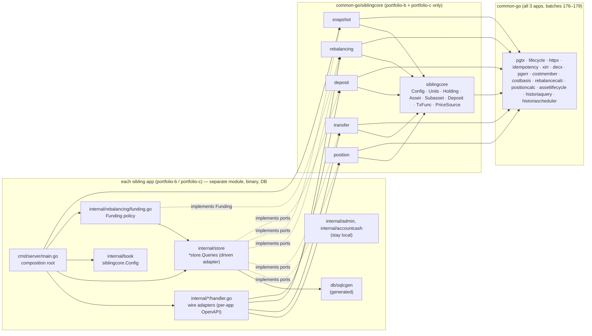
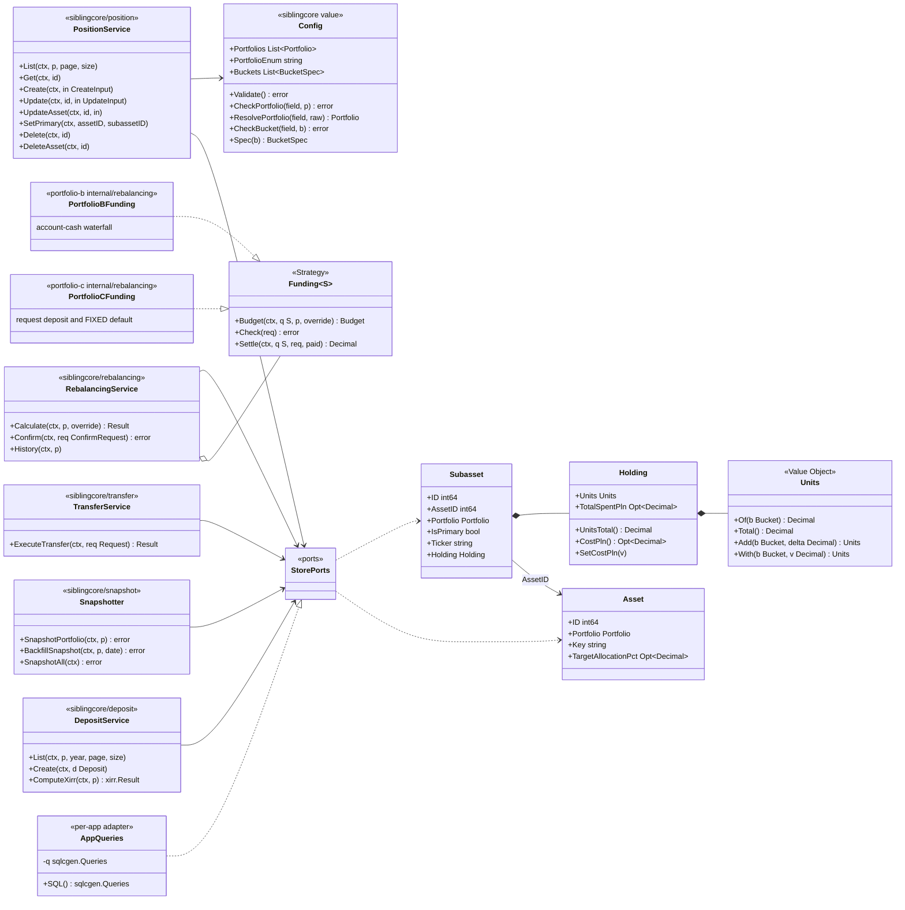
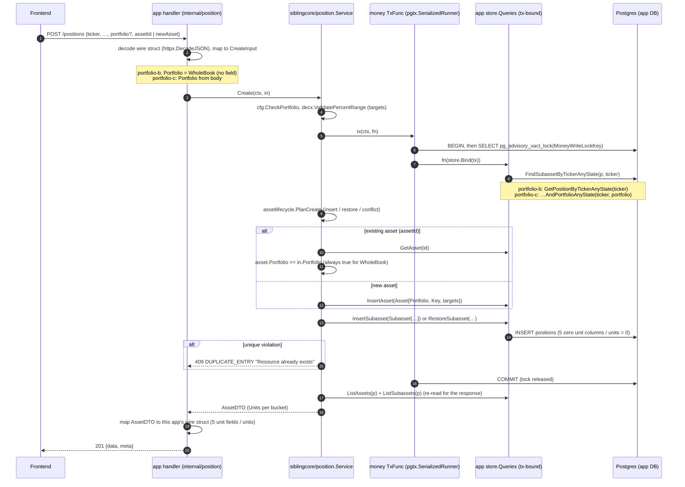
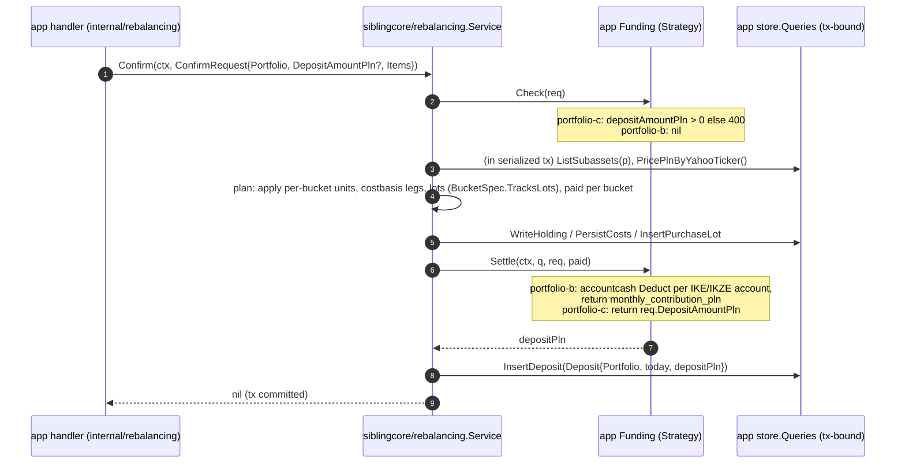
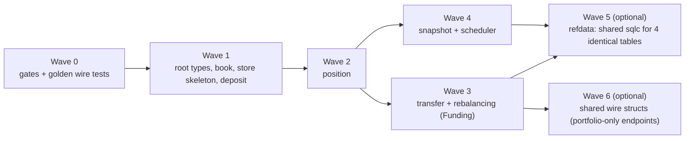

# 180 — `siblingcore`: one service core for the portfolio-b and portfolio-c Go backends (Architect, 2026-11-04)

> **Decision record:** `docs/adr/ADR-113-go-siblingcore.md` (amends ADR-076 for the sibling Go
> backends). **Living doc:** `docs/architecture/12-sibling-apps-and-shared-packages.md` §2.2.1.
> **Task:** `.claude/tasks/180-siblingcore.task.md` (waves, atomic steps, verification).
>
> **Inputs:** task 174 REPORT (F2.4, §5 wave C, §6 batch 180, §7a owner decision 4 — binding),
> `174-p2-duplication-catalog.md` §C + near-duplicate table, ADR-076, doc 13 §5, both siblings'
> `CLAUDE.md`, and the code of both apps as of `95576c5`.
>
> **Builds on (does not re-invent):** `docs/architecture/diagrams/174-remediation-design.md` §2
> "Contract for 180" — `pgtx.Runner` / `pgtx.SerializedRunner` + `pgtx.MoneyWriteLockKey`
> (176/177, ADR-111), `lifecycle` (176), `config.ConnectDB` (176), `httpx.DecodeJSON` (179),
> `idempotency` (177), `xirr.Solve` / `xirr.Summarize` (178, ADR-112), `decx`, `pgerr.NotFoundOr`,
> `pgnum.Date`, `costmember`, `rebalancecalc.PricesRefreshedAt` (179).
> **Batch 179 wave B2 (that doc §7.3–7.4, read 2026-11-04):** `subassetsOf`/`primaryOf` become
> `positioncalc.OrderSubassets[T SubassetRow]` / `PrimaryOf[T]`; marketdata and settings handlers
> become `marketdatacore.Handler` / `settingscore.Handler` (3 apps); every other position-service
> function is declined 3-way and **handed to 180 for its portfolio-b+portfolio-c half**, as are the deposit
> helpers. This design uses exactly that split (§8).

## 0. Scope and ownership

| In 180 (this design) | Not in 180 |
|---|---|
| `packages/common/go/common-go/siblingcore/**` (new; portfolio-b + portfolio-c only) | anything main also uses (batches 176–179, other architect) |
| per-app `internal/store` (driven adapter) and `internal/book` (config) in both siblings | main's backend; `apps/main/backend-go/internal/bot/**` |
| per-app `internal/rebalancing/funding.go` (the one policy port) | `internal/admin` backfill algorithms, `internal/accountcash` (declined, §2) |
| slimming the per-app `internal/{position,positiontransfer,rebalancing,historia,deposit}` packages to handlers | OpenAPI specs (no contract change), Flyway (no schema change) |

**No wire, contract or schema change.** Every endpoint returns what it returns today, except the
deltas listed in §7.

## 1. Pattern & principle evaluation (§1 Evaluate)

| Candidate | Verdict | Why (YAGNI/KISS is the tie-breaker) |
|---|---|---|
| **Hexagonal / Ports & Adapters** | **adopted** | siblingcore is the application core; each app supplies one driven adapter (`internal/store`, sqlc rows ↔ domain values) and keeps its driving adapters (HTTP handlers bound to its own OpenAPI). It is the shape seven common-go kernels already have (`settingscore.Store`, `accountcash.Store`, `marketdatacore.Store`, …). |
| **Consumer-side ports (ISP)** | **adopted** | Each sub-package declares only the methods it calls (`position.Store` 17, `transfer.Store` 6, `rebalancing.Store` 9, `snapshot.Store` 5, `deposit.Store` 6). One adapter struct per app satisfies all of them structurally — today's "`sqlcgen.Queries` satisfies the ports" idiom, one level up. |
| **Configuration over code for the two variation axes** (portfolio set, bucket set) | **adopted** | Both axes are data, not behaviour: portfolio-c's portfolio checks are no-ops for a one-portfolio book, and every units operation is the same sum over a different bucket list. `historiaquery.Config` (portfolio set) and `accountcash` (key list) already do this. |
| **Value Object** (`Units`, immutable, copy-on-write) | **adopted** | Replaces each app's `PositionUnits` struct and the 5-way `switch` in portfolio-b's `ApplyDelta`/`UnitsFor`. Copy-on-write keeps the value semantics the trade code relies on (a `touched[...]` map of copies). |
| **Strategy** (`rebalancing.Funding[S]`) | **adopted** | The one genuinely divergent step with two real implementations today (account-cash waterfall vs request deposit). Three methods, each called from exactly one place in the shared skeleton. |
| **Template Method as a Go function** (Calculate/Confirm skeleton with the Funding steps) | **adopted (implicit)** | The skeleton is plain code calling the strategy; no base type. Doc 13 §5 rule. |
| **Generic constructor only** (`NewService[S Port](…, tx TxFunc[S], …)`) | **adopted** | Binds a service to the app's transaction runner and lets `Funding[S]` receive the app's concrete adapter inside the transaction with no type assertion. Services themselves stay non-generic. |
| `UnitsExtractor` interface (doc 13 §5) | rejected | Covers reads only; writes vary too (§2). See ADR-113. |
| Generics over each app's units struct / sqlc rows | rejected | Type parameters would spread through 5 packages for a data-shaped difference; Go cannot constrain struct fields. ADR-113 seam table. |
| Shared sqlc query set for the core tables | rejected | Core tables are not column-identical (portfolio column, units columns). Kept as optional wave 5 for the 4 identical reference tables only. |
| Abstract Factory for per-app services / a `Core` facade bundling all services | rejected | Each `main.go` builds 5 services in 5 lines; a facade would hide the wiring the owner wants explicit per app (YAGNI). |
| Decorator for portfolio scoping (wrap a "whole DB" store with a portfolio filter) | rejected | The scoping is a query parameter the adapter binds; a decorator would need to filter rows in Go after loading both portfolios. |
| Shared HTTP handlers for every endpoint | rejected now | The wire really differs (units fields, account allocations, `portfolio` params). Optional wave 6 shares only the wire structs whose sole difference is `portfolio` (`omitempty`). |
| Observer/Mediator for confirm side effects | rejected | Two ordered calls (`Settle`, then deposit insert) inside one transaction. |
| **SOLID / DRY / Law of Demeter** | applied | Dependency rule: siblingcore → common-go kernels → stdlib/pgx/decimal; apps → siblingcore; never the reverse. Each sub-package has one reason to change (its domain). |

## 2. Divergence classification (the work list)

Measured with comments and blank lines removed and the module path normalised. **P** = differs only
by portfolio scoping, **B** = differs only by the bucket (units) model, **W** = per-app wire shape
(handler), **D** = genuinely domain-divergent, **C** = cosmetic (comments, names, literals).

| Package (identical %) | Differences and their class | Verdict |
|---|---|---|
| `position` (86 %) | `ListAll*` vs `List*ByPortfolio` (P); `GetPositionByTickerAnyState`/`GetAssetByKeyAnyState` take `(ticker|key, portfolio)` (P); portfolio-c's "must match the asset's portfolio" (Create) and "asset belongs to a different portfolio" (Update re-home) checks (P — a no-op for one portfolio); `guardTargetSum` message names the portfolio (P, message derived from `WholeBook`); 5 unit fields vs `Units` in DTO, `UpdateInput`, insert/update params and validation field names (B); handler units fields + `portfolio` (W) | → `siblingcore/position` (wave 2); handler stays |
| `positiontransfer` (81 %) | lookup by `(ticker, portfolio)` (P); `UnitsFor(accountType)` / `ApplyDelta(accountType)` vs single units (B); audit row `account_type` vs `portfolio` (B/P, adapter); `planCosts` lists the portfolio's rows (P) | → `siblingcore/transfer` (wave 3) |
| `rebalancing` (70 %) | per-portfolio reads (P); confirm items per account vs single units (B); lots only for IKE/IKZE units (B: `BucketSpec.TracksLots`); **funding: deployable cash, account allocation step, confirm-time cash deduct, deposit amount (D)**; `cashOnHandPln` vs `portfolio`/`depositAmountPln` on the wire (W) | skeleton → `siblingcore/rebalancing` (wave 3); funding → per-app `Funding` (D); handler stays |
| `historia` (89 %) | snapshot per portfolio (P); 5-column sum (B); scheduler loops portfolios (P); inflation base date (C — already `historiaquery.Config`); `portfolio` in entries (W) | snapshot + scheduler loop → `siblingcore/snapshot` (wave 4); `historiaquery` adapter + handler stay |
| `deposit` (84 %) | per-portfolio list/count/flows (P); units total (B) | → `siblingcore/deposit` (wave 1) |
| `admin` (59 %) | backfill algorithm (D: cutoff date + transfer replay + subasset fold vs lots-only per portfolio); `BackfillSnapshot` response shape (W) | **declined** — one-shot ADR-097 tool, real algorithmic difference; open question Q3. One fix still lands in both copies (wave 4, step 4.5): fetch the Yahoo OHLC series before opening the transaction (174-remediation §11.6) |
| `accountcash` (49 %) | table shape (D); route shape (W) | **declined** — kernel already shared; adapters are schema-specific |
| `marketdata` (100 %), `settings` (95 %), `inflation` (98 %) | none / validator keys (C, already a parameter) | handlers: batch 179 (`marketdatacore.Handler`, `settingscore.Handler`); inflation `SyncFromGus` handler: not moved (natural home `inflationsync`, 3-app after 178); the three store adapters: optional wave 5 |
| `cmd/server` (96 %) | port, issuer, service name (C, per-app literals); portfolio-b passes cash service (D, now inside portfolio-b's `Funding`) | stays per app; slimmer after 176 + this batch |

Catalog §C rows map onto waves in the task file (§"Catalog coverage").

## 3. Component view



*Legend:* solid arrow = imports; dotted = implements a port declared by the target (Dependency
Inversion: the core owns the interface, the app supplies the implementation — Hexagonal). Import
rules, enforced by review and by `go list -deps` in the task's verification step:
(1) nothing under `siblingcore` imports an `apps/**` module, `sqlcgen`, `openapi` or `net/http`
handlers; (2) sub-packages import the root, never each other; (3) main never imports
`siblingcore`; (4) only `internal/store` (and the two per-app escape hatches: `Funding`,
`internal/admin`) touches `sqlcgen`.

## 4. Exported API (exact Go signatures)

Doc comments are the contract. Ports return `pgx.ErrNoRows` (unwrapped or `%w`-wrapped) for a
missing row and the raw pgx error otherwise; **adapters never translate errors** — services map
them with `pgerr.NotFoundOr` and `pgerr.IsUniqueViolation`, keeping today's messages.

### 4.1 `siblingcore` (root)

```go
// Package siblingcore is the service core shared by the portfolio-b and portfolio-c backends (ADR-113).
// It knows two per-app parameters — the portfolio set and the unit-bucket set (Config) — and
// talks to each app's database only through the ports its sub-packages declare.
package siblingcore

import (
	"context"
	"time"

	"github.com/shopspring/decimal"

	"investing-app/common-go/costmember"
	"investing-app/common-go/positioncalc"
)

// Portfolio names one independent book. WholeBook is the single implicit book of an app that
// has no portfolio dimension (portfolio-b): adapters ignore it and messages omit it.
type Portfolio string

const WholeBook Portfolio = ""

// Bucket names one units column of a subasset row: an account type in portfolio-b
// (IKE_TATA … INNE), SingleBucket in portfolio-c.
type Bucket string

const SingleBucket Bucket = ""

// BucketSpec describes one bucket of an app's units model.
type BucketSpec struct {
	Bucket Bucket
	// Field is the request field named in this bucket's validation errors
	// ("unitsIkeTata" … in portfolio-b, "units" in portfolio-c).
	Field string
	// TracksLots: units bought into this bucket by a rebalancing confirm also record a
	// purchase lot (portfolio-b: the four IKE/IKZE buckets; INNE = false; portfolio-c: true).
	TracksLots bool
}

// Config is the whole per-app parameterisation of siblingcore. Each app declares exactly one,
// in internal/book.
type Config struct {
	Portfolios []Portfolio // portfolio-b {WholeBook}; portfolio-c {"VARIABLE", "FIXED"}
	// PortfolioEnum qualifies the 400 text for an unknown portfolio, matching the Java-era
	// message the apps already return elsewhere ("No enum constant <PortfolioEnum>.<NAME>").
	// Unused when Portfolios == {WholeBook}.
	PortfolioEnum string
	Buckets       []BucketSpec // portfolio-b 5 account types; portfolio-c {SingleBucket}
}

// Validate reports a malformed Config: empty sets, duplicates, WholeBook mixed with named
// portfolios, SingleBucket mixed with named buckets. Each app's internal/book test calls it.
func (c Config) Validate() error

// CheckPortfolio returns nil when p is one of c.Portfolios, otherwise a 400 VALIDATION_ERROR
// on field: "Required request parameter 'portfolio' is missing" when p is empty, else
// "No enum constant <PortfolioEnum>.<p>". For a WholeBook config it accepts only WholeBook.
func (c Config) CheckPortfolio(field string, p Portfolio) error

// ResolvePortfolio maps a raw wire value to a Portfolio: a WholeBook config ignores raw and
// returns WholeBook (portfolio-b accepts and ignores a body `portfolio` today); otherwise it trims
// and upper-cases raw and applies CheckPortfolio.
func (c Config) ResolvePortfolio(field, raw string) (Portfolio, error)

// CheckBucket returns nil when b is one of c.Buckets, otherwise a 400 VALIDATION_ERROR on field
// ("must be one of IKE_TATA, IKE_MAMA, IKZE_TATA, IKZE_MAMA, INNE").
func (c Config) CheckBucket(field string, b Bucket) error

// Spec returns the BucketSpec of b.
func (c Config) Spec(b Bucket) (BucketSpec, bool)

// Units is an immutable set of per-bucket unit amounts; the zero value holds nothing. Every
// method returning Units returns a copy, so a Units value can be stored and passed by value.
type Units struct{ /* m map[Bucket]decimal.Decimal — unexported */ }

// NewUnits copies amounts into a new Units.
func NewUnits(amounts map[Bucket]decimal.Decimal) Units

// Of returns the amount in bucket b (zero when absent).
func (u Units) Of(b Bucket) decimal.Decimal

// Total returns the exact decimal sum over all buckets (order-independent).
func (u Units) Total() decimal.Decimal

// Add returns a copy with Of(b) increased by delta (delta may be negative).
func (u Units) Add(b Bucket, delta decimal.Decimal) Units

// With returns a copy with Of(b) set to v.
func (u Units) With(b Bucket, v decimal.Decimal) Units

// Holding is the money state of one subasset row: its units plus its recorded cost.
// *Holding satisfies costmember.Holding and positioncalc.UnitsTotaler.
type Holding struct {
	Units         Units
	TotalSpentPln *decimal.Decimal // nil = SQL NULL, preserved on every round trip
}

func (h *Holding) UnitsTotal() decimal.Decimal
func (h *Holding) CostPln() *decimal.Decimal
func (h *Holding) SetCostPln(v *decimal.Decimal)

var _ costmember.Holding = (*Holding)(nil)

// CostMember is the costbasis write-back member over a subasset's Holding.
type CostMember = costmember.Member[*Holding]

// Asset is one `assets` row (the logical holding that carries the targets).
type Asset struct {
	ID                         int64
	Portfolio                  Portfolio
	Key                        string
	Name                       string
	Exposure                   string
	AssetClass                 string
	TargetAllocationPct        *decimal.Decimal
	TargetAllocationPctRiskOff *decimal.Decimal
	Deleted                    bool // only *AnyState reads can return true
	CreatedAt                  time.Time
	UpdatedAt                  time.Time
}

// Subasset is one `positions` row (a concrete ticker inside an asset).
type Subasset struct {
	ID            int64
	AssetID       int64
	Portfolio     Portfolio
	IsPrimary     bool
	Ticker        string
	Name          string
	Exchange      string
	AssetClass    string
	Exposure      string
	PriceCurrency string
	Holding       Holding
	AvgBuyPrice   *decimal.Decimal
	GroupName     *string
	YahooTicker   *string
	SortOrder     int
	Deleted       bool // only *AnyState / IncludingDeleted reads can return true
	CreatedAt     time.Time
	UpdatedAt     time.Time
}

// Deposit is one `deposits` row.
type Deposit struct {
	ID          int64
	Portfolio   Portfolio
	DepositDate time.Time
	Amount      decimal.Decimal
	Comment     *string
	CreatedAt   time.Time
}

// Subasset implements positioncalc.SubassetRow (batch 179), so the shared ordering helpers apply:
// positioncalc.OrderSubassets(subs, assetID) (primary first, then ticker ascending) and
// positioncalc.PrimaryOf(subs, assetID) (nil while a set-primary flip is in flight).
func (s Subasset) SubassetAssetID() int64  { return s.AssetID }
func (s Subasset) SubassetIsPrimary() bool { return s.IsPrimary }
func (s Subasset) SubassetTicker() string  { return s.Ticker }

var _ positioncalc.SubassetRow = Subasset{}

// MembersByAsset groups subassets into costbasis members by asset id (sibling order kept).
func MembersByAsset(subs []Subasset) map[int64][]*CostMember

// CostWriter persists a recorded cost on one subasset row (UpdatePositionCost).
type CostWriter interface {
	WriteCost(ctx context.Context, subassetID int64, cost *decimal.Decimal) error
}

// PersistCosts writes every changed member's cost except the rows in writtenByDelta (those were
// already written together with their units).
func PersistCosts(ctx context.Context, w CostWriter, changed []*CostMember, writtenByDelta ...int64) error

// TxFunc runs fn inside one database transaction with a port value S bound to it. The
// pgtx.Runner / pgtx.SerializedRunner results are assignable to it (identical underlying type).
type TxFunc[S any] func(ctx context.Context, fn func(S) error) error

// PriceSource is the cache-only price/FX view (never a live fetch).
type PriceSource interface {
	PricePlnByYahooTicker(ctx context.Context) (map[string]decimal.Decimal, error)
	AllRatesToPln(ctx context.Context) (map[string]decimal.Decimal, error) // "PLN" = 1 always present
	FetchedAtByYahooTicker(ctx context.Context) (map[string]time.Time, error)
}
```

### 4.2 `siblingcore/position`

```go
package position

// Store is the position service's port (consumer-side). Live reads exclude soft-deleted rows.
type Store interface {
	ListAssets(ctx context.Context, p siblingcore.Portfolio) ([]siblingcore.Asset, error)
	ListSubassets(ctx context.Context, p siblingcore.Portfolio) ([]siblingcore.Subasset, error)
	GetAsset(ctx context.Context, id int64) (siblingcore.Asset, error)
	GetSubasset(ctx context.Context, id int64) (siblingcore.Subasset, error)
	GetAssetAnyState(ctx context.Context, id int64) (siblingcore.Asset, error)
	FindAssetByKeyAnyState(ctx context.Context, p siblingcore.Portfolio, key string) (siblingcore.Asset, error)
	FindSubassetByTickerAnyState(ctx context.Context, p siblingcore.Portfolio, ticker string) (siblingcore.Subasset, error)
	InsertAsset(ctx context.Context, a siblingcore.Asset) (siblingcore.Asset, error)          // ID/timestamps ignored on input
	InsertSubasset(ctx context.Context, s siblingcore.Subasset) (siblingcore.Subasset, error) // units stored as zero in every bucket
	RestoreAsset(ctx context.Context, r AssetRestore) (siblingcore.Asset, error)
	RestoreSubasset(ctx context.Context, r SubassetRestore) (siblingcore.Subasset, error)
	UpdateSubassetFields(ctx context.Context, s siblingcore.Subasset) error // full-row overwrite of the editable fields
	UpdateAssetFields(ctx context.Context, a siblingcore.Asset) (siblingcore.Asset, error)
	ClearAssetPrimary(ctx context.Context, assetID int64) error
	SetSubassetPrimary(ctx context.Context, assetID, subassetID int64) error
	SoftDeleteSubasset(ctx context.Context, id int64) error
	SoftDeleteAsset(ctx context.Context, assetID int64) error
}

// AssetRestore / SubassetRestore are the fields a restore-on-create overwrites (ADR-109);
// nil pointers keep the stored value.
type AssetRestore struct {
	ID                         int64
	Name, Exposure, AssetClass string
	TargetAllocationPct        *decimal.Decimal
	TargetAllocationPctRiskOff *decimal.Decimal
}
type SubassetRestore struct {
	ID, AssetID                       int64
	IsPrimary                         bool
	Name, AssetClass, PriceCurrency   string
	Exposure, YahooTicker             *string
	SortOrder                         *int
}

type AssetDTO struct {
	siblingcore.Asset
	Computed  ComputedFields
	Subassets []SubassetDTO
}

// ComputedFields: field set and semantics unchanged from both apps' current position.ComputedFields.
type ComputedFields struct {
	UnitsTotal, PricePln, PriceNative, ValuePln       *decimal.Decimal
	CurrentPct, DeviationPct, ProfitPct               *decimal.Decimal
	AvgBuyPricePln, AvgBuyPriceNative, EquivalentUnits *decimal.Decimal
	CostlessSubassets                                 []string
}

type SubassetDTO struct {
	ID, AssetID                          int64
	IsPrimary                            bool
	Ticker, Name, Exchange, PriceCurrency string
	Units                                siblingcore.Units
	EffectiveUnits                       decimal.Decimal
	PricePln, PriceNative, ValuePln      *decimal.Decimal
	YahooTicker, GroupName               *string
	SortOrder                            int
}

type NewAssetInput struct {
	Name, Exposure, AssetClass  string
	TargetAllocationPct         *decimal.Decimal
	TargetAllocationPctRiskOff  *decimal.Decimal
}

type CreateInput struct {
	Portfolio                                                 siblingcore.Portfolio
	Ticker, Name, Exchange, AssetClass, Exposure, PriceCurrency string
	YahooTicker                                               *string
	SortOrder                                                 *int
	AssetID                                                   *int64
	IsPrimary                                                 *bool
	NewAsset                                                  *NewAssetInput
}

// UpdateInput: nil / absent means "leave unchanged". Units is a per-bucket patch: only the
// buckets present are overwritten; each must be a configured bucket and >= 0
// (400 on that bucket's BucketSpec.Field, checked in Config.Buckets order).
type UpdateInput struct {
	Units                                  map[siblingcore.Bucket]decimal.Decimal
	TotalSpentPln, AvgBuyPrice             *decimal.Decimal
	Name, GroupName, AssetClass, YahooTicker *string
	SortOrder                              *int
	AssetID                                *int64
}

// UpdateAssetInput: unchanged from today (httpx.Optional distinguishes absent from null).
type UpdateAssetInput struct {
	TargetAllocationPct        httpx.Optional[decimal.Decimal]
	TargetAllocationPctRiskOff httpx.Optional[decimal.Decimal]
	Name                       *string
}

// NewService wires the service. tx runs every write method (reads included) in one
// transaction; each app passes pgtx.SerializedRunner(pool, pgtx.MoneyWriteLockKey, store.Bind).
func NewService[S Store](cfg siblingcore.Config, store S, tx siblingcore.TxFunc[S], prices siblingcore.PriceSource) *Service

func (s *Service) List(ctx context.Context, p siblingcore.Portfolio, page, size int) ([]AssetDTO, int64, error)
func (s *Service) Get(ctx context.Context, subassetID int64) (AssetDTO, error)
func (s *Service) Create(ctx context.Context, in CreateInput) (AssetDTO, error)
func (s *Service) Update(ctx context.Context, subassetID int64, in UpdateInput) (AssetDTO, error)
func (s *Service) UpdateAsset(ctx context.Context, assetID int64, in UpdateAssetInput) (AssetDTO, error)
func (s *Service) SetPrimary(ctx context.Context, assetID, subassetID int64) (AssetDTO, error)
func (s *Service) Delete(ctx context.Context, subassetID int64) error
func (s *Service) DeleteAsset(ctx context.Context, assetID int64) error
```

### 4.3 `siblingcore/transfer`

```go
package transfer

type Store interface {
	GetSubassetByTicker(ctx context.Context, p siblingcore.Portfolio, ticker string) (siblingcore.Subasset, error)
	ListSubassets(ctx context.Context, p siblingcore.Portfolio) ([]siblingcore.Subasset, error)
	PricePlnByYahooTicker(ctx context.Context) (map[string]decimal.Decimal, error) // price_cache, read through the tx
	WriteHolding(ctx context.Context, subassetID int64, h siblingcore.Holding) error // UpdatePositionDelta
	WriteCost(ctx context.Context, subassetID int64, cost *decimal.Decimal) error   // UpdatePositionCost
	InsertTransferLeg(ctx context.Context, r LegRecord) error
}

// Leg is one side of a manual "Sprzedaj" transfer. Bucket is required (CheckBucket) when the
// app has more than one bucket; SingleBucket otherwise.
type Leg struct {
	Ticker          string
	Bucket          siblingcore.Bucket
	Units, PricePln decimal.Decimal
}
type Request struct {
	Portfolio siblingcore.Portfolio
	Sold      Leg
	Buys      []Leg
}
type Result struct {
	TransferID uuid.UUID
	Sold       Leg
	Buys       []Leg
}

// LegRecord is one `position_transfers` audit row (the adapter stores Bucket as account_type in
// portfolio-b and Portfolio in portfolio-c).
type LegRecord struct {
	TransferID                   uuid.UUID
	Portfolio                    siblingcore.Portfolio
	Ticker                       string
	Bucket                       siblingcore.Bucket
	UnitsDelta, PricePln, TotalPln decimal.Decimal
	TransferredAt                time.Time
}

// NewService: tx must be the app's serialized money-write runner (ADR-111).
func NewService[S Store](cfg siblingcore.Config, tx siblingcore.TxFunc[S]) *Service

// ExecuteTransfer records exactly what the user submitted — the sold leg comes from req, never
// from a target or deviation (manual-sell-only rule).
func (s *Service) ExecuteTransfer(ctx context.Context, req Request) (Result, error)
```

### 4.4 `siblingcore/rebalancing`

```go
package rebalancing

type Store interface {
	ListAssets(ctx context.Context, p siblingcore.Portfolio) ([]siblingcore.Asset, error)
	ListSubassets(ctx context.Context, p siblingcore.Portfolio) ([]siblingcore.Subasset, error)
	ListSubassetsIncludingDeleted(ctx context.Context, p siblingcore.Portfolio) ([]siblingcore.Subasset, error)
	ListPurchaseLots(ctx context.Context, p siblingcore.Portfolio) ([]PurchaseLot, error)
	PricePlnByYahooTicker(ctx context.Context) (map[string]decimal.Decimal, error)
	WriteHolding(ctx context.Context, subassetID int64, h siblingcore.Holding) error
	WriteCost(ctx context.Context, subassetID int64, cost *decimal.Decimal) error
	InsertPurchaseLot(ctx context.Context, lot PurchaseLot) error
	InsertDeposit(ctx context.Context, d siblingcore.Deposit) (siblingcore.Deposit, error)
}

type PurchaseLot struct {
	Portfolio               siblingcore.Portfolio
	SessionID               uuid.UUID
	PurchasedAt             time.Time
	Ticker                  string
	Units, PricePln, CostPln decimal.Decimal
}

// AllocateFunc is rebalancecalc.AllocateProportional's per-app account step.
type AllocateFunc func(buyList []rebalancecalc.BuyListItem, balances map[string]decimal.Decimal) []rebalancecalc.BuyListItem

// Budget is what Funding.Budget resolves for one Calculate call.
type Budget struct {
	DeployablePln decimal.Decimal
	CashOnHandPln *decimal.Decimal // portfolio-b: Σ IKE/IKZE cash; nil in portfolio-c (the wire has no such field)
	Allocate      AllocateFunc     // portfolio-b: account-cash waterfall; portfolio-c: identity
	Balances      map[string]decimal.Decimal
}

// Funding is the one genuinely per-app policy (Strategy). S is the app's concrete adapter, so
// the policy can reach its own tables (account cash, settings) through the same transaction.
type Funding[S any] interface {
	// Budget resolves the deployable cash for Calculate. Called outside any transaction.
	Budget(ctx context.Context, q S, p siblingcore.Portfolio, override *decimal.Decimal) (Budget, error)
	// Check validates a confirm request before the transaction opens
	// (portfolio-c: depositAmountPln > 0; portfolio-b: nil).
	Check(req ConfirmRequest) error
	// Settle runs inside Confirm's serialized transaction after holdings, costs and lots are
	// written. paid is Σ round4(units × pricePln) per bucket. It returns the deposit amount to
	// record (portfolio-b: deducts account cash per IKE/IKZE account, returns monthly_contribution_pln;
	// portfolio-c: returns req.DepositAmountPln).
	Settle(ctx context.Context, q S, req ConfirmRequest, paid map[siblingcore.Bucket]decimal.Decimal) (depositPln decimal.Decimal, err error)
}

type ConfirmItem struct {
	Ticker string
	Units  siblingcore.Units // per-bucket units bought (portfolio-c: SingleBucket only)
}
type ConfirmRequest struct {
	Portfolio        siblingcore.Portfolio
	DepositAmountPln *decimal.Decimal // portfolio-c: required; portfolio-b: nil
	Items            []ConfirmItem
}

type AccountAlloc struct {
	Bucket                siblingcore.Bucket
	AllocPln, UnitsToBuy  decimal.Decimal
}
type BuyItem struct {
	Ticker, Name, Exchange, PurchaseCurrency      string
	AllocatedPln, AllocatedNative, UnitsToBuy     decimal.Decimal
	CurrentPct, TargetPct, DeviationPct           decimal.Decimal
	AccountAllocations                            []AccountAlloc // nil in portfolio-c
	AvailableTickers                              []string
}
type DonutSlice struct {
	Ticker, Name                                    string
	CurrentPct, TargetPct, ValuePln, DeviationPct   decimal.Decimal
	Status                                          string // "ON_TARGET" | "OVER" | "UNDER"
}
type Result struct {
	Portfolio              siblingcore.Portfolio
	CashOnHandPln          *decimal.Decimal
	DeployableCashPln      decimal.Decimal
	TotalPortfolioValuePln decimal.Decimal
	PricesRefreshedAt      time.Time
	BuyList                []BuyItem
	DonutData              []DonutSlice
}

// NewService: tx must be the app's serialized money-write runner; now nil = historiaquery.NowInWarsaw.
func NewService[S Store](cfg siblingcore.Config, store S, tx siblingcore.TxFunc[S], prices siblingcore.PriceSource, funding Funding[S], now func() time.Time) *Service

func (s *Service) Calculate(ctx context.Context, p siblingcore.Portfolio, depositOverride *decimal.Decimal) (Result, error)
func (s *Service) Confirm(ctx context.Context, req ConfirmRequest) error
func (s *Service) History(ctx context.Context, p siblingcore.Portfolio) ([]rebalancecalc.PurchaseSessionResult, error)
```

### 4.5 `siblingcore/snapshot`

```go
package snapshot

type Store interface {
	ListSubassets(ctx context.Context, p siblingcore.Portfolio) ([]siblingcore.Subasset, error)
	PricePlnByYahooTicker(ctx context.Context) (map[string]decimal.Decimal, error)
	AllRatesToPln(ctx context.Context) (map[string]decimal.Decimal, error)
	ListDepositsAsc(ctx context.Context, p siblingcore.Portfolio) ([]siblingcore.Deposit, error)
	UpsertSnapshot(ctx context.Context, s Snapshot) error
}

// Snapshot is one `historia` row to upsert (on (snapshot_date) in portfolio-b, (portfolio,
// snapshot_date) in portfolio-c — the adapter's query decides).
type Snapshot struct {
	Portfolio          siblingcore.Portfolio
	Date               time.Time
	TotalDeposits      decimal.Decimal
	PortfolioValue     decimal.Decimal
	Xirr               *decimal.Decimal
	PositionValuesJSON []byte // historiaquery.MarshalPositionValues output
}

// NewSnapshotter: now nil = time.Now.
func NewSnapshotter(cfg siblingcore.Config, store Store, now func() time.Time) *Snapshotter

func (s *Snapshotter) SnapshotPortfolio(ctx context.Context, p siblingcore.Portfolio) error
func (s *Snapshotter) BackfillSnapshot(ctx context.Context, p siblingcore.Portfolio, date time.Time) error

// SnapshotAll snapshots every configured portfolio; one portfolio's failure never skips the
// others; the returned error is errors.Join of the failures. It is the job each app hands to
// historiascheduler.RunDaily.
func (s *Snapshotter) SnapshotAll(ctx context.Context) error
```

### 4.6 `siblingcore/deposit`

```go
package deposit

type Store interface {
	ListDeposits(ctx context.Context, p siblingcore.Portfolio, year *int, limit, offset int) ([]siblingcore.Deposit, error)
	CountDeposits(ctx context.Context, p siblingcore.Portfolio, year *int) (int64, error)
	ListDepositsAsc(ctx context.Context, p siblingcore.Portfolio) ([]siblingcore.Deposit, error)
	InsertDeposit(ctx context.Context, d siblingcore.Deposit) (siblingcore.Deposit, error)
	ListAssets(ctx context.Context, p siblingcore.Portfolio) ([]siblingcore.Asset, error)
	ListSubassets(ctx context.Context, p siblingcore.Portfolio) ([]siblingcore.Subasset, error)
}

// NewService: now nil = historiaquery.NowInWarsaw (the injected XIRR valuation date, ADR-112).
func NewService(cfg siblingcore.Config, store Store, prices siblingcore.PriceSource, now func() time.Time) *Service

func (s *Service) List(ctx context.Context, p siblingcore.Portfolio, year *int, page, size int) ([]siblingcore.Deposit, int64, error)
func (s *Service) Create(ctx context.Context, d siblingcore.Deposit) (siblingcore.Deposit, error)
func (s *Service) ComputeXirr(ctx context.Context, p siblingcore.Portfolio) (xirr.Result, error)
```

### 4.7 Per-app adapter and configuration (in each app, not in common-go)

```go
// apps/<app>/backend-go/internal/book/book.go
package book

// Config is this app's only siblingcore parameterisation.
var Config = siblingcore.Config{ /* portfolio-b / portfolio-c values below */ }

// portfolio-b:
//   Portfolios: {siblingcore.WholeBook}
//   Buckets: {IKE_TATA "unitsIkeTata" lots}, {IKE_MAMA "unitsIkeMama" lots},
//            {IKZE_TATA "unitsIkzeTata" lots}, {IKZE_MAMA "unitsIkzeMama" lots},
//            {INNE "unitsInne" no lots}
// portfolio-c:
//   Portfolios: {"VARIABLE", "FIXED"}, PortfolioEnum: "pl.shared.entity.enums.Portfolio"
//   Buckets: {siblingcore.SingleBucket "units" lots}

// apps/<app>/backend-go/internal/store/store.go
package store

// Queries is this app's one driven adapter: every siblingcore port, plus PriceSource
// (today's cmd/server/priceadapter.go moves here).
type Queries struct{ q *sqlcgen.Queries }

func New(q *sqlcgen.Queries) *Queries
// Bind is the pgtx bind function: store.Bind(tx) == New(sqlcgen.New(tx)).
func Bind(tx pgx.Tx) *Queries
// SQL is the escape hatch for this app's own policy code (Funding, admin) — never used by
// siblingcore.
func (s *Queries) SQL() *sqlcgen.Queries

var (
	_ position.Store          = (*Queries)(nil)
	_ transfer.Store          = (*Queries)(nil)
	_ rebalancing.Store       = (*Queries)(nil)
	_ snapshot.Store          = (*Queries)(nil)
	_ deposit.Store           = (*Queries)(nil)
	_ siblingcore.PriceSource = (*Queries)(nil)
)
```

**Adapter mapping rules** (the only place the axes meet SQL):

| Rule | portfolio-b | portfolio-c |
|---|---|---|
| Portfolio argument | ignored (`ListAll*`, `GetPositionByTickerAnyState`, …); rows decode with `Portfolio: WholeBook` | bound as `sqlcgen.PortfolioEnum(p)`; rows decode `Portfolio(row.Portfolio)` |
| Units read | `NewUnits({IKE_TATA: units_ike_tata, …, INNE: units_inne})` | `NewUnits({SingleBucket: units})` |
| Units write (`WriteHolding`, `UpdateSubassetFields`) | 5 columns from `Of(bucket)` | `units` from `Of(SingleBucket)` |
| `LegRecord` | `account_type = Bucket` | `portfolio = Portfolio` |
| `InsertSubasset` units | 5 zero columns | `units = 0` |
| Errors | returned unchanged (pgx sentinels and SQLSTATEs must survive for `pgerr`) | same |

### 4.8 Composition root after 180 (each app; 176's `lifecycle` already in place)

```go
import (
	scdeposit "investing-app/common-go/siblingcore/deposit"
	scposition "investing-app/common-go/siblingcore/position"
	screbalancing "investing-app/common-go/siblingcore/rebalancing"
	scsnapshot "investing-app/common-go/siblingcore/snapshot"
	sctransfer "investing-app/common-go/siblingcore/transfer"

	"<app>/backend-go/internal/book"
	"<app>/backend-go/internal/rebalancing" // this app's handler + Funding
	"<app>/backend-go/internal/store"
)

q := store.New(sqlcgen.New(pool))
money := pgtx.SerializedRunner(pool, pgtx.MoneyWriteLockKey, store.Bind)

positionSvc := scposition.NewService(book.Config, q, money, q)
transferSvc := sctransfer.NewService(book.Config, money)
rebalancingSvc := screbalancing.NewService(book.Config, q, money, q, rebalancing.NewFunding(), nil)
depositSvc := scdeposit.NewService(book.Config, q, q, nil)
snapshotter := scsnapshot.NewSnapshotter(book.Config, q, nil)
if historiascheduler.SchedulerEnabled() {
	workers.Go("historia-scheduler", func(ctx context.Context) { historiascheduler.RunDaily(ctx, snapshotter.SnapshotAll) })
}
```

The per-app handler packages import the core under the same `sc*` aliases (their own package
names stay `position`, `deposit`, …). `rebalancing.NewFunding` is the app's own constructor
(portfolio-b: account cash + `monthly_contribution_pln`; portfolio-c: request deposit + FIXED default).

### 4.9 Class diagram



*Legend:* `List~T~` = Go `[]T`, `Opt~T~` = Go `*T`; exact signatures are §4.1–4.7 (the class boxes
are a map, not the contract). **Value Object** = `Units` (immutable, copy-on-write). **Strategy** =
`Funding[S]` with two implementations, one per app. **Ports & Adapters** = the five consumer-side
`Store` interfaces (one box here) implemented structurally by each app's `internal/store.Queries`.
Composition only, no inheritance. `Config` is the single place the two per-app axes live.

## 5. Sequence: create a position through the seam



*Legend:* the service never sees a sqlc type or a portfolio column; the adapter is the only
participant that knows whether the app has a portfolio dimension or 5 unit columns (Ports &
Adapters). The advisory lock (ADR-111) is the runner's first statement, so the "already exists?"
read and the insert cannot interleave with another money write.



*Legend:* the shared skeleton owns ordering and the transaction; the per-app Strategy owns only the
two funding decisions. Today's order of writes inside the transaction is unchanged for both apps.

## 6. Migration waves (summary; atomic steps in the task file)



| Wave | Content | Risk | Lines removed (both apps) | Lines added | Net |
|---|---|---|---:|---:|---:|
| 0 | 176–179 landed; per-app golden JSON tests for every endpoint the waves touch | none | 0 | ~+300 test | — |
| 1 | `siblingcore` root types; `internal/book`; `internal/store` skeleton (+ priceadapter moved in); `siblingcore/deposit` | low | ~490 | ~640 | **≈ +150** (investment) |
| 2 | `siblingcore/position`; delete per-app service/domain/decode/delta/setprimary/computed/assetjoin | medium | ~2,650 | ~1,550 | **≈ −1,100** (179 already took `subassetsOf`/`primaryOf`) |
| 3 | `siblingcore/transfer`, `siblingcore/rebalancing`, per-app `Funding` | high (money writes) | ~2,170 | ~1,340 | **≈ −830** |
| 4 | `siblingcore/snapshot` + `SnapshotAll` scheduler job | low | ~590 | ~330 | **≈ −260** |
| **core** | | | | | **≈ −2,050** |
| 5 (opt.) | `siblingcore/refdata`: one sqlc query set for `price_cache`, `fx_rate_cache`, `settings`, `inflation` (+ `ListTrackedTickers`), implementing `marketdatacore.Store`, `settingscore.Store`, the inflation adapter and `PriceSource`; parity test against both schemas | low–medium (new sqlc config in common-go + CI drift check) | ~710 | ~240 | **≈ −470** |
| 6 (opt.) | `siblingcore/wire`: shared float64 wire structs + mapping for deposits, deposit XIRR, transfers, purchase history, historia entries (`portfolio,omitempty`) | low (golden tests) | ~380 | ~200 | **≈ −180** |
| **all** | | | | | **≈ −2,700** |

Counts are non-test Go lines including comments, ±20 %. Duplicated unit tests shrink by roughly
another 2,000 lines (both apps' `service_test.go` fakes collapse into one siblingcore suite run
against both configs). Integration tests stay per app and are the parity guard.

**Why this order:** wave 1 is a tracer bullet: the smallest package that crosses every seam
(config, port, adapter, handler) proves the design before the big move. Position (wave 2) is the
largest win and owns the `Units`/`Subasset` model the money paths then reuse. Transfers and confirm
(wave 3) carry the most risk, so they move after the units model is proven and with ADR-111's
serialized runner already in place. Waves 5–6 are optional and independent of each other.

## 7. Behaviour preservation

**Invariants (must hold after every wave):** same routes, status codes, JSON field names, field
presence and number formatting per app; same 4xx messages (portfolio-b keeps its portfolio-free texts:
the `WholeBook` branch renders exactly today's string); same write order inside each transaction;
reads that feed a money write stay inside the serialized transaction (ADR-111); soft-delete
semantics (ADR-109) and restore-on-create unchanged; cost-basis results identical (costbasis
kernel rules, owner decision 2026-10-16).

**Intended deltas (each gets a test in the wave that introduces it):**

| # | App | Today | After | Wave |
|---|---|---|---|---|
| D1 | portfolio-b | transfer/confirm leg with missing or unknown `accountType`: units check reads `INNE`, `ApplyDelta` silently skips, the audit insert fails the enum cast → 500, rolled back | `400 VALIDATION_ERROR` on `sold.accountType` / `buys.accountType` / `items.accountAllocations.accountType` before the transaction opens | 3 |
| D2 | portfolio-c | unknown `portfolio` value on positions/deposits/transfer/confirm/calculate reaches the enum cast → 500 | `400 VALIDATION_ERROR` "No enum constant pl.shared.entity.enums.Portfolio.X" (the text historia and account-cash already return) | 1–3 |
| D3 | portfolio-b | a confirm item listing the same `accountType` twice: applied twice, PLN rounded per row | units summed per bucket, PLN rounded once per bucket (≤ 0.0001 PLN difference; the UI never sends duplicates) | 3 |
| D4 | both | scheduled snapshot: portfolio-b returns the error to `RunDaily`; portfolio-c logs a warning per portfolio and returns nil | `SnapshotAll` tries every portfolio and returns `errors.Join` → `RunDaily` logs one "historia: scheduled snapshot failed" line (log text only) | 4 |
| D5 | both | internal (500) error wrap texts / slog attributes | may name the portfolio (portfolio-c) and omit it for `WholeBook`; not part of the contract | all |

## 8. Reconciliation notes

- **doc 13 §5** designed "one `PositionService` for all three apps with a `UnitsExtractor` seam";
  it was never built. 180 builds it for the two siblings with a bucket set instead (ADR-113). main
  keeps its own position service; doc 13 is historical (its as-built addendum says so) and is not
  edited.
- **Batch 179 wave B2** (174-remediation §7.3): only `subassetsOf`/`primaryOf` go 3-way, as the
  generic `positioncalc.OrderSubassets`/`PrimaryOf` over the `SubassetRow` accessor seam;
  `siblingcore.Subasset` implements that seam (§4.1) instead of carrying its own copies. B2
  declined a 3-way position service (main's bucket model and DTOs differ), so `siblingcore/position`
  is the only shared position service, and main keeps its own. Wave 2 step 2.0 only verifies that
  179 shipped this.
- **Batch 179 marketdata/settings handlers** become `marketdatacore.Handler` / `settingscore.Handler`
  in all three apps; 180 does not touch them. main gets its own `settings/store.go` and its own
  marketdata store, so the portfolio-b+portfolio-c store adapters for `price_cache`, `fx_rate_cache`,
  `settings` and `inflation` stay byte-identical twins after 179 — that is wave 5's scope.
- **Admin backfill** (174-remediation §11.6 assumed 180 moves it): 180 declines moving it (§2), but
  applies the one fix in both copies — the OHLC fetch moves before the transaction (wave 4).
- **Batch 182** (money as decimals on the wire) runs after 180 and edits the per-app handlers; if
  wave 6 ran, it edits `siblingcore/wire` once instead of twice.

## 9. Clean-architecture audit (Skill 16)

| Check | Result |
|---|---|
| Dependency rule | siblingcore imports only common-go, pgx (for `ErrNoRows` checks via `pgerr`), uuid, decimal. Apps import siblingcore; siblingcore imports no app. Ports are declared in the core. |
| SRP / cohesion | root = shared vocabulary; one sub-package per domain service; the adapter = SQL mapping only; `Funding` = funding policy only. |
| OCP | A third sibling with another portfolio set or bucket set needs a new `Config` and adapter, not a core change. A new funding policy is a new `Funding` implementation. |
| LSP | Both adapters satisfy the same ports with the same error semantics (pgx sentinels unchanged); the per-app integration suites run the same core against both. |
| ISP | Five narrow ports instead of one 30-method interface; fakes implement only what a package uses. |
| DIP | Services depend on ports and `TxFunc`, never on `pgxpool` or sqlc. |
| DRY | One copy of each sibling service. Remaining per-app duplication is the mapping code at the two edges (adapter, handlers), justified by different schemas and wire contracts; wave 6 removes the part that is not. |
| YAGNI | No facade, no factory, no extractor interface, no generics beyond the constructors; admin backfill and account cash left alone; waves 5–6 optional and gated. |
| Law of Demeter | Handlers call one service method and map its DTO; services call ports, not adapter internals; only per-app policy code uses `store.Queries.SQL()`. |

## 10. Open questions (recommended defaults)

| # | Question | Default |
|---|---|---|
| Q1 | Run optional wave 5 (shared sqlc for the 4 identical reference tables)? | Yes, after wave 4. Batch 179 leaves the sibling marketdata/settings/inflation store adapters as identical twins, so the scope is known. |
| Q2 | Run optional wave 6 (shared wire structs for portfolio-only endpoints)? | Yes, right before batch 182, so 182 edits those structs once. |
| Q3 | Admin backfill: portfolio-b replays position transfers and folds subassets; portfolio-c rewinds purchase lots only. Unify on portfolio-b's algorithm? | No (declined): one-shot ADR-097 tool; unifying changes portfolio-c's backfilled history. Revisit only if portfolio-c gains historia gaps after a transfer. |
| Q4 | Keep `WholeBook = ""` as portfolio-b's portfolio, or name it (`"DEFAULT"`)? | `""`: it is the zero value, never reaches SQL (portfolio-b's adapter ignores it), and keeps portfolio-b's portfolio-free messages trivially. |
