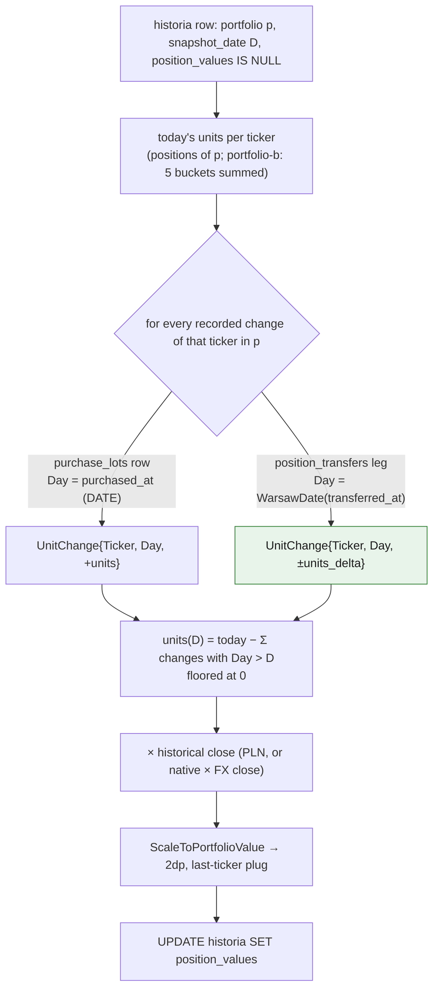
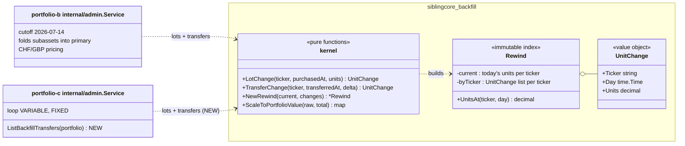
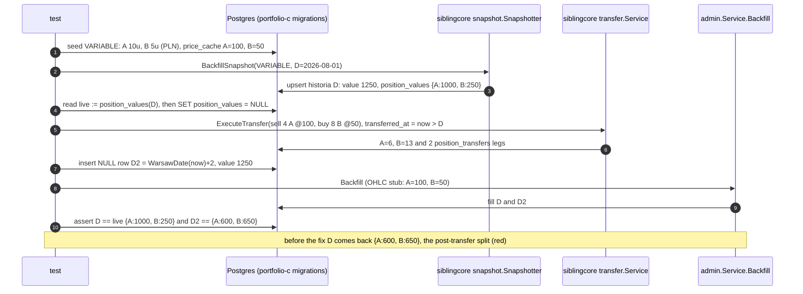
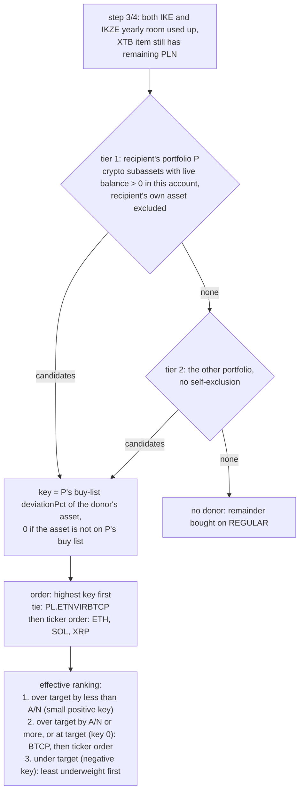

# 190 — portfolio-c backfill transfer replay (C2) and crypto donor ranking (C3) (Architect, 2026-11-09)

Task: `.claude/tasks/190-backfill-transfers-donor-ranking.task.md`. Part A is a design for
Backend-Go. Part B is analysis only: no code change until the owner answers the question in the
task file.

---

## Part A — C2: portfolio-c's position-values backfill never replays `position_transfers`

### A.1 Verdict: real bug, latent today, safe to fix

Verified against code and schema (2026-11-09, `main` at `1c6f372`):

| Fact | Where |
|---|---|
| portfolio-c has `position_transfers` (`portfolio`, `ticker`, signed `units_delta`, `transferred_at TIMESTAMPTZ`) since V1 | `apps/portfolio-c/db/migration/V1__init.sql` lines 156–176 |
| A transfer moves units on `positions` and writes one audit row per leg. It writes **no** `purchase_lots` row | `packages/common/go/common-go/siblingcore/transfer/service.go` `ExecuteTransfer` (`WriteHolding` + `InsertTransferLeg` only) |
| portfolio-c's backfill rewinds today's units through purchase lots only. It never reads `position_transfers`: there is no transfer query in `db/queries/backfill.sql`, and `unitsAtDate` says so in its comment | `apps/portfolio-c/backend-go/internal/admin/backfill.go` `unitsAtDate`, `loadBackfillBook`; `apps/portfolio-c/backend-go/db/queries/backfill.sql` |
| portfolio-b's backfill subtracts lots **and** transfer legs dated after the snapshot day (transfer instant → Europe/Warsaw calendar day) | `apps/portfolio-b/backend-go/internal/admin/backfill.go` `unitsAtDate`; query `ListBackfillTransfers` |
| The backfill is not only a manual tool. It runs **at every backend startup** (worker `historia-backfill`) and fills every `historia` row whose `position_values IS NULL` | `apps/portfolio-c/backend-go/cmd/server/main.go:188`, `internal/admin/runner.go` |
| The live 23:00 snapshot always writes `position_values` (an empty map encodes as `{}`, never NULL). So NULL rows come only from migrations that insert `historia` without a breakdown (V4/V6 did) | `siblingcore/snapshot/snapshot.go`, `historiaquery.MarshalPositionValues` |
| A filled row is never refilled | query `ListHistoriaMissingPositionValues` (`position_values IS NULL`) |

**Effect.** For a NULL row dated D, portfolio-c computes `units(D) = units(today) − Σ lots after D`.
A transfer after D is not undone: the sold ticker gets too few units on D and the bought ticker
too many. The rows are then scaled to the stored `portfolio_value`, so the total is still right
but the per-asset split is wrong, permanently. The task file's wording "a day *after* a
transfer" is the wrong way round. Rows dated **on or after** the transfer's Warsaw day are already
right, because today's units include the transfer. The rows that come out wrong are the ones
dated **before** a transfer that happened before the fill ran.

**Why it is latent.** In steady state there are no NULL rows, so the startup pass logs "nothing
to do". The bug fires only when a future migration inserts `historia` rows without a breakdown
(a history reconstruction, like V4/V6) after the owner has used "Sprzedaj" in that portfolio.
Whether any past row was filled wrong depends on live data (see the GETs in the task file). The
only NULL rows were V4/V6's, dated from 2026-07-28. They were filled at the first startup after
V7 added the column, and a transfer would have had to fall in that window.

**Safe to fix.** The fix changes only how NULL rows are filled. Rows that are already filled,
the live snapshot, transfers and money writes are untouched. portfolio-b's behaviour is unchanged,
and its existing Testcontainers goldens guard that.

### A.2 Pattern and principle evaluation (§1 Evaluate)

| Candidate | Verdict | Why |
|---|---|---|
| Local fix in portfolio-c only (copy portfolio-b's transfer loop) | rejected | Owner rule (AGENTS.md, ADR-113): code done the same way in 2–3 apps goes to `packages/common`. The fork is how C2 happened in the first place. |
| **Shared pure kernel `siblingcore/backfill` (rewind + scaling), used by both apps** | **adopted** | The rewind ("today's units minus every recorded change after day D") and the scaling tail (`scaleToPortfolioValue`, already byte-identical in both apps) are the same arithmetic in both apps. Pure functions, no port, no DB, so the unit tests are fast. The per-app orchestration stays local (portfolio loop, portfolio-b's cutoff, CHF pricing, subasset folding, warning texts). |
| Move the whole backfill into siblingcore (Store port + OHLC, like `siblingcore/snapshot`) | rejected for now (YAGNI) | After this fix the remaining differences are portfolio-b's cutoff, CHF/GBP pricing, FX set, warning texts and subasset folding. Merging them changes portfolio-b's characterisation goldens (task 185 B4) and both apps' warning output, for a tool that is a no-op in steady state. Revisit together with A.6 L1 if portfolio-c ever gets a multi-subasset asset. |
| Value object `UnitChange` + small `Rewind` index | adopted | One type for both event kinds, so a third kind (should one appear) is one constructor, not a new loop. `Rewind` replaces the three per-ticker maps both apps build today (DRY). Immutable after construction. |
| Strategy / Template Method over "lot vs transfer" | rejected | The two kinds differ only in how the calendar day is derived, which two constructors cover. No polymorphism needed. |
| Generics over each app's sqlc row types | rejected | Same reason as ADR-113 seam (b). The apps map their rows to `UnitChange` in 3 lines each. |
| New ADR | not written | The decision is narrow: two kernels move into siblingcore, and portfolio-c adopts portfolio-b's replay. It amends ADR-113 decision 5 only by moving these two kernels into siblingcore, while the backfill orchestration stays per app as decision 5 says. Recorded here and, at close-out, in living doc 12 §2.2 (step B4 in the task file). |

SOLID/LoD: the kernel depends on `decimal` and `historiaquery.WarsawDate` only (DIP: apps depend
on it, never the reverse). SRP: the kernel computes units and scaling. Pricing, persistence and
warnings stay in the app's `admin` package.

### A.3 Rewind rule (after the fix, both apps)



Legend: green = the step portfolio-c is missing today (C2). `Day > D` is strict: a change on day D is
held on D. Transfers use the Europe/Warsaw day of the instant, the day the 23:00 snapshot first
reflects it. Accepted edge, the same as portfolio-b today: a transfer between 23:00 and 24:00 Warsaw
is counted as held on that day, although that night's snapshot ran before it.

### A.4 Exact API (`packages/common/go/common-go/siblingcore/backfill/backfill.go`)

```go
// Package backfill holds the pure kernels of the portfolio-b + portfolio-c historia position-values backfill
// (ADR-097 recovery path; also run by each app's startup "historia-backfill" worker): rewinding
// today's units to a past day, and scaling a raw per-ticker breakdown to the stored total.
// The per-app orchestration (portfolio loop, cutoff, pricing, subasset folding, warnings) stays
// in each app's internal/admin.
package backfill

// UnitChange is one recorded change to a subasset's units: a purchase lot (+units) or one leg of
// a position transfer (signed units_delta). Day is the calendar day (UTC midnight) from which the
// change is held.
type UnitChange struct {
	Ticker string
	Day    time.Time
	Units  decimal.Decimal
}

// LotChange: a lot is held from its purchased_at date.
func LotChange(ticker string, purchasedAt time.Time, units decimal.Decimal) UnitChange

// TransferChange: a transfer leg is held from the Europe/Warsaw calendar day of transferredAt
// (historiaquery.WarsawDate).
func TransferChange(ticker string, transferredAt time.Time, unitsDelta decimal.Decimal) UnitChange

// Rewind indexes today's units and the recorded changes by ticker. Immutable after NewRewind.
type Rewind struct { /* current map[string]decimal.Decimal; byTicker map[string][]UnitChange */ }

// NewRewind copies current (today's units per ticker) and indexes changes by ticker.
func NewRewind(current map[string]decimal.Decimal, changes []UnitChange) *Rewind

// UnitsAt is today's units of ticker minus every change whose Day is after day's calendar date,
// floored at zero. An unknown ticker counts as zero units today.
func (r *Rewind) UnitsAt(ticker string, day time.Time) decimal.Decimal

// ScaleToPortfolioValue scales raw to sum exactly to portfolioValue: scale at 10dp, values at
// 2dp, the last key in sorted order absorbs the rounding remainder, negatives clamp to zero.
// raw must be non-empty with a non-zero sum (callers skip such rows with a warning first).
func ScaleToPortfolioValue(raw map[string]decimal.Decimal, portfolioValue decimal.Decimal) map[string]decimal.Decimal
```

`ScaleToPortfolioValue` is moved verbatim (today two identical copies, each saying it is
"shared with" the other app's).

### A.5 Structure after the fix



Legend: `siblingcore/backfill` is a pure-function module (no Store port, so nothing to fake). Both
apps depend on it, and it depends on neither (DIP). Per-app differences stay in the per-app
service (SRP). Nothing speculative: two consumers on day one.

### A.6 Known limits (unchanged by this fix, recorded so nobody "fixes" them by accident)

- **L1, subasset folding (portfolio-c).** The live snapshot keys `position_values` by the asset's
  primary ticker and folds the other subassets into it. portfolio-c's backfill keys every subasset
  separately. That makes no difference while every portfolio-c asset has one subasset, which CLAUDE.md
  says is the case today. Trigger for a fix: the first portfolio-c asset with a second subasset. The
  natural fix then is the full move rejected in A.2.
- **L2, unrecorded unit changes.** Position create and the manual units edit (`PUT /positions/{id}`)
  write no lot and no transfer, so neither app can rewind them. This is the same as today in both
  apps.
- **L3, already-filled rows are never refilled.** The fix does not repair a row filled wrongly in
  the past. Repairing one means setting its `position_values` to NULL through a Flyway migration
  and letting the next startup refill it. Do that only if the live-data check shows such a row
  (task file, C2 (b)).

### A.7 Golden test shape (Backend-Go step B3)



---

## Part B — C3: crypto donor ranking by the buy list's `deviationPct`

### B.1 Verification

Code: `apps/main/backend-go/internal/purchasesession/planning.go` (`findBestCryptoDonor`,
`findCryptoDonorCandidate`), `lifecycle.go` (`calculateBuyLists`, `toDeviationMap`),
`internal/rebalancingcalc/strategy.go` (`calculateBuyList`, `buildItem`).

- The deviation map per portfolio is built **from that portfolio's buy list only**
  (`toDeviationMap(result.BuyList)`). The buy list holds only assets with `allocatedPln > 0`
  (`strategy.go`: `if wr.v.Sign() <= 0 { continue }`), so each asset with deficit
  `q = c·(N+A) − n > 0`, where `c` is the target share, `n` the asset value, `N` the portfolio
  value and `A` the session budget.
- A donor whose asset is not on that list gets the default key **0**
  (`deviation := decimal.Zero`).
- On the list, `deviationPct = (n/N)/c − 1`, and `q > 0` means `deviationPct < A/N`. So list
  values range from −1 up to just under `A/N` (the budget as a share of the book). They are
  **not** all negative: an asset over target by less than `A/N` is still on the list with a small
  positive deviation.
- Ties: `PL.ETNVIRBTCP` wins (`tiebreak = 1`). Every other wrapper (`PL.ETNVIRETH`,
  `PL.ETNVIRSOL`, `PL.ETNVIRXRP`) gets 0, so remaining ties go to the first row in
  `ListAllPositions` order (`ORDER BY ticker`, strict `>`).

So the 185 finding is right that "most over-target first" never happens, but "no-op" overstates it.

### B.2 Today's actual donor choice (the real rule)



Legend: this is how the code behaves today, not how ADR-061 §3 or doc 05 §8.2 describe it.
When the budget is 0 (for example MAIN cash below the 5 % buffer), the buy list is empty, every
key is 0, and the order is just BTCP, then ticker order.

**Effect of the donor choice.** Each donor sell is paired with a compensating buy of the same
asset on REGULAR/Binance (`reconcileOwedCompensatingBuys`), so the book's allocation is the same
whichever donor is picked. The choice decides only **which crypto leaves the IKE/IKZE wrapper**.
"Most over-target first" comes from the old migration triple (`findBestEtfToSell`). There the
compensating buy went to the wrong asset, so the ranking in effect chose which crypto got trimmed.
ADR-061 fixed the compensating buy and kept the ranking unchanged without re-deriving its purpose.
Its only remaining effect is tax: the asset the owner is most likely to trim by hand next
("Sprzedaj" at 1.5× target) moves out of the account where that trim would be Belka-free.

**When it matters at all:** only after both statutory limits for the year are used up, for an
XTB item, and only when at least 2 crypto wrappers with a live IKE/IKZE balance sit in the active
tier. The task file lists the GETs that show whether today's book meets that.

### B.3 Documentation errors independent of the owner's answer

- doc 05 §8.2, first sentence: "**Any over-target crypto wrapper subasset held in IKE or IKZE**"
  is wrong. The candidate set is every subasset of a CRYPTO asset with a live IKE/IKZE balance,
  over target or not (code, ADR-061 decision 3, test `TestFindBestCryptoDonor_NeverTriggeredByOverTargetAlone`).
- doc 05 §8.2 "Selection: most over-target first" and ADR-061 §3 "Deviation ranking … most
  over-target parent first": wrong, see B.2.
- `TestFindBestCryptoDonor_HighestAssetDeviationWins` feeds a synthetic map (`ETH +0.4`) that a
  real buy list can only produce when `A/N > 0.4`. No test feeds a real buy list's map into the
  ranking.

Options, recommendation and the owner question: task file, section "C3 — owner question".
