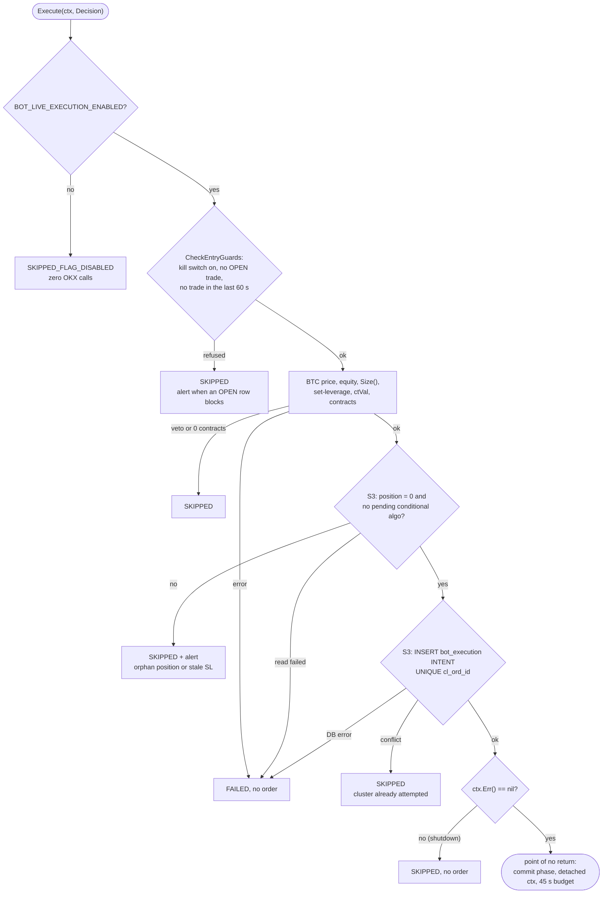
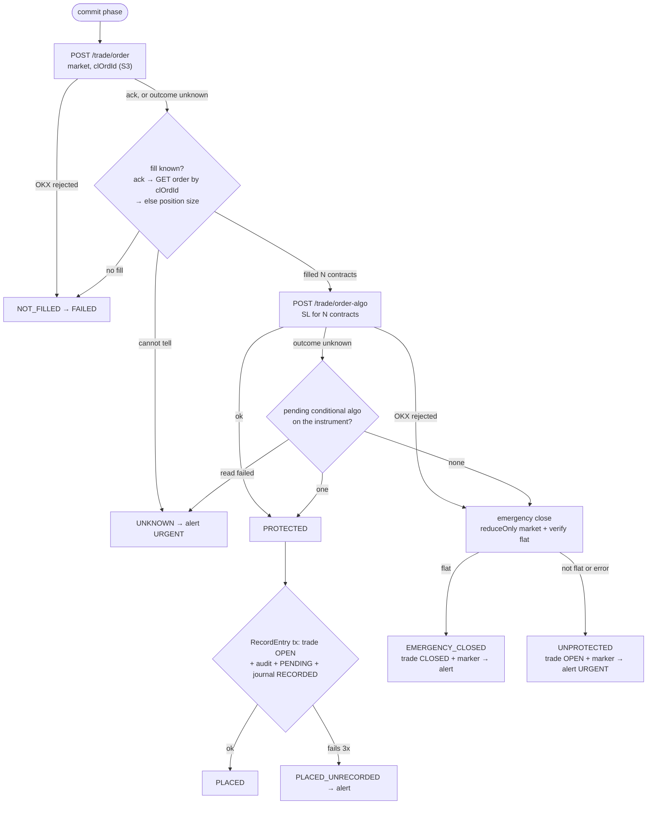
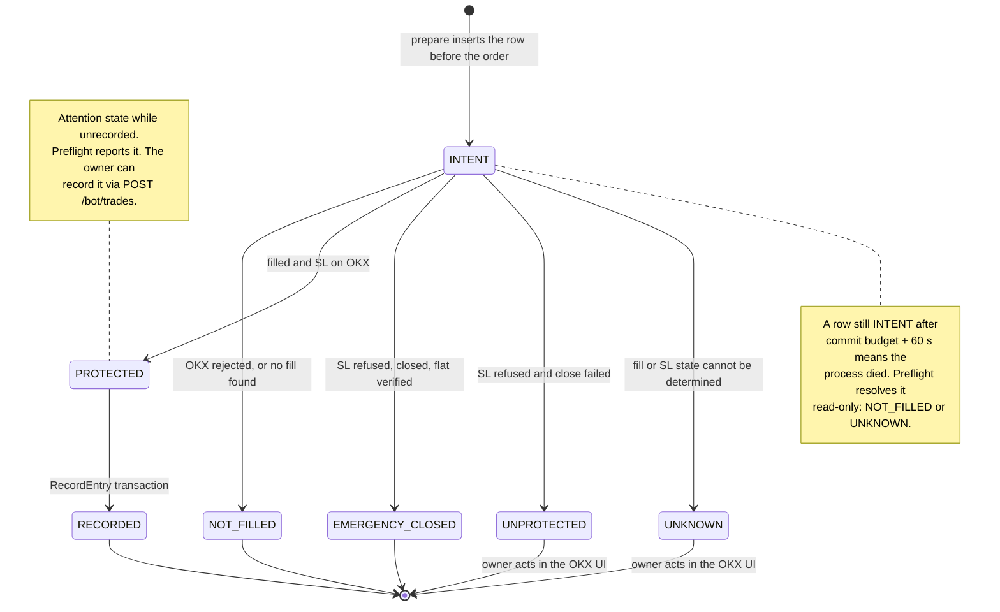
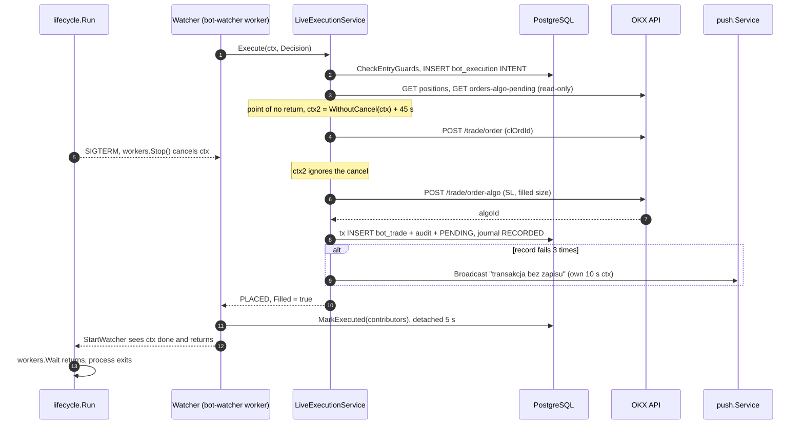
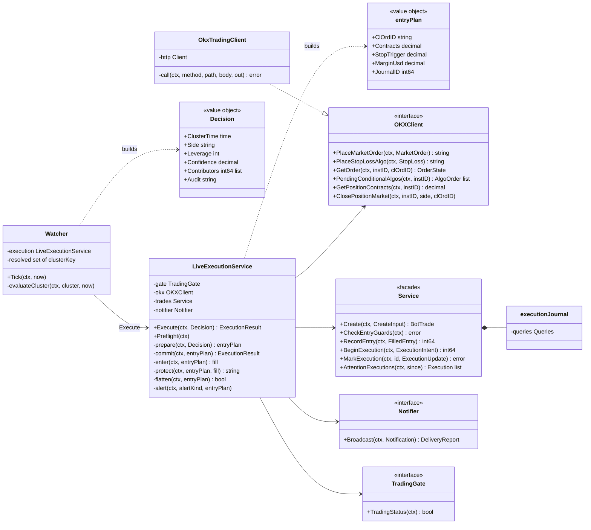
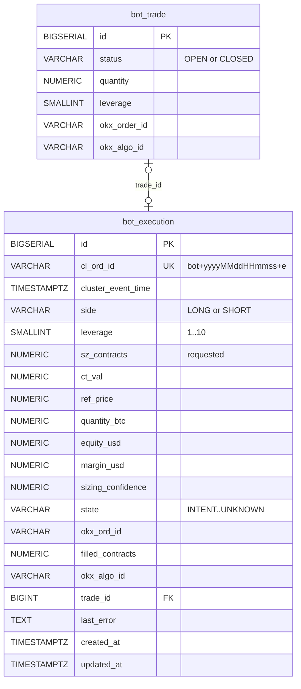
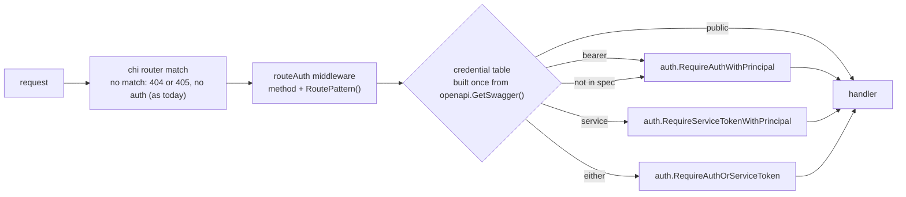

# 191: Bot live-execution fix (Architect design, 2026-11-09)

> **Status:** design complete (Phases 1–6). **ADR:** `docs/adr/ADR-114-bot-live-execution-safety.md`.
> **OpenAPI:** commit `e05947e` (`GET /bot/trades/pending-scalp` security now matches what is
> served). **Task file:** `.claude/tasks/191-bot-live-execution-fix.task.md` (steps S1–S8, owner
> questions). **F5.1 is gated on the owner. No other step depends on that answer.**
>
> **Inputs read:** task-174 REPORT (F1.1, F5.1, F4.5, F1.14, F5.4, F2.9, bot parts of F1.5/F4.4),
> `174-p0-p1-findings.md` F1.1, task 186 §A, ADR-089/090 (incl. the 2026-09-10 amendment)/092/096/110,
> and the code: `internal/bot/trade/{execution,okx,sizing,service,watcher,config}.go`,
> `cmd/server/{botauth,main}.go`, `internal/bot/{botutil,calendar}`, `common-go/{lifecycle,pgtx,httpx}`.
>
> **Live facts:** `BOT_LIVE_EXECUTION_ENABLED=true`, `BOT_SCHEDULER_ENABLED=true`,
> `OKX_DEMO_MODE=false`, real account, `BTC-USD-SWAP` (coin-margined, `ctVal` = 100 USD,
> lot 0.1 contract), isolated margin, net mode. `config.go` and `watcher_test.go` carry another
> session's uncommitted edits (`StaleAfterSeconds` 45→90, `RefreshStartOffsetSeconds` 15→30). **No
> step below edits either file.**

## 0. Steps at a glance

| Step | What | Findings | Risk addressed | Gate |
|---|---|---|---|---|
| **D1** | compose `backend-go` `stop_grace_period` 30 s → 90 s | F1.1 | shutdown must outlast an in-flight commit phase | ships with or before S1 |
| **S1** | Commit phase: guards before the order, SL before persist, detached context, record in one tx, alerts, watcher in `lifecycle.Group` | F1.1, F1.14, bot F1.3 | **S1: unprotected and unrecorded position** | none (ship first) |
| **S2** | Typed, context-aware OKX client with outcome classification (wire bytes unchanged) | F4.5, bot F4.4 | silent mis-parse on the real-money client | S1 |
| **S3** | Deterministic `clOrdId`, write-ahead `bot_execution` journal, unknown-outcome resolution, flat/no-pending-algo preflight, startup report | F1.1 (timeout path, crash path, restart double-order) | unknown fills, double orders, stale-SL hazard | S2 |
| **S4** | Honest User-Agent | F4.5 | — | O2 (public-endpoint check) |
| **S5** | Route-declared auth derived from the OpenAPI `security` lists | F2.9 | new routes silently writable with the service token | none (file-disjoint from S1–S3) |
| **S6** | Watcher map keys, bot decode/meta/tz helpers, bot error matching | F5.4, A6, bot F4.4 | — | S3 (watcher file) |
| **S7** | SL `reduceOnly` (+ `algoClOrdId`, `cxlOnClosePos` if supported), entry `expTime` | new finding N2 | stale SL can open a reverse position | **demo check (Q4)** |
| **S8** | Order notional vs P&L model | F5.1 | books or exposure off by the leverage factor | **owner (Q1)** |

## 1. Requirements and current behaviour (Phase 1)

**Goal.** No path from "the entry order filled" may end without (a) an exchange-side stop-loss
attempt, (b) if protection fails, an emergency close attempt, (c) an alert to the owner, and (d) a
durable record of what is known, whenever the DB is reachable. This applies to SIGTERM, DB failure,
guard refusal, OKX timeouts and process crashes.

**Actors.** Release watcher (1 s tick), OKX API, PostgreSQL, the owner (phone push, OKX UI, `/bot`
page), the host scalp launcher (outbox consumer, ADR-092), deploys (SIGTERM).

**Constraints.** Real money, so every OKX field-set change is verified on demo first (ADR-090
§Consequences). Free/OSS only. Single Pi, 64 MiB container. Reaction latency matters (~5–8 s after
the print, ADR-092).

**Trace of today's `Execute`** (`execution.go:70-170`):

`flag → side → kill switch → BTC price → equity → Size → set-leverage → ctVal → contracts →`
**`PlaceMarketOrder`** `→ trades.Create (DB + guards) → PlaceStopLossAlgo → AttachPlacedAudit`.

Every step after the entry runs on the watcher's root context, which SIGTERM cancels. OKX calls
take no context and are bounded only by a 15 s client timeout. The watcher goroutine is not
awaited (`main.go:232-234`).

**Paths to "filled, no SL, no row"** (N1 is new, not in the review):

| # | Trigger | Today |
|---|---|---|
| P1 | SIGTERM between fill and `Create` | `Create(ctx)` fails `context canceled` → `FAILED`, no SL |
| P2 | DB error at `Create` | `FAILED`, no SL |
| **N1** | **Guard refusal at `Create`** (OPEN row exists / 60 s window / kill switch flipped) | `409` → `FAILED`, no SL. **Systematic:** nothing closes a `bot_trade` row when the exchange SL fires (only `PATCH /close` by hand or the emergency path do), so after the first `PLACED` trade **every** later qualifying release fills and orphans |
| P3 | Entry timeout while OKX accepted it | `FAILED`, position may exist, no `clOrdId` to look it up |
| P4 | OOM kill / power loss between fill and SL | nothing durable |
| P5 | Restart inside the stale window after P1–P4 | in-memory `resolved` is gone and no OPEN row exists → the cluster is re-evaluated → **second real order** |
| **N2** | Position closed by anything other than its SL (owner in OKX UI, a future ADR-096 close) | standalone SL has no `reduceOnly`/`cxlOnClosePos` → stays pending → can later open an unprotected reverse position (OKX docs: not associated with the position by default) |

**Use cases → code entry points** (no new HTTP API):

| UC | Actor action | Entry point |
|---|---|---|
| UC1 | Watcher nets a cluster and trades | `Watcher.evaluateCluster` → `LiveExecutionService.Execute(ctx, Decision)` |
| UC2 | Deploy/restart during an execution | `lifecycle.Run` → `Group.Wait` waits for the "bot-watcher" worker |
| UC3 | Owner is told about a failure after a fill | `Notifier.Broadcast` (Web Push, ADR-108) |
| UC4 | Owner sees what happened to an unknown order | `bot_execution` row + alert payload; startup preflight summary |
| UC5 | Script/frontend calls a bot route | route-declared auth (S5), identical credentials |

**Glossary additions** (ubiquitous language, used in code and docs):

| Term | Meaning | Kind |
|---|---|---|
| **Prepare phase** | Everything before the entry order. Cancellable, so no order is placed if it fails | — |
| **Point of no return** | The instant the entry order is sent. From here the work runs to completion | — |
| **Commit phase** | Entry, protect, record, alert, under a context detached from shutdown, with a 45 s budget | — |
| **Decision** | One net cluster order: cluster time, side, net leverage, confidence, contributors, audit line | Value object |
| **Entry plan** | Decision plus sizing: `clOrdId`, contracts, ctVal, reference price, SL trigger, audit amounts | Value object |
| **Fill** | Order id and filled contracts actually on the exchange | Value object |
| **Execution (journal row)** | One attempt per cluster, keyed by `cl_ord_id`. Has a lifecycle (§4) | Entity |
| **Outcome unknown** | OKX may or may not have executed the call (timeout, 5xx, unparseable reply) | Error flag |
| **Attention state** | Journal state that needs a human: `INTENT` (stale), `PROTECTED` (unrecorded), `UNPROTECTED`, `UNKNOWN` | — |
| **Preflight** | Read-only startup check: equity, position, pending algos, attention rows | — |

## 2. Pattern evaluation (§1 Evaluate)

| Candidate | Verdict | Why |
|---|---|---|
| **Write-ahead journal / transactional log** (`bot_execution` before the order) | **adopted** (S3) | The only mechanism that survives a hard crash (P4) and gives exactly-once per cluster across restarts (P5). One small table, one unique key. |
| **Idempotency key** (deterministic `clOrdId` from the cluster time) | **adopted** (S3) | Lets the commit phase ask OKX "did this order execute?" after an unknown outcome. Exactly-once comes from our `UNIQUE`, not from OKX, which enforces `clOrdId` uniqueness only among pending orders. |
| **Compensating action** (emergency close when protection fails) | **kept** (ADR-090 rule) | Unchanged semantics. It now also covers "SL refused after an unknown SL outcome with no pending algo". |
| **Two-phase "prepare / commit" with a point of no return** | **adopted** (S1) | Separates "may abort freely" from "must finish". Go form: `context.WithoutCancel` + `WithTimeout` at one line. |
| **Supervisor** (`lifecycle.Group`) + **per-iteration Guard** | **adopted** (S1) | Reuses ADR-110. Reverses its Decision 6 bot exception. |
| **Parameter Object** (`Decision`, `entryPlan`, `FilledEntry`) | **adopted** (S1) | `Execute` takes 6 positional parameters today and needs a 7th (cluster time). |
| **Bounded retry with backoff** | **adopted** (S1, S3) | Order lookup (0.5/1/2 s) and `RecordEntry` (3 attempts) inside the commit budget. A transient DB blip no longer loses the record. |
| **Port / DIP** (`Notifier` interface, `*push.Service` satisfies it) | **adopted** (S1) | Same shape as `news.Notifier`. `nil` means push is not configured (news precedent): log only. |
| **Adapter with typed DTOs** (OKX client) | **adopted** (S2) | Replaces `%q` JSON and `map[string]any`. Generic `okxEnvelope[T]` decode. |
| **Decorator (middleware) + table from the spec** (route auth) | **adopted** (S5) | One source of truth: the OpenAPI `security` list. The lookup key is the matched chi route pattern, not the path text. |
| **State (GoF)** for journal states | rejected | 8 states, all transitions made in one function. A `CHECK` column plus a switch is clearer than state objects. |
| **Strategy** for sizing / F5.1 options | rejected | One formula after the owner decides. No runtime switch. |
| **Command / Circuit breaker** for OKX calls | rejected | A handful of calls a day on one path. A breaker would add a new "open" failure mode exactly when protection is needed. |
| **Automatic reconciler** (protect or flatten orphans at startup) | rejected | It would act on stale prices and race a human working in the OKX UI. Startup stays read-only and reports. |
| **Observer / event bus** for alerts | rejected | One consumer (push). A direct port call is enough. |
| **Intent as a `bot_trade` status** | rejected | Leaks "maybe no position" into stats, UI, enrichment and the OpenAPI enum. |
| **oapi-codegen security scopes** for auth | rejected | Not emitted with this generator config. Enabling them changes every generated wrapper. |

## 3. Execution flow and failure matrix

### 3.1 Prepare phase (cancellable; ends with no order unless it reaches the point of no return)



Legend: diamond = check, rounded = phase boundary. Before S3 the two S3 nodes are absent (S1
ships alone). The guards move from `Create` to here (fixes N1). `Create` keeps them for
`POST /bot/trades`.

### 3.2 Commit phase (detached; protection never waits on the DB)



Legend: in S1 (no journal yet) an entry error ends in `FAILED` exactly as today and the
"resolve" diamond is skipped. S3 adds it. The SL size is the **filled** contract count (S3), not
the requested one. Before S7 the "outcome unknown → pending algo" branch relies on preflight having
proven there were zero pending algos before the entry, so any pending conditional algo afterwards
is ours.

### 3.3 Failure matrix (normative, after S3)

"Alert" = Web Push to all subscriptions + ERROR log with `clOrdId`/`ordId`/`algoId`. Urgent = push
`Urgency: high`. Signals are marked `executed` iff `ExecutionResult.Filled`.

| # | Where | Event | Position on OKX | Action | Journal | `bot_trade` | Outcome | Alert | Signals executed |
|---|---|---|---|---|---|---|---|---|---|
| F0 | prepare | flag off | none | none | — | — | `SKIPPED_FLAG_DISABLED` | no | no |
| F1 | prepare | kill switch paused / gate error | none | none | — | — | `SKIPPED_PAUSED` | no | no |
| F2 | prepare | OPEN trade exists | none | none | — | — | `SKIPPED` | yes (tag `bot-open-<id>` replaces the earlier one on the phone) | no |
| F3 | prepare | duplicate 60 s window | none | ERROR log | — | — | `SKIPPED` | no | no |
| F4 | prepare | price / equity / leverage / ctVal error | none | none | — | — | `FAILED` | no | no |
| F5 | prepare | sizing veto / 0 contracts | none | WARN | — | — | `SKIPPED` | no | no |
| F6 | prepare (S3) | position ≠ 0 or a pending conditional algo | someone's | none | — | — | `SKIPPED` | yes | no |
| F7 | prepare (S3) | journal insert conflict | none new | WARN | existing row | — | `SKIPPED` | no | no |
| F8 | prepare (S3) | journal insert DB error | none | none (fail-closed) | — | — | `FAILED` | no | no |
| F9 | prepare | context cancelled (SIGTERM) before the order | none | none | (S3: `INTENT` → `NOT_FILLED`) | — | `SKIPPED` | no | no |
| F10 | commit | entry rejected by OKX (`code≠0` / `sCode≠0` / 4xx) | none | none | `NOT_FILLED` | — | `FAILED` | no | no |
| F11 | commit (S3) | entry outcome unknown, lookup: not filled / `51603` and flat | none | none | `NOT_FILLED` | — | `FAILED` | no | no |
| F12 | commit (S3) | entry outcome unknown, lookup fails, position read fails | unknown | none | `UNKNOWN` | — | `UNKNOWN` | **urgent** | no |
| F13 | commit | filled, SL ok, record ok | open, protected | — | `RECORDED` | OPEN, algo id, audit, `PENDING` | `PLACED` | no | yes |
| F14 | commit | filled, SL ok, record fails 3× (e.g. DB down) | open, protected | ERROR log | `PROTECTED` (best effort) | none | `PLACED_UNRECORDED` | yes (fails if the DB is down: log only) | yes (best effort) |
| F15 | commit | filled, SL rejected, close ok, flat | flat | emergency close | `EMERGENCY_CLOSED` | CLOSED, exit = entry, `SL_PLACE_FAILED_EMERGENCY_CLOSED` | `EMERGENCY_CLOSED` | yes | yes |
| F16 | commit | filled, SL rejected, close fails / not flat | **open, unprotected** | — | `UNPROTECTED` | OPEN, `UNPROTECTED_CLOSE_FAILED`, outbox `NONE` | `UNPROTECTED` | **urgent** | yes |
| F17 | commit (S3) | SL outcome unknown, one pending conditional algo | open, protected | adopt its algoId | → F13/F14 | | | | yes |
| F18 | commit (S3) | SL outcome unknown, no pending algo | open | emergency close | → F15/F16 | | | | yes |
| F19 | commit (S3) | SL outcome unknown, algo list read fails | open, SL unknown | none (closing could leave a live non-reduce-only SL, N2) | `UNKNOWN` | OPEN, `SL_STATE_UNKNOWN` (best effort) | `UNKNOWN` | **urgent** | yes |
| F20 | commit | panic | any | recover: no further OKX calls | `UNKNOWN` (best effort) | — | `UNKNOWN` | **urgent** | no |
| F21 | commit | 45 s budget exceeded mid-way | as reached | remaining calls fail fast → F12/F16/F19 | as reached | as reached | as reached | **urgent** (separate 10 s alert ctx) | as reached |
| F22 | commit | SIGTERM | as reached | **no effect** (detached ctx); `Group.Wait` waits ≤ 60 s | — | — | — | — | — |
| F23 | anywhere | SIGKILL / OOM / power loss | as reached | next boot: preflight resolves stale `INTENT` read-only, reports `PROTECTED`/`UNPROTECTED`/`UNKNOWN` rows | updated | — | — | yes (summary) | — |

After S7 (`reduceOnly` SL verified), F19 changes to "emergency close", because a reduce-only SL
cannot open a position after the close.

## 4. Journal state machine (Phase 2, Skill 7)



Legend: `INTENT`, `PROTECTED` (without `trade_id`), `UNPROTECTED` and `UNKNOWN` are the
**attention states**. There is no automatic transition out of `UNPROTECTED`/`UNKNOWN` and no
resolve API (YAGNI). The real gate for the next trade is the preflight's "exchange flat and no
pending algo" check (F6), which passes again once the owner has dealt with the position.

## 5. Sequences

### 5.1 SIGTERM arrives right after the fill (P1, fixed)



### 5.2 Shutdown budget

`lifecycle.Run` order (ADR-110): `workers.Stop()` → `srv.Shutdown` (≤ 15 s) → `workers.Wait`
(**main: `WorkerTimeout` 60 s**). Commit budget 45 s + alert budget 10 s = 55 s < 60 s. Worst-case
exit is 75 s, under compose `stop_grace_period` **90 s** (D1). This only applies while an execution
is in flight. Otherwise every worker returns at once, as today. OKX HTTP client timeout goes
15 s → **10 s** (S1). In S2 every call is also bounded by its context.

## 6. Structure (Phase 5, Skills 13–16)



Legend: `<<facade>>` = `trade.Service` stays the single module entry for trade rows. The journal
is an unexported helper it owns, the same way it already owns `AuditTrail`. `<<value object>>` =
immutable Parameter Objects. Interfaces are consumer-side ports (DIP): `*push.Service` satisfies
`Notifier`, `*control.Service` satisfies `TradingGate`. The one Adapter is `OkxTradingClient`.
`BeginExecution` also returns `started bool` (false = `cl_ord_id` conflict). `GetOrder` also
returns `found bool` (`51603` → false, nil error).

### 6.1 Go signatures (binding for Backend-Go; names may gain a suffix, shapes may not change)

```go
// internal/bot/trade/execution.go
type Decision struct {
	ClusterTime  time.Time        // cluster event time (UTC); source of clOrdId
	Side         string           // LONG | SHORT
	Leverage     int              // net, 1..10
	Confidence   *decimal.Decimal
	Contributors []int64
	Audit        string
}

type ExecutionResult struct {
	Outcome Outcome
	TradeID *int64
	Filled  bool // a position was opened on OKX; the watcher marks signals executed iff true
}

const (
	OutcomePlacedUnrecorded Outcome = "PLACED_UNRECORDED" // protected on OKX, no DB row
	OutcomeUnprotected      Outcome = "UNPROTECTED"       // filled, no SL, not flat
	OutcomeUnknown          Outcome = "UNKNOWN"           // fill or SL state unknown
	// existing: PLACED, SKIPPED, SKIPPED_PAUSED, SKIPPED_FLAG_DISABLED, FAILED, EMERGENCY_CLOSED
)

const (
	commitBudget = 45 * time.Second
	alertBudget  = 10 * time.Second
)

type ExecOption func(*LiveExecutionService)
func WithNotifier(n Notifier) ExecOption

// Signature kept + variadic options, so watcher_test.go's fixture compiles unchanged.
func NewLiveExecutionService(gate TradingGate, okx OKXClient, trades *Service,
	prices botutil.BTCPriceSource, cfg ExecutionConfig, liveEnabled func() bool,
	opts ...ExecOption) *LiveExecutionService
func (e *LiveExecutionService) Execute(ctx context.Context, d Decision) ExecutionResult
func (e *LiveExecutionService) Preflight(ctx context.Context) // S3, read-only

// ClOrdID derives the deterministic client order id ("bot" + yyyyMMddHHmmss + suffix), suffix
// 'e' entry, 'x' emergency close, 's' SL (S7). Pure; table-tested; ≤ 32 alphanumerics.
func ClOrdID(clusterTime time.Time, suffix byte) string

// internal/bot/trade/notify.go
type Notifier interface {
	Broadcast(ctx context.Context, n push.Notification) (push.DeliveryReport, error)
}

// internal/bot/trade/service.go (+ journal.go)
func (s *Service) CheckEntryGuards(ctx context.Context) error // same 409s as Create

type Protection int
const (
	ProtectedBySL Protection = iota // trade OPEN, okx_algo_id set, outbox PENDING
	EmergencyClosed                 // trade CLOSED at entry price, marker note, outbox NONE
	Unprotected                     // trade OPEN, marker note, outbox NONE
)

type FilledEntry struct {
	Side        string
	QuantityBtc decimal.Decimal // sizing quantity (unchanged semantics until S8)
	EntryPrice  decimal.Decimal // reference price used for the SL trigger
	Leverage    int
	OkxOrderID  string
	OkxAlgoID   string // empty unless ProtectedBySL
	Protection  Protection
	MarginPln   *decimal.Decimal
	Confidence  *decimal.Decimal
	Notes       string           // cluster audit line (+ marker)
	ExecutionID *int64           // S3: journal row set to RECORDED/EMERGENCY_CLOSED/UNPROTECTED in the same tx
}
// RecordEntry writes the row in ONE transaction (s.transact) and runs no guards: the position
// already exists, and refusing to record it only hides it.
func (s *Service) RecordEntry(ctx context.Context, e FilledEntry) (int64, error)

// S3 journal
type ExecutionState string // INTENT NOT_FILLED PROTECTED RECORDED EMERGENCY_CLOSED UNPROTECTED UNKNOWN
type ExecutionIntent struct {
	ClOrdID     string
	ClusterTime time.Time
	Side        string
	Leverage    int
	Contracts   decimal.Decimal
	CtVal       decimal.Decimal
	RefPrice    decimal.Decimal
	QuantityBtc decimal.Decimal
	EquityUsd   decimal.Decimal
	MarginUsd   decimal.Decimal
	Confidence  *decimal.Decimal
}
type ExecutionUpdate struct {
	State           ExecutionState
	OkxOrderID      *string
	FilledContracts *decimal.Decimal
	OkxAlgoID       *string
	LastError       *string
}
func (s *Service) BeginExecution(ctx context.Context, in ExecutionIntent) (id int64, started bool, err error)
func (s *Service) MarkExecution(ctx context.Context, id int64, u ExecutionUpdate) error
func (s *Service) AttentionExecutions(ctx context.Context, since time.Time) ([]Execution, error)
```

### 6.2 Clean-architecture audit (Skill 16)

- **SRP:** `Execute` (~100 lines, gocognit high) is split into `prepare`/`commit`/`enter`/
  `protect`/`flatten`/`alert`, each ≤ ~40 lines. `Service` gains entry-recording and journal
  methods. That is cohesive: it is already "the entry choke point and audit attach points".
- **DIP:** new outward dependencies are interfaces (`Notifier`). `trade` imports only `push`'s
  value types, as `news` does.
- **ISP:** `OKXClient` grows to 9 methods, all used by its one consumer. Not split.
- **No float on the money path:** the emergency path no longer rebuilds the entry price from an
  OpenAPI `float64` (`execution.go:187`). Everything stays `decimal` inside the commit phase (bot
  F1.5 hazard). Moving every `trade.Service` read method off `openapi.BotTrade` is **not** in scope
  (no correctness hazard left once this round trip is gone; owner decision 3 Option A keeps
  `httpx.AppError`).
- **YAGNI:** no resolve API, no reconciler, no config env vars for the new budgets (constants), no
  breaker, no State objects.
- **Test seams:** fakes for `OKXClient` (failure injection per call, plus ctx-cancel hooks),
  `Notifier`, `Queries`. Real Postgres (Testcontainers) for `RecordEntry` atomicity and journal
  uniqueness ("never mock the DB" for persistence semantics). `testing/synctest` for the watcher
  shutdown test (fake time, no 1 s sleeps).

## 7. Persistence (Phase 4): `bot_execution`



Flyway `apps/main/db/migration/V211__bot_execution_journal.sql`. **V211 = next free at design
time (head V210). Backend-Go re-checks with `ls apps/main/db/migration | sort -V | tail -1`.**
The parked `db/unapplied/V72`/`V73` are unaffected and will be renumbered by task 154 anyway.

```sql
-- V211__bot_execution_journal.sql — task 191 (ADR-114): write-ahead journal for live OKX entries.
-- One row per cluster attempt, inserted BEFORE the entry order. UNIQUE(cl_ord_id) is the
-- exactly-once guard across restarts. Rows are never deleted (audit).
CREATE TABLE bot_execution (
    id                 BIGSERIAL PRIMARY KEY,
    cl_ord_id          VARCHAR(32)   NOT NULL,
    cluster_event_time TIMESTAMPTZ   NOT NULL,
    side               VARCHAR(10)   NOT NULL CHECK (side IN ('LONG','SHORT')),
    leverage           SMALLINT      NOT NULL CHECK (leverage BETWEEN 1 AND 10),
    sz_contracts       NUMERIC(18,1) NOT NULL CHECK (sz_contracts > 0),
    ct_val             NUMERIC(18,8) NOT NULL CHECK (ct_val > 0),
    ref_price          NUMERIC(18,2) NOT NULL CHECK (ref_price > 0),
    quantity_btc       NUMERIC(18,8) NOT NULL CHECK (quantity_btc > 0),
    equity_usd         NUMERIC(18,4) NOT NULL,
    margin_usd         NUMERIC(18,4) NOT NULL,
    sizing_confidence  NUMERIC(3,2),
    state              VARCHAR(20)   NOT NULL DEFAULT 'INTENT'
        CHECK (state IN ('INTENT','NOT_FILLED','PROTECTED','RECORDED',
                         'EMERGENCY_CLOSED','UNPROTECTED','UNKNOWN')),
    okx_ord_id         VARCHAR(64),
    filled_contracts   NUMERIC(18,1),
    okx_algo_id        VARCHAR(64),
    trade_id           BIGINT REFERENCES bot_trade(id) ON DELETE SET NULL,
    last_error         TEXT,
    created_at         TIMESTAMPTZ   NOT NULL DEFAULT NOW(),
    updated_at         TIMESTAMPTZ   NOT NULL DEFAULT NOW(),
    CONSTRAINT bot_execution_cl_ord_id_key UNIQUE (cl_ord_id)
);
-- Preflight's "attention" query: recent rows a human may need to look at.
CREATE INDEX idx_bot_execution_attention ON bot_execution (created_at DESC)
    WHERE state IN ('INTENT','PROTECTED','UNPROTECTED','UNKNOWN');
```

sqlc queries (`apps/main/backend-go/db/queries/bot_execution.sql`): `InsertExecutionIntent`
(`ON CONFLICT (cl_ord_id) DO NOTHING RETURNING id`; no row means `started=false`),
`UpdateExecution` (`state`, `okx_ord_id`, `filled_contracts`, `okx_algo_id`, `last_error`,
`updated_at = NOW()`, each `COALESCE`d so a later update never blanks an id),
`AttachExecutionTrade` (`trade_id`, `state`, inside `RecordEntry`'s tx),
`ListAttentionExecutions(since)`. Add the file to `sqlc.yaml` via `hack/gen-sqlc-schema-list.sh`.

**Mapper boundary:** `sqlcgen.BotExecution` → `trade.Execution` (domain, `decimal`) inside
`journal.go`. No DTO: the journal is not on the API.

## 8. OKX client (S2 + S3 additions)

```go
type OKXClient interface {
	GetEquityUsdt(ctx context.Context) (decimal.Decimal, error)
	SetLeverage(ctx context.Context, instID string, leverage int) error
	GetContractValue(ctx context.Context, instID string) (decimal.Decimal, error)
	GetPositionContracts(ctx context.Context, instID string) (decimal.Decimal, error)
	PlaceMarketOrder(ctx context.Context, o MarketOrder) (string, error)
	PlaceStopLossAlgo(ctx context.Context, sl StopLoss) (string, error)
	ClosePositionMarket(ctx context.Context, instID, ourSide, clOrdID string) error
	GetOrder(ctx context.Context, instID, clOrdID string) (OrderState, bool, error)   // S3
	PendingConditionalAlgos(ctx context.Context, instID string) ([]AlgoOrder, error) // S3
}
type MarketOrder struct{ InstID, Side, Contracts, ClOrdID string; ReduceOnly bool }
type StopLoss struct {
	InstID, CloseSide, Contracts string
	TriggerPx                    decimal.Decimal
	AlgoClOrdID                  string // S7 only
	ReduceOnly                   bool   // S7 only
}
type OrderState struct{ OrdID, State string; FilledContracts decimal.Decimal }
type AlgoOrder struct{ AlgoID, Side, Contracts, SlTriggerPx string }

type OkxClientException struct {
	Code           string // OKX code, or sCode for per-order rejections, or TRANSPORT/HTTP_5xx/PARSE
	Message        string
	OutcomeUnknown bool   // true: OKX may have executed the call
}
func IsOutcomeUnknown(err error) bool // errors.As
```

Wire structs (unexported, `json` tags, numbers as strings as OKX requires). Field order equals
today's `%q` bodies, so **S2 changes no request byte**. Pinned by golden tests:

| Call | Body today (must stay byte-identical in S2) |
|---|---|
| set-leverage | `{"instId":"BTC-USD-SWAP","lever":"5","mgnMode":"isolated"}` |
| entry | `{"instId":"BTC-USD-SWAP","tdMode":"isolated","side":"buy","ordType":"market","sz":"1.2"}` |
| SL | `{"instId":"BTC-USD-SWAP","tdMode":"isolated","side":"sell","ordType":"conditional","sz":"1.2","slTriggerPx":"59400","slOrdPx":"-1"}` |
| close | `{"instId":"BTC-USD-SWAP","tdMode":"isolated","side":"sell","ordType":"market","sz":"1.2","reduceOnly":true}` |

S3 adds `"clOrdId":"bot20261109133000e"` (entry) and `"…x"` (close) after `sz`/`reduceOnly`.
This is a standard `/trade/order` parameter ("case-sensitive alphanumerics … up to 32 characters").
If OKX rejected it, the entry fails definitively (F10, no position), so it fails safe.

Response decoding: `okxEnvelope[T]{Code, Msg string; Data []T}`. For order/algo acks, a non-zero
`data[0].sCode` becomes the exception `Code` (today only the envelope `msg` survives).
Classification:

| Response | `OutcomeUnknown` |
|---|---|
| transport error, context deadline, `http.Client` timeout | **true** |
| HTTP 5xx | **true** |
| HTTP 2xx, body not JSON / no `data[0]` on a write | **true** |
| HTTP 2xx `code≠"0"` or `sCode≠"0"`, HTTP 4xx | false (OKX refused it: not executed) |
| `51603` on `GET /trade/order` | not an error: `found=false` |

GETs never need the flag (they change nothing). `GetOrder`: `GET /api/v5/trade/order?instId=…&clOrdId=…`
(OKX returns the latest order with that id). Filled contracts = `accFillSz` (contracts for SWAP).
`PendingConditionalAlgos`: `GET /api/v5/trade/orders-algo-pending?ordType=conditional&instId=…`.
`execution.go`'s `err.(*OkxClientException)` becomes `errors.As` (bot F4.4).
**User-Agent (S4):** `investing-app-okx-client/1.0`, only after O2 shows Cloudflare serves the
public instruments endpoint to it. If it does not, keep the browser UA and write the reason in the
comment.

## 9. Route-declared auth (S5, F2.9)



Legend: chi runs inline-group middlewares **after** routing (`Mux.handle` chains them onto each
endpoint), so `chi.RouteContext(r.Context()).RoutePattern()` is set (e.g.
`/api/bot/trades/{id}`). The lookup cannot be fooled by path text. Encoded variants (`%2F`) route
on `RawPath` and either match a declared pattern or 404. The table maps `security` absent → bearer
(spec-level default), `[]` → public, `[serviceTokenAuth]` → service, `[bearerAuth, serviceTokenAuth]`
(alternatives) → either. Any other combination fails startup. A missing key (the hand-mounted
`POST /api/admin/historia/backfill-snapshot`, or a future hand mount) defaults to bearer
(fail-closed). Middleware order in the group stays auth → idempotency.

**Route → credential (verified: all 83 spec operations; old `smartAuth` and the spec-derived table
agree on every one after `e05947e`):**

| Credential | Routes |
|---|---|
| **public** | `POST /auth/token` |
| **service only** | `GET /news/assets`, `POST /news/ingest`, `POST /news/notifications`, `POST /bot/calendar/sync`, `POST /bot/plans/ingest`, `POST /bot/signals`, `POST /bot/trades`, `PATCH /bot/trades/{id}/close`, `POST /bot/trades/{id}/actions`, `POST /bot/trades/{id}/ticks`, `POST /bot/trades/{id}/request-manage`, `POST /bot/trades/{id}/scalp-claim`, `POST /bot/trades/{id}/scalp-finish` |
| **either** (bearer or service) | `GET /bot/calendar`, `GET /bot/trades`, `GET /bot/trades/pending-scalp`, `GET /bot/trades/{id}`, `GET /bot/trades/{id}/actions`, `GET /bot/trades/{id}/ticks`, `GET /bot/stats` |
| **bearer** (bot/news/push neighbourhood) | `GET /news`, `GET /news/dates`, `GET /push/config`, `POST /push/subscriptions`, `DELETE /push/subscriptions`, `POST /push/test-notifications`, `GET /bot/control`, `PATCH /bot/control`, `GET /bot/plans`, `GET /bot/plans/latest`, `GET /bot/plans/{date}`, `GET /bot/signals`, `GET /bot/equity`, `GET /bot/positions/open`, `GET /market-data/macro-state`, `GET /market-data/macro-state/history`, `POST /market-data/macro-state/refresh` |
| **bearer** (everything else) | the other 45 operations (positions, assets, deposits, binance-transfers, history, cash-positions, market-data prices/fx, crypto-trades, tax-returns, inflation, settings, purchase-sessions, rebalancing-transfers) + hand-mounted `POST /admin/historia/backfill-snapshot` |
| outside the group | `GET /api/health-go` (no auth, unchanged) |

There is no behavioural difference for undeclared paths or methods either. `smartAuth` is itself
an inline-group middleware, so those never reached it; chi answers 404/405 first, and it still
will. The F2.9 weakness disappears: a new route gets exactly the credential its spec operation
declares, whatever its path looks like.

**Known contract question (not changed by S5, Q2):** ADR-089 made `GET /market-data/macro-state`
dual so `infra/bot/daily-plan.sh` can read it with `X-Service-Token`. The Go port serves it
bearer-only, so that call gets a 401 envelope that the script feeds to Claude as "macro state".
Restoring it is a one-line spec change once S5 lands (security `[bearerAuth, serviceTokenAuth]`).

## 10. A5 / A6 / bot F4.4 (S6)

- **F5.4:** `type clusterKey int64` (Unix seconds of the UTC event time) for `resolved`,
  `firstActualAt` and `loadSnapshots`' grouping. `prune(windowStart)` compares integers (no
  `time.Parse`, no unused `now`). Cluster times are whole seconds (exact-equality grouping, ADR-090
  §3), so nothing is lost.
- **F1.14:** removed in S1 (the CAS cannot fail: `Tick` runs synchronously in the loop goroutine).
- **A6 decode:** the 7 request-body decodes (`trade/handler.go` `decodeCreateBody`,
  `decodeCloseBody`, `decodeActionBody`, `decodeTicksBody`; `plan/handler.go`; `signal/handler.go`;
  `control/handler.go`) become `httpx.DecodeJSON(r, &raw)`. Wire-identical: 422
  `VALIDATION_ERROR` "Invalid request body", empty field. **Not changed:** the 3 re-unmarshal sites
  (already-decoded map → typed body) keep `botutil.Unprocessable("", "Invalid request body")`, and
  the deliberately tolerant optional-body decode at `trade/handler.go:121`.
  `botutil.Unprocessable` stays: it is the bot's 422 constructor, not a copy
  (`httpx.NewValidationError` is 400).
- **A6 meta:** `botutil.NewMeta()` → `botutil.NewMeta(ctx)` built on `httpx.NewMetaFrom(ctx)`. All
  ~20 handler call sites pass `r.Context()`, so `meta.requestId` equals `X-Request-Id`.
- **A6 tz:** `calendar/scheduler.go:nextPurgeFire` and `calendar/service.go:startOfWarsawDay` use
  `historiaquery.WarsawLocation()` (the one exported common helper). Also fix `nextPurgeFire`'s
  DST bug: `next.Add(24*time.Hour)` → `time.Date(y, m, d+1, 4, 0, 0, 0, loc)`.
- **Bot F4.4:** `isNoRows` (`trade/service.go`), `plan/service.go:324`, `signal/signal.go:181` →
  `errors.Is(err, pgx.ErrNoRows)`. `err.(errNotPending)` / `err.(errNotRunning)` → `errors.As`.
  The `*OkxClientException` assertion is already removed in S2.

## 11. F5.1: what the exchange order is vs what the books assume

**Code facts** (defaults `DefaultExecutionConfig`: base risk 1 %, band 0.3–3 %, confidence
multiplier `clamp(c/0.5, 0.5, 1.5)`, stop 1 %, cap `leverage × stop ≤ 30 %`):

- `Size`: `margin = equity × 1 % × multiplier` (so 0.5–1.5 % of equity at defaults; the 3 % band
  top is unreachable unless `BOT_BASE_RISK_PCT` is raised), `quantity = margin / price`.
- Order (`contractsFor`): `contracts = floor(quantity × price / 100, 0.1)` = **margin ÷ 100**. The
  order's notional is **margin**, with no leverage. `set-leverage L` then only sets how much BTC
  OKX locks: **notional ÷ L**.
- Books (`computeClosePnl`, `EnrichTrade` unrealised): `pnl = Δprice × quantity × L` = P&L of a
  position of **margin × L**. `margin_allocated_pln` = margin (not what OKX locked).
- ADR-090 §5's risk proof ("3 % × 10× × 1 % = 0.3 % of equity") assumes notional = margin × L.
  The 2026-09-10 amendment's own text "net notional (margin × leverage)" contradicts its formula.

So **the books overstate every P&L figure by the leverage factor L** (sign, hence win rate, is
unaffected), and the risk numbers the ADR promised are L× larger than what is actually traded.
The cap `L × stop ≤ 30 %` means the same in both readings: "loss at the stop ≤ 30 % of the
posted isolated margin", which keeps the SL well inside liquidation.

**Worked numbers** (illustrative equity E = 10 000 USD; the real `totalEq` is in OKX):

| Case | | Today (code) | Option A (books fixed) | Option B (orders × L) |
|---|---|---|---|---|
| conf 0.6, L = 5 | sized "margin" | 120 USD | 120 USD = notional | 120 USD = posted margin |
| | order | 1.2 contracts = 120 USD | **same** | 6.0 contracts = 600 USD |
| | BTC locked by OKX | 24 USD | **same** | 120 USD |
| | loss if the 1 % SL fills | 1.20 USD (0.012 % of E) | **same** | 6.00 USD (0.06 % of E) |
| | P&L in app at that SL | −6.00 USD (wrong ×5) | −1.20 USD | −6.00 USD |
| max at defaults: conf ≥ 0.75, L = 10 | order | 1.5 contracts = 150 USD | **same** | 15 contracts = 1 500 USD |
| | loss at SL / full gap (margin wiped) | 1.50 / 15 USD (0.015 / 0.15 % of E) | **same** | 15 / 150 USD (0.15 / 1.5 % of E) |
| smallest tradable account (0.1 contract = 10 USD) | | E ≥ 667–2 000 USD depending on confidence | **same** | E ≥ ~67 USD at L = 10 |

**Options:**

- **A (recommended, no change in real exposure):** keep `contractsFor` as is. Fix the books: drop
  `× leverage` from `computeClosePnl` and from `EnrichTrade`'s unrealised P&L, set
  `margin_allocated_pln` to notional ÷ L × USD/PLN (what OKX locks), and rename `Sizing.MarginUsdt`
  → `NotionalUsd`. Optionally restate the past live rows' `pnl_pln` ÷ leverage in a Flyway data
  migration, **only after one row is checked against its OKX fill** (Q1b). Consequence to state
  plainly: the plan's leverage then changes only the collateral locked and the liquidation
  distance, not what a trade can win or lose.
- **B (the ADR-090 design, raises real exposure up to 10×):** `contracts = floor(margin × L / ctVal)`.
  Books unchanged. Needs an explicit owner yes, a fresh check of the smallest/largest order, and a
  minimum-size first trade.
- C (not recommended now): risk-based sizing (size the notional from a target loss at the stop).
  This is a new design.

S8 implements A or B, test-first, with a test that pins "booked P&L at the SL = loss of the order
actually sent". No other step reads `contractsFor` or `computeClosePnl`.

## 12. Alerts (Web Push copy, Polish UI)

`push.Notification{Title, Body, URL: "/bot", Tag: "bot-exec-<clOrdId>", Urgency, TTL: 6h}`. The
tag dedupes repeats on the phone. Body always includes the OKX ids.

| Kind | Urgency | Title | Body |
|---|---|---|---|
| `UNPROTECTED` | high | `PILNE: pozycja BTC bez stop-lossa` | `Zlecenie {ordId} ({side}, {n} kontr.) jest otwarte bez SL i nie udało się go zamknąć. Zamknij je ręcznie w OKX.` |
| `UNKNOWN` | high | `PILNE: nieznany stan zlecenia BTC` | `Nie wiadomo, czy zlecenie {clOrdId} zostało wykonane lub zabezpieczone. Sprawdź pozycję i zlecenia SL w OKX.` |
| `PLACED_UNRECORDED` | normal | `Bot: transakcja bez zapisu w aplikacji` | `Pozycja {ordId} ma SL ({trigger}), ale nie zapisała się w bazie. Sprawdź /bot.` |
| `EMERGENCY_CLOSED` | normal | `Bot: awaryjne zamknięcie pozycji` | `Nie udało się ustawić SL; pozycja {ordId} została zamknięta po cenie rynkowej.` |
| `BLOCKED_OPEN_TRADE` (F2) | normal | `Bot nie handluje: otwarta transakcja` | `Transakcja #{id} jest w bazie oznaczona jako otwarta. Zamknij ją (PATCH /bot/trades/{id}/close), jeśli pozycji już nie ma.` |
| `BLOCKED_EXCHANGE` (F6) | high | `Bot nie handluje: pozycja lub SL w OKX` | `Na BTC-USD-SWAP jest pozycja {pos} lub oczekujące zlecenie SL, którego aplikacja nie zna. Sprawdź OKX.` |
| preflight summary | normal/high | `Bot: wymaga uwagi po restarcie` | `{n} wpisów: {state} {clOrdId}, …` |

When the DB is down, `Broadcast` cannot read the subscriptions. The alert then degrades to the
ERROR log, while the exchange SL (placed first) is the real protection.

## 13. Rollout and safe verification

**Deploy rule (every step):** push to `main` only outside release windows. Before pushing, read
`GET /api/bot/plans/latest` + `GET /api/bot/calendar` and keep clear of
`[eventTime − 60 s, eventTime + 10 min]` for any scenario with a LONG/SHORT rung. Toggling the
kill switch around a deploy is a prod write: owner consent only. D1 deploys with or before S1.
Each S-step deploys alone. Watch the first qualifying release after each of S1, S3, S7.

**What can be verified where:**

| Layer | Verifies | Places orders? |
|---|---|---|
| Unit fakes (`fakeOKX` with per-call failure + ctx-cancel hooks, fake `Notifier`, fake `Queries`) | every row of §3.3, guard order, SL-before-record, detached ctx, retry bounds, outcome mapping | no |
| `testing/synctest` watcher test | shutdown waits for an in-flight commit phase, then exits | no |
| Testcontainers Postgres | `RecordEntry` atomicity (trade + audit + PENDING + journal in one tx), `UNIQUE(cl_ord_id)`, migration V211 | no |
| `httptest` OKX server | exact request bytes, HMAC signature over the sent body, demo header, error classification (timeout, 5xx, non-JSON, `sCode`, `51603`) | no |
| Prod, after S3 deploy: **preflight log** (read-only signed GETs: balance, positions, algos-pending) | signing, typed decoding and EEA endpoint on the real account | **no** |
| O2: public `GET /api/v5/public/instruments` with the new UA (unsigned) | Cloudflare accepts the honest UA | no |
| **OKX demo account** (`OKX_DEMO_MODE=true`, separate demo API key, local backend + scratch Postgres, env-gated `okx_demo_test.go`, never the prod container) | `clOrdId` lookup, SL field set (`reduceOnly`, `algoClOrdId`, `cxlOnClosePos`), `expTime`, emergency close on `BTC-USD-SWAP`. **Required before S7** | demo only |
| Live | only the first real release after a step, watched | real, minimum size per sizing |

Demo caveat: ADR-090's demo gate never ran (`50119` on the key). A **separate demo-trading API
key** must be created in OKX's demo mode, and EEA demo availability is unverified (Q4). Without
demo, S7 needs an explicit owner decision for one minimum-size live check (0.1 contract = 10 USD
notional).

## 14. Corrections to the task-174 review

1. **F1.1 understated (N1):** the guards run after the fill. Any `OPEN` `bot_trade` row, which is
   the normal state after the first `PLACED` trade because nothing closes rows when the exchange SL
   fires, turns every later qualifying release into "filled, `409`, no SL, no row". That is
   systematic, not a transient DB error.
2. **F1.1 "at-most-once" is per process only (P5):** after a restart inside the stale window (45 s
   prod, 90 s in the uncommitted edit) the cluster is re-evaluated. If the first attempt left no
   OPEN row, a second real order follows. The review's `clOrdId` fix alone does not give
   exactly-once: OKX enforces `clOrdId` uniqueness only among pending orders.
3. **New hazard N2:** the standalone SL is not reduce-only and not tied to the position
   (`cxlOnClosePos` defaults to false). It survives any other close and can later open a reverse,
   unprotected position.
4. **F5.1 details:** win rate is not overstated (sign is unchanged). The cap means the same in
   both readings. The "max case 3 % equity" in ADR-090 is unreachable at defaults (1 % × 1.5).
5. **F2.9:** the spec itself drifted (`pending-scalp`, fixed in `e05947e`), and `macro-state`
   lost ADR-089's dual auth in the Go port (Q2). The weakness is as described. No bypass exists
   (chi middlewares run after routing).
6. **A6 counts:** 7 decode sites can use `httpx.DecodeJSON`, not 10. `botutil.Unprocessable` is
   not a duplicate (422 vs 400).
7. Line references in F1.1 (`main.go:217,237-243`) are stale after 176. The launches are now at
   `main.go:232-234`.
