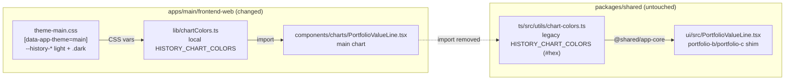

# History chart redesign — color tokens & palette decision

> **Ownership note (2026-10-21, task `history-chart-shared`):** the **values and palette rules
> below remain the source of truth**, but token ownership has moved. `--history-*` now lives in
> `packages/shared/ui/src/history-chart-tokens.css` (shared by all three apps), the palette object
> in `packages/shared/ui/src/lib/historyChartColors.ts`, and the chart itself is the 3-way shared
> `packages/shared/ui/src/PortfolioValueLine.tsx`. The "fork the palette inside the main app" /
> "leave `packages/shared/**` byte-identical" decision below is **historical**; see
> `history-chart-shared-design.md` for the current contract.

> **Audience:** Frontend-web, together with `history-chart-redesign-design.md` and
> `history-chart-redesign-states.md`.
> **Task:** `.claude/tasks/history-chart-redesign.task.md`.
>
> Decision in one sentence: **fork the chart palette inside the main app** — add `--history-*`
> CSS variables to `apps/main/frontend-web/src/theme-main.css`, expose them as a local
> `HISTORY_CHART_COLORS` in `apps/main/frontend-web/src/lib/chartColors.ts`, and leave
> `packages/shared/**` byte-identical. This matches
> `docs/architecture/12-portfolio-bpps-and-shared-packages.md` §2.1 (“investing-app chart tokens
> are deliberately per-app”) and keeps portfolio-b/portfolio-c's shim untouched.

## 0. Palette rules

1. **One unit per panel, one leading color per panel.**
   - Top panel (PLN): the portfolio value line is the hero in **theme ink**
     (`--foreground`, near-white in dark / near-black in light). Deposits and the
     inflation-adjusted break-even are **neutral** supporting lines.
   - Bottom panel (%): the cumulative return is the hero in **one chromatic leading color**
     (`--history-performance`, a restrained cyan). Real return, the inflation benchmark,
     annualized CPI and XIRR are neutral supporting lines (different dash patterns + weights).
2. **Green/red are semantic only** — the P/L fill and the profit/loss tooltip row. They are not
   used for a generic series, not for “below zero” in the bottom panel, and not for the deposit
   lines.
3. **Line weight carries hierarchy:** hero 2.75px; secondary 1.25–1.5px; reference 1–1.25px.
4. **Contrast:** every non-text line that carries meaning ≥ 3:1 against the composited card;
   text rows ≥ 4.5:1. Fills are intentionally low-contrast and redundantly encoded (position +
   tooltip text + legend label). See §6.
5. **Theme-aware, not raw hexes.** Tokens are `oklch()` or references to existing theme
   variables; no new hex literals in the chart.
6. **≤ 2 leading colors + semantics.** The only exceptions are opt-in overlays: the asset stack
   (`ASSET_PALETTE`, per-exposure colors) and the blend gradient (`blendToColor`). They are
   documented as exceptions, not part of the default palette.

That gives the default view: ink (value) + neutral (deposits/inflation) + cyan (return) +
semantic green/red (band/text). No turquoise/violet/amber rainbow, no second chart-wide hue.

---

## 1. Ownership and import boundaries



**Legend / boundary contract**

- `theme-main.css` owns the values; `chartColors.ts` is the single TS access point; the chart
  never writes a raw color literal for a history series.
- The main chart **stops importing** `HISTORY_CHART_COLORS` from `@shared/app-core`. The shared
  shim keeps importing it; no shared file changes, so portfolio-b/portfolio-c render exactly as before.
- `docs/architecture/12-portfolio-bpps-and-shared-packages.md` §2.1 needs **no edit** — it already
  says the investing-app history palette is per-app. The shared `chart-colors.ts` header comment
  is the thing that is imprecise (it calls the object per-app while physically hosting it); see
  §9, deliberately not fixed here.
- Tokens live under `[data-app-theme="main"]`, not `:root`, so another app cannot inherit them
  even if the bundles are ever co-located.

---

## 2. Token table

Backgrounds used for the ratios: **light** = `--card` (`oklch(1 0 0)`); **dark** = `--card`
(`oklch(0.13 0.04 218 / 55%)`) composited over `--background` (`oklch(0.07 0.03 222)`), i.e. the
worst-case (darkest) card. The glass card/nebula blobs can only lighten the dark surface, which
increases contrast for these light tokens.

### 2.1 Top panel — PLN

| Token | Light value | Dark value | Weight / dash | Usage | Contrast (light / dark) |
|---|---|---|---|---|---|
| `--history-value` | `var(--foreground)` → `oklch(0.145 0 0)` | `var(--foreground)` → `oklch(0.94 0.018 226)` | 2.75px solid, round cap | Portfolio value (hero) | **19.79:1 / 17.12:1** |
| `--history-deposits` | `oklch(0.50 0 0)` | `var(--muted-foreground)` → `oklch(0.58 0.04 222)` | 1.25px solid | Contributed capital (band zero boundary) | **6.00:1 / 4.81:1** |
| `--history-inflation` | `oklch(0.556 0 0)` | `oklch(0.48 0.035 222)` | 1.25px dashed `4 3` | Deposits inflated by CPI (real break-even) | **4.73:1 / 3.15:1** |
| `--history-profit` | `oklch(0.62 0.2 145)` | `oklch(0.78 0.26 145)` | fill source + band swatch | Nominal gain | 3.35:1 / 11.20:1 (source; fill is ~1.2:1 by design) |
| `--history-loss` | `oklch(0.58 0.22 15)` | `oklch(0.68 0.28 18)` | fill source + band swatch | Nominal loss | 4.81:1 / 5.20:1 |
| `--history-profit-fill` | `oklch(0.62 0.2 145 / 20%)` | `oklch(0.78 0.26 145 / 22%)` | fill, no stroke | Band, value > deposits | decorative (documented exception) |
| `--history-loss-fill` | `oklch(0.58 0.22 15 / 20%)` | `oklch(0.68 0.28 18 / 22%)` | fill, no stroke | Band, value < deposits | decorative (documented exception) |
| `--history-profit-text` | `oklch(0.48 0.16 145)` | `var(--neon-gain)` → `oklch(0.78 0.26 145)` | text | Tooltip “Zysk/strata” when ≥ 0 | **6.06:1 / 11.20:1** |
| `--history-loss-text` | `oklch(0.52 0.2 18)` | `var(--neon-loss)` → `oklch(0.68 0.28 18)` | text | Tooltip “Zysk/strata” when < 0 | **6.14:1 / 5.20:1** |

### 2.2 Bottom panel — %

| Token | Light value | Dark value | Weight / dash | Usage | Contrast (light / dark) |
|---|---|---|---|---|---|
| `--history-performance` | `oklch(0.52 0.12 220)` | `oklch(0.78 0.14 200)` | 2.75px solid, round cap | Cumulative return (hero) + range slider | **5.12:1 / 10.82:1** |
| `--history-real` | `color-mix(in oklab, var(--foreground) 82%, transparent)` | same formula → `oklch(0.94 0.018 226 / 82%)` | 1.5px solid | Real return; XIRR uses the same color, dotted `2 3` @ 1.25px | **4.52:1 / 14.22:1** |
| `--history-inflation` | `oklch(0.556 0 0)` | `oklch(0.48 0.035 222)` | 1.25px dashed `5 3` | Cumulative inflation on contributed capital | **4.73:1 / 3.15:1** |
| `--history-annualized` | `oklch(0.60 0 0)` | `oklch(0.50 0.035 222)` | 1px dotted `2 3` | Annualized CPI (fixed baseline; default OFF) | **3.95:1 / 3.43:1** |
| `--history-zero` | `oklch(0.40 0.01 250)` | `oklch(1 0 0 / 35%)` | 1.25px solid | 0% baseline (strong rule) | **9.20:1 / 3.07:1** |

### 2.3 Chrome (not series)

| Element | Token / value | Notes |
|---|---|---|
| Axis tick labels (11px) | `var(--history-axis-tick)` → light `oklch(0.42 0.01 250)`, dark `oklch(0.73 0.015 250)` | 8.45:1 / 8.55:1, comfortably above the 4.5:1 text threshold |
| Axis line / tick marks | `var(--history-axis-line)` → light `oklch(0.85 0 0)`, dark `oklch(1 0 0 / 16%)` | Decorative; labels carry the values. `tickLine={false}`; keep a faint axis line only |
| Tooltip cursor | `var(--muted-foreground)` @ 0.6, dashed `3 3` | Synced across panels; not a series |
| Range slider track | `var(--border)` hairline + `--history-sparkline` | 32px (`h-8`) track: 1px center rule + 24px portfolio-value sparkline (full range, min/max normalized) |
| Range slider selection + handles | `--history-performance` | Selection tint 4px @ 45%, drag surface 20px @ 6%, handle border 2px; handles `bg-background` |
| Tooltip surface | existing `bg-popover` / `text-popover-foreground` / `border` | Unchanged; do not add a new tooltip color |
| Asset chips / breakdown dots | `ASSET_PALETTE` + `colorForExposure` | Documented palette exception (existing behavior) |

**Important naming/semantics**

- `--history-inflation` is the **deposit-weighted** break-even line
  (`inflationAdjustedDeposits`), not the CPI index. Label it “Inflacja na wpłaconym kapitale” in
  the bottom legend and “Wpłaty + inflacja” in the top legend.
- `--history-annualized` is CPI from a fixed baseline (MAIN 2022-08, RETIREMENT 2024-02),
  annualized; under 12 months the backend returns the raw cumulative fraction. Label it
  “Inflacja CPI (śr. roczna)” and keep it OFF by default.
- `--history-performance` is used for the slider selection and handles. That is intentional: the
  slider is a control for the same series, not a new hue.

---

## 3. CSS tokens — `packages/shared/ui/src/history-chart-tokens.css`

The values below are the current shared file (`:root` light scope, `.dark` override on the same
`<html>` element). Token ownership moved from `theme-main.css` to the shared package in task
`history-chart-shared`; the values and palette rules are unchanged.

```css
/* History chart tokens — shared by all three apps (task history-chart-shared).
   `:root` is the light scope, `.dark` the dark override on the same <html>
   element. Semantic tokens (--foreground, --muted-foreground, --neon-gain,
   --neon-loss) are owned by design-tokens.css. */
:root {
  --history-value: var(--foreground);
  --history-performance: oklch(0.52 0.12 220);
  --history-deposits: oklch(0.50 0 0);
  --history-inflation: oklch(0.556 0 0);
  --history-real: color-mix(in oklab, var(--foreground) 82%, transparent);
  --history-zero: oklch(0.40 0.01 250);
  --history-axis-tick: oklch(0.42 0.01 250);
  --history-axis-line: oklch(0.85 0 0);
  --history-sparkline: color-mix(in oklab, var(--history-performance) 75%, transparent);
  --history-annualized: oklch(0.60 0 0);
  --history-profit: oklch(0.62 0.2 145);
  --history-loss: oklch(0.58 0.22 15);
  --history-profit-text: oklch(0.48 0.16 145);
  --history-loss-text: oklch(0.52 0.2 18);
  --history-profit-fill: oklch(0.62 0.2 145 / 20%);
  --history-loss-fill: oklch(0.58 0.22 15 / 20%);
}

.dark {
  --history-performance: oklch(0.78 0.14 200);
  --history-deposits: var(--muted-foreground);
  --history-inflation: oklch(0.48 0.035 222);
  --history-zero: oklch(1 0 0 / 35%);
  --history-axis-tick: oklch(0.73 0.015 250);
  --history-axis-line: oklch(1 0 0 / 16%);
  --history-sparkline: color-mix(in oklab, var(--history-performance) 65%, transparent);
  --history-annualized: oklch(0.50 0.035 222);
  --history-profit: oklch(0.78 0.26 145);
  --history-loss: oklch(0.68 0.28 18);
  --history-profit-text: var(--neon-gain);
  --history-loss-text: var(--neon-loss);
  --history-profit-fill: oklch(0.78 0.26 145 / 22%);
  --history-loss-fill: oklch(0.68 0.28 18 / 22%);
}
```

**Legend / implementation notes**

- `--history-value` and `--history-real` are **not** duplicated in `.dark`: they reference
  `--foreground`, which already flips on `.dark`. CSS custom-property substitution happens at
  use time, so the reference tracks the theme. `--history-zero` now has explicit light/dark
  values (dark is `oklch(1 0 0 / 35%)`).
- `.dark` is a class on the same `<html>` element as `:root`; specificity (0,1,0) beats the
  `:root` block, so the dark values win.
- `color-mix()` is baseline-modern (Chromium 111+); the app already targets Tailwind v4-era
  browsers on the Pi. If it ever needs a fallback, use `oklch(0.145 0 0 / 82%)` light and
  `oklch(0.94 0.018 226 / 82%)` dark — but do not hardcode those today.
- Keep the shared `design-tokens.css` untouched; `history-chart-tokens.css` is additive.
- Dark `--neon-loss` is `oklch(0.68 0.28 18)` (not the old 0.72/0.24/20 candidate); reuse it
  rather than inventing a near-duplicate red.

---

## 4. TypeScript additions — `apps/main/frontend-web/src/lib/chartColors.ts`

```ts
/**
 * History-chart palette — main-app only (docs/architecture/12 §2.1).
 * Values live in theme-main.css as --history-* so the chart is theme-aware
 * without duplicating oklch literals in TS. The shared
 * HISTORY_CHART_COLORS in @shared/app-core stays untouched for the
 * portfolio-b/portfolio-c shim.
 */
export const HISTORY_CHART_COLORS = {
  portfolioValue: "var(--history-value)",
  performance: "var(--history-performance)",
  deposits: "var(--history-deposits)",
  inflationAdjusted: "var(--history-inflation)",
  realReturn: "var(--history-real)",
  zero: "var(--history-zero)",
  annualized: "var(--history-annualized)",
  profit: "var(--history-profit)",
  loss: "var(--history-loss)",
  profitText: "var(--history-profit-text)",
  lossText: "var(--history-loss-text)",
  profitFill: "var(--history-profit-fill)",
  lossFill: "var(--history-loss-fill)",

  axisTick: "var(--history-axis-tick)",
  axisLine: "var(--history-axis-line)",
} as const;
```

**Legend / implementation notes**

- Keep the file's existing re-exports (`FALLBACK_PALETTE`, `ASSET_PALETTE`, `EXPOSURE_BASE`,
  `BENCHMARK_COLORS`, `REGIME_FILL`, `REGIME_SWATCH`, `REGRESSION_BAND_COLORS`) and
  `colorForExposure` unchanged.
- The chart imports `HISTORY_CHART_COLORS` from `@/lib/chartColors`; it no longer imports it
  from `@shared/app-core` (design doc §1).
- `profit`/`loss` are needed by the band swatch; the fills are used by the two paths; the text
  tokens are tooltip-only. Do not use `profit`/`loss` as line strokes anywhere else.
- No raw hex in the chart. `var(--history-*)` strings are valid Recharts `stroke`/`fill` values
  and valid SVG `stroke`/`fill` attributes.

---

## 5. Why these specific hues (and what was rejected)

| Candidate | Why not |
|---|---|
| `--primary` (dark `oklch(0.68 0.32 230)`) | In **light** mode `--primary` is `oklch(0.205 0 0)` — near-black, so it would collapse into the foreground/value line and lose the “one chromatic hero” contrast. In dark it also sits near the asset stack's violet exposure base. |
| `--chart-1` | Light mode is `oklch(0.646 0.222 41.116)` (orange), which collides with warning/asset colors; dark is `--theme-chart-1` (`oklch(0.68 0.32 230)`), an app-specific accent, not a stable performance hue. |
| `--neon-cyan` | Light `oklch(0.72 0.22 200)` is **2.03:1** on white (fails 3:1 non-text); dark `oklch(0.78 0.26 200)` is an over-saturated 13.11:1. The custom 0.52/0.12/220 and 0.78/0.14/200 pair is deliberately calmer and passes both. |
| Keep the shared 8-color palette | The task's core complaint is the pstrokatа palette; mapping 8 colors onto 5 semantic roles cannot be readable. The shared object stays for the sibling charts, not for this redesign. |
| Color the bottom line by sign (green/red below zero) | The bottom hero is a return, not a P/L; coloring it by sign would add a second semantic encoding, clash with the band, and make the line's identity change while zooming. Only the band and the tooltip text use semantic green/red. |
| Use `--neon-gain` for both themes' profit text | Light `--neon-gain` is `oklch(0.65 0.2 145)` → 3.28:1 on white, below 4.5:1 for text. The light `--history-profit-text` (0.48/0.16/145) is the darker, text-safe member of the same hue family. |

**Hue spacing:** the performance cyan (≈200–220°) is far from the semantic green (145°) and red
(15–18°), so the hero and the P/L band never read as the same category. The neutral deposits
lines (chroma ≤ 0.04) stay out of the way.

---

## 6. Contrast method and numbers

Method: convert `oklch` → linear sRGB → relative luminance → WCAG ratio
`(Lmax + 0.05) / (Lmin + 0.05)`, same as the `macroBlendColor` precedent. Alpha tokens are
composited over the card background before measuring. Targets: **≥ 3:1** for meaningful
non-text graphics (WCAG 1.4.11), **≥ 4.5:1** for text rows (1.4.3). Fills are exempt as
decorative (1.4.11 note), which is why they are backed by position + tooltip text.

| Pair | Light | Dark (card) | Verdict |
|---|---|---|---|
| value on card | 19.79 | 17.12 | pass (hero) |
| performance on card | 5.12 | 10.82 | pass |
| deposits on card | 6.00 | 4.81 | pass |
| inflation-adjusted on card | 4.73 | 3.15 | pass (non-text), dark is the tightest |
| real return on card | 4.52 | 14.22 | pass (non-text and text) |
| zero baseline on card | 9.20 | 3.07 | pass (non-text); dark is the tightest |
| annualized CPI on card | 3.95 | 3.43 | pass (non-text); default OFF |
| profit text on card | 6.06 | 11.20 | pass (text) |
| loss text on card | 6.14 | 5.20 | pass (text) |
| profit fill on card | ~1.2 | ~1.2 | intentional decorative exception |
| loss fill on card | ~1.2 | ~1.2 | intentional decorative exception |
| axis ticks on card | 8.45 | 8.55 | pass (text) |
| legend labels (75% foreground) | 9.25 | 9.61 | pass (text) |
| slider sparkline on card | 3.36 | 4.89 | pass (non-text) |

**Known tight spots, accepted and documented**

- Dark inflation-adjusted line: **3.15:1** — only 0.15 above the non-text threshold. It is a
  supporting reference line at 1.25px dashed; the deposits line (4.81) and the value line
  (17.12) carry the primary reading. If a future theme changes `--muted-foreground`, re-check
  this pair.
- Dark 0% baseline: **3.07:1** — only 0.07 above the non-text threshold, but it is 1.25px solid
  and spans the full plot, so it reads more strongly than the dashed series near zero. Do not
  reduce the white alpha without re-measuring.
- Light slider sparkline: **3.36:1** — passes non-text; do not reduce the 75% mix. Dark keeps
  65% (4.89:1).
- Light real return: **4.52:1** — passes both thresholds but is close; do not reduce the 82%
  mix without re-measuring.
- Fills: ~1.2:1 by design. The sign is also encoded by which side of the deposits line the
  portfolio is on, the tooltip's signed `+`/`-` text, and the green/red band swatch label. This is
  the documented exception to “all graphical objects ≥ 3:1”.

---

## 7. Change matrix

| Path | Change | Must not change |
|---|---|---|
| `apps/main/frontend-web/src/theme-main.css` | Append the `--history-*` blocks from §3 | Existing hue block and root-only CSS |
| `apps/main/frontend-web/src/lib/chartColors.ts` | Add local `HISTORY_CHART_COLORS` from §4 | Existing shared re-exports / `colorForExposure` |
| `apps/main/frontend-web/src/components/charts/PortfolioValueLine.tsx` | Use the local object; remove the `@shared/app-core` `HISTORY_CHART_COLORS` import | Public props/export |
| `packages/shared/ts/src/utils/chart-colors.ts` | **none** | Byte-identical |
| `packages/shared/ui/src/PortfolioValueLine.tsx` | **none** | Byte-identical |
| `docs/architecture/12-portfolio-bpps-and-shared-packages.md` | **none** (§2.1 already says per-app) | — |

---

## 8. Verification checklist (colors)

- [ ] The default view has at most two leading color families (ink/neutral + cyan) plus the
      semantic green/red band/text.
- [ ] Every default series is distinguishable in grayscale by weight/dash/position, not only hue.
- [ ] In dark mode, the value line is the brightest ink, the deposits line is quieter, and the
      performance line is the only chromatic hero.
- [ ] The band's green/red never appears on a line, a legend check box, or a non-P/L element.
- [ ] Hovering the legend shows the same token as the rendered series (no shared-palette leak).
- [ ] A page + dialog mounted together have distinct SVG ids (no gradient/clip collisions).
- [ ] No raw hex string was added to the main chart.
- [ ] `packages/shared/**` has zero diff in this task.

---

## 9. Open issues / mismatches (not fixed here)

1. **Shared `chart-colors.ts` comment vs. reality.** The file header calls
   `HISTORY_CHART_COLORS` “deliberately per-app and NOT shared”, yet the file lives in
   `packages/shared/ts` and the shared UI shim imports it. The task files this as a known
   inconsistency. This task does **not** move the object or edit the comment (that would touch
   shared and could affect portfolio-b/portfolio-c during a frontend-only redesign). Recommended follow-up:
   move the legacy object next to the shim (or duplicate it) and delete the misleading comment.
2. **Recharts version.** The task file says v2; the installed package is 3.10.1. This document's
   tokens are version-agnostic, but the design doc's band technique uses v3 public hooks. The
   orchestrator should treat “Recharts v2 API” in the task-quality gate as stale.
3. **Annualized CPI label.** “Inflacja CPI (śr. roczna)” is accurate only after 12 months of
   baseline history; before that the backend returns the raw cumulative fraction. At today's
   baseline (2022-08) that caveat does not apply, but the tooltip/legend should not claim a
   true CAGR for a future short-history portfolio without revisiting the backend.
4. **Light theme is not reachable in the UI** (`index.html` is statically `dark`). The light
   values are authored for correctness, but visual sign-off is dark-only until a theme toggle
   exists.
