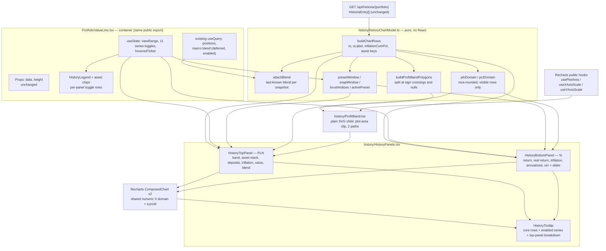
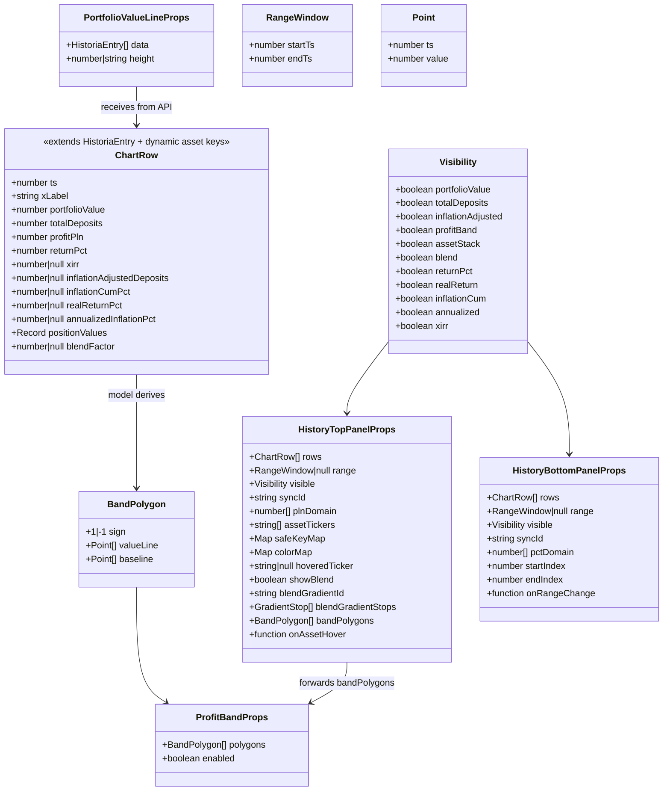
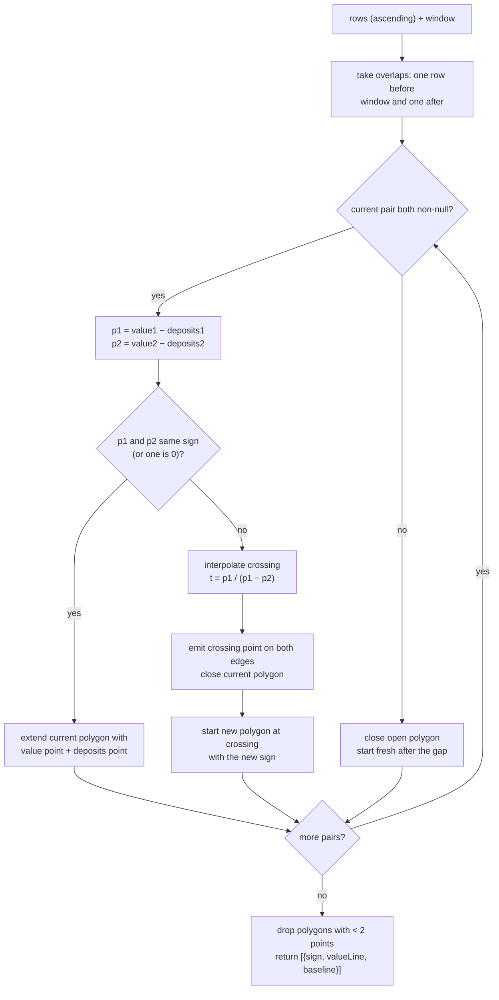

# History chart redesign — component & data-flow design

> **Audience:** Frontend-web, before editing
> `apps/main/frontend-web/src/components/charts/PortfolioValueLine.tsx`.
> **Task:** `.claude/tasks/history-chart-redesign.task.md` (Phase 5 design, no API/DB change).
> **Read with:** `history-chart-redesign-states.md` (UI state machine, toggles, tooltip) and
> `history-chart-redesign-color-tokens.md` (token table + per-app/shared decision).
>
> This is the committed contract the frontend implements against. The target chart is **main's
> local** `PortfolioValueLine`; `packages/shared/ui/src/PortfolioValueLine.tsx` (portfolio-b/portfolio-c
> shim) and `packages/shared/ts/src/utils/chart-colors.ts` are **not touched**.

## 0. Verified context and deviations from the task file

These were checked against the working tree before designing; where the task file and the
installed code disagree, this document follows the installed code and says so explicitly.

| # | Task file says | Working tree says | Resolution |
|---|---|---|---|
| 1 | Recharts **v2**; option (b) is `<Customized>` | `recharts@3.10.1`; `Customized` is deprecated in v3 and no longer injects chart props | Design for **3.10.1**. The custom band is a **plain child of `ComposedChart`** using the public hooks `usePlotArea`, `useXAxisScale`, `useYAxisScale` (exported from `recharts` root, `@since 3.8`). Do **not** use `Customized`. |
| 2 | Props `{ data: HistoriaEntry[]; height?: number }` | `height?: number \| string`; `HistoriaDialog.tsx` passes `height="100%"` | Keep **`number \| string`** — narrowing to `number` would break the retirement/main dialogs. |
| 3 | Quality gate `npm run lint` | `apps/main/frontend-web/package.json` has no `lint` script (`dev`, `build`, `preview`, `typecheck` only) | Gate is **`npm run build`** (= `tsc --noEmit && vite build`). Do not invent a lint script in this task. |
| 4 | Horizon ~2024–2026 | MAIN: 587 daily rows **2025-03-01 → 2026-10-19**; RETIREMENT: 967 rows **2024-02-15 → 2026-10-19** | `[3R]` always clamps to `dataMin` today. Keep the button (it becomes meaningful as history grows); document the clamp in the UI spec. |
| 5 | `inflationCumPct = adj / deposits − 1` | `inflationAdjustedDeposits` is **deposit-weighted** (Σ amountᵢ × CPI factor), `realReturnPct = value / adj − 1` | Formula is correct, but label it **“inflacja na wpłaconym kapitale”**, not “CPI”. Identity: `1 + realReturn = (1 + returnPct) / (1 + inflationCumPct)` — exact, not a subtraction. |
| 6 | `annualizedInflationPct` comparable inflation | It is CPI **since a fixed per-portfolio baseline** (MAIN 2022-08, RETIREMENT 2024-02), annualized; under 12 months the backend returns the raw cumulative fraction | Keep it as a **separate macro/context toggle**, default OFF, label “Inflacja CPI (śr. roczna)”. Never compare it directly to `returnPct`. |
| 7 | App palette has light/dark | `index.html` is statically `<html class="dark" data-app-theme="main">`; light tokens exist in CSS but there is no theme toggle | Author both light and dark token values anyway (CSS-only correctness), but verify visually in dark. |
| 8 | Data order | `ListHistoriaByPortfolio` does `ORDER BY snapshot_date ASC` | Rows are ascending/unique per day; range math can assume sorted input, but guard anyway. |

Also verified:

- `returnPct = portfolioValue / totalDeposits − 1`; `profitPln = portfolioValue − totalDeposits`
  (`historia/service.go` `toDTO`). Zero deposits ⇒ `returnPct = 0`, so the band and the return
  line can disagree at the very first rows — expected.
- `formatPln(value, decimals)` is the shared currency helper. **Name collision:** the chart's
  local `formatPct` multiplies by 100 (expects a ratio); the shared `formatPct` divides by 100
  (expects a percent). The chart must keep the local ratio-based helper.
- `HistoriaEntry` has `positionValues?`, `inflationAdjustedDeposits?`, `realReturnPct?`,
  `annualizedInflationPct?`, `xirr?` — all nullable; the chart must gate on null, never on
  truthiness (a legitimate 0).
- Today's `PortfolioValueLine` is one `ComposedChart` with a left PLN axis, a right % axis, a
  hidden blend axis, a `profitPln` `Bar`, and a tooltip that iterates the **enabled payload
  series**. All four are replaced by the design below.

---

## 1. Pattern evaluation & decisions

| Pattern / decision | Considered | Verdict |
|---|---|---|
| **Two stacked panels vs. one dual-axis chart** | Yes | **Adopted: two panels, one unit per panel.** PLN (top) and % (bottom) never share a frame, so no dual-axis misread; each panel gets its own Y domain and legend. This is the core of the redesign. |
| **Fill-between technique** | (a) paired/stacked `Area` trick, (b) custom SVG path, (c) gradient stops with hard breaks | **Adopted: (b) custom SVG path.** (a) breaks when the portfolio is below deposits because Recharts stacks negative values around zero; (c) is one-dimensional and cannot follow a deposits boundary that varies in both x and y. See §4.4. |
| **Custom band as a chart child** | `Customized`, a plain component with hooks, a separate absolute-positioned SVG overlay | **Adopted: plain child + public hooks** (`usePlotArea`, `useXAxisScale`, `useYAxisScale`). `Customized` is deprecated in v3 and does not receive chart props; an overlay would duplicate layout math and drift. |
| **View-range state** | one `RangeWindow \| null`; separate preset key + brush indices; XState machine | **Adopted: one `useState<RangeWindow \| null>`**, `null` = MAX/full. Preset key and brush indices are **derived**, so they cannot disagree. XState is YAGNI for one value + guards. See the states doc §1. |
| **Pure model module** | inline derivations in the component; a generic `useTimeSeries` abstraction | **Adopted: `history/historyChartModel.ts`**, pure functions only (rows, inflation ratio, presets/snap/clamp, domains, band polygons). Testable without React/Recharts; no speculative generic hook. |
| **Component split** | one ~900-line file; container + panels + band + model | **Adopted: container + `HistoryPanels.tsx` + `HistoryRangeSlider.tsx` + `ProfitBand.tsx` + model.** The redesign adds a second chart, a range slider, and a custom layer; the split keeps each file cohesive (SRP) without inventing generic chart abstractions (YAGNI). |
| **Palette ownership** | extend shared `HISTORY_CHART_COLORS`; per-app fork in main | **Adopted: per-app fork in `apps/main/frontend-web/src/lib/chartColors.ts`**, CSS vars from `theme-main.css`. docs/architecture/12 §2.1 already declares investing-app chart tokens deliberately per-app; shared stays byte-identical so portfolio-b/portfolio-c do not change. |
| **Tooltip source** | iterate tooltip payload entries; read the hovered `ChartRow` directly | **Adopted: row-driven summary.** Core snapshot rows are always shown, plus one row per enabled optional series (the `visible` map is passed into the tooltip). Payload iteration is still avoided: it duplicates values (e.g. `profitPln` and `returnPct`) and hides the summary when all series are off. |
| **Range control** | Recharts `Brush` inside the bottom chart; custom pointer slider; third mini-chart | **Adopted: custom pointer slider** (`HistoryRangeSlider`) with a 24px portfolio-value sparkline (minimap) inside the track. Recharts' controlled Brush resets the handle after each accepted update (recharts#2672), so drags felt like one step per gesture; it also offers no `touch-action` control. The slider reuses the same index model and supports mouse/touch/pen + keyboard. The sparkline is one SVG path from the same `rows` array, not a third chart (no duplicate data fetch/render). |
| **Y domains** | Recharts auto-domain; explicit domains from visible rows | **Adopted: explicit domains + `allowDataOverflow`.** Auto-domain uses the full data set, so presets/brush would zoom X but not Y. Explicit domains make the window real. |
| **Inflation-derived series** | add a backend field; compute on the client | **Adopted: client-side** `inflationCumPct` from two existing fields. No API/DB change; the field is a pure ratio. |

---

## 2. Component architecture



**Legend / responsibilities**

- **Container (`PortfolioValueLine.tsx`)** — owns all state (range, toggles, hovered ticker),
  the two existing queries, memoized model calls, layout (presets → top panel → top legend →
  asset chips → bottom panel with range slider → bottom legend), and the legend/chips. It keeps the
  existing `PortfolioValueLine` export and `{ data, height }` props, so `/history` and both
  `HistoriaDialog` call sites compile unchanged.
- **`history/historyChartModel.ts`** — pure data math. No imports from React or Recharts. It
  receives plain rows and visibility flags and returns plain arrays/numbers. This is the only
  place where the band splitting, inflation ratio, presets and domains are defined.
- **`history/HistoryPanels.tsx`** — two presentational `ComposedChart`s. `HistoryTopPanel`
  renders the PLN axis, optional asset stack, optional blend line, band slot, deposits and
  inflation-adjusted lines, portfolio-value line, and the `ProfitBand` (an early child: after
  the optional stack, before the lines). `HistoryBottomPanel` renders the % axis, the four
  optional series, the return line, the 0% reference line, and the shared tooltip; the
  `HistoryRangeSlider` sits below the plot. Both panels receive the **same full `rows` array**
  and the **same X domain**; the panels do not slice/filter.
- **`history/ProfitBand.tsx`** — a plain child of the top `ComposedChart`. It reads the plot
  area and the actual X/Y scales from Recharts, maps the model's polygons to pixels, clips to
  the plot area, and renders two `<path>`s (gain/loss). It renders `null` until the plot area
  and scales exist.
- **Not split:** the tooltip is rendered by the panels (`HistoryPanels.tsx`), and the legend
  and chips stay in the container. Splitting the legend into its own file would add a file
  without a cohesion win. The blend helpers (`blendToColor`, `buildGradientStops`) and the
  asset-color mapping also stay in the container. See §8 for the exact file list.

---

## 3. Types and props contract



**Legend / contract notes**

- `ChartRow` **extends** `HistoriaEntry` and adds only chart concerns: `ts` (local-midnight
  epoch ms from `parseISO(snapshotDate)`), `xLabel` (`d MMM yy`, `pl`), `inflationCumPct`, the
  optional `blendFactor`, and an index signature for the dynamic `a_<ticker>` stack keys. Do not
  mutate API types and do not add fields to the OpenAPI schema.
- `buildChartRows` **normalizes** the nullable/optional API fields: `positionValues ?? {}`,
  `xirr ?? null`, `inflationAdjustedDeposits ?? null`, `realReturnPct ?? null`,
  `annualizedInflationPct ?? null`. Downstream code can then use the non-null `ChartRow` shape
  shown in the diagram.
- `Visibility` has exactly 11 flags. Top panel reads 6 (`portfolioValue`, `totalDeposits`,
  `inflationAdjusted`, `profitBand`, `assetStack`, `blend`); bottom reads 5 (`returnPct`,
  `realReturn`, `inflationCum`, `annualized`, `xirr`). The states doc §5 maps labels to keys and
  panels.
- `RangeWindow | null` where `null` means MAX/full. **Never** encode MAX as a synthesized
  `{startTs: 0, endTs: now}`; that would produce wrong brush indices and an x-axis from 1970.
- `BandPolygon.sign` is `1` for profit (portfolio above deposits) and `-1` for loss. The
  renderer does not recompute sign; it only maps points to pixels and fills.
- `height` stays `number | string`; the container sets `style={{ height }}` with
  `display: flex; flex-direction: column; min-height: 0`.
- `bandPolygons` and `blendGradientStops` are memoized in the container and passed down; the
  panels do not recompute them. `ProfitBand` only maps precomputed polygons to pixels.
- The container derives **one** `syncId` with `useId()` and passes the same string to both
  panels. Do not call `useId()` inside each panel; that would produce two different sync groups.
- No new context/provider. The two panels are siblings fed by the same container; prop drilling
  across one level is deliberate (a context would add indirection without reuse).

---

## 4. Derived series and the P/L band

### 4.1 `buildChartRows`

For each `HistoriaEntry` (ascending, unique `snapshotDate`):

1. `ts = parseISO(e.snapshotDate).getTime()` — local midnight, the same value `format(...)`
   uses for `xLabel`; do not mix with `new Date("YYYY-MM-DD")` (UTC).
2. `xLabel = format(parseISO(e.snapshotDate), "d MMM yy", { locale: pl })`.
3. `inflationCumPct = computeInflationCumPct(e)` (§4.2).
4. For each ticker in the stable `assetTickers` list, write
   `row[safeKeyMap.get(ticker)] = e.positionValues?.[ticker] ?? 0` so the stacked areas keep a
   constant series set (a missing ticker is a 0, not a vanished area).
5. Keep `positionValues` for the tooltip breakdown, `profitPln`/`returnPct` for the band and
   summary, `xirr`/`realReturnPct`/`annualizedInflationPct` as nullable numbers.

`attachBlend` is unchanged in behavior: sort `MacroStateHistoryPoint`s by `asOfDate`, carry the
last blend on or before each snapshot forward. It only runs when the blend query is enabled;
the query stays deferred (`enabled: showBlend`), so the default view does not fetch macro data.

### 4.2 `inflationCumPct`

```
inflationCumPct =
  inflationAdjustedDeposits != null && totalDeposits > 0
    ? inflationAdjustedDeposits / totalDeposits - 1
    : null
```

- Null when either input is null, or when `totalDeposits <= 0` (division by zero / a
  meaningless ratio before the first deposit).
- A legitimate `0` must survive: test `!= null`, never truthiness.
- **Semantics:** `inflationAdjustedDeposits` is Σ depositᵢ × CPI factor(depositᵢ → snapshot),
  so the ratio is the **deposit-weighted** cumulative inflation on contributed capital, not the
  CPI index since the portfolio baseline. Label it “Inflacja na wpłaconym kapitale”.
- **Identity (use it in the design, not as a new calculation):**
  `1 + realReturnPct = (1 + returnPct) / (1 + inflationCumPct)`. This is exact because
  `realReturnPct = value / adj − 1`, `returnPct = value / deposits − 1`, and
  `adj / deposits = 1 + inflationCumPct`. Do **not** render `returnPct − inflationCumPct` as
  “real return”; the difference is the simple, not compounded, approximation.
- `annualizedInflationPct` is a different series (fixed CPI baseline, annualized). It is not
  part of this identity and must not be used as the inflation benchmark line.

### 4.3 What the band means (nominal vs real)

The band fills the space between `portfolioValue` and `totalDeposits`. Its sign is
`profitPln = portfolioValue − totalDeposits`, so it is **nominal** profit/loss. It can be green
while the real return (portfolio vs the inflation-adjusted deposits line) is negative. Label the
toggle **“Zysk/strata (nominalny)”** and keep the dashed inflation-adjusted line visible by
default so the distinction is on screen. This is a deliberate semantic decision, not an
oversight. The band is derived from the rows, not from visibility flags: hiding the deposits
line does not hide or change the band — only the `profitBand` toggle does.

### 4.4 Fill-between technique — decision card

| Option | How it would work | Why rejected / adopted |
|---|---|---|
| **(a) Pair of `Area`s / stacked trick** | Two areas with a masked background, or a stacked positive/negative pair around a synthesized baseline | **Rejected.** Recharts stacks negative values relative to zero, so the moment the portfolio drops below deposits the mask/stack flips or disappears. It also cannot express “between two arbitrary curves”; it only fills to 0 or to a stack. Fragile under the explicit Y domain. |
| **(b) Custom SVG path (chosen)** | Model builds gain/loss polygons in data space (portfolio edge + deposits edge); a plain child maps them through the chart's real scales and clips to the plot area | **Adopted.** Correct for any sign, any two curves, nulls, and crossings; one path per sign; no Recharts internals; no layout duplication. Uses public v3 hooks. |
| **(c) Gradient stops with hard breaks** | A vertical gradient on an area, with stops switched at the crossing x positions | **Rejected.** A single gradient is 1-D and cannot follow a deposits boundary that varies with x; multiple gradient stops only approximate vertical bands, not an arbitrary curve pair. |
| **(d) `Customized`** | Render custom SVG through Recharts' escape hatch | **Rejected in v3.** Deprecated; chart props are no longer injected, so the component would need hooks anyway — (b) without the deprecated wrapper. |

**Why the scales are not hand-rolled:** `useXAxisScale()` / `useYAxisScale("pln")` return the
exact d3 scale Recharts uses for the lines, after domain, `allowDataOverflow`, and margins.
Mapping the band through the same functions guarantees the fill edge sits **on** the lines, at
every zoom level. `usePlotArea()` supplies the clip rectangle. If any of the three is
`undefined` (first render), `ProfitBand` returns `null`; it renders on the next store update.

### 4.5 Band segmentation algorithm



Rules the implementation must follow (all pure, in `historyChartModel.ts`):

1. **Data space, not pixels.** The model emits `{ts, value}` points; `ProfitBand` maps them.
2. **Crossing split.** For a pair with `p1 * p2 < 0`, compute
   `t = p1 / (p1 - p2)` (stable because the signs differ), `tsX = ts1 + t(ts2 - ts1)`,
   `vX = value1 + t(value2 - value1)` (equals the interpolated deposits at the crossing).
   Push `(tsX, vX)` to the current polygon's both edges, close it, start the next polygon at the
   same point. Never extrapolate past the pair.
3. **Sign change at a sample.** If `p2 === 0`, close the current polygon at `(ts2, value2)` and
   start the next one from the next non-zero pair; no duplicate zero-width polygon.
4. **Zero at the start of a run.** If `p1 === 0` and `p2 !== 0`, start a new polygon at
   `(ts1, value1)` with the sign of `p2` (both edges coincide there). If both are zero, skip the
   pair. This is the same rule as a crossing, just at a sample.
5. **Null gaps.** If either value is null, close the open polygon (with the last valid point as
   both edges) and resume at the next pair with both non-null. Never connect across a gap and
   never `connectNulls`.
6. **Window edges.** Include one row on each side of `[startTs, endTs]` so a crossing just
   outside the window is interpolated and the clipped fill meets the plot edge at the right
   height. The clip then cuts it at the window boundary.
7. **Polygon shape.** `valueLine` runs left→right along the portfolio; `baseline` runs
   left→right along the deposits. The renderer emits `M valueLine[0] L valueLine[1..n]
   L baseline[n..0] Z`. Both edges meet at every crossing, so the polygon is simple. Invariant:
   `valueLine.length === baseline.length` and both are ordered by `ts`; the renderer guards and
   drops a malformed polygon rather than emitting a broken path.
8. **No band at all** when `portfolioValue` or `totalDeposits` is missing for the whole window,
   or when fewer than two valid adjacent points exist. The toggle stays enabled but renders
   nothing (no crash, no console noise).

### 4.6 Draw order inside the top panel

```
1. defs: blend gradient (if on), band clipPath (always)
2. asset-stack Areas (if on)
3. ProfitBand paths (if on)          ← 22% tint over the stack when both are on
4. totalDeposits line
5. inflationAdjustedDeposits line
6. portfolioValue line
7. blend line (gradient stroke, hidden blend Y axis)
```

- The band sits **above** the asset stack on purpose: at ~22% opacity it tints the stack by P/L
  sign without hiding the asset colors. If it sat below the stack it would be invisible when
  both toggles are on. Documented trade-off; the user can turn the stack off for a pure band.
- The deposits line is above the band because it is the band's zero boundary; the portfolio
  line is the hero and goes above everything except the optional blend overlay.
- `assetStack` Areas keep `isAnimationActive={false}`; **all** new lines also set
  `isAnimationActive={false}` so a slider drag does not replay path animations on every move.
- All SVG `<defs>` ids (blend gradient, band clipPath) use `useId()` (colon-stripped), because
  the chart can be mounted twice at once (page + dialog).

---

## 5. View-range controller, axes and hover sync

### 5.1 One state, derived views

```ts
const [viewRange, setViewRange] = useState<RangeWindow | null>(null); // null = MAX
```

- `rows` is the full ascending array. **Both panels always receive `rows`**; the window is
  expressed only through the X domain + `allowDataOverflow` + the band clip.
- `dataMinTs = rows[0]?.ts`, `dataMaxTs = rows[rows.length - 1]?.ts`.
- `effectiveRange = viewRange ?? { startTs: dataMinTs, endTs: dataMaxTs }` — computed only when
  `rows.length >= 2`. For 0 rows render the empty message; for 1 row use `{ts − 12h, ts + 12h}`.
  Never pass `undefined` timestamps into an axis domain.
- `brushIndices = brushIndices(rows, effectiveRange)` (start = first row `ts >= startTs`,
  end = last row `ts <= endTs`; fall back to `0`/`n-1` if not found).
- Do not store `startIndex`/`endIndex` separately. One source of truth; the slider is controlled.

### 5.2 Presets

`presetWindow(key, rows)` uses the **latest snapshot** as the anchor, not wall-clock `now`:

| Key | Raw start | Snap/clamp |
|---|---|---|
| `1M` | `subMonths(dataMaxDate, 1)` | first row `>= rawStart`; end = `dataMaxTs`; start ≥ `dataMinTs` |
| `3M` | `subMonths(dataMaxDate, 3)` | same |
| `YTD` | `startOfYear(dataMaxDate)` | same; may legitimately be a very short window around New Year |
| `1R` | `subYears(dataMaxDate, 1)` | same |
| `3R` | `subYears(dataMaxDate, 3)` | same; today clamps to `dataMinTs` (MAIN 2025-03-01) |
| `MAX` | — | `null` (full domain) |

- End is always `dataMaxTs`: a preset means “the last N up to the newest snapshot”, even if the
  user had brushed a window ending earlier.
- Active preset = the key whose `presetWindow` equals `viewRange` exactly (timestamp equality),
  or `MAX` when `viewRange === null`. A brush window that happens to match a preset is also
  highlighted — acceptable and self-consistent.
- Wrapper: a `role="group" aria-label="Zakres czasu"` with six buttons; each has
  `aria-pressed={active}` and a visible active style. Presets are the primary keyboard range
  path for whole-range jumps; the slider handles additionally support Arrow/Home/End.

### 5.3 Snapping, clamping, minimum window

- All range endpoints are **row timestamps**, never arbitrary ms. The slider already yields
  indices, but presets and any programmatic set must snap forward/backward to real rows.
- `startTs = max(startTs, dataMinTs)`, `endTs = min(endTs, dataMaxTs)`. If the raw window falls
  entirely outside the data, fall back to MAX.
- Range guard: `MIN_WINDOW_MS = 5 days`, reduced to `(dataMaxTs - dataMinTs) / 2` when the data
  span is shorter. If a proposed slider window is shorter, **clamp it** and set `viewRange`; do
  not ignore it. The slider is fully controlled and always follows `viewRange`, so ignoring
  would leave the handle visually at the rejected position. Clamp rule: compare the proposed
  indices with the current ones; if only `startIndex` changed, move `endTs` forward to the first
  row at/after `startTs + MIN_WINDOW_MS`; if only `endIndex` changed, move `startTs` back to the
  last row at/before `endTs - MIN_WINDOW_MS`; if both changed (slide), accept the proposed span
  (a slide preserves the current span, so a short preset window stays short). If the opposite
  edge is already at a data bound (cannot move), clamp the **dragged** edge back instead; if that
  is impossible (the data span is shorter than `MIN_WINDOW_MS`) or the clamped window has fewer
  than 2 rows, keep the previous range. The slider always follows `viewRange`, so a clamped
  handle never stays at a rejected pixel position.
- Presets bypass the 5-day guard: `YTD` on 2 January is a valid 1-day window. `MAX` always
  valid. If the snapped preset window has fewer than 2 rows, keep the previous range instead of
  rendering an empty chart.
- Invalid brush updates (`startIndex > endIndex`, out-of-range indices, `rowCount < 2`) are
  ignored with a guard clause; there is no reducer or state-machine library.

### 5.4 Range slider ↔ range mapping

- `<HistoryRangeSlider rows={rows} startIndex={brushIndices.startIndex}
  endIndex={brushIndices.endIndex} onChange={...} />` is rendered **below the bottom chart**;
  no third chart. It replaced Recharts `Brush` because a controlled Brush resets the handle
  after each accepted update (recharts#2672), making a drag feel like one step per gesture.
- The slider is index-based: `position(i) = i / (n - 1)`, independent of the chart's restricted
  X domain, so it remains stable while the X domain is zoomed. Handles use
  `setPointerCapture`; the track has `touch-action: none` so touch drags are not cancelled by
  page scroll.
- `onChange({startIndex, endIndex})`: guard → map indices to row `ts` → `setViewRange`.
  No debounce: n is ~1.9k rows today (the endpoint loads every page) and a debounce would make
  the drag feel laggy.
- Interaction: dragging a handle moves that edge; dragging the selection band pans both;
  clicking the bare track moves the nearest handle; Arrow/Home/End move a focused handle.
- Styling: 32px (`h-8`) track with a 1px `bg-border` center rule and a 24px sparkline of
  `portfolioValue` across the **full** range (min/max normalized, `--history-sparkline`,
  `vectorEffect="non-scaling-stroke"`; nulls break the path). The selection is a 4px
  `--history-performance` band @ 45%; a 20px @ 6% overlay is the pan-drag surface. Handles are a
  12×20 px bordered box with an expanded hit area (`before:-inset-2.5`). End labels use
  `d MMM yy` in `text-foreground/70`.
- Hide the slider when `rows.length < 2`; keep the presets visible but disabled.

### 5.5 Axes and domains

- Both charts use `<XAxis type="number" dataKey="ts" scale="linear"
  domain={[range.startTs, range.endTs]} allowDataOverflow />`. `allowDataOverflow` is
  load-bearing: without it Recharts expands the domain to all data and the zoom is fake.
- **Top X axis renders no labels**: `<XAxis ... tick={false} axisLine={false}
  tickLine={false} height={8} />`. Only the bottom chart renders date ticks (no duplicated
  labels), and the top axis still registers the scale `useXAxisScale()` needs for the band.
  Prefer this over `hide`, whose scale-registration behavior is an implementation detail.
- Both charts share the same margins and left Y-axis width (`width={64}`), so the plot areas
  align horizontally and the synced cursor is a straight vertical line across both panels.
- `YAxis yAxisId="pln"` (top) and `yAxisId="pct"` (bottom), `allowDataOverflow`, explicit
  `domain={plnDomain}` / `domain={pctDomain}`, `tickCount={5}`.
- **PLN domain** (per visible window, not the full data):
  - include `portfolioValue` if the value line **or** the band is on;
  - include `totalDeposits` if the deposits line **or** the band is on;
  - include `inflationAdjustedDeposits` if that line is on;
  - include the asset-stack cumulative min/max (in `assetTickers` order) if the stack is on;
  - **do not** force 0 — portfolio values are far from zero and forcing it flattens the chart;
  - pad 6% of the span, then round outward to a 1/2/5×10ⁿ step; if min == max, expand by
    `max(1, |value| × 0.05)`.
- **% domain**:
  - include every visible % series (`returnPct`, `realReturnPct`, `inflationCumPct`,
    `annualizedInflationPct`, `xirr`);
  - always include 0 so the 0% baseline is visible and above/below is legible;
  - enforce a minimum span of 2 percentage points (0.02) around the midpoint to avoid a flat
    line exploding into noise;
  - pad 8% of the span and nice-round outward.
- The hidden blend Y axis stays in the top panel only when `showBlend`, `domain={[0, 1]}`.
- `tickFormatter`:
  - PLN: the existing `M` / `k` / integer formatter, but with one decimal for `< 10k`;
  - %: adaptive decimals — `2` when `|v×100| < 1`, `1` when `< 10`, else `0`.
- Date ticks: `format(new Date(ts), "d MMM yy", { locale: pl })`, `minTickGap={36}`; no manual
  `interval={0}` (the old chart showed every label and relied on `everyNth`, which breaks when
  the window changes). The slider's end labels use `d MMM yy`.

### 5.6 Hover and tooltip synchronization

- Both charts get the **same** `syncId` string (e.g. `useId()`-derived) and the default
  `syncMethod="index"`. They receive the same `rows` array, so indices align.
- **No Recharts Brush:** the bottom range control is our own slider and does not participate
  in Recharts' `BRUSH_SYNC_EVENT`. Both panels derive their X domain from `viewRange`, and the
  band polygons are computed from the full `rows` in the container. Do **not** add a Brush to
  either chart.
- Both charts render `Tooltip content={<HistoryTooltip ... />}` with
  `cursor={{ stroke: "var(--muted-foreground)", strokeDasharray: "3 3", strokeOpacity: 0.6 }}`.
  Hovering either panel shows the cursor in both; the hovered panel's tooltip is the one under
  the pointer, and the other panel shows the same summary at the same index. The top
  tooltip additionally contains the asset breakdown and the blend row; the bottom one does not.
- `HistoryTooltip` resolves the row from the active x **`label`** (`ts`) through a memoized
  `Map<number, ChartRow>` built by the panel — it does **not** read or iterate the payload
  series. This keeps the summary working even when every series in the panel is toggled off
  (an empty payload). The only `any` remains the Recharts `content` adapter; everything
  below it is typed.
- Tooltip highlight of an asset row still drives `hoveredTicker` (area dim/highlight + chips).
  Hover state is independent of the range state; it never changes `viewRange`.

---

## 6. Panel composition and visual hierarchy

| Band (top → bottom) | Height rule | Contents |
|---|---|---|
| Presets | `shrink-0`, ~32px | `[1M][3M][YTD][1R][3R][MAX]`, right-aligned or left-aligned above the top panel |
| Top panel | `flex-[3] min-h-0` | PLN chart: optional stack, band, deposits, inflation-adjusted, portfolio value, optional blend |
| Top legend | `shrink-0`, ~24px | 6 top toggles + band swatch |
| Asset chips | `shrink-0`, only when `showAssetStack` | existing ticker chips, hover sync |
| Bottom panel | `flex-[2] min-h-0` | % chart + range slider with sparkline below the plot |
| Bottom legend | `shrink-0`, ~24px | 5 bottom toggles |
| Root | `style={{height}}`, flex column | `height` default 560; dialog passes `"100%"` |

- **One unit per axis.** No right-hand % axis in the top panel; no PLN series in the bottom.
- **Line weights:** portfolio value 2.75px; return 2.75px; real return 1.5px; deposits 1.25px
  solid; inflation-adjusted 1.25px dashed `4 3`; inflation benchmark 1.25px dashed `5 3`;
  annualized 1px dotted `2 3`; XIRR 1.25px dotted `2 3`; 0% baseline 1.25px solid; slider
  sparkline 1.25px non-scaling. Exact colors and contrast are in the tokens doc.
- **All top-panel value series are `type="linear"`**, including the asset-stack areas. The
  band's edges are straight segments between samples; a monotone line would bow away from the
  fill, and a monotone stack top would no longer coincide with the linear portfolio line. The
  blend line keeps `monotone` (a normalized overlay, not a value boundary). Bottom-panel lines
  may keep `monotone` (no band).
- **Nulls:** every series uses `connectNulls={false}`; the band breaks at nulls.
- **No animations** on any series or the band (`isAnimationActive={false}`), so dragging the
  brush updates immediately and the Pi browser does not animate 1k-point paths.
- **0% baseline** (bottom only): `ReferenceLine y={0}` with `--history-zero`, 1.25px solid. Recharts
  renders children in JSX order (all default `zIndex` 0), so place it **before** the Lines: it
  is a background rule, and the series lines sit on top of it.
- **Top panel has no `ReferenceLine` at y=0**; its semantic baseline is the deposits line. The
  old top-panel zero line is removed with the `profitPln` bar.

---

## 7. Tooltip and legend (contract summary)

Full tables are in `history-chart-redesign-states.md` §5–§7. The binding rules:

- Tooltip rows are **fixed** in both panels: date, portfolio value, contributed capital,
  profit/loss (PLN + %), XIRR. The panel passes the active `label` (`ts`) and a
  `Map<number, ChartRow>`; the tooltip resolves the row from the map, never from the payload
  series, so an all-toggles-off panel still shows the summary. Formatting: `formatPln(v, 0)`
  for money, local ratio `formatPct` for percentages, `"—"` for null XIRR, `+` prefix on
  positive profit.
- Asset breakdown and the blend footer are **top-panel only**; the breakdown content/threshold
  (≥ 0.5 PLN, sorted desc, scrollable) is unchanged.
- No toggle adds or removes a tooltip row. Optional series are read from the chart/axis, not the
  tooltip.
- Per-panel legends (top 6, bottom 5) reuse the existing `LegendToggle`/`LegendSwatch`
  mechanism. `LegendSwatchKind` gains `dottedLine` and `band`; `bar` is removed with the
  `profitPln` bar. The band swatch is a 20×10 box split horizontally: green top / red bottom.
- Asset chips stay under the top legend and keep the existing hover-to-highlight behavior.

---

## 8. File decomposition and implementation order

| # | File (all under `apps/main/frontend-web/src/components/charts/`) | Status | Responsibility |
|---|---|---|---|
| 1 | `history/historyChartModel.ts` | **new** | `ChartRow`, `RangeWindow`, `PresetKey`, `Visibility`, `Point`, `BandPolygon`; `computeInflationCumPct`, `buildChartRows`, `attachBlend`, `presetWindow`, `activePreset`, `snapWindow`, `brushIndices`, `plnDomain`, `pctDomain`, `buildProfitBandPolygons`, `niceDomain`. Pure; no React/Recharts imports. |
| 2 | `history/ProfitBand.tsx` | **new** | Plain SVG child: `usePlotArea`, `useXAxisScale`, `useYAxisScale`, `useId`; clipPath; two paths; null until ready. |
| 3 | `history/HistoryPanels.tsx` | **new** | `HistoryTopPanel` + `HistoryBottomPanel`; chart composition, axes, lines/areas, brush, tooltip, zero line. Shared chart constants (margins) live here; the container passes one `syncId`. |
| 4 | `PortfolioValueLine.tsx` | **rewritten** | Container: queries, memoized model calls, state, layout, legend, asset chips, blend-gradient stops, existing asset-color helpers. Public export/props unchanged. The chart tooltip is rendered by `HistoryPanels.tsx`. |
| 5 | `src/lib/chartColors.ts` | **edited** | Add the local `HISTORY_CHART_COLORS` object (CSS-var references); keep the shared re-exports. |
| 6 | `src/theme-main.css` | **edited** | Add `--history-*` tokens under `[data-app-theme="main"]` and `.dark`. |

Suggested order: **1 → 2 → 3 → 4 → 5/6**, then wire the existing call sites (no changes needed
there) and run `npm run build`.

Do **not** touch: `packages/shared/ui/src/PortfolioValueLine.tsx`,
`packages/shared/ts/src/utils/chart-colors.ts`, `docs/architecture/12-...` (its §2.1 already
states the per-app rule), `apps/main/backend-go/**`, `apps/main/db/**`, OpenAPI files.

---

## 9. Risks, deliberate trade-offs, and out of scope

| Risk / trade-off | Mitigation / decision |
|---|---|
| **Recharts 3.10.1 vs the task's “v2”** | Design uses v3 public hooks; `Customized` is not used. The orchestrator should note the task-file wording is stale. |
| **`npm run lint` does not exist** | Use `npm run build` (`tsc --noEmit` + Vite). Do not add a lint toolchain in a chart task. |
| **`[3R]` clamps to `dataMin`** | Keep the button; it is correct once history exceeds 3 years. Today it highlights the same window as a clamped preset, not MAX (MAX is still a distinct range). |
| **Band over asset stack** | 22% tint keeps both readable; documented in §4.6. Turning the stack off gives a pure band. |
| **Light theme is CSS-only** | Tokens are authored for both; visual verification is dark-only because `index.html` is statically `dark`. |
| **Reference-line contrast** | Deposits/inflation lines are deliberately quieter than the hero; every series line is ≥3:1 (the lowest is the dark inflation line at 3.15:1; annualized is 3.43–3.95:1) — see the token doc's contrast table. Fills are intentionally low-contrast and redundantly encoded by position + tooltip text. |
| **No frontend test runner** | The model is pure but there is no test script; verification is `tsc`/build + visual checks. Do not add a test framework in this task. |
| **TWR** | Out of scope (not in the backend). |
| **Shared palette comment contradicts reality** | `packages/shared/ts/src/utils/chart-colors.ts` says `HISTORY_CHART_COLORS` is per-app, yet the shared UI shim imports it. This task does not edit shared; the contradiction is flagged for a future cleanup in the tokens doc §9. |
