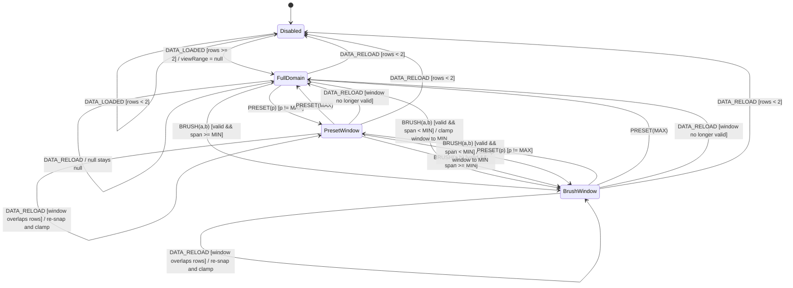
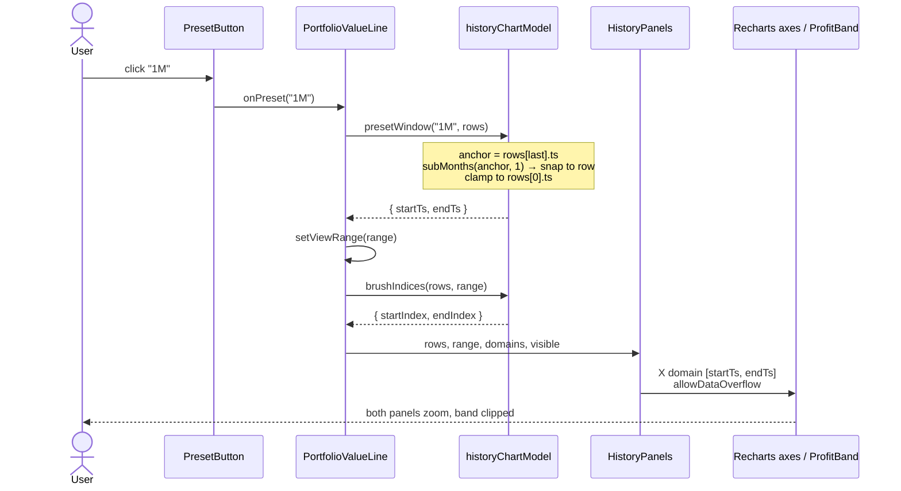
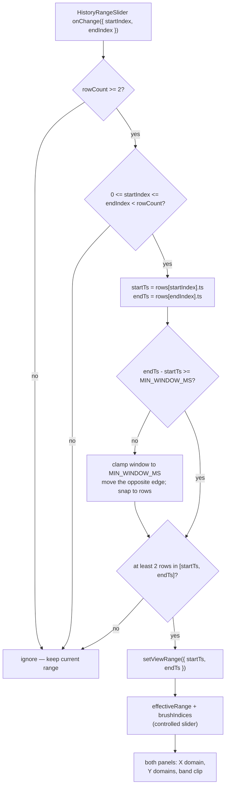
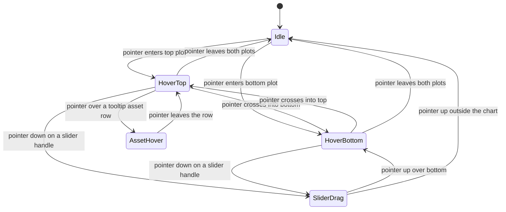
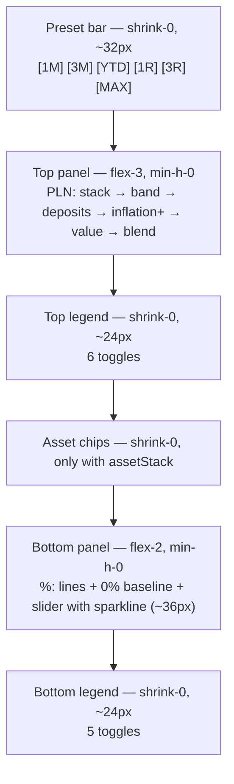

# History chart redesign — UI state machine & interaction spec

> **Audience:** Frontend-web, together with `history-chart-redesign-design.md` (component /
> data-flow contract) and `history-chart-redesign-color-tokens.md` (tokens).
> **Task:** `.claude/tasks/history-chart-redesign.task.md`.
>
> State ownership is deliberately small: **one range state, eleven boolean toggles, one hovered
> ticker**. Everything else (preset highlight, brush indices, domains, band polygons) is derived.
> No reducer, no state-machine library, no context.

## 0. State inventory

| State | Type | Owner | Derived from it |
|---|---|---|---|
| `viewRange` | `{ startTs: number; endTs: number } \| null` (null = MAX) | `PortfolioValueLine` | `effectiveRange`, `brushIndices`, `activePreset`, both X domains, band clip |
| `visibility` | 11 booleans (see §5) | `PortfolioValueLine` | series rendering, Y-domain inputs, legend pressed state |
| `hoveredTicker` | `string \| null` | `PortfolioValueLine` | asset-area dim/highlight, chip highlight, tooltip row highlight |
| `rows` | `ChartRow[]` | `useMemo` from `data` + asset mapping | everything above |
| `blendFactor` | optional per row | `useMemo` from the deferred macro query | blend gradient / blend line / tooltip footer |

`startIndex`/`endIndex`, the preset key, the domains and the band polygons are **never** stored.
Two independent range states (a preset key plus brush indices) could disagree after a data
reload; one range plus pure derivations cannot.

---

## 1. View-range state machine

**Legend / transition contract**

- **`Disabled`** — fewer than 2 rows. Presets and slider are disabled; `viewRange` is forced to
  `null`. The panels may still render a single dot (design doc §8).
- **`FullDomain`** — `viewRange === null`. This is the initial state after data loads and the
  result of `MAX`. The slider is at `[0, n-1]`; the active preset is `MAX`.
- **`PresetWindow`** — `viewRange` equals one of `presetWindow(key)` for `1M/3M/YTD/1R/3R`
  exactly (timestamp equality). Presets anchor on `dataMaxTs`, not `now`; see §2.
- **`BrushWindow`** — any other range. No preset is active. States are **derived from
  `viewRange`**, not stored: a slider release that lands exactly on a preset window renders as
  `PresetWindow` even if the diagram's edge says `BrushWindow`.
- **`PRESET(p)`** — compute the preset against the **current** `dataMaxTs`, snap/clamp, then
  `setViewRange`. It always replaces a slider window; it never refines one.
- **`BRUSH(a,b)`** — valid = indices in `[0, n-1]`, `a <= b`, and `rowCount >= 2`; `span` is the
  timestamp difference of the snapped rows. Invalid updates (start > end, out of range) are
  **ignored**; too-short updates are **clamped** to `MIN_WINDOW_MS` and applied (design doc §5.3),
  because the slider is fully controlled and always follows `viewRange`.
- **`DATA_RELOAD`** — if the new rows still contain the window, re-snap the endpoints to real
  rows and keep the state; otherwise go to `FullDomain`. A preset does **not** auto-advance its
  end on reload (the window is snapshot-relative; the history query has a 5-minute stale time
  and the page is not a live ticker). `MAX` stays `null` and always shows everything.
- No explicit `RESET` event: `MAX` is the reset. No `UNDO`: the presets are the escape hatch.

### Transition examples

| Start | Event | Result |
|---|---|---|
| `FullDomain` (587 rows) | `PRESET("1M")` on 2026-10-19 | `PresetWindow` = `[2026-09-19, 2026-10-19]` |
| `PresetWindow("1M")` | drag end handle to 2026-10-10 | `BrushWindow` = `[2026-09-19, 2026-10-10]` |
| `BrushWindow` | `PRESET("MAX")` | `FullDomain` (`viewRange = null`) |
| any | drag to a 2-day window | clamped to 5 days; the handle ends at the clamped row |
| `BrushWindow` | refetch drops the end row | re-snap end to the new `dataMax` |
| `PresetWindow` | refetch drops all rows in the window | `FullDomain` |

---

## 2. Preset resolution

| Preset | Raw start (from `dataMaxDate`) | Notes |
|---|---|---|
| `1M` | `subMonths(dataMaxDate, 1)` | end = `dataMaxTs`; start snaps forward to the first row `>= rawStart` |
| `3M` | `subMonths(dataMaxDate, 3)` | same |
| `YTD` | `startOfYear(dataMaxDate)` | valid even if only a few days (early January); bypasses the 5-day range guard |
| `1R` | `subYears(dataMaxDate, 1)` | same |
| `3R` | `subYears(dataMaxDate, 3)` | **today clamps to `dataMinTs`** (MAIN starts 2025-03-01); not identical to MAX: MAX is `null` and remains correct if rows are added/removed |
| `MAX` | — | `viewRange = null` |

- The active button is derived, not stored: `activePreset(rows, viewRange)` returns `MAX` for
  `null`, otherwise the first preset whose computed window equals the current range
  (timestamp equality), else `null`. A slider window that exactly matches a preset is highlighted;
  that is correct and costs nothing.
- Clicking the active preset re-applies it (idempotent). No toggle-off behavior.
- The preset bar is the keyboard path: `role="group" aria-label="Zakres czasu"`, buttons with
  `aria-pressed`, `focus-visible:ring-2 focus-visible:ring-ring`.
- The slider handles are `role="slider"` and support Arrow/Home/End; presets cover whole-range
  keyboard jumps.

---

## 3. Range slider interaction

**Legend / edge cases**

- `MIN_WINDOW_MS = 5 days`, reduced to `(dataMaxTs - dataMinTs) / 2` when the whole data span is
  shorter. This is a guard on **slider** updates only; presets are trusted (a 1-day YTD is valid).
  If clamping the opposite edge is impossible because it is at a data bound, clamp the dragged
  edge back; if the data span itself is shorter than `MIN_WINDOW_MS`, keep the previous range.
- The slider is a **custom pointer-driven control** (`HistoryRangeSlider`), not Recharts Brush.
  Recharts' controlled Brush plus a React state round-trip resets the handle after each accepted
  update (recharts#2672), which made dragging feel like one step per gesture. A plain HTML track
  with `setPointerCapture` updates continuously for mouse, touch and pen.
- The slider is **fully controlled**: `startIndex`/`endIndex` are recomputed from `viewRange`
  every render and the handles follow those props. A too-narrow update is **clamped** to
  `MIN_WINDOW_MS` and applied; ignoring it would leave the handle at the rejected position. Do
  not debounce; n is ~1.9k rows today and the drag must feel immediate.
- Mapping is index → row timestamp; index `i` maps to `rows[i].ts` and the handle position is
  `i / (n - 1)`. The slider is independent of the chart's restricted X domain, so a zoomed
  domain does not corrupt the handle positions.
- Handles cannot cross: start is clamped to `[0, endIndex - 1]`, end to `[startIndex + 1, n - 1]`.
  Dragging the selection band pans both handles; clicking the bare track moves the nearest
  handle to the click.
- `rowCount < 2`: do not render the slider; presets render disabled (`aria-disabled` plus the
  `disabled` attribute).
- Styling tokens: 32px (`h-8`) track with a 1px `bg-border` center rule and a 24px
  `portfolioValue` sparkline (full range, `--history-sparkline`, non-scaling stroke); selection
  is a 4px `var(--history-performance)` band @ 45%, the pan-drag surface is 20px @ 6%; handles
  are a 12×20 px bordered box, hit area expanded by `before:-inset-2.5`. Date labels at both
  ends use `d MMM yy` (`text-foreground/70`). The sparkline is `aria-hidden="true"` — the
  chart and tooltip carry the same values.
- Touch: `touch-action: none` on the track so a vertical page scroll cannot cancel the drag;
  no extra gesture layer.
- Keyboard: each handle is `role="slider"` with Arrow/Home/End support; the preset bar remains
  the primary keyboard path for whole-range jumps.

---

## 4. Hover and synchronized tooltip

**Legend / contract**

- `syncId` is one string shared by both `ComposedChart`s; the container derives it once with
  `useId` (like the SVG defs ids) and passes it to both panels. `syncMethod="index"` (default).
  Both charts receive the same `rows` array, so the active index is the same row in both.
- Hovering either panel shows the dashed cursor in **both** panels and a tooltip at the active
  index in both. The tooltip under the pointer is the focus; the other one is the same fixed
  summary (the top one additionally has the breakdown/blend rows). This redundancy is accepted:
  Recharts syncs the tooltip state, and suppressing one of the two would require conditional
  `Tooltip` mounts or a custom external overlay (more code for less clarity).
- `cursor={{ stroke: "var(--muted-foreground)", strokeDasharray: "3 3", strokeOpacity: 0.6 }}`
  on both panels. The cursor never changes `viewRange` or any toggle.
- The slider is not part of Recharts' sync group; it only changes `viewRange`, and both panels
  derive their X domain from it. The band polygons are computed from the full `rows` — see
  design §5.6.
- `AssetHover` is independent: it only sets `hoveredTicker`, which dims the other asset areas
  and highlights the matching chip/tooltip row. It is cleared on chart `onMouseLeave`.
- The tooltip resolves the row from the active `label` (`ts`) via the panel's memoized
  `Map<number, ChartRow>`; it does not read or iterate the payload series. This keeps the
  summary stable when toggles change, including when every series is off. See §6.

---

## 5. Series toggles

### 5.1 Binding table

| Key | Label (PL) | Panel | Default | Swatch | Gated by `hasInflation` | Notes |
|---|---|---|---|---|---|---|
| `portfolioValue` | Wartość portfela | top | **on** | `line` | no | hero line, 2.75px, `--history-value`; `activeDot` r=3 |
| `totalDeposits` | Wpłacony kapitał | top | **on** | `line` | no | 1.25px solid, `--history-deposits`; label changed from “Depozyty” |
| `inflationAdjusted` | Wpłaty + inflacja | top | **on** | `dashedLine` | **yes** | 1.25px dashed `4 3`, `--history-inflation`; the real break-even |
| `profitBand` | Zysk/strata (nominalny) | top | **on** | `band` | no | **new**, replaces the removed `profitPln` bar 1:1 |
| `assetStack` | Wartość aktywów | top | off | `stacked` | no | unchanged stack; chips appear with it |
| `blend` | Blend (makro) | top | off | `gradient` | no | unchanged deferred macro query/gradient |
| `returnPct` | Stopa zwrotu | bottom | **on** | `line` | no | 2.75px solid, `--history-performance`; now the bottom hero (was dashed) |
| `realReturn` | Realny zwrot | bottom | off | `line` | **yes** | 1.5px solid, `--history-real` |
| `inflationCum` | Inflacja na wpłaconym kapitale | bottom | **on** | `dashedLine` | **yes** | **new** derived series; 1.25px dashed `5 3` |
| `annualized` | Inflacja CPI (śr. roczna) | bottom | **off** | `dottedLine` | **yes** | 1px dotted `2 3`; default changed from on |
| `xirr` | XIRR (rocznie) | bottom | **off** | `dottedLine` | no | 1.25px dotted `2 3`, `--history-real`; default changed from on; always in tooltip |

`hasInflation = data.some((e) => e.inflationAdjustedDeposits != null)` — null test, not
truthiness. When it is false, the four gated toggles are not rendered at all (not rendered
disabled), and the domains/band ignore those series. The `profitBand` is **not** gated; it uses
`totalDeposits` and `portfolioValue` only.

### 5.2 Default changes vs. the current chart

| Removed | Added / changed | Why |
|---|---|---|
| `profitPln` bar toggle | `profitBand` (on) | Same nominal P/L, but as the fill-between; one toggle replaces one toggle. |
| — | `inflationCum` (on) | The cumulative, deposit-weighted benchmark is the correct companion to `returnPct`; the annualized CPI is not. |
| `xirr` (was on) | `xirr` (off) | XIRR is an annualized money-weighted rate; keeping it on by default invites a false “this is the same kind of %” reading next to cumulative return. It remains one click away and always in the tooltip. |
| `annualizedInflationPct` (was on) | off | It is CPI from a fixed 2022-08 baseline, not deposit-weighted; it is context, not the main comparison. |
| `returnPct` dashed | solid 2.75px cyan | It is now the bottom panel's primary metric. |

Defaults remain: `portfolioValue`, `totalDeposits`, `inflationAdjusted`, `profitBand`,
`returnPct`, `inflationCum` on; `realReturn`, `assetStack`, `blend`, `annualized`, `xirr` off.

### 5.3 Toggle behavior

- Legend buttons keep the existing mechanism: a check box + swatch + label, `aria-pressed`,
  `title` = “Ukryj/Pokaż …”. Toggling only flips the boolean; it never changes `viewRange`,
  `hoveredTicker`, or the tooltip rows.
- Toggling a series changes the Y-domain inputs (design doc §5.5). A series that is hidden must
  not influence the domain (except that the band keeps both of its edges in the domain).
- Toggling `assetStack` on shows the chips; off hides them and clears `hoveredTicker`.
- Toggling `blend` on mounts the existing `useQuery` (deferred fetch); off leaves the cached
  data alone.

---

## 6. Tooltip content contract

The tooltip shows the **core snapshot rows always**, plus one row per **enabled** optional
series, in both panels. The `visible` map is passed into `HistoryTooltip`, so the tooltip and the
legend/plot never disagree.

| Row | Value | Format | Shown |
|---|---|---|---|
| Header | `snapshotDate` | `format(parseISO(date), "d MMMM yyyy", {locale: pl})` | always |
| Wartość portfela | `portfolioValue` | `formatPln(v, 0)` | always |
| Wpłacony kapitał | `totalDeposits` | `formatPln(v, 0)` | always |
| Zysk/strata | `profitPln`, `returnPct` | `+` prefix when > 0, `formatPln(profit, 0)` + ` (${formatPct(returnPct)})` | always; text color `--history-profit-text` when `profitPln >= 0`, else `--history-loss-text` |
| XIRR (rocznie) | `xirr` | `formatPct(x)`; `"—"` when null | when `visible.xirr` |
| Wpłaty + inflacja | `inflationAdjustedDeposits` | `formatPln(v, 0)` | when `visible.inflationAdjusted` |
| Inflacja na wpłaconym kapitale | `inflationCumPct` | `formatPct(x)`; `"—"` when null | when `visible.inflationCum` |
| Realny zwrot | `realReturnPct` | `formatPct(x)`; `"—"` when null | when `visible.realReturn` |
| Inflacja CPI (śr. roczna) | `annualizedInflationPct` | `formatPct(x)`; `"—"` when null | when `visible.annualized` |
| Wartość aktywów | `positionValues` | ticker, `formatPln(value, 0)`, `pct.toFixed(1)%` | **top panel only**, entries with `|value| >= 0.5`, sorted desc, `max-h-72` scroll |
| Blend (makro) | `blendFactor` | `toFixed(2)` + `blendToColor` dot | **top panel only**, when `showBlend && blendFactor != null` |

**Legend / formatting rules**

- `formatPct` here is the chart's **local ratio** helper: `(v * 100).toFixed(1) + "%"`. The
  shared `formatPct` expects a percent (`value / 100`) and would be wrong by 100×.
- The header uses the long date; the x-axis keeps the short `d MMM yy` label. Do not reuse
  `xLabel` for the tooltip header.
- Guard every number with `Number.isFinite`; render `"—"` for null/non-finite values. A
  legitimate 0 renders as `0 zł` / `0.0%`, never as `—`.
- The profit/loss row is the only semantic green/red text row. The asset breakdown dots keep the
  per-ticker asset colors (the documented palette exception); they are not semantic P/L colors.
- Breakdown share: `pct = portfolioValue > 0 ? (value / portfolioValue) * 100 : 0`, rendered
  `pct.toFixed(1)%`. Keep the existing `|value| >= 0.5` filter and descending value sort.
- The tooltip must not show series rows (`Wartość portfela: …` duplicated per payload entry).
  Optional series appear only when their toggle is on — this is how the user reads the value of a
  plotted line (especially on a touch device, where there is no hover cursor).
- The top tooltip's asset row hover still sets `hoveredTicker`; the bottom tooltip has no
  breakdown and therefore no `AssetHover` transition.
- Real Recharts `TooltipProps` are loosely typed in v3; keep the `any` confined to the
  `content={(props) => …}` adapter, and resolve the row from the active `label` (`ts`) via the
  panel's memoized `Map<number, ChartRow>`: `const row = rowByTs.get(Number(props.label)) ?? null`.
  Do **not** read `payload[0].payload`; an empty payload (all series off) must still show the
  summary.

---

## 7. Legend, swatches, and asset chips

**Placement:** one legend row per panel, directly under that panel. This is how a swatch maps to
a panel without extra text. The top legend has 6 entries; the bottom has 5. Asset chips appear
between the top legend and the bottom panel, only when `showAssetStack`.

**Swatch kinds** (extend the existing `LegendSwatchKind`):

| Kind | Rendering | Used by |
|---|---|---|
| `line` | 20×10 SVG line, 2px, round caps | portfolio value, deposits, return, real return |
| `dashedLine` | same, `strokeDasharray="5 4"` (schematic) | inflation-adjusted, inflation benchmark |
| `dottedLine` | same, `strokeDasharray="2 3"` | annualized CPI, XIRR |
| `band` | 20×10 box split **horizontally**: green top half, red bottom half | profit/loss band |
| `gradient` | 32×10 pill, blend gradient | blend |
| `stacked` | 20×10 box, three asset-palette thirds | asset stack |
| ~~`bar`~~ | removed | the `profitPln` bar no longer exists |

- Swatches are schematic (2px strokes), not a pixel-accurate preview of 1.25px lines; the label
  and panel placement carry the meaning.
- Disabled: swatch and label at 40% opacity, empty check box. Enabled: full opacity, check mark.
- The band swatch uses `--history-profit` / `--history-loss` (the same semantic tokens as the
  fill), not the asset palette.
- Asset chips keep the existing button markup; add `onFocus`/`onBlur` alongside
  `onMouseEnter`/`onMouseLeave` so keyboard focus highlights the area too. A chip is not a
  toggle (no `aria-pressed`); it is a hover/focus highlight.
- Color is never the only encoding: check boxes + labels + dash patterns + panel position.

---

## 8. Empty, sparse, and null states

| Condition | Rendering |
|---|---|
| `data.length === 0` | Upstream `HistoryPage` already shows “Brak danych historycznych.”; if the component is mounted anyway, render the same muted message, no charts. |
| `data.length === 1` | Render both panels with a ±12h X domain and a dot for `portfolioValue`; hide the slider; render presets disabled; tooltip works. |
| `rows.length >= 2` but a preset snaps to < 2 rows | Keep the previous range (do not enter an empty window). |
| `hasInflation === false` | Hide the 4 gated toggles; no inflation lines/domains; the band still works. |
| `xirr == null` at a row | XIRR line has a gap (`connectNulls={false}`); tooltip shows `"—"`. |
| `positionValues == null` | Asset areas are 0 / absent; chips list may be empty; the breakdown section is omitted. |
| `totalDeposits === 0` | Backend sets `returnPct = 0`; the band degenerates to the value line; `inflationCumPct` is `null` (division guard). |
| `portfolioValue` all equal | PLN domain min == max → expand by `max(1, |v| × 0.05)` before nice-rounding. |
| Flat % series | % domain enforces a 2 pp minimum span; otherwise the chart would amplify noise. |
| 967 rows | No slicing/decimation; animations off; both panels share the same array. |
| A refetch changes `dataMax` | `FullDomain` stays null/full; a preset/slider window is re-snapped and clamped, or falls back to `FullDomain` if no longer valid. |

---

## 9. Panel layout and visual order

**Legend / layout rules**

- Root: `display:flex; flex-direction:column; height:{height}`. `height` defaults to 560; the
  dialog passes `"100%"` inside its `flex-1 min-h-0` wrapper. Every non-chart row is
  `shrink-0`; both chart wrappers are `min-h-0` + `flex-*` + `ResponsiveContainer 100%/100%`.
- The top panel gets 3/5 of the flexible height and the bottom 2/5 (the top carries the band and
  the value line). The range slider consumes ~36px **inside** the bottom panel, below the plot,
  so the bottom plot is shorter than its `flex-2` share by that amount — expected.
- 560px budget: 32 + ~250 + 24 + ~24 + ~150 + 36 + 24 ≈ 540, leaving ~20px of slack. The layout
  must not overflow when the asset chips wrap to two lines; the chart flex boxes absorb it.
- Both charts use identical margins and left Y-axis width (`width={64}`) so the plot areas align
  and the synced cursor is one vertical line across the panels. The top chart renders no date labels
  (`tick={false}`, `height={8}`); only the bottom one renders date ticks.
- The slider is the last row of the bottom panel column: below the bottom plot and above the
  bottom legend.

---

## 10. Accessibility and reduced motion

- **Presets:** `role="group" aria-label="Zakres czasu"`; each button `aria-pressed`,
  `disabled` when `rows < 2`, visible focus ring. Presets are the keyboard-operable whole-range
  control; the slider handles also support Arrow/Home/End.
- **Toggles:** `aria-pressed` and a descriptive `title`; the check icon is `aria-hidden`; the
  label is real text.
- **Charts:** Recharts' `accessibilityLayer` default is on, so each chart gets its role/tab
  index and keyboard tooltip navigation. Keep the default; do not set `accessibilityLayer={false}`.
- **Band:** `aria-hidden="true"` — it is decorative; the same values are in the lines and the
  tooltip.
- **Range slider:** wrapper is `role="group" aria-label="Suwak zakresu"` (the preset bar keeps
  `"Zakres czasu"`, so the two groups are distinguishable); handles are `role="slider"` with
  `aria-valuemin`/`aria-valuemax`/`aria-valuenow`/`aria-valuetext`; pointer capture gives
  mouse/touch/pen drag, and the track uses `touch-action: none`.
- **Color:** P/L sign is encoded by position (above/below deposits), the `+`/`-` in the tooltip
  text, and the legend label — not only by green/red. Series use distinct dash patterns and
  labels. Do not remove the text/dash differentiation when implementing.
- **Motion:** all series and the band are `isAnimationActive={false}`; there is no new
  transition. The page's existing `prefers-reduced-motion` rules are unaffected.
- **Contrast:** every line/token pair is documented in the token doc; the lowest-contrast
  default series is the inflation benchmark (3.15:1 dark), the optional annualized CPI line is
  3.43–3.95:1, and the dark 0% baseline is 3.07:1 — all still above the 3:1 non-text threshold.
  Axis ticks (8.45:1 / 8.55:1) and legend labels (9.25:1 / 9.61:1) pass the 4.5:1 text threshold.
