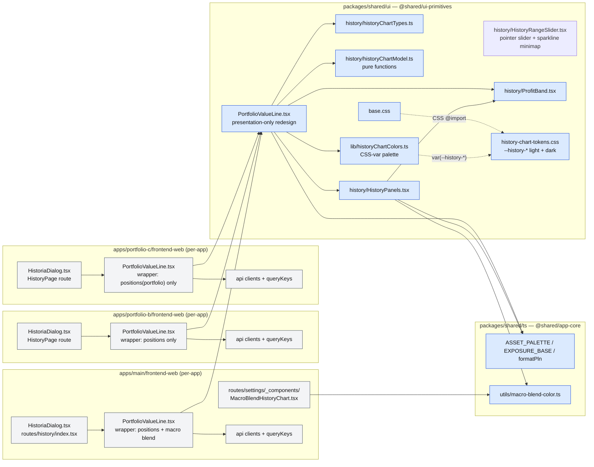
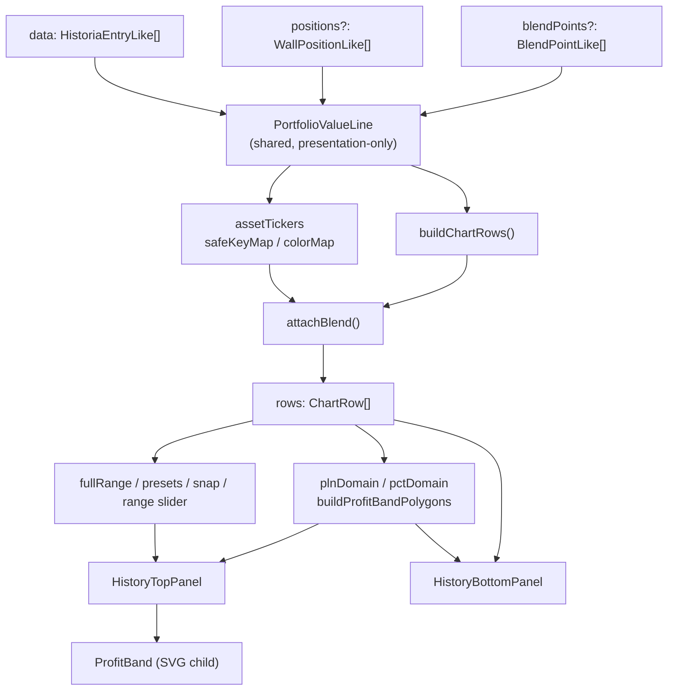
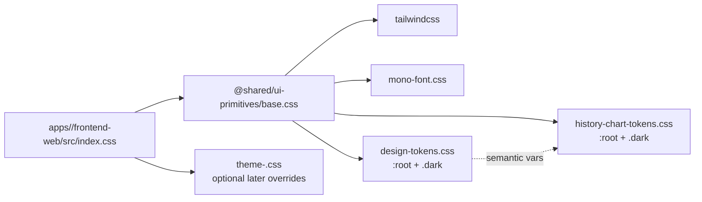

# History chart — 3-way shared component & ownership design

> **Audience:** Frontend-web, before editing the history chart in any of the three apps.
> **Task:** `.claude/tasks/history-chart-shared.task.md` (Phase 5 — design only; no API/DB change).
> **Read with:** `history-chart-redesign-design.md` (behaviour, range math, band),
> `history-chart-redesign-states.md` (toggles, tooltip, range slider), and
> `history-chart-redesign-color-tokens.md` (palette rules and values).
>
> **Supersedes in part:** this document replaces the *palette-ownership* decision in
> `history-chart-redesign-design.md` §1 ("per-app fork in main") and the *token/file-location*
> decision in `history-chart-redesign-color-tokens.md` ("leave `packages/shared/**` byte-identical").
> The **layout, state machine, algorithms, palette values and palette rules from the redesign
> remain the source of truth**; only ownership and import paths change.

---

## 0. Verified context and deviations from the task file

Checked against the working tree before designing. Where the task file and the installed code
disagree, this document follows the installed code and says so.

| # | Task file says / implies | Working tree says | Resolution |
|---|---|---|---|
| 1 | portfolio-b/portfolio-c wrappers may need type fixes | Both wrappers already fetch `listPositions` and delegate to `@shared/ui-primitives/PortfolioValueLine`; their dialogs pass positions through | **No contract change** needed for siblings; only shared type docs need correcting |
| 2 | main chart self-fetches positions and blend | `apps/main/.../PortfolioValueLine.tsx:271-283` does exactly that | Move both queries to the **main wrapper**; shared chart becomes presentation-only |
| 3 | main route/dialog props stay unchanged | `HistoriaDialog.tsx` calls `renderChart(entries)` with `height="100%"`; `routes/history/index.tsx` passes `{ data }` only | Keep wrapper props `{ data; height?: number \| string }` |
| 4 | preserve `height` | `height?: number \| string`, default `560` | Keep **`number \| string`**; `"100%"` is load-bearing |
| 5 | old shared `HISTORY_CHART_COLORS` becomes unused after replacement | Its **only** consumer is `packages/shared/ui/src/PortfolioValueLine.tsx:18` | Remove the legacy hex object **only after** the rewritten chart no longer imports it |
| 6 | main uses old-shape positions | Main's `Asset` rows carry `exposure` + `subassets` (task 156); no `ticker`/`subPositions` producer remains | `WallPositionLike` keeps the legacy fields for compatibility, but its docstring must be corrected |
| 7 | Recharts version | `3.10.1` in all three apps; `Customized` is deprecated in v3 | Keep the existing `usePlotArea`/`useXAxisScale`/`useYAxisScale` band implementation |
| 8 | quality gate mentions lint | No `lint` script in any frontend (`dev`, `build`, `preview`, `typecheck` only) | Gate is `npm run build` = `tsc --noEmit && vite build` |
| 9 | package may need new export-map entries | `packages/shared/ui/package.json` maps `./*` → `./src/*.tsx` only | **No new entries**: chart internals stay relative; apps import only `@shared/ui-primitives/PortfolioValueLine`; CSS is pulled via `base.css` |
| 10 | light/dark tokens | All three `index.html` files are statically `<html class="dark" data-app-theme="…">`; light tokens still exist | Author both `:root` and `.dark`; visually verify dark |
| 11 | blend is main-only | `getMacroStateHistory` exists only in main's API client | `blendPoints` prop is optional; siblings pass nothing |
| 12 | macro query can stay lazy | Today it is `enabled: visible.blend` (`PortfolioValueLine.tsx:271-275`) | Accepted trade-off: wrapper fetches eagerly; payload is small and cached (see §9) |
| 13 | `PORTFOLIO` enum is uniform | main historia `portfolio: "MAIN" \| "RETIREMENT"`; portfolio-c `portfolio: "VARIABLE" \| "FIXED"`; portfolio-b has none | Shared type must use `portfolio?: string`, never a literal union |
| 14 | `subPositions` is used by main | No producer found in any app; main passes `subassets` only | Keep the deprecated field for old data, but document it as legacy-only |
| 15 | old shared chart is type-checked | It starts with `@ts-nocheck`; the redesign must be strict-clean | Remove `@ts-nocheck`; expect small, behaviour-neutral type fixes in the moved files |

Also verified:

- `packages/shared/ui/src/base.css` is 3 lines: tailwind, mono-font, design-tokens. All three
  apps' `src/index.css` import `@shared/ui-primitives/base.css` and then their own `theme-*.css`.
- `packages/shared/ui/src/design-tokens.css` declares `:root` (light) at line 79 and `.dark` at
  line 125, and its header explicitly says root is **out of scope** for folding app tokens in.
- `packages/shared/ui/src/lib/` already exists (`utils.ts`); `packages/shared/ui/src/history/`
  does not exist yet.
- The legacy `HISTORY_CHART_COLORS` in `packages/shared/ts/src/utils/chart-colors.ts:38-47` is a
  **hex** object with 8 keys, unrelated to the redesign's 15 CSS-var keys.
- `MacroStateHistoryPoint` is
  `{ asOfDate: string; blendFactor: number \| null; zone: MacroZone \| null }`.
- `packages/shared/ts/src/index.ts:11` re-exports all of `chart-colors.ts`; there is no subpath
  export map in `@shared/app-core`.
- All three frontends and both shared packages use `strict` + `noUncheckedIndexedAccess`;
  apps additionally use `verbatimModuleSyntax`.

---

## 1. Pattern evaluation & decisions

| Candidate | Verdict | Why |
|---|---|---|
| **Container/presentational split** — per-app wrapper owns data; shared chart owns rendering | **Adopted** | Keeps the shared package free of app APIs/query keys; the same shape already exists in the sibling wrappers. This is the core boundary. |
| **Adapter in each wrapper** | **Adopted (minimal)** | The wrappers already adapt app entry/types to the shared shape; main gains one adapter (`listPositions` + `getMacroStateHistory`). |
| **Move TanStack Query into the shared chart** | **Rejected** | Would couple `@shared/ui-primitives` to three API clients and query-key conventions — the exact dependency inversion ADR-076 avoids. |
| **React context/provider for chart data or tokens** | **Rejected** | YAGNI: four props and CSS custom properties already cover it; a provider adds lifecycle and testing cost. |
| **Generic `useTimeSeries` / chart registry / config-driven chart** | **Rejected** | YAGNI: one chart, one layout, one data shape. The pure model functions are the reusable seam. |
| **Separate `@shared/charts` package** | **Rejected** | YAGNI: `@shared/ui-primitives` already hosts feature components (`HistoryPage`, `HistoriaDialog`, `DepositsPage`); a new package adds build/export wiring for no boundary gain. |
| **Per-app copies of the redesign** | **Rejected** | Directly violates the task's "max shared code" goal and the AGENTS.md shared-modules rule. |
| **Structural (duck-typed) interfaces instead of importing app types** | **Adopted** | Keeps the dependency direction shared → nothing; `HistoriaEntryLike`, `WallPositionLike`, `BlendPointLike` are satisfied by all three Zod-inferred types. |
| **Type file separate from the component** | **Adopted** | `history/historyChartTypes.ts` avoids a type-only circular import between the model and the container and gives the contract one home. |
| **CSS-var palette inside shared UI** | **Adopted** | The redesign is theme-aware; the palette object holds `var(--history-*)` references, not literals. |
| **Add `--history-*` to `design-tokens.css`** | **Rejected** | File header declares root out of scope; a dedicated file keeps the blast radius small. |
| **Move `blendToColor` to `@shared/app-core`** | **Adopted** | It is a pure function already used by two main files; shared TS is the correct home for a domain-neutral colour scale. |
| **Keep a re-export shim for `apps/main/.../lib/macroBlendColor.ts`** | **Rejected** | One consumer outside the chart; deleting the file and updating the import is simpler (KISS) and prevents a dead shim. |
| **Move `MACRO_BLEND_SCALE_ENDPOINTS`** | **Rejected** | No references found anywhere; dead code. Drop it. |
| **Keep the legacy hex `HISTORY_CHART_COLORS`** | **Rejected** | Zero consumers after the old shared chart is replaced; keeping it invites accidental use of the old palette. |
| **Delete the legacy object immediately** | **Rejected (ordering)** | The old shared chart still imports it; replacement must land first or all three apps break. See §10. |
| **One mega-commit vs. ordered steps** | Ordered steps | The steps below are all in one task commit, but the *edit order* prevents broken intermediate builds. |

---

## 2. Ownership architecture



**Legend.** Solid arrows = TypeScript imports. Dotted arrows = CSS `@import` / `var(--history-*)`
references. Blue = shared package; gray = per-app. `base.css` is imported by every app's
`src/index.css`; `history-chart-tokens.css` is imported only by `base.css`.

**Patterns applied.** Adapter (per-app wrappers), Container/Presentational (wrapper vs. shared
chart), Dependency Inversion (shared depends on structural interfaces, never on app modules),
Single Responsibility (model / panels / band / palette / tokens / container). No Strategy,
Factory, or provider was justified — there is one data shape and one layout.

---

## 3. Data flow inside the shared chart



No fetching, no query keys, no router, no app API. `data` need not be sorted: `buildChartRows`
sorts by `ts`. Blend points are sorted inside `attachBlend`.

---

## 4. Props contract

```ts
type Props = {
  data: HistoriaEntryLike[];
  height?: number | string;          // default 560
  positions?: WallPositionLike[];    // default []
  blendPoints?: BlendPointLike[];    // default []
};
```

| Prop | Type | Default | Required | Contract |
|---|---|---|---|---|
| `data` | `HistoriaEntryLike[]` | — | yes | History rows. Empty array renders the existing "Brak danych historycznych." placeholder. Not required to be sorted. |
| `height` | `number \| string` | `560` | no | Applied to the outer flex column. `"100%"` is used by both dialogs; do not narrow to `number`. |
| `positions` | `WallPositionLike[]` | `[]` | no | Used only to map snapshot tickers → exposure colour. No fetch. Empty ⇒ exposure fallback palette. |
| `blendPoints` | `BlendPointLike[]` | `[]` | no | Main-only macro overlay. When absent/empty/all-null, the blend toggle, axis, line and legend gradient must not render. |

**Invariants**

1. `hasBlend = blendPoints.some((p) => p.blendFactor != null)`. This avoids a dead toggle when the
   API returns rows with all-null factors.
2. `effectiveVisible.blend = hasBlend && visible.blend`; the blend toggle is appended to
   `topToggles` only when `hasBlend`.
3. `attachBlend(rows, blendPoints)` remains a no-op when there are no finite points.
4. `DEFAULT_VISIBILITY` stays exactly as today (all redesign defaults unchanged); blend defaults
   `false`.
5. The component is presentation-only: no `useQuery`, no `axios`, no router, no `@/` imports, no
   `apps/*` imports.
6. The shared component never mutates `data`, `positions` or `blendPoints`.
7. The shared component may import only React, Recharts, date-fns, lucide-react,
   `@shared/app-core`, and its own relative files (§6).

**Wrapper usage**

```tsx
// main — the only app with blend
<PortfolioValueLine data={entries} height="100%" positions={positions} blendPoints={blendPoints} />

// portfolio-b / portfolio-c — unchanged shape
<PortfolioValueLine data={entries} height="100%" positions={positions} />
```

---

## 5. Structural types and 3-app compatibility

New file: `packages/shared/ui/src/history/historyChartTypes.ts`. It must not import anything from
`apps/*` or from any app API module. `PortfolioValueLine.tsx` re-exports these types to preserve
the existing public import in `HistoriaDialog.tsx` (`import type { HistoriaEntryLike } from
"./PortfolioValueLine"`).

```ts
export interface HistoriaEntryLike {
  snapshotDate: string;
  totalDeposits: number;
  portfolioValue: number;
  xirr?: number | null;
  returnPct: number;
  profitPln: number;
  positionValues?: Record<string, number> | null;
  inflationAdjustedDeposits?: number | null;
  realReturnPct?: number | null;
  annualizedInflationPct?: number | null;
  /** portfolio-c only; ignored by the chart. String, not a literal union — see compatibility table. */
  portfolio?: string;
}

export interface WallPositionLike {
  /** Legacy pre-task-156 main shape; no current producer. */
  ticker?: string;
  exposure: string;
  subassets?: { ticker: string }[] | null;
  /** @deprecated legacy alias; no current producer. Retained for old data only. */
  subPositions?: { ticker: string }[] | null;
}

export interface BlendPointLike {
  asOfDate: string;
  blendFactor?: number | null;
}
```

| Shared field | main (`HistoriaEntry` / `Asset`) | portfolio-b (`HistoriaEntry` / `Asset`) | portfolio-c (`HistoriaEntry` / `Asset`) |
|---|---|---|---|
| `HistoriaEntryLike` core fields | exact match | exact match | exact match |
| `portfolio` | required `"MAIN" \| "RETIREMENT"` → assignable to `portfolio?: string` | absent → optional is fine | required `"VARIABLE" \| "FIXED"` → assignable to `portfolio?: string` |
| `positionValues` | `Record<string, number> \| null \| undefined` | same | same |
| nullable history fields | `xirr`, `inflationAdjustedDeposits`, `realReturnPct`, `annualizedInflationPct` nullable/optional | same | same |
| `WallPositionLike.exposure` | `Exposure` union → assignable to `string` | `Exposure` union → assignable to `string` | `Exposure` union → assignable to `string` |
| `WallPositionLike.subassets` | present, `Subasset[]` | present | present |
| `WallPositionLike.ticker` | absent (asset has `key`, subassets have `ticker`) | absent | absent |
| `WallPositionLike.subPositions` | absent | absent | absent |
| `BlendPointLike` | `MacroStateHistoryPoint` has extra `zone`; `asOfDate`/`blendFactor` match | siblings pass `[]` | siblings pass `[]` |

**Colour mapping.** Build `tickerExposure` from both the legacy parent `ticker` and
`subassets ?? subPositions ?? []` (preserve the old shim's behaviour). Today's history keys are
subasset tickers, so `subassets` is the only path exercised by current data; the legacy branches
are cheap compatibility, not logic to build on.

**Do not** add a literal union for `portfolio` — main and portfolio-c use disjoint enum values. **Do not**
add `zone` to `BlendPointLike`; extra properties are allowed by structural typing.

---

## 6. File layout, package boundary and import rules

```text
packages/shared/ui/src/
  PortfolioValueLine.tsx                 REWRITTEN (old @ts-nocheck chart deleted)
  history/
    historyChartTypes.ts                 NEW (structural contract)
    historyChartModel.ts                 MOVED from apps/main/.../history/
    HistoryPanels.tsx                    MOVED
    HistoryRangeSlider.tsx               NEW (replaces Recharts Brush)
    ProfitBand.tsx                       MOVED
  lib/historyChartColors.ts              NEW (CSS-var palette)
  history-chart-tokens.css               NEW (--history-* light + dark)
  base.css                               + @import "./history-chart-tokens.css"

packages/shared/ts/src/
  utils/macro-blend-color.ts             NEW (blendToColor)
  index.ts                               + export * from "./utils/macro-blend-color.js"
  utils/chart-colors.ts                  - legacy HISTORY_CHART_COLORS; header updated

apps/main/frontend-web/src/
  components/charts/PortfolioValueLine.tsx   REWRITTEN thin wrapper
  components/charts/history/*                DELETED (moved)
  lib/chartColors.ts                         - local HISTORY_CHART_COLORS fork
  lib/macroBlendColor.ts                     DELETED
  theme-main.css                             - --history-* block
  routes/settings/_components/MacroBlendHistoryChart.tsx  import update only
```

Sibling wrappers, sibling dialogs, `packages/shared/ui/src/HistoriaDialog.tsx` and
`packages/shared/ui/src/HistoryPage.tsx` need **no functional change**. (Their comments still say
"main renders its local chart"; updating those comments during implementation is optional but
recommended.)

| Location | May import | Must not import |
|---|---|---|
| `packages/shared/ui/src/PortfolioValueLine.tsx`, `history/*`, `lib/historyChartColors.ts` | `react`, `recharts`, `date-fns`, `lucide-react`, `@shared/app-core`, relative `./…` / `../…` files | `apps/*`, `@/`, `@tanstack/react-query`, `axios`, `react-router`, any app API/query-key module |
| `packages/shared/ts/src/utils/macro-blend-color.ts` | nothing (pure TypeScript) | React, DOM, browser APIs |
| per-app wrappers | their own API clients/query keys + the shared public component | chart internals (`history/*`, `lib/historyChartColors`) |

**Export-map rule.** `packages/shared/ui/package.json` maps `./*` → `./src/*.tsx`. Therefore:

- Apps import only `@shared/ui-primitives/PortfolioValueLine` (resolves to the `.tsx`).
- `history/historyChartModel.ts`, `history/historyChartTypes.ts` and `lib/historyChartColors.ts`
  are **package-private**; importing them from an app would resolve to a non-existent `.tsx`.
- The CSS file is pulled in relatively by `base.css`; no export entry is needed.
- Do not add new export-map entries in this task. If an app ever needs a `.ts`/CSS subpath, add an
  explicit entry and update this document.

Internal relative imports should follow the shared UI convention (`./card.js`,
`../lib/historyChartColors.js`); `moduleResolution: "bundler"` accepts either, but consistency
avoids mixed conventions in the moved files.

---

## 7. Theming and CSS ownership

New file `packages/shared/ui/src/history-chart-tokens.css` (values copied 1:1 from main's block,
`theme-main.css:22-53`). Scopes are `:root` (light) and `.dark`, because every app sets
`class="dark"` on `<html>`.

| Token | Light (`:root`) | Dark (`.dark`) |
|---|---|---|
| `--history-value` | `var(--foreground)` | same (inherits) |
| `--history-performance` | `oklch(0.52 0.12 220)` | `oklch(0.78 0.14 200)` |
| `--history-deposits` | `oklch(0.50 0 0)` | `var(--muted-foreground)` |
| `--history-inflation` | `oklch(0.556 0 0)` | `oklch(0.48 0.035 222)` |
| `--history-real` | `color-mix(in oklab, var(--foreground) 82%, transparent)` | same (inherits) |
| `--history-zero` | `var(--muted-foreground)` | same (inherits) |
| `--history-annualized` | `oklch(0.60 0 0)` | `oklch(0.50 0.035 222)` |
| `--history-profit` | `oklch(0.62 0.2 145)` | `oklch(0.78 0.26 145)` |
| `--history-loss` | `oklch(0.58 0.22 15)` | `oklch(0.68 0.28 18)` |
| `--history-profit-text` | `oklch(0.48 0.16 145)` | `var(--neon-gain)` |
| `--history-loss-text` | `oklch(0.52 0.2 18)` | `var(--neon-loss)` |
| `--history-profit-fill` | `oklch(0.62 0.2 145 / 20%)` | `oklch(0.78 0.26 145 / 22%)` |
| `--history-loss-fill` | `oklch(0.58 0.22 15 / 20%)` | `oklch(0.68 0.28 18 / 22%)` |

`--foreground`, `--muted-foreground`, `--neon-gain` and `--neon-loss` are owned by the shared
`design-tokens.css`, so the history tokens inherit each app's theme automatically. Do **not** add
these variables to `design-tokens.css`.

**Import order (must stay this way):**

```css
/* packages/shared/ui/src/base.css */
@import "tailwindcss";
@import "@shared/ui-primitives/mono-font.css";
@import "@shared/ui-primitives/design-tokens.css";
@import "./history-chart-tokens.css";
```

All three apps import `base.css` first and their own `theme-<app>.css` afterwards. Each app's
`src/index.css` already has `@source "../../../../packages/shared/ui/src"`, so Tailwind scans the
moved `history/*` files automatically — no Tailwind config change. Cascade:

- `:root` / `.dark` in `history-chart-tokens.css` have the same specificity as the shared
  `design-tokens.css` scopes, but different variable names — no conflict.
- An app-level override in `theme-<app>.css` is loaded later; `[data-app-theme="<app>"]` ties
  `:root` and wins. For dark-only overrides use `[data-app-theme="<app>"].dark` (higher
  specificity). If a future light-scope override is added without a `.dark` counterpart, it will
  also win in dark mode because it is loaded later — author both scopes when changing values.
- The main app must **remove** its `--history-*` block from `theme-main.css` (§9); leaving it
  would duplicate the source of truth and shadow the shared values at equal specificity/later
  cascade.



**Legend.** Solid = CSS `@import`; dotted = variable reference. Later files may override equal
specificity; app themes come last.

Per-app recipe (future, not part of this task):

```css
/* apps/<app>/frontend-web/src/theme-<app>.css */
[data-app-theme="<app>"] { --history-performance: oklch(…); }
[data-app-theme="<app>"].dark { --history-performance: oklch(…); }
```

---

## 8. Palette object, `blendToColor`, and the legacy hex object

### 8.1 New shared palette object

`packages/shared/ui/src/lib/historyChartColors.ts` — identical keys/values to main's current local
fork (`apps/main/frontend-web/src/lib/chartColors.ts:13-34`), so the rendered palette in main is
unchanged:

```ts
export const HISTORY_CHART_COLORS = {
  portfolioValue: "var(--history-value)",
  performance: "var(--history-performance)",
  deposits: "var(--history-deposits)",
  inflationAdjusted: "var(--history-inflation)",
  realReturn: "var(--history-real)",
  zero: "var(--history-zero)",
  annualized: "var(--history-annualized)",
  profit: "var(--history-profit)",
  loss: "var(--history-loss)",
  profitText: "var(--history-profit-text)",
  lossText: "var(--history-loss-text)",
  profitFill: "var(--history-profit-fill)",
  lossFill: "var(--history-loss-fill)",
  axisTick: "var(--history-axis-tick)",
  axisLine: "var(--history-axis-line)",
} as const;
```

This object is **package-private**. `HistoryPanels.tsx` and `ProfitBand.tsx` import it relatively
(`../lib/historyChartColors.js`); the container imports it directly. It is not re-exported from
`@shared/app-core`; the CSS vars only make sense with the shared token file.

In `apps/main/frontend-web/src/lib/chartColors.ts`, delete only this local fork and update the
stale comment that says the shared `HISTORY_CHART_COLORS` "stays untouched"; keep `EXPOSURE_COLORS`,
`FALLBACK_PALETTE`, `ASSET_PALETTE`, `EXPOSURE_BASE`, `BENCHMARK_COLORS`, `REGIME_FILL`,
`REGIME_SWATCH`, `REGRESSION_BAND_COLORS` and `colorForExposure` (they are used by
`MacroBlendHistoryChart.tsx` and other main pages).

### 8.2 `blendToColor`

- Move `apps/main/frontend-web/src/lib/macroBlendColor.ts` →
  `packages/shared/ts/src/utils/macro-blend-color.ts`, content unchanged except path-level
  formatting. Keep the OKLab interpolation and the two anchor hexes.
- Add `export * from "./utils/macro-blend-color.js";` to `packages/shared/ts/src/index.ts`.
- Update `apps/main/frontend-web/src/routes/settings/_components/MacroBlendHistoryChart.tsx:30`
  from `@/lib/macroBlendColor` to `@shared/app-core`.
- Delete `apps/main/frontend-web/src/lib/macroBlendColor.ts` — no re-export shim.
- Do **not** move `MACRO_BLEND_SCALE_ENDPOINTS`; it is unused (verified by grep). Dropping it is
  deliberate.

### 8.3 Legacy `HISTORY_CHART_COLORS` (hex) in shared TS

`packages/shared/ts/src/utils/chart-colors.ts:38-47` is the old 8-key hex palette used only by the
old shared chart. After the rewritten chart lands, it has zero consumers and must be deleted.
Update the file header (`lines 1-5`) so `HISTORY_CHART_COLORS` is no longer listed among the
investing-app tokens stored there, and add a one-line pointer to the new location.

**Ordering guard:** replace `packages/shared/ui/src/PortfolioValueLine.tsx` (and stop importing
the legacy object) **before** deleting the export. Doing it the other way breaks main, portfolio-b and
portfolio-c simultaneously.

Name collision note: the new palette object also uses the name `HISTORY_CHART_COLORS`. The legacy
export must be gone first, or the two names will be easy to confuse across the two packages.

---

## 9. Per-app wrapper responsibilities

| App | Wrapper path | Queries owned by wrapper | Props passed to shared chart | Change |
|---|---|---|---|---|
| main | `apps/main/frontend-web/src/components/charts/PortfolioValueLine.tsx` | `listPositions({ size: 1000 })` via `queryKeys.positions.all`; `getMacroStateHistory` via `queryKeys.macroState.history`; both `staleTime: 5 * 60 * 1000` | `data`, `height`, `positions`, `blendPoints` | **Rewritten** as a thin wrapper; same file path/export |
| portfolio-b | `apps/portfolio-b/frontend-web/src/components/charts/PortfolioValueLine.tsx` | positions only, `enabled: positionsProp == null` (already) | `data`, `height`, `positions` | **None** (contract unchanged) |
| portfolio-c | `apps/portfolio-c/frontend-web/src/components/charts/PortfolioValueLine.tsx` | positions only, portfolio-scoped via `usePortfolio()` (already) | `data`, `height`, `positions` | **None** (contract unchanged) |

Call sites (unchanged):

- main `components/charts/HistoriaDialog.tsx`: `renderChart={(entries) => <PortfolioValueLine data={entries} height="100%" />}`
- main `routes/history/index.tsx`: `<PortfolioValueLine data={entries} />`
- portfolio-b/portfolio-c dialogs: pass `positions` (already fetched) + `height="100%"`
- `packages/shared/ui/src/HistoryPage.tsx`: generic shell unchanged; main passes `positions={undefined}`, siblings pass their positions

**Accepted behaviour change (main only):** the macro-history query moves from the chart
(`enabled: visible.blend`) to the wrapper and therefore runs when the history chart mounts, even
before the user enables the blend toggle. Rationale: the payload is small, the query key is shared
with the settings chart, React Query dedupes concurrent mounts, and it keeps the shared component
presentation-only. Stale time 5 minutes mirrors the positions query. If the response is slow or
fails, the chart renders normally without the blend toggle; no loading/error UI is added (the
existing `renderChart` contract has none).

**Why not a callback prop (`fetchBlend`) or a render-prop?** It would push async state into the
shared component or invert the adapter, adding complexity for one optional series. YAGNI.

---

## 10. Migration sequence and rollback

Edit order matters; each numbered gate should build in at least one app before moving on.

1. **Shared types** — add `history/historyChartTypes.ts` with the three interfaces.
2. **Shared palette + tokens** — add `lib/historyChartColors.ts`, `history-chart-tokens.css`, and
   the `base.css` import. Nothing imports them yet; the shared UI typecheck stays green.
3. **Move model/panels/band** — copy `historyChartModel.ts`, `HistoryPanels.tsx`,
   `ProfitBand.tsx` into `packages/shared/ui/src/history/`; replace `@/lib/*` and app API imports
   with `@shared/app-core`, relative shared imports, and the structural types. Specifically:
   `HistoryPanels` imports `ASSET_PALETTE` and `blendToColor` from `@shared/app-core` and the
   palette object relatively; `ProfitBand` imports the palette object relatively; `attachBlend`
   takes `BlendPointLike[]`. The moved files are type-checked by the shared UI tsconfig.
4. **Rewrite shared chart** — replace `packages/shared/ui/src/PortfolioValueLine.tsx` with the
   redesigned container imported from `history/*`; add `blendPoints`/`positions`; add `hasBlend`;
   remove `@ts-nocheck`; re-export the structural types. The old chart implementation is deleted.
5. **Move `blendToColor`** — add shared-ts file + root export; update
   `MacroBlendHistoryChart.tsx`; delete `apps/main/.../lib/macroBlendColor.ts`.
6. **Main thin wrapper** — replace the main chart file with the wrapper described in §9; delete
   `apps/main/.../components/charts/history/`; remove main's local `HISTORY_CHART_COLORS` from
   `lib/chartColors.ts` (keep all other exports); remove the `--history-*` block from
   `theme-main.css`.
7. **Delete legacy hex palette** — remove `HISTORY_CHART_COLORS` from
   `packages/shared/ts/src/utils/chart-colors.ts` and update its header. Grep must show only the
   new shared-UI object.
8. **Docs consistency** — if implementation drifts from this document, update this document and
   `docs/architecture/12-portfolio-bpps-and-shared-packages.md` §2.1.1 in the same change.
9. **Verify** — run the matrix in §11 before committing/pushing.

**Rollback.** No DB/API change: rollback is `git revert` of the single task commit. If a partial
rollback is needed, restore the old shared chart **and** the legacy palette together (the ordering
guard in §8.3), then restore the main local chart/history files from the previous commit.
`theme-main.css` and `theme-*.css` are CSS-only and can be restored independently.

---

## 11. Verification matrix

Commands (workspace names):

```bash
npm run build -w @investing-app/frontend-web
npm run build -w @portfolio-b/frontend-web
npm run build -w @portfolio-c/frontend-web
npm run typecheck -w @shared/app-core
npx tsc -p packages/shared/ui/tsconfig.json
```

| Check | main | portfolio-b | portfolio-c |
|---|---|---|---|
| `npm run build` (tsc + vite) | required | required | required |
| shared chart renders redesign (page + dialog) | required | required | required |
| presets / range slider / synchronized tooltip / P/L band | required | required | required |
| asset-stack toggle + colours (positions) | required | required | required |
| blend toggle appears only after macro data; line/gradient correct | required | hidden (no `blendPoints`) | hidden (no `blendPoints`) |
| network: positions fetched by wrapper; macro only in main | required | positions only | positions only |
| dark theme token parity (and light CSS present) | required | required | required |
| `grep` no `@/` or `apps/` imports in shared chart files | required | — | — |
| `grep` no `@ts-nocheck` in the new shared chart | required | — | — |
| `--history-*` defined only in `history-chart-tokens.css`, not `theme-main.css` | required | — | — |
| no `apps/main/.../components/charts/history/` left | required | — | — |
| `HISTORY_CHART_COLORS` only the new shared-UI object; no legacy hex object | required | — | — |
| bundle/deploy smoke (CI builds all three stacks because `packages/shared/**` changes) | required | required | required |

Additional visual checks: main keeps the current redesign look (palette values unchanged);
portfolio-b/portfolio-c intentionally switch from the old hex palette to the redesign palette — this is the
expected outcome, not a regression. If a sibling wants its old colours back, use the per-app
override recipe in §7 (out of scope here).

---

## 12. Risks, mismatches and open items

1. **Old docs still say "per-app fork".** `history-chart-redesign-design.md` §1 and
   `history-chart-redesign-color-tokens.md` are historical on ownership. A note is prepended to the
   colour-tokens doc; this document is authoritative for paths. The behaviour/algorithms in those
   docs remain valid.
2. **Stale `WallPositionLike` docstring** in the old shared chart claims main passes
   `ticker`/`subPositions`. False since task 156; correct it during the move.
3. **Stale `HistoriaDialog`/`HistoryPage` comments** say "main renders its local chart". Optional
   comment-only cleanup during implementation.
4. **Sibling palette change** (old hex → redesign tokens) is intended; verify visually in dark.
5. **Eager macro query** in main (formerly lazy). Accepted; see §9.
6. **Removing `HISTORY_CHART_COLORS` from `@shared/app-core`** is a public-surface change with
   zero consumers; ordering guard in §8.3.
7. **Latent type errors** may surface when `@ts-nocheck` is removed; fix types without changing
   behaviour (the moved model already uses exhaustive non-null assertions).
8. **Export-map trap**: apps cannot deep-import the `.ts` model/palette. Keep them package-private
   or add an explicit export-map entry plus documentation.
9. **CSS import order**: `tailwindcss` must remain first; history tokens must come after
   `design-tokens.css`; app themes must remain after `base.css`.
10. **`MACRO_BLEND_SCALE_ENDPOINTS`** is dead code; do not move it.
11. **Recharts hooks** (`usePlotArea`, `useXAxisScale`, `useYAxisScale`) require recharts ≥ 3.8;
    all apps are on 3.10.1. Do not replace with the deprecated `Customized`.
12. **`height="100%"`** must keep working; a wrapper that mounts a flex child must not collapse the
    dialog layout (the shared chart already uses `min-h-0` + flex ratios).

---

## 13. Frontend reading order

1. **This document** (§0-§13): contract, ownership, import rules, token ownership.
2. `history-chart-redesign-design.md` lines 1-643: algorithms, range/preset math, band, tooltip;
   treat its §1 palette row as superseded.
3. `history-chart-redesign-states.md`: UI state/toggle/intent rules.
4. `history-chart-redesign-color-tokens.md` lines 1-340: palette rules/values; the note at the
   top (lines 3-10) supersedes ownership only.
5. Current main implementation:
   `apps/main/frontend-web/src/components/charts/PortfolioValueLine.tsx` (1-628),
   `.../charts/history/historyChartModel.ts` (1-557),
   `.../charts/history/HistoryPanels.tsx` (1-542),
   `.../charts/history/ProfitBand.tsx` (1-103).
6. Current shared shim/public types:
   `packages/shared/ui/src/PortfolioValueLine.tsx` (1-46, 277-360),
   `packages/shared/ui/src/HistoriaDialog.tsx` (1-84),
   `packages/shared/ui/src/HistoryPage.tsx` (1-63).
7. Sibling wrappers/dialogs:
   `apps/portfolio-b/frontend-web/src/components/charts/PortfolioValueLine.tsx` (1-32),
   `apps/portfolio-c/frontend-web/src/components/charts/PortfolioValueLine.tsx` (1-34),
   plus each app's `HistoriaDialog.tsx`.
8. Token files: `apps/main/frontend-web/src/theme-main.css` (22-53),
   `packages/shared/ui/src/base.css` (1-3),
   `packages/shared/ui/src/design-tokens.css` (60-130, scopes only).
9. Palette/utility sources: `apps/main/frontend-web/src/lib/chartColors.ts` (1-64),
   `apps/main/frontend-web/src/lib/macroBlendColor.ts` (1-99),
   `packages/shared/ts/src/utils/chart-colors.ts` (1-60),
   `packages/shared/ts/src/index.ts` (1-20).
10. Schemas proving compatibility:
    `apps/main/frontend-web/src/api/schemas/historia.ts` (1-21),
    `apps/portfolio-b/frontend-web/src/api/schemas/historia.ts` (1-20),
    `apps/portfolio-c/frontend-web/src/api/schemas/historia.ts` (1-25),
    `apps/main/frontend-web/src/api/schemas/positions.ts` (55-80),
    `apps/main/frontend-web/src/api/schemas/market-data.ts` (139-149).
